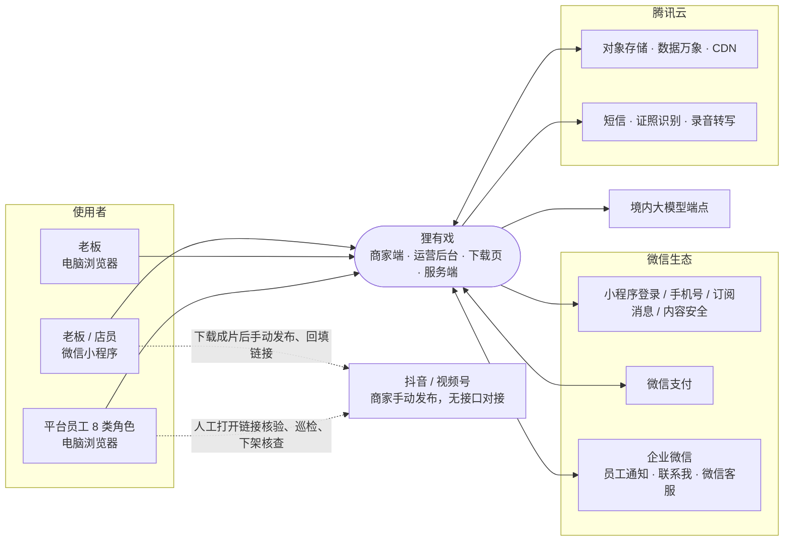
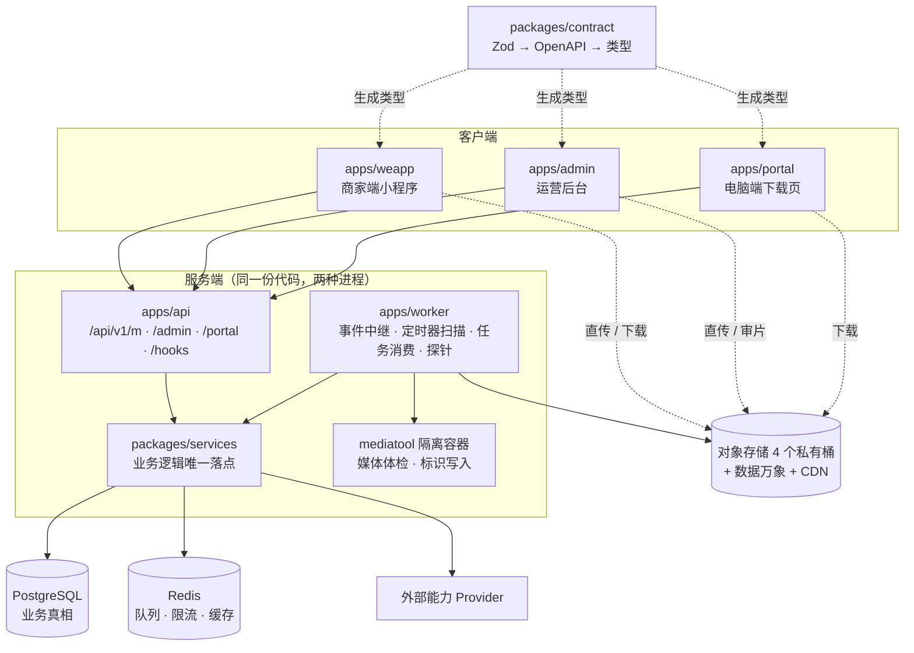
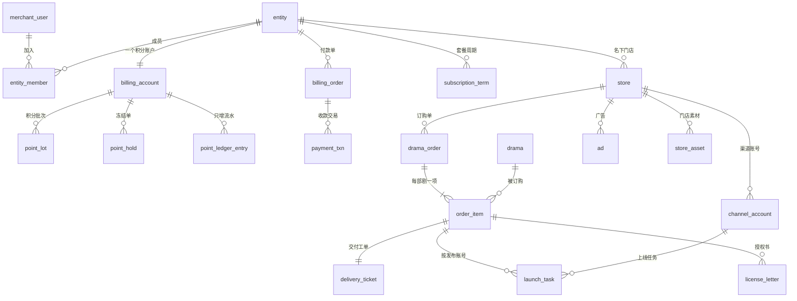
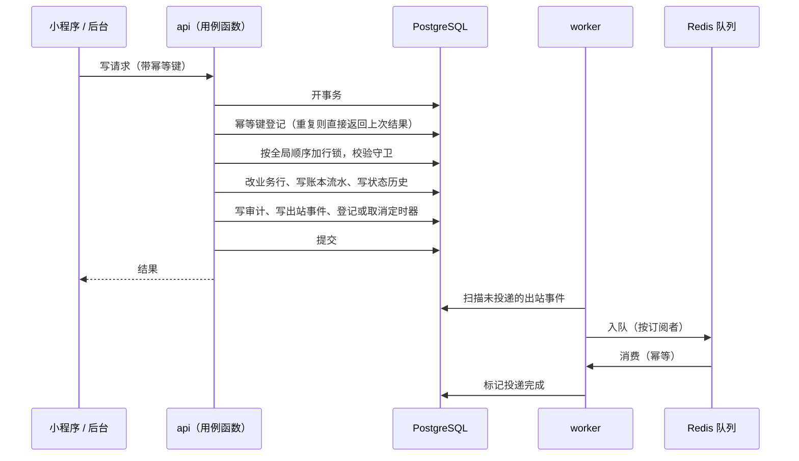
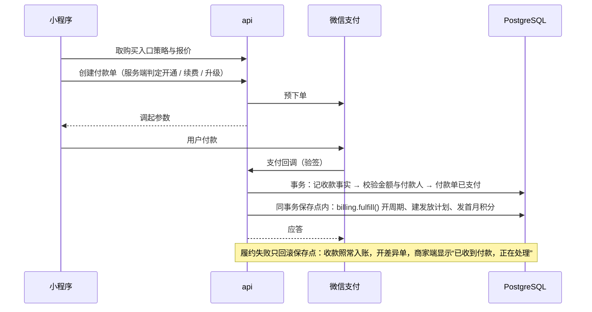
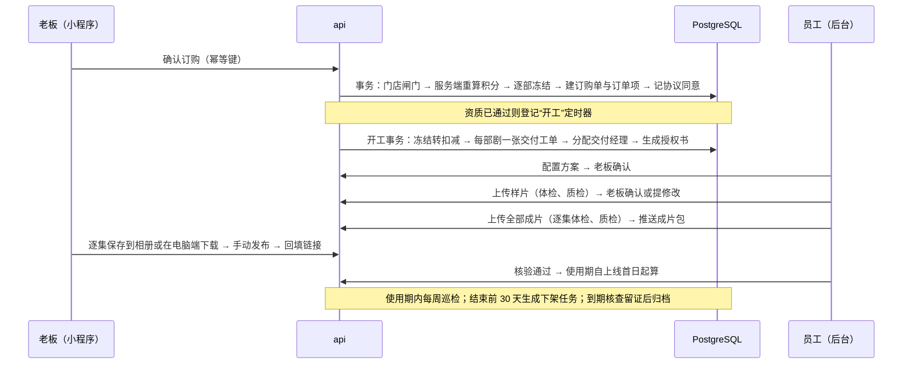
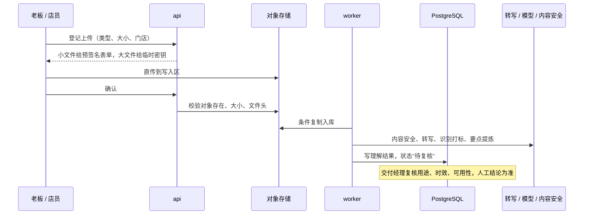
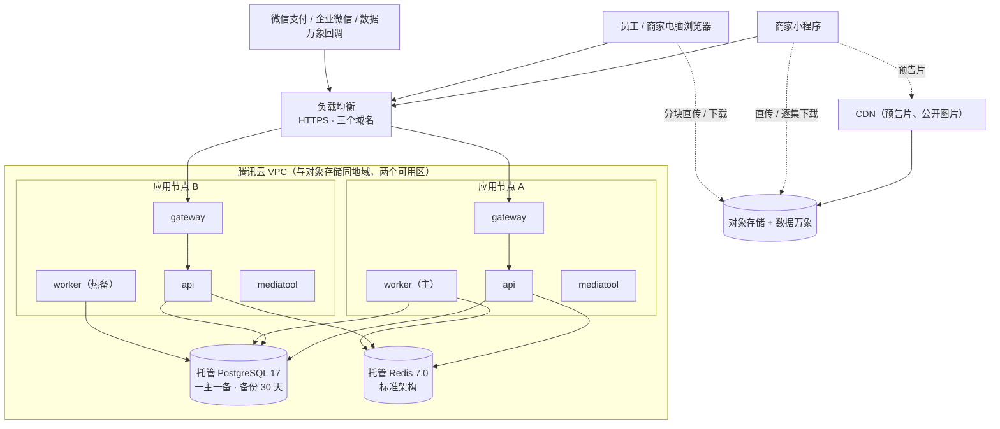

# 01 技术架构

| 项 | 内容 |
| --- | --- |
| 版本 | v0.9 评审稿 |
| 日期 | 2026-10-02 |
| 需求依据 | PRD 第 7 稿、商家端原型（47 个画板）、运营管理后台原型（56 个画板） |
| 配套文档 | [02 技术选型](02-tech-selection.md)、[03 关键技术方案](03-key-designs.md)、[04 决策记录](04-adr.md)、[05 风险与待确认](05-risks-and-open-issues.md) |

## 1. 一页结论

1. **形态**：一个 pnpm monorepo、一个模块化单体服务。五个应用（商家端小程序、运营后台、电脑端下载页、API、任务进程）共用一份接口契约、一份数据库 schema、一份业务逻辑。
2. **规模判断**：早期是数百家商家、千级订购单、几十名后台员工，请求量为个位数到几十每秒。计算资源不是难点，难点在账务正确、流程不卡死、平台规则不踩线。因此不引入微服务、搜索引擎、消息中间件、数仓。
3. **数据**：PostgreSQL 是唯一的业务真相；Redis 只做任务执行通道、限流与缓存，清空 Redis 不丢业务。金额用整数“分”，积分用整数。
4. **一致性**：凡涉及钱、积分、状态机的写操作，都是“单个数据库事务 + 行锁或唯一约束 + 幂等键”；跨模块的后续动作通过事务内写入的出站事件完成；业务时限以数据库里的到期时间为准。
5. **租户**：经营主体 → 门店 → 成员两层。套餐、积分、合同、发票归主体；订单、工单、渠道账号、素材、店员归门店。店员看不到的字段在服务端按角色裁剪。
6. **文件**：腾讯云对象存储私有桶为底座，大文件由客户端直传，API 进程不经手。下载用“业务授权 + 每次点击现签短时地址”。成片包在小程序内只能逐集保存，打包下载由电脑端下载页承担。
7. **支付**：微信支付（小程序内支付）与对公转账两条通道，另留“线下签约、后台代建付款单”的退路。购买入口怎么展示由服务端的购买入口策略决定，不写死在小程序里。
8. **制作**：V1.0 的成片由剪辑师在系统外制作后上传，系统管任务、文件、版本、质检与流转。“制作模型（标准/高级/顶级）”在 V1.0 只是计价与标签。
9. **部署**：腾讯云单地域，两台应用节点加一台预发节点，托管 PostgreSQL 高可用。容器镜像在持续集成中构建，生产机不现场构建。
10. **最大的不确定性不在技术**：支付是否被判为虚拟支付、小程序内能否播放预告片、定制成片的差异度与许可口径，这三件事决定产品形态；另有三项同级风险（商家账号发布整部短剧的合规性、成片交付与大文件上传的能力上限、授权书签署方式），共 6 项，见 [05](05-risks-and-open-issues.md) 第 1 节。架构上的对策是把相关行为都做成服务端开关。其中预告片一项业务已决定：V1.0 小程序内不播放短剧预告片，商城用海报加文字（2026-10-02 确认，见 [05](05-risks-and-open-issues.md) 第 0 节）。

## 2. 目标、约束与原则

### 2.1 架构要回答的问题

| 驱动因素 | 来源 | 对架构的含义 |
| --- | --- | --- |
| 账务不能错 | PRD 第 2 章：套餐、两类积分、冻结、扣减、退回、清零、升级补差 | 积分按批次建账本，只增流水，每日不变量校验；计价只有一份实现 |
| 流程长、角色多 | PRD 5.2：交付工单 11 步，8 类内部角色，约 38 条时间规则 | 统一的状态迁移函数、定时器、工作日历、审批与审计 |
| 平台规则是硬边界 | 微信小程序运营规范、微信支付、抖音与视频号发布规则 | 支付、视频播放、购买入口、订阅消息都做成可切换；发布全程人工，不预留代发接口 |
| 媒体是重资产 | 每单成片约 2–5GB，须保留到剧目授权期结束 | 私有桶、直传、生命周期管理；存储成本是增长期的大头 |
| 团队小 | 3–6 名工程师，熟悉 TypeScript、React、Taro | 沿用参考工程的栈与规范；宁可多写一张表，不多引一个中间件 |
| 分期交付 | V1.0 闭环；V1.1 服务商与代发布；V2.0 自动化与 AI | 留扩展点，不提前建设 |

### 2.2 设计原则

| 编号 | 原则 | 含义 |
| --- | --- | --- |
| P1 | 契约先行 | `packages/contract` 的 Zod schema 是接口唯一手写源，三端类型由它生成 |
| P2 | 业务逻辑只写一份 | 落在 `packages/services`；路由与任务处理器是薄壳 |
| P3 | 数据库是唯一真相 | 钱、积分、状态、到期时间、任务状态都在 PostgreSQL；Redis 可丢 |
| P4 | 服务端说了算 | 金额、积分、可否订购、可否播放、展示什么购买入口，都由服务端计算或下发 |
| P5 | 外部能力走 Provider | 未配置不崩溃，失败可降级，厂商可替换 |
| P6 | 先声明、可回滚 | 状态值与事件类型先发布声明、下一版再写入；发布可回滚 |
| P7 | 不为没有消费方的能力建设 | 服务商、代发布、自动合成只留接口位 |
| P8 | 规则做成数据 | PRD 未定或可能变的规则做成参数、字典、带版本的清单，下单时快照 |

### 2.3 V1.0 明确不做

微服务拆分、搜索引擎、独立数仓、消息中间件、Kubernetes、自动合成与任何模型生成能力、抖音或视频号的发布与数据接口、小程序虚拟支付接入、电子发票自动开具、服务商体系的实现。

## 3. 系统上下文

V1.0 与抖音、视频号之间没有任何接口：抖音的代发布能力只对党政机关与事业单位开放；通过 SDK 或 H5 拉起抖音发布页的能力仅对创作工具、社区、硬件配套、游戏类应用开放，且不对营销类内容开放，微信小程序这个载体也用不了（核实 pub-1 及 pub 组额外发现）。上线、核验、巡检、下架核查都是“人工操作 + 系统留证”。

## 4. 总体架构

### 4.1 可部署单元

| 单元 | 形态 | 职责 |
| --- | --- | --- |
| `apps/weapp` | 微信小程序（Taro） | 商家端全部页面：登录、商城、订购、交付确认、发布任务、建档、素材、套餐与积分、客服、个人中心 |
| `apps/admin` | 浏览器单页应用 | 运营后台 13 个菜单、56 个画板对应的页面；另有原型没有画的系统页与补充页（开关管理、系统健康、流程运维、发送日志与重发、通道配置、线下退款登记、红字发票、线下开单，清单见 [05](05-risks-and-open-issues.md) 第 4 节） |
| `apps/portal` | 浏览器单页应用（5 个页面） | 商家在电脑上下载成片、查看发布清单、预览样片与广告；授权书验真页 |
| `apps/api` | Node 进程，至少两实例 | 四组接口：商家端、后台、下载页、外部回调；健康检查 |
| `apps/worker` | Node 进程，一主一热备 | 出站事件中继、定时器扫描、媒体与通知等任务消费、周期任务、探针与不变量校验 |
| `mediatool` | 无网络、无密钥的隔离容器 | 用 ffprobe / ffmpeg 做媒体体检、抽封面、文档抽文本、写入并回读 AI 标识元数据 |
| `gateway` | 每节点一个 nginx 容器 | 托管后台与下载页的静态产物；按域名把接口请求反向代理到本机的 api（后台“与接口同源”由此实现）；输出访问日志用于计算 P95 与错误率 |

`apps/portal` 列入 V1.0 的原因：小程序单次下载上限 200MB、切到后台 5 秒即中断（核实 file-1、file-2），一部剧 36–80 集、约 2–5GB 的成片包（原型示例）无法在小程序内打包下载。

### 4.2 共享包

| 包 | 内容 | 被谁依赖 |
| --- | --- | --- |
| `packages/contract` | Zod schema、路由定义、错误码、权限点与能力点、开关键、埋点事件；生成三份 OpenAPI 与类型 | 全部应用 |
| `packages/db` | Prisma schema、数据库迁移脚本、客户端工厂 | services；api 与 worker 只在进程装配时引用客户端工厂，不得直接查询 |
| `packages/services` | 领域模块、Provider、测试替身 | api、worker |
| `packages/shared` | 纯函数：计价与取整、周期日期、状态机表、工作日计算、购买入口策略、金额格式化 | 全部 |
| `packages/config` | tsconfig 预设（Node、React 18、React 19 各一份）、lint 片段 | 全部 |

依赖方向只能是 应用 → services → db / shared → contract，由 dependency-cruiser 在持续集成中强制。参考工程只靠约定，已出现任务进程直接访问数据层的情况。

## 5. 逻辑架构：分层与领域模块

`packages/services` 分五层，同步调用只能向下，向上的影响走出站事件。

| 层 | 模块 | 职责 |
| --- | --- | --- |
| L0 横切 | `kernel` | 事务单元、时钟、幂等表、业务单号、服务装配 |
| L0 | `events`、`timers`、`flow`、`sla` | 出站事件与中继、定时器、统一状态迁移与状态历史、时限与工作日历 |
| L0 | `authz`、`audit`、`security` | 身份与断言、数据范围、审计、加密脱敏、限流、回调验签 |
| L0 | `config`、`providers` | 字典、参数、站点配置、特性开关；外部能力接口与驱动 |
| L1 基础 | `identity`、`tenant`、`profile`、`staff`、`approval` | 商家账号与会话；主体、门店、成员、邀请；门店档案与资质审核；员工与角色；统一审批单 |
| L1 | `content` | 短剧库：剧目、剧集、原片版本、许可与版权、上架校验 |
| L1 | `media`、`notify`、`docs`、`portal` | 文件与媒体任务、素材理解；通知中心；协议、同意记录、授权书；下载页登录票据 |
| L2 资金 | `billing` | 价目、订阅、积分账本、计价；付款单、支付渠道、退款、对账、发票 |
| L3 履约 | `order`、`ad`、`delivery`、`publish`、`support` | 选剧单与订购；广告；交付工单；渠道账号、上线、巡检、下架；客服工单 |
| L4 读侧 | `workbench`、`reports`、`analytics`、`exports`、`ops` | 待办聚合、报表、埋点、导出；健康检查、探针、告警 |

V1.1 预留模块位：`partner`（服务商、归属、返佣、结算）。V1.0 不建表、不写代码，只在付款单上保留“代操作人”留痕字段。

调用规则：

1. 钱（L2）不依赖履约（L3）。履约侧怎么改都动不到账本。
2. 改库的服务函数第一个参数是事务句柄；只有被路由或任务直接调用的用例函数可以开事务。
3. 事务内不调外部服务。必须同步的外部调用（微信下单、手机号换取）写成“先调外部、再开事务”。
4. 业务时间由注入的时钟提供，测试可以拨动时钟。
5. 下层需要上层逻辑且必须同事务时，用端口：下层定义接口，上层在装配时注册实现（审批执行器、定时器处理器、事件订阅者都是这种形态）。

### 5.1 PRD 功能模块的落点

| PRD 模块（4.2、4.3） | 主要服务模块 | 商家端 | 后台 |
| --- | --- | --- | --- |
| 登录与认证、多门店、门店成员 | `identity`、`tenant` | 登录、新增门店、我的门店、切换门店、邀请、加入 | 商家详情的门店与成员（只读） |
| 首页 | `workbench`（商家侧待办与上线概览聚合）、`content`、`config` | 首页：待办提醒、Banner、上线概览、推荐 | 首页配置 |
| 商家建档、资质审核、交付经理 | `profile`、`media`（证照识别）、`delivery`（分配与转移交付经理、在办工单移交） | 建档四步、审核结果 | 商家列表与详情、资质审核、分配交付经理 |
| 门店素材 | `media` | 素材库、上传、详情 | 素材复核、素材需求 |
| 套餐与积分 | `billing` | 套餐与积分、选择套餐、加购、明细 | 套餐、积分包、积分价、参数、账户与流水 |
| 短剧商城、短剧库 | `content`、`config` | 商城、搜索、详情 | 短剧列表与编辑 |
| 选剧单与订购 | `order`、`billing` | 选剧单、确认订购、结果页 | 订购单、订单详情 |
| 广告制作 | `ad`、`billing` | 我的广告、广告详情 | 广告制作任务 |
| 订单与交付 | `order`、`delivery` | 我的订单、方案确认、样片确认 | 工单池、工单详情 |
| 发布任务、渠道账号 | `publish`、`media` | 发布任务、上线记录、渠道账号 | 成片交付、上线日历、链接核验、账号核验、逾期、巡检、下架核查 |
| 售后服务、客服工单 | `support` | 客服中心、工单 | 工单池、工单详情 |
| 付款、退款、对账、发票 | `billing`、`approval` | 付款、发票管理 | 付款单、对公收款、套餐到期、收款流水、退款、积分调整审批、发票、对账 |
| 个人中心 | `docs`、`notify` 等 | 我的、我的短剧、合同与授权书、消息中心 | — |
| 工作台、数据报表 | `workbench`、`reports`、`exports` | — | 工作台、经营概览、积分报表 |
| 内容运营 | `config`、`docs`、`notify` | — | 首页配置、商城配置、协议管理、消息模板 |
| 系统设置 | `staff`、`authz`、`audit`、`config`、`sla` | — | 员工、角色权限、字典、参数、操作日志 |
| 投放数据、服务商工作台、渠道管理（V1.1） | 预留 | — | — |

短剧库（`content`）在七份子系统设计里只被引用、没有展开，是当前唯一没有详细设计的模块，需在数据模型阶段补齐（见 [05](05-risks-and-open-issues.md) 第 4 节）。

## 6. 数据架构

### 6.1 存储分工

| 存储 | 存什么 | 不存什么 |
| --- | --- | --- |
| PostgreSQL | 全部业务数据、账本、状态历史、出站事件、定时器、任务状态、会话、审计日志、埋点事件 | 文件内容 |
| Redis | BullMQ 队列、限流计数、微信 access_token 与配置版本号缓存 | 任何丢了无法从数据库重建的东西；不参与认证 |
| 对象存储 | 证照、素材、原片、预告片、广告、样片、成片、授权书、发票、导出文件 | 业务状态 |

三类会话（商家、员工、下载页）都存 PostgreSQL。理由：禁用员工、更换老板要求“状态变更 + 吊销会话 + 审计”在同一事务完成；腾讯云把托管 Redis 定位为可丢数据的缓存；代价只是每个请求多一到两次主键查询。

### 6.2 核心实体关系（概览）

字段级定义见附录的七份设计草案；本图只表达归属与基数。

### 6.3 建模约定

| 约定 | 内容 |
| --- | --- |
| 主键 | 业务表统一用应用生成的 UUID v7；只增的流水与日志表另带自增序号用于排序；对人展示用业务单号 |
| 归属 | 门店维度的表同时带 `entity_id` 与 `store_id`；主体维度的表只带 `entity_id` |
| 金额与积分 | 金额存整数分，积分存整数；比例存万分比整数；全仓只有一个取整函数（四舍五入） |
| 时间 | 库内存 UTC 时间戳；所有按“日”的规则以 Asia/Shanghai 日界计算；工作日计算走自建日历表 |
| 快照 | 订购单、广告、付款单保存下单时的价格、折扣、参数与规则版本；调价与改参数只影响之后的单据 |
| 只增 | 积分流水、审计日志、状态历史、同意记录只追加；数据库角色无更新与删除权限，另有触发器拦截 |
| 状态 | 状态迁移只经 `flow.transition()`，每次迁移写状态历史（支撑时效与漏斗指标） |
| 敏感字段 | 手机号、统一社会信用代码、银行账号：应用层 AES-256-GCM 加密 + HMAC 盲索引 + 脱敏列 |
| 手写约束 | 部分唯一索引、排他约束、CHECK、防改触发器在迁移里手写 SQL，持续集成比对约束清单 |

### 6.4 数据量预估

| 数据 | 早期 | 增长期（约 10 倍） | 处理 |
| --- | --- | --- | --- |
| 业务表 | 千到十万行 | 百万行级 | 单库 + 普通索引 |
| 积分流水、审计、状态历史 | 十万行级 | 千万行级 | 不分区；审计在线保留不少于 36 个月 |
| 埋点事件 | 每日数千到数万条 | 每日数十万条 | 按月分区 |
| 对象存储 | 首年约 4.6TB | 约 40TB | 生命周期分层；保留期待业务确定 |

搜索用数据库模糊匹配（剧名、题材、主演加品类兜底）即可。报表直接聚合业务库，加月结快照；出现“单张报表查询超过数秒”或“需要跨年明细自助分析”时再评估只读实例或数仓。

## 7. 一致性与异步

### 7.1 写操作的统一形态

要点：

- **幂等**：涉及钱、积分、状态的写接口都要求幂等键；账本操作另有全表唯一的操作键。
- **锁顺序**：全系统只有一份加锁顺序表（审批单 → 门店 → 广告 → 订购单 → 订单项 → 工单 → 付款单 → 收款交易 → 计费账户）。计费账户即每个主体一行的积分账户 `billing_account`，排在最后；一个事务只锁一个主体的计费账户；死锁与锁超时由事务包装统一有限次重试。
- **出站事件**：事件表之外另有“事件 × 订阅者”的投递表，重投由数据库驱动、有次数上限，死信可在后台重投。
- **内联加速**：付款入账、提交微信退款这类需要即时结果的动作，提交后先在 API 进程内尝试一次，任务进程消费同一事件兜底，两者调用同一个幂等函数。

### 7.2 三种时间机制

约 38 条时间规则按性质分三类，各用最不容易出错的机制：

| 类别 | 例子 | 机制 | 理由 |
| --- | --- | --- | --- |
| 账务时钟 | 每月发放、期末清零、预约周期生效、套餐过期 | 订阅表自带到期列，`billing.advance()` 幂等推进：凡涉及账本的写操作，在取得计费账户锁之后、第一次账本操作之前先调用；任务进程每分钟扫描兜底 | 到期点会被延长、升级、退款改动，另建定时器就是两份真相；账务正确性不能依赖定时器准点 |
| 会改状态的时限 | 付款单超时关单、资质通过后开工、工单自动解决、下架任务生成、时限超时升级 | 定时器表（到期时间、处理器、幂等键），扫描认领后执行 | 可改期、可取消、可人工重排，后台可见 |
| 纯提醒 | 到期前 7/3/1 天、上线前 1 天、下架前 30/7/1 天、样片未确认 | 通知模块每 5 分钟从业务表的当前到期日派生，去重键保证只发一次 | 到期日改了提醒自然跟着改，不需要在每个变更点重排 |

周期任务（每日对账、每日不变量校验、每周巡检抽样、备份）登记为数据库里的定时器行，不使用 BullMQ 的调度器。Redis 清空后没有任何调度定义需要重建。

### 7.3 Redis 不可用时

| 能力 | 表现 |
| --- | --- |
| 登录、下单、付款入账 | 正常（不依赖 Redis） |
| 关键定时器（开工、使用期结束、到期类） | 任务进程内直接执行 |
| 通知、导出、媒体任务 | 延迟，恢复后由扫描重新入队 |
| 限流 | 降级为进程内计数，限额减半 |

### 7.4 任务进程

任务进程一主一热备，用数据库租约决定谁是主。中继、扫描、消费都按“可多实例并行”设计（认领用 `FOR UPDATE SKIP LOCKED`），单活只是为了省资源，不是正确性的前提。补偿扫描与探针只依赖 PostgreSQL，不经队列——监控不能跑在被监控的链路上。

## 8. 三条主链路

### 8.1 开通套餐（付款 → 履约）

对公转账走同一个履约入口，触发点换成财务确认到账。超时不是到点即取消，而是“查单 → 关单 → 以关单结果为准”。

### 8.2 订购 → 交付 → 上线 → 下架

开工前，订单项阶段由订购流程直接写入；开工后只有交付工单的步骤是写入的，订单项阶段与订购单的 8 种状态都由它推导，商家端页签再由订购单状态映射（见 [03](03-key-designs.md) 3.3）。

### 8.3 素材上传 → 理解 → 复核

任一外部能力未配置或失败时，素材仍可入库，只是没有自动标签，由交付经理手工整理。

## 9. 集成架构

所有外部能力经 Provider 接口接入，每个接口都有“未配置”实现。

| Provider | 用途 | V1.0 | 默认驱动 | 未配置时 |
| --- | --- | --- | --- | --- |
| `wechat` | 登录、手机号、订阅消息、小程序码、图片与文本内容安全 | 必需 | 自研 fetch 封装 | 本地用假实现 |
| `wechatPay` | 预下单、回调验签、查单、关单、退款、账单 | 必需 | 自研薄封装（公钥模式） | 只剩对公转账 |
| `storage` / `media` | 签名、临时密钥、复制入库；转码、打包、视频审核 | 必需 | 腾讯云 COS + 数据万象 | 本地用 MinIO 走小文件通道 |
| `sms` | 员工激活码、订阅消息的补发、值班告警 | 必需 | 腾讯云短信 | 控制台输出；提醒只剩站内与订阅消息 |
| `ocr` | 营业执照识别、行业许可证字段抽取 | 可降级 | 腾讯云 OCR | 商家手填、审核人手工核对 |
| `asr` | 录音转写 | 可降级 | 腾讯云录音文件识别 | 不转写 |
| `llm` | 素材识别打标、要点提炼 | 可降级 | 境内 OpenAI 兼容端点，主备两家 | 不打标 |
| `wecom` | 员工通知、“联系我”二维码与加好友回调、微信客服（在线客服接待） | 可降级 | 企业微信自建应用 | 员工只收站内待办；服务经理二维码人工上传；在线客服退回小程序原生客服消息 |
| `esign` | 授权书数字签名 | 可降级（须法务同意） | 机构数字证书签署 | 图片章（生产须显式开关） |
| `mail` | 电子发票发送 | 可降级 | 腾讯云邮件推送 | 只在小程序内下载 |
| `invoice` | 自动开票 | V1.1+ | — | 财务线下开具后上传 |

回调入口统一在 `/api/v1/hooks/*`：统一验签框架，全系统一张回调收件表。有主动查询接口兜底的（微信支付、数据万象任务）用内联模式；没有查询接口的（内容安全结果、企业微信事件）先落库再由任务进程退避重投。数据万象的任务回调没有官方验签机制，只当作触发信号，状态一律以回查任务接口为准（核实 cos-8）。

## 10. 安全架构

### 10.1 身份与权限

| 身份空间 | 凭据 | 接口前缀 | 说明 |
| --- | --- | --- | --- |
| 商家用户 | 不透明会话令牌（Bearer） | `/api/v1/m/*` | 微信静默登录优先，未命中才用手机号组件；账号以手机号唯一，可挂多个微信身份 |
| 下载页 | 会话 Cookie | `/api/v1/portal/*` | 老板在小程序扫码确认后获得，只读能力白名单，只能取成片与预览 |
| 后台员工 | 会话 Cookie + 密码 + TOTP | `/api/v1/admin/*` | 独立身份空间；敏感操作需再次验证 |
| 系统 | — | 任务进程内部 | 定时任务与事件处理的操作人 |

三个空间互不提权，按域名隔离：`api.` 只放行商家端与回调，`admin.` 只放行后台，`portal.` 只放行下载页。

- **商家侧授权**：每个请求带门店上下文，服务层校验成员关系；角色映射到能力点；店员的响应用按角色区分的响应 schema 在服务端剥离金额、积分、合同、发票字段，并有回放测试守护。
- **后台授权**：13 个模块 × 4 个等级（无、查看、本人任务、编辑）+ 权限点（如“手动调整积分”）+ 数据范围（本人、本组、全部）。权限点注册表在 `packages/contract` 只有一份，路由声明的权限写错即编译失败。数据范围折算成负责人集合，以强制参数传入数据访问层。
- **敏感操作**：退款、订购与广告的取消退回、积分调整、套餐延长、老板更换走统一审批单（单级审批、审批人不得是发起人），执行入口每类只有一个。V1.1 的改价与商家归属（所属服务商）变更届时注册为新的审批类型。
- **审计**：单表只追加，与业务写同事务；记录操作人、来源 IP、变更前后；系统任务也入日志；导出本身留痕。

### 10.2 数据与文件

| 措施 | 内容 |
| --- | --- |
| 传输 | 全站 HTTPS，TLS 在负载均衡终止 |
| 字段加密 | 手机号、信用代码、银行账号加密存储，盲索引查找，脱敏展示；查看明文留痕并限频 |
| 文件 | 四个私有桶；API 的签名密钥只有读权限与写入区写权限，正式区写与删只属于任务进程 |
| 读地址 | 现签短时地址：证照 5 分钟，样片与广告 60 分钟，成片 15 分钟 |
| 删除保护 | 三个桶开版本控制；清除任务只写删除标记，带数量熔断，上线初期人工放行 |
| 上传内容 | 入库前校验文件头；统一改写 Content-Type 并加 `Content-Disposition: attachment`；媒体解析在隔离容器内进行 |
| 限流 | 按可信代理跳数取客户端 IP；登录、短信、埋点接口单独限流 |
| 密钥 | 凭据管理服务，按环境与用途分权；预发不持有任何生产资金凭据 |
| 供应链 | 依赖精确锁版本且须已发布满 7 天；关闭安装脚本；`echarts-for-react` 等曾被投毒的包不引入 |

### 10.3 合规要求的技术落点（PRD 10.3）

| 要求 | 落点 |
| --- | --- |
| 短剧须持许可或节目编号；片头许可信息不被广告遮挡 | 上架校验必填许可信息与文件；许可信息按“剧 × 播出平台”建模（三类剧的节目编号各平台不通用，核实 pub 组额外发现）；“片头信息完整、未被遮挡”是质检清单的硬性项 |
| 一类、二类剧只开放片头片尾贴片；植入或定制后是否须重新审核 | 植入形式按剧配置，订购与方案配置时校验；重新审核的两个口径尚无定论，见 [05](05-risks-and-open-issues.md) 1.3 |
| 版权授权 | 上架校验信息网络传播权、转授权权、剪辑植入权、改编权四项权利与权属文件；剩余授权期不足时自动停止订购 |
| 平台规则（同质化内容） | 订购时校验每个平台至多 1 个已核验账号；发布指引含“不声明原创”；差异度 V1.0 不做计算，由质检项加人工抽检把关（见 [05](05-risks-and-open-issues.md) 1.3） |
| 广告可识别 | “广告”标识是质检清单的硬性项；清单可配置且带版本 |
| AI 生成内容标识 | 上传登记时必填 AI 使用声明；声明使用的样片与成片入库时写入隐式标识并回读，读不回即拒收；显式标识列入质检清单 |
| 特殊行业不开放 | 行业白名单由数据字典控制，特殊行业不可开放 |
| 授权书 | 按“订单项 × 发布账号”生成，随版权续期重出，取消即作废 |
| 个人信息 | 最小必要采集；证照仅用于审核、合同与开票；本人数据查阅与注销 V1.0 人工受理 |
| 平台不索取账号密码（PRD 10.2 第 3 条） | 渠道账号只存名称、ID 与主页截图 |

## 11. 部署架构

| 项 | 方案 |
| --- | --- |
| 环境 | 本地、持续集成、预发、生产。预发用独立的小程序 AppID、独立商户号、独立 VPC 与数据库 |
| 节点 | 生产两台 2 核 4GB 云服务器（分属两个可用区，固定出口 IP），预发一台 |
| 容器 | Docker Compose；四个镜像：server（api 与 worker 共用）、gateway（nginx）、mediatool、小程序上传器 |
| 发布 | 持续集成构建镜像 → 镜像仓库 → 编排脚本经远程命令通道分步执行：预置静态资源 → 数据库迁移 → worker → api 滚动 |
| 回滚 | 顺序相反且有前置条件；迁移遵守“先扩后缩”，删列分三步，枚举先声明后写入 |
| 可用性 | 目标 99.9%（外部拨测、按月、计划内维护不计）：双节点、数据库高可用、滚动发布零失败请求 |
| 备份 | 数据库自动备份保留 30 天并支持按时间点恢复（恢复方式为克隆新实例，窗口需控制台实测）；另由任务进程每日导出加密备份到异地桶；每季度恢复演练 |
| 域名 | `api.`、`admin.`、`portal.`、`media.`（CDN），以及素材与成片的源站读域名；均须备案，主体须与小程序、企业微信一致 |

不选单机（达不到 99.9%，发布有中断）、不选 Kubernetes（学习与运维成本远高于收益）、不选 Serverless 容器（任务进程需常驻且需固定出口 IP）。成本估算见 [02](02-tech-selection.md) 第 8 节。

## 12. 可观测与质量

| 方面 | 方案 |
| --- | --- |
| 日志 | Pino 结构化日志输出到标准输出，采集到云日志服务，保留 180 天；请求号贯穿三端 |
| 错误监控 | 三端走 Sentry 协议，经自有已备案域名转发（小程序的合法域名须已备案，sentry.io 无法备案）；上游用 SaaS 还是自托管待法务对数据出境给结论 |
| 指标与告警 | 不建 Prometheus：任务进程每分钟跑 SQL 探针，直接告警到企业微信群；外部拨测兜底 |
| 关键告警 | 支付回调验签失败、收款成功超过 10 分钟未入账、出站事件积压、定时器滞后、对账差异、账本不变量不成立、任务租约丢失 |
| 健康检查 | `/livez`、`/readyz`（不查库，供负载均衡）、`/health`（由 api 自查账务与流程的关键度量，不依赖 worker 与 Redis） |
| 不变量校验 | 每日校验账本恒等式、状态一致性、文件引用；违规写入违规表并告警，后台“系统健康”页可认领 |

测试分七层：纯函数、服务层连真库、接口、契约差异、新旧版本混跑冒烟、后台端到端、小程序真机清单。账务必须有三类测试：

- **基于性质的测试**：随机操作序列下，账本恒等式始终成立（发放 + 加购 + 退回 + 调增 − 消耗 − 清零 − 调减 = 余额，见 [03](03-key-designs.md) 2.8）。
- **并发测试**：真实 PostgreSQL、多连接并行，覆盖并发订购、回调与取消竞争、清零与扣减同时刻。
- **回放测试**：PRD 2.9 的 7 个计费示例、支付回调样本、店员接口不得出现禁用字段。

质量门禁：lint、格式、类型、测试、契约检查、依赖方向、小程序主包体积（≤1.5MB）、数据库约束清单、迁移规范。

## 13. 非功能需求对照（PRD 10.1、10.2）

| PRD 要求 | 方案 | 差距与说明 |
| --- | --- | --- |
| 小程序首屏 ≤2 秒（4G） | 主包 ≤1.5MB 进门禁；分包与预下载；启动引导接口聚合开关、字典版本与用户上下文；公开图片走 CDN | 须真机测量 |
| 预告片首帧 ≤1.5 秒、多码率自适应、CDN | V1.0 小程序内不播放预告片（业务决定），本条不适用。日后启用时按两档 MP4（480P、720P）、moov 前置、CDN 鉴权分发、端上按网络类型选档实现 | 两档 MP4 而非 HLS 自适应码流，业务已确认接受 |
| 核心接口 P95 ≤500 毫秒 | 事务内无外部调用；单库索引；网关访问日志算 P95 并进门禁 | — |
| 可用性 ≥99.9% | 双节点、数据库高可用、滚动发布 | 口径需业务确认 |
| 图片 ≤5MB 自动压缩；视频 ≤200MB 断点续传 | 小文件走预签名表单，大文件走临时密钥分块续传 | 小程序内超过 100MB 的分块上传没有官方依据，须真机验证；通过前只承诺 ≤100MB |
| 兼容微信 8.0+；后台支持 Chrome、Edge 最新版，分辨率不低于 1366×768 | Taro + 原生组件；后台用 antd，按 1366×768 为最小布局 | 真机矩阵 |
| 全站 HTTPS；敏感信息加密存储、脱敏展示 | 见 10.2 | — |
| 预告片与样片加水印、地址签名、防盗链 | 转码时压制明水印；CDN 鉴权；样片出水印版 | 溯源水印不做（短剧单集时长不满足云厂商检测下限） |
| 成片包下载链接签名、7 天有效、仅订单商家及其授权的服务商可下 | 业务授权表记录 7 天有效与可重新生成；每次点击现签 15 分钟地址；下载留痕 | 有效期不写进签名（签名上限与不可撤销）；授权服务商下载随 V1.1，授权表留授权对象字段 |
| 不收集平台账号密码 | 见 10.3 | V1.1 代发布的授权方式待定 |
| 后台登录二次验证、关键操作二次确认与日志 | 密码 + TOTP；确认回显 + 再次验证；审计 | 原型为短信验证码，建议改 TOTP |
| 每日备份保留 30 天 | 见第 11 节 | — |

## 14. 演进路线

| 版本 | 新增能力 | 架构上已留的位置 | 届时要做的 |
| --- | --- | --- | --- |
| V1.1 | 服务商（代理）、返佣结算 | `partner` 模块位；付款单的代操作人字段；身份里的服务商类型；权限点与角色已预置 | 归属区间表、返佣快照、结算单 |
| V1.1 | 管理员角色、授权代为确认 | 能力点模型；老板专属操作集中在一处守卫 | 新增角色与授权记录 |
| V1.1 | 一个账号管理多个主体 | 成员关系按（主体，用户）建模；请求上下文可扩展主体 ID | 放开“一个账号只属一个主体”的部分唯一索引，增加主体切换 |
| V1.1 | 批量合成模板（自动贴片） | `media_job`、制作留痕、原片版本；mediatool 镜像 | 独立主机的合成进程、合成规格、规格化入库 |
| V1.1 | 视频号代发布（运营者机制） | 上线任务按“订单项 × 账号”；执行人字段 | 授权记录、任务分派；抖音无可行接口 |
| V1.1 | 投放数据录入、更多报表 | 状态历史、埋点分区表、月结快照 | 数据录入与 Excel 导入 |
| V2.0 | 自动化合成、AI 广告与植入镜头 | Provider 抽象、模型调用记录位、差异度指标空列 | 云端模型接入、成本与配额计量 |
| V2.0 | 自动开票、抖音数据同步 | `invoice` Provider | 视平台开放情况 |

AI 全片重制在现阶段不可行：视频编辑模型单次只处理 10–30 秒，一部剧的模型成本约为一单收入的 2–15 倍（调研估算，未经一手核实，见 [appendix/research/ext-aigc.md](appendix/research/ext-aigc.md)）。AI 只适合广告视频与少量植入镜头（见 [03](03-key-designs.md) 第 7 节）。

## 15. 与参考工程的关系

| 类别 | 内容 |
| --- | --- |
| 直接沿用 | pnpm monorepo 结构；Hono + Zod 契约先行链路与契约检查；services 唯一业务落点与 Provider“未配置不崩溃”；小程序的请求封装、分包策略、样式 Token；Vitest 连真库的集成测试；提交规范与门禁；部署前校验进程环境 |
| 调整后沿用 | 上传从单次预签名改为“小文件预签名 + 大文件分块”；素材理解管线（转写、识别）改用境内模型端点；后台安全模型（独立身份、TOTP、审计）保留，形态改为独立前端；异步任务从“提交后入队 + 补偿扫描”升级为出站事件表 |
| 必须新建 | 微信支付、对公转账、退款、对账、发票；积分账本与订阅；运营后台前端与权限体系；私有桶、签名读、CDN 鉴权、生命周期；状态机、定时器、工作日历、审批；通知中心；文书；报表与导出 |
| 不沿用 | 公有读桶加随机路径；挂在 API 进程里的静态后台页；单机 PM2 部署与生产机现场构建；境外模型线路；一张大表记录全部决策的写法 |
| 须整体换名 | 参考工程也叫“狸有戏”，包名 `@liyo/*`、队列名、Redis 键、进程名、令牌受众都占用了这个名字。新工程统一用 `@liyoxi/*` 与前缀 `lyx`，并且不与参考工程共用机器、数据库与 Redis |
