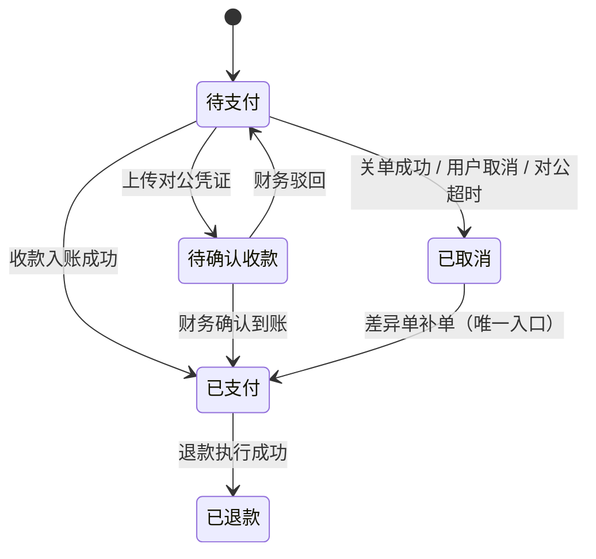
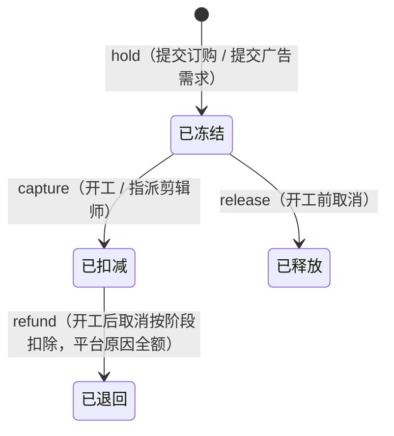
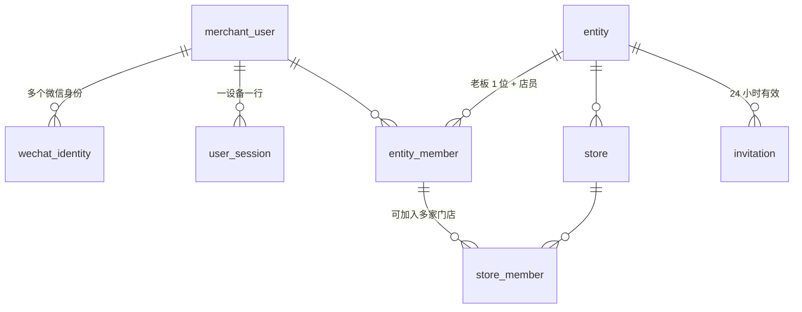
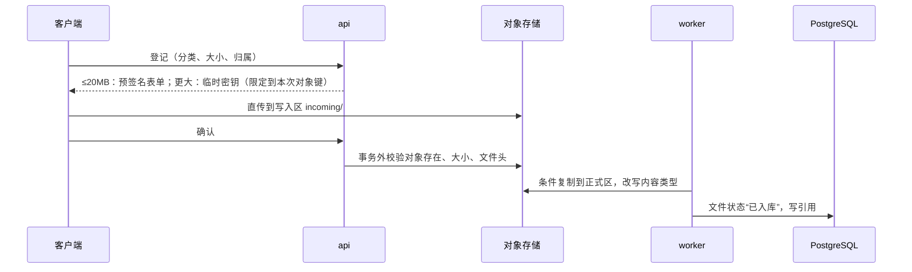
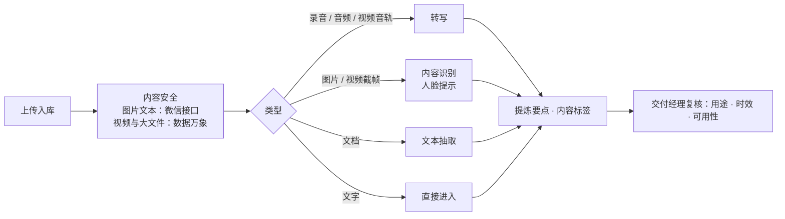
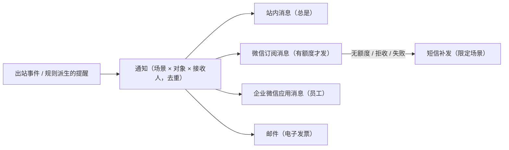

# 03 关键技术方案

| 项 | 内容 |
| --- | --- |
| 版本 | v0.9 评审稿 |
| 日期 | 2026-10-02 |
| 范围 | PRD 11.2 第 3 条要求评审的六项（支付、套餐与积分账户、视频存储与转码、多门店与成员权限、素材识别与转写、AI 定制制作），外加把它们串起来的订购与交付流程、通知与文书 |
| 细节 | 字段级表定义、完整状态迁移表与算法见 [appendix/design](appendix/README.md) 的七份草案；草案之间不一致处以本文第 9 节的裁决为准 |

本文所有方案都还没有实现和测试。需要先验证的事项列在 [05](05-risks-and-open-issues.md) 第 5 节。

---

## 1. 支付、对公转账、退款、对账与发票

### 1.1 边界

付款只发生在四种场景：开通套餐、续费、升级、加购积分。订剧与广告只扣积分，不付款、不开票。因此“付款单”和“订购单”是两套互不相干的单据。

### 1.2 数据模型

| 表 | 用途 |
| --- | --- |
| `billing_order` | 付款单：类型（开通、续费、升级、加购）由服务端判定；保存内容快照与应付金额 |
| `payment_txn` | 一次收款尝试；成功的即“收款流水”。保存渠道实收金额、付款人、回传数据 |
| `transfer_proof` | 对公转账凭证：回单图片、银行流水号（规范化后严格唯一）、付款行 |
| `refund_request` / `refund_txn` | 退款申请与渠道退款交易 |
| `payment_exception` | 差异单：实时异常与对账差异共用一张，14 种类型，每种有固定的可选处理 |
| `recon_day` 等 | 每日对账状态与账单行 |
| `invoice_request` 等 | 开票申请、发票、红字发票 |
| `finance_config_revision` | 受控财务配置：收款账户、购买入口策略、内控开关；提议人与批准人不得相同 |

### 1.3 付款单状态机



规则：

1. **先记资金事实，再入账**。回调、查单、对账、补单等六个入口都汇到同一个入账函数；它校验“实收等于应付、付款人一致”，通过才把付款单置为已支付。
2. **超时不是到点即取消**。到点触发“查单 → 仍未支付才关单 → 以关单接口的结果为准”。关单时发现已支付，按已支付处理。这样“回调晚于取消”不会成为日常差异。
3. **收到款的付款单一定离开未完成状态**。能入账的置已支付；金额或付款人不符的置已取消并挂“未入账收款”差异单。
4. **履约在保存点里**。付款入账与开通套餐在同一事务，履约部分包在保存点内；履约失败只回滚保存点，付款单记为“已支付 · 履约受阻”并开差异单，72 小时未处理计入不变量违规。商家端显示“已收到付款，正在处理”。
5. 同一主体同一时刻只有一张未完成的套餐类付款单；换支付方式须先取消原单。

### 1.4 微信支付接入

- 自研薄封装 Provider：预下单、调起参数签名、回调验签与解密、查单、关单、退款、退款查询、账单下载。
- 新商户号默认公钥模式，请求头须带公钥 ID，回调按序列号选择验签公钥。
- 回调 5 秒内应答；只要事实已落库（哪怕只进了收件表）就应答成功，失败的由定时器重处理。收件表只存密文与不含 openid 的摘要。
- 商户单号带随机段；回传数据携带主体、付款单、类型、套餐修订、月数，数据库按时间点恢复后可据此重建付款单。
- 命中“交易类小程序须接入订单发货管理”时，付款后上报发货信息（是否命中待提审确认）。

### 1.5 大额付款与对公转账

微信支付对付款人有限额，取决于商户号核准的行业类目。两个官方来源的数字不一致：较早的客服页写实物行业单笔与单日均为 8 万元、虚拟行业单笔 6,000 元与单日 9,000 元；2026-06 更新的客服页据摘要写虚拟额度单笔 5 万元、单日 50 万元（未逐字核读）。另受付款人银行卡限额与零钱每年 20 万元的约束（核实 pay-7、mch-3）。业务已开通商户号，应以商户平台里本商户号的核准记录为准。无论按哪组数字，旗舰版年付 14.4 万元都超过单笔上限，须走对公转账。

小程序内展示对公转账入口没有官方明文许可，即使业务没有被判为虚拟支付也是如此，只能通过提审确认（核实 vpay-7）。

- 对公转账是必备通道：商家上传回单 → 财务核对银行到账并填流水号 → 确认后走同一个履约入口。
- 未传凭证 7 天关闭；已传凭证待确认的不自动关闭。
- 首次开通与过期后续费的周期起点取财务确认到账的时刻；未过期的续费仍从本期结束次日接续（见 2.7）。
- 可选的大额二人复核、每日确认清单、月度银行勾对导出。

### 1.6 购买入口策略与两条退路

“会员套餐 + 积分充值”与微信对虚拟商品的举例同形，且官方客服已把面向企业的会员判为虚拟支付（核实 vpay 组）。一旦被判定，小程序内不能用普通微信支付，也不能展示对公转账入口或任何引导到外部付款的文案。

服务端提供唯一的判定函数 `getPurchasePolicy`，按平台、版本、主体、金额输出三种模式之一：

| 模式 | 价格与支付按钮 | 续费、加购引导 | 套餐状态 | 线下签约与后台代建付款单 |
| --- | --- | --- | --- | --- |
| `in_app` | 展示，按单笔与当日限额计算可用渠道 | 允许 | 展示 | 不需要 |
| `offline_contract` | 不展示 | 不允许 | 展示 | 承接（须打开退路 B 的开关） |
| `hidden` | 不展示 | 不允许 | 展示 | 不承接（临时下线某一端的入口时用） |

这个函数是公共契约：报价接口、创建付款单接口、到期提醒、积分不足弹窗、首页待办都必须调用它。文案键（套餐与积分的称呼、按钮文字、开票项目）也由服务端下发，便于不发版调整表述。

| 退路 | 做法 | V1.0 状态 |
| --- | --- | --- |
| A：接入小程序虚拟支付 | 独立商户号与资金流。iOS 走 Apple 支付，2026 年生效费率 12%（标准 17%）；非 iOS 端当前 1%（标准 10%，官方未写截止日期）。Apple 支付的单笔上限未核实；只选“广告/设计”类目能否开通虚拟支付须在小程序后台实测 | 不实现，不预留枚举 |
| B：小程序内不售卖，线下签约 | 销售线下签约 → 后台代建付款单 → 对公转账 → 财务确认 | 列入 V1.0 实现范围，受控开关默认关闭 |

策略表不设“审核态”维度。开关的用途是被判定后合规下线，不是对审核员隐藏支付。

### 1.7 退款

- 链路：客服发起 → 财务审批 → 财务执行；审批人不得是发起人；每步都要回显确认并再次验证身份。
- V1.0 只支持的现金退款：开通或续费 7 天内、未使用积分、未升级的全额退款；资质终审不通过的全额退款；履约受阻的全额退款；未入账收款的退回。部分退款、加购退现金、升级补差单独退，服务端直接拒绝。
- 其中两条比 PRD 宽：PRD 2.8 只写“开通 7 天内且未使用积分”全额退款、“其他情形不退款”。续费也适用 7 天退款，业务已确认（2026-10-02），PRD 2.8 相应修订。资质终审不通过时退套餐款仍是架构默认，须业务与财务确认（[05](05-risks-and-open-issues.md) 2.3）；不接受则把这条规则关掉即可。
- 微信退款是异步的：提交后进入处理中，以回调与查询为准；未到失败终态不得改走线下。超额退款照常落库并开最高优先级差异单。
- 已开票的付款须先开红字发票；守卫在执行退款时现算。
- 支付满 1 年后无法原路退回，只能线下退款并登记。
- 订购与广告的取消退回积分走同一条审批链，但核算与执行归订购模块（见 3.6）。

### 1.8 对账与发票

- 每日下载前一日交易账单（次日 10 点后可下，接口只保留 3 个月），逐笔匹配；退款行只在退款成功后驱动，不按日对齐。
- 差异处理：补单（已取消 → 已支付）、原路退款（须走审批）、补记渠道退款、重建付款单、关联到付款单并确认。
- 发票：按付款单全额一对一申请，抬头取认证主体且不可改；财务线下开具后回填 20 位发票号并上传 PDF 或 OFD；纸质票登记快递；电子票可发邮件。

### 1.9 需要拍板或验证

商户号行业归类与限额；支付定性；7 天退款窗口的起点；审批人与执行人是否必须不同；开票项目名称与开票时点；预发能否申请到独立商户号；交易账单里退款行的日期口径。

---

## 2. 套餐订阅、积分账本与计价

### 2.1 一句话方案

每个主体一行计费账户作为唯一的锁；积分按批次存放（来源、到期、入账成本），余额是批次的汇总缓存；每次变动写只增流水；订阅周期与发放计划自带到期时间，由幂等的推进函数在“请求进来时”与“每分钟扫描时”共同驱动；价格是按时间取值的纯函数，下单即快照。

### 2.2 数据模型

| 分组 | 表 | 说明 |
| --- | --- | --- |
| 价目 | `plan`、`plan_revision` | 套餐版本与价目修订（不可变，带生效时间；须提前 30 天公告）；另有首期优惠的使用记录，对应 PRD 2.2 第 8 条“已有商家在调整后的首个周期享受优惠” |
| 价目 | `point_pack`、`price_tier_revision`、`drama_price_revision` | 积分包；等级模板价；单剧调价记录 |
| 参数 | `billing_param` | 广告单价、免费修改次数、顶级模型加扣比例、最短可订授权期、取消扣除比例等，按键存储、逐键生效 |
| 订阅 | `subscription_term` | 一次购买对应一个周期；可排队（续费预约、降级下期生效） |
| 订阅 | `grant_schedule` | 月度发放计划，周期创建时一次生成 |
| 账本 | `billing_account` | 每主体一行，也是锁 |
| 账本 | `point_lot` | 积分批次：套餐月度发放、升级补发、加购、调整、退回 |
| 账本 | `point_hold`、`point_hold_alloc` | 冻结单及其落在哪些批次 |
| 账本 | `ledger_operation`、`point_ledger_entry` | 操作登记（幂等键）与只增流水 |
| 派生 | `billing_entity_daily`、`point_entry_valuation` | 每日快照；折算价值（可删除重算） |

### 2.3 周期与发放：锚定日规则

PRD 没有定义 29、30、31 日开通怎么算。默认规则：

```
锚定日 = 开通当天是几号；连续续费沿用，过期后重新开通时重置
边界(k) = 起始月往后数 k 个月，取 min(锚定日, 该月最后一天)
N 个月的周期 = [边界(0), 边界(N))
第 i 个月的发放日 = 边界(i)；首月在履约时立即发放
```

| 起始日 | 月数 | 本期 | 各月发放日 |
| --- | --- | --- | --- |
| 09-13 | 1 | 09-13 至 10-12 | 09-13 |
| 09-20 | 3 | 09-20 至 12-19 | 09-20、10-20、11-20 |
| 01-31 | 1 | 01-31 至 02-27 | 01-31 |
| 01-31 | 3 | 01-31 至 04-29 | 01-31、02-28、03-31 |

每个边界都从起始月直接算，不在上一个边界上累加，所以不会漂移。前两行与原型示例一致。示例按非闰年；闰年 2 月的边界为 02-29。

### 2.4 时间推进

`advance(主体)` 是幂等、可追赶的函数：发放到期的月度积分、清零已结束周期的套餐积分、让预约周期生效、停用过期后的加购积分。凡涉及账本的写操作，在取得计费账户锁之后、第一次账本操作之前先调用（不能在事务一开头就调用，否则会违反全局加锁顺序）；任务进程每分钟扫描兜底。权益判断按周期起止现算，不读状态缓存。

### 2.5 计价

```
S = round( P × R × (1 + T) )
P 剧目积分价   R 套餐折扣率   T 顶级模型加扣比例（旗舰版或未选用时为 0）
```

- 计价是 `packages/shared` 里的一个纯函数，商家端报价、提交订购、后台试算器调用同一实现。
- 提交时在账户锁内按当时的时刻重算，与客户端带来的期望值不一致即返回“报价已变”。
- 订单项保存 P、R、T、S 与规则版本的快照。
- 广告每条按广告单价 × 折扣；超出免费修改次数的每次修改按一条计。

PRD 2.9 的 7 个示例验算：

| 示例 | 计算 | 结果 |
| --- | --- | --- |
| 1 | round(2,400 × 0.9) | 2,160 |
| 2 | round(2,400 × 1 × 1.2) | 2,880 |
| 3 | round(3,000 × 0.9) + round(2,000 × 0.9) | 2,700 + 1,800 = 4,500 |
| 4 | round(50 × 0.9) × 2 | 45 × 2 = 90 |
| 5 | 冻结 2,160：先取套餐批次 1,920，再取加购批次 240 | 加购剩 760 |
| 6 | 6,000 × 12 | 72,000 元，每月发放 6,600 |
| 7 | (12,000 − 6,000) × 12 ÷ 30；(14,400 − 6,600) × 12 ÷ 30 | 补交 2,400 元，补发 3,120 积分 |

### 2.6 冻结、扣减、退回



- **扣减顺序**：当前周期的套餐批次按到期时间升序取，再取加购批次按入账时间升序取。
- **一单多部剧**：同一事务内逐部冻结；任意一部积分不足或报价已变，整个事务回滚。
- **跨周期**：冻结跨过期末的积分视为已使用，不清零。
- **退回去向**：原周期未结束的退回原批次；原周期已结束的套餐积分按 PRD 字面转为加购积分。
- **清零套利**：临到期下单冻结、过期后取消，可把将清零的积分变成长期有效。默认按 PRD 字面执行，取消预览标出这种情形并强制财务审批；“商家原因不予退回”的开关保留但默认关闭。此项需业务定。
- **“冻结”一词两义**：订购占用是冻结单；套餐过期时加购积分不可用是账户闸门。数据上分开，建议界面文案把后者改称“停用”。

### 2.7 升级、降级、过期、延长

| 场景 | 规则 |
| --- | --- |
| 升级 | 立即生效。剩余天数 = 本计费月最后一天（下一个边界的前一天，末月取周期止日）− 今天，当天不计，上限 30；折算 = 差额 × 剩余天数 ÷ 30（即 PRD 2.9 示例 7 的“按 30 天计”）。PRD 2.2 第 5 条只写“此后按新版本收费和发放”；季付年付已预付的后续整月在升级时一次补齐全额差价、之后按新版本发放，是架构默认 |
| 降级 | 下期生效；本期权益不变 |
| 续费 | 未过期的续费从本期结束次日接续；已过期的从履约时刻起算 |
| 过期 | 到期日 24:00 套餐积分清零，加购积分停用；在制订单继续交付；续费后恢复 |
| 补偿延长 | 经审批；未到期则顺延，已到期且未续费则复活周期并冲回期末清零 |
| 7 天退款 | 从周期生效时刻起 168 小时内、未使用积分（含冻结）；尚未生效的预约周期视为在窗口内；处理期间用周期上的闸门挡住新增冻结。窗口起点为默认值，待业务与法务确认（[05](05-risks-and-open-issues.md) 2.3） |

### 2.8 正确性保障

- 账户行锁等待上限 3 秒，超时返回可重试错误。
- 每个账本操作有全表唯一的操作键。
- 每日不变量校验：批次汇总等于账户余额；发放 + 加购 + 退回 + 调增 − 消耗 − 清零 − 调减 = 余额；冻结单的分摊之和等于冻结量；每张已支付付款单都有对应的周期或批次。
- 折算价值（预收款余额、收入确认金额）不在写路径上计算，由流水按估值口径版本回放生成，口径变了可以重算而不动账本。
- 存活指标（扫描滞后、最早受阻付款单时长）由 API 的健康端点现算，不依赖任务进程。

### 2.9 需要拍板

季付年付的升级补差；清零套利的处理；样片确认后至上线前取消的扣除比例（不设默认，由客服填写、财务核定）；按剩余使用期折算的公式；降级后门店或成员超限的系统行为；套餐款是否全额计入积分价值；月结制度。

---

## 3. 订购、广告、交付与发布流程

### 3.1 七个通用机制

| 机制 | 表 | 作用 |
| --- | --- | --- |
| 统一状态迁移 | `status_transition`（状态历史，只追加） | 所有状态变更经 `flow.transition()`：加锁、查状态迁移表、校验守卫、改状态、写历史、发事件。状态迁移表是 `packages/shared` 里的代码数据，不是数据库表 |
| 出站事件 | `outbox_event`、`outbox_delivery` | 事务内写事件；按订阅者投递，库驱动重试，死信可重投 |
| 定时器 | `timer` | 会改状态的时限；20 秒扫描一次；可改期、取消、人工重排 |
| 工作日历 | `work_calendar_day` | 自建日历表（年度放假安排导入）；时限计算；单据创建时快照参数 |
| 统一审批单 | `approval_request` | 单级审批，记录“批没批”；领域单据保存内容与执行状态 |
| 幂等与单号 | `idempotency_record`、`biz_sequence` | 写接口幂等；业务单号 |
| 不变量与纠偏 | `invariant_violation` | 卡死与不一致的发现；后台流程运维页可重新求值、重排定时器、重投死信 |

第三方日历数据不可依赖：调研时两个常用公开数据源都还没有 2027 年的放假安排。日历必须落在可维护的自建表上，每年由超级管理员导入。

### 3.2 确认订购

单个事务内完成：门店闸门（资质、套餐、名额）→ 发布账号校验（每平台至多 1 个已核验账号）→ 逐部重算并冻结积分 → 建订购单与订单项 → 记协议同意 → 写出站事件。资质已通过则登记“开工”定时器。

### 3.3 状态模型：只有一层是“写”的


| 订单项阶段 | 含义 |
| --- | --- |
| 待开工 | 积分已冻结，等待资质审核通过 |
| 制作中 | 积分已扣减，工单在第 1–7 步 |
| 待上线 | 成片已交付，等待回填或核验 |
| 上线中 | 至少一个账号核验通过 |
| 已结束 | 下架核查通过，工单归档 |
| 已取消 | 开工前取消 |
| 已退回积分 | 开工后终止，账本实际退回大于 0 |
| 已终止 | 开工后终止，实际退回为 0 |

上表是订单项的 8 个阶段。订购单的 8 种状态（PRD 5.3）与它不是同一组：

| 订购单状态 | 推导条件 |
| --- | --- |
| 售后处理中 | 有在途的取消或售后审批 |
| 待开工、制作中、待上线、上线中、已结束 | 取未关闭订单项里最靠前的阶段 |
| 已退回积分 | 全部订单项都已关闭，且至少一项实际退回了积分 |
| 已取消 | 全部订单项都已关闭，且没有任何一项退回积分（含开工前取消，以及订单项为“已终止”的情形） |

“已终止”只是订单项阶段，订购单层归入“已取消”并用子状态区分。列表另返回各阶段的部数（如“1 部上线中 · 1 部制作中”）。

商家端 6 个页签的映射：制作中 ← 待开工、制作中；待上线 ← 待上线；上线中 ← 上线中；已结束 ← 已结束；售后 ← 售后处理中、已取消、已退回积分；全部 ← 8 种。

### 3.4 开工与交付工单

资质审核通过后，开工事务完成：冻结转扣减 → 每部剧生成一张交付工单 → 指派人员 → 生成授权书。交付经理是按商家分配的专属服务经理：工单沿用该商家已有的交付经理；商家还没有时，按城市在交付经理之间轮流分配或由主管手动分配。发布专员在开工时轮流指派，主管可改派。开工的触发点都落到同一个定时器与同一个幂等入口，另有每 5 分钟的补偿扫描。

工单步骤：待分配 → 方案确认 → 广告准备 → 样片制作 → 样片确认（可退回样片制作）→ 批量合成 → 成片交付 → 待上线 → 上线核验（可退回待上线）→ 使用中 → 到期下架 → 已归档；任意在制步骤可进入已终止。PRD 的“11 步”指待分配至到期下架，已归档与已终止是终态。

- 工单带套餐版本的制作排期（标准、优先、加急）。默认只影响工单池的排序，不改各步时限；这是对一项付费权益含义的取舍，须业务确认。

- 每步有可配置时限，按工作日历计算；超时生成待办并升级。
- “系统求值”类迁移（如“广告全部已确认 → 进入样片制作”）收进一个幂等的重新求值函数，在写操作末尾、暂停恢复时、补偿扫描时调用。
- 暂停是原因集合（取消审批中、方案修改中可叠加），恢复时只移除自己的原因。
- 方案有版本号与乐观锁；商家的修改请求是结构化的。
- 质检清单可配置且带版本。PRD 的 7 项里，“与其他门店成片有明显差异”“AI 生成提示标识”两项在原型里缺失，须按 PRD 补上。

### 3.5 广告

- 状态：待补充、待制作、制作中、待确认、修改中、已确认、已取消。
- 资质通过后才指派剪辑师并扣减（PRD 2.3 的规则对广告同样适用）。
- 每条广告有版本与修改轮次；免费 2 次，超次提交前提示并冻结一条的积分。
- 一条已确认的广告可被多张订单引用。引用是浮动的，直到样片确认时钉住版本；之后广告再改版不影响已钉住的订单。

### 3.6 取消与退回

开工前后的取消走同一个入口：预览（含账本去向）→ 申请 → 财务审批 → 执行。执行函数只有一个，退回数额一律取账本的实际结果。免审批开关默认关闭，且只对“全部为释放且全额回到原批次”的申请生效。

| 阶段 | 默认处理 |
| --- | --- |
| 开工前 | 冻结全额释放 |
| 资质审核不通过且无法补正 | 冻结全额释放 |
| 平台原因无法交付（上线前任意阶段） | 冻结或已扣的积分全额退回，不适用扣除比例 |
| 制作中（样片未确认），商家原因 | 按后台配置的比例扣除，其余退回 |
| 样片确认后至上线前 | PRD 未定义；由客服填写扣除数、财务核定 |
| 已上线（平台原因） | 按剩余使用天数 ÷ 总天数折算；终止日在申请里固定 |

### 3.7 上线、巡检、下架

- **粒度**：上线任务按“订单项 × 发布账号”建立。
- **回填**：每个账号回填合集链接或逐集链接，带已发布集数与实际上线日期。
- **部分上线**：抖音对单账号单日发布量是否有上限没有官方数字（核实 pub-3），所以回填支持分批、跨日；默认部分集数核验通过即算已上线，可用参数关闭。
- **核验**：发布专员人工打开链接，按清单核验集数、账号、广告标识；通过后使用期自上线首日起算，到剧目授权期结束。双平台各自核验，使用期取最早的上线日。
- **巡检**：使用期内每周抽样，人工检查并截图。
- **下架**：使用期结束前 30 天生成下架任务；成片交付过的每个发布账号都要核查留证；逾期升级主管。进入到期下架后不再随版权续期顺延。
- **交付后纠错**：补发单（替换集重新质检后再推送）；撤销核验通过（1 个工作日内、主管权限）。

### 3.8 小程序内不能播放样片时

小程序内播放短剧视频有被认定为微短剧小程序的风险（见 [05](05-risks-and-open-issues.md) 1.2）。样片默认不在小程序内播放，替代途径是“保存水印版到相册查看”或“在电脑端下载页预览”，老板在小程序里勾选已查看并确认。此方式是否足以作为确认证据须法务确认。

### 3.9 客服工单

会话式时间线（商家消息、回复、内部备注、系统事件）；商家端接口过滤内部备注。响应时效按工作时间算，方案时效与 3 天自动解决按自然时间算。新工单在当班客服间轮流分配——原型里没有排班入口，默认用“分配池成员表”维护当班名单。

在线客服（PRD 6.12 第 3 条）：用微信客服，由客服在企业微信里接待，系统不托管会话内容；非工作时间的自动回复与“提交工单”的引导配置在微信客服侧；需要跟进的会话由客服在后台手工建单，来源记为“在线客服”。业务已确认用微信客服（2026-10-02），PRD 的“小程序客服消息”相应修订。

---

## 4. 多门店、成员与权限

### 4.1 商家侧



- **登录**：账号以手机号为唯一标识（盲索引唯一），一个账号可挂多个微信身份，所以换一个微信也能登录同一个账号。业务已确认这一目标（2026-10-02）：只要能收到该手机号的短信，用哪个微信都能登录。流程：先用 `wx.login` 静默登录；未命中时用微信手机号快速验证组件（每次成功 0.03 元）。该组件既可选择微信绑定的号码，也允许用户自主添加其他号码并由微信验证（核实 login-2），所以这个目标不需要平台自己发短信就能实现。
- **新微信首次登录已有账号、换绑手机号**：改用手机号实时验证组件（每次 0.04 元，微信在每次请求时都实时验证该号码）。原因是快速验证组件“不保证实时验证”，以前在某个微信里添加过的号码，之后可能不再验证就直接返回。
- **自建短信验证码登录**：列为备选，V1.0 默认不做（见 [04](04-adr.md) ADR-040）。小程序有账号体系时必须提供微信授权登录（运营规范 12.6.1），自建短信登录只能与之并存、不能替代；每条约 0.045–0.05 元，高于组件；须先完成短信签名审核与运营商报备，新建短信应用默认每个号码每天只能发 2 条；审核员收不到验证码，还要另备测试账号通道。若真机验证发现组件“添加号码”的体验不可接受（[05](05-risks-and-open-issues.md) V19），再加上它。
- **登录的审核约束**：登录页与手机号组件的前置页不得使用“微信”“腾讯”字样、标识或官方样式致人误认（运营规范 5.14.2）；须先让用户浏览体验，再由用户自己选择登录，不得一进入就要求授权手机号（运营规范 15.1.3）；须提供易于发现的退出登录入口（12.6.3）；提审时须提供可体验全部功能的测试账号。
- **会话**：不透明令牌，空闲 30 天、绝对 90 天；失效后客户端把并发请求合并为一次静默登录，成功后各重放一次。
- **租户约束**（部分唯一索引保证）：每主体 1 位老板；同主体同用户 1 条有效成员关系；V1.0 一个账号只属一个主体（V1.1 上线“一个账号管理多个主体”时放开这条索引并增加主体切换）。
- **门店上下文**：请求头带门店 ID，逐请求校验成员关系。套餐与积分不随门店变化。
- **能力点**：角色（老板、店员）映射到能力点；老板专属操作（订购、付款、签约、确认、改资质、新增门店、管理成员）集中在一处守卫。V1.1 的管理员是新增一个角色与一组能力点。
- **字段裁剪**：店员的响应用按角色区分的响应 schema 在运行时剥离积分、金额、合同、发票字段；有“禁用键回放测试”——用店员身份回放全部接口，响应里不得出现禁用字段。
- **名额**：门店数与成员数上限取套餐权益，是否超限由纯函数现算、不存标记。PRD 2.2 第 6 条要求降级生效前移除超出部分，但没有定义到期仍超限时的系统行为。默认：降级付款前必须确认需要移除的门店与成员数量，到期前的提醒带上数字；生效时仍超限的不自动移除，门店超限时全部门店不能新订购，成员超限时不能新增邀请。
- **邀请**：一次性令牌、24 小时、待接受占名额；卡片被转发时先到先得；手机号已属其他主体则拒绝。
- **账号接管防护**：手机号可能被运营商二次放号。新微信身份绑定前做休眠检查（默认 180 天）：休眠店员自动移出，休眠老板转人工复核；新微信绑定即通知其余微信，可查看与移除已登录的微信。
- **门店停用**：有在办订购、未归档工单、制作中广告时不可停用；已停用门店保留下载成片、确认下架等收尾能力，不计入额度。

### 4.2 后台侧

| 层 | 内容 |
| --- | --- |
| 登录 | 手机号 + 密码 + TOTP；第一位超级管理员用命令行创建；失败锁定分“已登录过的设备”与“陌生来源”两个桶；所有失败统一返回同一错误 |
| 模块等级 | 13 个模块 × 4 级（无、查看、本人任务、编辑），与 PRD 3.3 的矩阵逐格一致 |
| 权限点 | 按钮级动作，如手动调整积分、确认到账、审批退款、导出明文；可限定仅主管 |
| 数据范围 | 本人、本组、全部；折算为负责人集合 + 待分配池（只给主管），以强制参数传入数据访问层 |
| 敏感操作 | 确认回显 + 再次验证身份；须审批的走统一审批单 |
| 职责分离 | 发起人不得审批（硬约束）；审批人可否执行可配；超级管理员兜底审批 |
| 员工禁用 | 须先把在办事项移交给同角色的启用员工；禁用、吊销会话、审计在同一事务 |

8 个预置角色固定，V1.0 不支持自定义角色；“渠道运营”角色与渠道模块权限预置但默认关闭。

### 4.3 审计与数据安全

- 审计日志单表只追加：操作人、角色、来源 IP、对象、变更前后、原因；与业务写同事务；应用的数据库角色只有插入与查询权限，另有触发器拦截改删。
- 门店维度活动流（商家详情里的“操作日志”）是审计日志按门店过滤的视图，混合商家行为、系统事件与员工操作。
- 导出由任务进程执行时，按发起人当时的权限与数据范围重查；发起人被禁用或失去权限则任务失败。默认脱敏，明文导出须专门权限、再次验证与原因。
- 后台域名可配置来源 IP 白名单（默认不启用）。

---

## 5. 视频存储、上传、转码、播放与下载

### 5.1 桶与文件分类

| 桶 | 内容 | 读方式 |
| --- | --- | --- |
| `secure` | 证照、回单、发票、授权书、许可与权属文件、核查留证、导出文件 | 预签名 5 分钟，每次签发记审计；服务端加密 |
| `asset` | 门店素材、档案媒体、账号主页截图、工单附件 | 预签名 30–60 分钟 |
| `media` | 原片、广告、样片、成片、成片包压缩包 | 预签名：播放 60 分钟，成片下载 15 分钟，压缩包 3 小时 |
| `pub` | 预告片转码产物、海报、Banner | CDN；视频须 CDN 鉴权，图片不鉴权 |

前三个桶开版本控制。清除任务只写删除标记，带数量与字节熔断，上线初期只出清单、人工放行。

### 5.2 上传



- API 的签名密钥只有读权限与写入区的写权限；复制入库只由任务进程做；业务只能引用已入库的文件。
- 文件引用表：业务模块声明使用与保留期，清除时间由引用推导。
- **小程序大文件**：分块上传 SDK 依赖的文件读取接口，官方限制的措辞是“单个文件大小上限 100M”，超过 100MB 能否分段读没有一手依据（核实 file-4、file-5）。在真机验证通过前，小程序内只承诺 ≤100MB；超限的降级方案是选取时压缩，或由服务经理通过企业微信代收代传。PRD 里 200MB（10.1）与 500MB（6.16.3）两个口径也需统一。
- 上传期间用户必须停留在前台（切后台 5 秒中断），界面要有提示与续传。
- **后台批量上传**：剪辑师一次选择几十集，按文件名规则逐集匹配，可单集替换；ZIP 上传不支持（解包成本高且与单文件上限冲突）。

### 5.3 体检、转码与任务

| 视频 | 入库动作 |
| --- | --- |
| 原片 | 体检（分辨率、时长、编码、音轨）；保留版本，替换后已交付成片不受影响 |
| 预告片 | 数据万象转两档 MP4（480P、720P）+ 明水印 → 核对后发布到 `pub` 桶。V1.0 小程序内不播放预告片（见 5.4），这条流水线不在 V1.0 的关键路径上 |
| 广告、样片、成片 | 体检；样片另出水印版；成片硬性要求：竖屏 9:16、H.264 MP4。单集体积的目标值应远低于 200MB，具体值待真机验证后定（有线索称部分机型在小于上限时也会下载失败）；200MB 是小程序下载接口的绝对上限 |
| 声明使用 AI 的样片与成片 | 入库时流拷贝重封装写入 AI 标识元数据并回读，读不回即拒收 |

- 体检与标识写入在 `mediatool` 隔离容器里进行：无网络、无密钥、只读根文件系统，任务进程把文件下载到共享目录后经本机套接字调用。解析不可信媒体文件是常见的攻击面。
- 媒体任务以数据库为准：带租约、可回查云端任务状态；云端任务记录只保留一个月，不能当长期凭据。
- 转码产物先落暂存区，核对后才取回正式位置。

### 5.4 播放

- **业务决定（2026-10-02）**：V1.0 小程序内不播放短剧预告片，商城与短剧详情用海报加文字。PRD 6.5 的预告片模式与 6.6 的详情页顶部播放器不进 V1.0。
- 小程序内视频由三个服务端开关控制：预告片（默认关）、样片（默认关）、广告（默认开）；另有自动播放与全屏滑动流两个开关（默认关）。商家自己的广告视频不是短剧内容，仍可在小程序内预览与确认。
- 日后启用预告片时：点击播放，CDN 鉴权地址，moov 前置，封面预载，端上按网络类型选档、卡顿降档。审核规范禁止多媒体自动播放，字面上不区分是否静音（核实 msg-5）。
- 开关全关时商城退化为“海报 + 剧情简介”的纯图文形态——这是被要求整改时唯一可行的兜底。
- 样片与广告播放器需要进度条上的区间标注（广告位、可提意见的分段），数据来自方案与广告版本的分段元数据。

### 5.5 下载

- 推送成片包时生成不可变的清单与下载授权（默认 7 天，可重新生成）。有效期记在业务表里，不写进签名：S3 兼容的预签名最长 7 天；用临时密钥签名时，实际有效期还受临时密钥有效期限制（视签发方式为 2 小时、12 小时或 36 小时）；长期签名也无法撤销。
- **小程序**：逐集下载到临时文件并保存到相册；并发限制、失败续传、进度记录。
- **电脑端下载页**：电脑显示二维码，老板在小程序里扫码确认后登录；可逐集下载或打包下载。打包由数据万象异步完成，压缩包是可丢弃的缓存，过期自动重打。
- 每次下载留痕；发布清单（合集名、每集标题、话题、简介）在两端都可复制。

### 5.6 生命周期与成本

成片为门店专属、无法去重，须保留到剧目授权期结束。保留期默认值（使用期结束后 90 天清除成片、被取代的版本 30 天等）需业务、财务、法务确认。增长期约 40TB，做归档分层后每月约 2,500–3,500 元；归档对象取回需数分钟到数小时，流程上要有“恢复中”状态。

---

## 6. 素材识别与转写

### 6.1 流水线



- 每一步是一个媒体任务，可单独失败、单独重试；任何一步失败都不影响素材入库。
- 素材的状态是三个独立维度：处理进度、可用性（可直接使用、仅供参考、需补拍、需肖像授权）、是否已采用。不能按 PRD 的单一状态枚举建模。
- 自动识别只产出“内容标签”与“要点”；用途、时效、可用性由交付经理复核，人工结论为准。
- 识别到人脸时提示“可能需要肖像授权”，由人工判定。
- 结果只在同一经营主体内复用，缓存键含文件指纹与提示词版本。

### 6.2 选型与降级

| 步骤 | 默认 | 未配置或失败时 |
| --- | --- | --- |
| 转写 | 腾讯云录音文件识别（参考工程已有 Provider） | 不转写，人工听 |
| 识别与提炼 | 境内 OpenAI 兼容端点，主备两家 | 不打标，人工整理 |
| 文档抽取 | PDF、Word 在隔离容器内抽文本；表格不抽取 | 人工查看 |

参考工程的素材理解管线（上传登记、转写、视觉识别、封面抽帧）与这里同构，是最大的可复用业务代码；但其生产模型线路走境外，本项目只用境内端点。

### 6.3 证照与回单识别

流程：上传 → 识别 → 回显给商家核对 → 系统比对（主体名称、信用代码、有效期、主体类型的交叉校验）→ 审核人查看原图与识别结果。

原型里“比对有异常时禁止通过”会在误识别时卡住审核，默认允许审核人修正识别值后通过并留痕。识别值加密存放，业务表只存引用与比对结论。行业许可证与银行回单是否做识别待业务定。

---

## 7. AI 定制制作

### 7.1 V1.0 的边界

| 事项 | V1.0 |
| --- | --- |
| 样片与成片 | 剪辑师在系统外用剪辑工具制作，后台上传 |
| 系统提供 | 任务与指派、素材调取（记录所用原片版本与广告版本）、上传、体检、质检清单、版本与修改轮次、成片包与发布清单、AI 声明与标识校验 |
| 制作模型（标准、高级、顶级） | 计价与标签；系统不调用任何模型 |
| 差异度 | 不计算，只留空列 |

“顶级模型”对外加收 20%，须有可举证的工序定义与留痕字段，否则是一项无法证明已履约的收费。三档的可验证定义需业务与内容团队给出。

### 7.2 最大的口径问题

PRD 2.6 要求“每份成片按门店重新制作画面、场景与植入，彼此内容不同”；同时 PRD 10.3 规定一类、二类剧默认只开放片头、片尾贴片。只做贴片时，两家门店的同一集正片约 88% 的帧完全相同（按样片时长与贴片时长推算）。这两条规则在一类、二类剧上互相矛盾，且直接关系到“是否被平台判为同质化内容”。这不是技术能解决的问题，须业务、内容与法务先定口径。

### 7.3 路线

| 阶段 | 能力 | 实现 |
| --- | --- | --- |
| V1.1 | 批量合成模板（自动贴片） | 独立主机上的 ffmpeg 合成进程：原片与广告先规格化（统一分辨率、帧率、码率、音频响度），每单做流拷贝拼接，每集不到 1 秒（调研时的本机实测，仅看量级）；参考工程的合成规格、子进程护栏、任务编排可复用。也可用云端模板合成（按刊例价估算一部 60 集约 8 元） |
| V2.0 | AI 广告视频、少量植入镜头 | 云端模型接口，不自建 GPU；按制作档位设单笔成本上限并计量 |
| 不做 | AI 全片重制 | 视频编辑模型单次只处理 10–30 秒、接口分辨率达不到 1080×1920；一部 40–60 集的模型成本约 0.3–1.3 万元，是一单收入的 2–15 倍；真人演员素材的 AI 编辑须演员单独同意。以上为调研估算，未经一手核实（见 [appendix/research/ext-aigc.md](appendix/research/ext-aigc.md)），模型能力与价格变化快，立项时须重查 |

合成进程必须与 API 分机：1080×1920 整集重编码单进程占 0.8–1.3GB 内存，参考工程同机部署时使接口响应时间增加约一到两倍。

### 7.4 AI 标识

三层义务（核实 pub-6、pub-7），各有不同的义务主体：

| 义务 | 依据 | 义务主体 |
| --- | --- | --- |
| 每集明显位置的提示标识 | 《微短剧发展管理办法》第三十四条 | 制作机构 |
| 起始画面的显式标识、文件元数据里的隐式标识 | 《人工智能生成合成内容标识办法》 | 生成合成服务提供者 |
| 发布时主动声明 | 同上 | 发布内容的用户（即商家） |

V1.0 的成片由剪辑师在系统外制作，平台是否属于“生成合成服务提供者”尚无结论。本方案按从严口径一并落实，待法务确认。

- 隐式标识：入库时写入并回读（5.3）。ffmpeg 转码默认会丢掉非标准元数据，须显式重写。
- 显式标识：样式、位置由法务与内容确定后列入质检清单。
- 主动声明：发布指引里加入“发布时声明含 AI 生成内容”一步。

---

## 8. 通知与文书

### 8.1 通知中心



- **订阅消息**是一次性订阅：每次授权只能发一条，“商业服务”类目不能申请长期订阅（核实 msg-1、msg-2）。到期前 7、3、1 天这类多次提醒不能只靠它。系统维护每个用户每个模板的额度估计，在支付、提交等自然节点请求授权。不得强制订阅、不得用积分换订阅。
- **投递语义**：每次认领至多调用一次外部接口；未开始调用的可重试，结果未知的不重发。宁可极少数外部提醒丢失（站内仍在，可手动重发），也不重复打扰。
- **发送时段** 08:00–21:00，之外顺延；验证码与激活码走同步直发，不经过通知流水线。
- **购买引导**：通知文案接入购买入口策略；不允许购买引导时，只发状态不带“去续费”。
- 短信签名须为公司名的连续子串或已注册商标；长期不发会被运营商失效，低频场景需要保活。

### 8.2 协议与同意记录

6 类协议（V1.1 加服务商合作协议）做版本管理，到点生效。重新同意的拦截比较“当前版本集合的指纹”。同意记录保存用户、主体、协议与版本、场景、时间、IP、设备、微信身份的哈希快照。隐私政策节选里写了采集“法人身份证件”，但表单与 PRD 都不采集，须法务改文本。

### 8.3 定制内容授权书

- 粒度：订单项 × 发布账号（每个平台 1 个账号）。
- 生成方式：收敛函数——锁订单项，读当前事实（剧目、许可信息、账号、使用期、版权止日），与现有授权书对齐：该建的建、该出新版的出新版、该作废的作废。任何相关事件到达都触发它，事件乱序不会留下错误文件。
- 版本：开工时出首版（待生效）；上线核验通过后填入起始日（生效中）；版权续期后重出；取消即作废。
- 签署：PRD 10.5 要求“双方签章”。只贴印章图片不构成可靠电子签名。默认方案是平台用机构数字证书对 PDF 做数字签名，商家一方以订购时勾选《定制内容授权使用协议》的同意记录为凭；是否必须双方电子签须法务拍板（双方签署意味着每个商家都要做企业实名认证）。
- 验真：页脚印内容指纹；下载页域名下提供验真页。

### 8.4 配置、报表、埋点

| 项 | 方案 |
| --- | --- |
| 数据字典 | 树形、带扩展属性、被引用不可停用；两端共用；带版本号缓存 |
| 参数 | 计费参数归计费模块（逐键生效、须公告的强制提前公告）；时限与提醒参数归参数服务；单据创建时快照 |
| 首页与商城配置 | 草稿与发布；Banner 时间窗在服务端做重叠校验 |
| 规则变更公告 | V1.0 没有公告管理（V1.1），但 PRD 要求计费规则变更提前 30 天公告。补一张公告记录表：保存价目修订时同事务建立，给全部老板发站内消息，首页显示公告条 |
| 特性开关 | 服务端下发：隐藏 V1.1 功能、视频播放、购买入口 |
| 埋点 | 26 个事件按来源分三类：端上上报 7 个、出站事件派生 11 个、用例事务内直记 8 个；事件表按月分区 |
| 报表 | 直接聚合业务库；积分与订阅数字取计费模块的月结结果；交付时长用数据库的分位数函数取中位数 |
| 导出 | 只有异步任务一条路；服务端生成 xlsx 或 csv；文件保留 24 小时；留痕 |

---

## 9. 对七份设计草案的裁决

七份草案由不同作者并行完成，下列分歧在主文档里统一。数据模型阶段须按此回写草案。表中的“基线”指七份草案动笔前发给各作者的总体方案初稿（九条总体决策，未收入本仓库；其内容已被本文档取代）。

| 编号 | 分歧 | 裁决 | 理由 |
| --- | --- | --- | --- |
| R1 | 主键：`bigint` 自增（多数草案）还是 UUID v7（身份草案） | UUID v7，应用生成；只增流水另带自增序号 | 标识会出现在小程序路径与接口里；避免 BigInt 在 JSON 与 TypeScript 里的转换问题；跨环境合并数据不冲突。须在第一条数据库迁移脚本之前定死 |
| R2 | 表名单数还是复数 | 单数、蛇形命名；Prisma 模型用帕斯卡命名并映射 | 统一即可 |
| R3 | 审批：通用审批表（流程草案）还是每类一张申请表（身份草案） | 一张单级的 `approval_request` 记录“批没批”；领域表（退款申请、取消明细等）保存内容与执行状态，一对一；每类只有一个执行入口；统一守卫校验“审批人不是发起人” | 支付、账本、流程三份草案都依赖统一审批单；后台“待审批”需要一处聚合 |
| R4 | 会话存 Redis（基线）还是 PostgreSQL（身份草案） | PostgreSQL | 吊销须与状态变更同事务；Redis 可丢 |
| R5 | 下载页是否进 V1.0；登录方式 | 进 V1.0；只做扫码确认，不做“链接 + 提取码” | 小程序内无法打包下载；提取码可被转发 |
| R6 | 提醒：登记定时器（流程草案）还是规则派生（通知草案） | 纯提醒由通知模块规则派生；会改状态的时限用定时器 | 到期日会被多处改动，派生不会漏重排 |
| R7 | 周期任务：BullMQ 调度器还是数据库定时器行 | 数据库定时器行 | Redis 清空后无需重建 |
| R8 | 预告片：HLS 自适应（基线）还是两档 MP4（媒体草案） | 两档 MP4（业务已确认）；HLS 待验证后作为增强。V1.0 小程序内不播放预告片 | HLS 加分片签名加 CDN 的组合未验证；与 PRD“多码率自适应”的字面差距须产品确认 |
| R9 | V1.0 是否引入 mediatool 隔离容器 | 引入 | 成片硬性规格与 AI 隐式标识需要可靠体检；不合成不转码。若运维上不可行，退路是用云端媒体信息接口做体检；此时系统既不能写入也不能回读隐式标识，只能要求剪辑师在导出时写入、质检时人工核对，须法务确认可接受，否则 mediatool 就是上线前置条件 |
| R10 | 导出权限：按发起时快照还是执行时重查 | 按发起人在执行时刻的权限与数据范围重查 | 发起后被禁用的员工不应拿到数据 |
| R11 | 履约受阻的付款单是否记为已支付 | 记为已支付并带“履约受阻”子状态 | 否则商家在处理完之前无法再次购买，且资金事实与单据状态脱节 |
| R12 | 短剧库的归属 | 独立模块 `content`，数据模型阶段补详细设计 | 七份草案都只引用、未展开 |
| R13 | 同意记录表是否合并 | 合并为一张，由文书模块提供校验接口 | 证据只存一处 |
| R14 | 发票邮件由谁发 | 支付模块只发事件，通知中心投递 | 发送日志、重发、限频统一 |
| R15 | 操作人类型的枚举各草案不同 | 四类：商家用户、员工、系统、服务商（V1.1 启用）。下载页会话的操作人仍是商家用户，另记客户端来源 | 审计与状态历史要按同一枚举查询 |
