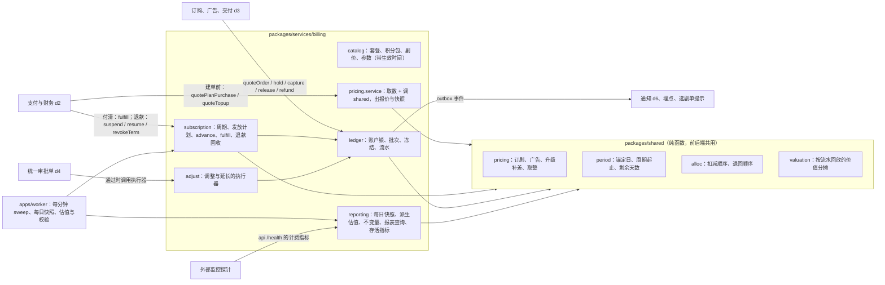
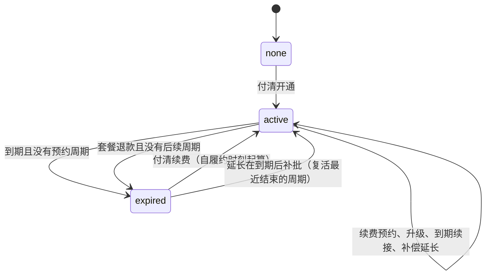
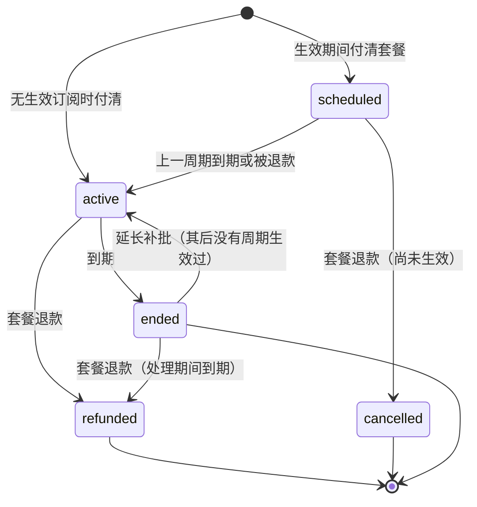
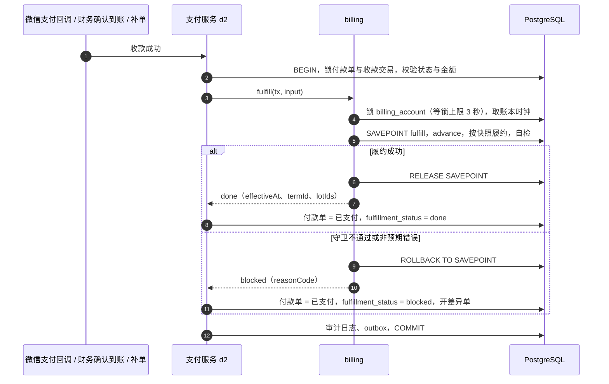
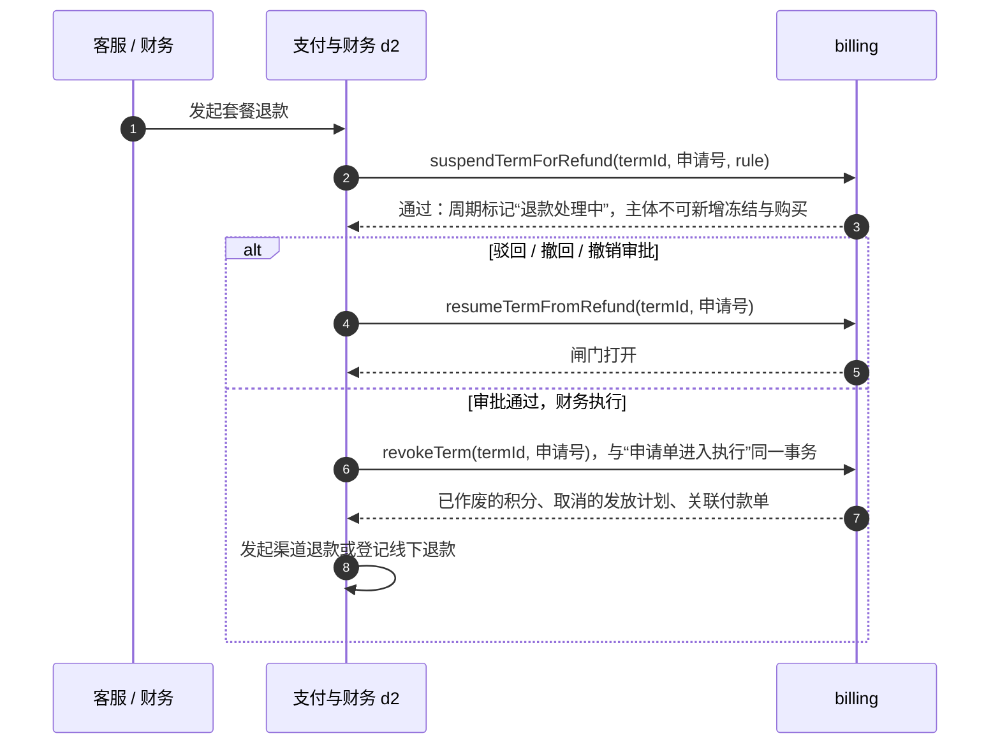
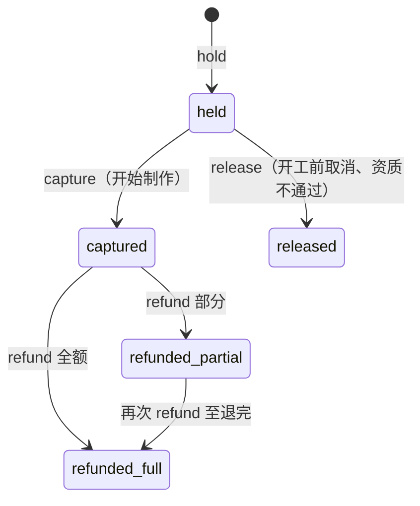
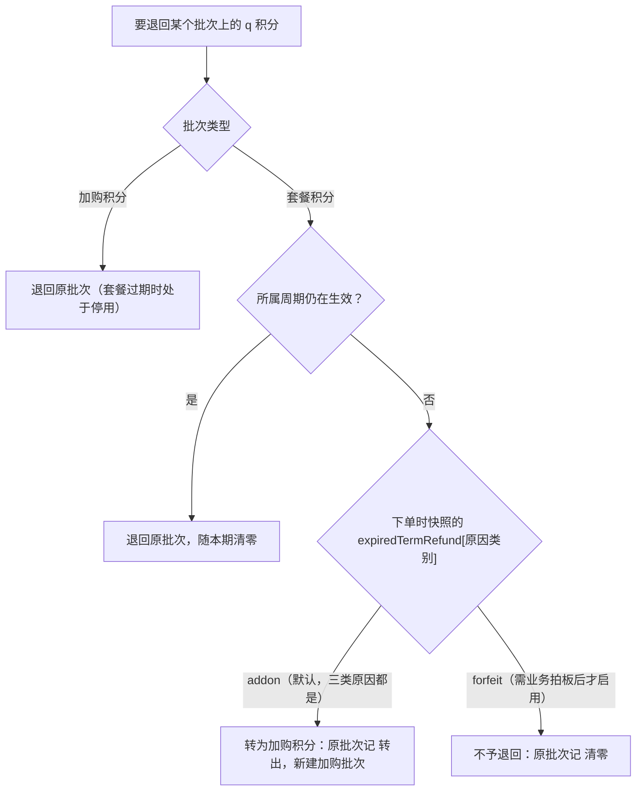
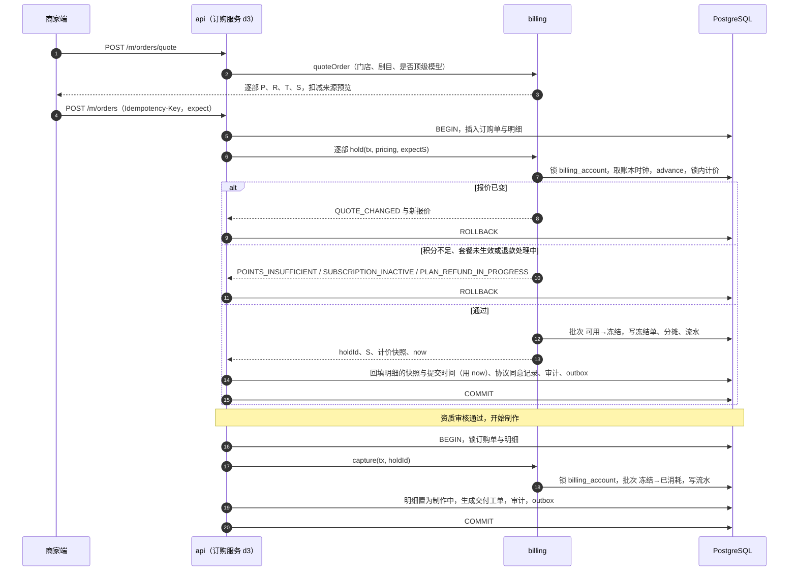

# D1 套餐订阅、积分账本与计价 · 详细设计（修订稿 v2）

> 「狸有戏」V1.0 子系统设计。修订日期 2026-10-02。本稿取代 `design/d1-ledger.md`（14:14 版），已按 `design/d1-ledger.critique.md` 的 19 条意见逐条处理，处理结果见附录 B。本稿可独立阅读。
>
> **出处约定**：【PRD §x】= PRD 第 7 稿章节；【原型 admin/X】【原型 merchant/X】= `slim/` 下对应画板；【调研 prd-tech §x】等 = `research/` 下调研报告；【核实 pay-7】等 = 外部结论核实编号；【评审 M1】等 = 评审意见编号；【d2 §x】【d3 §x】【d4 §x】【d6 §x】【d7 §x】= 同批的其他子系统设计（引用的是 10-02 14:07–14:31 的版本，它们也在修订中）；【默认】= PRD 与原型都没写、本设计给出的默认处理，需拍板的汇总在第 16 节。
>
> 文中数字（3,000 / 6,600 / 9 折 / 50 积分 / 20% 等）都是 PRD 的示例值，正式值待定价【PRD §12.3-3】；设计不依赖任何一个具体数值。
>
> 算法已用脚本验算：计价、周期日期见 `scratchpad/d1-work/verify.mjs`（原稿）；本稿新增或改动的部分（含延长的升级报价、派生估值、延长补批、提醒节点、参数按键取值、跨发放日的升级履约）见 `scratchpad/d1-v2-work/verify2.mjs`，全部通过，结果见 5.6 与 7.7。

**相对原稿的主要变化**

1. **与支付设计（d2）的契约重写为一份**（4.4）：付款单表、状态与差异单归 d2；本设计只定义付款单内容快照的 schema、一个 `fulfill()` 和一组套餐退款函数。锁顺序、起算时刻、参数归属、预收款分摊各只留一种说法。
2. **“现在”改为拿到账户锁之后取真实时钟，并保证每个主体的时间单调**（3.1、7.1），零点前后不再出现时间倒退。
3. **补偿延长可以在到期之后补批**（6.8）：受控的“清零冲回”，不再因为审批晚一天而让延长无处入账。
4. **升级报价覆盖延长尾段；升级按快照履约**（6.5）：延长段内报价不再为负；付款成功时间在有效期内即履约，不因回调晚到而进异常。
5. **参数按键存储、逐键生效**（4.1）；各修订表补唯一约束，套餐同一时刻至多一条待生效修订。
6. **套餐 7 天退款**（6.10）：窗口从周期生效时刻起算；升级过的周期可连同补差一并退；处理期间主体暂停新增冻结；“未使用”覆盖加购积分。
7. **两个偏离 PRD 的默认值改回 PRD 字面**（7.5、4.1）：原周期已结束的退回一律转加购积分；样片确认后取消不再给默认比例。
8. **入账事务不会因履约失败而整体失败**（6.4）：`fulfill` 包在保存点里，失败转为“已支付 · 履约受阻”并开差异单。
9. **折算价值移出写路径**（7.7）：流水只记数量，价值是可重算的派生估值表；原稿价值冲回公式的错误分支随之消除。
10. **被判定为虚拟支付时的退路改写**（1.2、15、16-A）：不再说“对公转账成为主要收款方式”；付款单在 V1.0 就支持员工代建。
11. **精简**（附录 C）：调整与延长不再自建申请表，用 d4 的统一审批单；月结、流水校验和、生产数据回放推迟到首个月结前；删掉两个开关参数与提醒日志表。

---

## 1. 目标、约束与不做什么

### 1.1 这个子系统负责什么

1. **价目**：套餐版本与权益、购买周期、积分包、剧目积分价（等级模板 + 单剧调整）、积分规则参数——全部带生效时间、可追溯。
2. **订阅**：经营主体的套餐周期（开通、续费预约、升级、降级、过期、恢复、补偿延长、7 天退款）、按月发放、期末清零。
3. **积分账本**：账户、批次、冻结、流水；扣减顺序、冻结 → 扣减 → 退回、手动调整。
4. **计价**：订剧 `S = round(P × R × (1 + T))`、广告、超次修改、升级补差，以及下单时的价格与参数快照；后台试算器与商家端用同一份实现。
5. **校验与报表数据**：每日不变量校验、积分报表恒等式、积分负债与收入确认明细（派生估值）、MRR 等指标所需的每日快照。

### 1.2 硬约束

| 约束 | 来源 | 对设计的含义 |
|---|---|---|
| 账务正确性不可妥协 | 任务前提；【PRD §12.1】“积分负债与收入确认口径不清” | 流水只增不改；余额由批次推导；每一步可回放、可对账 |
| 规模小：数百主体、订购千级 | 任务前提；【原型 admin/PointAccounts】213 个账户 | 不追求吞吐，按主体串行化即可；不引入分库、事件溯源框架、独立账务服务 |
| 团队 3–6 人，熟 TypeScript | 任务前提 | 一个模块、一把锁、一套纯函数；规则写成表和参数，不写成框架 |
| 金额整数“分”、积分整数；写操作 = 单事务 + 行锁/唯一约束 + 幂等键 + outbox | 基线 2、3 | 比例一律用万分比整数；所有账本操作在调用方事务内完成 |
| 业务时限以数据库到期时间为准，Redis 丢数据不丢业务 | 基线 3 | 发放、清零、续接都由库里的到期列驱动，且可“补跑” |
| 套餐、积分归主体；订单、广告归门店 | 基线 4；【PRD §6.16.1】 | 账本按 `entity_id`，流水注明 `store_id` |
| 规则变更只影响之后的单据 | 【PRD §2.2-8、§2.4-1、§7.3】 | 价目按时间取值；订购、广告、付款单保存快照，事后不重算 |
| 普通微信支付能否使用，取决于平台是否把所售内容判为虚拟商品；单笔限额随商户号行业属性（实物 8 万、虚拟 6,000 元，现行数值须进件前确认） | 【核实 vpay-1/3/4/7、pay-7】 | 账本与支付渠道、购买入口无关。小程序内是否展示购买入口、可用哪些渠道，由支付设计的购买策略在服务端决定【d2 §10.3】；付款单既可由老板在小程序创建，也可由有权限的员工在后台代建（线下签约）；见 15、16-A |
| 微信回调须 5 秒内应答、最多重试 15 次 | 【核实 pay-4】 | 账户锁等待设上限（7.1）；履约失败不让入账事务失败（6.4） |

### 1.3 不做什么

- **不做付款单与支付渠道**：付款单表、下单调起、回调验签、关单查单、退款申请与执行、差异单、微信账单对账、发票都属于支付设计（d2）。本设计只定义“付款单内容快照的 schema”“付清后的履约”和“套餐退款时的权益回收”，接口见 4.4、6.4、6.10。
- **不做订购单、交付工单、广告任务的状态机**：它们在各自事务里调用账本的 `hold / capture / release / refund`（d3）。
- **不做审批引擎、通知发送、公告管理**：调整与延长用 d4 的统一审批单，本设计提供审批单的 payload schema 与“通过后入账”的执行器；通知只发 outbox 事件（d6）。
- **不做自动续费 / 代扣**：PRD 全文没有；原型“10-13 起按旗舰版续费”【原型 merchant/PlanPick】按“下次续费的价目提示”理解。
- **不做独立数仓与实时报表引擎**：V1.0 的两张报表直接从流水、派生估值与每日快照聚合。
- **不为 V1.1 / V2.0 提前建设**：服务商返佣、代付、增值服务按次计费只留字段与接口位（第 14 节）。

---

## 2. 总体方案

### 2.1 一句话方案

> 每个主体一行 `billing_account` 作为**唯一的锁**；积分按**批次**存放（来源、到期、入账成本），余额是批次的汇总缓存；每次变动写**只增流水**（批次内“桶到桶”的数量移动）；订阅周期与发放计划自带到期时间，由**幂等的 `advance()` 推进函数**在“请求进来时”和“每分钟扫描时”共同驱动；价格是“按时间取值的纯函数”，下单即快照；**折算价值（预收款、收入确认）不在写路径上**，由流水回放派生、可重算。

### 2.2 模块落点



- `packages/shared` 只放不读库的函数，`apps/admin` 的试算器、`apps/weapp` 的即时预览和 `apps/api` 都引用同一份；**提交一律以服务端重算为准**【PRD §6.8-2】。
- `packages/services/billing` 的函数都接收调用方传入的事务句柄 `tx`，不自己开事务；这样“订购单状态 + 冻结 + 审计 + outbox”能落在一个事务里（基线 3）。
- 表都在 `packages/db` 的唯一 schema 里，表名前缀按用途分三组：价目（`plan*`、`point_pack`、`*_price_*`、`billing_param`）、订阅（`billing_account`、`subscription_*`、`grant_schedule`）、账本（`point_*`、`ledger_operation`）。本设计**没有**付款单表、审批表。

### 2.3 关键决策与取舍（总表）

| # | 决策 | 备选 | 为什么选它 |
|---|---|---|---|
| K1 | 账本 = 批次（lot）+ 冻结单 + 只增流水，余额是缓存 | (a) 只存两个余额 + 流水；(b) 标准复式总账（科目 + 借贷） | (a) 做不了“快到期先用”“退回时判断原周期是否结束”“按来源折算预收款”【调研 proto-admin-d §8.5】。(b) 表达力够，但团队要先学科目设计，且“积分到期”“按批次先后”仍要另建批次表。批次模型正好贴合 PRD 的规则，每条规则对应一个字段 |
| K2 | 流水记录“批次内桶到桶的数量移动”（可用 → 冻结 → 已消耗 …），一批次一行 | 一次操作一行、写变动后余额 | 桶到桶可以完整回放出每个批次的状态，不变量可逐批验证；展示时再按“操作 × 积分类型”聚合 |
| K3 | 每主体一把行锁（`billing_account FOR UPDATE`），所有改钱改积分的事务都要拿它，且**放在本事务要锁的其他已有行之后** | 乐观锁重试；批次级行锁；advisory lock | 主体内并发极低（一个老板 + 定时任务 + 财务），串行化最省心；乐观锁在“清零与下单同时发生”时要写重试；批次级锁需要处理锁顺序 |
| K4 | 时间推进用幂等的 `advance(entity, now)`：请求路径先调用，每分钟扫描兜底 | 只靠定时任务到点执行；每个到期点建一条通用定时器 | 定时任务晚到几分钟时，商家可能花掉已过期的积分或看不到新发的积分；`advance` 让正确性不依赖定时器是否准点，宕机恢复后自动补齐 |
| K5 | 价目“按时间取值”：`effective_at ≤ t` 的最新一条即当前值；到点不需要任何任务去“切换”。参数**按键**各自取值 | 到点由定时任务改写“当前价”字段；参数整页一版（原稿） | 定时任务失败不会造成错价。整页一版与“各键生效时间不同”不相容，会静默回滚或提前生效【评审 M4】 |
| K6 | 比例用万分比整数、先乘后除、HALF_UP；全仓只有一个取整函数 | 浮点数 + `Math.round`；Decimal 库 | 整数运算无误差、无依赖。浮点会算错：加扣比例调成 15% 时，`1500 × 0.9 × 1.15` 在 JS 里是 `1552.4999999999998`，`Math.round` 得 1552，正确值是 1553（已实测，评审复算属实） |
| K7 | “主体整体不能花积分”一律用账户或周期上的**闸门**表达（套餐过期 → 加购停用；套餐退款处理中 → 暂停新增冻结），批次数量不动 | 把积分搬进一个“冻结 / 待退款”桶 | 与订购的“冻结”彻底分开【原型 merchant/WalletExpired】；恢复时不需要搬回；闸门天然覆盖两类积分 |
| K8 | 批次只记**入账成本**（这批积分对应多少实付）；消耗、清零、退回时“转出多少价值”由**派生估值表**按流水回放得出，带口径版本，可重算 | (a) 写路径同事务计算并写进流水（原稿）；(b) 报表时用“月费 ÷ 每月积分”现算 | (a) 把尚未确定的财务口径固化进不可改的流水，且写路径多一类出错面——原稿的冲回公式就有算错的分支【评审 M8】。(b) 调价、升级补差、赠送后单价各不相同，现算对不上。派生表既逐批守恒，又能在口径变更后重算 |
| K9 | 每日快照由流水按业务日累加得出，可重算 | 每晚拍当前余额 | 0 点同时发生“清零（记前一日）”和“发放（记当日）”，拍当前余额会串日；按业务日累加与任务何时跑无关 |
| K10 | 账本操作的“现在” = **拿到账户锁之后**的真实时钟，并与该主体上一次操作的时间取较大者 | 事务开始时间 `now()`（原稿） | 事务开始时间在等锁期间不前进；零点前开始、零点后拿到锁的事务会用旧时间冻结新周期的积分、按旧价成交【评审 M1】 |
| K11 | 付清后的履约包在保存点里：守卫不通过或出现非预期错误，付款单照样记为“已支付”，另记“履约受阻”并开差异单 | (a) 付款单保持“待支付”+ 差异单（d2 原稿）；(b) 抛错让入账事务回滚 | (a) 受阻的付款单占着“同主体至多一张未完成套餐单”的名额，商家在财务处理完之前无法再买任何套餐【d2 评审 M4】。(b) 回调重试 15 次都会失败，已收的钱既不履约也不进任何队列【评审 M7】 |

---

## 3. 口径：时间、单位与取整

### 3.1 时间

- **业务时区固定为北京时间（UTC+8，无夏令时）**；库里存 `timestamptz`，“业务日”由 `shared/period.bizDate(t)` 计算，任何代码不得用服务器本地时区。
- **账本操作的“现在”**：拿到 `billing_account` 行锁**之后**执行 `SELECT clock_timestamp()`，再取 `now = max(clock_timestamp(), 该主体的 last_op_at)`，并在同一事务里把 `last_op_at` 写为 `now`。不使用 `now()` / `CURRENT_TIMESTAMP`（它们是事务开始时间，等锁期间不前进）。同一事务内对同一主体的多次账本调用共用这一个 `now`（7.1）。api 多实例之间不依赖各自时钟；测试用可注入的 `Clock`，注入点就是这一处。
- 由此得到两条性质（I16 每日校验）：同一主体的流水按 `seq` 排序时 `occurred_at` 不减；报价、选批次、判断过期与写流水用的是同一个时刻。
- **调用方的义务**：订购、支付等调用方在同一事务里写的时间敏感字段（订购提交时间、协议同意时间、付款单的 `effective_at`）用账本返回的 `now`，不用自己事务开始时取的时间。
- **周期是左闭右开区间** `[starts_at, ends_at)`。“到期日 24:00”【PRD §2.3-4】实现为“到期日次日 00:00”，即 `ends_at`。展示时，清零类流水显示为“前一日 24:00”，发放类显示为“当日 00:00”【原型 merchant/Ledger】。
- **每条流水带两个时间**：`occurred_at`（业务生效时刻；到点类操作取逻辑时间，如到期时刻）与 `created_at`（真实写入时刻）；另带 `biz_date`（归属业务日）。清零流水的 `biz_date` = 周期最后一天，同一瞬间的发放流水 `biz_date` = 新周期第一天。报表一律按 `biz_date` 归集。到点类操作的逻辑时间一定晚于该主体上一次操作的时间（上一次操作已把它之前到期的事都推进完了），所以单调性不被破坏。

### 3.2 周期日期算法（锚定日）

PRD 没定义 29 / 30 / 31 日开通怎么算【调研 prd-tech Q-2】。【默认】采用“锚定日”规则，与原型的全部示例一致：

```
anchor_day   = 开通当天是几号（1..31），连续续费时沿用，过期后重新开通时重置
boundary(k)  = 起始月往后数 k 个月的那个月里，取 min(anchor_day, 该月最后一天)
周期（N 个月）= [boundary(0), boundary(N))        end_date（含）= boundary(N) − 1 天
第 i 个月发放日（i = 0..N−1）= boundary(i)；首期的第 0 个月在履约时刻立即发放
```

验算（脚本输出）：

| 起始日 | 月数 | 本期（含头含尾） | 各月发放日 | 出处 |
|---|---|---|---|---|
| 09-13 | 1 | 09-13 至 10-12 | 09-13 | 【原型 merchant/Wallet】一致 |
| 09-20 | 3 | 09-20 至 12-19 | 09-20、10-20、11-20 | 【原型 admin/PointAccounts 云间民宿】一致 |
| 07-04 | 3 | 07-04 至 10-03 | 07-04、08-04、09-04 | 【调研 prd-tech §3.3】一致 |
| 08-30 | 1 | 08-30 至 09-29 | 08-30 | 同上 |
| 01-31 | 1 | 01-31 至 02-27 | 01-31 | 【默认】 |
| 02-28（锚定日 31，续接上一行） | 1 | 02-28 至 03-30 | 02-28 | 【默认】不会永久漂到 28 日 |
| 01-31 | 3 | 01-31 至 04-29 | 01-31、02-28、03-31 | 【默认】 |

每个边界都从“起始月 + k”直接算，不是在上一个边界上再加一个月，所以不会漂移。补偿延长只把 `end_date` 往后推，不改 `boundary()`；延长出来的天数是“最后一个月的尾段”（6.5、6.8）。

### 3.3 单位与取整

| 量 | 存储 | 说明 |
|---|---|---|
| 金额 | `integer`，单位分 | 单行上限约 2,147 万元，足够；汇总在 SQL 里转 `bigint`，出接口前转字符串或除回元。与 d2 统一用 `int`【d2 评审 m1】 |
| 积分 | `integer` | 不存在小数积分 |
| 折扣率 R、加扣比例 T、扣除比例 | `integer`，万分比（bp） | 9 折 = 9000，20% = 2000；后台“9.5 折”= 9500 |
| 批次入账成本 | `integer`，单位分 | 这批积分对应的实付金额（4.3）；转出价值在派生估值表（7.7） |

唯一的取整函数（`shared/pricing/round.ts`）：

```ts
// n、d 为正的 BigInt；四舍五入（HALF_UP）
export const divRoundHalfUp = (n: bigint, d: bigint) => (2n * n + d) / (2n * d);
```

- 订剧、广告、升级补发积分、升级补交金额、取消扣除额都用它；**价值分摊**用向下取整 + 尾差（7.7），不用它。
- ESLint 规则禁止在 `packages/services/billing` 与 `packages/shared/pricing` 中出现 `Math.round`、`toFixed`、`parseFloat` 和浮点字面量乘法。

---

## 4. 数据模型

约定：主键类型沿用全仓约定（下表记作 `uuid`；d4 用 `bigint identity`，以 d7 的最终约定为准，本设计不依赖主键类型）；枚举用 `text + CHECK`，取值在 `packages/contract` 以 Zod enum 为唯一来源；所有表有 `created_at`，可变表有 `updated_at`。CHECK、部分唯一索引、排他约束 Prisma schema 表达不了，用手写 SQL 迁移维护，CI 加一条“约束清单与库内实际约束比对”的脚本（清单见 4.7）。

### 4.1 价目与参数（带生效时间，只增）

**`plan` 套餐版本**

| 字段 | 类型 | 约束 | 说明 |
|---|---|---|---|
| id | uuid | PK | |
| code | text | UNIQUE | `basic` / `pro` / `flagship`；可新增 |
| name | text | | 基础版 / 专业版 / 旗舰版 |
| rank | int | UNIQUE | 升降级比较：目标 rank 高 = 升级，低 = 降级 |
| scope | text | CHECK in (`public`,`entity`)，默认 `public` | `entity` 为大客户专属套餐的扩展位，V1.0 不用【PRD §12.3-14】 |
| listed | bool | | 上下架【PRD §7.3-1】；下架后不可新购与续费，已有周期不受影响 |

**`plan_revision` 套餐价目修订（不可变）**

| 字段 | 类型 | 约束 | 说明 |
|---|---|---|---|
| id | uuid | PK | |
| plan_id | uuid | FK | |
| revision_no | int | UNIQUE(plan_id, revision_no) | |
| monthly_fee_fen | int | > 0 | 月费 |
| monthly_points | int | > 0 | 每月套餐积分 |
| discount_bp | int | CHECK 5000..10000 | 订剧与广告折扣【原型 admin/Plans：5–10 折，1 位小数】 |
| production_model | text | `standard` / `advanced` / `top` | 制作模型；`top` 时订剧不加扣 |
| max_stores | int | ≥ 1 | 可管理门店数 |
| max_members | int | NULL = 不限 | 成员数 |
| schedule_priority | text | `standard` / `priority` / `rush` | 制作排期 |
| has_monthly_report | bool | | 月度效果报告 |
| cycle_prices | jsonb | Zod 校验 | 各周期**总价**（分）：`{"1":600000,"3":1800000,"12":7200000}`；默认 = 月费 × 月数。季付、年付若有优惠，只改这里【PRD §2.2-2、§12.3-3】 |
| effective_at | timestamptz | `UNIQUE(plan_id, effective_at) WHERE cancelled_at IS NULL` | 生效时间 |
| announced_at | timestamptz | | 公告时间；服务层校验 `effective_at ≥ 保存时刻 + noticeDays`（首个修订豁免） |
| announcement_ref | text | | 公告记录（内容运营子系统） |
| legacy_promo | jsonb | 可空 | **首期优惠位**，V1.0 只有 `{"type":"previous_revision"}` 一种，见 6.9 |
| cancelled_at | timestamptz | 可空 | 仅生效前可撤销 |
| created_by | uuid | | 后台员工 |

索引：`(plan_id, effective_at DESC) WHERE cancelled_at IS NULL`。当前价目 = 该索引上 `effective_at ≤ t` 的第一条。“调整待生效”“已生效”是由时间推导出的展示状态，不存字段。

**修订规则**（三张修订表通用，【评审 M4】）：

1. 每行都是**完整的值**（不是增量）。
2. `plan_revision`：**同一套餐同一时刻至多一条待生效修订**。新建修订的事务先 `SELECT … FOR UPDATE` 锁 `plan` 行，再检查没有 `effective_at > now 且未撤销` 的行，否则返回 `REVISION_PENDING_EXISTS`。要改一条待生效修订，只能“撤销 + 新建”，新建时**重新校验公告期**（表单以被撤销的那一条预填）。这样不存在“两条待生效修订、后建的以谁为底稿”的问题，也不会让某个字段借另一条修订提前生效。“待生效”取决于当前时间，不能写成部分唯一索引，由服务层 + 不变量 I15 保证。
3. 同一对象同一 `effective_at` 至多一条未撤销的行（部分唯一约束），所以“最新一条”总是确定的。“保存后立即生效”取账本时钟的当前时刻；撞上唯一约束时返回 409 由前端重试。

**`plan_promo_claim` 首期优惠使用记录**：`entity_id`、`plan_revision_id`（两者组合 UNIQUE）、`payment_order_id`、`used_at`。规则见 6.9。

**`point_pack` 积分包**

| 字段 | 类型 | 约束 | 说明 |
|---|---|---|---|
| id | uuid | PK | |
| points | int | ≥ 100；`UNIQUE(points) WHERE listed` | 积分数【原型 admin/PointPacks】 |
| price_fen | int | > 0 | 后台允许价格 ≠ 积分数，商家端按配置渲染 |
| listed | bool | | 上下架 |
| sort | int | | |

积分包可原地修改（写审计日志）；“已创建未支付的付款单按原价”靠付款单快照保证【原型 admin/PointPacks】。

**`price_tier_revision` 等级模板价**

| 字段 | 类型 | 约束 | 说明 |
|---|---|---|---|
| id | uuid | PK | |
| tier | text | `S` / `A` / `B` / `C` | |
| points | int | CHECK 100..20000 | 模板积分价 |
| effective_at | timestamptz | UNIQUE(tier, effective_at) | |
| batch_id | uuid | | 同一次保存的 4 档共用；服务层校验同一生效时刻 S ≥ A ≥ B ≥ C |
| created_by | uuid | | |

**`drama_price_revision` 单剧定价修订（即调价记录）**

| 字段 | 类型 | 约束 | 说明 |
|---|---|---|---|
| id | uuid | PK | |
| drama_id | uuid | FK | |
| mode | text | `template` / `custom` | 按模板 / 单剧调整 |
| custom_points | int | `mode='custom'` 时必填且 ≥ 100 | |
| effective_at | timestamptz | `UNIQUE(drama_id, effective_at) WHERE cancelled_at IS NULL`；INDEX(drama_id, effective_at DESC) | “保存后立即”或“某日 00:00”【原型 admin/Pricing】 |
| reason_code | text | | 制作质量 / 题材适配 / 上新时间 / 剩余授权期 / 恢复模板价 |
| note | text | | 备注（原型的枚举与示例里的自由描述对不上，两个字段都留） |
| cancelled_at | timestamptz | 可空 | 仅生效前可撤销 |
| created_by | uuid | | |

`P(drama, t)`：取该剧 `effective_at ≤ t` 且未撤销的最新修订；`custom` 取 `custom_points`，`template`（或没有任何修订）取 `price_tier_revision` 中该剧当前热度等级在 `t` 的模板价。热度等级是短剧的属性（短剧库维护），改等级即时影响模板价，由短剧库发 `drama.tier_changed` 事件。

**`billing_param` 积分规则参数（按键存储，不可变行）**

| 字段 | 类型 | 约束 | 说明 |
|---|---|---|---|
| id | uuid | PK | |
| key | text | CHECK in 下表的键 | |
| value | jsonb | 每个键各自的 Zod schema | 该键的完整值 |
| effective_at | timestamptz | `UNIQUE(key, effective_at) WHERE cancelled_at IS NULL` | |
| change_id | uuid | INDEX | 同一次保存的各键共用（后台“变更记录”按它聚合展示） |
| note | text | | 变更说明 |
| announcement_ref | text | 需公告的键必填 | |
| cancelled_at | timestamptz | 可空 | 仅生效前可撤销 |
| created_by | uuid | | |

取值：`paramsAt(t)` = 对每个键取 `effective_at ≤ t` 且未撤销的最新一行（`SELECT DISTINCT ON (key) … ORDER BY key, effective_at DESC`，十几行，直接在事务里读）。保存规则：

- 后台“参数页”保存 = 一个变更集：**只为值有变化的键各插一行**，各键可以有不同的生效时间。
- “需提前公告”的键，`effective_at` 不得早于保存时刻 + `noticeDays`；其余键可立即生效。这张清单写在代码常量 `NOTICE_REQUIRED_KEYS` 里，业务拍板后改一行。
- 每个键至多一条待生效行（`PARAM_PENDING_EXISTS`）；要改先撤销再建，重新校验公告期。保存事务先取一把事务级咨询锁（`pg_advisory_xact_lock`）串行化。
- 评审的反例在这个模型下的结果（脚本验算）：10-01 把广告每条积分改为 60、11-01 生效；10-10 把提醒节点改为 [10,5,1]、立即生效。10-15 取值 = 广告 50、提醒 [10,5,1]；11-01 取值 = 广告 60、提醒 [10,5,1]。互不影响。

键清单（默认值来自 PRD 与原型，范围校验同【原型 admin/Params】）：

| 键 | 默认 | 需提前公告 | 说明 |
|---|---|---|---|
| `adUnitPoints` | 50 | 是 | 广告每条积分 |
| `adFreeRevisions` | 2 | 是 | 每条广告免费修改次数 |
| `topModelSurchargeBp` | 2000 | 是 | 顶级模型加扣比例 |
| `cancelDeductionBp` | `{planConfirm:1000, adAndSample:3000, samplePending:5000, postSample:null}` | 是 | 制作中取消扣除比例；非空档位须随阶段不递减。`postSample`（样片确认后至上线前）PRD 与原型都没有规定，**不设默认值**：为 `null` 时该阶段的取消由客服填写扣除数、财务审批核定（7.4、12-C11） |
| `expiredTermRefund` | `{merchant:"addon", platform:"addon", qualification:"addon"}` | 是 | 原周期已结束的套餐积分退回去向；默认按 PRD 字面一律转加购积分，可选值另有 `forfeit`，见 7.5 |
| `minLicenseMonths` | 3 | 否 | 最短可订授权期（短剧库使用） |
| `renewalReminderDays` | `[7,3,1]` | 否 | 到期与清零提醒节点（到期当天固定再提醒一次） |
| `prorationBaseDays` | 30 | 是 | 升级按 30 天计【PRD §2.9 例 7】 |
| `planRefundWindowHours` | 168 | 是 | 套餐退款窗口（7 天）【PRD §2.8】；d2 不再另存一份 |
| `enabledCycles` | `[1,3,12]` | 是 | 可选周期，至少 1 个 |
| `maxScheduledTerms` | 1 | 否 | 最多预约几个未生效周期【默认】 |
| `upgradeQuoteValidHours` | 48 | 否 | 升级报价的有效时长（各渠道通用，6.5）【默认】 |
| `noticeDays` | 30 | — | 提前公告天数【PRD §2.2-8】 |

不在这里的参数：付款单超时、对公凭证时限、金额阈值、购买入口策略属于支付设计的 `sys_config.billing.payment.*`【d2 §12.1】。同一个参数只在一处（4.4 第 10 行）。原稿的 `captureWhenExpired`、`adjustWhenExpired` 两个开关删除，行为固定写在代码里（6.7、7.8），业务若要改再加【评审 m8】。

### 4.2 订阅

**`billing_account` 主体计费账户（每主体一行，也是锁）**

| 字段 | 类型 | 约束 | 说明 |
|---|---|---|---|
| entity_id | uuid | PK，FK 经营主体 | 主体创建时同事务建行 |
| sub_status | text | `none` / `active` / `expired` | 订阅状态**缓存**（由 `advance` 维护），只用于后台列表筛选与扫描；权益判断不读它（6.2） |
| current_term_id | uuid | 可空 | 当前生效周期 |
| plan_available | int | ≥ 0 | 缓存：当前周期未过期套餐批次的可用合计 |
| addon_available | int | ≥ 0 | 缓存：加购批次的可用合计（不管是否停用） |
| held_total | int | ≥ 0 | 缓存：冻结合计 |
| next_due_at | timestamptz | 可空；INDEX | 下一个要处理的时刻 = min(当前周期 `ends_at`, 最早的待发放 `due_at`)；扫描就查它 |
| last_op_at | timestamptz | | 该主体最近一次账本操作的 `now`；保证时间单调（3.1） |
| last_expired_qty / last_expired_at | int / timestamptz | | 最近一次清零数量，供“已清零 1,920”展示【原型 merchant/WalletExpired】 |
| updated_at | timestamptz | | |

可花积分 `spendable = (当前周期生效且不在退款处理中) ? plan_available + addon_available : 0`。

**`subscription_term` 订阅周期（一次购买 = 一个周期）**

| 字段 | 类型 | 约束 | 说明 |
|---|---|---|---|
| id | uuid | PK | |
| entity_id | uuid | FK | |
| seq | int | UNIQUE(entity_id, seq) | 该主体第几个周期 |
| origin | text | `new` / `renew` / `resume` | 首次开通 / 续接 / 过期后重新开通 |
| plan_id | uuid | FK | 当前版本（升级后更新） |
| plan_revision_id | uuid | FK | 当前价目修订（升级后更新） |
| initial_plan_revision_id | uuid | FK | 购买时的修订 |
| months | int | CHECK in (1,3,12) 或启用的周期 | |
| price_total_fen | int | ≥ 0 | 购买该周期的应付金额（不含之后的升级补差） |
| monthly_equiv_fen | int | | 月度分摊金额 = floor(周期总价 ÷ 月数)；升级后改为新版本的值；MRR 用 |
| monthly_points / discount_bp / production_model / max_stores / max_members / schedule_priority / has_monthly_report | 同 plan_revision | | **权益快照**，升级时整体覆盖；订购计价、名额校验都读这里，不读价目表 |
| anchor_day | smallint | 1..31 | 见 3.2 |
| start_date / end_date | date | | 含头含尾；`end_date` 含补偿延长 |
| starts_at / ends_at | timestamptz | `ends_at > starts_at` | `ends_at` = `end_date` 次日 00:00（北京时间） |
| extended_days | int | 默认 0 | 累计补偿延长天数 |
| status | text | `scheduled` / `active` / `ended` / `refunded` / `cancelled` | |
| refund_request_id | text | 可空 | 非空 = **退款处理中**：d2 的退款申请号；闸门见 6.10 |
| refund_rule | text | 可空 | `window` / `qualification_failed` / `override` |
| source_payment_order_id | uuid | UNIQUE | 来源付款单（d2 的 `payment_order.id`） |
| activated_at / ended_at / refunded_at | timestamptz | | |

约束：`UNIQUE(entity_id) WHERE status='active'`（一个主体至多一个生效周期）；排他约束 `EXCLUDE USING gist (entity_id WITH =, tstzrange(starts_at, ends_at) WITH &&) WHERE (status IN ('scheduled','active','ended')) DEFERRABLE INITIALLY DEFERRED`（周期不重叠，提交时检查，需 `btree_gist` 扩展）。延长、退款前移会在一个事务里改多个周期的起止，约束延迟到提交时检查，另外规定**从链尾向前更新**【评审 m6】。若托管库不提供该扩展，退化为服务层校验 + 每日不变量 I10（16-A3）。

**`subscription_event` 订阅事件（只增）**

| 字段 | 类型 | 说明 |
|---|---|---|
| id | uuid | PK |
| entity_id / term_id | uuid | |
| type | text | `activated` / `renewal_scheduled` / `rolled_over`（续接生效）/ `upgraded` / `downgrade_scheduled` / `extended` / `expired` / `resumed` / `refund_suspended` / `refund_resumed` / `refunded` / `cancelled` |
| from_plan_id / to_plan_id / from_revision_id / to_revision_id | uuid | 升降级、续费换版本时填 |
| payment_order_id | uuid | 可空 |
| payload | jsonb | 如升级的剩余天数与算式；延长天数、审批单号、是否为到期后补批 |
| occurred_at / biz_date | timestamptz / date | |
| operator_type / operator_id | text / uuid | `merchant_user` / `staff` / `system`；V1.1 增加 `partner_user` |

新开通、续费、升级家数与续费率、升级率都从这张表和 `subscription_term` 算（10.4）。

**`grant_schedule` 月度发放计划（周期创建时一次生成 N 行）**

| 字段 | 类型 | 约束 | 说明 |
|---|---|---|---|
| id | uuid | PK | |
| term_id / entity_id | uuid | FK | |
| month_index | smallint | UNIQUE(term_id, month_index) | 0..N−1 |
| due_at / due_date | timestamptz / date | INDEX(status, due_at) | 第 0 个月 = 周期 `starts_at` |
| points | int | > 0 | 该月应发积分（升级后改为新版本的值） |
| value_fen | int | ≥ 0 | 该月分摊的套餐款（周期实付 ÷ 月数向下取整，尾差放最后一个月；升级后加上该月差价） |
| plan_id / plan_revision_id | uuid | | 发放时的版本 |
| status | text | `pending` / `granted` / `cancelled` | |
| lot_id | uuid | 可空 | 发放后指向批次 |
| granted_at | timestamptz | | |

这张表加上批次的 `cost_basis_fen` 就是**唯一的“付款 → 各月 → 批次”分摊台账**；d2 不再另建 `payment_allocation`（4.4 第 3 行）。`Σ pending 的 value_fen` 是“已收款、尚未发放月份的预收套餐款”（季付、年付才有），积分负债里看不到它，财务报表要单列（10.2）。

### 4.3 账本

**`point_lot` 积分批次**

| 字段 | 类型 | 约束 | 说明 |
|---|---|---|---|
| id | uuid | PK | |
| entity_id | uuid | FK | |
| kind | text | `plan` / `addon` | 套餐积分 / 加购积分 |
| source_type | text | `grant_monthly` / `grant_upgrade` / `purchase` / `adjust` / `conversion` | 来源 |
| source_id | text | UNIQUE(source_type, source_id) | 发放计划 id / `{升级付款单 id}:{月序}` / 加购付款单 id / 审批单号 / `{退回操作 id}:{序号}` |
| term_id | uuid | `kind='plan'` 必填 | 所属周期 |
| plan_id / plan_revision_id | uuid | 可空 | 来源版本（报表按版本拆分） |
| origin_lot_id / origin_entry_seq | uuid / bigint | 可空 | `conversion` 时指向原套餐批次与那条“转出”流水（估值按它取转入价值） |
| granted_at / biz_date | timestamptz / date | | |
| expires_at | timestamptz | `kind='plan'` 必填，= 所属周期 `ends_at`；`addon` 为 NULL | |
| original_qty | int | > 0 | 入账数量 |
| available_qty | int | ≥ 0 | 可用 |
| held_qty | int | ≥ 0 | 冻结（订购 / 广告占用） |
| consumed_qty | int | ≥ 0 | 已消耗（开始制作后） |
| expired_qty | int | ≥ 0 | 已清零 |
| revoked_qty | int | ≥ 0 | 套餐退款作废 |
| converted_out_qty | int | ≥ 0 | 转为加购积分转出 |
| adjusted_out_qty | int | ≥ 0 | 手动调整扣减 |
| cost_basis_fen | int | ≥ 0；`conversion` 为 NULL | **入账成本**：这批积分对应的实付金额，入账后不变。它是“钱对到哪批积分”的事实（I12 用）；转出多少价值不记在这里（7.7） |
| updated_at | timestamptz | | 估值任务按它找有变动的批次 |

约束：`CHECK (original_qty = available_qty + held_qty + consumed_qty + expired_qty + revoked_qty + converted_out_qty + adjusted_out_qty)`。
索引：`(entity_id, kind, expires_at, granted_at, id) WHERE available_qty > 0`（选批次）；`(term_id)`。

**`point_hold` 冻结单**

| 字段 | 类型 | 约束 | 说明 |
|---|---|---|---|
| id | uuid | PK | |
| entity_id / store_id | uuid | FK | 归主体、记门店 |
| purpose | text | `drama_order_item` / `ad_task` / `ad_revision` | |
| ref_type / ref_id | text | UNIQUE(ref_type, ref_id) | 业务幂等键：订购明细 id、广告任务 id、广告修改记录 id |
| group_ref | text | 可空 | 展示聚合用：同一订购单 / 同一次广告提交 |
| amount | int | > 0 | 应扣积分 S |
| status | text | `held` / `captured` / `released` / `refunded_partial` / `refunded_full` | |
| returned_qty | int | 默认 0 | 累计退回给商家的数量 |
| forfeited_qty | int | 默认 0 | 累计“原周期已结束、不予退回”的数量（仅 `expiredTermRefund` 取 `forfeit` 时出现） |
| pricing_snapshot | jsonb | Zod | 计价与规则快照，见 5.3 |
| term_id_at_hold | uuid | INDEX | 冻结时的周期（套餐退款判断“本周期是否用过积分”用它，6.10） |
| held_at / captured_at / closed_at | timestamptz | | |
| operator_type / operator_id / on_behalf_of | text / uuid / uuid | | `on_behalf_of` 为 V1.1 代操作扩展位 |

**`point_hold_alloc` 冻结分摊（冻结落在哪些批次）**

| 字段 | 类型 | 约束 | 说明 |
|---|---|---|---|
| hold_id | uuid | PK(hold_id, seq) | |
| seq | smallint | | 分摊顺序（= 扣减顺序） |
| lot_id | uuid | UNIQUE(hold_id, lot_id) | |
| lot_kind | text | | 冗余，展示用 |
| qty | int | > 0 | 该批次冻结数量 |
| returned_qty | int | 默认 0 | 已退回数量 |
| forfeited_qty | int | 默认 0 | 退回时被清零的数量 |

**`ledger_operation` 账本操作（幂等登记 + 展示行）**

| 字段 | 类型 | 约束 | 说明 |
|---|---|---|---|
| id | uuid | PK | |
| op_key | text | **UNIQUE** | 幂等键，如 `hold:drama_order_item:{id}`，全表见 8.3 |
| op_type | text | 动积分的：`grant` / `purchase` / `hold` / `capture` / `release` / `refund` / `expire` / `unexpire` / `adjust` / `revoke`；只记闸门开合、不动积分的：`addon_suspend` / `addon_resume` / `refund_suspend` / `refund_resume`；只做幂等登记的：`fulfill` / `extend` / `fix` | |
| entity_id / store_id | uuid | INDEX(entity_id, occurred_at DESC) | |
| ref_type / ref_id / hold_id | text / text / uuid | | 关联单据 |
| occurred_at / biz_date | timestamptz / date | | |
| plan_delta / addon_delta | int | | 本次操作对两类“可用”的净变动（冻结为负，退回为正，扣减为 0） |
| spendable_after | int | | 操作后的可花积分（闸门关闭时为 0），即后台流水的“可用余额”列 |
| held_after | int | | 操作后的冻结合计 |
| title_code / title_args | text / jsonb | | 展示文案由代码与参数拼出（如“提交订购 2 部”“(6,600 − 3,000) × 20 ÷ 30”），不存成品字符串 |
| operator_type / operator_id / on_behalf_of | | | |
| request_id | text | | 链路追踪 |

**`point_ledger_entry` 积分流水（只增，只记数量）**

| 字段 | 类型 | 约束 | 说明 |
|---|---|---|---|
| seq | bigint | PK，自增 | 全局顺序，回放用 |
| operation_id | uuid | FK | |
| entity_id | uuid | INDEX(entity_id, seq) | |
| lot_id | uuid | INDEX(lot_id, seq) | |
| hold_id | uuid | 可空 | 与冻结单有关的移动必填（估值按“冻结单 × 批次”建池，7.7） |
| lot_kind / lot_plan_id | text / uuid | | 冗余，报表按来源聚合 |
| from_bucket / to_bucket | text | 取值：`external` `available` `held` `consumed` `expired` `revoked` `converted_out` `adjusted_out` | 桶到桶 |
| qty | int | > 0 | |
| occurred_at / biz_date / created_at | | INDEX(biz_date) | |

应用账号对这张表与 `ledger_operation`、`subscription_event` 只有 INSERT 与 SELECT 权限，另加触发器拒绝 UPDATE / DELETE。

合法的桶移动只有下面这些，其他组合由 CHECK 拒绝：

| 移动 | 触发操作 | 负债（可用 + 冻结） | 估值效果（派生，7.7） |
|---|---|---|---|
| external → available | 发放、加购、调整增加、转入 | 增加 | 入账（成本，或转入的价值） |
| available → held | 冻结 | 不变 | 无 |
| held → available | 释放（开工前取消） | 不变 | 无 |
| held → consumed | 扣减（开始制作） | 减少 | **确认收入** |
| consumed → available | 退回（开工后） | 增加 | **冲回收入** |
| available → expired | 期末清零 | 减少 | **确认收入**（清零） |
| expired → available | 延长在到期后补批时的清零冲回（6.8），只能由 `applyExtension` 触发 | 增加 | **冲回清零收入** |
| held → converted_out / consumed → converted_out | 原周期已结束、转为加购积分 | 前者减少、后者不变（同时新加购批次增加） | 转出价值（后者同时冲回收入） |
| available → revoked | 套餐退款作废 | 减少 | 退还的预收款，不是收入 |
| expired → revoked | 套餐退款执行时该周期已在处理期间到期（6.10），只能由 `revokeTerm` 触发 | 不变 | 冲回清零收入并转为退还的预收款 |
| available → adjusted_out | 手动调整扣减 | 减少 | 调整转出，报表单列 |
| held → expired / consumed → expired | 退回时原周期已结束且参数取 `forfeit`（默认不出现） | 前者减少、后者不变 | 前者确认收入（清零）；后者无（收入已确认，只改归类） |

评审建议的“待退款”桶（`refund_pending`）没有采用：套餐退款处理期间还必须挡住**加购积分**按套餐折扣下单【d2 评审 M2】，这需要一道主体级的闸门；有了闸门，再把套餐积分搬进一个新桶就是重复的（多 1 列、4 种移动）。处理期间周期到期的情形由 `expired → revoked` 一种移动覆盖。

### 4.4 与支付设计（d2）的契约

评审指出本设计与 d2 对同一段流程各写了一套【评审 B1；d2 评审 B1】。下表是本稿的定稿口径，逐项对应评审列出的 11 个主题；d2 的修订稿需与之一致，仍有出入的由首席架构师裁决（16-A4）。

| # | 主题 | 定稿 | 理由 |
|---|---|---|---|
| 1 | 付款单 | 表、状态机、渠道交易、差异单、退款申请与退款交易、发票**归 d2**（表名 `payment_order`，状态仍是 PRD §5.3 的 5 种）。本设计不建付款单表，只定义它的 `item_snapshot` 的 schema（Zod `BillingOrderContent`，见下）并由 `quotePlanPurchase` / `quoteTopup` 生成，d2 原样保存。`kind`（`subscribe` / `renew` / `upgrade` / `topup`）由本设计的报价函数**在服务端判定**后返回，前端不传 | 升级守卫与季付补差需要的字段只有报价方知道；一份快照一个出处 |
| 2 | 履约入口 | 只有一个：`billing.fulfill(tx, input)`。d2 删除 `openTerm / queueOrStartRenewal / upgradeCurrentTerm / grantLot` 的编排。周期、发放计划、批次、起算时刻全部在 `fulfill` 内部决定 | 两边都编排必然重复或漏做 |
| 3 | 按月分摊 | `grant_schedule.value_fen` + `point_lot.cost_basis_fen` 是唯一台账；d2 删除 `payment_allocation`，导出预收款明细时调用 `billing.listPrepaidBreakdown(paymentOrderId)` | 升级会改后续月份的金额、延长会改服务区间，两张表必然不同步 |
| 4 | 守卫不通过 / 履约出错 | 付款单置**已支付**，`fulfillment_status = blocked`（原稿叫 `exception`），d2 在同一事务开 `fulfillment_blocked` 差异单；队列只有 d2 的差异单一个。处理方式：重试履约，或经差异单原路 / 线下退款（付款单 → 已退款）。受阻超过 72 小时计入不变量违规（I12）。d2 的“已支付 ⇔ 已入账”改为“已支付 ⇔ 该单名下有一笔已记到账的收款”，开票须 `fulfillment_status = done` | **未采纳评审 B1 的建议（付款单不进“已支付”）**：d2 有“同主体至多一张未完成套餐类付款单”的唯一索引，受阻的单若停在待支付，商家在财务处理完之前无法续费、也就无法订购【d2 评审 M4 的反例】。“已支付”描述的是资金事实，本来就成立 |
| 5 | 起算时刻 | 周期起点、发放时刻 = `fulfill` 所在事务的账本时钟 `now`（3.1），由 `fulfill` 返回，d2 写入 `payment_order.effective_at`。d2 另传 `payerActedAt`（微信 = 渠道的支付成功时间；对公 = 凭证提交时刻），**只用于**判断升级报价是否在有效期内付款（6.5） | 回调丢失、次日对账自愈或补单时，按渠道时间会建出一个“昨天开始”的周期，商家白丢天数，流水还要倒填业务日；按处理时刻起算对商家有利、对账务简单。升级的有效期则应看商家何时付的款，不看平台何时处理【评审 M7】 |
| 6 | 已有生效周期时又付清一张开通单（不论版本是否相同） | 可履约：按快照的版本与周期建一个预约周期接在链尾（与“续费 / 降级续费”同一条路径），在返回值里标注 `queuedBehindActive` | 快照自带版本、周期、价格、积分，没有不能履约的理由；d2 的“版本不同 → 不通过”删除 |
| 7 | 套餐退款 | d2 在发起、驳回 / 撤回、执行三个时点分别调用 `suspendTermForRefund` / `resumeTermFromRefund` / `revokeTerm`；d2 不再自己冻结积分（没有 `points_hold_id`）。处理期间由主体级闸门挡住一切新增冻结（6.10） | d2 自己加的冻结会让本设计“冻结为 0”的守卫必然失败；闸门同时覆盖加购积分 |
| 8 | 退款窗口 | `周期 starts_at + planRefundWindowHours`；未生效的预约周期视为在窗口内。**窗口只在发起时判断**并由 d2 快照进申请单；审批、执行只复核“积分是否被使用”【d2 评审 M1】。资格判断只有 `billing.previewPlanRefund` 一个实现，d2 的 `refundEligibility` 调它 | 见 6.10 与【评审 M5】 |
| 9 | 锁顺序 | 全仓一条：**本事务要锁的已有业务单据行在前（付款单 → 收款交易 → 退款申请 → 退款交易 → 开票申请；订购单 → 订购明细 → 广告任务；审批单），`billing_account` 在后，计费内部行最后**。d2 创建付款单时不锁“订阅行”（同主体唯一未完成单由它的部分唯一索引保证）；`applyPayment` 先锁付款单与收款交易，再调 `fulfill`。新插入的行不受次序限制 | d2 所说的“订阅行”和“积分账户行”在本设计里是同一行；一头一尾必然 AB-BA |
| 10 | 参数 | 计费规则参数（含 `planRefundWindowHours`、`upgradeQuoteValidHours`）在本设计的 `billing_param`；付款单超时、对公凭证时限、金额阈值、购买入口策略在 d2 的 `sys_config.billing.payment.*`。本设计删除 `paymentTimeoutMinutes`、`bankTransferValidDays`、`upgradeQuoteValidDays`；d2 删除 `refund.plan_window_hours`、`upgrade_proof_ttl_hours`，升级付款单的支付截止 = `min(自身时限, 快照 validUntil)` | 同一参数两处存、取值不同 |
| 11 | 下单人 | 老板本人，或有 `billing.order.create_offline` 权限的员工在后台代建（d2 的 `source = admin`，须填合同号）。角色校验在接口层（d4），本设计的报价函数接收 `actor` 并只拒绝“既不是老板也不是员工”的调用 | 被判定为虚拟支付后，可行的退路正是员工代建【评审 M9】 |

**付款单内容快照 `BillingOrderContent`**（由本设计生成，d2 存入 `payment_order.item_snapshot`；履约只读快照和快照里指向的不可变修订行，不回查“当前”价目）：

```jsonc
// 套餐（开通 / 续费 / 降级续费 / 下期换高版本）
{ "v": 1, "kind": "plan", "planId": "...", "planRevisionId": "...", "months": 3,
  "cyclePriceFen": 1800000, "payFen": 1800000, "monthlyPoints": 6600, "discountBp": 9000,
  "promo": null,                       // 首期优惠时为 { claimRevisionId, type, appliedRevisionId }
  "quotedAt": "2026-09-30T10:05:00+08:00" }
// 升级
{ "v": 1, "kind": "upgrade", "termId": "...", "fromPlanRevisionId": "...", "toPlanRevisionId": "...",
  "quotedAt": "2026-09-30T10:05:00+08:00", "quotedOn": "2026-09-30",
  "monthIndex": 0, "remainingDays": 12, "baseDays": 30, "remainingFullMonths": 0,
  "feeDeltaPerMonthFen": 600000, "pointsDeltaPerMonth": 7800,
  "proratedFen": 240000, "payFen": 240000, "topupPoints": 3120,
  "validUntil": "2026-10-02T10:05:00+08:00" }
// 加购
{ "v": 1, "kind": "topup", "packId": "...", "points": 3000, "payFen": 300000 }
```

**本设计提供给 d2 的函数**（都接收 `tx`；签名见 11.1）：

| 函数 | 何时调用 | 说明 |
|---|---|---|
| `quotePlanPurchase` / `quoteTopup` | 创建付款单前；后台代建时同样 | 返回 `kind`、`content`、`payableFen`、展示用算式与生效说明；d2 比对前端的 `expectedPayableFen` |
| `fulfill` | `applyPayment` 把付款单置为已支付的同一事务 | 6.4；返回 `done` 或 `blocked`，不因业务原因抛错 |
| `previewFulfill` | 差异单“补单”前 | 只读：现在补单会得到什么（多排一个周期 / 升级已不可履约 …） |
| `previewPlanRefund` | 发起退款前、退款详情页 | 6.10；返回窗口截止时刻、是否未使用、须一并退的付款单 |
| `suspendTermForRefund` / `resumeTermFromRefund` / `revokeTerm` | 发起 / 驳回、撤回、撤销审批 / 执行 | 6.10 |
| `listPrepaidBreakdown` | 财务导出、付款单详情 | 该付款单的钱分到了哪些月份、哪些批次、是否已发放 |

**d2 提供给本设计的**：`resolvePurchasePolicy`（套餐与积分包的列表接口按它决定是否返回价格与购买入口，11.2）；一个只读查询端口，供每日不变量 I12 取“已支付付款单及其履约状态”。

`fulfill` 的入参不含付款单表的行，而是 d2 读出后传入的字段，本设计因此不依赖 d2 的表结构：

```ts
type FulfillInput = {
  paymentOrderId: string; entityId: string;
  content: BillingOrderContent;      // 付款单快照
  paidAmountFen: number;             // 渠道实收；与 content.payFen 不等 → blocked(AMOUNT_MISMATCH)
  payerActedAt: Date;                // 微信：支付成功时间；对公：凭证提交时刻
  operator: Operator;                // 系统回调 / 确认到账的财务 / 补单的财务
};
type FulfillResult =
  | { status: 'done'; effectiveAt: Date; termId?: string; lotIds: string[]; queuedBehindActive?: boolean; notes: string[] }
  | { status: 'blocked'; reasonCode: FulfillBlockReason; detail: unknown };
```

### 4.5 审批：payload 与执行器（不自建申请表）

积分调整与补偿延长用 d4 的统一审批单 `approval_requests`（类型 `points.adjust`、`plan.extend`，单号前缀 `TZ`、`YQ`）【d4 §7.6】。原稿的 `point_adjustment_request`、`term_extension_request` 两张表删除：审批状态只有一处，发起人 ≠ 审批人由 d4 的约束保证。本设计提供的是两类 payload 的 Zod schema 和两个执行器；执行器在审批“通过”的同一事务内被调用，前提不成立时抛 `PRECONDITION_CHANGED`，整个事务回滚、审批单保持待审【d4 §7.6】。

| 类型 | payload | `dedupe_key`（同时只允许一张待审） | 执行器 |
|---|---|---|---|
| `points.adjust` | `{ entityId, direction: 'increase'｜'decrease', lotKind: 'plan'｜'addon', qty, reasonCode: 'compensation'｜'platform_refund'｜'correction'｜'campaign'｜'other', note(5..200 字，商家可见), ref?: { type: 'hold', id }, spendableBefore }` | `points.adjust:{entityId}`【原型 admin/MerchantDetail：同一主体同时只允许一张在审；d4 原写“不填”，需对齐】 | `billing.applyAdjustment(tx, approval)`，7.8 |
| `plan.extend` | `{ entityId, termId（发起时的当前周期，仅作记录）, days: 1..90（原型档位 3 / 7 / 15 / 30 由前端限制）, reasonCode, note }` | `plan.extend:{entityId}` | `billing.applyExtension(tx, approval)`，6.8 |

审批层级（一级还是两级、谁批）由 d4 的策略表配置【PRD §12.3-4 待定】。入账后在 `ledger_operation` 上记 `ref_type = 'approval'`、`ref_id = 审批单号`，审批单详情据此反查流水。

### 4.6 快照、派生估值与校验

**`billing_entity_daily`（主体 × 业务日）**

| 字段 | 类型 | 说明 |
|---|---|---|
| biz_date / entity_id | date / uuid | PK |
| sub_status / plan_id / plan_revision_id / term_id / term_months | | 当日 24:00 的订阅状态 |
| mrr_fen | int | 生效则为 `monthly_equiv_fen`，否则 0 |
| plan_available / addon_available / held | int | 当日 24:00 各桶 |
| liability_points | int | 可用 + 冻结（含冻结，含停用的加购）【原型 admin/RptPoints】 |
| liability_value_fen | int | 对应折算价值（取自派生估值，口径版本 = 当前版本） |
| deferred_plan_fee_fen | int | 未发放月份的预收套餐款 |
| recomputed_at | timestamptz | |

**`valuation_policy`（估值口径版本）**：`version` PK、`description`、`rule`（jsonb：入账成本的折算方式、取整与尾差规则）、`created_at`。V1.0 只有版本 1：成本按入账记录、等比向下取整、最后一笔吃尾差。

**`point_entry_valuation`（派生，可删除重算）**

| 字段 | 类型 | 说明 |
|---|---|---|
| entry_seq / policy_version | bigint / int | PK；对应一条流水 |
| lot_id / entity_id / biz_date | | 冗余，聚合用 |
| effect | text | `inflow` 入账 / `recognize` 确认收入 / `recognize_breakage` 清零确认 / `reverse` 冲回收入 / `reverse_transfer` 冲回收入并转出（转加购）/ `reverse_breakage` 冲回清零 / `reverse_breakage_refund` 冲回清零并退还 / `transfer_out` 转出 / `refund_out` 退还预收款 / `adjust_out` 调整转出 / `none` |
| value_fen | int | 这条流水带走或带回的价值 |
| remaining_value_fen | int | 这条流水之后该批次的剩余价值（= 折合预收款） |
| computed_at | timestamptz | |

**`billing_invariant_run` / `billing_invariant_violation`**：每次校验的批次与违规明细（`code`、`entity_id`、`detail jsonb`、`resolved_at`、`resolved_by`、`resolution`）。

不再有 `renewal_reminder_log`（提醒去重交给 d6，6.11）。月结表 `billing_month_close` 推迟到首个月结前补齐（10.5、附录 C）。

### 4.7 数据库级约束清单（CI 比对）

1. `point_lot`：七个桶非负；桶之和 = `original_qty`；`kind='plan'` ⇔ `term_id`、`expires_at` 非空；`cost_basis_fen` 仅 `conversion` 可空。
2. `subscription_term`：每主体至多一个 `active`；周期不重叠（延迟检查的排他约束，或 I10）。
3. `grant_schedule`：`UNIQUE(term_id, month_index)`。
4. `ledger_operation.op_key`、`point_hold(ref_type, ref_id)`、`point_lot(source_type, source_id)`、`subscription_term.source_payment_order_id` 唯一。
5. `point_ledger_entry`：`(from_bucket, to_bucket)` 只能是 4.3 表里的组合；禁止 UPDATE / DELETE。
6. `billing_account`：三个缓存列非负。
7. `plan_promo_claim(entity_id, plan_revision_id)` 唯一。
8. 修订表：`plan_revision(plan_id, effective_at)`、`drama_price_revision(drama_id, effective_at)`、`billing_param(key, effective_at)` 在未撤销的行上唯一；`price_tier_revision(tier, effective_at)` 唯一。

---

## 5. 计价

### 5.1 公式的唯一实现

```ts
// packages/shared/src/pricing/index.ts —— 不读库、不依赖运行环境
const BP = 10_000n;

/** 订一部剧：S = round(P × R × (1 + T))【PRD §2.4】 */
export function quoteDramaItem(i: {
  P: number; discountBp: number; planModel: 'standard' | 'advanced' | 'top';
  topModelSelected: boolean; surchargeBp: number;
}) {
  const T = i.planModel === 'top' || !i.topModelSelected ? 0 : i.surchargeBp; // 旗舰版默认顶级模型，不加扣
  const S = Number(divRoundHalfUp(BigInt(i.P) * BigInt(i.discountBp) * (BP + BigInt(T)), BP * BP));
  return { P: i.P, discountBp: i.discountBp, surchargeBp: T, S };
}

/** 一条广告 / 一次超次修改：round(单价 × R)【PRD §2.7】 */
export const quoteAd = (unitPoints: number, discountBp: number) =>
  Number(divRoundHalfUp(BigInt(unitPoints) * BigInt(discountBp), BP));

/** 升级补差【PRD §2.2-5】：当月按剩余天数折算，其后已预付的整月补全额差价（见 6.5） */
export function quoteUpgrade(i: {
  feeDeltaPerMonthFen: number; pointsDeltaPerMonth: number;
  remainingDays: number; baseDays: number; remainingFullMonths: number;   // 三者都 ≥ 0，由 upgradePosition 给出
}) {
  const d = BigInt(i.remainingDays), b = BigInt(i.baseDays);
  const proratedFen = Number(divRoundHalfUp(BigInt(i.feeDeltaPerMonthFen) * d, b));
  return {
    payFen: proratedFen + i.feeDeltaPerMonthFen * i.remainingFullMonths,
    proratedFen,
    topupPoints: Number(divRoundHalfUp(BigInt(i.pointsDeltaPerMonth) * d, b)),
  };
}

// packages/shared/src/period/index.ts
/** 升级时处在周期的什么位置。补偿延长出来的尾段并入最后一个月，月序不会超过 N−1 */
export function upgradePosition(term: TermDates /* startDate, anchorDay, months, endDate（含延长） */, today: BizDate, baseDays: number) {
  const N = term.months;
  const i = Math.min(monthIndexOf(term, today), N - 1);
  const monthEnd = i === N - 1 ? term.endDate : addDays(boundary(term, i + 1), -1);
  return { monthIndex: i, remainingDays: clamp(diffDays(monthEnd, today), 0, baseDays), remainingFullMonths: N - 1 - i };
}
```

规则补充：

1. **逐部计算、逐部取整**【PRD §2.4】：一次订购多部剧的合计 = 各部 S 之和，不是对合计取整。两者可能不同：`P = 1,005`、9 折，单部 `904.5 → 905`，两部合计 1,810；若对 2,010 整体取整是 1,809。广告同理按条取整（8.5 折时每条 `42.5 → 43`）。
2. **展示分解从 S 反推**：确认订购页的“专业版 9 折 −240”“顶级模型加扣 20% +432”【原型 merchant/Checkout】用 `round(P×R) − P` 与 `S − round(P×R)` 得出，保证各行相加一定等于 S。
3. **取数**（`pricing.service`）：`P` = 4.1 的 `P(drama, now)`；`R`、制作模型 = **当前生效周期的权益快照**（`subscription_term.discount_bp` / `production_model`），升级后立刻变【PRD §2.2-5】；`T` = `paramsAt(now).topModelSurchargeBp`。三者用的 `now` 是同一个账本时钟（3.1）。

### 5.2 报价与提交校验

- `POST /api/v1/m/orders/quote`（纯计算，不落库）：返回逐部 `{dramaId, P, discountBp, surchargeBp, S}`、合计、**扣减来源预览**（套餐积分各批次及清零时间、加购积分）与订购后剩余【原型 merchant/Checkout】。预览调用 `shared/alloc.allocate()`，与真正冻结用同一个函数。
- 提交时，订购服务对每部剧调用 `billing.hold(tx, { …, pricing: { kind: 'drama', dramaId, topModel }, expectS })`。**价格在 `hold` 内部、拿到账户锁之后按 `now` 重算**；与 `expectS` 不等 → `QUOTE_CHANGED`（带新报价），订购服务回滚并返回 409，商家重新确认【PRD §6.8-2】。调用方不自己算 S 再传进来，这样“零点前报价、零点后成交”的事务一定按零点后的价格与周期处理【评审 M1】。
- 不需要服务端保存报价单，也没有“报价过期”的状态要维护。备选：服务端签发带有效期的 `quoteToken`。没选它，是因为价格在锁内重算本来就是必须的，token 只多一种失效情形。

### 5.3 下单时的快照

订购明细、广告任务各自保存一份 `pricing_snapshot`（由 `hold` 生成并返回，同时写进 `point_hold.pricing_snapshot`），之后的扣减、取消、报表一律读快照【PRD §2.4-1；原型 admin/Params“已冻结或已扣减的积分按原规则处理”】：

```jsonc
{ "v": 1, "kind": "drama",
  "dramaId": "...", "P": 2400,
  "priceSource": { "mode": "template", "tier": "A", "dramaPriceRevisionId": null, "tierRevisionId": "..." },
  "termId": "...", "planId": "...", "planRevisionId": "...", "planModel": "advanced",
  "discountBp": 9000, "topModelSelected": false, "surchargeBp": 0,
  "S": 2160, "formula": { "code": "drama", "args": { "P": 2400, "R": 9000, "T": 0 } },
  "cancelDeductionBp": { "planConfirm": 1000, "adAndSample": 3000, "samplePending": 5000, "postSample": null },
  "expiredTermRefund": { "merchant": "addon", "platform": "addon", "qualification": "addon" },
  "quotedAt": "2026-09-30T10:05:00+08:00" }
```

- 广告的快照把 `P` 换成 `unitPoints`、加上 `freeRevisions`。
- 取消扣除比例与“原周期已结束时的退回去向”都进快照：商家下单时看到的规则，就是这一单适用的规则。退回时 `returnPoints` 读快照里的 `expiredTermRefund`，不读当前参数【评审 M6】。
- 快照直接保存用到的参数值，不保存“参数修订号”（参数已按键存储，没有整页修订号）。

### 5.4 广告与超次修改

| 场景 | 账本动作 | 金额 | 幂等键 |
|---|---|---|---|
| 提交广告需求 | `hold`（`pricing: { kind: 'ad' }`） | `quoteAd(adUnitPoints, R)`，逐条 | `hold:ad_task:{id}` |
| 需求因素材不全被退回、补充后重提 | 无（冻结单还在）【PRD §6.4.2-1】 | — | 同上，重复调用直接返回 |
| 开始制作 | `capture` | — | `capture:hold:{holdId}` |
| 第 n 次修改，n ≤ 快照里的 `freeRevisions` | 无 | 0 | — |
| 第 n 次修改，n > `freeRevisions` | `charge` = 同一事务内 `hold` + `capture`（`pricing: { kind: 'ad_revision' }`） | `quoteAd(当前 adUnitPoints, 当前 R)`【原型 merchant/AdDetail：按修改当时的折扣】 | `hold:ad_revision:{修改记录 id}` |
| 平台原因未交付 | `refund`，全额，原因类别 `platform` | — | `refund:{退回申请明细 id}` |

“开始制作”由哪个动作触发（原型是指派剪辑师，PRD 写剪辑师开始制作）由交付设计决定，账本只认 `capture` 调用。样片反馈里“改广告内容计入修改次数”【原型 merchant/Sample】同样由交付侧判定后调用 `charge`。

### 5.5 选剧单变价联动

- 选剧单项保存 `price_points_seen`（加入或最近一次“确认新价格”时的 P）。**状态在读取时计算**：剧已下架或停止订购 → `invalid`；`P(drama, now) ≠ price_points_seen` → `price_changed`（展示“积分价由 2,000 调整为 2,200”）；否则 `valid`。没有需要批量回写的状态，模板调价一次影响多部剧也不用扫表。
- 折扣变化（升级套餐）不算变价：R 不是 P 的一部分，列表按当前 R 现算。
- 通知：定时生效的调价登记一条通用定时器（基线 3），到点只做一件事——发 outbox 事件 `pricing.drama_price_changed`，通知消费者找出选剧单里有这部剧的老板并推送【原型 admin/Pricing】。**定时器没跑，价格也不会错**，只是通知晚到。

### 5.6 示例验算

PRD §2.9 的 7 个示例（脚本逐个断言通过）：

| 示例 | 输入 | 整数算式 | 结果 | PRD |
|---|---|---|---|---|
| 1 | P=2400，R=9000，T=0 | 2400×9000×10000 ÷ 10⁸ | 2,160 | 2,160 ✓ |
| 2 | P=2400，R=10000，T=2000 | 2400×10000×12000 ÷ 10⁸ | 2,880 | 2,880 ✓ |
| 3 | 3000 与 2000，R=9000，逐部 | 2,700 + 1,800 | 4,500 | 4,500 ✓ |
| 4 | 广告 50，R=9000，2 条 | round(45) × 2 | 90 | 90 ✓ |
| 5 | 套餐可用 1,920、加购 1,000，冻结 2,160 | 先取套餐 1,920，再取加购 240 | 加购剩 760 | 760 ✓ |
| 6 | 专业版年付 | `cycle_prices["12"]` = 600000 × 12 分 | 72,000 元；发放计划 12 行，每行 6,600 积分、成本 6,000 元 | ✓ |
| 7 | 专业 → 旗舰，剩 12 天，按 30 天 | 600000×12÷30；7800×12÷30 | 2,400 元；3,120 积分 | ✓ |

原型里的算例：

| 出处 | 输入 | 结果 |
|---|---|---|
| 【原型 admin/PointAccounts 胖哥冒菜】 | 2600 × 0.9 × 1.2 | 2,808 ✓ |
| 【原型 admin/PointAccounts 米粒烘焙】基础 → 专业，剩 20 天 | 300000×20÷30；3600×20÷30 | 2,000 元；2,400 积分 ✓ |
| 【原型 admin/PointAccounts 云间民宿】旗舰版广告 | 50 × 0.8 | 40 ✓ |
| 【原型 admin/Refunds】方案确认阶段取消 | 2,700 × 10% | 扣除 270，退回 2,430 ✓ |
| 【原型 merchant/Checkout】专业版 + 顶级模型 | 2400 × 0.9 × 1.2 | 2,592；来源拆分 1,920 + 672 ✓ |
| 【原型 admin/RptPoints】专业版负债 189,600 | 189,600 × 600000 ÷ 6600 | ¥172,363.64 ✓（本设计按批次分摊求和，可能与此有几分钱差异，见 10.2） |

本稿新增或改动部分的验算（`verify2.mjs`）：

| 场景 | 输入 | 结果 |
|---|---|---|
| 评审 M3 的反例：月付 09-13 至 10-12，延长 30 天至 11-11，10-20 专业 → 旗舰 | 月序封顶为 0；月末日 = 11-11；d = 22；m = 0 | 补交 4,400 元、补发 5,720 积分（原稿公式得 −1,400 元） |
| 末月含延长 15 天（止日 10-27），09-20 升级 | 月末日 − 今天 = 37，按 30 天封顶 | d = 30，补交一个整月差价 |
| 年付（01-13 起）第 3 个月剩 12 天升级 | i = 2，d = 12，m = 9 | 补交 2,400 + 6,000 × 9 = 56,400 元；当即补发 3,120 积分 |
| 性质：任取起始日、1 / 3 / 12 个月、延长 0–180 天，逐日报价 | 834,706 例 | 应付恒 ≥ 0，且随日期单调不增 ✓ |
| 年付升级，付款在第 3 个月最后一天、入账时已过第 4 个月发放日 | 快照 i = 2，d = 0，m = 9；入账时月序 3 已按旧版发放 | 当即补发月序 3 的差额 7,800 积分；9 个月的差价成本合计 54,000 元 = 实付 ✓ |

### 5.7 后台试算器与商家端是同一实现

- 后台“积分试算”“升级补差试算”“续费试算”【原型 admin/Pricing、Plans、Renewals】调用 `/api/v1/admin/pricing/quotes/*`，与商家端报价走**同一个** `pricing.service` 函数，区别只是入参来源：商家端从当前主体的周期取 R 和模型，试算器由员工指定版本、剧目、天数。
- 前端可以直接引用 `packages/shared/pricing` 做输入即算的预览，但页面上任何会被提交的数，都以接口返回为准。
- 契约测试：对随机入参，断言“试算器接口结果 == 商家端报价接口结果 == shared 函数结果”。

---

## 6. 订阅生命周期

### 6.1 状态机

**主体订阅状态**（`billing_account.sub_status` 是它的缓存）



| 当前 | 事件 | 新状态 | 守卫 | 副作用 |
|---|---|---|---|---|
| none / expired | 付清套餐（`kind = plan`） | active | — | 建周期（`active`，`origin` = new / resume，起点 = 履约时刻）；建发放计划；发第 0 个月；若此前 expired，写 `addon_resume` |
| active | 付清套餐（`kind = plan`，任意版本） | active | — | 建 `scheduled` 周期接在链尾；事件 `renewal_scheduled` 或 `downgrade_scheduled` |
| active | 付清升级（`kind = upgrade`） | active | 6.5 的四条守卫 | 6.5；不通过 → 履约受阻 |
| active | `ends_at` 到达，有 `scheduled` | active | — | 旧周期清零 → 新周期生效 → 发第 0 个月（同一事务，顺序固定） |
| active | `ends_at` 到达，无 `scheduled` | expired | — | 旧周期清零；写 `addon_suspend`；事件 `expired` |
| active | 延长审批通过 | active | 6.8 | 当前周期止日后延，预约周期顺移 |
| expired | 延长审批通过 | active | 最近结束的周期可复活（6.8） | 清零冲回；止日后延；写 `addon_resume` |
| active（当前周期非退款处理中） | 发起套餐退款 | active（退款处理中） | 6.10 | 闸门关闭：不可新增冻结、不可购买 |
| active（退款处理中） | 退款驳回 / 撤回 | active | — | 闸门打开 |
| active（退款处理中） | 退款执行 | active / expired / none | 6.10 | 批次作废；后续周期提前或订阅失效 |
| 任意 | 付清加购（`kind = topup`） | 不变 | — | 加购入账；非 active 时处于停用 |

**周期状态 `subscription_term.status`**



“退款处理中”不是一个状态值，而是周期上的一个标记（`refund_request_id` 非空），与 `scheduled / active / ended` 正交。

### 6.2 时间推进：`advance()`

所有“到点发生”的事（月度发放、期末清零、预约周期生效、过期）只在这一个函数里发生。它幂等、可追赶，调用点有两个：**任何持有账户锁的写操作开头**，以及 **worker 每分钟的扫描**。

```
advance(tx, acct /* 已持锁 */, now /* 3.1 的账本时钟 */):
  loop:                                        // 追赶：停机两个月也能一轮轮补齐
    cur = acct 的 active 周期
    if cur 不存在: break
    if cur.ends_at <= now:
        expireTerm(cur)                        // op_key = expire:term:{cur.id}:{cur.end_date}，逻辑时间 = cur.ends_at，biz_date = cur.end_date
        next = 最早的 scheduled 周期
        if next 存在:
            activateTerm(next)                 // 状态置 active；发第 0 个月（逻辑时间 = next.starts_at）
            continue
        acct.sub_status = 'expired'; acct.current_term_id = null
        写 ledger_operation(addon_suspend, spendable_after = 0)      // op_key = suspend:term:{cur.id}:{cur.end_date}
        outbox: billing.subscription.expired
        break
    g = cur 最早的 pending 发放计划
    if g 存在 and g.due_at <= now:
        grant(g)                               // op_key = grant:schedule:{g.id}，逻辑时间 = g.due_at
        continue
    break
  acct.next_due_at = cur 存在 ? min(cur.ends_at, 最早 pending 的 due_at) : null
```

- `expireTerm`：把该周期所有套餐批次的 `available` 移到 `expired`；`held` 不动（冻结跨期视为已使用【PRD §2.3-2】）；周期置 `ended`；记 `last_expired_qty`；发事件 `billing.points.expired`（埋点 `points_expire`）。幂等键带上止日，是因为周期可能被延长“复活”后再次到期（6.8）。
- `grant`：新建套餐批次（`qty = points`、`cost_basis_fen = value_fen`、`expires_at = 周期 ends_at`），发放计划置 `granted`。
- **清零与发放的顺序**：同一事务里先 `expireTerm` 再 `activateTerm`，流水 `seq` 保证先后；这正是原型里“09-12 24:00 清零 −390”紧接“09-13 00:00 发放 +6,600”【原型 merchant/Ledger】。
- **扫描**（worker，每分钟）：`SELECT entity_id FROM billing_account WHERE next_due_at <= clock_timestamp() ORDER BY next_due_at LIMIT 200`；逐个主体开事务，`SELECT … FOR UPDATE SKIP LOCKED` 拿不到锁就跳过（下一分钟再来），拿到就 `advance`。worker 多开也安全。
- **读路径**：商家打开“套餐与积分”时，若 `next_due_at <= 当前时刻`，先执行一次 `advance`（短事务）再读。
- **权益判断不读缓存**：`getEntitlements(entityId)` 按“存在 `starts_at ≤ 当前时刻 < ends_at` 且状态为 `active` 或 `scheduled` 的周期”现算（到点但还没被 `advance` 处理的预约周期也算生效），不读 `sub_status`。扫描停摆时，没有账本写操作的主体也不会被误判为“生效中”【评审 m1】。
- **即使扫描晚到，过期的积分也花不出去**：选批次的条件里有 `expires_at > now`（7.2），而且冻结前一定先 `advance`。

备选与取舍：通用定时器表也能做到“不丢”，但“改期”时（补偿延长、升级改发放量、退款取消发放）要同步改定时器行，两处数据容易不一致。这里的到期时间就是领域表自己的列，`next_due_at` 只是它们的最小值缓存，由 `advance` 和每个改动周期的操作重算。

### 6.3 购买类型判定与报价

`quotePlanPurchase(tx, { entityId, planId, months?, intent?, actor })` 在账户锁内（先 `advance`）由服务端判定类型，前端不传类型；d2 创建付款单时调用它并保存返回的 `kind` 与 `content`。

| 当前订阅 | 目标版本 | `intent` | `kind` | 是否选周期 | 金额 | 生效 |
|---|---|---|---|---|---|---|
| none / expired | 任意 | — | `subscribe` | 是 | `cycle_prices[months]` | 履约时刻 |
| active | 同版本 | — | `renew` | 是 | `cycle_prices[months]` | 链尾（本期结束次日） |
| active | 更低 | — | `renew`（降级） | 是 | 低版本的 `cycle_prices[months]` | 链尾；本期权益不变【PRD §2.2-6】 |
| active | 更高 | 缺省或 `upgrade_now` | `upgrade` | 否 | 6.5 | 立即 |
| active | 更高 | `renew_next_term` | `renew`（下期换高版本） | 是 | 高版本的 `cycle_prices[months]` | 链尾 |

- `intent = renew_next_term` 解决“本期最后一天升级应付为 0、又想下一期用高版本”的情形【评审 m3】：最后一天请求升级返回 `UPGRADE_NOT_ALLOWED_TODAY`，错误体里带 `suggest: 'renew_next_term'`，前端引导“续费更高版本，明日生效”。其他日子商家也可以主动选它。
- 价目取 `now` 时刻生效的修订（付款单创建时刻定价，写进快照）。“调整只影响之后开通或续费的周期”【PRD §2.2-8】因此自然成立：调价生效前创建并付清的续费，即使新周期在调价后才开始，也按原价与原积分履约【原型 admin/Plans】。

守卫：目标版本 `listed`；`months ∈ enabledCycles`；已有 `scheduled` 周期数 < `maxScheduledTerms`；当前周期不在退款处理中（`PLAN_REFUND_IN_PROGRESS`）；`actor` 是老板，或是员工代建（权限由接口层校验，4.4 第 11 行）。另外两条由 d2 在创建付款单时保证：同主体至多一张未完成的套餐类付款单（`OPEN_ORDER_EXISTS`）【d2 §4.2】；购买策略允许该渠道与金额。这些都是**建单时**的守卫；付清之后一律走 6.4 的“尽量履约”。

### 6.4 付清后的履约：`fulfill()`



```
fulfill(tx, input):                                   // op_key = fulfill:payment_order:{id}
  { acct, now } = lockAccount(tx, input.entityId, { advance: false })
                                                      // 等锁超时 → 抛 ACCOUNT_BUSY：整个入账事务回滚，d2 稍后重试（不算受阻）
  已有该 op_key → 返回上次的 done 结果
  SAVEPOINT fulfill
  try:
    advance(acct, now)
    input.paidAmountFen != content.payFen → block(AMOUNT_MISMATCH)
    switch content.kind:
      plan:
        cur = 当前生效周期
        if cur 存在:
            建 scheduled 周期接在链尾：start_date = 链尾 end_date + 1，anchor_day 沿用链尾，origin = renew
        else:
            建 active 周期：starts_at = now，start_date = bizDate(now)，anchor_day = 当天几号，
                            origin = 从未有过生效周期 ? new : resume
            grant(第 0 个月)；sub_status = active；此前 expired → 写 addon_resume
        发放计划 N 行：points = monthlyPoints；value_fen = floor(payFen / N)，余数加到最后一行
        快照带 promo：INSERT plan_promo_claim … ON CONFLICT DO NOTHING
                      冲突（这次优惠已被另一张单占用）→ 仍按快照履约，notes += 'promo_already_claimed'
      upgrade:  见 6.5
      topup:    新建 addon 批次（qty = points，cost_basis_fen = payFen，source = purchase:{paymentOrderId}）
    selfCheck(acct)                                   // 8.5
    写 ledger_operation(fulfill)；outbox: billing.order_fulfilled 及对应的订阅 / 积分事件
    RELEASE SAVEPOINT fulfill
    return { status: 'done', effectiveAt: now, … }
  catch e:
    e 是可重试的基础设施错误（序列化失败 40001、死锁 40P01、锁超时 55P03、连接中断）→ 原样抛出
    ROLLBACK TO SAVEPOINT fulfill                     // 账户锁仍在；付款单与收款事实不受影响
    return { status: 'blocked', reasonCode: e.blockReason ?? 'UNEXPECTED', detail }
```

原则：**收了钱必须有去处**——要么履约，要么进入 d2 的差异单队列由财务重试或退款；绝不因为状态对不上而丢弃一笔已到账的付款，也不让入账事务因履约失败而反复回滚【评审 M7】。

- `plan` 与 `topup` 没有业务上不能履约的情况：重复付款就多排一个周期（`queuedBehindActive`）；首期优惠被占用就照快照履约并标注；超过 `maxScheduledTerms` 也照常排（那是建单时的软限制）。
- 可能受阻的原因（`FulfillBlockReason`）：

| reasonCode | 何时出现 | 处理 |
|---|---|---|
| `UPGRADE_TERM_CHANGED` / `UPGRADE_PLAN_CHANGED` / `UPGRADE_QUOTE_EXPIRED` | 升级的前提已变（6.5） | 退款；商家可重新报价下单 |
| `PLAN_REFUND_IN_PROGRESS` | 升级付款到达时，该周期在退款处理中 | 退款 |
| `AMOUNT_MISMATCH` | 实收 ≠ 快照应付（d2 已先拦一道，这里是防御） | 按 d2 的差异流程 |
| `ADVANCE_FAILED` / `SELF_CHECK_FAILED` / `CONSTRAINT_VIOLATION` / `UNEXPECTED` | 程序缺陷或数据异常 | 最高优先级告警；修复后在差异单上“重试履约”（同一个 `op_key`，尚未登记，可重入） |

- 保存点用原生 SQL（`SAVEPOINT` / `ROLLBACK TO SAVEPOINT`）在 Prisma 交互式事务的同一连接上执行。这一点在锁定的 Prisma 版本上要有集成测试（13.4）；npm 上 `prisma` 的 latest 标签已指向 8.0 的候选版，安装时必须显式写 7.x 版本号【核实 ver-4】。

起算时刻由 `fulfill` 在**履约时**根据账户状态决定，不在建单时决定，也不取渠道时间（4.4 第 5 行）。微信支付、对公转账、对账补单三条路径共用一套规则：

| 情形 | 起算 | 出处 |
|---|---|---|
| 首次开通，微信支付 | 入账事务的账本时钟 | 【原型 merchant/Ledger：08-13 09:15 发放】 |
| 首次开通，对公转账 | 财务确认到账的事务时刻 | 【原型 admin/Receipts：“开通时间以确认到账时间为准”】 |
| 生效期间续费（任一渠道） | 本期结束次日 00:00，与付款时刻无关 | 【原型 admin/Orders：“本期结束后生效”】 |
| 过期后续费 | 履约时刻；中间的空档不补 | 【原型 admin/Renewals：“新周期自续费当日起算”】 |
| 续费的对公转账在本期到期后才确认 | 按“过期后续费”处理 | 【默认】 |
| 回调丢失后由查单、对账自愈，或差异单补单 | 自愈 / 补单事务的时刻 | 【默认】商家不因平台延迟损失天数 |
| 加购，确认时套餐已过期 | 照常入账，处于停用 | 【默认】 |

### 6.5 升级（立即生效，补差、补发）

**报价**（`quotePlanPurchase` 判定为 `upgrade` 时计算并写入快照）：

```
cur = 当前周期（N 个月）；today = bizDate(now)
{ monthIndex: i, remainingDays: d, remainingFullMonths: m } = upgradePosition(cur, today, baseDays)
      // i = min(今天所在月序, N−1)；月末日 = (i == N−1) ? cur.end_date : boundary(i+1) − 1 天
      // d = clamp(月末日 − 今天, 0, baseDays)，不含今天；m = N − 1 − i ≥ 0
feeDelta    = floor(目标版本 cycle_prices[N] ÷ N) − cur.monthly_equiv_fen
pointsDelta = 目标版本 monthly_points − cur.monthly_points
{ payFen, proratedFen, topupPoints } = quoteUpgrade(feeDelta, pointsDelta, d, baseDays, m)
validUntil  = min(cur.ends_at, now + upgradeQuoteValidHours)
```

- `d` 的口径取自原型：有效期 09-13 至 10-12，09-30 当天“剩 12 天”；09-21 至 10-20，09-30 升级按 20 天【原型 merchant/Wallet、admin/PointAccounts】。
- 月付（N=1，m=0）时公式退化为 PRD 的 `差价 × d ÷ 30`。季付、年付的 `m` 项是【默认】：其后每个已预付月份补全额差价，这些月份按新版本发放积分——这是“此后按新版本收费和发放积分”【PRD §2.2-5】最直接的读法。需业务确认（16-B2）。
- **补偿延长的尾段**并入最后一个月：月序封顶为 `N−1`，月末日取含延长的 `end_date`，`d` 仍按 `baseDays` 封顶。应付因此恒 ≥ 0、随日期单调不增（5.6 的性质测试）。含义是：最后一个月连同延长出来的天数，最多按一个整月补差——延长是平台给的补偿，超出 30 天的部分不另收差价【默认，16-B2】。
- 应付为 0（本期最后一天，`d = 0` 且 `m = 0`），或 `payFen > 0` 而 `topupPoints = 0` 且 `m = 0`（差价极小的价目配置）：不提供升级，返回 `UPGRADE_NOT_ALLOWED_TODAY`，引导 `renew_next_term`（6.3）。
- 保存价目修订时校验“rank 越高，各周期总价与每月积分越高”，正常情况下 `feeDelta > 0`、`pointsDelta > 0`。当前周期是按很早的高价买的、而目标版本后来降过价时，两者可能不为正：此时不提供自助升级，返回 `UPGRADE_NOT_ALLOWED_TODAY`（`suggest: 'renew_next_term'`），需要立即升级的由客服走后台代建。

**应用**（`fulfill` 的 upgrade 分支，**只按快照**，不看“现在是第几个月”）：

```
守卫（任一不满足 → 受阻）：
  G1 acct 的当前生效周期 == content.termId                         否则 UPGRADE_TERM_CHANGED
  G2 cur.plan_revision_id == content.fromPlanRevisionId            否则 UPGRADE_PLAN_CHANGED
  G3 input.payerActedAt <= content.validUntil                      否则 UPGRADE_QUOTE_EXPIRED
  G4 cur.refund_request_id 为空                                    否则 PLAN_REFUND_IN_PROGRESS
cur 的权益快照整体换成目标版本；monthly_equiv_fen 更新
topupPoints > 0：新建套餐批次 source = grant_upgrade:{paymentOrderId}:{monthIndex}，qty = topupPoints，
                 cost_basis_fen = proratedFen，term = cur，expires_at = cur.ends_at，plan = 目标版本
                                                                  // 并入当期、期末一并清零【原型 admin/Plans】
对月序 j = monthIndex+1 … N−1 的发放计划：
    pending → points = 目标版本 monthly_points；value_fen += feeDelta；版本 = 目标版本
    granted（付款与入账之间跨过了这个发放日）→ 补一个批次 source = grant_upgrade:{paymentOrderId}:{j}，
                 qty = pointsDelta，cost_basis_fen = feeDelta
事件 upgraded（payload 含 d、m、算式）；已冻结的订购不动（冻结时已定价）
```

- 守卫 G3 用的是**商家付款的时刻**（微信的支付成功时间、对公的凭证提交时刻），不是平台处理的时刻。微信支付 23:59:40 成功、回调 00:00:20 才被处理，照常履约【评审 M7】。
- 成本守恒：升级付款单名下各批次与发放计划增量的成本合计 = `proratedFen + feeDelta × m = payFen`，不管入账时跨没跨过发放日（5.6 最后一行；I12）。
- 报价有效期统一为 `upgradeQuoteValidHours`（默认 48 小时，各渠道相同），且不超过本期结束。有效期内付款的，按快照的 `d` 履约（页面写明“按报价当日的剩余天数计算”）。d2 把付款单的支付截止设为 `min(自身时限, validUntil)`，微信的 `time_expire` 同步。原稿“微信渠道报价当日 24:00 失效、距零点不足 1 分钟不让建单”的规则删除：按快照履约之后不再需要它。
- 对公转账用于升级：是否允许由 d2 的购买策略决定【d2 §5.2-5】；允许时，财务在有效期后才确认但凭证在有效期内提交的，照常履约；确认时本期已结束的，G1 不通过，退款。
- **已预约了旧版本的续费周期再升级**：【默认】预约周期保持原样（到期后回到旧版本，相当于一次降级），升级页明确提示；不自动补差。理由：不新增资金规则，沿用已有的“降级续接”路径。
- **末日升级的折扣套利**【评审 m7】：本期剩 1 天时专业版升旗舰版只需补 200 元，当天所有订购（含用加购积分的）按 8 折而不是 9 折。这是【PRD §2.2-5】规则本身的结果，本设计不擅自加限制，列入 16-B2 请业务决定；候选限制是“升级补差设最低计费天数”，实现上只改 `upgradePosition` 一处。

### 6.6 降级（下期生效）

降级就是“以更低版本续费”：现在付款，建一个低版本的 `scheduled` 周期【原型 merchant/PlanPick】。它生效时（`advance` 里的 `activateTerm`）：

- 权益快照来自低版本；事件 `rolled_over` 带上新旧版本与新的 `maxStores`、`maxMembers`。是否超限由身份与门店子系统在消费事件时自己判断，账本不计算、事件里也没有“是否超限”的字段【评审 m9】。
- 超限时的系统行为【默认】：照常生效（钱已收，不能卡住）；身份子系统把主体标为“名额超限”，禁止新增门店与成员、禁止在超出的门店下新订购，直到移除超出部分；在办订单不受影响。到期前 7 / 3 / 1 天的提醒里带上“需移除 N 家门店”。需业务确认（16-B4）。

### 6.7 过期与恢复

- 过期（`advance` 判定 `ends_at <= now` 且无预约周期）：套餐积分清零；`sub_status = expired`；加购积分**停用**（7.6）。之后：`hold` 被拒（不能订购、不能提交广告需求）；不能加购；`capture` 仍可执行（在制作的订购继续交付——冻结时已视为使用【PRD §2.3-2、-4】，这条写死在代码里，不再是开关）；退回照常入账但处于停用。
- 恢复：付清续费即 `fulfill` 的“无生效周期”分支，起点 = 履约时刻，`anchor_day` 重置；写 `addon_resume`；“续费后立即恢复”【PRD §2.3-4】。

### 6.8 补偿延长

原型里延长只能在“7 天内到期”的页签发起【原型 admin/Renewals：`canAct: x.state === 'soon'`】，所以**审批与到期赛跑是常态**。本稿让延长执行器面向“主体当前的有效期”，而不是发起时的那个周期，三种情况都有去处【评审 M2】：

```
applyExtension(tx, approval):                          // op_key = extend:{审批单号}；d4 审批“通过”的事务内调用
  withAccount（已 advance）:
    D = payload.days
    A. 主体有生效周期 cur（不论它是不是发起时的那个周期）:
         守卫：cur 不在退款处理中（否则 PRECONDITION_CHANGED）
         cur.end_date += D；cur.ends_at += D 天；cur.extended_days += D
         UPDATE point_lot SET expires_at = cur.ends_at WHERE term_id = cur.id      // 清零时间同步顺延【原型 admin/Renewals】
         预约周期自链尾向前逐个后移：start_date = 前一周期 end_date + 1；anchor_day = 新起始日的几号；
                                   重算 end_date、ends_at 与 pending 发放计划的 due_at
    B. 主体没有生效周期，最近结束的周期 last 状态为 ended（即到期后尚未续费）:
         守卫：审批单的发起时刻早于 last 的原 ends_at（发起时周期还在生效；原型只允许对“7 天内到期”的周期发起）
         新止日 = max(last.end_date, bizDate(now) − 1) + D          // 自审批当天起至少还有 D 天
         last.status = active；end_date / ends_at = 新止日；extended_days += 新止日 − 原止日
         清零冲回：最近一次 expire:term:{last.id}:… 操作清零的数量，逐批 expired → available   // op_type = unexpire
         该周期全部批次 expires_at = 新 ends_at
         sub_status = active；current_term = last；写 addon_resume
    C. 主体从未有过周期，或最近的周期是已退款 / 已取消 → 抛 PRECONDITION_CHANGED（审批单保持待审，由审批人驳回）
    重算 acct.next_due_at；事件 extended（payload：days、审批单号、作用的周期、是否复活、空档天数）；outbox 通知商家
```

- 情况 A 里若 `cur` 已不是发起时的周期（发起后原周期到期并续接了新周期）：延长作用于**新周期的止日**，商家仍多得 D 天；原周期已清零的积分不恢复。审批人在点“通过”前看到的预览（`previewExtension`）会写明这一点，需要补积分的另提一张积分调整。
- 情况 B 的例子（脚本验算）：周期 10-12 到期、剩 1,920 套餐积分，交付经理 10-11 提交延长 7 天，主管 10-13 09:00 才批。执行结果：周期复活，止日 10-19；1,920 积分由“已清零”回到“可用”，清零时间改为 10-19 24:00；加购积分恢复可用；10-13 00:00 至 09:00 的“已过期”如实留在订阅事件里。若拖到 10-17 才批，止日 = 10-16 + 7 = 10-23。
- 情况 B 只接受“发起时周期仍在生效”的延长单，不能用来复活一个早已过期的周期；对已过期的主体要补偿，走续费后延长或积分调整。
- 清零冲回只恢复“期末清零”那一次操作移走的数量。空档期间因取消而转成加购积分的部分保持原样。流水记在审批当天（`biz_date` = 审批日），不倒填；报表上是“清零”与“清零冲回”两笔（10.1）。
- 延长不产生积分、不改成本。当前周期内尚未发放的月份照原日期发放；延长的天数加在周期尾部。提醒节点因 `end_date` 变化自动重排（6.11）。
- 复活后的周期再次到期时，`expire:term:{id}:{新止日}` 是一个新的幂等键，不会被第一次清零的登记挡住。

备选：存在在审延长单时让 `advance` 暂缓过期。没选它，是因为暂缓期间这个主体处于“既没过期、积分又不该能花”的第三种状态，冻结、提醒、快照都要为它开特例；补批只增加一种受控的反向移动。

### 6.9 规则变更：提前公告与首期优惠位

- **提前公告**：新建 `plan_revision`、修改“需提前公告”的参数键时，服务层校验 `effective_at ≥ 保存时刻 + noticeDays`，并要求关联一条公告记录；V1.0 没有公告管理页，最小实现是“消息中心站内信 + 首页固定公告条”（内容运营设计），本设计只发 `billing.plan_revision_scheduled` 事件。撤销后重建同样重新校验（4.1 修订规则）。
- **首期优惠位**【PRD §2.2-8：“已有商家在调整后的首个周期享受优惠”；优惠幅度两处资料都没定义】：

| 构件 | 定义 |
|---|---|
| `plan_revision.legacy_promo` | `null` 或 `{ "type": "previous_revision" }`。V1.0 只实现这一种；按金额或比例减免等幅度定了再加【评审 m8】 |
| 资格 | 该主体在此修订 `effective_at` 之前有过已付清且未退款的套餐周期 |
| 效果【默认】 | 调价生效后的第一次开通或续费，整体按**上一版价目**（价格、积分、折扣一起沿用）计一个周期 |
| 只用一次 | 表 `plan_promo_claim(entity_id, plan_revision_id)` 唯一，在 `fulfill` 时以 `ON CONFLICT DO NOTHING` 插入；付款单取消或超时不占用。冲突时不让入账失败，照快照履约并标注（6.4） |
| 报价 | `quotePlanPurchase` 发现“有资格且未用过”时，把 `appliedRevisionId` 换成上一版并在快照 `promo` 里记下 |

  选“沿用上一版”作默认，是因为它不需要再定一个优惠幅度，涨价时等于“老客户晚一个周期涨价”。

### 6.10 套餐 7 天退款

PRD 原文：“开通 7 天内，且未使用积分（含冻结）→ 全额退款”【PRD §2.8、§12.2 第 27 项】。退款申请、审批、执行、现金怎么退、红字发票前置都在 d2；本设计负责“能不能退”的事实判断和权益回收，共四个函数。

**资格**（`previewPlanRefund`，发起时判定）：

1. **窗口**：`now ≤ 周期 starts_at + planRefundWindowHours`；尚未生效的预约周期视为在窗口内。按周期**生效时刻**起算，不按付款时刻——提前续费的周期在生效前不应“过窗”；原型退款单 TK20260925003 是 09-08 付款、本期 09-10 起的续费，页面显示的阶段是“本期已生效 16 天”【原型 admin/Refunds】。周期起点恒不早于付款时刻，所以不需要再与 `paid_at` 取较大者。
2. **未使用**：(a) 该周期名下所有批次 `held = consumed = converted_out = adjusted_out = 0`；(b) 不存在 `term_id_at_hold = 该周期` 且状态为 `held` / `captured` / `refunded_partial` 的冻结单——也就是说，本周期内用**加购积分**按套餐折扣下的单同样算“使用了”【d2 评审 M2】。冻结过又全额释放、或扣减后被全额退回的，净使用为 0，不算使用。
3. **升级过的周期可以退**：返回值 `paymentOrderIds` 列出该周期的来源付款单和全部升级补差付款单，须**一并全额退**（d2 一张申请、多笔退款交易）；升级补发的批次同样受条件 2 约束。升级补差不能单独退。原稿“有升级事件即不可退”的守卫删除——PRD 没有这个例外【评审 M5】。

```ts
previewPlanRefund(tx, { termId }): {
  eligible: boolean; reasons: string[];                 // 不满足的条件
  windowDeadline: Date | null; withinWindow: boolean;   // 预约周期 windowDeadline 为 null
  unused: boolean; usage: { heldOrUsedHolds: number; lotsTouched: number };
  paymentOrderIds: string[]; refundableFen: number;     // 来源付款单 + 升级补差
  sideEffects: { revokePoints: number; cancelSchedules: number; addonWillSuspend: number; nextTermWillStartNow: boolean };
}
```

**处理过程**：



```
suspendTermForRefund(tx, { termId, refundRequestId, rule }):      // op_key = refund_suspend:{refundRequestId}
  withAccount:
    守卫：term.status ∈ {scheduled, active}；term.refund_request_id 为空
         rule = window              → 窗口内 且 未使用
         rule = qualification_failed → 未使用（不看窗口；资质终审不通过由 d2 / d4 认定）【d2 评审 M12】
         rule = override            → 无（规则外退款，仅超级管理员发起，d2 负责权限与审批）
    term.refund_request_id = refundRequestId；term.refund_rule = rule
    若它是当前生效周期：写 ledger_operation(refund_suspend, spendable_after = 0)；事件 refund_suspended

resumeTermFromRefund(tx, { termId, refundRequestId }):            // op_key = refund_resume:{refundRequestId}
  withAccount: 守卫：term.refund_request_id == refundRequestId
    清空标记；若它仍是当前生效周期：写 ledger_operation(refund_resume)；事件 refund_resumed

revokeTerm(tx, { termId, refundRequestId }):                      // op_key = revoke:term:{termId}
  withAccount:
    守卫：term.refund_request_id == refundRequestId（必须先 suspend）
         rule ≠ override 时复核“未使用”（闸门关着，正常恒真；防的是平台侧的调整）
    该周期全部批次：available → revoked；处理期间已到期的：最近一次期末清零的数量 expired → revoked
    pending 发放计划 → cancelled
    term.status = 原为 scheduled ? cancelled : refunded；refunded_at = now；清空标记
    若它是当前生效周期：有预约周期 → 把最早的提前到 now 生效（start_date = bizDate(now)，anchor 重置，
                                    重算止日与发放计划，发第 0 个月）
                        没有 → sub_status = expired（从未有过其他生效周期则 none），写 addon_suspend
    若它是预约周期：其后的预约周期自链尾向前依次前移
    若它已在处理期间到期（ended）：订阅状态与后续周期都不动
    事件 refunded；返回 { revokedPoints, cancelledSchedules, paymentOrderIds }
```

- **闸门**：周期在退款处理中时，`hold` / `charge` 返回 `PLAN_REFUND_IN_PROGRESS`，`quotePlanPurchase` / `quoteTopup` 同样拒绝；已有冻结单的 `capture` / `release` / `refund` 不受影响（它们属于更早的周期，或属于规则外退款；否则条件 2 不成立）。闸门是周期上的标记，不搬动任何积分，所以驳回时没有东西要搬回（K7）。预约周期在处理期间被 `advance` 激活时，标记跟着周期走，闸门自动生效。
- **窗口只在发起时判断**。审批拖到第 8 天、或红字发票花了几天，不会把一笔窗口内提出的退款卡死【d2 评审 M1】；d2 把发起时的 `windowDeadline` 快照进申请单。
- **处理期间周期到期**（月付周期、退款挂了三周以上）：`advance` 照常清零、照常续接或过期；`revokeTerm` 用 `expired → revoked` 把清零确认的收入冲回为退还的预收款。在审超过 7 天的退款处理中周期会被每日校验列为提醒项（I17）。
- `override`（规则外退款）时已使用的积分不动，只作废剩余的可用积分并取消未发放月份；退多少钱由 d2 决定。
- 同期买的加购积分不退现金【PRD §2.8】，订阅失效后随之停用，续费后恢复——是否允许这样，见 16-B6。

### 6.11 提醒

触发归本设计，去重、渠道、静默时段与补发归通知设计【d6 §2.7】。本设计提供一个只读查询端口和一个每日任务，不再有 `renewal_reminder_log`【评审 m2】：

```ts
listTermsDueForReminder(tx, { asOfDate, nodeDays }): Array<{
  entityId; termId; endDate; daysLeft; node;            // node = nodeDays ∪ {0} 中 ≥ daysLeft 的最小值
  expiringPlanPoints;                                   // 当前周期套餐积分可用合计 = 即将清零的数量【PRD §2.3-5】
}>
// 范围：有生效周期、它是链尾（没有预约周期）、不在退款处理中、daysLeft = endDate − asOfDate ∈ [0, max(nodeDays)]
```

- worker 每日 10:00 调用它，对每一行发 outbox 事件 `billing.renewal_reminder_due { entityId, termId, endDate, node, expiringPlanPoints }`。d6 按 `termId + 止日 + 节点 + 接收人` 去重，所以同一节点连续几天重复发出也只送达一次。
- **停跑可追赶**：节点取的是“当前所处的节点”而不是“恰好等于”。剩余天数 9 / 7 / 6 / 4 / 3 / 2 / 1 / 0 对应节点 无 / 7 / 7 / 7 / 3 / 3 / 1 / 0（脚本验算）；任务某天没跑，第二天仍会发出同一节点。
- 延长后 `endDate` 变了，去重键跟着变，节点自然重排。d6 的每日核对调用同一个端口。
- 文案按“服务到期提醒”写、不带促销用语【d6 §1.2、§2.10；核实 msg 额外发现“运营规范 5.21、12.8”】；购买策略不是 `in_app` 时不带购买入口（由 d6 读取 d2 的策略决定）。
- 已预约下一周期的主体不发续费提醒【原型 admin/Renewals：已续费不显示提醒】；它们本期剩余的套餐积分照样在期末清零，是否单独提醒“积分即将清零”列入 12-C35。

---

## 7. 账本操作

### 7.1 统一骨架：账户锁、账本时钟、锁顺序

```ts
// packages/services/billing/ledger/with-account.ts
const ctxByTx = new WeakMap<Tx, { entityId: string; acct: Account; now: Date }>();

export async function lockAccount(tx: Tx, entityId: string, opts = { advance: true }) {
  const cached = ctxByTx.get(tx);
  if (cached) {                                           // 同一事务内再次进入：同一把锁、同一个 now
    if (cached.entityId !== entityId) throw new BillingError('ONE_ACCOUNT_PER_TX');
    return cached;
  }
  await tx.$executeRaw`SET LOCAL lock_timeout = '3s'`;    // 等锁上限；超时 55P03 → ACCOUNT_BUSY（可重试）
  const [acct] = await tx.$queryRaw<Account[]>`
    SELECT * FROM billing_account WHERE entity_id = ${entityId} FOR UPDATE`;
  const now = maxDate(await clock.afterLock(tx), acct.last_op_at);   // 生产实现：SELECT clock_timestamp()
  await tx.$executeRaw`UPDATE billing_account SET last_op_at = ${now} WHERE entity_id = ${entityId}`;
  const ctx = { entityId, acct, now };
  ctxByTx.set(tx, ctx);
  if (opts.advance) await advance(tx, acct, now);         // 先把该发的发了、该清的清了
  return ctx;
}
export const withAccount = async <T>(tx: Tx, entityId: string, fn: (acct: Account, now: Date) => Promise<T>) => {
  const { acct, now } = await lockAccount(tx, entityId);
  return fn(acct, now);
};
```

每个操作的固定步骤：① 拿账户锁、取账本时钟并 `advance`；② 按 `op_key` 查 `ledger_operation`，已存在则返回上次结果；③ 校验守卫；④ 改批次的桶、写 `point_ledger_entry`；⑤ 更新冻结单与账户缓存；⑥ 写 `ledger_operation`（含 `spendable_after`）；⑦ 写入时自检（8.5）；⑧ 写 outbox 事件。审计日志由调用方在同一事务写。

- **时钟**：`now` 在拿到锁之后取，并与 `last_op_at` 取较大者（3.1）。评审的反例在这里的结果：订购事务 23:59:59.500 开始、00:00:00.400 才拿到锁，`now` = 00:00:00.400；`advance` 发现扫描已处理完；冻结落在新周期批次上，流水 `occurred_at` 为 00:00:00.400、`biz_date` 为 10-13；价格按零点后的价目重算，与 `expectS` 不符则 `QUOTE_CHANGED`。10-12 的日快照不会出现负数【评审 M1】。
- **等锁上限 3 秒**：账户锁被长事务占住时，调用方得到可重试的 `ACCOUNT_BUSY`，而不是一直等。微信回调要求 5 秒内应答【核实 pay-4】，d2 的回调内联路径遇到它就放弃内联、交给 worker 重试【d2 评审 m4】。全局的连接级 `lock_timeout` 由 d7 设定（5 秒）【d7 §8.3】，这里只是对账户锁收紧。
- **锁顺序**（全仓一条，防死锁；4.4 第 9 行）：本事务要锁的**已有**业务单据行（付款单、收款交易、退款申请、订购单、订购明细、广告任务、审批单）在前 → `billing_account` → 计费模块内部的行。计费模块自己的行（周期、批次、冻结单、发放计划）**只在持有账户锁时修改**；一个事务只锁一个主体的账户（代码里断言）。调用方在拿到账户锁之后可以插入新行，但不再去锁其他已存在的业务行。从子行进入的入口（如按退款单号找到退款交易）先无锁读出祖先 id，再按上述顺序加锁【d2 评审 m3】。

### 7.2 冻结 `hold` 与扣减顺序

```
hold(tx, { entityId, storeId, purpose, refType, refId, groupRef, pricing, expectS, operator }):
  withAccount:
    op_key = hold:{refType}:{refId}
      已存在且 pricing 入参与原冻结单的快照一致 → 返回原冻结单
      已存在但 pricing 不一致（换了剧、改了是否顶级模型）→ HOLD_CONFLICT          // 同一业务引用不得换内容
    守卫：存在生效周期 cur（starts_at ≤ now < ends_at）        否则 SUBSCRIPTION_INACTIVE
          cur.refund_request_id 为空                            否则 PLAN_REFUND_IN_PROGRESS
    { S, snapshot } = pricing.service.price(pricing, cur, paramsAt(now), now)     // 5.1–5.3，锁内按 now 计价
    expectS 给出且 ≠ S → QUOTE_CHANGED（带新报价）
    lots = 当前周期的套餐批次（available > 0 且 expires_at > now）按 (expires_at, granted_at, id) 升序
           接上 加购批次（available > 0）按 (granted_at, id) 升序
    allocs = shared.alloc.allocate(S, lots)           // 贪心取满；不够 → POINTS_INSUFFICIENT（带缺口数）
    逐个 alloc：lot.available −= q；lot.held += q；写流水 available → held（带 hold_id）
    建 point_hold(status = held, amount = S, pricing_snapshot = snapshot, term_id_at_hold = cur.id) 与 point_hold_alloc
    返回 { holdId, S, snapshot, allocs }
```

- “套餐积分先扣、快到期先用，不足再扣加购”【PRD §2.3】= 上面的排序。同一周期内套餐批次到期时间相同，先后由入账时间决定（月度发放、升级补发、调整增加依次排队）。
- **一单多部剧**：订购服务在同一事务里按明细顺序逐部调用 `hold`【PRD §2.4“逐部计算、分别冻结”】；第一次调用拿锁，后面几次复用同一把锁和同一个 `now`；任意一部积分不足或报价已变，整个事务回滚，不产生“部分下单”。
- 冻结中的积分不在 `available` 里，天然不能用于其他订购【PRD §2.3-1】。

### 7.3 扣减 `capture`

```
capture(tx, holdId):
  withAccount:
    op_key = capture:hold:{holdId}；hold.status == captured → 返回；== released → HOLD_NOT_ACTIVE
    逐个 alloc：lot.held −= qty；lot.consumed += qty；写流水 held → consumed（带 hold_id）
    hold.status = captured
```

不要求订阅生效，也不受退款闸门影响：冻结时已“视为使用”，过期后照样开工扣减【PRD §2.3-2、-4】。可用积分不变（冻结时已减），与原型流水“扣减：由冻结转出，可用余额不变”一致。确认了多少收入不在这里算（7.7）。

### 7.4 释放 `release` 与退回 `refund`



| 当前 | 事件 | 新状态 | 守卫 | 副作用 |
|---|---|---|---|---|
| — | `hold` | held | 订阅生效、不在退款处理中、可用足够、报价未变 | 批次 可用 → 冻结 |
| held | `capture` | captured | — | 批次 冻结 → 已消耗 |
| held | `release(reasonClass)` | released | — | 全额走 `returnPoints`（来源桶 = 冻结） |
| captured / refunded_partial | `refund(qty, reasonClass)` | refunded_partial / refunded_full | `qty ≤ amount − returned − forfeited` | `returnPoints`（来源桶 = 已消耗） |
| released / refunded_full | 任何 | 不变 | — | 拒绝（幂等键相同则返回原结果） |

退回数量由调用方按规则算好再传入（账本不懂交付阶段）：

| 情形【PRD §2.8】 | 调用 | 数量 | reasonClass |
|---|---|---|---|
| 开始制作前取消 | `release` | 全额 | `merchant` |
| 资质审核不通过且无法补正 | `release` | 全额 | `qualification` |
| 制作中取消（样片未确认） | `refund` | `S − divRoundHalfUp(S × 快照里的阶段扣除比例, 10000)` | `merchant` |
| 样片确认后、上线前取消 | `refund` | 快照里 `postSample` 为 `null`：由客服在取消申请里填写扣除数并说明依据，财务审批核定【默认，12-C11】；业务确认比例后同上一行 | `merchant` |
| 平台原因无法交付 | `release` 或 `refund` | 全额 | `platform` |
| 已上线，平台原因无法继续上线 | `refund` | `divRoundHalfUp(S × 剩余使用天数, 使用期总天数)`【默认】，见 12-C12 | `platform` |

`returnPoints` 是两者共用的核心：

```
returnPoints(tx, hold, qty, reasonClass, fromBucket /* held | consumed */):
  rule = hold.pricing_snapshot.expiredTermRefund[reasonClass]     // 下单时的规则，不读当前参数
  rest = qty
  for alloc in hold.allocs ORDER BY seq DESC:                     // 从分摊序列的尾部退起
      can = alloc.qty − alloc.returned_qty − alloc.forfeited_qty
      q = min(rest, can)；q == 0 则跳过
      lot = alloc.lot
      if lot.kind == 'addon' or (lot 所属周期仍是生效周期 且 lot.expires_at > now):   // 原批次仍有效 → 原路退回
          lot[fromBucket] −= q；lot.available += q；写流水 fromBucket → available；alloc.returned_qty += q
      else if rule == 'addon':                                    // 原周期已结束 → 按加购积分退回【PRD §2.3-3】
          lot[fromBucket] −= q；lot.converted_out += q；写流水 fromBucket → converted_out
          新建加购批次：source = conversion:{操作 id}:{序号}，origin_lot_id、origin_entry_seq 指向上一条流水，
                        qty = q，cost_basis_fen = NULL；写流水 external → available
          alloc.returned_qty += q
      else:                                                       // rule == 'forfeit'，默认不出现
          lot[fromBucket] −= q；lot.expired += q；写流水 fromBucket → expired；alloc.forfeited_qty += q
      rest −= q
```

**部分退回时，扣掉的那部分落在哪**【PRD 未定义，调研 prd-tech §3.4 易错点 2】：【默认】留存部分按原扣减顺序留在分摊序列的头部（先留套餐积分、快到期的），退回从尾部取（先退加购积分，再退晚到期的套餐积分）。等价于“这一单当初只花了留存的那部分”，规则确定、对商家有利，且不需要再引入一个比例拆分。

### 7.5 原周期已结束的退回，与清零套利

先把“冻结跨周期”的几种走向列全【PRD §2.3-2、-3】：

| 冻结之后发生的事 | 处理 |
|---|---|
| 周期结束时仍在冻结 | 不清零：`expireTerm` 只移动 `available`，`held` 留在原批次 |
| 周期结束后开工 | 照常 `capture` |
| 周期结束**前**取消 | 回到原批次的可用，随本期清零 |
| 周期结束**后**取消或退回 | 原批次已不可用，按下面的规则决定去向 |
| 周期被补偿延长（含到期后补批复活） | 原批次的到期时间一并顺延，按“未结束”处理 |
| 周期结束后已续费，再取消上一周期冻结的订购 | 仍属“原周期已结束”：积分不会并入新周期的套餐积分 |

规则原文：“退回时原周期已结束的套餐积分，按加购积分退回”【PRD §2.3-3】。这是第 6 稿随 9 月 29 日计费模式确认写入正文的规则，不在 §12.3 的待确认清单里；原型积分包页的规则文案也是“订单取消等退回的积分按原来源退回”【原型 admin/PointPacks；调研 proto-admin-c §4.5-4】。



**默认值按 PRD 字面：三类原因一律转加购积分**【评审 M6】。原稿把“商家原因”默认设为不予退回，理由是堵“清零套利”（到期前一天把快清零的套餐积分下单冻结，过期后取消，积分变成长期有效的加购积分【调研 prd-tech §3.4 易错点 1】）。漏洞是真实的，但在业务拍板、《积分规则》改文案之前按“不予退回”上线，等于没有协议依据地没收商家积分。本稿的处理：

- 能力保留、默认关闭：`expiredTermRefund` 的每个原因类别可取 `addon` 或 `forfeit`；业务若决定堵漏洞，把 `merchant` 改为 `forfeit`（需提前公告，只影响之后提交的订购——规则在下单时进快照）。
- 上线时靠人把关：V1.0 的取消都由客服发起、选择原因、财务审批【原型 admin/OrderDetail、admin/Refunds】。取消预览 `previewReturn` 逐项列出“回到本期套餐积分 X（MM-DD 清零）/ 转为加购积分 Y”，并在“下单时间距原周期结束不足 7 天、且在周期结束后才取消”时返回 `arbitrageHint = true`，审批页醒目提示。7 天是代码常量。
- 考虑过的其他方案：转加购但设短有效期（多出第三类积分，展示与报表都变复杂）；一律清零（平台原因时对商家不公）。
- 转加购的新批次：`source_type = conversion`、`origin_lot_id` / `origin_entry_seq` 指向原批次与那条转出流水。价值跟着积分走（7.7），转换本身不产生损益；报表里它归“加购积分”来源，但单价不是 1 元（10.2）。

### 7.6 闸门：“停用”“退款处理中”与“冻结”分开

原型把“订购占用”和“套餐过期时加购积分不可用”都叫“冻结”，流水类型也相同【原型 admin/PointAccounts 一品香卤味、merchant/WalletExpired】。数据模型里它们毫无关系：

| | 冻结（hold） | 停用（套餐过期） | 退款处理中 |
|---|---|---|---|
| 含义 | 某笔订购或广告占用了一定数量的积分 | 套餐过期，加购积分整体暂不可用 | 套餐退款在审，整个主体暂不可新增冻结与购买 |
| 粒度 | 一个业务单据、落到具体批次 | 整个主体 | 整个主体（标记在周期上） |
| 数据 | `point_hold` + `point_hold_alloc`；批次 `held_qty` | 没有生效周期；批次数量不动 | `subscription_term.refund_request_id` 非空；批次数量不动 |
| 流水 | 批次流水 available ↔ held | 只有 `ledger_operation(addon_suspend / addon_resume)` | 只有 `ledger_operation(refund_suspend / refund_resume)` |
| 结束方式 | 扣减、释放 | 续费或延长补批后自动恢复 | 驳回 / 撤回后恢复；执行后周期作废 |
| 汇总口径 | 计入“冻结积分”与“有冻结积分”筛选 | 不计入；单独显示“已停用 N” | 不计入；钱包显示“退款处理中” |
| 对负债 | 仍是负债 | 仍是负债 | 仍是负债 |

展示上，后台与商家端的文案建议把过期这种改叫“停用”（或沿用“冻结”文案但用不同的类型码 `addon_suspend`），避免“冻结积分 3,000”被理解成有订购占用。套餐过期期间退回到加购批次的积分，不需要任何特殊处理就处于停用——因为停用是账户上的一道闸，不是批次里的一个桶。

### 7.7 折算价值：派生估值，不在写路径上

写路径只记两样与钱有关的事实：发放计划每个月分到多少套餐款（`grant_schedule.value_fen`），以及每个批次的入账成本（`point_lot.cost_basis_fen`）。**每一次消耗、清零、退回带走或带回多少价值，由 `shared/valuation` 按流水回放算出**，写进可删除重算的 `point_entry_valuation`（4.6）【评审 M8】。

批次入账成本的来源：

| 批次来源 | `cost_basis_fen` | 说明 |
|---|---|---|
| 月度发放 | 该月发放计划的 `value_fen` | 周期实付按月均摊；升级后的月份含差价 |
| 升级补发 | 升级付款中“当月折算”的 `proratedFen`；跨过发放日补发的批次为一个月的 `feeDelta` | 6.5 |
| 加购 | 积分包实付价 | |
| 调整增加（补偿、活动赠送、纠错） | 0 | 无对价 |
| 转加购（7.5） | NULL；估值时取原批次那条转出流水的价值 | |

估值算法（纯函数，逐批次、按 `seq` 回放；口径版本 1）：

```
状态：remQty / remVal        该批次仍是负债的数量与价值（可用 + 冻结）
      pool[holdId]           某张冻结单在该批次上“已确认、尚可冲回”的数量与价值
      expPool                期末清零“已确认、尚可冲回”的数量与价值
take(池数量, 池价值, q) = (q == 池数量) ? 池价值 : floor(池价值 × q ÷ 池数量)      // 最后一笔吃掉尾差

external → available          v = 入账成本（转加购：原批次转出流水的 v）；rem += (q, v)                    入账
available ↔ held              无
held → consumed               v = take(rem, q)；rem −= (q, v)；pool[hold] += (q, v)                       确认收入
consumed → available          v = take(pool[hold], q)；pool −= (q, v)；rem += (q, v)                      冲回收入
consumed → converted_out      v = take(pool[hold], q)；pool −= (q, v)                                     冲回并转出
consumed → expired            s = take(pool[hold], q)；pool −= (q, s)；v = 0                              不予退回：收入保持确认
available → expired           v = take(rem, q)；rem −= (q, v)；expPool += (q, v)                          清零确认
held → expired                v = take(rem, q)；rem −= (q, v)                                             清零确认
expired → available           v = take(expPool, q)；expPool −= (q, v)；rem += (q, v)                      冲回清零
expired → revoked             v = take(expPool, q)；expPool −= (q, v)                                     冲回清零并退还
held → converted_out / available → revoked / available → adjusted_out
                              v = take(rem, q)；rem −= (q, v)                                             转出 / 退还 / 调整转出
```

性质（基于性质的测试，13.1）：对任意合法的移动序列，任何时刻都有 **净确认收入 + 转出 + 剩余价值 = 入账成本**；`0 ≤ 剩余价值 ≤ 入账成本`；剩余数量为 0 时剩余价值为 0。脚本验算：

- 6,600 积分 / 600,000 分，分 5 次消耗 2,160、45、45、2,700、1,650，价值依次 196,363、4,090、4,090、245,456、150,001，合计 600,000。
- 评审的反例（原稿公式算错的分支）：一笔扣减 2,700 积分，确认 245,454 分；其中 2,430 记“不予退回”，再对剩余 270 走平台原因退回。池子在“不予退回”时按比例缩小到 270 积分 / 24,546 分，冲回 **24,546 分**（等比值 24,545.4）；原稿公式会冲回 245,454 分。冲回量按“池子里还剩多少”计算，不存在“先弃后退”的特殊分支。
- 3,000 条随机序列（含清零后复活、作废、调整扣减、转加购、不予退回）守恒性质全部成立。

运行方式：

- worker 每日在快照任务之后跑一次：找出 `point_lot.updated_at` 晚于上次运行开始时刻（再往前留 1 小时余量）的批次，按批次创建顺序整批重算并覆盖写入（原批次先于它转出的加购批次）。回放是前缀确定的——追加新流水不会改变旧流水的估值——所以重算是幂等的。
- 后台主体详情与导出可对单个主体即时重算。
- **口径变更**（如财务决定套餐款只有一部分计入积分【16-F1】，或渠道费从成本里扣除）：新增一个 `valuation_policy` 版本，对全部批次重算出一套新的估值行，流水与批次一个字不改。月结上线后（10.5），已月结月份的旧版本估值冻结，差额在“月结后调整”列示。
- 【默认】口径版本 1：套餐款 100% 计入积分价值（与原型“折算单价 = 月费 ÷ 每月积分”一致）；折扣、名额等权益不单独分摊；支付渠道手续费不进入积分价值，在支付侧单独记为费用。

备选是原稿的做法：在每次写操作的同一事务里算好价值，写进不可改的流水。没选它，一是套餐款是否全额计入积分、开票与确认时点都还没定【PRD §12.3-10】，写死之后无法重述；二是它让每个账本操作多一段容易算错的代码，而且错了以后流水与批次仍然自洽，每日校验查不出来。代价是“折合预收款”不是实时的（日更；单个主体可即时算），对月度报表足够。

### 7.8 手动调整（审批后入账）

```
applyAdjustment(tx, approval):                       // op_key = adjust:{审批单号}；d4 审批“通过”的同一事务内调用
  withAccount:
    p = approval.payload
    increase，reason == platform_refund：
        必须带 ref = { type: 'hold', id }；按冻结单状态分三种：
          captured / refunded_partial → 调用 refund(hold, p.qty, 'platform')：冲回的是原批次，报表计入“退回”
          held                        → 拒绝（PRECONDITION_CHANGED）：尚未扣减，应走订购 / 广告取消流程的 release
          released / refunded_full    → 拒绝：已无可退
        只有客服工单、没有对应冻结单的补偿，发起时就不能选“平台原因退回”，改选“制作问题补偿”
    increase，其他原因：
        守卫：主体有生效周期（已过期的账户不能调整【原型 admin/PointAccounts】；写死在代码里）
        新建批次：plan → 归入当前周期、随本期清零【原型 admin/PointAccounts】；addon → 长期有效；cost_basis_fen = 0
    decrease：
        守卫同上；从指定类型的批次按扣减顺序取 available → adjusted_out
        不够 → PRECONDITION_CHANGED（不得扣成负数【原型 admin/CreditAdjust】），审批单保持待审并提示审批人
    outbox 通知商家
```

- 提交申请不动账；审批通过的那一刻重新校验余额（payload 里的 `spendableBefore` 只是展示用的快照）。
- “交付超时补偿应扣积分的 10%”【原型 admin/CreditAdjust】只是一个申请示例，不做自动规则。

### 7.9 流水的展示映射

存储粒度是“每批次一行”；展示粒度是“每次操作 × 积分类型一行”（一笔订购同时动了套餐与加购，就显示两行，各带来源标签）【原型 merchant/Ledger：每条流水只带一个来源标签】。同一 `group_ref` 的多条广告在列表里可再聚合成“广告制作 · 4 条”。

| 账本操作 | 后台类型【PRD §7.3-5 + 原型】 | 商家端筛选【PRD §6.15】 | 备注 |
|---|---|---|---|
| grant（月度、升级补发） | 发放 | 获得 | |
| purchase | 加购 | 获得 | PRD 列了 6 类，原型多“加购”，以 7 类为准 |
| hold | 冻结 | 使用 | 商家端显示为“订购《X》−S”，状态“已冻结 / 已扣减” |
| capture | 扣减（由冻结转出） | 不单独显示 | 更新上一行的状态 |
| release、refund | 退回 | 获得 | 转加购的那部分注明“转为加购积分” |
| expire；退回时不予退回的部分 | 清零 | 过期 | 后台叫“清零”，商家端叫“过期”，同一类型码 |
| unexpire | 发放（注明“有效期延长，恢复已清零积分”） | 获得 | 只在延长补批时出现 |
| adjust | 调整 | 获得 / 使用 | |
| revoke | 清零（注明“套餐退款作废”） | 过期 | |
| addon_suspend / addon_resume、refund_suspend / refund_resume | 停用 / 恢复 | 仅在“全部”里显示 | 不计入任何合计 |

---

## 8. 并发、幂等、失败与补偿

### 8.1 一次订购的完整时序



### 8.2 并发场景与结果

| 场景 | 机制 | 结果 |
|---|---|---|
| 老板连点两次“确认订购”，或网络重试 | HTTP `Idempotency-Key` + `point_hold(ref_type, ref_id)` 唯一 | 只有一张订购单、一次冻结 |
| 两家门店同时下单，积分只够一单 | 账户行锁串行化 | 先到的成功，后到的 `POINTS_INSUFFICIENT`；不会出现负数（批次 CHECK 兜底） |
| 0 点整：清零、发放与下单同时发生；下单事务在零点前开始、零点后才拿到锁 | 拿锁后取真实时钟并保证单调（7.1），再 `advance`，再选批次（`expires_at > now`）、锁内计价 | 旧周期积分先清零，订购只能用新周期积分，流水记在零点后的业务日；价目在零点切换的，按新价比对 `expectS` |
| 微信回调重复送达（最多 15 次【核实 pay-4】）、回调与主动查单并发 | 付款单行锁（d2）+ `fulfill` 的 `op_key` | 只履约一次 |
| 履约时出现守卫不通过或程序错误 | 保存点回滚，付款单仍记已支付（6.4） | 进 d2 差异单，不反复重试失败 |
| 两位财务同时点“确认到账”或“审批通过” | 单据行锁 + 状态守卫 + `op_key` | 后到的收到“状态已变更” |
| 开工扣减与客服取消同时发生 | 两者都先锁订购明细行，再进账本；冻结单状态守卫 | 先到者生效：先扣减，则取消变成“制作中取消”（走 `refund`）；先释放，则 `capture` 得到 `HOLD_NOT_ACTIVE`，订购服务终止开工 |
| worker 多实例同时扫描 | `FOR UPDATE SKIP LOCKED` + `advance` 幂等 | 各处理各的，不重复发放 |
| 升级付款在有效期内完成，但入账晚于零点或晚于下一个发放日 | 守卫看付款时刻；按快照履约，已发放的月份补发差额（6.5） | 正常履约 |
| 升级付款期间本期结束或已被另一次升级改了版本 | G1 / G2 不通过 | 履约受阻，退款或重新报价 |
| 延长审批与到期赛跑 | 执行器面向“当前有效期”：未到期则顺延，已到期则复活并冲回清零（6.8） | 两种先后顺序都入账 |
| 套餐退款在审期间商家下单（含只用加购积分） | 周期上的退款标记，`hold` 拒绝 | `PLAN_REFUND_IN_PROGRESS`；驳回后恢复 |
| 调价在下单瞬间生效 | 报价在锁内按账本时钟重算，与 `expectS` 比对 | `QUOTE_CHANGED`，商家重新确认 |
| 审批通过时余额已不足以扣减 | `applyAdjustment` 重新校验 | 不入账，审批单留在待审并提示 |
| 两名运营同时保存参数或价目修订 | 参数：事务级咨询锁；套餐修订：`plan` 行锁；`(对象, effective_at)` 唯一 | 后到的看到“已有待生效的修订” |

隔离级别用 PostgreSQL 默认的 READ COMMITTED；正确性靠显式行锁与唯一约束，不依赖 SERIALIZABLE 重试。

### 8.3 幂等键全表（`ledger_operation.op_key`）

| 操作 | op_key |
|---|---|
| 履约 | `fulfill:payment_order:{id}` |
| 月度发放 | `grant:schedule:{id}` |
| 升级补发 | `grant:upgrade:{payment_order_id}:{月序}` |
| 加购入账 | `purchase:payment_order:{id}` |
| 期末清零 | `expire:term:{id}:{end_date}` |
| 清零冲回（延长补批） | `unexpire:{审批单号}` |
| 加购停用 / 恢复 | `suspend:term:{到期周期 id}:{end_date}` / `resume:term:{恢复后的生效周期 id}:{end_date}`（延长复活时止日已变，键不同） |
| 冻结 | `hold:{ref_type}:{ref_id}` |
| 扣减 | `capture:hold:{hold_id}` |
| 释放 | `release:hold:{hold_id}` |
| 退回 | `refund:{退回申请明细 id}` |
| 调整 | `adjust:{审批单号}` |
| 延长 | `extend:{审批单号}` |
| 退款处理中 / 恢复 | `refund_suspend:{退款申请号}` / `refund_resume:{退款申请号}` |
| 套餐退款作废 | `revoke:term:{id}` |
| 人工修复 | `fix:{工单号}:{序号}` |

键来自“这次业务动作的身份”，不是时间戳或随机数；同一个键再来一次，返回第一次的结果。BullMQ 的 jobId 去重不作为幂等手段（参考工程在这上面踩过 4 次【调研 ref-arch §6.2】）。

### 8.4 失败、重试与补偿

- **事务失败**：整体回滚，账本没有“做了一半”的状态；调用方按原幂等键重试即可。
- **等锁超时（`ACCOUNT_BUSY`）**：可重试错误；HTTP 请求由端上自动重试一次【d7 §8.3】，回调与 worker 任务按各自的重试策略。
- **通知、埋点失败**：它们是 outbox 的消费者，失败只影响送达，重试不会重复动账。
- **扫描中某个主体出错**：按主体隔离（一个主体一个事务），记录错误并告警，不影响其他主体；该主体的 `next_due_at` 不前进，下一分钟继续尝试；连续失败 5 次升级告警。这期间该主体的冻结、调整等写操作也会因 `advance` 抛错而失败——宁可拒绝服务，也不带着没清零的积分继续跑。**唯一的例外是付款入账**：`fulfill` 把 `advance` 包在保存点里，收款事实照常落库，付款单进“履约受阻”（6.4）。
- **履约受阻**：在 d2 的差异单队列里处理，方式只有两种：修复后“重试履约”，或退款。受阻超过 72 小时仍未处理，每日校验报违规（I12）并升级告警【评审 m9】。不允许直接改库。
- **停机恢复**：`advance` 的循环按逻辑时间逐个补齐清零、续接与发放；补记的流水 `biz_date` 是它们本该发生的日子，受影响日期的快照自动重算（10.3）。
- **错误清零的补救**：只有延长补批这一条受控路径可以把“已清零”冲回（6.8）。其他情况一律走“调整增加”。
- **账务差错的修正**：流水永不修改。修正一律通过反向操作——多扣的走 `refund` 或“调整增加”，多发的走“调整扣减”，都要审批、留原因。确需工程师介入的数据修复，也必须调用账本函数并使用 `fix:` 前缀的幂等键，脚本进代码评审。估值错了不需要修流水，改算法后重算即可。

### 8.5 写入时自检

每个账本操作在提交前，对**当前主体**重算一次：批次各桶之和、账户缓存、在冻结状态的冻结单合计（一个主体通常只有几到几十个批次，开销可忽略）。不一致就抛错回滚。这样错误的状态根本落不了库，第 9 节的每日校验变成第二道防线。`fulfill` 里的自检在保存点之内，失败转为履约受阻而不是让入账事务失败。

### 8.6 存活监控不依赖 worker

每分钟扫描、每日快照、估值与不变量校验都跑在单活的 worker 上（基线 9）。worker 宕机时这些任务不执行，由它自己发的告警也一并消失【评审 m1】。所以计费的存活指标由 **api 进程**在 `/health` 的计费分节里现算（都是一条聚合 SQL），由外部监控探针拉取并告警【d7 §9.5】：

| 指标 | 算法 | 告警阈值（部署配置） |
|---|---|---|
| `sweepLagSeconds` | `当前时刻 − min(next_due_at)`（只取已到期的；没有则为 0） | > 600 秒 |
| `invariantRunAgeHours` | 距上次每日校验完成的小时数 | > 26 小时 |
| `openViolations` | 未处理的不变量违规数 | > 0 |
| `valuationAgeHours` | 距上次估值任务完成的小时数 | > 26 小时 |
| `oldestBlockedFulfillmentHours` | 最早一张履约受阻付款单的时长（经 d2 的查询端口） | > 24 小时提醒，> 72 小时升级 |

---

## 9. 每日不变量校验与对账

worker 每日 02:00 对全部主体执行；也可在后台对单个主体手动触发。结果写 `billing_invariant_run` / `billing_invariant_violation`，有违规即告警（企业微信应用消息，基线 7 的 wecom Provider）。不自动修复。校验任务本身有没有跑，由 8.6 的外部探针盯着。

| 编号 | 不变量 | 查法 |
|---|---|---|
| I1 | 每个批次：七个桶非负，且之和 = `original_qty` | 数据库 CHECK 已保证；校验再查一遍 |
| I2 | 每个批次：把它的全部流水按桶累加，结果 = 批次当前各桶 | 回放 `point_ledger_entry` |
| I3 | 每个主体：`plan_available` = 当前周期未过期套餐批次可用之和；`addon_available` = 加购批次可用之和；`held_total` = 全部批次冻结之和 | 聚合比对 |
| I4 | 每张冻结单：`amount` = 分摊数量之和；每个批次的 `held_qty` = 该批次上所有冻结中冻结单的分摊量之和 | 聚合比对 |
| I5 | 已扣减的冻结单：`amount − returned_qty − forfeited_qty` = 其分摊留在 `consumed` 的数量 | 聚合比对 |
| I6 | 已过 `expires_at`（超过 10 分钟）的套餐批次 `available_qty = 0` | 扫描是否漏跑 |
| I7 | 套餐批次的 `expires_at` = 所属周期 `ends_at`；已结束、已退款周期没有 `pending` 的发放计划 | 关联比对 |
| I8 | `due_at` 已过（超过 10 分钟）的发放计划都已发放；`next_due_at` 没有落后于当前时间 10 分钟以上的主体 | 扫描是否漏跑 |
| I9 | 每个主体至多一个生效周期；`sub_status = active` ⇔ 存在生效周期且 `starts_at ≤ now < ends_at` | 关联比对 |
| I10 | 同一主体的周期两两不重叠；预约周期首尾相接 | 自连接 |
| I11 | **估值守恒**：每个批次“净确认收入 + 转出 + 剩余价值 = 入账成本”，`0 ≤ 剩余价值 ≤ 入账成本`，可用与冻结都为 0 的批次剩余价值为 0；转加购批次的入账价值 = 原批次对应转出流水的价值 | 重算估值并与 `point_entry_valuation` 比对 |
| I12 | **钱与权益一一对应**：每张已支付付款单 `fulfillment_status ∈ {done, blocked}`；`blocked` 的必须有一张未决差异单，且受阻不超过 72 小时；`done` 的套餐付款单恰有一个周期，其发放计划 `value_fen` 之和（含已发放批次的入账成本）= 该付款单实付；升级付款单名下批次成本 + 发放计划增量 = 实付；加购付款单恰有一个批次且入账成本 = 实付；已退款的套餐付款单，其周期为 `refunded` / `cancelled` 且该周期批次没有可用与冻结 | 经 d2 的只读端口取付款单，关联比对 |
| I13 | **报表恒等式**（10.1）对每个业务日、每个来源分组成立；`billing_entity_daily` 与流水重算结果一致 | 重算比对 |
| I15 | 价目与参数：每个套餐、每个参数键至多一条待生效且未撤销的修订；同一对象同一 `effective_at` 至多一条未撤销的行 | 聚合 |
| I16 | 每个主体的流水按 `seq` 排序时 `occurred_at` 不减；每条流水的 `biz_date = bizDate(occurred_at)`（期末清零按 3.1 取前一日） | 窗口函数 |
| I17 | 提醒项（不算违规）：标记为“退款处理中”超过 7 天的周期；待审超过 7 天的延长单 | 列表 |

原稿的 I14（流水、操作、事件表的分段校验和）推迟到首个月结前：表上的“只允许 INSERT”权限与拒绝 UPDATE / DELETE 的触发器在 V1.0 就有，校验和是它之上的第二层。补做时只校验早于安全水位（如 10 分钟前）的区间——`seq` 的分配顺序不等于提交顺序，贴着最新位置校验会误报【评审 m5、m8】。

与支付侧的对账分工：微信账单 ↔ 付款单的逐笔核对在 d2；本设计负责的是 I12——“平台认定已收的每一笔钱，都变成了对应的周期或积分，或者明确挂在差异单上；没有哪份积分是凭空来的”。两段接起来就是“账单 → 付款单 → 发放计划 / 批次 → 流水 → 负债”的完整链条。

---

## 10. 报表所需的数据

### 10.1 积分报表恒等式

对任一时间段与任一来源分组（全部 / 基础版套餐积分 / 专业版 / 旗舰版 / 加购积分），负债 = 可用 + 冻结（含冻结，含停用的加购积分）【原型 admin/RptPoints】：

```
期末负债 = 期初负债
         + 发放（external→available，来源 = 月度发放、升级补发）
         + 加购（external→available，来源 = 加购）
         + 调整增加（external→available，来源 = 调整）
         + 退回（consumed→available）
         + 转入（external→available，来源 = 转加购）
         + 清零冲回（expired→available，仅延长补批）
         − 消耗（held→consumed）
         − 清零（available→expired、held→expired）
         − 转出（held→converted_out）
         − 调整扣减（available→adjusted_out）
         − 作废（available→revoked）
```

- “转出”与“转入”各列一项【评审 m4】。按来源分组时：套餐来源有“转出”，加购来源有“转入”；`consumed→converted_out` 不改变原批次的负债（已消耗本来就不是负债），只在加购来源体现为“转入”。全部来源合计时，转入 − 转出 = 开工后退回并转成加购的数量，展示上并入“退回”。
- 冻结与开工前的释放（available ↔ held）都在负债内部移动，**不进恒等式**。所以报表的“退回”只指**开始制作后**退回的积分；开工前取消释放的冻结另列一个“释放”数字（不参与恒等式）。原型的 KPI“本月退回 · 取消与售后 11 单”没有区分这两者，按字面相加恒等式不成立，这里明确口径（12-C22）。
- “调整”在原型的流转图里没有位置；本设计把它单列两项，恒等式才在任何情况下都成立。
- `expired→revoked`、`consumed→expired` 不改变负债，不进恒等式，只影响收入（10.2）。
- “消耗构成”（订购短剧 / 广告制作 / 顶级模型加扣）来自冻结单的 `purpose` 与快照（加扣 = `S − round(P×R)`）。
- 原型示例自洽：528,315 + 1,067,560 + 91,000 + 8,370 − 876,645 − 257,840 = 560,760。

### 10.2 积分负债、预收款与收入确认

| 报表项 | 取数 |
|---|---|
| 积分负债（积分数） | `Σ (available_qty + held_qty)`，按来源分组；实时 |
| 折合预收款 | 各批次最新一条估值行的 `remaining_value_fen` 之和，精确到分；日更（7.7）。原型用“余额 × 未取整单价”估算（¥172,363.64）；本设计逐批分摊，可能有几分钱差异，以逐批结果为准 |
| 折算单价（展示） | 分组内 `Σ 入账成本 ÷ Σ original_qty`；标准情形下就是“月费 ÷ 每月积分” |
| 未发放月份的预收套餐款 | `Σ grant_schedule.value_fen WHERE status = 'pending'`。**原型没有这一项**：年付 72,000 元，首月只发放了成本 6,000 元的积分，其余 66,000 元是预收款但不在积分负债里；财务口径必须加上它，预收款合计 = 折合预收款 + 本项 |
| 收入确认明细 | `point_entry_valuation` 中 `recognize`、`recognize_breakage` 为确认，`reverse`、`reverse_transfer`、`reverse_breakage`、`reverse_breakage_refund` 为冲回；可按主体、版本、订购单逐笔导出 |
| 清零收入 | `recognize_breakage` 减去两类清零冲回，单列 |
| 赠送积分 | 入账成本为 0 的批次，消耗时确认收入为 0；数量仍计入负债积分数 |
| 付款单 → 月份 → 批次 | `listPrepaidBreakdown(paymentOrderId)`，供 d2 的财务导出 |

“订购与广告消耗、套餐积分清零时确认收入”【PRD §7.9-1】由此落到每一条流水上。开票时点、是否按消耗开票仍待财务确认【PRD §12.3-10】；口径定下来之后，改的是估值口径版本（7.7），不动账本。

### 10.3 每日快照

- `billing_entity_daily(D)` 的积分列 = `(D−1)` 的值 + `biz_date = D` 的流水净额；价值列取自估值；订阅列取自 `subscription_term` 与 `subscription_event`（按 `biz_date ≤ D` 的最后状态）。
- 生成任务每日 00:20 运行：先对 `next_due_at ≤ 当日 00:00` 的主体全部执行 `advance`（保证前一日 24:00 的清零已入账），再累加，然后跑估值任务。
- **可重算**：如有补记到历史日期的流水（停机追赶），从最早受影响的日期起重算；I13 每日比对快照与重算值。
- 流水的 `biz_date` 由账本时钟决定（3.1），不会出现“零点后成交、记在前一日”的流水，按业务日累加与按 `seq` 回放得到相同的当日余额。
- 备选“每晚直接拍当前余额”更简单，但 00:00 的发放与 00:00 之后的真实交易会混进前一日，月初余额就不准，放弃。

### 10.4 经营指标的取数

| 指标【PRD §9.1、§7.10】 | 取数 | 口径中待定的部分 |
|---|---|---|
| MRR | 月末（当月取最新一日）`Σ mrr_fen`；季付、年付因 `monthly_equiv_fen` = 周期总价 ÷ 月数而自动按月分摊 | 【默认】取时点值，与原型“94×3,000 + 71×6,000 + 21×12,000”一致；若改为“当月任一天生效”，换一个聚合即可 |
| 付费主体数 | 当月任一日 `sub_status = active` 的主体去重 | — |
| 新开通 / 续费 / 升级 | `subscription_event` 的 `activated(origin=new)`、`renewal_scheduled` + `activated(origin=resume)`、`upgraded` 计数 | “续费”按付款发生月统计 |
| 续费率 | 分母：周期 `end_date` 落在当月、且未退款的主体；分子：其中下一周期的付款单 `paid_at ≤ end_date + 7 天`（含提前续费） | 与原型 118 ÷ 142 的算法一致；T+7 才能出最终值。延长补批复活的周期按新的止日计 |
| 升级率 | 当月有 `upgraded` 事件的主体数 ÷ 上月末快照中处于非最高版本的生效主体数 | — |
| 加购率 | 当月有加购批次入账的主体数 ÷ 付费主体数 | — |
| 积分消耗率 | 当月消耗 ÷（月初负债 + 当月发放 + 当月加购） | PRD 写“月初可用积分”，原型用“月初余额（含冻结）”，【默认】按原型 |
| 积分负债、每月发放 / 消耗 / 清零 / 退回 | 10.1、10.2 | — |

收款额、退款额来自付款单与退款单（d2），不在本设计范围；本设计保证每张付款单的 `kind`、版本、周期都在快照里，可以按“新开通 / 续费 / 升级补差 / 加购”“按版本”“按购买周期”拆分【原型 admin/RptOverview】。履约受阻的付款单是已收款，计入收款额，但不计入新开通 / 续费 / 升级家数。

### 10.5 月结（首个月结前补齐）

V1.0 上线时不建月结表：上线后的第一个月里，报表数字都是从流水、估值与每日快照现算的。**第一次月结之前**补上这一块【评审 m8；d6 §5.3.4 依赖它】：

- 表 `billing_month_close`：`month` PK、`payload jsonb`（当月报表各数与估值口径版本）、`closed_at`、`closed_by`。
- 由有 `billing.month.close` 权限的员工执行；前提是 I1–I13 无未处理违规、没有 `next_due_at` 落在上月的主体。月结后该月数字以此为准，已月结月份的估值行冻结；之后补记到该月的流水或口径变更产生的差额，在下月报表的“上月调整”中单列【原型 admin/RptOverview：“8 月数据已于 09-01 完成结算”】。
- 月结成功时发 outbox 事件 `billing.month_closed`【d6 §5.3.4 的要求】。

---

## 11. 接口、权限与事件

### 11.1 服务层接口（`packages/services/billing`，均接收 `tx`）

```ts
// 计价
quoteOrder(tx, { entityId, storeId, items: { dramaId: string; topModel: boolean }[] }): OrderQuote
quoteAdUnit(tx, { entityId }): { unitPoints: number; discountBp: number; S: number }
quotePlanPurchase(tx, { entityId, planId, months?, intent?: 'upgrade_now' | 'renew_next_term', actor }): PlanQuote
                                                    // 含 kind 判定、content 快照、payableFen、发放说明、升级算式
quoteTopup(tx, { entityId, packId, actor }): TopupQuote
simulateOrderQuote / simulateUpgrade / simulateRenewal(...)          // 后台试算，与上面同一实现

// 订阅（d2 调用）
fulfill(tx, input: FulfillInput): FulfillResult                       // 4.4、6.4
previewFulfill(tx, input: FulfillInput): { wouldBe: 'done' | 'blocked'; reasonCode?; effect: string[] }   // 只读
previewPlanRefund(tx, { termId }): PlanRefundPreview                  // 6.10
suspendTermForRefund(tx, { termId, refundRequestId, rule: 'window' | 'qualification_failed' | 'override' }): void
resumeTermFromRefund(tx, { termId, refundRequestId }): void
revokeTerm(tx, { termId, refundRequestId }): RevokeResult
listPrepaidBreakdown(tx, { paymentOrderId }): PrepaidRow[]

// 订阅（其他）
advanceEntity(tx, entityId): void
getEntitlements(tx, entityId): { subStatus: 'none' | 'active' | 'expired'; refundPending: boolean; planId; discountBp;
                                 productionModel; maxStores; maxMembers; schedulePriority; hasMonthlyReport; termEndsAt }
                                                    // 按周期起止现算，不读缓存；其他子系统只读这个
listTermsDueForReminder(tx, { asOfDate, nodeDays }): ReminderRow[]    // 6.11，d6 的每日核对也用它

// 审批执行器（d4 在审批“通过”的事务内调用）
applyAdjustment(tx, approval): void
applyExtension(tx, approval): void
previewAdjustment(tx, payload) / previewExtension(tx, payload): Preview   // 发起页与审批页的影响预览

// 账本（d3 调用）
lockAccount(tx, entityId): { now: Date }             // 需要先拿到账本时钟的调用方可显式调用
hold(tx, { entityId, storeId, purpose, refType, refId, groupRef?, pricing: PricingInput, expectS?, operator }):
     { holdId; S; snapshot; allocs; now }
capture(tx, holdId): void
charge(tx, HoldInput): HoldResult                                     // hold + capture，超次修改用
previewReturn(tx, { holdId, qty, reasonClass }): ReturnPreview        // 逐项列出去向与 arbitrageHint
release(tx, { holdId, reasonClass, opRef }): ReturnResult
refund(tx, { holdId, qty, reasonClass, opRef }): ReturnResult

// 查询与运维
getWallet(tx, entityId): Wallet
listLedger(tx, entityId, { group, month, cursor }): LedgerPage
valuateEntity(tx, entityId): void                                     // 即时重算某主体的估值
health(tx): BillingHealth                                             // 8.6
```

`PricingInput = { kind: 'drama'; dramaId; topModel } | { kind: 'ad' } | { kind: 'ad_revision' }`。

### 11.2 HTTP 接口（契约在 `packages/contract`）

| 端 | 方法与路径 | 说明 | 权限 |
|---|---|---|---|
| 商家 | `GET /api/v1/m/billing/wallet` | 当前套餐、权益、名额占用、两类积分、冻结、即将清零、是否退款处理中 | 仅老板；店员的响应 schema 不含任何积分与金额字段（基线 4） |
| 商家 | `GET /api/v1/m/billing/plans`、`GET /api/v1/m/billing/point-packs` | 上架中的版本与积分包；**是否返回价格与购买入口由 d2 的购买策略决定**（`hidden` / `offline_contract` 时只返回当前套餐状态） | 仅老板 |
| 商家 | `POST /api/v1/m/billing/plan-quotes` | 续费 / 升级 / 降级 / 下期换版本的报价（不落库） | 仅老板 |
| 商家 | `POST /api/v1/m/payment-orders` | **属于 d2**；内部调用本设计的 `quotePlanPurchase` / `quoteTopup` | — |
| 商家 | `GET /api/v1/m/billing/ledger?group=all\|gain\|use\|expire&month=` | 积分明细，默认当月【PRD §6.15】 | 仅老板 |
| 商家 | `POST /api/v1/m/orders/quote` | 订购报价（d3 调用本设计的 `quoteOrder`） | 仅老板 |
| 后台 | `GET/POST /api/v1/admin/billing/plans`、`/plans/{id}/revisions`、`DELETE …/revisions/{id}`（生效前撤销） | 套餐与价目修订；同一套餐已有待生效修订时 POST 返回 `REVISION_PENDING_EXISTS` | `billing.plan.view` / `billing.plan.edit` |
| 后台 | `GET/POST/PATCH /api/v1/admin/billing/point-packs` | 积分包 | `billing.pack.edit` |
| 后台 | `GET /api/v1/admin/billing/params`（每键的当前值与待生效值）、`POST …/params/changes`（变更集：`[{key, value, effectiveAt}]`）、`DELETE …/params/pending/{id}`、`GET …/params/changes` | 参数按键保存、逐键生效 | `billing.param.edit` |
| 后台 | `PUT /api/v1/admin/billing/price-tiers`、`GET/POST /api/v1/admin/billing/drama-prices`、`…/{dramaId}/revisions` | 模板价、单剧调价、调价记录 | `billing.price.edit` |
| 后台 | `POST /api/v1/admin/pricing/quotes/order\|upgrade\|renewal` | 试算器 | `billing.plan.view` |
| 后台 | `GET /api/v1/admin/billing/accounts`、`…/{entityId}`、`…/{entityId}/ledger` | 积分账户与流水 | `billing.account.view` + 数据范围 |
| 后台 | `POST /api/v1/admin/billing/adjustments/preview`、`…/extensions/preview` | 调整与延长的影响预览 | 同发起权限 |
| 后台 | 发起 / 通过 / 驳回调整与延长 | 走 d4 的审批接口（类型 `points.adjust`、`plan.extend`）；通过时在事务内调用本设计的执行器 | `billing.adjust.request`（独立按钮权限，不随模块编辑权限【调研 proto-admin-c §7.5-5】）/ `billing.extension.request` / 对应的 approve 权限点 |
| 后台 | `GET /api/v1/admin/reports/points`、`/overview`、导出 | 报表 | `billing.report.view` / `billing.report.export` |
| 后台 | `GET /api/v1/admin/billing/invariants`、`POST …/run`、`POST …/violations/{id}/resolve` | 校验 | `billing.invariant.view` / `billing.invariant.resolve` |

后台代建付款单、确认到账、退款、差异单的接口都在 d2。

### 11.3 outbox 事件

`billing.subscription.{activated|renewal_scheduled|rolled_over|upgraded|expired|resumed|extended|refund_suspended|refund_resumed|refunded}`、`billing.points.{granted|purchased|held|captured|returned|expired|adjusted}`、`billing.order_fulfilled`、`billing.plan_revision_scheduled`、`billing.param_change_scheduled`、`billing.renewal_reminder_due`、`pricing.drama_price_changed`、`billing.invariant_violated`；月结补齐后增加 `billing.month_closed`。履约受阻的事件由 d2 连同差异单一起发出（本设计在保存点内写的事件已随保存点回滚）。负载只带 id 与关键数字，消费者自行查询；消费者按事件 id 幂等。

### 11.4 错误码（建议放 41xxx 段）

`SUBSCRIPTION_INACTIVE`、`POINTS_INSUFFICIENT`（带缺口数）、`QUOTE_CHANGED`（带新报价）、`HOLD_NOT_ACTIVE`、`HOLD_CONFLICT`、`RETURN_EXCEEDS_HOLD`、`PLAN_NOT_AVAILABLE`、`CYCLE_NOT_AVAILABLE`、`UPGRADE_NOT_ALLOWED_TODAY`（带 `suggest`）、`SCHEDULED_TERM_LIMIT`、`TOPUP_REQUIRES_ACTIVE_PLAN`、`PLAN_REFUND_IN_PROGRESS`、`PLAN_REFUND_NOT_ELIGIBLE`（带不满足的条件）、`NOTICE_PERIOD_REQUIRED`、`REVISION_ALREADY_EFFECTIVE`、`REVISION_PENDING_EXISTS`、`PARAM_PENDING_EXISTS`、`ACCOUNT_BUSY`（可重试）、`ONE_ACCOUNT_PER_TX`（编程错误）。审批执行器的前提不成立统一抛 d4 的 `PRECONDITION_CHANGED`。

### 11.5 需要其他设计配合的改动

本稿改了几处对外约定，列在这里，供各设计修订时对齐：

| 对方 | 需要对方做的 | 本稿位置 |
|---|---|---|
| d2 支付 | 4.4 的 11 行；开票守卫加 `fulfillment_status = done`；差异单增加处理方式“重试履约”；升级付款单的支付截止取 `min(自身时限, validUntil)`；传 `payerActedAt` | 4.4、6.4、6.5、6.10 |
| d3 订购 | `hold` / `charge` 的入参由 `qty` 改为 `pricing + expectS`，价格在账本内计算并返回快照与 `now`；`postSample` 不再有 100% 的占位值，该阶段取消由客服填写扣除数；取消预览展示 `arbitrageHint` | 5.2、7.2、7.4、7.5 |
| d4 身份与审批 | `points.adjust` 的 `dedupe_key` 取 `points.adjust:{entityId}`；`plan.extend` 取 `plan.extend:{entityId}`；执行器名为 `applyAdjustment` / `applyExtension`；代建付款单的权限点 `billing.order.create_offline` | 4.5 |
| d6 通知与数据 | 续费提醒改为调用 `listTermsDueForReminder`，去重在 d6；D1 的参数是**按键**生效（d6 §4.2.1 写的是“整页一版”）；月结表与 `billing.month_closed` 在首个月结前才有 | 6.11、4.1、10.5 |
| d7 平台 | `/health` 增加计费分节并接入外部探针；确认托管 PostgreSQL 是否提供 `btree_gist` | 8.6、16-A3 |

---

## 12. PRD 与原型的冲突、空白及架构默认处理

“怎么改”一栏说明默认值放在哪里，业务拍板后不需要改表结构。默认值的原则：**PRD 正文已确认的规则按字面实现**；PRD 与原型都没写的，取对商家不更不利、且容易改的做法。

| # | 冲突或空白 | 出处 | 架构默认处理 | 怎么改 | 拍板 |
|---|---|---|---|---|---|
| C1 | “冻结”一词两义：订购占用 vs 套餐过期时加购积分不可用 | PRD §2.3 表与 §2.3-1；原型 admin/PointAccounts、merchant/WalletExpired | 数据上彻底分开：hold 与账户闸门；类型码不同；建议文案改“停用” | 文案是展示层常量 | 产品 |
| C2 | 流水类型：PRD 6 种，原型 7 种（多“加购”）；商家端叫“过期”、后台叫“清零” | PRD §7.3-5、§6.15；原型 | 单一枚举 + 两端各自的展示映射（7.9） | 映射表 | 产品 |
| C3 | 29 / 30 / 31 日开通的发放日与到期日 | PRD 未定义 | 锚定日规则（3.2）；01-31 开通首期到 02-27 | `shared/period` 一处 | 业务 |
| C4 | “本月剩余天数”的算法 | PRD §2.2-5 只有示例 | `月末日 − 今天`，不含今天，按 30 天封顶；最后一天不能升级，可选“下期换高版本” | `prorationBaseDays` + `shared/period` | 业务 |
| C5 | 季付、年付中途升级，其后已预付月份怎么补 | PRD、原型都没写 | 当月按天折算 + 其后每个整月补全额差价，并按新版本发放 | `quoteUpgrade` 一处 | 业务 |
| C6 | 已预约旧版本续费后再升级 | 未定义 | 预约周期保持原样并在升级页提示 | — | 业务 |
| C7 | 降级是否立即付款；生效时名额超限怎么办 | PRD §2.2-6 只说“下期生效、须先移除”；原型要求立即付款 | 立即付款、下期生效；生效时照常切换，超限则禁止新增与在超出门店下新订购 | 身份子系统的策略 | 业务 |
| C8 | 过期后续费从哪天起算 | PRD 未写；原型 admin/Renewals“自续费当日起算” | 履约时刻起算，空档不补 | `fulfill` | 业务 |
| C9 | 对公转账的起算、有效期、金额门槛、能否用于升级 | PRD §6.15-1 只说“大额可选”；原型 admin/Receipts“以确认到账时间为准”，无超时 | 起算见 6.4 表；有效期、门槛、能否用于升级是 d2 的参数与购买策略；升级报价有效 48 小时，凭证在有效期内提交即可 | d2 的参数；`upgradeQuoteValidHours` | 业务、财务 |
| C10 | **清零套利**：到期前冻结、过期后取消，套餐积分变加购积分 | PRD §2.3-3（已确认的正文规则） | **按 PRD 字面：一律转加购积分**；取消预览与审批页对“到期前 7 天内下单、到期后取消”给出提示，由财务把关；保留“商家原因不予退回”的开关，默认关闭 | `expiredTermRefund` 参数（进下单快照，需提前公告） | 业务 |
| C11 | 样片确认后至上线前取消的扣除比例 | PRD §2.8 与原型都空白 | **不设默认比例**：该阶段取消由客服填写扣除数、财务审批核定；平台原因仍全额退 | `cancelDeductionBp.postSample` | 业务 |
| C12 | “按剩余使用期折算退回”的公式 | PRD §2.8 未给 | `round(S × 剩余使用天数 ÷ 使用期总天数)`；总天数 = 上线首日至授权期结束日（含头含尾），剩余 = 终止次日至结束日 | 订购设计里的一个函数 | 业务 |
| C13 | 部分退回时扣除部分落在哪类积分 | 未定义 | 留存部分按原扣减顺序留在头部，退回从尾部取（先退加购） | `returnPoints` 的遍历方向 | 业务 |
| C14 | 套餐 7 天退款的细则：从何时起算；续费、升级是否适用；“未使用（含冻结）”怎么判；同期加购怎么办 | PRD §2.8“开通 7 天内”；原型 admin/Refunds“本期已生效 16 天” | 从**周期生效时刻**起 168 小时，预约周期视为在窗口内，窗口只在发起时判断；开通与续费适用；升级过的周期连同补差一并退，补差不能单独退；“未使用”= 本周期内没有净使用，含用加购积分下的单；加购不退、随订阅停用 | 参数 + `previewPlanRefund` | 业务、财务 |
| C15 | 套餐过期时，冻结中（待开工）的订购能否开工扣减 | 未定义 | 可以（冻结即视为已使用）；写死，不设开关 | 代码一处 | 业务 |
| C16 | 积分调整审批层级；过期账户能否调整；增加的套餐积分归属 | PRD §12.3-4 与原型不一致；原型“已过期不能调整”“并入本期随期清零” | 层级交 d4 的审批策略；过期不能调整（写死）；并入本期 | d4 策略表；代码一处 | 业务 |
| C17 | 模板调价是否有生效时间；参数与模板价改动是否受“提前 30 天公告”约束；参数是整页保存还是逐项生效 | PRD §7.3-3 要求生效时间，原型 admin/Params 整页保存即生效；PRD §2.2-8 | 模板价与单剧价可立即或定时生效，不强制公告；计费规则类参数（4.1 表中标“是”的）强制提前公告；**参数按键存储、逐键生效**，页面仍可整页提交 | `NOTICE_REQUIRED_KEYS` 常量 | 业务 |
| C18 | 首期优惠是“必给”还是“可选”，幅度多少 | PRD §2.2-8；原型是复选框 | 做成每次修订可选的 `legacy_promo`，只有“沿用上一版价目一个周期”一种形式 | 6.9 | 业务 |
| C19 | 可选周期开关的生效方式自相矛盾 | 原型 admin/Plans | 归入需提前公告的参数 | 同 C17 | 业务 |
| C20 | 开工前取消是否走财务审批；状态叫“已取消”还是“已退回积分” | PRD §5.3 vs 原型 admin/Refunds | 账本两种都支持（`release` 可被任一流程调用）；建议开工前取消不经财务审批——没有扣除、没有收入影响 | 订购设计 | 业务 |
| C21 | 广告扣减时点（指派 vs 开始制作）；超次修改何时扣、过期期间能否付费修改 | PRD §2.7 vs 原型 admin/AdTasks | 账本只认 `capture` 调用；超次修改提交即 `charge`；过期期间付费修改被拒（免费修改不受限） | 交付设计 | 业务 |
| C22 | 积分报表“退回”是否含开工前释放；“调整”“转加购”“清零冲回”在恒等式中的位置；余额是否含冻结 | 原型 admin/RptPoints | 退回只含开工后；释放单列不进恒等式；调整、转出 / 转入、清零冲回各单列；余额含冻结 | 报表层 | 财务 |
| C23 | 折算单价：套餐款是否全额计入积分；升级补发、赠送、转加购的单价 | 原型 admin/RptPoints 只给了“月费 ÷ 每月积分” | 估值口径版本 1：全额计入；升级补发 = 当月折算的差价；赠送 = 0；转加购 = 随积分转移的原价值。口径可换版本重算 | 7.7 的口径版本 | 财务 |
| C24 | MRR 是时点值还是“当月生效”；季付年付优惠如何分摊 | PRD §9.1；原型 KPI | 月末时点；按周期总价 ÷ 月数 | 报表层 | 业务、数据 |
| C25 | 商家端是否展示冻结中的积分；一笔订购同时扣两类积分怎么展示 | 原型 merchant/Wallet 未展示 | 接口返回冻结数（是否展示由前端定）；按“操作 × 积分类型”拆行 | 展示层 | 产品 |
| C26 | 积分包价格可以 ≠ 积分数，商家端原型写死 1:1 | 原型 admin/PointPacks vs merchant/TopUp | 以后台配置为准；批次入账成本 = 实付价 | — | 产品 |
| C27 | 付款单超时 30 分钟 PRD 未写 | 原型 admin/Orders、Reconcile | d2 的参数（本设计不再保存） | d2 | 业务 |
| C28 | “交付超时补偿 10%” | 仅原型示例 | 不做自动规则，只是调整原因之一 | — | 业务 |
| C29 | 套餐“上下架”“新增版本”PRD 有、原型没画 | PRD §7.3-1 | 数据模型支持（`listed`、可新增 `plan`）；界面可后补 | — | 产品 |
| C30 | 原型流水示例把 4 条广告合并成一行 | 原型 merchant/Ledger、admin/PointAccounts | 入账逐条（PRD §2.7），展示按 `group_ref` 聚合 | 展示层 | 产品 |
| C31 | 一次订购多部剧，积分只够其中几部 | 未定义 | 整单失败，不产生部分订购 | 订购设计 | 产品 |
| C32 | “10-13 起按旗舰版续费” | 原型 merchant/PlanPick | 理解为下次续费的价目提示；V1.0 无自动续费 | — | 业务 |
| C33 | 最多能预约几个未生效周期 | 未定义 | 1 个（建单时的软限制） | `maxScheduledTerms` | 业务 |
| C34 | 积分消耗率分母：“月初可用积分”还是“月初余额（含冻结）” | PRD §9.1 vs 原型 | 按原型，含冻结 | 报表层 | 数据 |
| C35 | 已续费的主体，本期剩余套餐积分清零前是否单独提醒 | PRD §2.3-5“提醒续费及即将清零的积分数量”；原型 admin/Renewals 已续费不显示提醒 | 不发（查询端口只返回没有预约周期的主体） | `listTermsDueForReminder` 的范围 | 产品 |
| C36 | 补偿延长在到期之后才审批通过 | 原型 admin/Renewals 只写“通过后本期顺延” | 周期复活、已清零的套餐积分恢复、自审批当天起至少还有所批天数；原周期已续接的，延长加在新周期上，旧积分不恢复 | `applyExtension` | 业务 |
| C37 | 延长出来的天数是否计入升级补差 | 未定义 | 并入最后一个月，按 30 天封顶；超出部分不另收差价 | `upgradePosition` | 业务 |
| C38 | 末日升级用很少的补差拿到更高折扣 | PRD §2.2-5 规则本身 | 不加限制；候选：补差设最低计费天数 | `upgradePosition` | 业务 |
| C39 | 套餐退款在审期间商家能否继续订购 | 未定义 | 不能（含只用加购积分的订购）；驳回后恢复 | 6.10 的闸门 | 业务 |
| C40 | 资质审核不通过且无法补正时的套餐退款是否受 7 天限制 | PRD §2.8 只有“7 天内且未使用”一条；原型退款原因含“资质审核不通过且无法补正” | 提供不看窗口、只看“未使用”的规则 `qualification_failed`；是否启用、谁认定在 d2 / d4 | `suspendTermForRefund` 的 `rule` | 业务、财务 |

---

## 13. 测试策略

`packages/shared` 的 pricing / period / alloc / valuation 要求分支覆盖率 100%；`packages/services/billing` 的测试一律跑在真实 PostgreSQL 上（容器），不 mock 数据库——锁、约束、事务、保存点正是要测的东西。时间一律通过可注入的 `Clock`（注入点是“拿锁之后取时钟”那一处）。

### 13.1 必须有的基于性质的测试（fast-check）

| 对象 | 性质 |
|---|---|
| `quoteDramaItem` / `quoteAd` | 与“有理数精确计算后 HALF_UP”的参考实现逐一相等；结果为整数；`T=0` 时 `S ≤ P`；对 P 单调不减；旗舰版模型下结果与是否勾选顶级模型无关 |
| `upgradePosition` + `quoteUpgrade` | 对任意周期（1 / 3 / 12 个月、**含 0–180 天延长**）与周期内任意一天：`monthIndex ∈ [0, N−1]`、`remainingDays ∈ [0, baseDays]`、`remainingFullMonths ≥ 0`、`payFen ≥ 0`；`payFen` 随日期单调不增；`d = baseDays, m = 0` 时恰为一个月差价与积分差 |
| `period` | 任取 2024–2032 的起始日与 1 / 3 / 12 个月，连续续费 60 次：周期首尾相接、不重叠；发放日严格递增且都落在周期内；`anchor_day` 不漂移；闰年 02-29 正确 |
| `allocate` | 分摊量之和 = 需求量；严格按顺序取满；任一批次不超可用；不足时抛错且无副作用 |
| `valuateLot` | 对任意合法移动序列（含**先不予退回再退回**、清零后复活、清零后作废、转加购、调整扣减）：净确认 + 转出 + 剩余价值 = 入账成本；任一时刻 `0 ≤ 剩余价值 ≤ 入账成本`；剩余数量为 0 时剩余价值为 0；追加流水不改变已有流水的估值 |
| `paramsAt` | 任意保存序列下，每个键的取值只取决于该键自己的修订；需公告的键不会早于“保存时刻 + 公告天数”生效 |
| 升级履约 | 任意“报价日、付款时刻、入账时刻”组合（入账可晚于若干个发放日）：升级付款单名下成本合计 = 实付；各月最终发放的积分 = 新版本应发 |
| **账本状态机（模型测试）** | 随机生成命令序列：开通、续费、升级、加购、冻结、扣减、释放、部分退回、调整增减、延长（到期前与到期后）、推进时钟（含跨月、跨期、长时间停机）、套餐退款的发起 / 驳回 / 执行。对真实数据库执行，同时在内存里跑一个极简参考模型；每步之后断言 I1–I13、I16 成立，且与参考模型的各类余额相等 |

### 13.2 必须有的并发测试（多连接并行）

| 用例 | 断言 |
|---|---|
| 50 个并发冻结，总需求超过余额 | 成功数恰为余额能承受的个数；无负数；I3、I4 成立 |
| 同一幂等键的 20 个并发 `fulfill` / `hold` / `capture` | 各只生效一次，其余返回同一结果 |
| `capture` 与 `release` 同时作用于同一冻结单 | 恰有一个成功 |
| **事务跨零点且等锁**：订购事务在 23:59:59 开始并阻塞在账户锁上，扫描事务在零点后完成清零与续接，然后放行订购 | 订购的流水 `occurred_at`、`biz_date` 在零点之后；只用到新周期批次；任何一天的日快照余额不为负；I16 成立；零点生效的调价对这笔订购生效 |
| 时钟拨到 `ends_at`：扫描、下单、支付回调三路并发 | 清零只发生一次；下单用不到旧周期积分；预约周期只生效一次、首月只发一次 |
| 两个扫描进程并行 | 发放与清零不重复；无死锁 |
| 延长审批与到期赛跑（审批事务在 `ends_at` 前 / 后提交各 100 轮） | 两种顺序都入账；最终止日、可用积分与参考模型一致 |
| 套餐退款发起与下单并发 | 要么下单先成功、退款发起因“已使用”被拒，要么退款先发起、下单得到 `PLAN_REFUND_IN_PROGRESS` |
| 入账事务（先锁付款单后锁账户）与套餐退款执行、订购冻结交错 1,000 轮 | 无 `deadlock detected` |
| 账户锁被占用 5 秒时调用 `fulfill` / `hold` | 3 秒左右得到 `ACCOUNT_BUSY`；重试成功 |
| 审批通过与下单并发（调整扣减） | 余额不为负；不足时调整不入账 |

### 13.3 必须有的回放测试

1. **流水回放**：任取测试结束时的数据库，从空白开始只读 `point_ledger_entry` 重建全部批次的各桶，再汇总出账户余额，与库中现值逐一相等（即 I2、I3 的离线版本）；删除全部估值行后重算，结果与删除前逐行相等。
2. **原型场景回放**：把【原型 admin/PointAccounts】10 个账户的流水整理成场景脚本（附录 A），用服务层接口加可控时钟重放，断言每一步的“可用余额”与原型一致。这是产品、测试、研发三方都能看懂的验收用例。
3. **PRD §2.9 的 7 个示例**与 5.6 的新增算例作为单元测试固化。
4. 生产数据回放（预发环境用脱敏的生产库副本重放最近 30 天的账本操作）推迟到上线后、首个月结前建立【评审 m8】。

### 13.4 其他

- **时间边界**：00:00 前后一毫秒的冻结；停机 60 天后一次 `advance` 的追赶结果与“每天都按时跑”的结果相同；提醒任务停跑一天后补发同一节点。
- **履约失败注入**：在 `fulfill` 的每个写步骤之后抛错（含唯一约束冲突、自检失败、`advance` 失败）：入账事务仍提交，付款单为已支付 + 履约受阻，账本无残留；修复后用同一入参重试得到 `done`。这一组测试同时验证“原生 SAVEPOINT 在锁定的 Prisma 版本的交互式事务里可用”。
- **首期优惠并发**：同一主体两张带优惠的付款单先后入账（第二张经补单路径），第二张不报错、按快照履约并带 `promo_already_claimed` 标注。
- **契约测试**：试算器与商家端报价结果相等（5.7）；店员身份访问钱包、流水接口得到 403，且订购相关响应 schema 里不出现积分字段；与 d2 的契约用一组共享的夹具（`FulfillInput` 样例 → 期望的周期、批次、发放计划）在两边各跑一遍。
- **迁移测试**：4.7 的约束清单与库内实际约束逐条比对；对流水表执行 UPDATE / DELETE 必须失败；排他约束在“先延长当前周期、再后移预约周期”的事务里不误报。
- **故障注入**：在其他账本操作的每个写步骤之后抛错，断言事务回滚后无残留、按原幂等键重试成功。

---

## 14. 扩展点（只留位置，不提前建设）

| 版本 | 需求 | 现在留下的位置 | 到时要做的 |
|---|---|---|---|
| V1.1 | 服务商代开通、代付款【PRD §2.10-2】 | 报价函数的 `actor`、`fulfill` 的 `operator` 已区分“谁下的单”与“购买主体”；周期、批次只认购买主体 | `actor` 增加 `partner_user`；付款人字段在 d2 |
| V1.1 | 服务商代订购、代提交广告 | `point_hold.on_behalf_of`、`operator_type` 枚举 | 增加枚举值；流水展示代操作人 |
| V1.1 | 返佣基数 = 名下商家套餐费与加购实付【PRD §2.10-4】 | 付款单快照含 `kind` 与金额；套餐退款有 `revoke` 记录 | 渠道设计按归属关系聚合付款单净额 |
| V1.1 | 付款单改价（须审批） | 快照里 `cyclePriceFen`（价目价）与 `payFen`（应付）已分开；批次成本按实付 | 快照加 `priceOverride` 与审批单号 |
| V1.1 | 广告新形态（角标、片中插播）不同价 | `adUnitPoints` 是一个参数键 | 值改成按广告类型的映射（该键的 schema 升版） |
| V1.1 | 管理员代老板办理 | 权限由身份设计控制；账本只记 `operator` | 无 |
| V1.1 | 批量合成、独立合成 worker | 与计费无关；“制作模型”仍是权益快照里的标签 | 无 |
| V2.0 | 增值服务按次计费（现金） | `BillingOrderContent.kind` 可扩展；`fulfill` 按 `kind` 分支 | 新增一种 kind |
| V2.0 | 用积分支付新服务（AI 生成、数据报告） | `point_hold.purpose` 与 `PricingInput.kind` | 新增枚举；计价函数放 `shared/pricing` |
| V2.0 | 自动续费 | `subscription_term.origin` 可加 `auto_renew`；周期链逻辑不变 | 签约与代扣在支付侧 |
| V2.0 | 加盟总部、多主体共用积分 | 账本的归属键是 `billing_account.entity_id` | 引入“计费主体”映射，账户挂到计费主体上 |
| 待定 | 大客户专属套餐（超过 10 家门店【PRD §12.3-14】） | `plan.scope = 'entity'` | 加“可见主体”关联表 |
| 待定 | 被判定为虚拟支付【核实 vpay-1/3/7】 | 账本不依赖渠道与购买入口；付款单可由员工代建；估值口径带版本 | 小程序内只保留虚拟支付或不展示购买入口（d2 的购买策略）；若接入虚拟支付，渠道费如何计入成本换一个估值口径版本；“混合商品拆单”在 d2 |
| 待定 | 一笔购买分多次支付（超过单笔限额） | 履约只认“付款单已支付” | 支付侧实现“累计付清”；本设计不变 |
| 上线后 | 月结、流水校验和、生产数据回放 | 10.5、第 9 节、13.3 | 首个月结前补齐（附录 C） |

---

## 15. 与基线的分歧

1. **基线 3“定时器表 + 分钟级扫描”——在计费域采用变体**。月度发放、期末清零、预约周期生效不进通用定时器表，而是用领域表自己的到期列（`grant_schedule.due_at`、`subscription_term.ends_at`）+ `billing_account.next_due_at` + 幂等的 `advance()`，并且写操作与读钱包时也会触发推进。理由：这些到期点会被补偿延长、升级、退款改动，再维护一份定时器行就是两份真相；更重要的是，账务正确性不应依赖定时器准点（晚到几分钟就可能让商家花掉已过期的积分）。扫描方式（分钟级、`FOR UPDATE SKIP LOCKED`）与“Redis 丢数据不丢业务”的要求和基线一致。通用定时器只用于不影响账务的事：变价通知。续费提醒用每日任务 + 查询端口（6.11）。
2. **基线 6“支付渠道做成可切换的抽象（为被判定为虚拟支付留退路）”——认同，但提请补充两点**。(a) 渠道可切换不足以构成退路：一旦业务被认定为虚拟支付，小程序内展示对公转账入口本身就落入运营规范 5.13、14.7“不得引导至……完成支付”的范围【核实 vpay-3、vpay-7】；可行的退路只有“小程序内接入虚拟支付”或“小程序内不展示购买入口、员工线下签约后在后台代建付款单”，两者都由 d2 的购买策略控制。原稿“对公转账会成为主要收款方式”的说法撤回【评审 M9】。(b) 在**未**被判为虚拟的正常情形下，对公转账仍是必需的一条路：实物行业单笔上限 8 万元，旗舰版年付 14.4 万元无法单笔微信支付【核实 pay-7】。所以本设计的履约规则对微信支付、对公转账、员工代建三种来源一视同仁（6.4），不把任何一种当作例外。
3. **基线 3“凡涉及钱、积分的写操作 = 单个数据库事务”——遵循，有两处细化请确认**。(a) 付清入账与履约仍在同一个事务里，但履约放在保存点内：履约失败时回滚的只是履约部分，“已收款”照常提交并进差异单（6.4）。(b) 折算价值（预收款余额、收入确认金额）不在写事务里计算，是按流水回放的派生数据，日更、可重算（7.7）。账本的数量、成本、付款与批次的对应关系仍然全部在写事务内落库。

其余各条（模块化单体、单库、整数分、行锁 + 幂等键 + outbox、两层租户、按角色裁剪响应、审计与业务同事务、敏感操作审批、Provider 抽象）本设计完全遵循。补充三点不算分歧的细化：计费域统一用账户行的悲观锁并规定全仓锁顺序（7.1）；账本操作的“现在”取拿锁之后的时钟（3.1）；每个账本操作提交前做写入时自检（8.5）。

---

## 16. 待拍板问题

**A. 平台合规与架构（架构师、法务、业务）**

- A1 商户号的行业归类与现行单笔限额：进件前向微信支付确认【核实 pay-7】。若被归为虚拟行业（单笔 6,000 元），应视同“被判定为虚拟支付”处理，而不是把套餐改走小程序内的对公转账。
- A2 “会员套餐 + 积分充值”的产品表述与官方判定为虚拟支付的案例高度同形【核实 vpay-4 及额外发现】；是否改用突出“人工定制制作服务”的命名，是否把“套餐（权益）”与“积分”拆成两笔交易。本设计的账本不受结论影响；被判定后的收款形态（虚拟支付，或线下签约 + 员工代建）由 d2 的购买策略承接。
- A3 托管 PostgreSQL 是否提供 `btree_gist` 扩展（周期不重叠的排他约束）；不提供则退化为服务层校验 + 每日校验。
- A4 **与 d2 的契约定稿**（4.4）：尤其是“履约受阻的付款单记为已支付 + 受阻”（本稿与 d2 的评审意见一致，与 d1 的评审建议相反）、“周期起点取入账事务时刻而非渠道支付时间”、“d2 删除 `payment_allocation`”。两份修订稿若仍不一致，请裁决。
- A5 原生 SAVEPOINT 在锁定的 Prisma 7.x 交互式事务中的行为需在开工第一周用集成测试确认（13.4）；不可用时的退路是把履约放到入账提交后的第二个事务里，并由 d2 的“已支付未履约”扫描兜底。

**B. 业务规则（业务方）**

- B1 清零套利：上线时按 PRD 字面一律转加购积分 + 人工把关；是否改为“商家原因取消且原周期已结束 → 不予退回”（C10）。
- B2 升级：季付、年付中途升级的补差公式；已预约续费后升级的处理；延长天数是否计入补差；末日升级的折扣套利是否要限制（C5、C6、C37、C38）。
- B3 月末开通的周期与发放日规则（C3）；“剩余天数”口径与最后一天不可升级（C4）。
- B4 降级生效时名额超限的系统行为（C7）。
- B5 取消与退回：样片确认后至上线前的扣除比例（在此之前按人工核定）；按剩余使用期折算的公式；部分退回时留存部分的落点；开工前取消是否需财务审批（C11–C13、C20）。
- B6 套餐 7 天退款细则：从周期生效起算；升级过的周期一并退；处理期间暂停订购；同期已购加购积分的处理；资质审核不通过是否不受 7 天限制（C14、C39、C40）。
- B7 首期优惠的形式与幅度；“提前 30 天公告”适用于哪些调整（C17–C19）。
- B8 套餐过期后待开工的订购照常扣减；过期期间能否付费修改广告（C15、C21）。
- B9 调整与延长的审批层级、审批人；延长在到期后补批的处理（C16、C36）。
- B10 最多预约几个周期（C33）；已续费主体是否单独提醒积分清零（C35）。
- B11 商家端是否展示冻结积分；“冻结”“停用”“退款处理中”的文案（C1、C25）。

**F. 财务口径（财务、税务、数据）**

- F1 套餐款是否全额计入积分价值；赠送积分、升级补发、转加购的价值口径（C23）。结论只影响估值口径版本，不影响上线。
- F2 积分报表：是否接受新增“未发放月份的预收套餐款”“调整”“释放”“转出 / 转入”“清零冲回”几项；“退回”只含开工后（C22）。
- F3 月结制度：是否按月冻结报表数字、月结后调整如何列示（10.5）；最晚在首个月结前确定。
- F4 MRR、积分消耗率、续费率的最终口径（C24、C34）。
- F5 开票时点若改为“消耗时开票”【PRD §12.3-10】，需要本设计提供按消耗的开票基数明细——数据已具备（10.2 的收入确认明细），但发票与付款单不再一一对应，影响的是发票设计。
- F6 若将来接入小程序虚拟支付：iOS 端 12% 渠道费后，批次的入账成本取实付还是净额【核实 vpay-2】；虚拟支付单笔金额上限官方文档未查到，3.6 万至 14.4 万的客单价能否支付需另行确认【核实 vpay 额外发现】。

---

## 附录 A：原型流水回放用例（节选）

来源【原型 admin/PointAccounts】。每行是一步业务动作，最后一列是原型给出的“可用余额”，回放测试逐步断言。

**A-1 XX 火锅（专业版月付，跨一次续费）**

| 时间 | 动作 | 套餐 | 加购 | 冻结 | 可用余额 |
|---|---|---|---|---|---|
| 08-13 09:15 | 开通专业版，发放 6,600 | 6,600 | 0 | 0 | 6,600 |
| 08-14 10:20 | 订购 3 部，冻结 6,120 | 480 | 0 | 6,120 | 480 |
| 08-14 10:25 | 开始制作，扣减 6,120 | 480 | 0 | 0 | 480 |
| 08-14 15:00 | 广告 2 条，冻结 90 | 390 | 0 | 90 | 390 |
| 08-14 16:00 | 开始制作，扣减 90 | 390 | 0 | 0 | 390 |
| 09-12 24:00 | 上期清零 390 | 0 | 0 | 0 | 0 |
| 09-13 00:00 | 预约周期生效，发放 6,600 | 6,600 | 0 | 0 | 6,600 |
| 09-20 16:12 | 加购 1,000 | 6,600 | 1,000 | 0 | 7,600 |
| 09-26 10:32 | 订购 2 部，冻结 4,500 | 2,100 | 1,000 | 4,500 | 3,100 |
| 09-26 10:35 | 扣减 4,500 | 2,100 | 1,000 | 0 | 3,100 |
| 09-28 15:00 | 广告 4 条，冻结 180 | 1,920 | 1,000 | 180 | 2,920 |
| 09-28 16:00 | 扣减 180 | 1,920 | 1,000 | 0 | 2,920 |

（此后按 PRD 例 5 再订购 2,160：套餐扣 1,920、加购扣 240，剩余加购 760。）

**A-2 一品香卤味（基础版，过期）**：08-26 发放 3,000 → 09-05 加购 3,000（可用 6,000）→ 09-12 冻结并扣减 2,400（可用 3,600，全部落在套餐批次）→ 09-25 24:00 套餐清零 600（可用 3,000）→ 同一时刻加购停用（可花 0；加购批次仍为 3,000，`addon_suspend` 记录一行）。续费后：`addon_resume`，可花 = 新发放 + 3,000。

**A-3 米粒烘焙（升级）**：09-21 开通基础版发放 3,000 → 消耗 1,300（可用 1,700）→ 09-30 升级专业版，本期 09-21 至 10-20，剩 20 天：补交 2,000 元、补发 2,400（可用 4,100）；补发批次入账成本 200,000 分，与首月批次同于 10-20 24:00 清零。

**A-4 拾光咖啡（制作中取消）**：订购《夜巷疑云》扣减 2,700（全部来自套餐批次，本期 09-18 至 10-17）→ 方案确认阶段取消：留存 `round(2,700 × 10%) = 270`，`refund` 2,430；原批次所属周期未结束 → 退回原批次，随本期 10-17 24:00 清零【原型 admin/Refunds 一致】。变体（用于测 7.5）：若财务在 10-18 之后才执行 → 2,430 转为加购积分（默认，三类原因相同）；把快照里的 `expiredTermRefund.merchant` 设为 `forfeit` 再跑一遍 → 2,430 不予退回并记清零。

**A-5 云间民宿（季付）**：06-20 至 09-19 上期清零 3,160 → 09-20 新周期（09-20 至 12-19）发放第 1 个月 14,400 → 10-20、11-20 各发放 14,400（发放计划第 1、2 行）→ 12-19 24:00 统一清零。

**A-6 延长在到期后补批（本稿新增）**：专业版月付 09-13 至 10-12，10-12 剩套餐 1,920、加购 1,000。10-11 提交延长 7 天；10-13 00:00 `advance`：清零 1,920、加购停用（可花 0）；10-13 09:00 审批通过 → 周期复活，止日 10-19；1,920 恢复（流水“清零冲回”，记在 10-13）；`addon_resume`；可花 2,920。10-19 24:00 再次清零（幂等键带新止日）。估值：10-12 的清零确认与 10-13 的冲回金额相等。

**A-7 升级入账晚于发放日（本稿新增）**：专业版年付 01-13 起；04-12（第 3 个月最后一天）23:58 报价升级旗舰版：`d = 0`、`m = 9`，应付 54,000 元，当即付款成功；回调 04-13 00:01 才处理，此时月序 3 已按专业版发放 6,600。履约：权益换成旗舰版；月序 3 补发 7,800（成本 6,000 元）；月序 4–11 的发放计划改为 14,400 积分、各加 6,000 元。成本合计 54,000 元 = 实付。

**A-8 套餐退款（本稿新增）**：09-10 续费周期生效并发放 6,600；09-12 加购 1,000；09-14 客服发起退款 → 闸门关闭，可花显示 0；此时用加购积分下单得到 `PLAN_REFUND_IN_PROGRESS`。(a) 财务驳回 → 闸门打开，可花 7,600。(b) 财务执行 → 6,600 作废，周期 `refunded`，没有预约周期 → 订阅过期、加购 1,000 停用。变体：若 09-13 已用加购积分订购一部剧（冻结中），发起退款即被拒（“本周期已使用积分”）。

其余 5 个账户（胖哥冒菜、悦心瑜伽、晴天洗衣、小鹿亲子乐园、星河洗车）覆盖顶级模型加扣、先加购后订购的扣减顺序、资质审核中保持冻结、调整待审批等情形，同样整理为场景脚本。

---

## 附录 B：评审意见处理表

评审共 19 条（blocker 1、major 9、minor 9）。涉及 PRD 与外部事实的意见，都回到 PRD 原文、原型文本与核实结果核对过；核对结论写在“核对”一栏。

| 编号 | 问题 | 核对 | 处理 | 本稿位置 |
|---|---|---|---|---|
| B1 | 与 d2 的“付款 → 履约 → 退款”契约互相矛盾（11 个主题） | 对照 d2 14:07 版 §3.1、§3.9、§4.2、§4.5、§5.2、§6、§7.4、§9.1、§12.1 与 d2 的评审意见，矛盾属实 | **采纳，写成一份契约**。逐项：付款单表归 d2、快照 schema 归 d1；履约入口只留 `fulfill`；分摊台账只留 `grant_schedule` + 批次成本；起算取入账事务时刻、另传付款时刻供升级守卫用；不同版本的开通单可履约；套餐退款改为 suspend / resume / revoke 三个函数；窗口从周期生效起算；锁顺序全仓一条；参数各归一处；下单人含员工代建 | 4.4、6.4、6.10、7.1 |
| B1（其中一项） | 建议“守卫不通过时付款单不进已支付” | d2 的评审 M4 给出反例：受阻的单停在待支付会占住“同主体唯一未完成套餐单”，商家在财务处理完之前无法续费；d2 的评审 B1 建议第 5 条也主张采纳“已支付 + 履约异常” | **不采纳这一项**：统一为“已支付 + `fulfillment_status = blocked` + d2 差异单”，队列只有差异单一个；补上 72 小时时限（I12）。列入 16-A4 请裁决 | 4.4 第 4 行、6.4 |
| B1（其中一项） | 建议新增 `refund_pending` 桶 | d2 的评审 M2 指出处理期间还须挡住加购积分下单 | **改用闸门实现同一目的**：周期上的退款标记挡住全部新增冻结；不新增桶。处理期间到期的情形用 `expired → revoked` 覆盖 | 4.3、6.10、7.6 |
| M1 | “现在”取事务开始时间，零点前后时间倒退、日余额为负 | PostgreSQL 的 `now()` 确为事务开始时间；反例成立 | **采纳**：拿锁后取 `clock_timestamp()`，与 `last_op_at` 取较大者；价格改在 `hold` 内按该时刻计算；加 I16 与“跨零点等锁”并发用例 | 3.1、5.2、7.1、13.2 |
| M2 | 延长审批晚于到期时无法入账，积分已清零 | 原型确实只允许在“7 天内到期”页签发起（`Renewals.txt` 的 `canAct`） | **采纳第二个方案**：到期后可补批，周期复活、清零冲回（新增受控移动 `expired → available`）；原周期已续接的，延长加在新周期上 | 6.8、4.3、附录 A-6 |
| M3 | 延长段内升级报价为负 | 复算属实（−140,000 分） | **采纳**：月序封顶 `N−1`，延长尾段并入最后一个月，`d` 按 30 天封顶；性质测试覆盖含延长的周期；“延长天数是否计入补差”列入 16-B2 | 5.1、6.5、5.6、13.1 |
| M4 | 参数整页一版与各键生效时间不同不相容；修订表缺唯一约束 | 反例成立 | **采纳第一个方案**：参数按键存储、逐键取值，每键至多一条待生效；`plan_revision` 采用“至多一条待生效、改则撤销重建并重新校验公告期”；修订表加 `(对象, effective_at)` 唯一约束 | 4.1、4.7、I15 |
| M5 | 套餐退款窗口从付款时刻起算、升级过的周期不可退，与 PRD、原型相悖 | PRD §2.8 写“开通 7 天内”；原型 TK20260925003 为 09-08 付款、09-10 起的续费，显示“本期已生效 16 天” | **采纳**：窗口从周期生效时刻起算，预约周期视为在窗口内；升级过的周期连同补差一并退。另按 d2 的评审补充：窗口只在发起时判断；“未使用”覆盖加购积分 | 6.10 |
| M6 | “商家原因 → 不予退回”偏离已确认的 PRD；`postSample` 默认 100% 无依据；规则未进快照 | PRD §2.3-3 原文不区分原因，且不在 §12.3 待确认清单；PRD §2.8 对样片确认后未作规定 | **采纳**：`expiredTermRefund` 默认三类都转加购，套利靠审批提示把关；`postSample` 默认为空、转人工核定；`expiredTermRefund` 进下单快照 | 4.1、5.3、7.4、7.5 |
| M7 | `fulfill` 存在让入账事务失败的分支；升级守卫用处理时刻 | 三个分支属实；回调重试节奏见核实 pay-4 | **采纳**：`fulfill` 包在保存点里，非预期错误转为履约受阻；优惠占用 `ON CONFLICT DO NOTHING`；升级守卫看付款时刻，并改为按快照履约（跨过发放日时补发差额）；建单守卫引用 d2 的 `OPEN_ORDER_EXISTS` | 6.3、6.4、6.5 |
| M8 | 价值冲回公式有算错的分支；未定的财务口径被写进不可变流水 | 复算属实（先弃 2,430 再退 270 时冲回了全部确认价值） | **两条都采纳**：流水只记数量；价值移到可重算的派生估值表（带口径版本）；冲回按“池子里还剩多少”计算，原反例冲回 24,546 分；性质测试含“先弃后退” | 4.3、4.6、7.7、13.1 |
| M9 | “被判虚拟支付时以对公转账为主”与平台规则相悖；模型没有员工代建的位置 | 核实 vpay-3、vpay-7 支持评审的判断 | **采纳**：删除该表述；购买入口由 d2 的购买策略控制；报价与履约支持员工代建；F6 增加渠道费与金额上限两个问题 | 1.2、4.4 第 11 行、15、16-A、16-F6 |
| m1 | 故障发现依赖 worker；权益读缓存；锁无超时 | — | **采纳**：存活指标由 api 的 `/health` 现算、外部探针告警；`getEntitlements` 按周期起止现算；账户锁等待上限 3 秒 | 8.6、6.2、7.1 |
| m2 | 续费提醒精确匹配会漏发，缺 d6 要求的查询端口 | d6 §2.7 确要求只读查询端口并按 `termId + 止日 + 节点 + 接收人` 去重 | **采纳**：提供 `listTermsDueForReminder`；节点改为“当前所处节点”可追赶；删除 `renewal_reminder_log` | 6.11 |
| m3 | “续费更高版本，明日生效”没有对应的购买类型 | — | **采纳**：`intent = renew_next_term` | 6.3 |
| m4 | 报表恒等式漏了“冻结 → 转出” | — | **采纳**：“转出”“转入”各列一项，并补“清零冲回” | 10.1 |
| m5 | I14 校验和需要水位 | — | **采纳并推迟**：I14 移到首个月结前补齐，届时按安全水位校验 | 第 9 节、附录 C |
| m6 | 排他约束与延长、退款前移的更新顺序 | PostgreSQL 的排他约束支持 `DEFERRABLE` | **采纳**：约束声明为延迟检查，并规定从链尾向前更新 | 4.2、6.8 |
| m7 | 末日升级低价拿高折扣，未列入待拍板 | — | **采纳**：列入 12-C38、16-B2，给出候选限制；不擅自加规则 | 6.5 |
| m8 | 对 3–6 人团队偏重的部分 | — | **大部分采纳**：月结、I14、生产数据回放推迟；`legacy_promo` 只留一种；删除 `captureWhenExpired` / `adjustWhenExpired`；另外删掉两张自建申请表（改用 d4 审批单）和提醒日志表。**保留** `expiredTermRefund` 的 `forfeit` 选项（默认关闭）：清零套利是否要堵待业务拍板，保留它只多两种桶移动 | 附录 C、4.5、7.5 |
| m9 | 几个没有定义的小分支 | — | **采纳**：`platform_refund` 调整按冻结单状态分三种并要求关联冻结单；履约受阻 72 小时时限；同一引用再次冻结但内容不同返回 `HOLD_CONFLICT`；`rolled_over` 事件不再带“是否超限” | 7.8、I12、7.2、6.6 |

---

## 附录 C：交付分期

| 阶段 | 内容 |
|---|---|
| **V1.0 上线必须有** | 价目与参数（按键）；账户、周期、发放计划、批次、冻结单、流水；`advance` 与每分钟扫描；计价与快照；`fulfill`（含保存点）与套餐退款四函数；调整与延长执行器；派生估值（口径版本 1）；每日快照；不变量 I1–I13、I15–I17；`/health` 计费指标；13.1–13.3 的性质、并发、回放测试（生产数据回放除外）；流水表的只增权限与触发器 |
| **上线后、首个月结前补齐** | 月结表与 `billing.month_closed` 事件、月结后调整；I14 分段校验和；预发环境的生产数据回放 |
| **业务拍板后再做** | `legacy_promo` 的其他优惠形式；升级最低计费天数；清零套利的“不予退回”开关启用；估值的其他口径版本 |
| **不在 V1.0** | 第 14 节各扩展点 |
