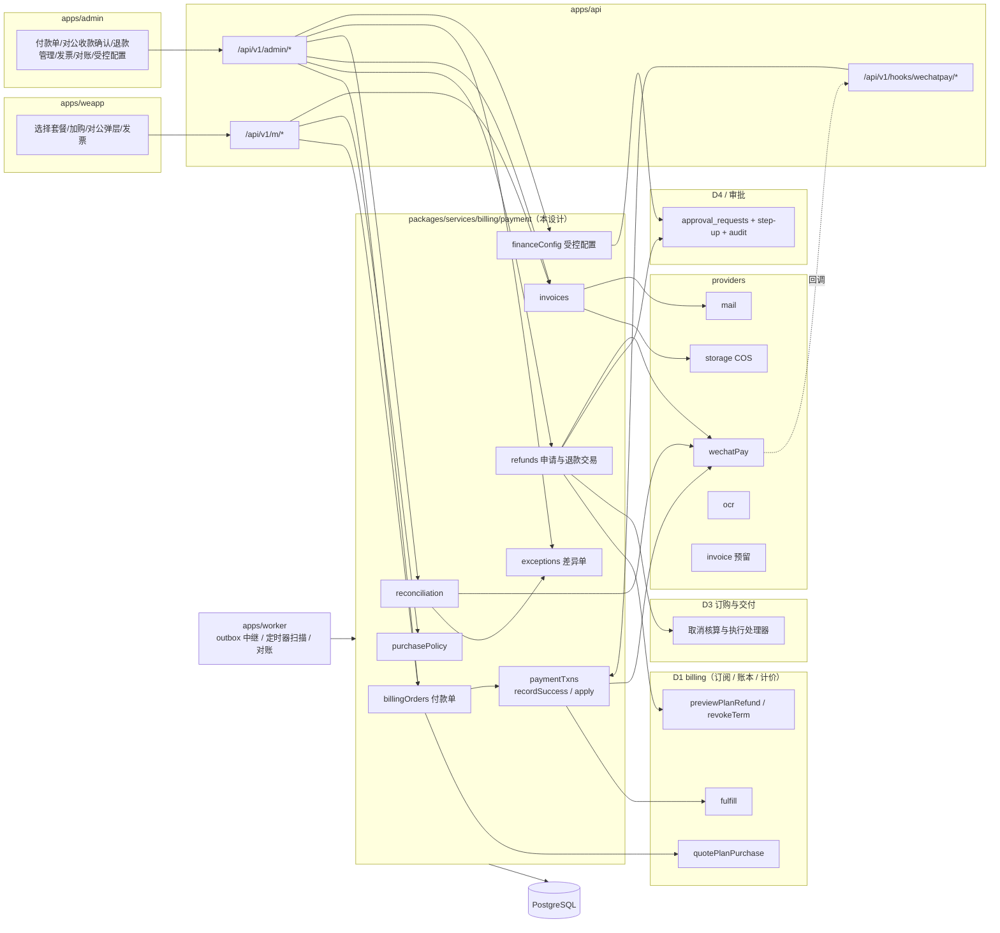
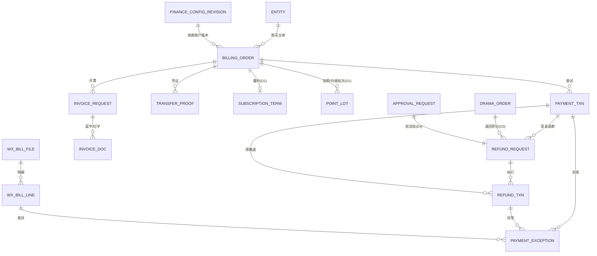
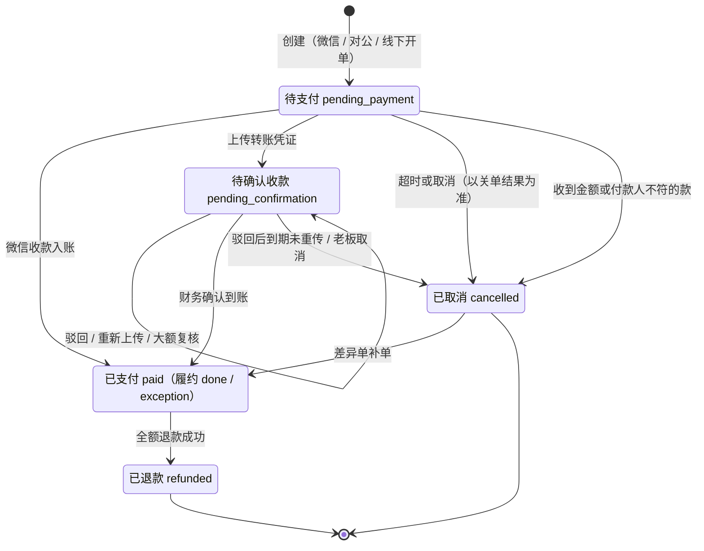
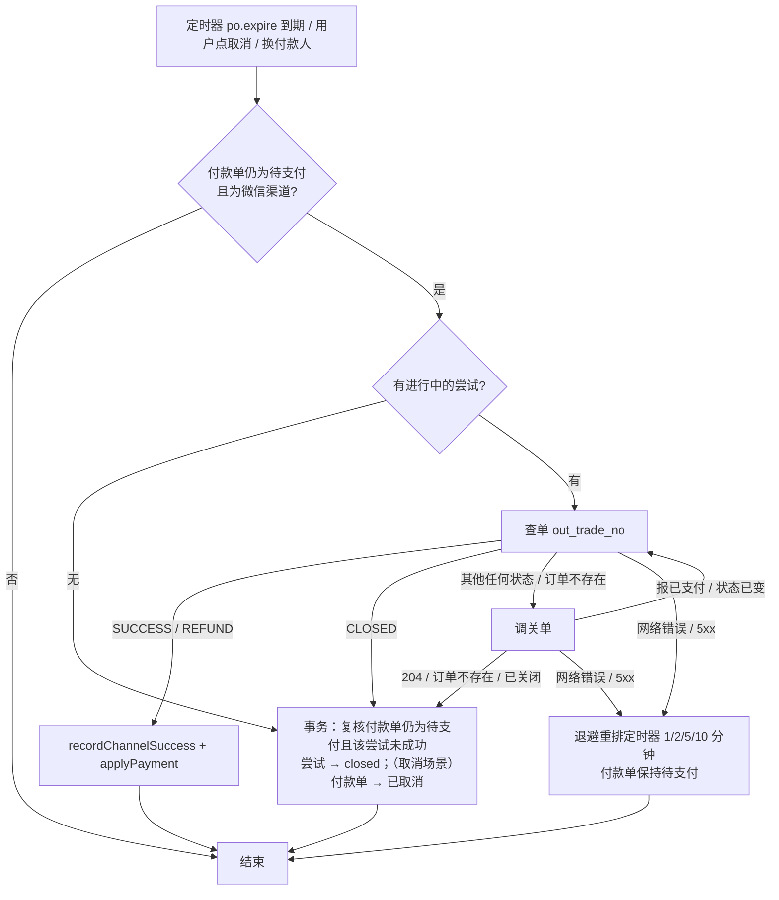
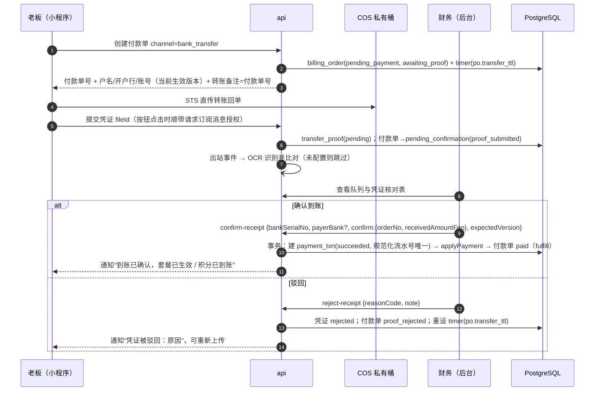
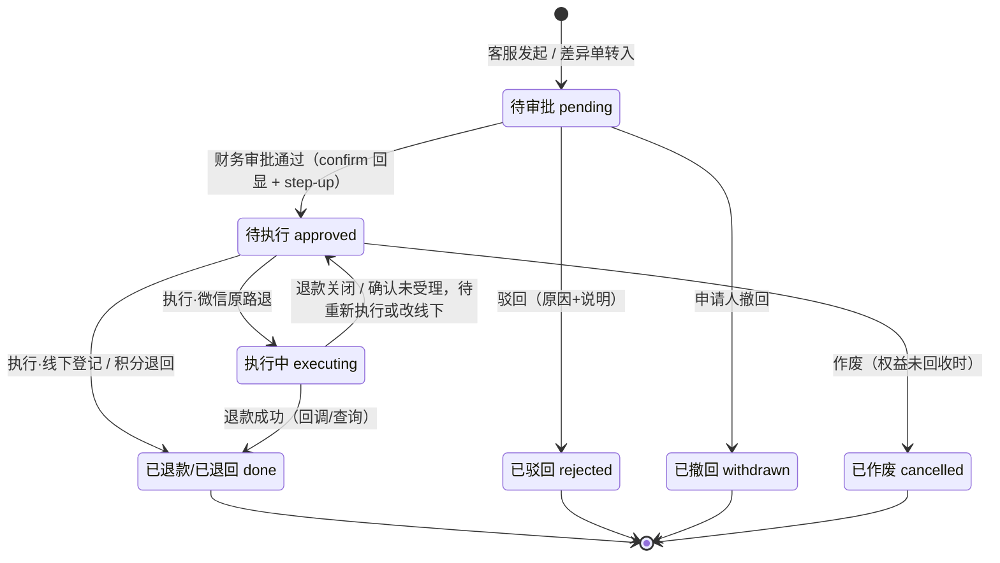
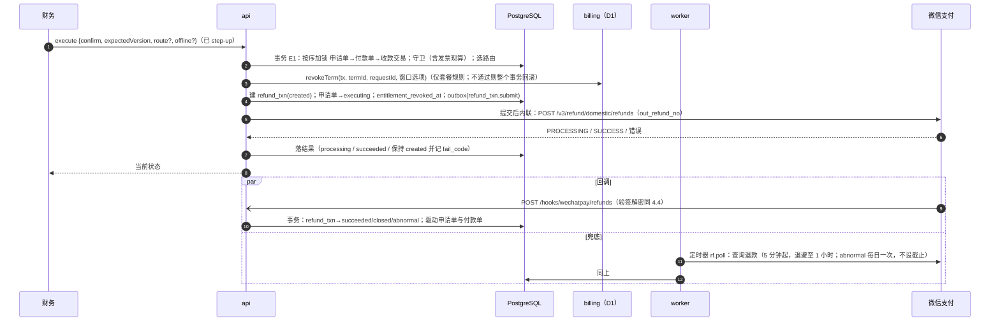
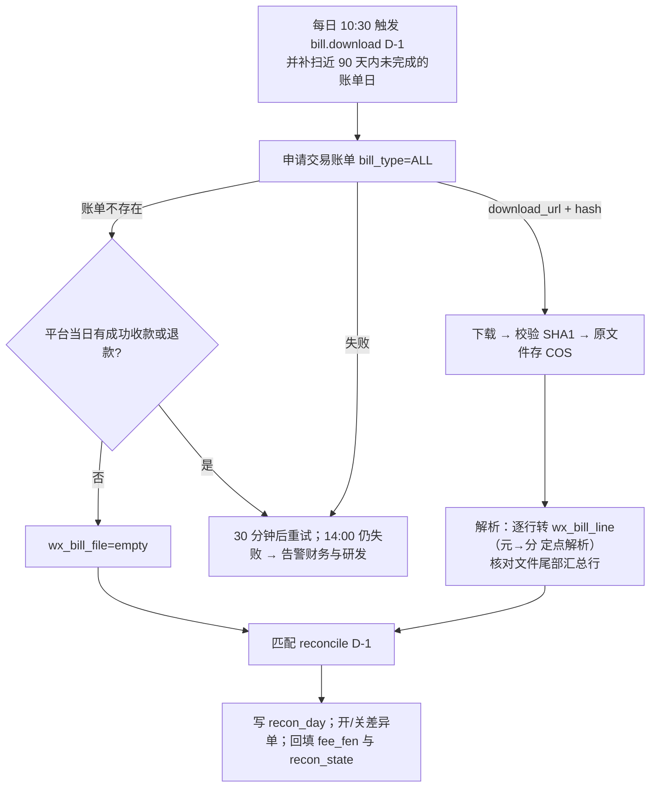
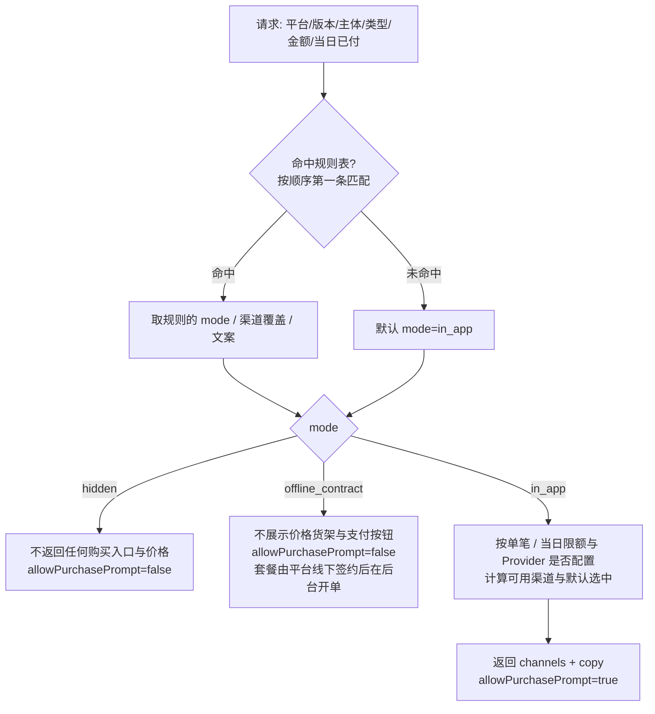
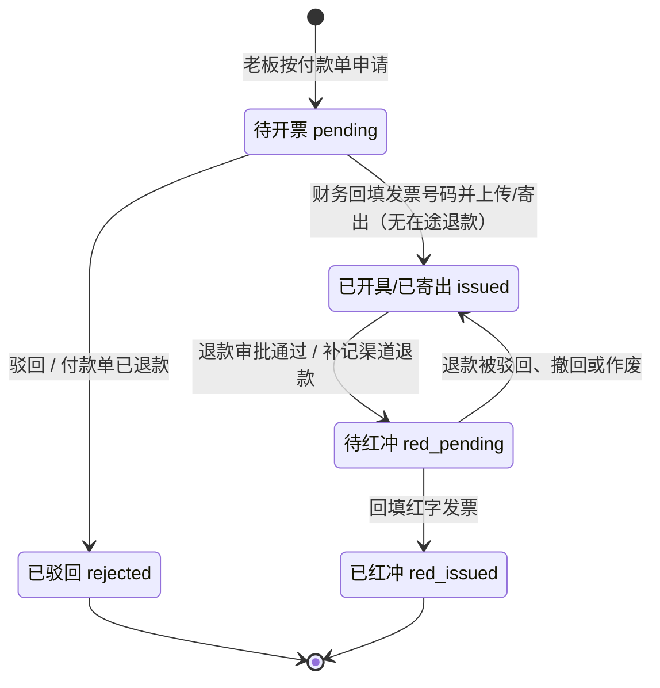

# D2 · 支付、对公转账、退款、对账与发票 —— 子系统详细设计（修订稿 v2）

- 版本：修订稿 v2（2026-10-02），依据对抗式评审 `design/d2-payment.critique.md`（2 个 blocker、12 个 major、16 个 minor）修订；逐条处理结果见第 19 节。
- 适用范围：「狸有戏」V1.0（商家端微信小程序 + 运营管理后台）
- 落点：`packages/services/src/billing/payment/*`（付款单、收款、退款、对账、发票）、`packages/services/src/providers/wechatPay/*`（渠道薄封装）、`packages/shared/src/money|purchasePolicy`（纯函数）、`packages/db`（表）、`apps/api`（`/api/v1/m/*`、`/api/v1/admin/*`、`/api/v1/hooks/wechatpay/*`）、`apps/worker`（中继、定时扫描、对账）
- 出处写法：`PRD §x.y`；`原型 admin/Refunds.txt:行`（`scratchpad/slim/…`）；`research/proto-admin-d §2.5`；外部核实结论用任务书编号（`pay-4`、`vpay-7` 等，均为 2026-10-02 核实结果）；`参考工程` 指 `timavia-liyo-project`；同批设计记作 `D1`（订阅、积分账本与计价，`design/d1-ledger.md`）、`D3`（订购与交付流程，`design/d3-flow.md`）、`D4`（身份、权限、审计，`design/d4-identity.md`）、`D6`（通知、文书、配置、数据，`design/d6-notify-docs-data.md`）。
- 标注：**【定】**=本设计的决定；**【默认】**=PRD/原型未定时的架构默认处理（可配置或易改，拍板人见第 14 节）；**【待核】**=须进件/提审/真机确认的外部事实；**【约定】**=与同批设计的接口约定，对方修订稿若不同，以第 2.4 节的裁决方式处理。

**相对原稿（v1）的主要变化**

1. 与 D1、D3、D4 的接口统一：付款单表按 D1 的命名（`billing_order`）；履约只调用 D1 的 `fulfill()`；套餐退款的规则核算与权益回收只调用 D1 的 `previewPlanRefund()` / `revokeTerm()`；审批走统一审批单，二次确认用 D4 的 `confirm` 回显与 step-up；锁顺序全仓一条。
2. 收到款但履约不了：付款单置“已支付 + 履约异常”，不再停在“待支付”。收到款但入不了账（金额或付款人不符、付款单已取消）：付款单立即离开“未完成”集合，不阻塞商家再次购买。
3. 删除付款分摊表 `payment_allocation`，预收款明细读 D1 的发放计划与批次。
4. 退款：窗口以申请时刻为准；申请时不再冻结积分；“改走线下”与微信侧退款互锁；超额退款照常落库并开差异单；“待执行”增加“作废”出口；V1.0 不支持的退款组合在服务端直接拒绝。
5. 资金事实保存渠道实收金额、付款人与 `attach`，入账时逐项校验；渠道单号带随机段，数据库按时间点恢复后不会串单；`attach` 携带可重建付款单的最小信息。
6. 对账：退款行只在 `SUCCESS` 时驱动状态，退款不按日对齐；差异单补全“类型 × 处理 × 迁移 × 副作用”矩阵。
7. 购买策略成为对其他子系统的公共契约；“商户号被归为虚拟行业”不再当作改限额即可应对。
8. 收款账户与内控开关改为“双人 + step-up + 延迟生效”的受控配置。

---

## 1. 目标、约束与不做什么

### 1.1 目标

1. 商家（仅老板）能为经营主体**开通 / 续费 / 升级套餐、加购积分**并付款：微信支付 JSAPI 或对公转账（PRD §2.1、§6.15）。
2. **钱的事实不丢、不重、不串**：任何一笔渠道侧成功的收款或退款，系统里必有且仅有一条对应记录；任何一张付款单至多履约一次。
3. 付款成功 → 付款单置“已支付”与**履约**（由 D1 的 `fulfill()` 完成）在**同一事务**，可重放、幂等。
4. 退款：客服发起 → 财务审批 → 财务执行（两步均二次确认），覆盖微信原路退（异步、可失败）、线下退款登记、已开票先红冲、支付满 1 年无法原路退（PRD §2.8、§7.9-2；`pay-5`）。
5. 订购 / 广告取消按阶段退回积分与现金退款**共用一条审批链与一个队列**（原型 admin/Refunds：`kind: cash | pts`）；积分侧的核算与执行由 D3 负责。
6. 每日自动下载微信账单逐笔对账；差异（含“回调晚于超时取消”“已收款无订单”）有唯一的差异单、唯一的处理入口（PRD §7.9-5）。
7. 发票：按付款单申请、抬头取认证主体、人工开具后回填、驳回、红字、邮件发送（PRD §6.13、§7.9-4）。
8. 给财务可核对的数据：收款 / 退款 / 差异 / 发票台账导出；预收款与收入确认明细由 D1 的发放计划与批次提供，本设计负责“收款侧合计”与它对得上（PRD §7.9-1、§12.1）。
9. 为“被判定为虚拟支付”准备好**不发版即可切换**的购买入口开关与两条退路（`vpay-1`～`vpay-7`）。

### 1.2 硬约束（来自已核实的外部事实）

| # | 约束 | 依据 | 对设计的直接后果 |
|---|---|---|---|
| K1 | 微信支付金额为整数“分”；回调须 5 秒内应答，失败按退避重试最多 15 次；不能只依赖回调 | `pay-3`、`pay-4` | 回调只做“验签→解密→落资金事实→应答”；另有主动查单与 T+1 对账两层兜底 |
| K2 | 新商户号默认“微信支付公钥”模式，按 `Wechatpay-Serial`（`PUB_KEY_ID_` 前缀）选密钥；有签名探测流量 | `pay-1` 及其额外发现 | 验签器是“按 Serial 查密钥表”，同时兼容平台证书；验签失败必须回 4XX/5XX + `{code:"FAIL"}` |
| K3 | 官方建议“查单 → 未支付才关单 → 关单成功（204）后才算失败终态”；官方只把 `SUCCESS`、`CLOSED`、`REFUND` 列为终态 | `pay-8` 更正 | **本地超时不直接取消**；除 `SUCCESS`、`CLOSED` 外的任何查单结果都先关单，以关单结果为准 |
| K4 | 退款须在支付成功后 365 天内；异步；失败重试必须用原 `out_refund_no`；最多 50 次部分退 | `pay-5` | 退款执行是独立状态机；超 1 年或对公付款走线下退款登记；同一申请名下的微信退款未到失败终态前不得改走线下 |
| K5 | 账单次日 10 点后可下，API 只能下 3 个月内，金额单位“元”；交易账单按“支付成功时间 / 退款受理成功时间”归日 | `pay-6`；`research/ext-wechat §1.1` | 10:30 起拉取并重试；原文件自存 COS；“元”字符串用定点解析成分；退款的匹配不按日对齐 |
| K6 | 付款人对同一商户有限额：实物行业单笔 / 单日 8 万；虚拟行业单笔 6000、单日 9000（现行数值与本商户号归类【待核】）；5 万元不是微信支付的限额线 | `pay-7` 更正 | 14.4 万年付不可能单笔微信支付；按“单笔 + 当日累计”两个维度决定微信渠道是否可用；商户号若被归为虚拟行业，按“被判定为虚拟支付”处理（切线下签约），不是调限额 |
| K7 | 小程序内虚拟商品须走虚拟支付且不得引导站外支付；“会员 + 充值积分”与官方举例同形；无 B2B 豁免明文；“小程序内展示对公转账入口”无官方明文许可 | `vpay-1/3/4/7` | 购买入口、可选渠道、文案、是否允许出现购买引导，全部由服务端下发；预留“虚拟支付渠道”与“小程序内不售卖、线下签约”两条退路 |
| K8 | 交易类小程序可能被要求接入“订单发货管理”，否则可能被限制支付权限（是否命中本小程序【待核】） | `pay` 组额外发现 | 进件后第一件事确认是否命中；命中则提审前打开“发货信息上报”并验证 |
| K9 | 数电发票自动开具须经税务直连服务商或托管电子税务局身份，V1.0 不具备条件 | `misc-3` 更正 | V1.0 人工开票回填；`InvoiceProvider` 只留接口 |
| K10 | 腾讯云 Redis 不承诺作为队列可靠；BullMQ 数据按“可丢”对待 | `inf-2` | 本子系统所有“必须发生”的动作都能从 PostgreSQL 的定时器表 / 出站事件表 / 状态扫描重新推导 |

### 1.3 规模假设

数百主体；付款单累计千级（原型示例 1,386 张，`research/proto-admin-b §4.2`；月收款约 207 笔，`research/proto-admin-d §1.2`）；财务 1～3 人。并发不是难点，难点是**并发下的正确性**（回调 × 超时 × 查单 × 人工操作交错）。

### 1.4 不做什么（V1.0）

- 不做自动续费 / 代扣；不做分期、拆单、合并支付、优惠券；不做付款单改价（V1.1）。
- 不接银企直连、不自动认款；对公到账只认财务人工确认。
- 不接开票接口、不接快递轨迹；不做合并 / 拆分开票。
- 不实现虚拟支付渠道，也不为它在表里预留枚举值与列；不为服务商代付、返佣预留列（V1.1 加可空列是一次迁移的事，见第 17 节）。
- 不下载、不解析资金账单（V1.0 的对账只用交易账单，手续费取交易账单的手续费列）。
- 不做会计总账与凭证，只提供财务可据以入账的明细数据。
- **不做**：部分金额退款、加购付款单的现金退款、升级补差的单独退款、已使用积分的套餐退款。模型留有金额字段，但服务端直接拒绝这些组合（7.7）。
- 不实现下列事项，只调用同批设计提供的函数：订阅周期与发放计划、积分批次与流水、升级报价与守卫、套餐退款的规则核算与权益回收（D1）；订购 / 广告取消的逐项核算与执行（D3）；审批单、权限点、step-up、审计（D4）；参数存取、导出任务、通知发送（D6）。

---

## 2. 总体方案与关键取舍

### 2.1 一句话方案

**付款单（业务单据，严格 5 态）**与**渠道交易（资金事实）**分表：收到钱先无条件记成“收款交易成功”（连同渠道实收金额、付款人、附加数据），再在同一个数据库事务里“入账到付款单 + 调用 D1 履约”。入不了账（付款单已取消、金额或付款人不符）就留成“未入账收款”并自动开一张**差异单**；入了账但履约不了（升级前提已变）就是“已支付 + 履约异常”，同样开差异单。两种情况付款单都立即离开“未完成”集合。超时取消以微信关单结果为准。退款是“申请单（挂统一审批单）+ 退款交易（资金事实）”两层，微信侧退款没到失败终态之前不允许换路。每日账单对账只负责“发现与微信不一致的地方”，发现后的处理入口与实时发现的差异单是同一个。

### 2.2 模块边界



### 2.3 关键决策一览（详见各节“备选与取舍”）

| # | 决策 | 为什么适合这个规模与团队 |
|---|---|---|
| J1 | 付款单只保留 PRD 的 5 个状态；渠道过程态（已下单、关单中、退款处理中）放在 `payment_txn` / `refund_txn`；履约结果放在 `fulfillment_status` | 业务与原型口径不被技术态污染；资金事实独立可审计 |
| J2 | “资金事实”与“入账履约”两步：先记收款成功（含实收金额、付款人），再入账；二者各自幂等 | 业务代码有 bug 时钱的记录也不丢；迟到回调、重复回调、对账补记都走同一函数 |
| J3 | 入账与履约**同一个数据库事务**；履约内容、周期、起算时刻全部由 D1 的 `fulfill()` 决定，本设计不编排 | 单库单体下最简单也最强；“建周期、算分摊”只有一个实现 |
| J4 | 收到款后付款单一律离开“未完成”集合：能入账的置“已支付”（履约 `done` 或 `exception`）；不能入账的置“已取消”并挂未入账收款 | 平台的处理延迟不变成商家的停购（评审 M4） |
| J5 | 超时取消 = 查单 → 关单 → 以关单结果为准；微信侧 `time_expire` 与本地到期对齐并留 60 秒宽限；预下单落结果的事务带守卫 | 按官方建议从根上消除“回调晚于取消”（`pay-8`）；预下单与取消的竞态有确定结局（评审 M5） |
| J6 | 外部调用一律“先落意图并提交 → 调外部 → 再落结果”，绝不在持有行锁的事务里发 HTTP；提交后**内联尝试一次**，出站事件 + 定时扫描兜底 | 不拖长事务；Redis/BullMQ 丢数据不影响正确性 |
| J7 | 差异单是实时异常与 T+1 对账差异的**同一种单据**，每种差异有固定的可选处理与迁移（8.4） | 财务只有一个处理入口；补单 / 退款逻辑只写一遍 |
| J8 | 差异“原路退款”生成退款申请走审批 + 执行；“补单”一步完成但须二次确认回显 + step-up + 系统实时查单校验 | 满足 PRD §3.3-3“退款须审批”，又不让补单被流程拖慢 |
| J9 | 套餐退款：7 天窗口以**申请时刻**为准并快照；申请时不冻结积分；执行事务内由 D1 的 `revokeTerm()` 一次校验并作废权益；退款成功才把付款单置“已退款” | 合规申请不会因平台处理慢而超窗（评审 M1）；不与 D1 的守卫互相打架（评审 B1-e） |
| J10 | 同一申请名下的微信退款交易未到失败终态（已关闭 / 经查询确认未受理）前，不允许改走线下；超额的成功退款照常落库并开差异单 | 杜绝“同一笔钱退两次”与“成功的退款落不了库”（评审 B2） |
| J11 | 渠道抽象 `PaymentChannel`（V1.0 两个实现）+ 服务端购买策略 `getPurchasePolicy`，策略是通知、订购等子系统必须调用的公共契约 | 被判虚拟支付时改配置即可下线全部购买引导（评审 M10） |
| J12 | 退路 B（线下签约 + 后台开单 + 对公确认）在 V1.0 即实现、默认关闭 | 它是唯一不依赖小程序发版与平台审核的收款路径，成本只多一个后台接口（第 13 节分歧 1） |
| J13 | 审批用统一审批单（D4 §7.6）记录“批没批”，`refund_request` 是领域单据并与审批单一对一；执行状态机在本设计 | 待审批只查一处；“发起人 ≠ 审批人”由数据库约束兜底；退款的异步执行细节不进通用表 |
| J14 | 发票“申请单 + 票据（蓝 / 红）”两表；一张付款单同一时刻至多一张有效申请；红冲前置在执行事务里按发票当前状态现算 | 红冲、重开、将来接开票接口都不改模型；开票与退款的竞态有确定结局（评审 M7） |
| J15 | 收款账户、购买策略、内控开关是“受控配置”：提议人 ≠ 批准人、step-up、收款账户延迟 24 小时生效并通知全体财务与超级管理员 | 后台账号被盗或内部替换收款账户时有第二道门（评审 M11） |

### 2.4 跨设计接口约定【约定】

D1、D3、D4、D6 与本设计同期撰写、同期修订。下表是本设计采用的约定：左列是事项，中列是归属与本设计的用法，右列是需要对方配合的增量（对方修订稿若未提供，本设计给出的退路）。**需架构师定稿的只有标“待裁决”的三项。**

| 事项 | 归属与本设计的用法 | 需要对方配合 / 退路 |
|---|---|---|
| 付款单表 | 表由本设计建，命名与必备字段按 D1 §4.4：`billing_order`、`type = plan_new / plan_renew / plan_upgrade / topup`（服务端判定）、`content_snapshot`、`amount_fen`、`channel`、`expires_at`、`paid_at`、`fulfillment_status` | D1 只读 `entity_id / type / content_snapshot / amount_fen / paid_at`；V1.0 `channel` 的 CHECK 只含 `wechat_jsapi`、`bank_transfer` |
| 报价与类型判定 | D1 的 `quotePlanPurchase()`（含升级的周期 id、月序、其后已预付整月、`validUntil`）与积分包价目；本设计不计算金额，只比对入参与落快照 | — |
| 履约 | 只调用 `billing.fulfill(tx, billingOrderId)`（D1 §6.4）；起算时刻、周期、发放计划、批次由它内部决定；返回 `done` 或 `exception` | 约定返回 `{ status, termId?, lotIds?, exceptionCode?, note? }`，由本设计写回付款单；若 D1 实现为自己写 `fulfillment_*` 三个字段，等价 |
| 套餐退款核算与权益回收 | 只调用 `billing.previewPlanRefund()` 与 `billing.revokeTerm()`（D1 §6.10）；本设计不自己判窗口、不冻结积分、不作废批次 | **增量 1**：两个函数接受窗口判定时刻 `windowAsOf`（= 申请时刻，见 7.4），以及免窗口标记 `windowWaived`（资质终审不通过、规则外）；“未使用”“未升级”两条仍按执行时的当前事实判。退路：若 D1 不提供，评审 M1 的问题无法在本设计内解决，只能把“超窗”当作规则外退款处理 |
| 7 天窗口的起点 | 由 D1 的 `previewPlanRefund` 唯一实现 | **待裁决 1**：D1 现稿为“付款单 `paid_at` 起”；原型对续费单按“本期已生效 16 天”表述（admin/Refunds TK20260925003：09-08 付款、09-10 生效、09-25 申请）。本设计建议起点取 `max(paid_at, 周期 starts_at)`；无论结论如何，只改 D1 一处 |
| 预收款明细 | D1 的 `grant_schedule`（未发放月份）与 `point_lot`（已发放批次的折算价值）是唯一来源；本设计删除 `payment_allocation` | D1 的不变量 I12 需把两类付款单排除在“已退款的套餐付款单其周期为已退款”之外：`fulfillment_status = exception` 的（从未建周期）与挂着 `entitlement_unrecovered` 差异单的（8.4） |
| 计费参数 | 付款单超时、对公有效期、升级报价有效期、退款窗口取 D1 的 `billing_param_revision`：`paymentTimeoutMinutes`、`bankTransferValidDays`、`upgradeQuoteValidDays`、`planRefundWindowHours`；本设计不再另设同义参数 | — |
| 灾备重建付款单 | 本设计按微信 `attach` 重建付款单（9.5） | **增量 2**：D1 提供 `billing.rebuildOrderContent(tx, { type, planRevisionId?, months?, packId? })`，按不可变的价目修订重建 `content_snapshot` 与应付金额。退路：不重建，只能退款 |
| 锁顺序 | 全仓一条：审批单 → 领域单据行 → `billing_account`（由 D1 函数内部加锁，永远最后）。本设计内部的单据次序见 9.1 | 本设计的任何事务都不先于单据行去锁 `billing_account` |
| 订购 / 广告取消退回积分 | `refund_request(kind = points)` 是领域单据与队列入口；逐项核算、售后态、执行（调用账本 `release / refund`）由 D3 §16 的处理器完成 | “开工前取消是否审批”的开关只留 D3 的 `order.cancel_before_start.requires_approval`，本设计原有的同义参数删除 |
| 审批 | “批没批”用统一审批单 `approval_requests`（D4 §7.6，类型 `refund`）；单号 `TK…` 两表共用；通过 / 驳回 / 撤销时在审批事务内回调本设计的处理器 | **待裁决 2**：D3 §17 提出把审批表扩成含执行态与“审核类”的超集。本设计对两种形态都兼容：执行状态以 `refund_request` 为准，审批表若有 `executing / done` 则由本设计同步。对公收款确认、开票申请是否也镜像进审批表，本设计的立场是不镜像（它们的状态机在 `billing_order.transfer_state`、`invoice_request`，再镜像一份就是两处真相），工作台待办数由本设计的计数接口提供 |
| 二次确认与 step-up | 采用 D4 §7.5：请求体带 `confirm` 回显（单号 + 金额分），服务端在事务内比对，不一致 409 `CONFIRM_MISMATCH`；资金类权限点要求 step-up | **增量 3**：D4 的权限点注册表补充本设计新增的权限点并标注 step-up（12.2）；`reconcile.resolve` 由“不要 step-up”改为“要” |
| 权限点与参数命名 | 以 D4 为准：`refund.request / refund.approve / refund.execute`、`payment.transfer.confirm`、`invoice.issue / invoice.reject`、`reconcile.resolve`、`pii.bank.reveal`；职责分离参数 `sod.refund.distinct_executor` | — |
| 公共表 | `outbox_event`（D3 §20）、`timer`（D3 §21）、`idempotency_record`、`biz_sequence`（D3 §3.2、§3.3）；`audit_logs`（D4 §8）；参数服务（D6 §4.2）；导出任务（D6 §5.4） | **增量 4**：`biz_sequence` 的灾备约定——按时间点恢复后先把当日各前缀的流水整体上跳（9.5） |
| 购买策略 | 本设计提供 `billing.getPurchasePolicy()`；通知（续费与清零提醒、积分不足）、订购（积分不足引导）、首页待办**必须**在输出购买引导前调用 | **增量 5**：D3、D6 在对应场景接入；策略为 `allowPurchasePrompt = false` 时只发状态类文案，不带价格与购买入口 |
| 资质终审不通过 | 套餐退款规则 `qualification_failed` 依赖“主体资质已无法补正”的判定 | **增量 6**：商家模块提供 `merchant.isQualificationDead(tx, entityId)`（D3 §17.5 的终局驳回事件 `store.qualification.rejected(final = true)` 是其来源）。**待裁决 3**：该规则超出 PRD §2.8 的字面（见 P27） |

---

## 3. 数据模型

约定：

- 主键 `id` 的类型随 `packages/db` 全局约定；时间一律 `timestamptz`（UTC 存储，业务日按 `Asia/Shanghai`）；事务内的“现在”取数据库时间（与 D1 §3.1 一致）。
- **金额列以 `_fen` 结尾，类型 `int`**（单行上限约 2,147 万元，单笔最大 14.4 万元，足够；与 D1 §3.3 一致）。聚合在 SQL 里转 `bigint`，在接口边界转成字符串，不让 `BigInt` 进入 JSON 与 Zod 的 number 类型。
- 枚举用 `text + CHECK`，取值在 `packages/contract` 以 Zod enum 为唯一来源（与 D1 §4 一致）。
- 所有表有 `created_at`、`updated_at`；带人工并发写的表有 `version int`（状态迁移一律“带原状态条件的 UPDATE”，后台操作另带 `expectedVersion`）。
- 标注 `(enc)` 的列为字段级加密、接口按权限脱敏（D4 §9.2、§9.3）。
- CHECK、部分唯一索引用手写 SQL 迁移维护，并列入 D1 §4.7 的“约束清单与库内实际约束比对”脚本。

### 3.1 `billing_order` 付款单（FK…）

| 字段 | 类型 | 约束 / 说明 |
|---|---|---|
| order_no | text | 唯一。`FK` + yyyymmdd + 5 位日流水（原型 admin/Orders）；流水超过 5 位自动扩位；预发环境加前缀 `T` |
| entity_id | fk | 非空。购买主体（PRD §2.2-1） |
| store_id | fk | 可空。创建时的当前门店，仅用于列表展示 |
| type | text | `plan_new` 开通 / `plan_renew` 续费（含降级续费）/ `plan_upgrade` 升级补差 / `topup` 加购积分。**由服务端按 D1 §6.3 判定**，前端不传 |
| status | text | `pending_payment` 待支付 / `pending_confirmation` 待确认收款 / `paid` 已支付 / `cancelled` 已取消 / `refunded` 已退款（PRD §5.3，严格 5 种） |
| channel | text | `wechat_jsapi` / `bank_transfer`（V1.0 的 CHECK 只有这两个值） |
| source | text | `miniapp` / `admin`（线下签约开单，退路 B） |
| content_snapshot | jsonb | D1 §4.4 的 `BillingOrderContent`（套餐 / 升级 / 加购三种形态；升级含 `termId、monthIndex、remainingDays、remainingFullMonths、payFen、topupPoints、validUntil`）。**履约只认快照，不回查现价**（PRD §2.2-8） |
| formula_code / formula_args | text / jsonb | 计算式（“¥6,000 × 3 个月”），展示用 |
| quote_hash | text | 快照内容哈希，用于“同内容未完成付款单复用” |
| amount_fen | int | 应付金额，> 0（V1.0 不改价，等于报价金额） |
| paid_amount_fen | int | 默认 0；入账时写入**渠道实收金额** |
| refunded_amount_fen | int | 默认 0；`CHECK (refunded_amount_fen >= 0)`。**不设上限 CHECK**：超额退款是需要记录的资金事实，由不变量 I3 与 `refund_over` 差异单发现（7.3） |
| expires_at | timestamptz | 待支付截止。微信：创建 + `paymentTimeoutMinutes`；对公：创建 + `bankTransferValidDays`；升级另受快照 `validUntil` 约束（4.2） |
| transfer_state | text? | 仅对公：`awaiting_proof` / `proof_submitted` / `proof_rejected` / `confirm_review`（大额复核中，仅当开启二人复核） |
| bank_account_revision_id | fk? | 仅对公：创建时展示给商家的收款账户版本（3.9） |
| paid_at | timestamptz | 收款时间 = 微信 `success_time` / 财务确认到账时间（与 D1 §4.4 一致） |
| paid_txn_id / applied_at | | 入账的收款交易；入账事务时间 |
| fulfillment_status | text | `none` / `done` / `exception`（D1 §4.4）。“已支付 / 已退款 ⇔ 履约状态非 `none`”由不变量 I1 校验，不做行级 CHECK（同一事务内先置已支付、再写履约结果，两条语句之间不满足） |
| fulfilled_at / fulfillment_note / fulfillment_result | | 履约完成时刻、说明（如“重复付款，多排一个周期”“升级前提已变”）、`{termId, lotIds[]}` |
| cancelled_at / cancel_reason | | `timeout` / `user` / `staff` / `transfer_ttl` / `amount_mismatch` / `payer_mismatch` |
| refunded_at | timestamptz | 全额退款成功时间 |
| has_open_exception | bool | 冗余：存在未决差异单（列表打标“对账差异待处理”，原型 admin/Orders.txt:155-157） |
| agreement_versions | jsonb | 付款时同意的协议版本（原型 merchant/PlanPick.txt:27“付款即表示同意”） |
| client_platform / client_version | text | 下单端信息（排查虚拟支付与策略命中） |
| contract_no | text | `source = admin` 必填：线下合同号 |
| placed_by_user_id / created_by_staff_id | fk | 二选一 |
| rebuilt_from | text? | 灾备重建时记录原 `out_trade_no`（9.5） |
| version | int | 乐观锁 |

索引与唯一键：

- `UNIQUE (order_no)`
- `UNIQUE (entity_id) WHERE status IN ('pending_payment','pending_confirmation') AND type IN ('plan_new','plan_renew','plan_upgrade')` —— **同一主体同一时刻只允许一张未完成的套餐类付款单**（避免两张报价互相失效）。收到过款的付款单必然不在这个集合里（4.5），所以它不会因平台处理慢而长期占位。
- `(entity_id, created_at DESC)`；`(status, expires_at) WHERE status = 'pending_payment'`；`(status, channel, created_at)`；`(fulfillment_status) WHERE fulfillment_status = 'exception'`

### 3.2 `payment_txn` 收款交易（渠道侧一次收款尝试；成功的即“收款流水”）

| 字段 | 类型 | 约束 / 说明 |
|---|---|---|
| billing_order_id | fk | 可空：仅“账单 / 银行有、平台无对应付款单”的孤儿交易为空 |
| channel | text | 同付款单 |
| attempt_seq | smallint | 从 1 起。产生第 2 次及以后尝试的唯一场景：付款人 openid 变了（4.3） |
| out_trade_no | text | **唯一**。`{order_no}-{attempt_seq 两位}-{6 位随机 [0-9A-Z]}`，如 `FK2026093000006-01-7QK2M9`（25 位，满足 6–32 位与字符集限制，`research/ext-wechat §1.1`）。随机段使渠道单号不随流水回退而重复（9.5）。对公渠道同样生成，作为内部引用 |
| amount_fen | int | > 0，下单时的应付金额 |
| channel_amount_fen | int | **渠道实收金额**：微信回调 / 查单 / 账单返回的 `amount.total`；对公为财务确认的到账金额。成功前为空 |
| payer_openid | text | 微信：预下单时取当前会话的 openid，即 JSAPI 的 `payer.openid` |
| channel_payer_ref | text | 渠道返回的付款人：微信回调里的 `payer.openid` / 对公付款户名 |
| attach / channel_attach | text | 下单时写给微信的附加数据（≤128 字节，格式见 4.3）/ 回调或查单返回的附加数据。二者应相同，用于入账校验与灾备重建 |
| status | text | `created`（已建、预下单在途或失败）/ `prepaid`（已拿到 prepay_id，等用户付）/ `succeeded` / `closed` |
| applied_at | timestamptz | 入账到付款单的时间 |
| refunded_fen | int | 默认 0；该笔收款已成功退回的金额，`CHECK (refunded_fen >= 0)`，不设上限 CHECK（理由同 3.1）。**未入账收款** = `status = 'succeeded' AND applied_at IS NULL AND refunded_fen < channel_amount_fen` |
| prepay_id / prepay_expires_at | | prepay_id 有效 2 小时（`pay-3`） |
| channel_txn_no | text | 微信 `transaction_id` / **规范化后的**银行流水号（去首尾空白、全角转半角、去内部空格与连字符、转大写） |
| bank_serial_raw / payer_bank | text | 对公：财务录入的原始流水号；付款行（字典，可空，仅在流水号冲突时填写） |
| channel_success_at | timestamptz | 微信 `success_time` / 财务确认到账时间 |
| trade_state_raw / bank_type | text | 渠道原始状态、付款银行 |
| fee_fen | int | 手续费，对账时由交易账单回填 |
| proof_id / confirmed_by_staff_id / reviewed_by_staff_id | fk | 对公：被采纳的凭证、确认人、复核人（开启二人复核时） |
| recon_state | text | `pending` 待对账 / `matched` 已对平 / `diff` 有差异 / `resolved` 已处理（原型 admin/Payments 行级对账状态） |
| recon_bill_date | date | 对平所依据的账单日 |
| last_queried_at / query_count | | 主动查单节流 |

索引与唯一键：

- `UNIQUE (out_trade_no)`
- `UNIQUE (channel, channel_txn_no, COALESCE(payer_bank, '')) WHERE channel_txn_no IS NOT NULL` —— **同一微信交易号 / 同一银行流水号只能入库一次**
- `UNIQUE (billing_order_id) WHERE status IN ('created','prepaid')` —— 一张付款单至多一个进行中的尝试
- `UNIQUE (billing_order_id) WHERE applied_at IS NOT NULL` —— 一张付款单至多入账一笔（V1.0 不支持分笔付款）
- `(status, channel_success_at)`；`(recon_state, channel_success_at)`；`(payer_openid, channel_success_at) WHERE status = 'succeeded'`（当日累计，5.1）

### 3.3 `transfer_proof` 对公转账凭证

| 字段 | 说明 |
|---|---|
| billing_order_id, seq | 一张付款单可多次上传（原型 admin/Receipts：“驳回后…可重新上传”） |
| file_id | COS 私有桶文件；图片 ≤ 5MB（jpg/png）或 PDF |
| uploaded_by_user_id / uploaded_by_staff_id, uploaded_at | 后台代传时记员工 |
| ocr_result jsonb | `{payer_name, amount_fen, remark, trade_time}`；OCR 未配置或失败为 `null` |
| check_result jsonb | 系统比对四项：户名一致、金额一致、附言含付款单号、转账时间晚于创建（原型 admin/Receipts “凭证核对”表）。**仅提示，不阻断** |
| review_status | `pending` / `accepted` / `rejected` / `superseded`（被新凭证替换） |
| first_confirm jsonb | 仅二人复核：第一名财务的确认内容 `{staffId, at, bankSerialNorm, payerBank, receivedAmountFen}` |
| reviewed_by, reviewed_at, reject_reason_code, reject_note | 驳回原因 5 项字典（未到账 / 金额不符 / 户名与购买主体不一致 / 凭证无法识别 / 其他）+ 说明 ≤ 200 字 |

唯一键：`UNIQUE (billing_order_id) WHERE review_status = 'pending'`。

### 3.4 `refund_request` 退款 / 退回申请（TK…）

| 字段 | 类型 | 说明 |
|---|---|---|
| request_no | text | 唯一。`TK` + yyyymmdd + 3 位（当日超过 999 自动扩位，与 D3 §3.3 的 `biz_sequence` 规则一致）；**与统一审批单的 `no` 相同** |
| approval_request_id | fk | 唯一。对应的审批单（D4 §7.6，类型 `refund`） |
| kind | text | `cash` 现金退款 / `points` 订购或广告取消退回积分 |
| source | text | `customer_service` / `exception`（差异单或履约异常转入） |
| entity_id, store_id | fk | |
| billing_order_id | fk? | `cash`：被退的付款单（孤儿收款为空） |
| payment_txn_id | fk? | `cash` 必填：被退的那一笔收款交易 |
| subject_type / subject_id | text / fk | `points` 必填：`drama_order` / `ad_task`（PRD §2.8 的对象是“订购与广告”；广告取消是否进入本审批链由 D3 §16.3 决定） |
| unit | text | `fen` / `point` |
| base_amount, deduct_amount, amount | int | 基数、扣除、申请退回数；`CHECK (amount = base_amount - deduct_amount AND amount > 0)` |
| breakdown | jsonb | `points`：D3 §16.2 的逐项核算行 `{itemId, phase, charge, ratioBp, deduct, refund}` 与 `billing.previewReturn` 给出的去向；`cash`：`{termId, windowRefAt, windowOk, usageOk, upgraded, addonAvailable}` |
| rule_code, rule_text | text | 适用规则及其文案快照。`cash` 的规则码见 7.4：`plan_7d` / `qualification_failed` / `window_waived` / `fulfillment_exception` / `unapplied_receipt` |
| window_ref_at | timestamptz | 套餐退款的窗口判定时刻（7.4）；其他规则为空 |
| recheck_log | jsonb | 审批、执行时的复核结果（各存一份，供排查） |
| is_override | bool | 规则外退款（V1.0 只有“免窗口”一种，仅超级管理员可发起） |
| reason_code, note, service_ticket_id | | 申请原因、说明、关联客服工单 |
| status | text | `pending` 待审批 / `approved` 待执行 / `executing` 执行中 / `done` 已退款或已退回 / `rejected` 已驳回 / `withdrawn` 已撤回 / `cancelled` 已作废（审批通过后撤销） |
| exec_route | text | `wechat_original` / `offline` / `points_ledger`；执行时确定 |
| entitlement_revoked_at | timestamptz | 套餐权益已回收的时刻（非空后申请单不可作废，7.2） |
| applicant_staff_id, applied_at | | 与审批单的发起人、发起时间一致（冗余，便于队列查询） |
| approved_by, approved_at | | 审批单通过时回写 |
| executed_by, executed_at, done_at | | |
| cancelled_by, cancelled_at, cancel_note | | 作废 |
| exec_error | jsonb | 最近一次执行失败的原因（供“待执行 / 执行中”队列展示） |
| version | int | |

唯一键：`UNIQUE (request_no)`；`UNIQUE (approval_request_id)`；`UNIQUE (payment_txn_id) WHERE status IN ('pending','approved','executing')`；`UNIQUE (subject_type, subject_id) WHERE status IN ('pending','approved','executing')`（同一标的只允许一张在途申请，`research/proto-admin-b §5.3`）。

### 3.5 `refund_txn` 退款交易

| 字段 | 说明 |
|---|---|
| refund_request_id | 可空：仅“补记渠道退款”（8.4）为空 |
| billing_order_id, payment_txn_id | 原收款交易必填（原路退需要 `out_trade_no`） |
| channel | `wechat_jsapi` / `offline` |
| origin | `system`（本系统发起）/ `external`（在微信商户平台直接发起、事后补记） |
| out_refund_no | **唯一**。`{request_no}-{seq 两位}-{6 位随机}`；重试同一次退款必须沿用（`pay-5`）；`external` 取账单里的商户退款单号 |
| amount_fen | > 0 |
| status | `created`（已建；是否被微信受理未知或被明确拒绝，待重试）/ `processing`（微信已受理）/ `succeeded` / `closed`（微信关闭，终态）/ `abnormal`（微信侧异常，**非终态**）/ `not_accepted`（经查询确认微信侧不存在该退款单，终态）/ `abandoned`（异常退款经微信侧确认无法继续后人工放弃，终态，见 7.3） |
| channel_refund_no | 微信 `refund_id` / 线下退款银行流水号；`UNIQUE (channel, channel_refund_no) WHERE NOT NULL` |
| submit_count, last_submit_at, retry_halted | 提交次数、最近一次提交时间、是否已停止自动重试 |
| success_at, user_received_account | 退款入账时间、入账账户描述 |
| fail_code, fail_message | 如余额不足、频率限制、超期 |
| late_success | bool：从失败终态被渠道事实改成成功（必开差异单） |
| 线下登记字段 | `transfer_date, payee_name, payee_bank, payee_account (enc), receipt_file_id, registered_by` |
| fee_refund_fen, recon_state, recon_bill_date, last_queried_at | 同收款 |

唯一键：`UNIQUE (out_refund_no)`；`UNIQUE (refund_request_id) WHERE status IN ('created','processing','abnormal')` —— **一张申请同一时刻至多一条未到终态的退款交易**，`abnormal` 在其中（评审 B2）。

### 3.6 `payment_exception` 差异单（实时异常与对账差异共用）

| 字段 | 说明 |
|---|---|
| exception_no | `CY` + yyyymmdd + 3 位起、自动扩位（架构自定前缀） |
| kind | 收款侧：`paid_after_cancel`（已取消后收到款）/ `amount_mismatch`（实收与应付不符）/ `payer_mismatch`（付款人或 `attach` 与付款单不符）/ `duplicate_receipt`（已支付的付款单又收到一笔）/ `fulfillment_exception`（已支付但履约异常）/ `bill_only`（账单有、平台无）/ `platform_only`（平台有、账单无）/ `status_mismatch`（本库成功而渠道查询非成功等矛盾）/ `bank_unmatched`（对公到账无对应付款单，人工登记）。退款侧：`refund_bill_only` / `refund_platform_only` / `refund_amount_mismatch` / `refund_over`（累计成功退款超过实收）/ `entitlement_unrecovered`（钱已退出、权益未能收回） |
| detected_by | `callback` / `query` / `apply` / `reconciliation` / `manual` |
| bill_date | 对账发现时为账单日；实时发现时为发生日 |
| billing_order_id, payment_txn_id, refund_txn_id, wx_bill_line_id | 均可空 |
| amount_fen, bill_fact jsonb, platform_fact jsonb, cause_text | 两侧事实与系统判断的原因（原型 admin/Reconcile.txt:83-102） |
| status | `open` / `resolving`（已转退款申请，等待完成）/ `resolved` / `auto_healed` / `ignored`。**未决 = `open` 或 `resolving`** |
| resolution | `restore` 补单 / `refund` 原路或线下退款 / `rebuild_order` 重建付款单并入账 / `link_order` 关联到付款单并确认 / `offline_return` 线下退回 / `record_channel_refund` 补记渠道退款 / `corrected` 数据更正 / `written_off` 核销 / `none` |
| resolution_note, resolved_by, resolved_at, refund_request_id | 处理说明必填 ≤ 200 字 |
| dedupe_key | **唯一**，如 `paid_after_cancel:FK…-01-7QK2M9`、`bill_only:2026-09-29:4200…`；重跑对账、重复调用入账都不会重复开单 |

### 3.7 对账用表

**`wx_bill_file`**：`mchid, bill_date, bill_type('trade_all'), status('pending' | 'downloaded' | 'parsed' | 'empty' | 'failed'), storage_key, sha1, hash_verified, line_count, summary jsonb, attempt_count, last_error, downloaded_at`；`UNIQUE (mchid, bill_date, bill_type)`。

**`wx_bill_line`**：`bill_file_id, line_no, bill_date, line_kind('payment' | 'refund'), trade_time, appid, mchid, transaction_id, out_trade_no, trade_state, order_amount_fen, settle_amount_fen, refund_id, out_refund_no, refund_amount_fen, refund_state, attach（账单若含“商户数据包”列则填，【待核】；重建付款单以查单返回的为准）, fee_fen, rate_text, is_foreign, match_state('matched' | 'matched_pending' | 'diff' | 'unmatched' | 'foreign'), matched_txn_id, matched_refund_txn_id`；`UNIQUE (bill_file_id, line_no)`（同一笔退款可能在受理日与成功日的账单各出现一行，所以不以退款单号做唯一键，【待核】见 8.2）；索引 `(out_trade_no)`、`(out_refund_no)`。

**`recon_day`**：`bill_date, channel, platform_pay_count, platform_pay_fen, bill_pay_count, bill_pay_fen, platform_refund_count, platform_refund_fen, bill_refund_count, bill_refund_fen, bank_count, bank_fen, fee_fen, diff_count, diff_fen, status('wait' | 'ok' | 'diff' | 'fixed'), run_count, last_run_at`；`UNIQUE (bill_date, channel)`。四态与原型 admin/Reconcile.txt:134-144 一致。

### 3.8 发票

**`invoice_request` 开票申请（KP…）**

| 字段 | 说明 |
|---|---|
| request_no | 唯一。`KP` + yyyymmdd + 3 位起、自动扩位 |
| billing_order_id, entity_id | |
| amount_fen | V1.0 恒等于付款单实付全额 |
| invoice_type | `normal` 普通发票 / `special` 增值税专用发票 |
| medium | `electronic` / `paper`；`CHECK (invoice_type = 'special' OR medium = 'electronic')`（普票仅电子，PRD §12.3-10、原型 merchant/Invoices.txt:106） |
| title, tax_no (enc) | **申请时从认证主体快照**，接口不接受客户端传入（PRD §7.9-4“不可修改”） |
| addr_tel (enc), bank_account (enc) | 专票必填 |
| recv_email (enc) | 电子必填 |
| mail_to (enc) jsonb | 纸质：收件人、电话、地址（可编辑，默认带出联系人与门店地址） |
| item_name | 开票项目快照，取配置 `invoice.item_name.{type}`（见 P13） |
| status | `pending` 待开票 / `issued` 已开具（纸质展示为“已寄出”）/ `rejected` 已驳回 / `red_pending` 待红冲 / `red_issued` 已红冲 |
| held_by_refund_request_id | fk?：该付款单有在途退款申请时置上，队列展示“退款处理中，暂停开具”；只是展示用，开具守卫另行现算（11.1） |
| reject_reason_code, reject_note, rejected_by, rejected_at | 原因字典 4 项（原型 admin/Invoices.txt:110-124） |
| applied_by_user_id, applied_at, provider | `provider = 'manual'`（V1.0 固定） |
| version | |

唯一键：`UNIQUE (billing_order_id) WHERE status IN ('pending','issued','red_pending')`。

**`invoice_doc` 票据**：`invoice_request_id, doc_kind('blue' | 'red'), invoice_no, invoice_code（可空）, amount_fen（红字为负）, file_id, file_format('pdf' | 'ofd' | 'xml'), issued_at, issued_by, express_company, tracking_no, shipped_at, email_state('none' | 'queued' | 'sent' | 'failed' | 'skipped'), email_sent_at, original_doc_id（红字指向蓝字）, red_reason, provider_ref`；`UNIQUE (COALESCE(invoice_code, ''), invoice_no)`。号码校验按介质区分：电子为 20 位数字（数电发票号码，原型 admin/Invoices 示例）；纸质接受“20 位数字”或“发票代码 10 / 12 位 + 发票号码 8 位”（格式口径由财务在上线前确认，校验规则是参数）。

### 3.9 `finance_config_revision` 受控财务配置（版本化，只增）

替代原稿把收款账户与内控开关放在普通参数页的做法（评审 M11）。预收款分摊表 `payment_allocation` 已删除，预收款明细见 12.3。

| 字段 | 说明 |
|---|---|
| config_key | `bank_account`（对公收款户名 / 开户行 / 账号）/ `purchase_policy`（10.3 的规则表）/ `controls`（内控开关组，见 12.1） |
| payload (enc for bank_account) jsonb | Zod 校验 |
| status | `proposed` / `approved` / `rejected` / `withdrawn` |
| proposed_by, proposed_at, change_note | 提议人与变更说明 |
| approval_request_id | 统一审批单（类型 `finance.config_change`） |
| approved_by, approved_at | `CHECK (approved_by <> proposed_by)` |
| effective_at | `approved` 时写入：`bank_account` = 批准时刻 + 24 小时（代码常量，不可在界面修改）；其余 = 批准时刻 |

当前值 = 该键 `status = 'approved' AND effective_at <= now()` 的最新一行（“按时间取值”，与 D1 的价目修订同一思路，不需要任何任务去切换）。

### 3.10 `webhook_event` 回调收件箱

`provider('wechatpay'), event_id（微信通知 id）, event_type, serial, received_at, summary jsonb（out_trade_no / out_refund_no、transaction_id / refund_id、状态、金额、成功时间；不含 openid）, resource_cipher jsonb（回调原文的密文三元组 ciphertext / nonce / associated_data，即微信用 APIv3 密钥加密后的原样）, key_version, process_state('received' | 'processed' | 'ignored' | 'failed'), attempts, processed_at, error`；`UNIQUE (provider, event_id)`。

- 不保存解密后的明文：需要回放时用对应版本的 APIv3 密钥重新解密（密钥轮换后旧密钥保留到其加密的回调过了保留期）。
- `summary` 保留 ≥ 3 年（与审计日志同口径）；`resource_cipher` 保留 180 天后清空（账单原文件永久归档，足以举证）。用途与保留期写入隐私政策（D4 §9.7）。

### 3.11 依赖的公共表（由同批设计提供，这里只列用法）

- `outbox_event`（D3 §20）：本子系统发出的事件见 9.3。
- `timer`（D3 §21）：`(kind, ref_id)` 去重、到期时间、状态；本子系统的定时器见 9.2。
- `idempotency_record`（D3 §3.2）：`(actor, route, key)` 唯一，存请求哈希与响应快照，**放在 PostgreSQL**（Redis 不存业务真相）。
- `biz_sequence(prefix, biz_date, next_val)`（D3 §3.3）：单号流水，事务内自增；超过定宽自动扩位。
- `approval_requests`（D4 §7.6）、`audit_logs`（D4 §8，只追加，与业务写同事务）。
- 参数服务（D6 §4.2）：本子系统的普通参数见 12.1；计费参数在 D1 的 `billing_param_revision`。

### 3.12 实体关系



---

## 4. 付款单与微信支付 JSAPI

### 4.1 付款单状态机（状态 × 事件 → 新状态 / 守卫 / 副作用）

| 当前 | 事件 | 新状态 | 守卫 | 副作用（同事务，除非注明） |
|---|---|---|---|---|
| — | 老板创建（微信） | pending_payment | 仅老板；主体“已认证或审核中”（P20）；购买策略允许该渠道与金额；D1 报价金额与入参一致；无其他未完成套餐类付款单；加购须套餐生效中（PRD §6.15） | 定时器 `po.expire`（`expires_at + 60s`）；审计。收款交易在首次预下单时才建（4.3） |
| — | 老板创建（对公）/ 员工线下开单 | pending_payment（`awaiting_proof`） | 同上；线下开单须 `contract_no` 且退路 B 开关开启 | 记下当前收款账户版本；定时器 `po.transfer_ttl`（`expires_at`） |
| pending_payment | 收款入账 `applyPayment`（回调 / 查单 / 对账触发） | paid | 交易 `succeeded`；**渠道实收 = 应付**；付款人、`attach` 与本库一致 | `paid_amount_fen / paid_at / paid_txn_id / applied_at`；调用 `billing.fulfill()` 得 `done` 或 `exception`（后者开 `fulfillment_exception` 差异单）；出站 `billing_order.paid` |
| pending_payment / pending_confirmation | 收到实收金额或付款人不符的款 | cancelled | 系统动作 | `cancel_reason = amount_mismatch / payer_mismatch`；该笔保留为未入账收款并开差异单（只能退款） |
| pending_payment | 超时 / 用户取消，且**微信侧已无可支付的订单** | cancelled | 微信渠道：名下尝试都已 `closed`（关单 204 / 查单 `CLOSED` / 关单返回订单不存在，见 4.6）；对公：无待审凭证 | 出站 `billing_order.cancelled` |
| pending_payment（对公） | 上传凭证 | pending_confirmation（`proof_submitted`） | 文件已确认存在；类型合规；`now < expires_at` | 建凭证；触发 OCR；取消 `po.transfer_ttl`；通知财务待办 |
| pending_confirmation（`proof_submitted`） | 财务驳回凭证 | pending_confirmation（`proof_rejected`） | 原因 + 说明 | 凭证 → `rejected`；`expires_at = now + bankTransferValidDays`（升级单不延长，仍以快照 `validUntil` 为限）；重设 `po.transfer_ttl`；通知商家 |
| pending_confirmation（`proof_rejected`） | 重新上传凭证 | pending_confirmation（`proof_submitted`） | `now < expires_at` | 新凭证；取消 `po.transfer_ttl` |
| pending_confirmation（`proof_submitted`） | 财务确认到账（未开启二人复核，或金额低于复核阈值） | paid | 权限 `payment.transfer.confirm` + step-up；`confirm` 回显（付款单号 + 到账金额）；到账金额 = 应付；银行流水号必填、规范化后唯一；确认人 ≠ 开单员工 | 建 `payment_txn(succeeded)` 后走 `applyPayment`（同一事务）；通知商家 |
| pending_confirmation（`proof_submitted`） | 财务确认到账（金额 ≥ 复核阈值） | pending_confirmation（`confirm_review`） | 同上 | 只记 `transfer_proof.first_confirm`；通知有权复核的人 |
| pending_confirmation（`confirm_review`） | 第二人复核通过 / 退回 | paid / pending_confirmation（`proof_submitted`） | 复核人 ≠ 第一确认人；同样的权限与 step-up | 通过：同“确认到账”；退回：清空 `first_confirm`，说明必填 |
| pending_payment（`awaiting_proof`）/ pending_confirmation（`proof_rejected`） | 到期 / 老板取消 | cancelled | 无 `pending` 凭证（凭证待财务确认期间不可取消、不自动关闭） | — |
| cancelled | 差异单“补单” | paid | 存在该单未入账的成功收款；实时查单仍为 `SUCCESS` 且金额相等；`confirm` 回显 + step-up + 说明 | 同入账；差异单 → `resolved`；通知商家（原型 admin/Reconcile.txt:178-181） |
| paid | 退款成功且累计退款 ≥ 实付 | refunded | 由 `refund_txn` 成功驱动 | `refunded_at`；出站 `billing_order.refunded` |

不允许的迁移一律拒绝并返回当前状态（幂等调用方据此判断“已处理”）。V1.0 的业务规则不产生部分退款（7.7）。



### 4.2 创建付款单

接口：`POST /api/v1/m/billing/orders`（路径与 D1 §11.2 一致），头 `Idempotency-Key`（必填）。

```
入参：{ planId?, months?, packId?, channel, expectAmountFen, agreementVersions }      // 不传类型
1. 鉴权：成员角色 = 老板（服务层校验，不信任前端）。主体须“已认证或审核中”（P20）。
2. q = 套餐：billing.quotePlanPurchase(tx, { entityId, planId, months })               // D1 §6.3、§6.5
       加购：积分包价目（须 listed，且套餐生效中）
   q = { type, contentSnapshot, amountFen, formula, validUntil? }
   q.amountFen != expectAmountFen → 409 QUOTE_CHANGED（带新报价；错误码沿用 D1 §11.4）
3. policy = billing.getPurchasePolicy(ctx)（第 10 节）
   policy.mode != 'in_app' 或 channel 不在可用集 → 403 CHANNEL_NOT_ALLOWED
4. 事务：
   a. 查同主体未完成的付款单（不锁 billing_account；并发由 3.1 的部分唯一索引兜底）：
        存在 quote_hash 相同、channel 相同、且 expires_at − now > 5 分钟的 → 直接返回该单（复用，套餐与加购都适用）
        内容相同但剩余不足 5 分钟                                          → 409 OPEN_ORDER_EXPIRING（带单号）
        本次是套餐类，且已有内容或渠道不同的未完成套餐类付款单              → 409 OPEN_ORDER_EXISTS（带单号）
      两种 409 都由前端引导“取消后重新下单”（取消流程见 4.6）
   b. 计算 expires_at：
        微信：min(now + paymentTimeoutMinutes, validUntil − 2 分钟)；不足 3 分钟 → 409 UPGRADE_NOT_ALLOWED_TODAY
        对公：now + bankTransferValidDays；升级取 validUntil（= 报价日 + upgradeQuoteValidDays，D1 §6.5）
   c. 生成 order_no；INSERT billing_order(pending_payment)；唯一索引冲突 → 409 OPEN_ORDER_EXISTS
   d. 微信：timer(po.expire, expires_at + 60s)
      对公：transfer_state = awaiting_proof；bank_account_revision_id = 当前生效版本；timer(po.transfer_ttl, expires_at)
   e. audit；idempotency_record 记录响应
5. 返回付款单（对公同时返回收款账户信息与“转账备注 = 付款单号”）
```

说明：

- 升级单的微信有效期比 `validUntil` 早 2 分钟，是给“23:59 付款、回调跨零点到达”留余量：D1 的履约守卫按履约时刻判 `now <= validUntil`，余量之内到达的回调仍能履约；余量之外（回调丢失、次日对账才发现）按履约异常处理（6.2）。
- 线下开单接口 `POST /api/v1/admin/billing/orders`（退路 B）走同一段逻辑：`source = admin`、`channel = bank_transfer`、须 `contract_no`，由员工代主体下单。

备选与取舍：

- **“同内容复用 + 不同内容报冲突”** 对比 “自动取消旧单再建新单”：自动取消要先调微信关单，可能失败或发现已支付，创建接口就变成一个带外部调用的长流程。小团队更容易把“显式取消”做对，故选前者【定】。
- **报价是否发放一次性令牌**：不发。创建时服务端重算并比对 `expectAmountFen` 已足够，少一张表。
- **创建时先锁主体账户行**（原稿做法）：与全仓锁顺序“单据在前、`billing_account` 最后”相反（评审 B1-c），改为只靠唯一索引。

### 4.3 调起支付（预下单）

接口：`POST /api/v1/m/billing/orders/{orderNo}/wechat-prepay`。

```
1. 事务 A（短）：锁付款单；守卫 status = pending_payment、channel = wechat_jsapi、now < expires_at − 60s
   openid = 当前会话在本小程序 appid 下的 openid（D4 的身份表；一个账号可挂多个 openid）
   cur = 该单进行中的尝试（created / prepaid）
   ├─ 无 cur：INSERT payment_txn(created, attempt_seq = 已有尝试数 + 1, out_trade_no 含随机段, payer_openid = openid, attach)
   ├─ cur.payer_openid = openid 且 cur.status = prepaid 且 prepay_id 仍有效（> now + 5 分钟）→ 跳到第 4 步
   ├─ cur.payer_openid = openid：继续用 cur（同一 out_trade_no 以相同参数重复下单是幂等的）
   └─ cur.payer_openid ≠ openid（老板换了微信号）：提交事务后执行 closeAttempt(cur)（4.6 的“查单 → 关单”，
        查得 SUCCESS 则入账并返回“已支付”），关闭成功后重新进入第 1 步新建 attempt_seq + 1
2. 调微信 JSAPI 下单（不在事务内，超时 8 秒）：
   out_trade_no、amount.total = txn.amount_fen、payer.openid、time_expire = 付款单 expires_at（RFC3339）、
   notify_url = /api/v1/hooks/wechatpay/transactions、attach、
   description = 配置模板（按 type；≤127 字符；避免“会员、充值、VIP、解锁”等用语，research/ext-wechat §2.3）
3. 事务 B（带守卫）：锁付款单（与取消流程的收尾事务串行），然后
   UPDATE payment_txn SET status = 'prepaid', prepay_id, prepay_expires_at = now + 2h
    WHERE id = :txn AND status = 'created'          -- 且付款单仍为 pending_payment
   付款单已不是待支付，或受影响 0 行 → 说明第 2 步期间付款单已被取消 / 该尝试已被关闭：
   回滚，立即对 out_trade_no 调关单（幂等），返回 409 ORDER_CLOSED
4. 用商户私钥对 `appId\ntimeStamp\nnonceStr\nprepay_id=…\n` 做 RSA-SHA256，返回 wx.requestPayment 参数
```

- **`attach` 的内容**：`v1.{entityId}.{orderId}.{typeCode}.{refId}.{months}`，其中 `typeCode` 为 `N / R / U / T`（开通 / 续费 / 升级 / 加购），`refId` 为套餐修订 id（升级为目标修订）或积分包 id；id 为 uuid 时用 base64url（22 字符）。全长 < 128 字节。它有两个用途：入账时校验这笔钱确实属于这张单（4.5）；数据库按时间点恢复后据此重建付款单（9.5）。
- **调起参数只在事务 B 成功后才返回**。因此“微信下单已成功、事务 B 之前进程崩溃”时，没有任何客户端拿到 `prepay_id`，这张微信订单无法被支付，到 `time_expire` 自然失效。
- 微信下单返回“订单已支付”→ 走 `sync` 的入账逻辑；返回“订单已关闭”→ 把该尝试置 `closed`，按新尝试重来。
- 客户端 `wx.requestPayment` 成功回调后调用 `POST /api/v1/m/billing/orders/{orderNo}/sync`（限流：每单每 3 秒一次）：服务端主动查单并尝试入账，然后返回付款单状态。**付款结果页以服务端状态为准，不以前端回调为准。**
- 订阅消息：在“微信支付”“提交凭证”两个按钮的点击里顺带 `wx.requestSubscribeMessage`（到账确认、凭证驳回、退款结果），用户拒绝不阻断流程（`msg-1`、运营规范 5.21）；没有授权时通知回落到消息中心与短信（D6）。

### 4.4 支付回调（公钥模式验签）

接口：`POST /api/v1/hooks/wechatpay/transactions`（无登录态；只靠签名）。

```
1. 取原始请求体字节（不得先 JSON 解析再序列化）、头 Wechatpay-Timestamp / Nonce / Signature / Serial
2. 时间戳与本机时间相差 > 5 分钟 → 401 {code:"FAIL"}（本机时钟偏移有独立告警，第 16 节）
3. 按 Serial 查密钥表：
     以 PUB_KEY_ID_ 开头 → 微信支付公钥
     否则 → 平台证书（仅当配置了平台证书模式；切换期两者并存）
     查不到 → 401 + 告警
4. 验签：message = timestamp + "\n" + nonce + "\n" + body + "\n"，RSA-SHA256（node:crypto）
   失败 → 401 {code:"FAIL","message":"签名验证失败"}（含 WECHATPAY/SIGNTEST/ 探测流量，pay 组额外发现）
5. 解密 resource：AEAD_AES_256_GCM，APIv3 密钥，associated_data + nonce
6. 校验 mchid、appid 属于本系统；按 out_trade_no 找 payment_txn，找不到 → 记 webhook_event(ignored) + 告警，仍回 200
7. 事务 T1（资金事实；SET LOCAL lock_timeout = '2s'）：
     INSERT webhook_event … ON CONFLICT (provider, event_id) DO NOTHING
     recordChannelSuccess(txn, { transaction_id, success_time, amount.total, payer.openid, attach, trade_state })   // 4.5
     INSERT outbox_event('payment_txn.succeeded')
   T1 因程序错误或约束冲突失败 → 兜底事务 T1'：只写 webhook_event(process_state = 'failed', error) 并告警
8. 提交后内联调用 applyPayment(txn.id)（SET LOCAL lock_timeout = '1500ms'，statement_timeout = '3s'）；
   拿不到锁或抛错即放弃，不影响应答（worker 消费同一事件会再做）
9. 回 200（无包体）
```

应答规则：**只要事实已落库（T1 成功，或至少 T1' 把回调收进了收件箱）就回 200**；落不了库（数据库不可用）才回 500 让微信重试。收件箱里 `received / failed` 超过 1 分钟的记录由定时器 `webhook.reprocess` 重新解密处理，连续失败 5 次升级告警。入账履约失败不让微信重试——那是我们自己的问题，由出站事件与扫描兜底。

### 4.5 两个核心函数

**`recordChannelSuccess(txn, fact)`** —— 记资金事实，幂等，不做任何业务判断：

```
UPDATE payment_txn
   SET status = 'succeeded', channel_txn_no = :transaction_id, channel_success_at = :success_time,
       channel_amount_fen = :amount_total, channel_payer_ref = :payer_openid, channel_attach = :attach,
       trade_state_raw = 'SUCCESS'
 WHERE id = :id AND status IN ('created','prepaid','closed')        -- closed 也允许：迟到的成功
受影响 0 行 → 已是 succeeded：若 channel_txn_no 或 channel_amount_fen 与本次不同 → 开 status_mismatch 差异单
```

金额、付款人对不对，不在这里判断，也不影响“记成功”；判断在入账时做。

**`applyPayment(txnId, opts?)`** —— 入账 + 履约，幂等，单事务。`opts.restore = { exceptionId, staffId, note }` 仅由差异单“补单”传入：

```
先无锁读 txn 得到 billing_order_id
BEGIN
  按锁序加锁：billing_order → payment_txn（9.1）；加锁后重读
  txn 非 succeeded、applied_at 非空、或已全额退回（refunded_fen >= channel_amount_fen）→ 返回
  txn.billing_order_id 为空（孤儿）→ 确保存在 bill_only / bank_unmatched 差异单；返回
  order = 付款单

  一致性校验（任一不通过都不入账）：
    C1  txn.channel_amount_fen = order.amount_fen                                  → 否则 amount_mismatch
    C2  微信渠道：txn.channel_payer_ref = txn.payer_openid，txn.channel_attach = txn.attach，
        且 attach 解出的 entityId、orderId、typeCode 与 order 一致                    → 否则 payer_mismatch
    不通过：开对应差异单（dedupe_key 唯一）；order.has_open_exception = true；
            若 order 仍为待支付 / 待确认 → 置已取消（cancel_reason 同差异类型）；COMMIT；通知财务

  switch order.status:
    paid / refunded        → 差异单 duplicate_receipt（同一张单出现第二笔成功收款）；COMMIT
    cancelled 且无 opts.restore
                           → 差异单 paid_after_cancel；order.has_open_exception = true；COMMIT；通知财务
    cancelled 且有 opts.restore（调用方已在事务外实时查单确认 SUCCESS 且金额相等）
    pending_payment / pending_confirmation:
        UPDATE billing_order SET status = 'paid', paid_amount_fen = txn.channel_amount_fen,
               paid_at = txn.channel_success_at, paid_payment_txn_id = txn.id,
               applied_at = 注入时钟, transfer_state = NULL
         WHERE id AND status IN (…)
        UPDATE payment_txn SET applied_at = 注入时钟
        { result: r, replayed } = billing.fulfill(tx, { billingOrderId: order.id, ctx })
                                                  -- 内部锁 billing_account；保存点内 advance、按快照履约、自检
        写回 fulfillment_status = r.status、fulfilled_at、fulfillment_note、fulfillment_result
        r.status = 'blocked' → 差异单 fulfillment_blocked；出站 billing_order.fulfillment_blocked
                              通知财务与商家（“已收到付款，正在处理”）
        有 opts.restore → 差异单置 resolved
        取消 timer(po.expire / po.transfer_ttl)；outbox('billing_order.paid')；audit
COMMIT
```

- 调用方：回调内联、`payment_txn.succeeded` 的 worker 消费者、主动查单（`sync`、超时流程）、对账自愈、对公确认、差异单补单。**六个入口同一段代码**，一致性校验 C1、C2 在函数内部，任何入口都绕不过（评审 M3）。
- `paid_amount_fen` 记的是**实收**（`channel_amount_fen`），不是应付。
- `fulfill()` 的保存点内业务错误、约束冲突、自检失败与推进失败回滚履约写入并返回 `blocked`：付款单与收款入账事实仍提交，同事务开 `fulfillment_blocked`。可重试数据库错误（死锁、序列化失败、锁等待超时）、`ACCOUNT_BUSY`、连接/事务故障与内核违规继续外抛，整个入账事务回滚；收款保持“成功未入账”，由后续扫描重试。以 03 第 1.3 节、08 第 2.1 节与 ADR-0046 为准。
- W1-11a 的 M1 实现只接对公成功交易，没有微信、孤儿与 `restore` 入口；后三项在 M4 回补。`fulfill` 的完成时间取账本操作时钟，预约起点另存 `effectiveAt`。
- 付款单只要收到过款，就一定不在“待支付 / 待确认”里：要么已支付（履约完成或履约异常），要么已取消并挂着未入账收款。商家随时可以另下新单（评审 M4）。

### 4.6 超时、关单与用户取消

微信侧 `time_expire` = 付款单 `expires_at`（默认创建 + 30 分钟，原型 admin/Orders.txt:129、157）；本地定时器 `po.expire` 在 `expires_at + 60 秒`触发。到期前 60 秒起预下单接口即拒绝。



要点：

- 查单与关单都在事务外；最后的“置已取消”事务里再次校验付款单仍为 `pending_payment`（并发的回调可能已把它入账）。
- **除 `SUCCESS`（及“转入退款”）与 `CLOSED` 外，一律先关单**（`pay-8`：官方只把这几个列为终态；`USERPAYING / PAYERROR / REVOKED` 在 JSAPI 下是否出现没有核实依据，不为它们单独设计分支）。
- **“订单不存在”也调用一次关单，并且不依赖它来保证安全**：真正的保证是 4.3 事务 B 的守卫——付款单一旦取消、尝试一旦置 `closed`，在途的预下单即使在微信侧成功，也拿不到调起参数，并会被事务 B 的失败分支再关一次。用户主动取消与定时器到期走的是同一条路径，结论相同（评审 M5）。
- 关单返回 204 之后微信侧该订单是失败终态（`pay-8` 更正），因此“已取消的单又收到成功回调”在本设计下只剩防御性场景，由 4.5 的 `paid_after_cancel` 兜住。
- 客户端在 `expires_at` 之后看到的是“已超时，正在确认支付结果”，直到定时器流程结束（正常 1～2 分钟）。创建接口不会把剩余不足 5 分钟的旧单复用给用户（4.2），避免刚进来就卡在这个提示上。
- 用户主动取消同步执行；微信不可达时返回“取消处理中”并把定时器提前到现在。对“已收到付款”的付款单（已支付，或已取消且挂着未入账收款）取消接口直接返回当前状态与“已收到付款，正在处理”，不做任何动作。

备选与取舍：

- **本地到点直接取消，靠对账兜底**（原型示例的做法，admin/Reconcile.txt:89）：实现最省，但每次“用户在最后几秒付款”都会变成一张差异单，财务要人工补单，商家付了钱却看到“已取消”。否决。
- **不设 `time_expire`、沿用默认 7 天**：会留下长时间可支付的订单，取消必须依赖关单成功。设置后即使关单请求丢失，微信侧也会在 30 分钟后拒付，是第二道保险。

### 4.7 迟到回调与“已收款无订单”处理总表

| 情形 | 如何发现 | 系统动作 | 人工动作 |
|---|---|---|---|
| 回调重复到达 | `webhook_event` 唯一键、`recordChannelSuccess` 0 行 | 回 200，不重复入账 | 无 |
| 回调丢失 / 从未到达 | 客户端 `sync`；`po.expire` 查单；T+1 对账 | 查单为 SUCCESS → 记成功并入账（自愈） | 无；对账时记一条 `auto_healed` 差异单留痕 |
| 付款单已取消后收到成功（防御性场景 / 历史数据 / 人工误操作） | `applyPayment` 见 `cancelled` | 记资金事实；开 `paid_after_cancel`；付款单打标；企业微信通知财务 | 补单或退款（8.4） |
| 已入账但履约异常（如升级单到账时本期已结束、已过报价有效期） | `fulfill()` 返回 `exception` | 付款单**已支付**、`fulfillment_status = exception`；开 `fulfillment_exception` | 全额退款（走审批，退款成功后付款单为“已退款”）；商家可立即另下新单 |
| 实收金额或付款人与付款单不一致 | `applyPayment` 的 C1、C2 | 不入账；付款单置已取消；开 `amount_mismatch / payer_mismatch` | 核实后退款 |
| 账单里有我方格式的 `out_trade_no`，库里没有交易（如数据库按时间点恢复后丢失） | T+1 对账 | 实时查单取 `attach`；建孤儿或已关联的 `payment_txn(succeeded)`；开 `bill_only` | 关联到现有付款单补单 / 按 `attach` 重建付款单并入账 / 退款（8.4、9.5） |
| 账单里有非我方格式 / 非本 appid 的交易（共用商户号的其他系统） | T+1 对账 | `wx_bill_line.is_foreign = true`，不计入差异，只在对账页单列笔数 | 无 |
| 对公账户收到无法对应付款单的款项 | 财务查银行流水 | — | 后台“登记异常到账”建孤儿 `payment_txn(bank_transfer, succeeded)` 与 `bank_unmatched` 差异单；之后关联到付款单并确认，或线下退回并登记（8.4） |

---

## 5. 大额付款与对公转账

### 5.1 大额怎么付

资料事实：示例定价下年付为 3.6 万 / 7.2 万 / 14.4 万（PRD §2.2、§2.9 示例 6）。按腾讯客服官方页，付款人对同一商户的限额随商户号行业属性而定：实物行业单笔 / 单日 8 万，虚拟行业单笔 6000 / 单日 9000（`pay-7` 更正，现行数值与本商户号归类【待核】）。“5 万元”只是 B2b 门店助手里银行转账的起点金额，不是微信支付的限额线（`pay-7` 更正），原稿把它当默认软上限是错的，已删除。

【定】不拆单（拆单破坏“付款单—发票—合同”一一对应，`research/ext-wechat §1.4`）；可选渠道由服务端按“单笔 + 当日累计”两个维度给出：

| 条件 | 微信支付 | 对公转账 |
|---|---|---|
| 金额 < `bank_transfer.min_fen`（默认 0，即任意金额都可对公，与原型 merchant/TopUp 一致） | 可用 | 不展示 |
| 金额 ≤ `wechat.single_limit_fen`（默认 8 万）且 该付款人当日已成功付款 + 本单金额 ≤ `wechat.daily_limit_fen`（默认 8 万） | 可用 | 可用 |
| 金额 > 单笔限额，或加上当日累计后超过当日限额 | **不可用**，提示键 `limit_exceeded` | 唯一方式 |

- “该付款人当日已成功付款”按当前会话 openid 在 `payment_txn` 里求和（北京时间自然日）。它只覆盖本系统内的付款，足以拦住“先付 7.2 万年费、当天再加购 1 万”这类必然失败的组合。
- `wechat.advise_transfer_above_fen` 是**产品提示阈值**，没有外部依据，默认不设；财务在上线后按实际失败情况配置。配置后，高于它的金额默认选中对公转账，并在微信支付下提示“大额付款可能受银行卡限额影响”。
- 限额失败发生在微信收银台内，小程序只收到 `requestPayment` 的失败或取消，服务端无从区分原因。处理方式：支付未成功返回后，若策略允许对公，付款单页给出“改用对公转账”（= 取消本单后以对公方式重新下单，P25）；策略不允许对公时不出现该入口。
- 14.4 万只能对公；7.2 万两种都可。
- **商户号若被归为虚拟行业**：这与小程序被认定为虚拟支付高度相关（`vpay-7`、`pay-7` 额外发现）。此时把套餐的付款方式全部改成小程序内的对公转账，正是运营规范 5.13 禁止的“引导至其他渠道完成支付”。正确动作是把购买策略切到 `offline_contract`（退路 B，10.3），并立即向平台书面确认定性；**不是**把限额改成 6000 元继续在小程序内卖。

### 5.2 对公转账流程



规则【默认，除注明外 PRD 未定义】：

1. **起算时间**由 D1 的 `fulfill()` 在履约时决定（D1 §6.4）：首次开通与过期后续费 = 财务确认到账的时刻（原型 admin/Receipts.txt“开通时间以确认到账时间为准”）；生效期间续费 = 本期结束次日 00:00，与确认时刻无关；续费的对公转账在本期到期后才确认，按“过期后续费”处理。本设计不传起算时刻。
2. **有效期**：创建后 `bankTransferValidDays`（默认 7 天，D1 的计费参数）内未上传凭证 → 取消；被驳回后从驳回时刻起再给一个 `bankTransferValidDays`（升级单不延长）；**已上传待财务确认的不自动关闭**，只按“上传后 1 个工作日”产生待办预警（原型 merchant/PlanPick.txt“财务将在 1 个工作日内确认到账”）。理由：此时球在财务，自动关闭可能关掉一笔已到账的钱。原稿的 72 小时偏短（企业内部付款审批常超过 3 天），且与 D1 不一致，已取消。
3. **确认到账的并发与防重**：状态条件更新 + `expectedVersion`；银行流水号入库前规范化（去空白、全角转半角、去连字符、转大写），`UNIQUE (channel, channel_txn_no, payer_bank)` 防同一笔到账确认两张付款单；不同银行流水号相同的罕见情形，由财务填写“付款行”后放行，且系统对“规范化流水号相同”的确认一律要求在 `confirm` 里显式回显冲突的付款单号，并列入当日复核清单。确认人不得是该单的开单员工。
4. **到账金额必须等于应付**：确认请求的 `confirm.receivedAmountFen` 由财务对照银行流水填写，服务端与付款单应付比对，不等即拒绝（提示走“金额不符”驳回）。
5. **附言缺付款单号、户名不一致**：系统比对只给提示（原型 admin/Orders.txt:134“附言缺付款单号”），由财务人工判断；户名与购买主体不一致时财务应驳回（原因字典已有该项）。
6. **金额不符的到账**（多转 / 少转）：驳回凭证（原因“金额不符”）；实际到账款由财务“登记异常到账”（`bank_unmatched`），之后线下退回并登记，或在商家按到账金额另下一张等额付款单后“关联到付款单并确认”（8.4）。V1.0 不支持“部分到账挂账”。
7. **升级走对公**：升级差价按本期剩余天数计算（PRD §2.2-5），到账晚于创建会使差价失真。D1 在账本层支持（报价锁定、`upgradeQuoteValidDays` 默认 3 天内确认则按快照履约，过期转异常，D1 §6.5）；本设计的购买策略【默认】只在微信渠道对该金额不可用时才给升级单开放对公（策略规则，可改）。升级单在对公队列里置顶并标注“报价将于 … 失效”；确认时已过有效期或本期已结束 → `fulfill()` 返回异常 → 付款单“已支付 + 履约异常”，财务走线下退款。
8. **二人复核**（评审 M11）：参数 `controls.receipt_second_review_fen`（受控配置，默认不开启）。开启后，金额 ≥ 阈值的确认需要第二名有 `payment.transfer.confirm` 权限的人复核后才入账。无论是否开启，系统都提供两项事后核对：每日把当天的对公确认清单推送给超级管理员；月度“对公收款清单”导出（付款单、户名、流水号、金额、确认人、确认时间），供出纳与银行流水逐笔勾对（12.3）。
9. **后台代传 / 线下开单**（退路 B，受控开关 `controls.admin_create_order`）：有权限的员工为已认证主体创建 `source = admin` 的对公付款单（须填合同号），可代传凭证；财务确认规则不变。

备选与取舍：

- **每张付款单生成唯一转账附言码、为银企直连留口**：附言直接用付款单号即可（已唯一），不另造一套码。自动认款是 V2.0 的事。
- **凭证字段由商家手填** 对比 **OCR 识别**：OCR 只做辅助比对，失败不阻断；不要求商家手填（多一步且仍需人工核对）。
- **流水号唯一键放宽为“流水号 + 到账日期 + 金额”**（评审 m6 的备选）：日期或金额录错一位即可绕过，防重变弱。选择“规范化 + 严格唯一 + 冲突时显式回显并进复核清单”。

---

## 6. 履约（与 D1 的契约）

### 6.1 付款成功后发生什么

履约的全部内容由 D1 的 `fulfill()` 实现（D1 §6.4、§6.5）。下表只为让读者知道结果，**不是本设计的实现范围**：

| type | `fulfill()` 的行为（D1） | 生效时点（D1 决定） |
|---|---|---|
| plan_new / plan_renew，主体当前无生效订阅 | 建生效周期与月度发放计划，立即发放第 0 个月 | 履约事务的数据库时间 |
| plan_new / plan_renew，主体当前有生效订阅 | 建预约周期接在链尾（含降级续费）；重复付款就多排一个周期并在 `fulfillment_note` 标注 | 本期结束次日 00:00 |
| plan_upgrade | 校验快照（周期、原修订、月序、`validUntil`）→ 当期权益换成目标版本、补发积分并入当期、其后未发放月份改按新版本 | 履约时刻；校验不过 → `exception` |
| topup | 新建加购批次（价值 = 实付） | 履约时刻；套餐已过期则入账后处于停用 |

主体资质“审核中”不拦履约（原型 admin/Receipts.txt：“商家资质审核中；确认到账后基础版即生效”）。

### 6.2 履约异常

`fulfill()` 返回 `exception` 时（V1.0 只有升级单可能出现，D1 §6.4）：

1. 付款单已是“已支付”，`fulfillment_status = exception`，“已支付不回滚”（与 D1 一致；D1 不变量 I12 要求已支付单的履约状态 ∈ {`done`, `exception`}）。
2. 同事务开 `fulfillment_exception` 差异单，出现在财务的差异队列；商家端付款结果页显示“已收到付款，因 … 未能生效，客服将联系您”。
3. 处理方式只有一种：**全额退款**（退款申请 `source = exception`、`rule_code = fulfillment_exception`，走审批与执行；微信收款原路退，对公收款线下退）。没有权益需要回收。退款成功后付款单为“已退款”，差异单 `resolved`。
4. 不提供“按当前报价重新履约、多退少补”：那等于改价，V1.0 不做。商家需要的话另下一张新单即可，异常单不占“未完成”名额。
5. 这类付款单不可申请开票（11.1 的守卫要求履约完成）。

### 6.3 契约

```ts
// 本设计调用 D1 的全部函数；均在调用方事务（传入 tx）内执行，均幂等
billing.quotePlanPurchase(tx, { entityId, planId, months? }): PlanQuote
  // → { type, contentSnapshot, amountFen, formulaCode, formulaArgs, validUntil? }；建单时调用

billing.fulfill(tx, billingOrderId): FulfillResult
  // → { status: 'done' | 'exception', termId?, lotIds?, exceptionCode?, note? }
  // op_key = fulfill:billing_order:{id}；内部 SELECT billing_account FOR UPDATE、advance()、建周期 / 批次

billing.previewPlanRefund(tx, termId, opts: { windowAsOf: Date } | { windowWaived: WaiveCode }): PlanRefundPreview
  // → { eligible, reasons[], windowOk, usageOk, upgraded, addonAvailable }；发起、审批时调用（只读）

billing.revokeTerm(tx, termId, refundRequestId, opts: 同上): void
  // op_key = revoke:term:{id}；执行退款的事务内调用；守卫不通过抛 PLAN_REFUND_NOT_ELIGIBLE，调用方事务整体回滚

billing.rebuildOrderContent(tx, { type, planRevisionId?, months?, packId? }): { contentSnapshot, amountFen }
  // 仅灾备重建付款单使用（9.5）

type WaiveCode = 'qualification_failed' | 'override';
```

责任划分：

| 事项 | 本设计 | D1 |
|---|---|---|
| 付款单状态、收款事实、入账幂等 | 负责 | 不关心 |
| 周期、发放计划、批次、起算时刻、升级守卫 | 不关心，不传参 | 负责 |
| “钱与权益一一对应” | 保证每张已支付单恰调用一次 `fulfill()` 并写回结果 | 不变量 I12 逐单核对 |
| 退款窗口、未使用、未升级的判定 | 只传窗口判定时刻或免窗口标记 | 唯一实现 |
| 作废批次、取消发放计划、周期终态 | 不做 | `revokeTerm()` |

### 6.4 幂等如何保证

1. `applyPayment` 的入口判断（`applied_at` 非空即返回）+ `UNIQUE (billing_order_id) WHERE applied_at IS NOT NULL`。
2. `billing_order` 状态条件更新（`WHERE status IN ('pending_payment','pending_confirmation')`；补单路径额外允许 `'cancelled'`）。
3. D1 的 `ledger_operation.op_key = fulfill:billing_order:{id}` 唯一；`subscription_term.source_billing_order_id` 唯一（D1 §4.7）。

三层任意一层单独存在都能防重；并存是为了让并发测试（15.2）在任一层被误删时立刻失败。

---

## 7. 退款

### 7.1 两类申请、一条审批链

| | 现金退款 `cash` | 订购 / 广告取消 `points` |
|---|---|---|
| 标的 | 一笔收款交易（通常即一张付款单） | 订购单（按部剧核算）/ 广告任务 |
| 规则 | 套餐：开通 7 天内且未使用积分（含冻结）全额退；其他情形不退；加购积分不退现金（PRD §2.8） | 开始制作前全额退回；制作中按阶段扣除（比例取下单时的计价快照，D3 §16.2；原型 admin/Params：10% / 30% / 50%）；已上线不退回，**因平台原因无法继续上线的按剩余使用期折算退回**（PRD §2.8；公式见 D3 §16.2） |
| 发起 | 客服在付款单详情发起；差异单、履约异常转入 | 客服在订购单详情发起（原型 admin/OrderDetail.txt:71-79；核算与售后态由 D3 负责） |
| 审批 / 执行 | 财务审批 → 财务执行，两步各自二次确认 | 同左。“开工前取消是否需要审批”由 D3 的开关 `order.cancel_before_start.requires_approval` 决定，不需要审批的不进入本表 |
| 执行落点 | 微信原路退 / 线下退款登记 | D3 的处理器调用账本 `release / refund` |

审批的“批没批”记在统一审批单（D4 §7.6，类型 `refund`）；`refund_request` 是领域单据，创建时同事务建审批单，两者单号相同、一对一。审批单的通过 / 驳回 / 撤销在同一事务内回调本设计的处理器（下表的“副作用”）。执行不属于审批单的范围，状态机在本设计。

### 7.2 申请单状态机

| 当前 | 事件 | 新状态 | 守卫 | 副作用（同事务） |
|---|---|---|---|---|
| — | 发起 | pending | 权限 `refund.request`（规则外另需 `refund.override.request`）；标的无在途申请（唯一索引 + 审批单 `dedupe_key`）；数额由**服务端**核算（前端试算值只用于 `confirm` 回显）；`cash`：属于 7.7 支持的组合，且规则核算通过（7.4）；差异转入：存在对应的未入账收款或履约异常 | 建审批单与申请单；快照规则核算结果与 `window_ref_at`；该付款单 `pending` 的开票申请置上 `held_by_refund_request_id`；差异单 → `resolving`；`points`：调用 D3 处理器 `onSubmit`（订购单进入“售后处理中”、工单暂停）；审计；通知财务。**不冻结任何积分** |
| pending | 审批通过 | approved | 权限 `refund.approve` + step-up；`confirm` 回显（申请单号 + 数额）；审批人 ≠ 申请人（审批单的数据库 CHECK）；**复核只看会变坏的事实**：套餐规则用同一个 `window_ref_at` 重新调用 `previewPlanRefund`（窗口结论不会变，只可能因“已使用”“已升级”变为不符合）、可退余额仍足够、差异转入的收款仍未入账；`points`：D3 处理器 `revalidate`。不通过 → 409 `PRECONDITION_CHANGED`，审批单保持待审批 | 该付款单 `issued` 的开票申请 → `red_pending`（进入“待红冲”队列）；审计；通知申请人 |
| pending | 驳回 | rejected | 原因 + 说明 | 恢复：开票申请清除暂停标记；差异单 → `open`；`points`：D3 处理器 `onRejected`（订购单与工单恢复原状态）；通知申请人并同步客服工单（原型 admin/Refunds.txt:259） |
| pending | 申请人撤回 | withdrawn | 仅申请人 | 同驳回的恢复动作 |
| approved | 执行 | executing（`cash` 微信原路）/ done（`cash` 线下登记、`points`） | 权限 `refund.execute` + step-up；`confirm` 回显；`sod.refund.distinct_executor` 开启时执行人 ≠ 审批人；**发票守卫现算**（7.5）；金额 ≤ 原收款实收 − 已退 − 在途；该申请名下没有未到终态的退款交易 | 见 7.3 / 7.6 |
| approved | 作废（撤销审批） | cancelled | 权限 `refund.approve` + step-up；说明必填；`entitlement_revoked_at` 为空；该申请名下没有成功或未到终态的退款交易 | 同驳回的恢复动作；`red_pending` 的开票申请恢复为 `issued`（红字发票已回填的保持 `red_issued`，商家可重新申请开票）；通知申请人、客服工单与商家 |
| executing | 退款交易成功 | done | — | 原收款交易累加 `refunded_fen`。原收款**已入账**：付款单累加已退，累计 ≥ 实付则 → `refunded`；`pending` 的开票申请自动驳回（原因“付款单已退款”）。原收款**未入账**（差异退款）：不动付款单金额与状态。差异单 → `resolved`。通知商家 |
| executing | 退款交易到达失败终态（`closed` / `not_accepted` / `abandoned`） | approved | — | 写 `exec_error`；回到“待执行”队列，由财务重新执行或改走线下。**此时权益可能已回收**，申请单不可作废，必须完成退款 |



“两步二次确认”在接口层的含义（PRD §7.9-2、§12.2-17；D4 §7.5）：审批、执行两个接口各自要求 `confirm` 回显（申请单号 + 数额，服务端在事务内与库中当前值比对，不一致返回 409 `CONFIRM_MISMATCH`）、有效的 step-up、`expectedVersion`、`Idempotency-Key`；缺任何一项拒绝。原型里的强制勾选项（“已核对所处阶段、适用规则与退回数额”等，admin/Refunds.txt:113-128）是界面层的补充，勾选的键随请求提交并写入审计。

职责分离【默认】：申请人 ≠ 审批人（强制，数据库约束）；审批人与执行人可为同一人（原型示例如此，admin/Refunds.txt:185、195），由参数 `sod.refund.distinct_executor`（D4 §7.7，默认 `false`）控制。

与审批单状态的对应：申请单 `pending` ↔ 审批单 `pending`；`rejected` ↔ `rejected`；`withdrawn` ↔ 审批单的 `cancelled`（D4 把发起人撤销叫 `cancelled`）；申请单 `approved / executing / done / cancelled（作废）` ↔ 审批单 `approved`。审批单若按 D3 §17 扩出执行态，由本设计的处理器同步，申请单仍是唯一依据。

“待执行”为什么需要“作废”出口（评审 M1）：审批通过后、执行之前，商家可能又用了积分，或红字发票迟迟开不出来、业务决定不退了。没有这个出口，申请单会永久停在“待执行”。权益一旦回收（执行事务已提交）就不能作废——那时钱必须退到位。

### 7.3 现金退款的执行



**路由选择**（执行时确定）：

```
原收款 channel = wechat_jsapi 且 now < channel_success_at + 365 天 − refund.original_route_safety_hours（默认 24）→ wechat_original
否则（对公付款；微信付款已满 1 年）                                                              → offline
```

**改走线下的唯一条件**（评审 B2）：申请单处于“待执行”，且其名下**不存在任何未到终态的微信退款交易**。由 3.5 的唯一索引（`created / processing / abnormal` 都算进行中）与 7.2 的守卫共同保证。申请单从“执行中”回到“待执行”只有三条路：微信明确关闭（`closed`）、经查询确认微信从未受理（`not_accepted`）、异常退款被放弃（`abandoned`）。改走线下须填说明，是一次新的“执行”（`confirm` 回显 + step-up），不需重新审批。重新执行（含改走线下）时 `revokeTerm()` 因幂等键直接返回，权益不会被重复回收。

**线下退款登记**（`offline`）：执行接口同时提交 `{transfer_date（不晚于今天）, bank_serial_no（规范化后唯一）, payee_name, payee_bank, payee_account, receipt_file_id, note}`。对公付款的收款户名必须等于购买主体名称；微信付款超期的，收款账户由财务与商家书面确认后填写。登记即 `refund_txn(channel = offline, succeeded)`，同事务完成申请单与付款单的终态迁移。原型没有这个表单（`research/proto-admin-d §2.5-9`），V1.0 需补界面：字段与校验比照“服务商结算登记打款”（原型 admin/FinSettle）。

**失败与重试**：

| 情形 | `refund_txn` | 申请单 | 处理 |
|---|---|---|---|
| 调用超时 / 5xx / 网络错误（是否受理未知） | 保持 `created` | executing | worker 以**同一 `out_refund_no`** 退避重试（`pay-5`：重试必须用原单号） |
| 微信明确返回业务错误（商户余额不足、“1 个月之前的订单请降低频率”等） | 保持 `created`，记 `fail_code` | executing，队列标“需处理” | 财务充值 / 稍后点“重试”（仍同一 `out_refund_no`） |
| 财务点“确认未受理” | `created → not_accepted` | executing → approved | 守卫三条同时成立：已停止自动重试（`retry_halted`）；距最近一次提交 ≥ 10 分钟；按 `out_refund_no` 查询返回“退款单不存在”。之后可重新执行（新 `out_refund_no`）或改走线下 |
| 微信受理，`PROCESSING` | `processing` | executing | 回调 + 轮询；超过 3 天告警，继续轮询 |
| 微信返回 `CLOSED` | `closed` | approved | 重新执行会新建一条 `refund_txn`（新 `out_refund_no`，与上次间隔 ≥ 1 分钟），或改走线下 |
| 微信返回 `ABNORMAL`（退款到银行卡失败等） | `abnormal` | 保持 executing | **唯一出口是财务在微信商户平台处理该笔异常退款**；系统每日查询，转 `SUCCESS` 或 `CLOSED` 后按对应行处理。**不允许改走线下**：`ABNORMAL` 在微信侧不是终态，商户平台上随时可能把它处理成功 |
| 已超 365 天 | — | — | 路由直接为 `offline` |

**放弃异常退款**（极少数：微信侧确认该异常退款无法继续，且不会再成功）：V1.0 不做界面，由研发按运维手册执行 `worker` 命令 `refund:abandon-txn`，须附微信侧凭据文件，并登记一名财务与一名超级管理员两人的确认；写审计；`refund_txn → abandoned`，申请单回“待执行”。这条路径存在是为了不让申请单永久卡死，不是日常操作。

**成功的退款永远落库**（评审 B2-3）：退款回调 / 查询 / 账单得到 `SUCCESS` 时，无论 `refund_txn` 当前是什么状态都置为 `succeeded` 并累加 `refunded_fen`；若它此前已是失败终态（`closed / not_accepted / abandoned`），记 `late_success = true`。累加后若 `Σ 成功退款 > 实收`，开 `refund_over` 差异单并按最高优先级告警。`refunded_fen`、`refunded_amount_fen` 不设上限 CHECK，就是为了让这类事实能写进去而不是被约束弹回、让微信重试 15 次后丢失。

备选与取舍：

- **执行时同步等微信结果再提交事务**：会把行锁持有到外部调用结束；微信超时时无法判断是否已受理。否决。
- **权益在退款成功后才收回**：退款可能处理数日，其间商家仍可用折扣与积分。选择“执行即收回权益、成功才改付款单状态”【定】，与 D1 §6.10“财务执行退款的事务内调用 `revokeTerm`”一致。代价是若原路退最终失败，商家暂时“钱未到、权益已停”，但此时申请已获批且不可作废，财务必须改走线下完成，属于可见（待执行队列 + 告警）的状态。
- **申请时冻结该期套餐积分**（原稿做法）：D1 的退款守卫要求该周期所有批次“冻结 = 0”，自加的冻结会让执行必然失败（评审 B1-e）；而且它恰好制造了“套餐积分被冻住、改用加购积分下单”的口子（评审 M2）。改为不冻结：商家在申请后又用了积分，执行时 `revokeTerm` 的守卫会拒绝，申请单由财务作废。

### 7.4 套餐退款的规则核算与副作用

**规则核算**（发起时调用一次并快照；审批、执行时用同一个 `window_ref_at` 复核）：

```
适用单据：order.type ∈ {plan_new, plan_renew} 且 fulfillment_status = 'done'；term = 该单履约出的周期
window_ref_at =（申请关联了“取消与退款”类客服工单）? 该工单的创建时刻 : 申请时刻
               -- 由服务端从客服模块读取，不接受前端传入；【默认】

R1 plan_7d             ：billing.previewPlanRefund(tx, term, { windowAsOf: window_ref_at }).eligible
R2 qualification_failed：merchant.isQualificationDead(tx, entity)
                          且 previewPlanRefund(tx, term, { windowWaived: 'qualification_failed' }).eligible
R3 window_waived       ：is_override（仅超级管理员可发起，须说明）
                          且 previewPlanRefund(tx, term, { windowWaived: 'override' }).eligible
按 R1 → R2 → R3 的次序取第一条成立的；都不成立 → 422 PLAN_REFUND_NOT_ELIGIBLE（带 D1 返回的原因）
```

- 三条规则对“未使用”“未升级”的要求相同，区别只在窗口。D1 的判定（§6.10）：该周期名下所有批次**当前净使用为 0**（已消耗、冻结、转出、调整扣减都为 0；冻结过又全额释放的不算使用）；该周期没有升级事件。
- 关于“只看套餐批次是否留下加购积分的口子”（评审 M2）：扣减顺序是先套餐后加购（PRD §2.3；D1 §7.2），未使用过的周期套餐可用必然大于 0，任何订购或广告需求都会先落到套餐批次上，从而使守卫不通过。原稿的口子来自“申请时冻结全部套餐积分”这一步，该步已删除。
- **窗口以申请时刻为准**（评审 M1）：PRD §2.8“开通 7 天内”约束的是商家提出的时间，不是平台处理完的时间。审批晚、红字发票回填晚，都不会让合规申请变成不合规。
- **窗口起点**由 D1 唯一实现（2.4 待裁决 1）。
- **R2 资质终审不通过**（评审 M12-2）：原型允许资质审核中开通，且把“资质审核不通过且无法补正”列为常规退款原因（admin/Refunds TK20260913001）。补正往返可能超过 7 天，此时按 R1 会判不符合，只能由超级管理员走规则外。【默认】单列一条规则：主体资质已无法补正时免窗口，但仍要求净使用为 0——名下待开工的订购由 D3 在终局驳回时自动取消并释放冻结（D3 §17.5），释放后才满足。这条规则超出 PRD §2.8 的字面，见 P27。
- 发起时不符合规则的申请直接被服务端拒绝并返回原因，客服当场就能答复商家。原型示例里有一张“客服提交、财务以不符合规则驳回”的申请（admin/Refunds TK20260925003），本设计把这一步前移；财务驳回原因字典里的“不符合退款规则”仍保留（用于审批时事实已变的情形）。

**执行时的副作用**（事务 E1 内，全部由 `billing.revokeTerm()` 完成，D1 §6.10）：

1. 该周期批次的可用积分作废（`available → revoked`，价值转出，不是收入）；未发放月份的发放计划取消。
2. 周期置“已退款”（预约周期则为“已取消”）；若它是当前周期：有预约周期则提前生效，否则主体订阅失效。
3. 同主体的加购积分不动，随订阅失效而停用（PRD §2.3-4）【默认，见 P9】。发起退款的预览里明确列出“名下加购积分 N，退款后停用、不退现金”，客服须向商家说明。

`revokeTerm()` 抛 `PLAN_REFUND_NOT_ELIGIBLE` 时 E1 整体回滚，申请单保持“待执行”，由财务作废。

### 7.5 已开票的付款先红冲

发票守卫**不存储，执行时现算**（评审 M7）。执行事务 E1 持有付款单行锁，开具发票的事务也先锁付款单行（11.1），两者串行：

```
E1 内（已持有 billing_order 行锁）：
  r = 该付款单最新的开票申请
  r 不存在 / rejected / red_issued        → 放行
  r = pending（未开具）                   → 放行；它带着暂停标记，开具接口此刻会拒绝（11.1）
  r = issued / red_pending               → 拒绝执行：409 RED_INVOICE_REQUIRED，“请先完成红字发票”
```

与之配套：

- 发起退款时，`pending` 的开票申请置暂停标记；“开具”接口的守卫是“该付款单没有在途退款申请”（在持有付款单行锁的事务里现查），不是只看“未发生退款”。
- 审批通过时，`issued` 的开票申请 → `red_pending`，出现在发票管理“待红冲”队列。财务在税务平台开具红字发票后回填：红字发票号码 + 文件 → `invoice_doc(red)`，开票申请 → `red_issued`。
- 退款申请被驳回 / 撤回 / 作废且红票尚未回填：开票申请恢复为 `issued`，暂停标记清除。

数电发票已被对方用途确认或入账的，红冲须对方确认《红字发票信息确认单》（`misc-3` 依据），这一步在系统外完成，系统只记录结果。因为窗口以申请时刻为准，红冲耗时多久都不影响退款的规则结论。

### 7.6 订购 / 广告取消退回积分（审批链部分）

本设计负责申请单、队列与审批链的挂接；阶段判定、逐项核算、售后态、退回到哪个批次，由 D3 §16 的处理器与 D1 的账本完成：

```ts
// D3 注册到退款申请的处理器（按 subject_type）；全部在调用方事务内
interface PointsRefundHandler {
  preview(tx, subjectId, input): Breakdown            // 逐项核算（D3 §16.2）+ billing.previewReturn 的去向
  onSubmit(tx, request): void                         // 订购单→售后处理中；涉及的工单暂停
  revalidate(tx, request): void                       // 工单仍暂停且阶段未变，重算数额与快照一致
  onRejected(tx, request): void                       // 工单恢复，订购单重新推导状态
  execute(tx, request): void                          // D3 §16.3：逐项 billing.release / billing.refund；工单终止；订购单终态
}
```

执行（`points`）是**单个数据库事务**：按序加锁（审批单 → 申请单 → D3 的领域行）→ `revalidate` → `execute` → 申请单 `done` → 客服工单追加记录、出站通知。没有外部调用，因此没有 `executing` 中间态。

广告任务（原型编号 `GG…`，不在订购单表里，`research/proto-admin-b §4.5-2`）的取消退回：`refund_request.subject_type = 'ad_task'` 已支持；哪些广告取消需要审批、哪些直接释放冻结，由 D3 §16.3 决定。终态命名（开始制作前 → “已取消”，开始制作后 → “已退回积分”）由 D3 定。

### 7.7 V1.0 支持的现金退款组合（服务端强制）

| 付款单 | 情形 | V1.0 | 权益回收 |
|---|---|---|---|
| plan_new / plan_renew，履约完成 | R1 / R2 / R3 成立（未使用、未升级） | **支持，全额** | `revokeTerm()` |
| plan_new / plan_renew，履约完成 | 该周期已被升级 | 不支持（`term_upgraded`）。D1 守卫 3；若放行，开通款退了而升级补差留在“已支付”，钱与权益对不上 | — |
| plan_new / plan_renew，履约完成 | 已使用积分（含冻结） | 不支持（PRD §2.8“其他情形不退款”） | — |
| plan_upgrade，履约完成 | 任何 | 不支持：升级补差不可单独退 | — |
| topup，履约完成 | 任何 | 不支持：加购积分不退现金（PRD §2.8） | — |
| 任何 type，履约异常 | 差异转入，`fulfillment_exception` | **支持，全额** | 无（从未发放权益） |
| 未入账收款（付款单已取消 / 孤儿收款） | 差异转入，`unapplied_receipt` | **支持，金额 = 该笔收款未退余额** | 无 |
| 任何 | 部分金额 | 不支持 | — |

不支持的组合在“发起”时即返回 422 `REFUND_NOT_SUPPORTED`（带原因码），超级管理员也不能绕过。原稿允许超级管理员对任意付款单、任意金额发起规则外退款，却只定义了套餐的权益回收，会出现“钱退了、积分或升级权益还在”（评审 M12-1）。D1 没有“作废加购批次的未用部分”“回退升级”这两个操作，V1.0 不为它们提前建设；确有协商退款需求时，需先由业务定规则（P26）。

---

## 8. 对账与差异单

### 8.1 每日任务



- 账单金额单位为“元”（`pay-6`）：`yuanStringToFen("1000.00") = 100000`，纯字符串运算，禁止浮点。
- 原文件永久归档到 COS（API 只能拉近 3 个月）。V1.0 只下载交易账单；资金账单不下载（没有使用它的流程）。
- 整个任务按 `bill_date` 幂等：`wx_bill_file` 唯一键、`wx_bill_line (bill_file_id, line_no)` 唯一键、差异单 `dedupe_key`；后台提供“重新对账”按钮（重跑匹配步骤）。

### 8.2 匹配算法

```
输入：账单日 D 的全部 wx_bill_line；本库全部微信渠道 payment_txn / refund_txn
0. 归属：appid / mchid 非我方，或 out_trade_no 不符合我方格式（前缀 + 尝试序号 + 随机段）→ is_foreign，跳过
1. 收款行（交易状态 SUCCESS）按 out_trade_no 连接 payment_txn：
   a. 找不到         → 实时查单取 attach / payer / amount；
                        按 attach 的 orderId 或 out_trade_no 的单号段找付款单：找到则建 txn 并关联，找不到建孤儿 txn；
                        txn 记 succeeded；有付款单的走 applyPayment（结果可能是自愈、paid_after_cancel 等）；
                        无付款单的开 bill_only
   b. txn 未成功     → recordChannelSuccess + applyPayment（自愈）
                        入账且履约完成 → 差异单 auto_healed（留痕，不占待办）；否则 4.5 已开对应差异单
   c. txn.channel_amount_fen ≠ 行金额 → status_mismatch（本库记录的实收与账单不一致）
   d. 一致           → match_state = matched；txn.recon_state = matched；回填 fee_fen
2. 退款行（交易状态 REFUND）按 out_refund_no 连接 refund_txn：
   a. 找不到         → refund_bill_only（不自动建交易，处理见 8.4）
   b. 金额不等       → refund_amount_mismatch
   c. 行的退款状态 = SUCCESS：
        本库已成功   → matched
        本库未成功   → 调 queryRefund 实时确认；确认为 SUCCESS 才置成功并驱动申请单（7.3）
   d. 行的退款状态 ≠ SUCCESS（处理中等）→ 只核对单号与金额，match_state = matched_pending；**不改本库状态**
3. 反向检查：
   收款：channel_success_at（微信返回的 success_time，北京时间）∈ D 的成功 payment_txn，未被任何账单行匹配 → platform_only
   退款：**不按日对齐**。成功已满 3 天（refund.bill_wait_days）的 refund_txn，在全部已解析账单行里按 out_refund_no 找不到任何一行 → refund_platform_only
4. 汇总：平台侧与账单侧的收款笔数、金额；退款两侧的笔数、金额（仅展示，并注明“账单按受理日、平台按成功日”）；
   对公到账笔数金额（仅展示）；status = 当日收款两侧相等且无未决差异 ? ok : diff；当日差异全部处理后 → fixed
```

关于退款行（评审 M6）：交易账单按“退款受理成功时间”归日（`research/ext-wechat §1.1`），退到银行卡通常晚 1～3 天才成功。所以受理日的账单行多半还是“处理中”，不能据此把本库置成功；成功日的账单里也未必再出现一行，不能按“成功日当天账单无此行”报差异。退款行在受理日与成功日是否各出现一次、状态列的取值，官方文档没有写到这个粒度【待核】：上线前用真实商户号做一笔退到银行卡的退款，记录账单行出现的日期与状态值（18 节第 9 项）；`wx_bill_line` 的唯一键与上述算法对两种情况都成立。

对公转账没有外部账单，“以财务确认到账为准”（PRD §7.9-5）：对账页只展示当日确认的笔数与金额；它的正确性靠银行流水号唯一、可选的二人复核、每日确认清单与月度银行勾对（5.2）。

### 8.3 `recon_day` 与收款行的对账状态

| 收款行 `recon_state` | 含义 |
|---|---|
| pending | 账单未到（当天的记录，原型 admin/Payments.txt:118）；对公收款恒为 `matched`（确认即对平） |
| matched | 与账单一致 |
| diff | 关联着未决差异单 |
| resolved | 差异已处理 |

### 8.4 差异单：类型 × 可选处理 × 迁移 × 副作用

所有处理动作的共同要求：权限 `reconcile.resolve` + step-up；`confirm` 回显（差异单号 + 金额）；处理说明必填 ≤ 200 字；审计。“转退款”的动作生成退款申请，申请人 = 处理差异的财务，之后走 7.2 的审批与执行（**审批人 ≠ 申请人**，只有一名财务时由超级管理员审批）。

| 差异类型 | 可选处理 | 状态迁移 | 副作用 |
|---|---|---|---|
| `paid_after_cancel` | ① **补单** `restore` | open → resolved | 系统实时查单确认 `SUCCESS` 且金额相等 → `applyPayment(restore)`：付款单 已取消 → 已支付并履约（起算 = 补单时刻，D1 §6.4）；通知商家。弹层同时提示“该主体在取消后已有新的已支付付款单 …”，供财务判断是否应改为退款 |
| | ② **退款** `refund` | open → resolving → resolved；申请被驳回 / 撤回 / 作废 → **回到 open** | 退款申请 `unapplied_receipt`；微信收款原路退、对公收款线下退；付款单保持“已取消” |
| `amount_mismatch` / `payer_mismatch` / `duplicate_receipt` | 退款 `refund` | 同上② | 同上② |
| `fulfillment_exception` | 退款 `refund`（全额） | 同上② | 退款成功后付款单 → 已退款（6.2） |
| `bill_only`（已关联到现有付款单） | 按该付款单当前状态落入上面某一类 | — | 关联后由 `applyPayment` 重新归类，本差异单 `resolved`（或被新差异单取代） |
| `bill_only`（库里没有对应付款单） | ① **重建付款单** `rebuild_order` | open → resolved | 9.5：按 `attach` 重建并入账；仅限开通 / 续费 / 加购且金额与价目一致 |
| | ② 退款 `refund` | 同上② | 孤儿收款原路退 |
| `bank_unmatched` | ① **关联到付款单并确认** `link_order` | open → resolved | 选择同主体、同金额、待支付或待确认的对公付款单 → 孤儿收款关联到该单 → `applyPayment` |
| | ② **线下退回** `offline_return` | open → resolved | 登记退回的银行流水号与回单（即一条线下 `refund_txn`） |
| `platform_only` | **数据更正** `corrected` | open → resolved；次日账单出现该行时自动 `auto_healed` | 3 个账单日后仍无 → 升级研发核查（可能是本库误记成功） |
| `status_mismatch` | 数据更正 `corrected` | open → resolved | 以微信实时查询结果为准更正本库的实收金额或状态，重算累计；由研发配合，更正前后值写审计 |
| `refund_bill_only`（多为在微信商户平台直接发起的退款） | **补记渠道退款** `record_channel_refund` | open → resolved（或转出 `entitlement_unrecovered`） | 系统按账单行的 `out_refund_no` 实时 `queryRefund` 确认成功与金额 → 建 `refund_txn(origin = external, succeeded)` → 累加已退 → 累计 ≥ 实付则付款单 → 已退款；已开具的蓝字发票 → `red_pending`（待红冲）→ 套餐类付款单尝试 `revokeTerm(windowWaived: 'override')`；D1 守卫不通过（积分已使用等）→ 开 `entitlement_unrecovered` |
| `refund_platform_only` | 数据更正 `corrected` | open → resolved | 以 `queryRefund` 为准；若微信侧实际未成功，本库回退该笔并重开执行 |
| `refund_amount_mismatch` | 数据更正 `corrected` | open → resolved | 同上 |
| `refund_over` | ① 追回后 `corrected`；② **核销** `written_off`（仅超级管理员） | open → resolved | 最高优先级告警；登记追回的收款凭据或核销依据 |
| `entitlement_unrecovered` | ① 经 D1 的积分调整审批扣回后 `corrected`；② 向商家追回款项后 `corrected`；③ 核销 `written_off`（仅超级管理员） | open → resolved | 存续期间该付款单被排除在 I10 与 D1 的 I12 之外 |

要点：

- 退款申请终止（驳回 / 撤回 / 作废）时差异单必然回到 `open`，重新出现在待办里；不会停在 `resolving`（评审 M9-1）。不变量 I2 里的“未决”包含 `resolving`。
- “补记渠道退款”的资金事实由微信查询接口确认，不是人工断言；权益回收用的是 D1 既有守卫，回收不了就显式转成一张新差异单，不留隐性状态（评审 M9-2）。
- 差异退款计入“本月退款”统计（原型 admin/Reconcile.txt:194-195），因为它是真实的资金流出。
- 差异单、退款申请、开票申请的单号都不定宽（3 位起、自动扩位）：一次恢复或一次对账缺陷一天开出上千张单时，开单事务不会因流水溢出而失败（评审 M9-4）。

备选与取舍：原型把差异“原路退款”画成财务一步完成（admin/Reconcile.txt:228-234），与 PRD §3.3-3“退款须审批”冲突。本设计让它进入同一条退款审批链：多一次点击，换来“系统里所有资金流出都经过两个人或两步确认”这一条可以写进内控制度的规则。

---

## 9. 并发、幂等、重试、补偿与不变量

### 9.1 并发控制

**锁顺序**（全仓一条，与 D1 §7.1、D3 §2.4 一致）：

```
审批单 approval_requests
  → 退款申请 refund_request
  → D3 的领域行（订购单 → 订单项 → 工单；仅积分类申请涉及）
  → 付款单 billing_order → 收款交易 payment_txn / 凭证 transfer_proof
  → 退款交易 refund_txn → 开票申请 invoice_request → 差异单 payment_exception
  → billing_account（只在 D1 的函数内部加锁，永远最后；一个事务只锁一个主体）
```

规则：

1. **本设计的任何事务都不直接锁 `billing_account`**，也不先于单据行调用会锁它的 D1 函数。创建付款单时“同主体唯一未完成单”由部分唯一索引保证，不需要先锁主体（原稿先锁主体订阅行的做法已删除，评审 B1-c）。
2. **从子行进入的入口用两段式**（评审 m3）：退款回调按 `out_refund_no` 找到 `refund_txn`，支付回调按 `out_trade_no` 找到 `payment_txn`，差异处理从差异单进入。它们都先**无锁读出**祖先的 id，再按上面的次序 `SELECT … FOR UPDATE`，加锁后重读并复核状态。
3. **状态迁移**一律 `UPDATE … WHERE id = ? AND status = <期望原状态> [AND version = ?]`，受影响 0 行即并发失败，返回当前状态。
4. **不在持锁事务内调用外部接口**（微信、OCR、邮件、COS）。
5. 后台人工操作全部带 `expectedVersion`（两名财务同时处理同一单时后者得到 409）。
6. 回调路径的事务设 `lock_timeout`（T1 为 2 秒；内联入账为 1.5 秒，`statement_timeout` 3 秒）：拿不到锁就放弃，交给重试或 worker，不让微信的 5 秒应答时限被一个长事务拖过（评审 m4）。

典型竞态与结论：

| 竞态 | 结论 |
|---|---|
| 支付回调 × 回调重试 × 客户端 sync × worker 消费者同时入账 | `applyPayment` 串行于付款单行锁；只有第一个生效 |
| 入账（付款单 → `billing_account`）× 退款执行（申请单 → 付款单 → `billing_account`）× 订购冻结（订单项 → `billing_account`） | 三条路径都是“单据在前、账户最后”，不存在反向等待 |
| 支付成功 × 超时关单 | 关单前查单；查单与关单之间付款 → 关单报错 → 重查 → 入账；最终事务再校验状态 |
| 预下单在途 × 用户取消 | 取消把尝试置 `closed`、付款单置已取消；预下单的事务 B 守卫失败 → 关单并返回 409；调起参数从未下发（4.3） |
| 两名财务同时确认同一张对公付款单 | 状态条件更新；后者 409 |
| 同一银行流水号确认两张付款单 | 规范化后唯一键冲突 → 400“该流水号已用于付款单 FK…” |
| 审批 × 驳回同时点击 | 审批单状态条件更新，只有一个成功 |
| 退款回调 × 轮询查询 | `refund_txn` 状态条件更新；申请单 / 付款单迁移幂等 |
| 退款执行 × 商家同时用积分下单 | 都要拿 `billing_account` 锁：下单先到 → `revokeTerm` 守卫不通过，执行回滚；执行先到 → 权益已回收，下单因订阅失效或积分不足被拒 |
| 改走线下 × 微信侧异常退款被处理成功 | `abnormal` 期间不允许改线下（7.3）；即使经“放弃”后迟到成功，也照常落库并开 `refund_over` |
| 开具发票 × 发起 / 执行退款 | 三者都先锁付款单行；开具守卫现查“无在途退款申请”，执行守卫现查发票状态（7.5、11.1） |
| 并发创建同主体的两张套餐类付款单 | 部分唯一索引：一张成功、一张 409 |

### 9.2 定时器（数据库为准，分钟级扫描；表与认领机制见 D3 §21）

| kind | ref | 到期时间 | 动作 |
|---|---|---|---|
| `po.expire` | 付款单 | `expires_at + 60s` | 4.6 流程 |
| `po.transfer_ttl` | 付款单 | `expires_at`（创建 + `bankTransferValidDays`；驳回后重设） | 无待审凭证则取消 |
| `rf.poll` | 退款交易 | 提交后 5 分钟起退避至 1 小时；`abnormal` 每日一次 | 查询退款并落结果 |
| `bill.download` | 账单日 | D+1 10:30 起 | 8.1 |
| `tx.unapplied_scan` | 全局（每 5 分钟） | — | 找出未入账收款（3.2 定义）中没有未决差异单的 → `applyPayment` |
| `webhook.reprocess` | 全局（每分钟） | — | 收件箱里 `received / failed` 超过 1 分钟的回调重新解密处理 |
| `receipt.daily_digest` | 全局（每日 18:00） | — | 当日对公确认清单（含“流水号冲突放行”标记）推送超级管理员 |
| `invariant.check` | 全局（每日 03:00） | — | 9.4 |
| `outbox` 中继 | — | — | 公共设施（D3 §20） |

### 9.3 出站事件

`payment_txn.succeeded`（→ applyPayment 兜底）、`billing_order.paid`（→ 通知商家、发货信息上报（开关）、埋点 `plan_purchase` / `points_topup`）、`billing_order.fulfillment_exception`、`billing_order.cancelled`、`billing_order.refunded`、`transfer.proof_submitted`（→ OCR、财务待办）、`transfer.rejected`、`refund_txn.submit`（→ 调微信退款）、`refund.approved` / `refund.rejected` / `refund.cancelled` / `refund.done`、`invoice.issued`（→ 消息 + 邮件）、`invoice.rejected`、`exception.opened`（→ 企业微信通知财务）、`recon.day_closed`、`finance_config.proposed` / `.approved`（→ 通知全体财务与超级管理员）。消费者全部幂等（以事件 id + 业务状态判断）。D1 在 `fulfill()` 内另发 `billing.order_fulfilled` 等事件，本设计不重复。

### 9.4 不变量（每日校验任务 + 测试断言；任何一条不成立即告警）

| # | 不变量 |
|---|---|
| I1 | 付款单 `paid / refunded` ⇔ 恰有一条 `applied_at` 非空的成功收款，且 `paid_amount_fen = 该交易 channel_amount_fen = amount_fen`；此时 `fulfillment_status ∈ {done, exception}`（与 D1 的 I12 同一口径） |
| I2 | 付款单 ∈ {待支付, 待确认, 已取消} ⇒ 无已入账交易，`fulfillment_status = none`；**待支付 / 待确认的付款单名下没有成功的收款**；每条未入账收款（成功已超过 10 分钟的）都有一张未决（`open` 或 `resolving`）差异单 |
| I3 | 每条收款交易：`refunded_fen = Σ 指向它的成功退款交易金额`；`refunded_fen > channel_amount_fen` ⇒ 存在 `refund_over` 差异单。付款单：`refunded_amount_fen = 已入账收款的 refunded_fen`；`status = refunded ⇔ refunded_amount_fen ≥ paid_amount_fen > 0` |
| I4 | `fulfillment_status = exception` 的付款单：有未决的 `fulfillment_exception` 差异单，或已退款 |
| I5 | 现金退款申请 `done` ⇔ 其成功退款交易金额之和 = `amount`；`executing` ⇒ 恰有一条未到终态的退款交易；其他状态 ⇒ 没有未到终态的退款交易 |
| I6 | 付款单 `refunded` ⇒ 其开票申请不处于 `issued`（只能是无、`rejected`、`red_issued`，或补记渠道退款后的 `red_pending`）；开票申请 `issued` ⇒ 恰有一张蓝字票据且金额 = 付款单实付 |
| I7 | 已解析账单日的每一条非外部账单行：`matched / matched_pending`，或关联一张差异单 |
| I8 | `recon_day.status = ok` ⇒ 当日收款两侧笔数金额相等且无未决差异单 |
| I9 | 各渠道 `channel_txn_no`、`channel_refund_no` 全局唯一（由唯一键保证，校验任务复核空值比例） |
| I10 | 套餐退款申请 `done` ⇒ 对应订阅周期为“已退款 / 已取消”且其批次可用为 0（挂着 `entitlement_unrecovered` 的除外）；`entitlement_revoked_at` 非空的申请单状态 ∈ {`executing`, `approved`, `done`} |
| I11 | 每张 `refund_request` 恰对应一张审批单，状态按 7.2 的对应关系相容 |
| I12 | 受控配置每个键的当前生效版本 `approved_by ≠ proposed_by`；对公付款单的 `bank_account_revision_id` 是其创建时刻生效的版本 |
| I13 | 履约完成的付款单在 D1 侧恰有对应的周期（套餐）或批次（加购、升级补发）——由 D1 的 I12 校验，本设计的每日校验把它的结果并入同一份报告 |

### 9.5 灾备：数据库按时间点恢复之后

托管 PostgreSQL 的按时间点恢复是“克隆出新实例”（`inf-1`）。恢复点之后发生的支付、退款在库里不存在，但微信侧与银行侧已经发生。原稿只写“对账会识别为 `bill_only`，财务逐笔补单”，评审指出两个问题（M8）：单号流水回退会串单；付款单随恢复丢失后无单可补。本稿的应对：

**设计上的防线**

1. **渠道单号不随流水回退而重复**：`out_trade_no`、`out_refund_no` 带 6 位随机段。恢复后新建的付款单即使拿到了与丢失付款单相同的 `order_no`，它的 `out_trade_no` 也不同；对旧单的回调、查单都落不到新单上。
2. **入账校验**：`applyPayment` 的 C2 要求付款人与 `attach`（含主体、付款单 id、类型）同本库一致，不一致即不入账（4.5）。
3. **`attach` 可重建付款单**：开通 / 续费 / 加购的 `attach` 带主体、类型、套餐修订或积分包、月数（4.3）。价目修订不可变（D1 §4.1），只要它早于恢复点就还在库里。

**恢复手册（上线前演练一次，18 节第 10 项）**

```
0. 切换到恢复出的实例之前：回调入口返回 503（微信会按退避重试，pay-4），worker 暂停
1. 流水上跳：把 biz_sequence 中恢复点所在日及之后各日的 FK / TK / KP / CY 流水各加 10,000
   —— 新单号不与丢失的单号重复（对公转账的附言就是付款单号，不能让两位商家拿到同一个号）
2. 恢复服务。恢复期间的微信回调重试到达：找不到 out_trade_no 的记 webhook_event(ignored) 并告警
3. 对账：恢复点所在日起的交易账单逐日重跑（当日账单次日 10 点后才有；之前先按告警里的 out_trade_no 逐个查单）
   恢复点之后成功的收款 → bill_only（库里无交易、无付款单）
4. 逐笔处理 bill_only（差异单的“重建付款单” rebuild_order）：
   a. 系统按 out_trade_no 查单，取 attach、付款人、实收金额、成功时间
   b. 类型为开通 / 续费 / 加购：billing.rebuildOrderContent() 重建快照与应付金额
      应付 = 实收 → 建 billing_order（沿用 out_trade_no 里的原单号；已被占用则取新号并记 rebuilt_from）
                  → 孤儿收款关联到它 → applyPayment → fulfill（起算 = 重建时刻；续费按当前订阅状态排队或起算）
   c. 类型为升级、应付 ≠ 实收（如当时用了首期优惠）、主体已不存在：不重建，退款
5. 恢复点之后财务确认的对公到账：出纳按银行流水与“对公收款清单”勾对；库里缺失的，财务“登记异常到账”后关联到
   重新开立的付款单并确认
6. 恢复点之后成功的微信退款：账单里表现为 refund_bill_only → 补记渠道退款（8.4）；线下退款按银行流水重新登记
7. 恢复点之后开具的发票：按税务平台记录重新回填
```

Redis 丢数据、回调丢失、部署中断三种情形不需要手册：定时器、出站事件、未入账扫描、回调收件箱都在 PostgreSQL，恢复运行后自动补齐。

---

## 10. 支付渠道抽象与购买入口策略

### 10.1 渠道接口（`packages/services/src/billing/payment/channels`）

```ts
type ChannelCode = 'wechat_jsapi' | 'bank_transfer';      // V1.0 只有这两个；新增渠道 = 加一个值 + 一个实现

interface PaymentChannel {
  code: ChannelCode;
  configured: boolean;                       // 未配置不崩溃：策略层自动剔除该渠道
  capabilities: {
    asyncNotify: boolean;                    // 有支付回调
    remoteClose: boolean;                    // 可远程关单
    originalRefund: boolean;                 // 可原路退
    dailyBill: boolean;                      // 有可下载账单
    refundWindowDays: number | null;         // 微信 365
  };
  start(txn, order, ctx): Promise<ClientPayInstruction>;   // JSAPI 调起参数 / 对公收款账户与备注
  query(txn): Promise<ChannelPaymentState>;
  close(txn): Promise<'closed' | 'already_paid' | 'retry'>;
  refund(refundTxn): Promise<ChannelRefundState>;
  queryRefund(refundTxn): Promise<ChannelRefundState>;
}
```

- `wechat_jsapi`：基于 `WechatPayProvider`。
- `bank_transfer`：`start` 返回平台对公账户（当前生效版本）；`query / close / refund` 为人工动作，`capabilities` 全为 `false`。
- 虚拟支付渠道不在 V1.0 的枚举与表里。它是独立商户号与独立资金流（`wx.requestVirtualPayment`、`/xpay/*`、HMAC-SHA256、发货推送）、结算 T+3、iOS 走 Apple 支付且月结 45～60 天、费率 1%～12%（`vpay` 组额外发现）。接入时新增一个渠道实现、一个账单解析器、`channel` 的一个取值；`payment_txn.fee_fen`、按渠道分行的 `recon_day` 已能承接，付款单模型不变。

### 10.2 `WechatPayProvider`（自研薄封装，`node:crypto` + `fetch`）

写法沿用参考工程的 Provider 模式（`packages/services/src/providers/wechat/wechat.ts`：工厂函数 `createWechatProvider(config, deps)`、可注入 `fetchImpl`、默认超时常量、错误统一转 `AppError`；`providers/unconfigured.ts`：未配置时返回“调用即不可用”的占位，不影响进程启动）。

| 方法 | 微信接口 | 备注 |
|---|---|---|
| `createJsapiOrder` | `POST /v3/pay/transactions/jsapi` | 幂等于 `out_trade_no`；带 `attach`、`time_expire` |
| `signMiniProgramPay` | 本地签名 | 生成 `wx.requestPayment` 参数 |
| `queryByOutTradeNo` | `GET /v3/pay/transactions/out-trade-no/{no}` | 返回 `attach`、`payer`、`amount` |
| `closeOrder` | `POST …/{no}/close` | 204 为成功 |
| `createRefund` / `queryRefund` | `/v3/refund/domestic/refunds` | |
| `applyTradeBill` / `downloadBill` | `/v3/bill/tradebill` + download_url | 校验 hash |
| `verifyAndDecryptNotification` | 本地 | 4.4 的第 1～5 步 |
| `uploadShippingInfo` | 小程序发货信息录入接口 | 仅在 10.4 的开关打开时使用（属 `wechat` Provider，这里列出以便对照） |

实现要点：请求签名 `RSA-SHA256`（商户 API 私钥）；请求头带 `Wechatpay-Serial: PUB_KEY_ID_…`（公钥模式下微信才用公钥对应私钥签应答）；所有应答也要验签；密钥表支持“公钥 + 平台证书”并存（复用老商户号时须走切换流程，`pay-1` 额外发现）；密钥只从 `packages/config` 的受控配置读取，不进仓库、不进日志；商户 API 证书的到期日作为健康指标暴露（第 16 节）。官方无 Node SDK（`pay-2`），用官方 Java / Go 示例与验签工具产出的向量做对照测试。

备选：`wechatpay-axios-plugin@0.9.6`（支持公钥模式，仍在维护）。不选的理由：需要的接口只有 8 个，自研约 300 行；支付密钥链路上少引入一组第三方依赖（2026-05 的 npm 供应链事件见核实结果 `fe` 组额外发现）；与参考工程一致，团队已有同类代码。

### 10.3 购买入口策略 `getPurchasePolicy`（判定逻辑为 `packages/shared` 的纯函数，对外是 `billing.getPurchasePolicy()`）

输入：`{ platform: 'ios' | 'android' | 'harmony' | 'windows' | 'mac' | 'devtools' | 'unknown', appVersion?, entityId, type?, amountFen?, payerPaidTodayFen?, providers: { wechatPayConfigured } }` + 受控配置 `purchase_policy` 与 `controls`。输出：

```ts
{
  mode: 'in_app' | 'offline_contract' | 'hidden',
  showPrice: boolean,
  allowPurchasePrompt: boolean,     // 是否允许出现任何“去购买 / 去续费 / 去加购”的入口、按钮与文案
  channels: Array<{ code: ChannelCode; enabled: boolean; recommended: boolean; hintKey?: string }>,
  copy: { planNounKey: string; pointsNounKey: string; agreementKeys: string[]; payButtonKey: string },
}
```



| mode | 价格货架与支付按钮 | 购买引导（提醒、弹窗、待办里的“去续费 / 去加购”） | 套餐状态（版本、有效期、积分） | 后台 |
|---|---|---|---|---|
| `in_app` | 展示 | 允许 | 展示 | — |
| `offline_contract` | 不展示 | **不允许** | 展示 | 需打开退路 B（线下开单） |
| `hidden` | 不展示 | **不允许** | 展示 | 不承接线下签约（临时下线某端入口时用） |

- 规则表存受控配置 `purchase_policy`（Zod 校验；修改须双人批准，3.9）：`rules: [{ when: { platforms?, versionRange?, entityIds?, types?, amountGteFen?, amountLtFen? }, then: { mode?, channels?: { wechat_jsapi?: 'on'|'off', bank_transfer?: 'on'|'off' }, copySet? } }]`。
- 同一函数在**报价接口**（决定前端展示）与**创建付款单接口**（强制校验）各执行一次；前端不自行判断。
- **它是其他子系统的公共契约**（评审 M10-4）。被认定为虚拟商品后，小程序内任何“前往支付流程的路径 / 文案”都可能被驳回（`vpay` 组额外发现），所以购买引导不只存在于购买页：

| 调用方 | 场景 | `allowPurchasePrompt = false` 时的行为 |
|---|---|---|
| 通知（D6） | 到期前 7 / 3 / 1 天与到期当天的续费、清零提醒（PRD §2.2-7、§2.3-5） | 只发状态（“套餐将于 … 到期，届时套餐积分清零”），不带“去续费”按钮、不带价格 |
| 订购与广告（D3） | 积分不足弹窗（PRD §6.15） | 只提示“积分不足”，不出现“去加购 / 去升级” |
| 首页待办、套餐与积分页（weapp） | 续费入口、加购入口 | 不渲染入口 |

  推送类场景没有平台上下文（`platform = 'unknown'`）：仅当该主体在**所有平台**的 mode 都是 `in_app` 时才允许带购买引导，否则按不允许处理。
- 文案键（“套餐 / 额度 / 协议名称 / 按钮文字 / 开票项目展示名”）由服务端下发，用于在不发版的情况下完成“去虚拟化表达”的调整（`research/ext-wechat §2.3`）。

**两条退路**：

| | 退路 A：虚拟支付渠道 | 退路 B：小程序内不售卖、线下签约 |
|---|---|---|
| 触发 | 平台判定为虚拟支付，且业务接受渠道费与回款周期 | 平台判定为虚拟支付而业务不接受 A；**商户号被归为虚拟行业**；或某一端被单独限制 |
| V1.0 状态 | 不实现，不留枚举（10.1） | **后台开单 + 对公确认已实现，开关默认关** |
| 切换动作 | 新增渠道实现（需开发与提审） | 改受控配置：对应平台 `mode = offline_contract`，打开 `controls.admin_create_order`；销售 / 服务经理线下签约，后台开单，财务确认到账后开通；同时向平台书面确认定性 |
| 局限 | 3.6 万～14.4 万客单价在 Apple 支付下的金额上限未核到；能否在“商业服务 > 广告/设计”类目开通虚拟支付【待核】 | 小程序内**不出现**“联系我们购买”之类的引导，购买沟通完全在小程序外发生；全部购买引导由 `allowPurchasePrompt` 统一关闭 |

重要说明：策略表里不设“审核态”维度。开关的用途是**被判定后合规下线**，不是对审核员隐藏支付；让审核版本与线上版本行为不一致本身违反平台规则。按版本号下发策略只用于灰度与回滚。

### 10.4 订单发货管理

小程序若被纳入“发货信息管理”，支付成功后须上报发货信息，否则可能被限制支付权限（K8）。处理顺序（评审 m8）：

1. **进件并开通支付后第一件事**：在公众平台后台确认本小程序是否命中（18 节第 5 项，提审前必须有结论）。
2. 命中：提审前打开 `controls.shipping_report` 并用真实订单验证；`billing_order.paid` 的消费者 `wechat.uploadShippingInfo` 负责上报，失败重试，不影响付款单状态。
3. 物流类型怎么选，与虚拟支付定性是同一个问题：评审指出“无实体配送”一项的官方名称可能是“虚拟商品”，选它等于自我声明虚拟——该说法与“未上报是否影响资金结算”都不在核实结果内【待核】，须与定性一并向平台书面咨询后再定，不由研发自行选择。
4. 未命中：开关保持关闭，消费者不运行。

---

## 11. 发票

### 11.1 流程与状态机

| 当前 | 事件 | 新状态 | 守卫 | 副作用 |
|---|---|---|---|---|
| — | 老板申请 | pending | 付款单 `paid` 且 `fulfillment_status = done`；已退金额 = 0；无在途退款申请；无有效开票申请；主体认证已通过（抬头与税号取自审核通过的营业执照）；专票须地址电话与开户行账号；电子须邮箱；普票不可选纸质；配置了 `invoice.apply_within_days` 时付款未超过期限 | 快照抬头、税号、开票项目；通知财务待办 |
| pending | 财务开具（电子） | issued | 权限 `invoice.issue`；**事务内先锁付款单行，再现查**：付款单仍为 `paid`、已退 = 0、**无在途退款申请**（`pending / approved / executing`）；发票号码按介质校验且未被使用；文件已上传（PDF / OFD）；开票前核对项全部通过（原型 admin/Invoices.txt:156-161，服务端重算） | 建 `invoice_doc(blue)`；出站 `invoice.issued` → 消息中心 + 邮件 |
| pending | 财务开具并寄出（纸质） | issued | 同上 + 快递公司（字典）+ 运单号 | 同上（不发邮件）；商家端展示快递公司与运单号 |
| pending | 财务驳回 | rejected | 原因 + 说明 | 通知商家；商家可重新申请（**新申请单**） |
| pending | 付款单退款成功 | rejected | 系统动作 | 原因“付款单已退款” |
| issued | 退款申请审批通过；或差异单“补记渠道退款”使付款单全额退款 | red_pending | 7.5、8.4 | 进入“待红冲”队列 |
| red_pending | 财务回填红字发票 | red_issued | 红字发票号码 + 文件 | 建 `invoice_doc(red, amount 为负, original_doc_id)` |
| red_pending | 退款申请被驳回 / 撤回 / 作废 | issued | 红票尚未回填 | — |



开票与退款的竞态（评审 M7）：发起退款、执行退款、开具发票三个事务都先锁同一行付款单，因此严格串行。“先发起退款、再开具蓝票、再执行退款”的时间线里，第二步会被“无在途退款申请”拦下；“先开具、再发起退款”的时间线里，执行会被 7.5 的现算守卫拦到红冲完成。

### 11.2 具体规则

1. **一张付款单一张发票、全额**（原型核对项“该付款单此前未开具发票”）；不支持合并、拆分。订购与广告不单独开票（PRD §2.1）。V1.0 不产生部分退款（7.7），所以“已退金额 = 0 才可开票”不会把合法申请挡在外面；将来放开部分退款时，开票金额口径（原额开蓝票再部分红冲，还是按净额开）须由财务先定。
2. **抬头不可改**：申请接口不接收抬头与税号；服务端从主体取值并快照。主体更名后新申请取新值，已开具的不变。
3. **发票号码**：按介质校验（3.8）；规则是参数 `invoice.no_rules`，财务确认纸质专票的号码口径后可调。
4. **文件**：电子发票文件存 COS 私有桶；商家端“下载发票”每次点击现签短时 URL。OFD 不做在线预览，只提供下载（浏览器不原生支持）。
5. **邮件**：`mail` Provider 发送，PDF / OFD 作为附件（单个文件通常数百 KB）；未配置则 `email_state = skipped`，不影响开具。邮件失败可在后台“重发”。
6. **套餐过期后仍可申请开票**（原型 merchant/WalletExpired）。申请时限 `invoice.apply_within_days` 默认不限制；跨年度开票财务通常不接受，是否设限由财务定（P28）。
7. **`InvoiceProvider` 预留**：`issueBlue / issueRed / query / download` 四个方法的接口定义 + 未配置占位；`invoice_request.provider`、`invoice_doc.provider_ref` 已留字段。V1.0 不实现（K9）。

---

## 12. 接口、配置、权限与导出

### 12.1 配置

配置分三处，各有各的修改控制：

**(a) 计费参数（D1 的 `billing_param_revision`，本设计只读）**

| 键 | 默认 | 用途 |
|---|---|---|
| `paymentTimeoutMinutes` | 30 | 微信付款单有效期 |
| `bankTransferValidDays` | 7 | 对公付款单有效期；驳回后重传的期限也用它 |
| `upgradeQuoteValidDays` | 3 | 对公升级报价有效期 |
| `planRefundWindowHours` | 168 | 套餐退款窗口 |

**(b) 普通参数（D6 §4.2 的参数服务；权限 `param.edit`，修改留审计）**

| 键 | 默认 | 说明 |
|---|---|---|
| `payment.bank_transfer.min_fen` | 0 | 低于此金额不展示对公 |
| `payment.wechat.advise_transfer_above_fen` | 不设 | 产品提示阈值（5.1），无外部依据 |
| `payment.description_template.{type}` | — | 微信订单描述 |
| `refund.original_route_safety_hours` | 24 | 距 365 天上限的安全余量 |
| `refund.bill_wait_days` | 3 | 成功退款等待账单行出现的天数（8.2） |
| `invoice.item_name.{plan_new,plan_renew,plan_upgrade,topup}` | 待财务确认 | 开票项目名称 |
| `invoice.express_companies` | 字典 | 顺丰速运 / 中国邮政 EMS / 京东快递 |
| `invoice.apply_within_days` | 不设 | 开票申请时限 |
| `invoice.no_rules` | 见 3.8 | 发票号码校验规则 |
| `recon.first_run_time` / `alarm_time` | 10:30 / 14:00 | 8.1 |

**(c) 受控配置（3.9 的 `finance_config_revision`）** —— 评审 M11

| 键 | 内容 | 默认 |
|---|---|---|
| `bank_account` | 对公收款户名 / 开户行 / 账号（展示给所有商家） | 上线前建首个版本 |
| `purchase_policy` | 10.3 的规则表 | `in_app` |
| `controls.admin_create_order` | 退路 B 开关 | false |
| `controls.wechat_single_limit_fen` / `wechat_daily_limit_fen` | 微信渠道单笔 / 当日限额 | 8,000,000 / 8,000,000（【待核】后定） |
| `controls.receipt_second_review_fen` | 对公确认二人复核阈值 | 不开启 |
| `controls.shipping_report` | 订单发货信息上报 | false（上线前必须有结论） |

修改流程：有 `finance.config.propose` 权限的人提议（step-up，`confirm` 回显关键值，说明必填）→ 另一名有 `finance.config.approve` 权限的人批准（step-up；提议人 ≠ 批准人，数据库 CHECK + 统一审批单）→ 生效。`bank_account` 批准后延迟 24 小时生效。提议与批准两个时点都通知全体财务与超级管理员（企业微信应用消息 + 站内）。收款账户被替换是这个子系统里单次损失最大的风险：商家会把 3.6 万至 14.4 万的款项转到错误账户，而财务“确认到账”环节看不到这笔钱；所以它不能是参数页里一个可直接保存的输入框。

D4 的 `sod.refund.distinct_executor` 同属内控开关，建议 D4 也按受控配置管理（2.4）。

### 12.2 接口清单（契约在 `packages/contract`，此处只列资源）

商家端 `/api/v1/m`（除注明外仅老板；店员请求一律 403，且店员的响应 schema 中不含任何金额、付款单、发票字段）：

| 方法与路径 | 说明 | 幂等 / 事务 |
|---|---|---|
| `POST /billing/plan-quotes`（D1）、`GET /billing/point-packs`（D1） | 报价与积分包；响应里附带本设计的购买策略 | 读 |
| `GET /billing/purchase-policy` | 购买策略（无金额上下文的入口用） | 读 |
| `POST /billing/orders` | 创建付款单（不传类型） | Idempotency-Key；事务 |
| `GET /billing/orders/{no}` | 详情与状态（含“已收到付款，正在处理”） | 读 |
| `POST /billing/orders/{no}/wechat-prepay` | 调起参数 | 幂等于 out_trade_no |
| `POST /billing/orders/{no}/sync` | 主动查单并入账 | 限流；幂等 |
| `POST /billing/orders/{no}/cancel` | 取消 | 4.6 |
| `POST /billing/orders/{no}/transfer-proofs` | 提交凭证 | 事务 |
| `GET /billing/invoiceable-orders`、`GET /billing/invoice-requests`、`POST /billing/invoice-requests`、`GET /billing/invoice-requests/{no}/file` | 发票 | 创建幂等 |

后台 `/api/v1/admin`：

| 资源 | 接口 | 权限点 |
|---|---|---|
| 付款单 | `GET /billing/orders`、`/stats`、`/{no}`、`POST /billing/orders/export`；`POST /billing/orders`（线下开单） | 订单模块查看 / `payment.order.create_offline` |
| 对公收款 | `GET /finance/receipts`、`/{no}`；`POST /billing/orders/{no}/confirm-receipt`、`/review-receipt`、`/reject-receipt`、`/transfer-proofs`（代传） | `payment.transfer.confirm` |
| 收款流水 | `GET /finance/payments`、`/summary`、`POST /finance/payments/export`、`POST /finance/bank-receipts/export`（月度对公收款清单） | 财务模块查看 / `finance.export` |
| 退款 | `POST /billing/orders/{no}/refund-preview`、`/refund-requests`（客服）；订购 / 广告取消由 D3 的接口发起；`GET /finance/refunds`、`/{no}`、`/summary`；`POST /finance/refunds/{no}/approve`、`/reject`、`/withdraw`（转调审批服务）；`/execute`、`/retry`、`/confirm-not-accepted`、`/cancel`（作废） | `refund.request`、`refund.override.request` / `refund.approve` / `refund.execute` |
| 发票 | `GET /finance/invoice-requests`、`/{no}`；`POST …/{no}/issue`、`/reject`、`/red`、`/resend-email` | `invoice.issue` / `invoice.reject` |
| 对账与差异 | `GET /finance/reconciliations?month=`；`GET /finance/exceptions`；`POST /finance/exceptions`（登记异常到账）；`POST /finance/exceptions/{no}/resolve`；`POST /finance/reconciliations/{date}/rerun`；`POST /finance/reconciliations/export` | 财务模块查看 / `reconcile.resolve` |
| 受控配置 | `GET /finance/config`、`/revisions`；`POST /finance/config/{key}/proposals`；`POST /finance/config/proposals/{id}/approve`、`/reject`、`/withdraw` | `finance.config.propose` / `finance.config.approve` |
| 待办计数 | `GET /finance/todo-counts`（待确认收款、待审批、待执行、执行中需处理、待开票、待红冲、未决差异、履约异常） | 财务模块查看 |

回调 `/api/v1/hooks/wechatpay/transactions`、`/refunds`：无登录态；验签即鉴权；网关层不做需要改写请求体的处理。

**权限点**（名称以 D4 §7.1 的注册表为准；“新增”为本设计请 D4 补充的）：

| 权限点 | 用途 | 默认授予 | step-up | 来源 |
|---|---|---|---|---|
| `refund.request` | 发起现金退款申请、撤回 | 客服 | | D4 |
| `refund.override.request` | 发起规则外（免窗口）退款 | 超级管理员 | 要 | 新增 |
| `refund.approve` | 审批、驳回、作废 | 财务 | 要（驳回不要） | D4 |
| `refund.execute` | 执行、重试、确认未受理、线下退款登记 | 财务 | 要 | D4 |
| `payment.transfer.confirm` | 确认到账、复核、驳回凭证、代传凭证 | 财务 | 要（驳回、代传不要） | D4 |
| `payment.order.create_offline` | 线下开单（退路 B） | 超级管理员（待定，P29） | 要 | 新增 |
| `invoice.issue` / `invoice.reject` | 开具、红字回填、重发邮件 / 驳回 | 财务 | | D4 |
| `reconcile.resolve` | 差异处理、登记异常到账、重新对账 | 财务 | **要**（D4 现稿为不要，请调整：补单会发放权益） | D4 |
| `finance.config.propose` / `finance.config.approve` | 受控配置的提议 / 批准 | 财务、超级管理员 | 要 | 新增 |
| `finance.export` | 财务类导出 | 财务 | 要（D4：导出类） | 新增 |
| `pii.bank.reveal` | 查看完整银行账号 | 财务 | | D4 |

所有后台写接口：权限点 + 数据范围（财务为“全部”）+ `Idempotency-Key` + `expectedVersion`；资金与权益相关的（`confirm-receipt / review-receipt / approve / execute / retry / cancel / resolve / 线下开单 / 受控配置`）另须 `confirm` 回显与有效的 step-up（D4 §7.5）。审计日志与业务写同事务，记录操作者、前后状态、原因、`confirm` 的内容与勾选的核对项。

### 12.3 财务导出与收入确认数据

导出走 D6 §5.4 的导出任务（异步、留痕、每次下载现签链接；后端用 `write-excel-file` 生成 `.xlsx`，超过行数阈值自动改 CSV 并带 UTF-8 BOM；前端不引入任何 Excel 库，`fe-9`）。本设计只定义数据集：

| 导出 | 数据来源 | 关键列 |
|---|---|---|
| 付款单明细 | `billing_order` | 单号、主体、类型、内容、应付、实付、已退、方式、状态、履约状态、创建 / 收款 / 履约时间、来源 |
| 收款明细 | 成功的 `payment_txn` | 收款时间、交易单号 / 银行流水号、付款单号、应付、实收、手续费、对账状态、是否入账 |
| 对公收款清单（月度，供出纳与银行流水勾对） | `payment_txn(channel = bank_transfer)` | 确认时间、付款户名、付款行、规范化流水号、金额、付款单号、确认人、复核人、“流水号冲突放行”标记 |
| 退款明细 | `refund_txn` + 申请单 + 审批单 | 申请单号、付款单号、规则、金额、路由、微信退款单号 / 银行流水号、成功时间、申请人、审批人、执行人、来源（系统 / 补记） |
| 对账差异 | `payment_exception` | 类型、两侧事实、处理方式、说明、处理人 |
| 发票台账 | `invoice_request` + `invoice_doc` | 蓝 / 红、发票代码与号码、金额、类型、介质、项目、开具时间 |
| 预收款与收入确认 | **D1**：`grant_schedule`、`point_lot`、`point_ledger_entry`（D1 §10.2） | 未发放月份的预收套餐款、批次折算价值与余额、消耗 / 清零 / 作废的价值流水 |

**预收款与收入确认的数据口径**（供财务据以核算，系统不出凭证）：

- 明细的唯一来源是 D1：已收款未发放月份 = `Σ grant_schedule.value_fen（pending）`；已发放未消耗 = 批次 `value_total_fen − value_out_fen`；收入确认 = 消耗与清零流水的价值；套餐退款的作废不确认收入，只冲减预收款（D1 §4.3、§10.2）。本设计不再保存第二份分摊数据——升级会改后续月份的金额、补偿延长会改服务区间，两份数据必然对不上（评审 B1-g）。
- 本设计负责收款侧：`Σ 履约完成付款单的实付 − Σ 其成功退款` 与 D1 侧的入账价值合计由 D1 的 I12 逐单核对（9.4 的 I13）。
- 履约异常的付款单已收款但没有进入 D1：在导出里单列为“已收款待退回”，不计入预收款。
- 未入账收款（付款单已取消或无付款单）同样单列，口径是“暂收待处理”。
- 金额均为含税价；是否需要不含税列、税率取值由财务确认后在导出层增加，不影响存储。

---

## 13. 与基线的分歧

| # | 基线 | 本设计 | 理由 |
|---|---|---|---|
| 1 | 基线 6：“为‘被判定为虚拟支付’留退路”；总原则“留扩展点但不提前建设” | 退路 B 的**后台线下开单 + 代传凭证**在 V1.0 实现（受控开关默认关）；退路 A（虚拟支付渠道）不实现、也不在表与枚举里预留 | 虚拟支付定性是 V1.0 头号风险且只能通过提审确认（`vpay-7`）。若上线前后被判定，或商户号被归为虚拟行业，B 是唯一不需要小程序发版、不依赖平台审核的收款路径；它与对公确认共用同一套服务，增量是一个后台接口与一个表单。若架构师不同意，可只保留服务函数、不做界面 |
| 2 | 基线 3：出站事件由 worker 中继到 BullMQ，消费者幂等 | 对“入账履约”与“提交微信退款”两个动作，**事务提交后先在 api 进程内联尝试一次**（带 `lock_timeout`），worker 消费同一事件作为兜底 | 商家付款后希望立刻看到生效；财务点执行后希望立刻看到受理结果。内联失败不影响正确性（同一幂等函数）。这是对基线的补充而非替换，单列以免被认为悄悄偏离 |
| 3 | 基线 3：业务时限以定时器表为准 | 付款单超时**不是到点即取消**，而是到点触发“查单 → 关单 → 以结果为准”，期间付款单可能短暂停留在“待支付（确认中）” | 官方建议（`pay-8`）；否则“回调晚于取消”会成为日常差异 |
| 4 | 基线 9：worker 单活 | 与资金相关的存活性告警（worker 心跳、定时器积压、“成功未入账超过 10 分钟”）**不由 worker 自己计算**，由 api 进程的内部健康端点给出、外部探针拉取 | worker 宕机时，超时关单、退款轮询、对账全部停摆；若告警也在 worker 里，就一并失效（评审 m10）。不改变“worker 单活”，只改变谁来发现它没活着 |

其余与基线一致：整数分、单事务 + 行锁 / 唯一约束 + 幂等键、出站事件、Provider 抽象（`wechatPay`、`invoice`、`mail`、`ocr`、`storage`）、审计同事务、Redis 不存业务真相（幂等键、回调收件箱、定时器都在 PostgreSQL）、敏感操作审批与二次确认。两点不算分歧的细化：付款单 `channel` 的取值 V1.0 只有两个（D1 现稿列了 `wechat_virtual`，建议一并去掉）；收款账户与内控开关用“受控配置”而不是普通参数。

---

## 14. PRD / 原型的冲突与空白 → 架构默认处理

| # | 冲突或空白 | 出处 | 架构默认处理 | 拍板人 |
|---|---|---|---|---|
| P1 | 付款单未支付超时时长 PRD 未写；原型为 30 分钟 | admin/Orders.txt:129、157 | 30 分钟，D1 计费参数 `paymentTimeoutMinutes` | 业务 |
| P2 | 对公转账付款单无超时规则 | `research/proto-admin-b §6.5-5` | 未传凭证 7 天关闭（D1 参数 `bankTransferValidDays`）；驳回后再给 7 天；已传待确认不自动关闭 | 业务、财务 |
| P3 | “大额可选对公转账”的金额门槛：PRD 未定；原型任意金额可选 | PRD §6.15-1；merchant/TopUp | 最低金额默认 0（可配）；微信渠道按单笔 / 当日限额（默认各 8 万，【待核】）决定是否可用；“建议改用对公”的提示阈值默认不设 | 业务、财务 |
| P4 | 14.4 万年付超过微信单笔限额；商户号若被归为虚拟行业则 6000 元以上都付不了 | `pay-7` | 超限额只能对公；**被归为虚拟行业按“被判定为虚拟支付”处理**：切 `offline_contract`（退路 B）并向平台书面确认，不是调低限额后继续在小程序内卖 | 财务（进件时确认归类与限额）、业务 |
| P5 | 付款单 5 态没有“已取消 → 已支付”；原型有“补单” | PRD §5.3；admin/Reconcile.txt:179 | 支持，且只能由差异单“补单”触发 | 业务 |
| P6 | 差异“原路退款”原型一步完成；PRD 要求退款先审批再执行 | admin/Reconcile.txt:228-234；PRD §3.3-3、§7.9-2 | 原路退款生成退款申请走审批 + 执行（申请人 ≠ 审批人）；补单一步 + `confirm` 回显 + step-up + 实时查单校验 | 财务、业务 |
| P7 | 套餐退款的副作用（套餐关闭、已发套餐积分作废）PRD 未写 | admin/Refunds.txt:192 | 按原型；由 D1 的 `revokeTerm()` 在执行事务内完成；申请时不冻结积分；退款成功后才置“已退款” | 业务 |
| P8 | “开通 7 天内”的起算、判定时刻与适用范围 | PRD §2.8；`research/prd-tech §3.4-4`；admin/Refunds TK20260925003（“本期已生效 16 天”） | 判定时刻 = 申请时刻（关联了客服工单则取工单创建时刻）；起点由 D1 唯一实现，本设计建议 `max(收款时间, 周期生效时刻)`（2.4 待裁决 1）；适用于开通与续费；升级补差不可单独退，已升级的周期不可退 | 业务、法务 |
| P9 | 套餐退款时同主体已到账的加购积分如何处理 | PRD §2.3、§2.8 | 保留并随订阅失效而停用；不退现金；发起退款的预览里列明，客服须向商家说明 | 业务 |
| P10 | 审批人与执行人是否必须不同；原型为同一人 | admin/Refunds.txt:185、195 | 申请人 ≠ 审批人强制；审批人 = 执行人允许（`sod.refund.distinct_executor`） | 财务 |
| P11 | “线下退款须登记转账信息”无界面 | PRD §7.9-2；`research/proto-admin-d §2.5-9` | V1.0 补登记表单（字段比照服务商打款登记）；对公付款与超 1 年的微信付款都走它 | 产品 |
| P12 | 红字发票只有提示文案，无操作与状态 | `research/proto-admin-d §4.5-7` | V1.0 补“待红冲”队列与回填；退款执行时按发票当前状态强制校验 | 产品、财务 |
| P13 | 开票项目名称三处不一致：“信息技术服务费”/“会员服务费”/“积分充值” | admin/Invoices.txt:135；merchant/Invoices.txt:59-60；PRD §12.3-10 | 做成参数，申请时快照；初始值待定，建议与“去虚拟化表达”一并定为广告制作 / 营销服务类名称 | 财务、税务 |
| P14 | 开票时点（充值时还是消耗时） | PRD §12.3-10 | 按付款单全额开票（1:1）；若改为消耗时开票，发票与付款单不再一一对应，流程要重做（开票基数明细 D1 已具备） | 财务、税务 |
| P15 | 电子发票“发送至接收邮箱”为原型新增 | merchant/Invoices.txt:21、40 | 实现；`mail` 未配置时跳过 | 产品 |
| P16 | 纸质发票“查看物流”与“查看快递单号”不一致 | admin/Invoices.txt:249 | 只展示快递公司与运单号，不接轨迹 | 产品 |
| P17 | 升级差价按剩余天数计算，对公到账滞后会失真 | `research/proto-admin-b §6.5-6` | 账本层按 D1：报价锁定、3 天内确认有效，过期转履约异常；购买策略默认只在微信不可用时才给升级开放对公 | 业务 |
| P18 | 开始制作前取消：PRD“已取消、冻结直接退回”；原型走财务审批、状态“已退回积分” | PRD §5.3；admin/Refunds TK20260917001 | 由 D3 的开关 `order.cancel_before_start.requires_approval` 决定；需要审批的进入本设计的退款队列 | 业务、财务 |
| P19 | 降级是否现在付款 | PRD §2.2-6；merchant/PlanPick.txt:82-86 | 按原型：降级 = 购买下一期的低版本（`plan_renew`），本期结束后生效（D1 §6.6） | 业务 |
| P20 | 资质审核中能否开通套餐 | admin/Receipts.txt | 允许（原型）；审核不通过且无法补正时按 P27 退款 | 业务 |
| P21 | 协议采用“付款即表示同意”，无勾选 | merchant/PlanPick.txt:27 | 付款单记录所同意的协议版本 | 法务 |
| P22 | “会员服务协议 / 积分充值”等用语与虚拟支付举例同形 | `vpay-4`；`research/ext-wechat §2.2` | 相关名词与按钮文案由服务端文案键下发，可不发版调整 | 产品、法务 |
| P23 | 对账只演示“账单有、平台无”一种差异 | admin/Reconcile | 差异类型扩为 14 种（3.6），每种有固定的处理矩阵（8.4），同一处理入口 | — |
| P24 | 收款额“不冲减退款”与服务商名下实付“已扣除退款”口径不同 | admin/RptOverview.txt:43；admin/RptPartners.txt:43 | 数据层同时保留实付与已退，两种口径都能出 | 财务（报表口径） |
| P25 | 待支付时想换支付方式 | 未定义 | 须先取消原单（走关单流程）再新建；同主体同一时刻只有一张未完成的套餐类付款单 | 产品 |
| P26 | 规则外退款（协商退款、部分退款、加购或升级退现金） | PRD §2.8 只有“全额 / 不退” | V1.0 只支持“免 7 天窗口”一种规则外退款（仍要求未使用、未升级、全额）；其余组合服务端拒绝。确有需要时先由业务定规则与权益回收办法 | 业务 |
| P27 | 资质终审不通过的主体，其套餐超过 7 天还能不能退 | PRD §2.8 只有“7 天内且未使用”；原型把它列为常规退款原因（admin/Refunds TK20260913001，开通 3 天） | 单列规则 `qualification_failed`：免窗口，仍要求净使用为 0、未升级。理由：允许审核中开通（P20）而审核与补正可能超过 7 天，平台拒绝提供服务却不退款不合理 | 业务、法务 |
| P28 | 商家申请开票有没有时限 | 未定义；原型允许套餐过期后申请 | 默认不限；参数 `invoice.apply_within_days` 可设 | 财务 |
| P29 | 线下开单（退路 B）由谁操作 | 未定义（PRD 无此流程） | 默认仅超级管理员；确认到账的财务不得是开单人 | 业务 |
| P30 | 不符合规则的退款申请能否提交 | 原型示例有“客服提交、财务以不符合规则驳回”（admin/Refunds TK20260925003） | 发起时服务端即拒绝并返回原因（规则外须超级管理员发起）；财务侧保留“不符合退款规则”驳回原因 | 产品 |
| P31 | 对公到账由一名财务确认即生效 | PRD §7.5-3、§7.9-5 | 默认按 PRD；提供可选的大额二人复核（默认不开启）+ 每日确认清单推送 + 月度银行勾对导出 | 财务 |
| P32 | 已收款但履约不了的付款单怎么展示 | PRD §5.3 的 5 态没有对应 | 状态仍为“已支付”，以履约状态 `exception` 作子状态，商家端显示“已收到付款，正在处理”；全额退款后为“已退款” | 产品 |
| P33 | 订购 / 广告的取消核算（样片确认后的比例、已上线按剩余使用期折算、广告取消是否审批） | PRD §2.8 | 由 D3 §16 定义并执行，本设计只提供申请单与审批链 | 业务 |

---

## 15. 测试策略

### 15.1 基于性质的测试（fast-check；纯函数在 `packages/shared`）

| 对象 | 性质 |
|---|---|
| `yuanStringToFen` / `fenToYuanString` | 往返恒等；拒绝三位小数、科学计数、负号以外的非法字符 |
| `resolvePurchasePolicy` | 金额超过单笔限额或当日累计超限时微信必不可用；Provider 未配置时该渠道必不可用；任意输入下有确定的 `mode`；`mode ≠ in_app` 时不返回任何渠道与价格且 `allowPurchasePrompt = false`；`platform = unknown` 时只要任一平台非 `in_app` 就不允许购买引导 |
| 银行流水号规范化 | 幂等；全角 / 半角、大小写、首尾与内部空白、连字符的任意组合归一到同一结果 |
| `attach` 编解码、`out_trade_no` 生成 | 往返恒等；长度 ≤ 128 字节 / ≤ 32 位；字符集合法；随机段不同则单号不同 |
| 付款单状态机（模型化测试） | 随机生成事件序列（创建、预下单开始 / 完成、成功回调 ×N、金额或付款人不符的回调、超时、查单各种返回、关单各种返回、凭证上传 / 驳回 / 确认 / 复核、补单、履约返回 `done / exception`、退款成功），任意前缀执行后 I1～I5 成立；`fulfill()` 对每张单至多被有效调用一次；任何收到过款的付款单都不在“未完成”集合 |
| 退款申请状态机（模型化测试） | 随机事件序列（审批、驳回、撤回、作废、执行、微信返回各状态、`ABNORMAL → SUCCESS`、确认未受理、放弃、改走线下、迟到成功）：不存在“线下退款成功”与“未到终态的微信退款”并存；成功退款总额 > 实收 ⇒ 存在 `refund_over`；`done ⇔` 资金或积分已退回；驳回 / 撤回 / 作废后标的、发票、差异单恢复原状态；权益已回收的申请不可作废 |
| 对账匹配 | 随机生成“平台交易集 + 账单行集”（含缺失、重复、金额篡改、外部行、处理中的退款行、成功日无行的退款），匹配结果满足 I7；重跑结果不变；处理中的退款行不改变本库状态 |

报价、升级补差、发放计划分摊的性质测试属于 D1（D1 §13.1），本设计不重复；这里只断言“创建付款单把 D1 的报价原样落进快照”。

### 15.2 并发测试（真实 PostgreSQL，Testcontainers；每个用例并行 N = 20）

1. 同一成功回调并发 20 次 + `sync` 并发 → 恰一次履约、恰一条 `webhook_event`。
2. 回调与超时流程交错（注入：查单 NOTPAY 后、关单前到达回调）→ 终态为已支付，无差异单。
3. 关单 204 后注入成功回调 → 付款单保持已取消，恰一张 `paid_after_cancel` 差异单。
4. **预下单 × 取消（评审 M5 的时间线）**：假微信的下单接口延迟 3 秒返回；其间调用取消。断言：付款单已取消、尝试 `closed`、预下单接口返回 409 且响应里没有调起参数、假微信收到了对该 `out_trade_no` 的关单；随后注入成功回调，结果是一张 `paid_after_cancel`，不是静默入账。
5. **履约异常不阻塞（评审 M4 的时间线）**：升级单在本期最后一秒付款，回调在周期结束后到达。断言：付款单已支付、`fulfillment_status = exception`、一张 `fulfillment_exception`；同一主体随即创建续费付款单成功（不是 409）。
6. 两名财务并发确认同一对公付款单；并发用同一银行流水号（含全角、带空格的变体）确认两张单 → 只有一张成功。
7. 审批 / 驳回并发；执行双击；退款回调与轮询并发。
8. **退款换路互锁（评审 B2 的时间线）**：微信退款回调 `ABNORMAL` → 调用“改走线下”必须被拒绝 → 注入微信 `SUCCESS` → 申请单 `done`、付款单已退款。变体：经“放弃”后线下退款成功，再注入迟到的微信 `SUCCESS` → 回调应答 200、两笔退款都落库、开 `refund_over`。
9. **开票 × 退款（评审 M7 的时间线）**：待开票 → 发起退款 → 并发“开具”与“审批 + 执行”。断言：开具被拒；退款完成后开票申请被自动驳回。变体：先开具、再发起并执行 → 执行被 `RED_INVOICE_REQUIRED` 拦下，回填红字发票后放行。
10. 退款执行与订购下单并发争用同一主体（需 D1、D3 参与的集成测试）→ 两种先后顺序都得到一致结果（7.3），且没有死锁错误。
11. **锁顺序**：对同一主体并发运行入账、退款执行、订购冻结三条路径各 N 次 → 数据库不报死锁（`40P01`）。
12. 并发创建付款单（同主体两张套餐类）→ 一张成功、一张 409。
13. 回调内联入账时主体账户锁被一个长事务占用 → 回调在预算内应答 200，随后 worker 完成入账。

### 15.3 回放测试

- **回调回放**：用测试密钥生成的真实结构通知样本（支付成功、退款成功 / 关闭 / 异常、签名探测、过期时间戳、未知 Serial、公钥与平台证书两种模式）；断言应答码与落库结果。
- **`webhook_event` 回放**：把收件箱记录按任意顺序、任意重复次数灌入空库，终态一致。
- **账单回放**：固定的交易账单样本（含退款行、汇总行、外部行、空账单；**退款行在受理日为“处理中”、成功日有行 / 无行两种版本**）→ 对账结果与黄金文件一致；处理中的退款行不把本库置成功，成功 3 天内无行不报 `refund_platform_only`（评审 M6）。
- **按时间点恢复回放（评审 M8 的时间线）**：主体 A 创建并支付一张年付单 → 把库回退到付款单创建之前 →（变体一：按手册上跳流水；变体二：故意不上跳）→ 主体 B 创建同内容付款单（变体二中拿到相同 `order_no`）→ B 调 `sync`：结果必须是“未支付”；A 的回调重试：记 `ignored`；次日账单：`bill_only` → “重建付款单”后 A 的套餐生效、B 不受影响。另断言升级单与金额不符的单不允许重建。
- **签名对照**：与官方 Java / Go 示例对同一输入的签名、验签、解密结果逐字节一致。

### 15.4 集成与验收

- 假微信支付服务（进程内）：可注入“成功但应答超时”“5xx”“延迟返回”“延迟回调”“退款异常后转成功”“关单返回订单不存在”。
- 预发环境用**独立申请的商户号**做 0.01 元全链路（按现有资料未见 APIv3 沙箱，【待核】）：下单、支付、回调、查单、关单、退款、退款回调、次日账单下载与对账。申请不到独立商户号时：预发的商户私钥与 APIv3 密钥单独保管，在商户平台对该 API 证书限制退款权限并开启退款告警——否则预发环境持有的密钥可以对生产交易发起退款（评审 m11）。
- 每日不变量校验任务本身有测试：人为破坏一条数据，任务必须报出对应编号。

---

## 16. 可观测与告警

| 指标 / 事件 | 阈值 | 通知 | 由谁计算 |
|---|---|---|---|
| 回调验签失败（排除签名探测特征） | 任意；5 分钟内失败率突增另行升级 | 研发 | api |
| 服务器时钟偏移（对比数据库时间与微信应答头时间） | > 60 秒 | 研发（偏移超过 5 分钟会拒掉全部回调） | api |
| 成功未入账交易存在超过 10 分钟 | > 0 | 财务 + 研发 | api 健康端点 |
| worker 心跳（worker 每分钟写一行 PostgreSQL） | 超过 3 分钟未更新 | 研发（最高优先级） | api 健康端点 + 外部探针 |
| 最早未处理定时器的延迟；回调收件箱积压 | > 5 分钟；> 0 且超过 5 分钟 | 研发 | api 健康端点 |
| 商户 API 证书 / 平台证书剩余天数 | < 30 天 | 研发 + 财务 | api 健康端点 |
| 未决差异单 | 新增即通知；超过 1 个工作日未处理升级；`refund_over`、`entitlement_unrecovered` 立即升级 | 财务（后两类同时通知超级管理员） | worker |
| 履约异常的付款单 | 新增即通知 | 财务 + 客服 | worker |
| 账单下载 | 14:00 仍失败 | 财务 + 研发 | worker |
| 退款处理中超过 3 天；`abnormal`；`created` 且有失败码超过 1 小时 | 任意 | 财务 | worker |
| 对公凭证待确认超过 1 个工作日；升级单距报价失效不足 1 个工作日 | 任意 | 财务（待办预警） | worker |
| 受控配置有待批准的提议；收款账户即将生效 | 任意 | 全体财务 + 超级管理员 | worker |
| 不变量校验失败 | 任意 | 研发（最高优先级） | worker |
| 微信支付接口错误率、P95 延迟 | 5 分钟窗口 > 20% | 研发 | api |

“由 api 健康端点计算”的几项通过 `GET /internal/health/finance`（仅内网）暴露，由云监控或独立探针每分钟拉取：worker 不在时它们照样能报警（第 13 节分歧 4）。

日志中不得出现密钥、完整税号、银行账号、完整 openid；回调只在 `webhook_event` 表里以摘要 + 密文保存（3.10）。

---

## 17. 扩展点（只列位置，不设计实现；V1.0 不为它们建列）

**V1.1**

| 需求 | 到时怎么加 |
|---|---|
| 服务商代付、生成付款码由商家付 | `billing_order` 加可空列（付款人类型、付款服务商）；`source` 增加取值；JSAPI 的付款人 openid 本就在 `payment_txn` 上、与购买主体解耦，入账校验 C2 比对的是“下单时的付款人”，不要求付款人属于购买主体 |
| 返佣基数 | `billing_order` 加付款时的服务商、等级、比例快照列；基数 = 实付 − 已退，退款时间取 `refund_txn.success_at`（这些数据 V1.0 已有） |
| 付款单改价 | 加原价、调整额两列与审批单类型；改价后新建一次 `payment_txn` 尝试（新 `out_trade_no`），旧尝试先关单——“多次尝试”的机制 V1.0 已因换付款人而存在 |
| 商家自助申请退款 | `refund_request.source` 增加取值；审批链不变 |
| 季付 / 年付优惠 | D1 的 `cycle_prices`；本设计无改动 |
| 协商退款、部分退款、加购退现金 | 先由业务定规则；D1 增加相应的权益回收操作；7.7 的支持表加行 |

**V2.0**

| 需求 | 到时怎么加 |
|---|---|
| 银企直连自动认款 | `payment_txn(channel = bank_transfer)` + 规范化流水号唯一；新增“到账流水 → 按附言（付款单号）匹配 → 自动确认”的消费者，匹配不上的自动登记 `bank_unmatched` |
| 自动开票 | `InvoiceProvider`、`invoice_request.provider`、`invoice_doc.provider_ref` |
| 虚拟支付 | `PaymentChannel` 新实现 + 新账单解析器 + `channel` 新取值；`recon_day` 已按渠道分行 |
| 自动处理差异（如迟到 5 分钟内自动补单） | 差异单 `resolution` 由规则填充，处理函数不变 |
| 资金账单对账（手续费、结算入账核对） | 新增一种账单类型与解析器 |

---

## 18. 上线前置条件与核查清单

1. 微信支付商户号进件：经营类目按广告 / 商务服务申请；**向微信支付确认商户号的行业归类与付款人单笔 / 单日限额**（K6），据此设置受控配置里的两个限额。若被归为虚拟行业：不要上线小程序内售卖，按 10.3 切退路 B 并向平台书面确认。
2. 确认验签模式：新商户号为公钥模式；若复用老商户号，先完成公钥切换并在切换期同时配置平台证书（K2）。
3. 回调域名已备案、HTTPS；`/api/v1/hooks/wechatpay/*` 在网关不被改写请求体、不被 WAF 拦截。
4. 用最小可提审版本确认虚拟支付定性；同步确认“小程序内展示对公转账入口”是否被接受（K7）。
5. 在公众平台后台确认是否命中订单发货管理（K8）；命中则在提审前打开上报并验证，物流类型的选择与第 4 项一并向平台咨询（10.4）。
6. 平台对公账户（受控配置的首个版本，双人批准）、开票项目名称、协议文本、去虚拟化文案由财务 / 法务 / 产品给定。
7. 预发环境使用独立商户号（或按 15.4 的替代措施）；0.01 元全链路通过。
8. 次日账单对账通过；不变量校验连续 7 天无告警。
9. **退款账单口径验证**：用真实商户号做一笔退到银行卡的退款，记录交易账单里该退款行出现的日期（受理日 / 成功日）与状态列取值，核对 8.2 的处理。
10. **灾备演练**：把预发库恢复到 30 分钟前，按 9.5 的手册走一遍（流水上跳、`bill_only` 重建付款单、对公与退款的补记），确认不串单、可重建。
11. 财务岗位与权限点分配完成；至少两名可审批退款、可批准受控配置的人员（或明确超级管理员兜底）；后台 step-up（D4 §7.5）可用。
12. 2.4 的接口约定已由 D1、D3、D4、D6 的修订稿确认，三项“待裁决”有结论。
13. 外部健康探针已接入 `GET /internal/health/finance`（第 16 节）。
14. `mail`、`ocr` Provider 是否配置不阻断上线（均可降级）。

---

## 19. 评审意见处理表

评审结论为 needs-revision，共 30 条（blocker 2、major 12、minor 16）。“采纳”指按建议修改；“部分采纳”“不采纳”给出理由。

### 19.1 Blocker

| # | 问题 | 处理 | 落点 |
|---|---|---|---|
| B1-a | 履约入口：D2 自己编排开周期、发积分，D1 只有 `fulfill()` | 采纳。只调用 `billing.fulfill(tx, billingOrderId)`，删除原 6.3 的四个函数 | 2.4、6.1、6.3 |
| B1-b | 收到款但不能履约时付款单的状态两套说法 | 采纳 D1 的“已支付 + 履约异常”。I1 改为与 D1 的 I12 同口径 | 4.5、6.2、9.4 |
| B1-c | 锁顺序相反会死锁 | 采纳 D1 的“单据在前、`billing_account` 最后”；创建付款单不再先锁主体，靠唯一索引；补充子行入口的两段式加锁与并发测试 | 4.2、9.1、15.2-11 |
| B1-d | 7 天窗口起算点不一致 | 采纳“只留一处实现”：窗口由 D1 的 `previewPlanRefund / revokeTerm` 判定，本设计只传判定时刻。起点取收款时间还是周期生效时刻，回到原型核对后发现原型对续费单按“本期已生效 N 天”表述，与 D1 现稿不同，列为待裁决并给出建议 | 2.4（待裁决 1）、7.4、P8 |
| B1-e | 申请时冻结积分与 D1 守卫冲突，套餐退款无法执行 | 采纳评审给的第二个选项：放弃申请时冻结，执行事务内由 `revokeTerm()` 一次校验并作废 | 7.2、7.3、7.4 |
| B1-f | 被升级过的周期能否退没写 | 采纳：不可退（与 D1 守卫 3 一致），服务端在发起时拒绝 | 7.7 |
| B1-g | `payment_allocation` 与 D1 的发放计划重复 | 采纳：删除该表，预收款明细读 D1；原 I4 删除 | 3.9、12.3 |
| B1-h | 升级报价快照与守卫过于简化 | 采纳：报价与守卫完全由 D1 提供，本设计不再计算、不再测试升级算式 | 3.1、4.2、15.1 |
| B1-i | 起算时刻自相矛盾 | 采纳：由 `fulfill()` 在履约时决定，本设计不传 | 5.2-1、6.1 |
| B1-j | 对公付款单有效期两套参数 | 采纳 D1 的参数（7 天、升级 3 天），删除本设计的同义参数；保留“已传待确认不自动关闭”这条子规则 | 4.1、5.2-2、12.1 |
| B1-k | 表名、字段、接口两套契约 | 采纳 D1 的命名：`billing_order`、`type`、`content_snapshot`、`amount_fen`、`POST /api/v1/m/billing/orders`（不传类型）、`/billing/plan-quotes`；金额用 `int` | 3.1、12.2 |
| B1-l | 退款审批落在两张表，没有 step-up | 采纳：统一审批单记“批没批”，`refund_request` 为领域单据且一对一；`confirm` 回显 + step-up；权限点与参数用 D4 的名称。D3 提出的审批表超集方案列为待裁决，本设计对两种形态都兼容 | 2.4（待裁决 2）、7.1、7.2、12.2 |
| B1（建议 1） | 三份设计以一页“接口约定”定稿 | 采纳：2.4 即该约定的本设计一侧，列出对 D1、D3、D4、D6 的增量请求与退路；因并行修订无法保证对方已同步，列入上线清单第 12 项 | 2.4、18 |
| B2 | 改走线下没有与微信侧互锁，可退两次；成功的微信退款可能落不了库 | 采纳四条建议中的三条半：① 只有申请单处于“待执行”才可改线下，而回到“待执行”的唯一条件是微信退款到达失败终态（关闭 / 经查询确认未受理 / 放弃）；② `abnormal` 不允许改线下，只轮询；③ 成功的退款永远落库，超额开 `refund_over`，取消金额上限 CHECK；④ 唯一键把 `abnormal` 计入进行中。**部分采纳**的一点：“放弃异常退款”不做后台界面，改为运维命令 + 凭据 + 两人确认——它极少发生，做成日常按钮反而增加误用面 | 3.5、7.2、7.3、15.2-8 |

### 19.2 Major

| # | 问题 | 处理 | 落点 |
|---|---|---|---|
| M1 | 窗口在审批和执行时重判，合规退款被卡死；“待执行”无出口 | 采纳：窗口以申请时刻（或关联工单创建时刻）为准并快照；审批、执行只复核会变坏的事实；“待执行”增加“作废”，权益回收后不可作废 | 7.2、7.4 |
| M2 | “未使用”只看套餐批次，可用加购积分白用套餐权益 | **部分采纳**。口子的成因是“申请时冻结全部套餐积分”，该步已删除；扣减顺序先套餐后加购，未使用的周期里任何消费都会先落在套餐批次上，D1 的守卫即可拦住。未采纳“条件改为从未提交过订购”“发起时给账本加闸”：前者与“冻结过又全额释放不算使用”冲突，会让资质终审不通过的商家永远退不了；后者需要 D1 新增一个开关而已无必要。升级过的周期不可退（B1-f）；同期加购积分的去留列为业务待定并在预览里明示 | 7.3（取舍）、7.4、P9 |
| M3 | 没有保存渠道实收金额，金额不符守卫是空的 | 采纳：增加 `channel_amount_fen`、`channel_payer_ref`、`channel_attach`；一致性校验放进 `applyPayment` 内部，所有入口都经过；`paid_amount_fen` 取实收 | 3.2、4.5 |
| M4 | 履约受阻的付款单停在待支付，主体无法再买 | 采纳：能入账的置“已支付 + 履约异常”，不能入账的置“已取消”并挂未入账收款；取消接口对这类单返回“已收到付款，正在处理” | 4.1、4.5、4.6、15.2-5 |
| M5 | 预下单与取消有竞态；“订单不存在”不关单；非终态直接取消 | 采纳：事务 B 带守卫并在失败时关单；调起参数只在事务 B 成功后下发；“订单不存在”也关单；除 `SUCCESS`、`CLOSED` 外一律先关单；补并发测试 | 4.3、4.6、15.2-4 |
| M6 | 对账把处理中的退款置成功，并误报差异 | 采纳：退款行只在 `SUCCESS` 时驱动（且再经 `queryRefund` 确认）；退款不按日对齐，成功满 3 天无任何账单行才报；上线前实测账单口径 | 3.7、8.2、18-9 |
| M7 | 开票与退款有竞态 | 采纳：发票守卫执行时现算；开具接口守卫“无在途退款申请”；发起退款时待开票申请打暂停标记；三个事务都先锁付款单行 | 7.5、11.1、15.2-9 |
| M8 | 按时间点恢复后串单、无单可补 | 采纳：渠道单号带随机段；恢复手册规定流水上跳；`attach` 带可重建信息并提供“重建付款单”；入账校验付款人与 `attach`；演练列入上线清单 | 3.2、4.3、4.5、9.5、18-10 |
| M9 | 差异单处理路径不闭合 | 采纳：补全“类型 × 处理 × 迁移 × 副作用”矩阵；退款申请终止时差异单回 `open`；增加“补记渠道退款”；单号不定宽。**一点未按建议**：“补记渠道退款须另一人复核”——资金事实由微信查询接口确认，权益回收用 D1 既有守卫，没有可被单人滥用的裁量；改为 `confirm` 回显 + step-up + 通知超级管理员 | 3.6、8.4 |
| M10 | 把“被归为虚拟行业”当成改配置 | 采纳：删除该段，改为切退路 B 并书面确认；限额按单笔 + 当日两个维度；5 万元软上限删除，改为默认不设的产品提示阈值；购买策略成为通知、订购子系统必须调用的公共契约。限额类失败发生在微信收银台内、服务端拿不到错误码，无法做“错误码映射”，改为支付未成功返回后在策略允许时给出改用对公的入口 | 5.1、10.3、P4 |
| M11 | 高危配置与资金操作控制过轻 | 采纳：收款账户、购买策略、内控开关改为受控配置（双人、step-up、收款账户延迟 24 小时生效、变更通知）；资金操作统一接 `confirm` 回显与 step-up；提供月度对公收款清单与每日确认清单。**部分采纳**：大额对公确认的二人复核做成可配置但默认不开启（PRD 规定财务单人确认，且不少团队只有一名财务），列入 P31 由财务定 | 3.9、5.2-8、12.1、12.2 |
| M12 | 规则外退款与资质不通过退款的副作用未定义 | 采纳：写明 V1.0 支持的组合与各自的权益回收，其余在服务端拒绝；新增规则 `qualification_failed`。回到 PRD 核对：该规则超出 §2.8 字面，标为【默认】并列入 P27 待业务、法务确认 | 7.4、7.7、P26、P27 |

### 19.3 Minor

| # | 问题 | 处理 | 落点 |
|---|---|---|---|
| m1 | 金额用 `bigint` | 采纳：单笔 `int`，聚合 `bigint` 在边界转字符串 | 3（约定） |
| m2 | V1.1 预留列与枚举、资金账单归档 | 采纳：全部删除，写入扩展点 | 1.4、3.1、8.1、17 |
| m3 | 锁顺序未覆盖子行入口，缺订购单 | 采纳：两段式加锁；锁序含 D3 领域行 | 9.1 |
| m4 | 内联入账“预算 2 秒”无实现手段 | 采纳：`SET LOCAL lock_timeout / statement_timeout`，拿不到锁即放弃 | 4.4、9.1 |
| m5 | `payer_openid` 创建时固定 | 采纳：预下单时取当前会话 openid，放在 `payment_txn`；变了就关闭旧尝试、新建尝试 | 3.2、4.3 |
| m6 | 银行流水号唯一性依赖人工字符串 | **部分采纳**：入库前规范化并增加“付款行”字段；未把唯一键放宽为“流水号 + 日期 + 金额”（录错一位即可绕过，防重变弱），改为严格唯一 + 冲突时显式回显并进复核清单 | 3.2、5.2-3 |
| m7 | 72 小时偏短；`bank_unmatched` 无“关联付款单”操作 | 采纳：统一为 7 天；增加处理方式“关联到付款单并确认” | 5.2-2、8.4 |
| m8 | 订单发货管理默认关闭的风险 | 采纳：进件后第一件事确认；命中则提审前打开；物流类型与定性一并咨询 | 10.4、18-5 |
| m9 | 订购取消只挂订购单；规则表漏“平台原因折算” | 采纳：标的改为通用的类型 + id（含广告任务）；规则表补上折算退回，公式引 D3 | 3.4、7.1、7.6 |
| m10 | 可观测性缺三项 | 采纳：worker 心跳、定时器延迟、证书剩余天数、时钟偏移；资金相关告警由 api 健康端点计算 | 13（分歧 4）、16 |
| m11 | 预发与生产共用商户号的风险 | 采纳：预发独立商户号；做不到时的替代措施 | 15.4、18-7 |
| m12 | 发票号码格式、部分退款后开票、申请时限 | 采纳：号码按介质校验且规则可配；说明 V1.0 无部分退款；增加可配置的申请时限（默认不限） | 3.8、11.2 |
| m13 | 复用即将过期的旧单 | 采纳：剩余有效期 > 5 分钟才复用 | 4.2 |
| m14 | 订阅消息授权 | 采纳：在“微信支付”“提交凭证”按钮处请求，拒绝不阻断；回落到消息中心与短信 | 4.3、5.2 |
| m15 | 导出库未选型 | 采纳：走 D6 的导出任务与其选型（`write-excel-file`，超阈值改 CSV） | 12.3 |
| m16 | 回调明文长期保存 | 采纳：不存明文，存微信加密后的密文与不含 openid 的摘要；密文 180 天后清空；写入隐私政策 | 3.10 |

**勘误（计划变更，ADR-041）**

业主 2026-10-04 定了“预发先行、同一个 AppID（由狸有戏接替参考工程）、预发用现有的阿里云服务器”，见 [ADR-041](../../adr/0041-预发先行-单机预发-共用AppID.md)。本文正文未改，生产的设计保留。下表列出正文里与预发先行阶段不一致的地方，以右栏为准。右栏里写“业主已定”的是业主的结论；写“业主提议”的是业主提议、会话同意，以业主合并 ADR-041 的 PR 为确认；写“会话建议”的还没有结论，先按 ADR-041 写的默认做。

| 涉及的节 | 预发先行阶段以什么为准 |
| --- | --- |
| 9.5；18 第 10 条 | 灾备演练（把库恢复到 30 分钟前，再按 9.5 的手册走一遍）随生产：建生产后在托管库上做。预发的库是节点本地的容器（业主提议），没有任意时间点恢复，预发只演练逻辑备份的恢复。9.5 的手册不变 |
| 18 第 3 条 | 回调域名：预发是 `api.stg.liyoxi.timavia.com`，生产是 `api.liyoxi.timavia.com`（业主已定）。预发的 TLS 在宿主机 nginx 终止，再转到网关：两层都不得改写请求体，宿主机 nginx 的请求体上限不小于网关的值 |
| 18 第 4 条 | 最小可提审版本在生产建好之前指向预发，提一次，过审后不发布（会话建议，待业主定；开发计划 第 4.2 节 Q11） |
| 3.1 的 `order_no`“预发环境加前缀 `T`”；15.4；18 第 7 条 | 不变。预发与生产共用一个小程序 AppID（业主已定），预发商户号照原计划另行申请，两个商户号都关联到这一个 AppID；预发仍不持有生产资金凭据。单环境阶段环境名仍是预发，单号照带前缀 `T` |
