# D3 订购、广告、交付与发布：状态机、事件、定时与审批（详细设计 · 修订稿 v2）

> 版本：修订稿 v2 · 撰写日期 2026-10-02 · 适用范围：「狸有戏」V1.0（为 V1.1、V2.0 留扩展点）
>
> 本稿是在评审稿 v1 基础上，按对抗式评审（`d3-flow.critique.md`，3 个 blocker、13 个 major、8 个 minor）修订后的**完整设计**，可独立阅读；逐条处理结果见附录 C。相对 v1 的主要变化集中在：提醒的触发归属（§21.5）、退回数额口径与取消审批（§6.5、§16）、暂停与系统求值（§7.4、§7.8）、加锁顺序与重试（§7.5、§25.1）、出站事件的按订阅者投递表（§20）、定时器的失败处理与进程内降级（§21）、上线任务与下架核查（§12、§14）、审批读权限与单一执行入口（§17）、样片不可播时的替代确认（§10.3）、交付后的纠错与人工纠偏（§11.4、§12.7、§7.9）。
>
> 出处标注：`PRD §x.y` 指 PRD 第 7 稿；`原型 admin/X`、`原型 merchant/X` 指对应画板的精简文本；`research/xxx` 指调研报告；`核实 xxx-n` 指外部结论核实条目（如 `核实 pub-3`）；`D1 §x`～`D7 §x` 指同批的并行设计稿（D1 积分账本、D2 支付、D4 身份权限、D5 媒体、D6 通知文书数据、D7 平台骨架）。标【默认】的是 PRD 与原型未定或互相冲突时本设计给出的默认处理，全部集中在第 28 节，并注明由谁拍板。
>
> 与其他子系统的边界：积分账本（批次、冻结、扣减、退回）、付款与订阅、媒体文件、通知中心、身份与权限、协议与授权书 PDF 各有独立设计。本文只定义对它们的调用契约和事件，不重复其内部实现。

**目录**

| 部分 | 章节 |
| --- | --- |
| 总则 | 1 目标、约束与不做什么 · 2 方案总览 · 3 数据模型总览 |
| 订购 | 4 选剧单与确认订购 · 5 订购单与订单项的状态模型、聚合规则 · 6 开工 |
| 交付 | 7 交付工单 · 8 交付方案 · 9 广告需求与广告视频 · 10 样片、成片与质检 · 11 成片交付与发布清单 |
| 发布 | 12 上线任务、链接回填与核验、使用期 · 13 作品巡检 · 14 下架任务与核查 · 15 渠道账号 |
| 售后与审批 | 16 取消与终止（开工前后同一入口） · 17 通用“审核/审批”模型 · 18 客服工单 |
| 流程基础 | 19 状态变更历史 · 20 领域事件与出站表 · 21 定时器表与时间规则 · 22 工作日历与时限 · 23 工作台待办聚合 · 24 在办事项移交 |
| 质量 | 25 并发、幂等、重试、补偿、对账与不变量 · 26 测试策略 |
| 演进与决策 | 27 扩展点 · 28 冲突、空白与默认处理 · 29 与基线的分歧 · 30 待拍板问题 · 附录 A 权限点 · 附录 B 接口 · 附录 C 评审意见处理表 |

---

## 1. 目标、约束与不做什么

### 1.1 目标

1. 把“选剧 → 确认订购 → 开工 → 11 步交付 → 上线 → 巡检 → 下架归档”做成一条**可据此建表和写代码**的链路：每个对象有明确的状态集合、迁移表、守卫和副作用。
2. 凡涉及积分的状态迁移（冻结、扣减、超次修改扣减、取消退回）与状态变更在**同一个数据库事务**里完成，重复请求、重复事件、重复定时触发都不会多扣或多退；展示给商家和财务的“退回了多少”一律取自账本的实际结果，而不是本模块自己算的请求量。
3. 约 38 条时间规则（提醒、超时、到期、自动流转）统一落在一张定时器表上：到期时间在库里；出站事件按订阅者落投递表。**Redis 丢数据既不丢定时，也不丢事件**。
4. 资质审核、账号核验、链接核验、素材复核、开票、退款、积分调整、套餐延长共用一个“审核/审批”模型，后台 6～7 个队列页共用一套接口形态（原型 admin 的“左队列＋右详情”工作台，research/proto-admin-a §13.4），读权限按 kind 隔离。
5. 每次状态变更留痕，直接支撑“成片交付时长、按时上线率、样片一次通过率、超时工单数、客服响应时长”等指标（PRD §7.10、§9.1）。
6. 3～6 人团队能在一个模块化单体里实现和维护：不引入工作流引擎、规则引擎、消息中间件。
7. 出了问题有受控的出口：卡住的工单、失败的定时器、消费失败的事件、点错的核验，都有后台入口处理并留痕，不需要改库。

### 1.2 约束（来自基线、PRD 与核实结果）

| 约束 | 出处 | 对本设计的含义 |
| --- | --- | --- |
| 模块化单体，业务逻辑只落在 `packages/services`；状态机表、计价、取整、工作日计算放 `packages/shared`（纯函数） | 基线 1 | 状态机“表”与“守卫/副作用”分两层：表是纯数据，可做性质测试；守卫与副作用在 services |
| 钱、积分、状态机写操作 ＝ 单事务 ＋ 行锁/唯一约束 ＋ 幂等键；事务内写出站事件表 | 基线 3 | 所有迁移走同一个 `transition()`；不允许在事务外改状态 |
| 业务时限以库里的到期时间为准；BullMQ 只是执行通道 | 基线 3 | 定时器表 ＋ 扫描 ＋ 认领；BullMQ 6 已移除旧的 repeatable API（核实 ver-7），本设计的周期任务也不依赖它 |
| 腾讯云 Redis 定位为缓存，只查到周期性 RDB 快照；BullMQ 在带 Proxy 的托管 Redis 上没有一手兼容性背书 | 核实 inf-2 及其额外发现 | 队列里的任何数据都按“可丢、可从 PostgreSQL 重建”对待（§20、§21）；补偿扫描与健康检查不经过 Redis；上线前先做 PoC（§30） |
| 套餐、积分、合同、发票归主体；订单、工单、渠道账号、素材归门店 | 基线 4，PRD §6.16.1 | 本文所有业务表同时带 `entity_id` 与 `store_id` |
| V1.0 成片在系统外制作、后台上传；系统只管任务、文件、版本、质检与流转 | 基线 8 | 批量合成步骤的完成条件是“全部剧集登记且质检通过”，不触发任何合成计算 |
| V1.0 不对接抖音、视频号任何接口；代发布能力对一般企业不开放 | PRD §10.4，核实 pub-1 | 发布、核验、巡检、下架全部是“人工任务 ＋ 留证”；链接只存储和跳转 |
| 单日可发条数、合集容量无官方数字，“一次性上线整部剧”未必可行 | 核实 pub-3 | 上线任务必须支持分批、跨日回填与按集数核验（第 12 节） |
| 一次性订阅消息每次授权只能下发一条，送达没有保证 | 核实 msg-1、msg-2 | **通知不承载状态**：任何状态迁移都不以“商家收到通知”为前提；每条面向商家的提醒同时在后台生成可见的待办或超时标记 |
| 小程序内播放整集短剧（样片）可能被要求补“文娱 > 微短剧”类目，补了之后自托管视频反而播不出来 | 核实 cat-1、cat-3；D5 §7.4 的开关 `weapp.video.enabled` | 样片确认不能只有“小程序内播放”一条路（§10.3） |
| 三类微短剧的节目编号按播出平台各自发放，不能跨平台使用 | 核实 pub-4 及其额外发现 | 订购校验按目标平台检查许可信息；成片文件预留“平台变体”维度（第 10.4 节） |
| 超期使用构成侵权 | PRD §12.1、§2.5-5 | 只要成片包交付过，到期或终止时每个发布账号都要有核查并留证（§14） |
| 规模：数百商家、订购单千级、上线中剧目千余部、后台员工几十人 | 任务书；原型 admin/Tickets（服务中 1,392 张） | 单库、普通索引、分钟级聚合即可；不做分库、搜索引擎、读写分离 |

### 1.3 不做什么（V1.0）

1. 不做可配置的流程引擎：步骤、迁移、审批链写在代码里；可配置的只有时限、清单、原因字典、扣除比例、提醒节点。审批一律单级；kind 的钩子固定为 7 个，不再扩展（§17.4）。
2. 不做自动合成、自动质检、自动核验链接、自动巡检（V1.1 合成 worker、V2.0 自动化的接入点见第 27 节）。
3. 不做商家自助取消与自助退款入口（PRD §4.2 把“退款申请”列为 V1.1；V1.0 由客服发起，PRD §3.3-2）。
4. 不做工单的实时推送：后台与小程序都用拉取（进入页面刷新、分钟级轮询）。
5. 不做跨订单的“批量确认”“合并方案”；一张订购单一份方案。
6. 不做排班系统：客服“当班”用员工的一个开关表示（第 18.4 节）。
7. 不在本文设计积分批次、付款单、订阅周期、文件转码、通知路由、授权书 PDF 渲染。
8. 不提供“任意改状态”的后台：人工纠偏只能在代码里登记过的“更正白名单”内进行，且永远不动积分（§7.9）。

---

## 2. 方案总览

### 2.1 模块落点

```
packages/shared
  ├─ pricing.ts          计价与取整（S = round(P × R × (1 + T))，HALF_UP，整数运算；D1 负责实现）
  ├─ machines/*.ts       状态机表：order-item、ticket、plan、ad、sample、launch-task、
  │                      takedown-task、patrol-task、channel-account、approval、service-ticket
  ├─ aggregate.ts        订购单状态聚合、子状态、商家端页签映射（纯函数）
  ├─ workcal.ts          工作日历计算（纯函数，日历数据由调用方传入）
  ├─ refund.ts           分阶段扣除与按剩余使用期折算（纯函数）
  └─ lock-order.ts       全局加锁顺序常量与排序帮助函数（§7.5）
packages/services
  ├─ flow/               transition()、reevaluate()、暂停集合、状态历史、环节记录、人工纠偏（§7、§19）
  ├─ order/              选剧单、确认订购、开工、取消与终止（取消申请的核算、明细与执行事务归这里）
  ├─ delivery/           工单、方案、样片、成片、质检、成片交付与补发
  ├─ ad/                 广告需求、版本、修改轮次、版本绑定
  ├─ publish/            渠道账号、上线任务、回填与核验、巡检、下架
  ├─ approval/           通用审核/审批引擎与各 kind 的处理器注册
  ├─ support/            客服工单
  ├─ workbench/          待办聚合、在办事项移交、流程运维页（§25.7）
  ├─ events/             出站事件表、投递表、中继与派发、订阅者注册
  ├─ timers/             定时器表、扫描、处理器注册、周期任务
  └─ sla/                时限策略、截止时间计算、参数快照
apps/api      只做鉴权、门店上下文、契约校验、调用 services；/health 暴露流程健康聚合值（§25.4）
apps/worker   进程内循环（只依赖 PostgreSQL）：出站中继与派发、定时器扫描、补偿扫描、探针
              BullMQ 消费者（执行通道）：events、timers、notify …
```

### 2.2 七个通用机制

本设计里所有流程都由下面七个机制拼出来，后文各节只描述“这个对象的状态表、守卫和副作用”。

| 机制 | 一句话 | 详见 |
| --- | --- | --- |
| `transition()` | 按全局锁序锁行 → 查状态机表 → 跑守卫 → 改状态 → 写状态历史、环节记录、定时器、出站事件、审计，全部在调用方事务里 | §7.5、§19 |
| `reevaluate()` | 所有“系统求值”类迁移收在一个幂等函数里；写入后调用、暂停恢复后调用、每 5 分钟补偿扫描调用 | §7.8 |
| 状态聚合 | 订单项状态由工单步骤推导，订购单状态由订单项推导；推导函数是纯函数，结果在同一事务里物化 | §5 |
| 审核/审批单 | 一张 `approval_request` 表 ＋ 按 kind 注册的处理器，覆盖商家提交的审核和员工发起的审批；读、决定、执行的权限都按 kind | §17 |
| 出站事件 | 事务内写 `outbox_event`；中继为每个订阅者生成一行 `outbox_delivery`（库里的投递真相），BullMQ 只负责把投递行送到处理器 | §20 |
| 定时器 | 事务内写 `timer`（到期时间、去重键）；扫描认领后经 BullMQ 执行，Redis 不可用时关键类在 worker 进程内直接执行；处理器执行前重新校验业务状态 | §21 |
| 时限与工作日历 | 进入环节时按当时参数算出 `due_at` 并存快照；工作日按导入的日历算 | §22 |

### 2.3 对其他模块的调用契约（本文只依赖这些接口）

```ts
// 积分账本与计价（D1 §11.1，名称与参数以该设计为准）。都在调用方传入的事务 tx 内执行。
// 账本函数内部自己锁主体积分账户行；幂等键由账本按业务引用生成（D1 §8.3）：
//   hold:{refType}:{refId}、capture:hold:{holdId}、release:hold:{holdId}、refund:{退回申请明细 id}
billing.quoteOrder(tx, { entityId, storeId, items }): OrderQuote                  // 逐部 P、R、T、S 与扣减来源预览
billing.quoteAdUnit(tx, { entityId }): { unitPoints, discountBp, S }
billing.getEntitlements(tx, entityId): { subStatus, planId, discountBp, productionModel, schedulePriority, termEndsAt, … }
billing.hold(tx, { entityId, storeId, purpose, refType, refId, groupRef, amount, pricingSnapshot, expect?, operator }): Hold
        // purpose / refType 取 D1 的枚举：drama_order_item | ad_task | ad_revision；groupRef = 订购单号或广告编号
        // 错误：POINTS_INSUFFICIENT / SUBSCRIPTION_INACTIVE / QUOTE_CHANGED
billing.capture(tx, holdId): void                                                 // 冻结转扣减；HOLD_NOT_ACTIVE
billing.charge(tx, HoldInput): Hold                                               // 冻结并立即扣减（超次修改）
billing.previewReturn(tx, { holdId, qty, reasonClass }): ReturnPreview            // 只读：这笔退回会去哪里
billing.release(tx, { holdId, reasonClass, opRef }): ReturnResult                 // 释放冻结（全额）
billing.refund(tx, { holdId, qty, reasonClass, opRef }): ReturnResult             // 已扣减后的退回
        // reasonClass：merchant | platform | qualification（D1 §7.5）

// ReturnPreview 与 ReturnResult 的结构相同（字段名以 D1 为准，本文只依赖这三类数量）：
type ReturnBreakdown = {
  qty: number;                 // 调用方请求退回的数量
  backToOriginal: number;      // 回到原批次的可用（本期套餐积分或加购积分）
  convertedToAddon: number;    // 原周期已结束、转为加购积分（D1 §7.5）
  forfeited: number;           // 原周期已结束、不予退回（记清零）
  lots: Array<{ lotKind: 'plan' | 'addon'; expiresAt?: string; qty: number; route: 'original' | 'converted' | 'forfeited' }>;
};                             // 恒有 qty = backToOriginal + convertedToAddon + forfeited

// 内容库
content.assertOrderable(tx, dramaId, platforms[], today): DramaSnapshot  // 已上架、剩余授权期达标、目标平台许可信息齐全

// 文件与媒体（D5）
media.assertFiles(tx, fileIds[], { kind, storeId? }): void                 // 文件存在、已确认上传、归属正确
media.deliverableReadiness(tx, orderItemId): { sample, finals }            // D5 §12.1：体检与版本状态
media.snapshotRelease(tx, { orderItemId, releaseNo, episodes }): releaseId // D5 的 delivery_release：一次推送或补发的不可变清单
media.isSamplePlayableInWeapp(): boolean                                    // 读开关 weapp.video.enabled 与样片子开关（§10.3）

// 协议与授权书（D6 §3）
docs.recordSignature(tx, { userId, entityId, storeId, code, version, scene, ref }): signatureId
docs.hasActiveLetters(tx, orderItemId, accountIds[]): boolean               // 成片交付守卫（§11.3）
docs.ensureLetters(tx, orderItemId): void                                   // 按订单项当前状态收敛授权书（§6.4），幂等

// 商家与资质（商家模块）
merchant.storeGate(tx, storeId): 'full' | 'parallel' | 'blocked'            // 见 §4.4：full = 资质已通过；parallel = 首店审核中；blocked = 其余
```

本文取消原因到账本原因类别的映射固定为：

| 取消原因（原型 admin/OrderDetail 的三项 ＋ 系统一项） | `reasonClass` |
| --- | --- |
| `merchant_request` 商家申请取消 | `merchant` |
| `store_closed` 门店停业或转让 | `merchant` |
| `platform_fault` 平台原因无法交付 / 无法继续上线 | `platform` |
| `qualification_final` 资质审核不通过且无法补正（仅系统生成） | `qualification` |

### 2.4 与并行设计的衔接（已对照各稿现行文本）

| 重叠点 | 对方现稿的做法 | 本文的做法 | 结论 |
| --- | --- | --- | --- |
| 计价与提交校验 | D1 §5：`packages/shared/pricing` 是公式唯一实现；提交带 `expect`，账本在账户锁内重算，不一致 `QUOTE_CHANGED`；订单项存 `pricing_snapshot` | 直接采用，不另写计价函数 | 以 D1 为准 |
| 加锁顺序 | D1 §7.1：业务单据行 → 积分账户 → 计费内部行；D7 §8.3：`lock_timeout = 5s` | 全局锁序见 §7.5（员工 → 审批单 → 门店 → 广告 → 订购单 → 订单项 → 工单 → 子表 → 账户），事务封装统一重试 | 全系统一条规则，常量放 `packages/shared/lock-order.ts` |
| 状态历史与 `transition()` | D6 §5.2：**不另建表**，以本文为准，表名 `status_transition`；提出两点要求（时长在终点时刻固化；D1、D2 的状态机不强求并入） | 表名用 `status_transition`，两点要求都满足（§19） | 以本文为准 |
| **面向商家的日期型提醒由谁触发** | D6 §2.7：触发归领域——样片、广告、上线、下架、逾期由**本文的定时器行**到点校验后发事件；通知中心负责去重、发送前守卫、额度分配，并保留一个每日核对兜底 | **本文登记定时器行**：`sample.remind`、`ad.confirm_remind`、`launch.remind`、`launch.overdue`、`takedown.remind`（§21.5），到点发 `*.remind_due` 事件；另提供每日核对用的只读查询端口 | 已统一（v1 误以为归通知域派生，本稿更正）。套餐到期提醒归 D1，版权到期提醒归内容库，二者只借用定时器基础设施 |
| 出站事件 | D6 §1.4：每个订阅者一条独立任务；D7 §7.3：要求补“已投递未消费”的重投 | `outbox_delivery` 按订阅者一行，带状态、次数、租约，由库驱动重投（§20） | 以本文为准；D7 探针读取的 `event_consumption` 改为 `outbox_delivery` |
| 事件命名 | D6 §2.2 的场景注册表引用了 `delivery.plan_pushed`、`ad.version_uploaded`、`delivery.package_pushed`、`publish.verified`、`publish.need_fix`、`ticket.replied`、`store.review_decided`、`order_item.production_started`、`order_item.cancelled`、`sample.remind_due` | 事件由本文产生，目录见 §20.4 | 以 §20.4 为准，对应关系：`plan.pushed`、`ad.version_pushed`、`package.delivered`、`launch.verified`、`launch.returned`、`service_ticket.replied`、`store.qualification.approved/.rejected`、`order.started`（载荷逐项）、`order.item.cancelled/.refunded/.terminated`；提醒类统一为 `<定时器 kind>_due` |
| 授权书 | D6 §3.5：`license_letter`，粒度“订单项 × 账号”，按本文 §6.4 的事件表触发 | 触发契约改为状态对账式：任何相关事件到达都调用 `docs.ensureLetters(orderItemId)`，按订单项当前状态收敛（§6.4） | 以 D6 的表为准，契约按本文 |
| 员工发起的审批 | D4 §7.6：`approval_requests`（发起人 ≠ 审批人的数据库约束、二次确认回显、第二因子复核），四个状态，只管“批没批”；D2 §3.4、§7.2：`refund_request` 自带“待审批 → 待执行 → 执行中 → 已退回”六个状态 | §17 的模型是两者的并集：六个状态与 D2 的 `refund_request` 逐一对应，约束取 D4 | 合并为一张表（§17.7）；**执行事务只有一份**：积分类申请的执行归本文 §16.3，D2 的“执行”按钮调用它，幂等键统一为 D1 §8.3 的 `refund:{明细 id}` |
| 开工前取消是否审批 | D2 §7.6 默认走审批，开关 `refund.points.auto_approve_before_production`；PRD §3.3-2、§7.5-4“客服发起、财务审批” | 默认走审批；开关打开后也只对“全额回到原批次”的释放免审批（§6.5） | 两处是同一个开关，键名取 D2 的 |
| 样片、成片的文件版本 | D5 §4.6：`deliverable_version`（文件、版本号、体检、AI 使用声明、水印播放版、是否当前版）与 `delivery_release`（一次推送的不可变清单） | §10、§11 的 `sample`、`episode_output`、`delivery_package` 是同一批事实的流程视角 | 文件属性、体检、版本号以 D5 为准；本文的表保留流程字段（推送、商家决定、质检记录、补发单）并以 `deliverable_version_id`、`release_id` 引用，落地时不重复存文件属性 |
| 小程序内视频开关 | D5 §7.4：`weapp.video.enabled`，关闭后样片“联系服务经理看样片”，电脑端预览只是预案 | 样片确认的替代路径写进流程与数据（§10.3） | 开关以 D5 为准；替代路径以本文为准，电脑端预览需 D5 落实 |
| worker 形态与探针 | D7 §7.6：两台节点都跑 worker，数据库租约决定谁干活；D7 §9：worker 每分钟跑 SQL 探针，外部拨测 `/health` | 本文的循环全部可多实例并行，不依赖单活；健康数据由本文的表提供（§25.4） | 一致 |
| 主键类型 | D7 §2.4：`bigint identity`，接口以字符串传输 | 一致；对账本对象的引用（`hold_ref`）用 `text` 存 | 以 D7 为准 |

---

## 3. 数据模型总览

### 3.1 关系

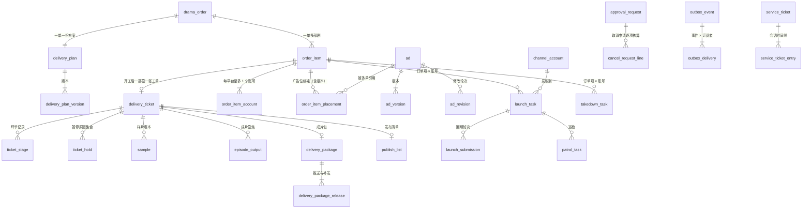

### 3.2 表清单

| 分组 | 表 | 用途 |
| --- | --- | --- |
| 订购 | `cart_item`、`drama_order`、`order_item`、`order_item_account`、`order_item_placement`、`cancel_request_line` | 选剧单、订购单、订单项、发布账号、广告位绑定、取消申请的逐项核算与实际结果 |
| 交付 | `delivery_ticket`、`ticket_stage`、`ticket_hold`、`delivery_plan`、`delivery_plan_version`、`plan_change_request`、`sample`、`episode_output`、`qc_record`、`checklist_template`、`delivery_package`、`delivery_package_release`、`package_reissue`、`publish_list`、`publish_list_episode` | 工单、环节、暂停原因、方案、样片、成片、质检、成片包、推送与补发、发布清单 |
| 广告 | `ad`、`ad_version`、`ad_revision` | 广告需求与视频、版本、修改轮次 |
| 发布 | `channel_account`、`launch_task`、`launch_submission`、`patrol_batch`、`patrol_task`、`takedown_task`、`follow_up`、`reminder_log` | 账号、上线、回填、巡检、下架、跟进、催办限频 |
| 审批与客服 | `approval_request`、`service_ticket`、`service_ticket_entry`、`service_ticket_ref` | 审核/审批单、客服工单 |
| 流程基础 | `status_transition`、`outbox_event`、`outbox_delivery`、`timer`、`work_calendar_day`、`idempotency_record`、`biz_sequence`、`assignment_pool_member`、`assignment_cursor`、`assignment_history`、`invariant_violation` | 状态历史、事件与投递、定时、日历、幂等、编号、分配、移交、不变量与卡死记录 |

相对 v1：新增 `ticket_hold`、`cancel_request_line`、`delivery_package_release`、`package_reissue`、`outbox_delivery`；删除 `approval_step`（审批单级，§17）与 `event_consumption`（由 `outbox_delivery` 取代）。

### 3.3 建表约定

1. 主键 `id bigint generated always as identity`；对外展示用业务编号（`LYX…`、`JF…`、`GG…`、`KF…`、`TK…`）。契约里的 ID 沿用参考工程的 `IdSchema`（BIGINT 范围校验，research/ref-arch §6.3 第 17 条）。按 ID 取资源一律带范围校验（商家端带门店范围，后台带数据范围与 kind 读权限），不依赖 ID 不可猜。
2. 时间用 `timestamptz`；“哪一天”用 `date`，一律按 Asia/Shanghai 取日（research/ref-arch §6.3 第 24 条）。
3. 枚举列用 `text` ＋ 迁移里手写的 `CHECK`，取值的唯一来源是 `packages/shared` 的常量，契约里的 Zod 枚举引用同一份常量。不用数据库原生 enum：新增状态不用改类型，回滚也简单。
4. 外部传入的字符串（链接、备注）用 `text`，长度在契约层校验，不用定宽列（research/ref-arch §6.3 第 16 条）。
5. 多人会改的行带 `lock_version int not null default 0`；状态迁移用“事务内 `FOR UPDATE` ＋ 状态守卫”，内容编辑用客户端带回的 `lock_version` 做乐观锁，两者分工见 §25.1。
6. 金额、积分都是 `int`（积分）或 `bigint`（分）；比例用整数万分比（`discount_bp`：9 折 ＝ 9000；`surcharge_bp`：加扣 20% ＝ 2000），与 D1 一致。
7. 业务编号用 `biz_sequence(prefix text, biz_date date, next_val int, primary key(prefix, biz_date))`，事务内 `INSERT … ON CONFLICT DO UPDATE SET next_val = biz_sequence.next_val + 1 RETURNING`。格式沿用原型：`LYX`＋8 位日期＋5 位流水；`GG`、`KF`、`TK` ＋8 位日期＋3 位流水（当日超过 999 时自动扩到 4 位）；工单号 ＝ `JF` ＋订购单号的数字部分＋`-序号`（原型 admin/Tickets：`JF2026091800011-1`）。
8. “任务的处理人”不复制到任务行上：核验单、巡检任务、下架任务的处理人一律**读取时取所属工单的 `publisher_id`**（§24）。行上只存不可变的 `ticket_id`。

---

## 4. 选剧单与确认订购

### 4.1 选剧单

```
cart_item
  id                bigint PK
  entity_id         bigint not null
  store_id          bigint not null
  drama_id          bigint not null
  added_by_user_id  bigint not null
  price_snapshot    int    not null      -- 加入（或最近一次“确认新价格”）时的剧目积分价 P
  price_acked_at    timestamptz
  created_at / updated_at
  UNIQUE (store_id, drama_id)
  INDEX  (store_id, created_at DESC)
```

规则：

1. 归属是“门店”，不是“用户”【默认，见 §28 第 21 项】。V1.0 只有老板能订购，按门店保存在 V1.1 开放管理员后也不用迁移。
2. 状态不落库，读取时算：剧目未上架或剩余授权期不足 → `invalid`；当前价 ≠ `price_snapshot` → `price_changed`；否则 `valid`（PRD §6.7-2；原型 merchant/Cart 的“确认新价格”即把 `price_snapshot` 更新为当前价）。
3. 上限 50 部（PRD §6.7-4）：加入时先取 `pg_advisory_xact_lock(hashtextextended('cart:' || store_id, 0))`，再数行数、再插入。咨询锁必须在交互式事务里拿（research/ref-arch §6.3 第 22 条）。
4. 同一门店可多次订购同一部剧（PRD §2.4-3），所以选剧单按剧去重，订购单不去重。
5. 订购成功后，同一事务删除本次订购的剧对应的行。

### 4.2 报价

`POST /api/v1/m/orders/quote` 是纯计算，不写库。订购服务调用 `billing.quoteOrder` 得到逐部的 `P、discountBp、surchargeBp、S`、合计与扣减来源预览，再补上本模块的内容：可选账号、可用广告、最早可指定上线日。

计价公式只有一份实现，在 `packages/shared/pricing`（D1 §5.1 的 `quoteDramaItem`、`quoteAd`，整数运算、四舍五入）；本文不另写。多部剧逐部取整后求和，不对合计取整（PRD §2.4）。

提交校验：`POST /orders` 带 `expect: { total, items: [{ dramaId, S }] }`，账本在账户锁内重算，任何一项不等返回 `409 QUOTE_CHANGED` 和新报价（PRD §6.8-2；D1 §5.2）。

**备选与取舍**：也可以签发带有效期的报价令牌并锁价。不采用：PRD 的口径是“以服务端重新计算为准、变动时提示重新确认”，锁价会引入“令牌有效期内调价是否生效”的新规则；带回期望值比对没有状态，够用。

### 4.3 订购单与订单项

```
drama_order
  id                   bigint PK
  order_no             text   not null UNIQUE          -- LYX2026093000007
  entity_id            bigint not null
  store_id             bigint not null
  placed_by_user_id    bigint not null
  acting_as            jsonb                            -- V1.1：代操作人（服务商、管理员），V1.0 恒为 null
  status               text   not null                  -- pending_start|producing|to_launch|live|ended|cancelled|after_sale|refunded
  sub_status           text                             -- 展示用子状态，见 §5.3
  status_changed_at    timestamptz not null
  item_count           smallint not null
  total_charge         int    not null                  -- Σ S
  term_id              bigint not null                  -- 下单时的订阅周期
  tier_code            text   not null                  -- 下单时套餐版本（快照）
  discount_bp          int    not null                  -- 下单时折扣（万分比）
  top_model            boolean not null                 -- 是否勾选顶级模型（整单一份）
  surcharge_bp         int    not null                  -- 加扣比例快照（万分比）；旗舰版或未选为 0
  focus_tags           text[] not null                  -- 定制重点（至少 1 项）
  reference_asset_ids  bigint[] not null default '{}'
  note                 text                             -- ≤200 字
  expected_launch_date date                             -- null = 成片交付后尽快上线
  agreement_consent_id bigint not null                  -- 协议同意记录（D6 §3.3）
  delivery_manager_id  bigint                           -- 冗余：门店的交付经理；转移时同步
  open_after_sale_id   bigint                           -- 在途的取消/售后审批单（approval_request.id），无则 null
  submitted_at         timestamptz not null
  started_at           timestamptz
  closed_at            timestamptz                      -- 进入 ended / cancelled / refunded 的时间
  lock_version         int    not null default 0
  INDEX (store_id, submitted_at DESC)
  INDEX (entity_id, submitted_at DESC)
  INDEX (status, submitted_at DESC)
  INDEX (delivery_manager_id, status)

order_item
  id                   bigint PK
  order_id             bigint not null REFERENCES drama_order
  seq                  smallint not null                -- 1..n，对应工单号后缀
  entity_id / store_id bigint not null
  drama_id             bigint not null
  drama_snapshot       jsonb  not null                  -- 剧名、集数、微短剧类别、各平台许可信息、题材
  episode_count        smallint not null
  list_price           int    not null                  -- P
  discount_bp          int    not null                  -- R（万分比）
  surcharge_bp         int    not null                  -- T（万分比）
  charge               int    not null                  -- S
  pricing_snapshot     jsonb  not null                  -- D1 §5.3 的完整计价快照（含价格来源、参数修订、取消扣除比例）
  production_model     text   not null                  -- standard|advanced|top（V1.0 仅计价与标签）
  hold_ref             text   not null                  -- 账本冻结单 ID（D1 的 holdId）
  captured_at          timestamptz
  refund_requested_points int not null default 0        -- 已向账本请求退回或释放的数量累计（＝ 下面三列之和）
  returned_points      int    not null default 0        -- 账本实际回到原批次可用的数量（ReturnResult.backToOriginal 累计）
  converted_points     int    not null default 0        -- 账本转为加购积分的数量（convertedToAddon 累计）
  forfeited_points     int    not null default 0        -- 账本判定不予退回的数量（forfeited 累计）
  phase                text   not null                  -- pending_start|producing|to_launch|live|ended|cancelled|refunded|terminated
  phase_changed_at     timestamptz not null
  agreed_launch_date   date                             -- 约定上线日；方案确认时写入，可改期
  usage_start_date     date                             -- 上线首日（核验通过时写入）；为空 = 从未上线
  usage_end_date       date   not null                  -- 下单时 = 剧目授权期结束日；版权续期时顺延
  usage_end_source     text   not null default 'license'-- license|early_end|expired（后两者不再随版权续期顺延）
  live_episode_count   smallint not null default 0      -- 已核验上线集数（各账号取最大值）
  cancel_reason_code   text
  cancelled_at         timestamptz
  lock_version         int    not null default 0
  UNIQUE (order_id, seq)
  CHECK (refund_requested_points = returned_points + converted_points + forfeited_points)
  CHECK (refund_requested_points <= charge)
  INDEX (store_id, phase)
  INDEX (drama_id, phase)
  INDEX (usage_end_date) WHERE phase IN ('to_launch','live')
  INDEX (agreed_launch_date) WHERE phase IN ('producing','to_launch')

order_item_account                                       -- 发布账号（每平台至多 1 个）
  order_item_id        bigint not null REFERENCES order_item
  channel_account_id   bigint not null REFERENCES channel_account
  platform             text   not null                  -- douyin|wechat_channels
  PRIMARY KEY (order_item_id, channel_account_id)
  UNIQUE (order_item_id, platform)
  INDEX (channel_account_id)

order_item_placement                                     -- 广告位绑定，见 §9.5
  id                   bigint PK
  order_item_id        bigint not null REFERENCES order_item
  slot                 text   not null                  -- opening|ending（V1.1：corner|midroll）
  ad_id                bigint not null REFERENCES ad
  bound_version_no     int                              -- null = 跟随最新已确认版本；样片确认时钉住
  duration_sec         smallint not null
  pinned_at            timestamptz
  UNIQUE (order_item_id, slot)
  INDEX (ad_id)
```

**退回的四个数**：`refund_requested_points` 是本模块按规则算出并传给账本的数量；另外三列全部取自账本返回的 `ReturnResult`，本模块不自己推算。商家实际拿回的积分 ＝ `returned_points + converted_points`（下文记作“实际退回”）；`forfeited_points` 是原周期已结束、账本判定不予退回的部分（D1 §7.5）。一切展示文案、阶段判断和对账都用实际值（§5.2、§16、§25.6）。

**“整单一份配置”还是“逐剧一份”**：原型 merchant/Checkout 只演示单剧；多剧订购时方案页“两部剧共用两条广告”、约定上线日同一天（原型 merchant/Plan）。【默认】确认订购页整单录入一份（账号、定制重点、顶级模型、广告、期望上线日），落库时**账号与广告位逐项落到 `order_item_*`**。理由：授权书、使用期、取消核算、上线任务都按剧；按剧配置的可用植入形式不同（PRD §7.2-4）；将来要逐剧设置时只改前端和方案内容，不改表。

### 4.4 确认订购：单事务

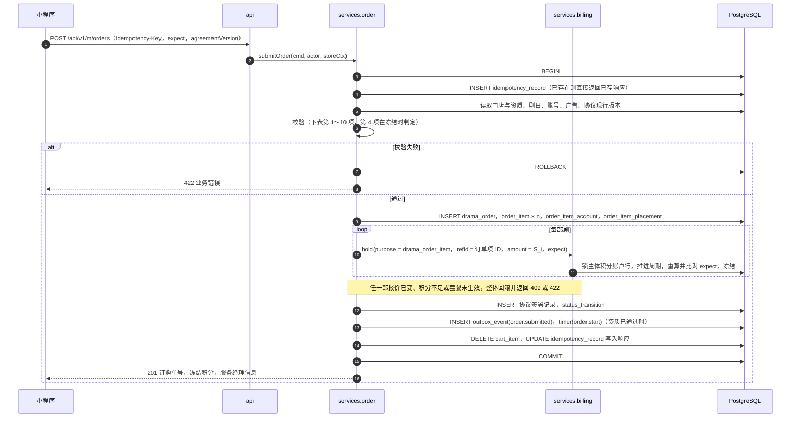

校验清单（任何一项不过即整体回滚，不产生订单，也不产生冻结）：

| # | 校验 | 失败码 | 出处 |
| --- | --- | --- | --- |
| 1 | 操作人是该主体的老板，门店属于该主体 | `FORBIDDEN` | PRD §6.16.2-1 |
| 2 | 门店建档必填项齐全；`merchant.storeGate(store) ∈ {full, parallel}` | `STORE_PROFILE_INCOMPLETE` / `STORE_NOT_QUALIFIED` | PRD §6.8-1、§2.4-2、§6.16.1-3 |
| 3 | 门店行业在开放名单内 | `INDUSTRY_NOT_OPEN` | PRD §10.3 |
| 4 | 套餐生效中（由 `billing.hold` 在账户锁内判定） | `SUBSCRIPTION_INACTIVE` | PRD §2.4-2 |
| 5 | 1 ≤ 剧目数 ≤ 50；每部剧已上架、剩余授权期 ≥ 最短可订授权期、所选平台的许可信息齐全 | `DRAMA_NOT_ORDERABLE` | PRD §2.4-7；核实 pub-4 |
| 6 | 发布账号：至少 1 个；每平台至多 1 个；属于下单门店；状态为“可用”（已核验） | `ACCOUNT_INVALID` | PRD §2.4-4、§6.8、§6.10.2 |
| 7 | 定制重点至少 1 项；补充说明 ≤ 200 字；参考素材属于该门店 | `VALIDATION` | 原型 merchant/Checkout（必选为【默认】） |
| 8 | 所选广告（可空）：属于该门店、已有确认版本、类型与广告位一致、广告位在该剧允许的植入形式内 | `AD_INVALID` | PRD §6.8、§7.2-4 |
| 9 | 期望上线日为空，或不早于“订购日后第 7 个工作日” | `LAUNCH_DATE_TOO_EARLY` | PRD §6.8 |
| 10 | 协议版本等于《定制内容授权使用协议》现行版本 | `AGREEMENT_OUTDATED` | PRD §7.11-3 |
| 11 | 账本在账户锁内重算的逐部 S 与请求的 `expect` 一致 | `QUOTE_CHANGED` | PRD §6.8-2；D1 §5.2 |
| 12 | 可用积分 ≥ ΣS（由 `billing.hold` 逐部判定，任一失败整体回滚） | `POINTS_INSUFFICIENT` | PRD §2.3-1 |

**门店闸门 `storeGate`**（商家模块的单点函数，订购、绑定渠道账号、广告指派三处共用）：

| 返回 | 条件 | 能做什么 |
| --- | --- | --- |
| `full` | 门店最近一次资质审核结论为“已通过” | 订购、绑定账号、广告指派与扣减、开工 |
| `parallel` | 主体的**首家门店**，资质“审核中”（已提交、未决定） | 订购（进入待开工）、绑定账号并核验、提交广告需求（只冻结）；**不能**开工、不能指派广告 |
| `blocked` | 新增门店未通过；首店未提交、已驳回待补正、终局驳回 | 都不能 |

PRD §6.16.1-3 的原文是“新增门店……不能订购、绑定发布账号……；首家门店仍按 5.1，资质审核可与订购并行”。首店在审核期间必须能绑定账号，否则第 6 项恒不通过、“待开工”对首店不可达。账号核验（1 个工作日）与资质审核（1 个工作日）并行进行，不增加串行等待。订购时账号必须“已核验”是 PRD §2.4-4、§6.8 的明文，本稿不放宽；是否允许订购时选“待核验”账号、把硬守卫后移到成片交付，列入 §30 待产品确认。

要点：

1. **幂等**：`Idempotency-Key` 必填。`idempotency_record(scope, actor_id, key)` 唯一；并发的第二个请求阻塞在唯一索引上，等第一个提交后读到已存响应；请求体哈希不同返回 `409 IDEMPOTENCY_KEY_REUSED`。回滚时幂等记录一并回滚，商家修正后可用同一个键重试。
2. **逐部冻结**：先插入订单项，再以 `purpose = refType = drama_order_item、refId = 订单项 ID` 调用 `billing.hold`；账本按业务引用生成幂等键（`hold:drama_order_item:{id}`）并以唯一约束保证不重复。返回的 `holdId` 写回 `order_item.hold_ref`，计价快照写入 `pricing_snapshot`。
3. **加锁顺序**：本事务不预先锁账户；账户行锁由第一次 `billing.hold` 取得并持有到提交，之后不再去锁其他已存在的领域行（只做插入与删除选剧单行）。同一主体的并发订购因此在第一次冻结处排队。
4. **不在此事务里开工**：即使资质已通过，也只写一条 `timer(kind = order.start, fire_at = now() + 开工延迟)`。开工延迟是参数 `order.start_delay_minutes`，【默认 0】。原型里“冻结 10:32 → 扣减 10:35”的间隔按异步处理理解，不是业务规则（research/proto-admin-b §2.5 第 15 条）。
5. **订购成功页的服务经理**：门店已有交付经理则返回其姓名、企业微信二维码；没有则返回空，页面显示“服务经理将在 1 个工作日内联系您”（分配时点见 §6.3）。
6. **订阅消息授权**：下单按钮上顺带请求“方案待确认、样片待确认、成片已交付”模板的授权由前端处理；用户拒绝不影响下单（核实 msg 额外发现：运营规范 5.21 禁止强制订阅）。

**备选与取舍**：

| 方案 | 说明 | 结论 |
| --- | --- | --- |
| A（采用）主体账户行锁 ＋ 单事务 | 账本函数内部锁主体账户行，把同一主体的订购、广告、发放、清零、退回串行化 | 规模小，串行化代价可忽略；逻辑最直观 |
| B 乐观锁 ＋ 重试 | 账户 `version` 冲突后重试 | 冲突时要重跑整段校验；账本是批次模型，重试逻辑更难写对（research/ref-arch §2.9 的推断与此一致） |
| C 先建订单、异步冻结 | 订单先进“冻结中”，由事件驱动冻结 | 多一个状态和一类失败补偿，商家看到“订购成功”后又失败，体验差 |

---

## 5. 订购单与订单项的状态模型、聚合规则

### 5.1 三层状态，只有一层是“写”的

一张订购单可含多部剧，各部剧进度不同（原型 merchant/MyDramas：同一单两部剧分别“样片待确认”“样片制作中”；原型 admin/Tickets：`JF…-1`、`JF…-2`）。PRD 没有定义整单状态如何聚合（research/prd-tech Q-1）。

本设计的做法：

| 层 | 状态 | 谁来写 |
| --- | --- | --- |
| 交付工单 `delivery_ticket.step` | 11 步 ＋ 已归档 ＋ 已终止（§7） | **唯一由事件驱动的状态机**（开工之后） |
| 订单项 `order_item.phase` | 8 种 | 开工前由订购流程直接写（待开工、已取消）；开工后由工单步骤与订单项上的事实**推导** |
| 订购单 `drama_order.status` | 8 种（后台） | 由订单项阶段和“是否有在途售后”**推导** |

推导函数是 `packages/shared/aggregate.ts` 里的纯函数；结果在同一事务里写回列（物化），用于列表筛选和计数。这样“审批驳回后恢复原状态”不需要记“原状态”：审批单关闭后重新推导即可。

**备选与取舍**：(a) 订购单、订单项、工单各自一套独立状态机并互相同步——三处写、最容易不一致；(b) 订购单状态完全不落库、每次查询时算——列表按状态筛选和计数要联表聚合，写 SQL 麻烦。采用“单一写入点 ＋ 同事务物化 ＋ 不变量校验（§25.5 的 I2、I3）”。

### 5.2 订单项阶段

```ts
// packages/shared/aggregate.ts
type ItemFacts = { everLive: boolean;            // usage_start_date 非空
                   effectiveReturn: number };    // returned_points + converted_points（账本实际退回）

export function phaseFromTicket(step: TicketStep, f: ItemFacts): ItemPhase {
  switch (step) {
    case 'assigning': case 'plan_confirm': case 'ad_prep': case 'sample_making':
    case 'sample_confirm': case 'batch_compose': case 'delivering':   return 'producing';
    case 'awaiting_launch': case 'launch_verify':                    return 'to_launch';
    case 'in_service':                                               return 'live';
    case 'takedown':    return f.everLive ? 'live' : 'to_launch';     // 从未上线就到期的，核查期间仍显示待上线
    case 'archived':    return f.effectiveReturn > 0 ? 'refunded' : 'ended';
    case 'terminated':  return f.effectiveReturn > 0 ? 'refunded' : 'terminated';
  }
}
```

| 订单项阶段 | 含义 | 进入条件 |
| --- | --- | --- |
| `pending_start` 待开工 | 积分已冻结，等待资质审核通过 | 确认订购 |
| `producing` 制作中 | 积分已扣减，工单在步骤 1～7 | 开工 |
| `to_launch` 待上线 | 成片已交付，等待回填或核验 | 推送成片包 |
| `live` 上线中 | 至少一个账号核验通过；含“到期下架”核查期间 | 首个上线任务核验通过 |
| `ended` 已结束 | 下架核查通过，工单归档；`usage_start_date` 为空时商家端文案为“已结束（未上线）” | 归档且实际退回为 0 |
| `cancelled` 已取消 | 开工前取消，冻结已释放（去向见取消明细） | 待开工取消（§6.5） |
| `refunded` 已退回积分 | 开工后终止，账本**实际退回 > 0** | 退回执行（§16） |
| `terminated` 已终止 | 开工后终止，账本实际退回为 0（扣除比例 100%，或原周期已结束全部不予退回） | 退回执行（§16） |

`refunded` 与 `terminated` 的区分只看账本的实际结果：v1 用“请求退回量 > 0”判断，会出现“显示已退回积分、实际一分未退”。商家端订单项的文案由同一组数字生成：“已终止，已退回 1,512 积分”“已终止，未退回积分（原周期已结束 2,000 积分不予退回）”。

商家端“上线状态”（PRD §6.9-7）：`pending_start`～`to_launch` → 待上线；`live` → 上线中；曾上线的 `ended`、`refunded`、`terminated` → 已下架；从未上线的 `ended` → 已结束（未上线）。

### 5.3 订购单状态（后台 8 种）与子状态

```ts
const ORDER  = ['pending_start', 'producing', 'to_launch', 'live', 'ended'] as const;
const CLOSED = new Set<ItemPhase>(['cancelled', 'refunded', 'terminated']);

export function orderStatus(items: { phase: ItemPhase }[], hasOpenAfterSale: boolean): OrderStatus {
  if (hasOpenAfterSale) return 'after_sale';                              // 售后处理中
  const active = items.filter(i => !CLOSED.has(i.phase));
  if (active.length === 0)
    return items.some(i => i.phase === 'refunded') ? 'refunded' : 'cancelled';
  return ORDER[Math.min(...active.map(i => ORDER.indexOf(i.phase as any)))];  // 取最靠前的未完成阶段
}
```

规则说明【默认，需产品确认，§28 第 1 项】：

1. 有在途的取消或售后审批单 → 整单“售后处理中”，子状态“取消审批中”或“待执行”。原型两处不一致（admin/OrderDetail 保持“制作中”＋徽标，admin/Orders 列表显示“售后处理中 · 取消审批中”），取后者。
2. 没有在途售后时，只看未关闭的订单项，取**最靠前**的阶段：一部已上线、一部还在制作 → 制作中；一部已结束、一部上线中 → 上线中；全部已结束 → 已结束。
3. 全部订单项都已关闭：只要有一项实际退回了积分 → 已退回积分；否则 → 已取消（子状态区分“开工前取消”与“已终止 · 未退回积分”）。PRD 只有 8 种订购单状态，不为“实际退回为 0 的终止”新增第 9 种【默认，§28 第 38 项】。
4. 列表另返回 `phaseCounts`（如 `{ live: 1, producing: 1 }`），前端展示“1 部上线中 · 1 部制作中”，避免单一状态掩盖进度。

子状态 `sub_status`（原型 admin/Orders 的状态副说明）取“最靠前的那一项”的细节：

| 订购单状态 | 子状态取值 |
| --- | --- |
| 待开工 | `qualification_reviewing` 资质审核中；`qualification_rejected` 资质已驳回待补正；`starting` 即将开工 |
| 制作中 | 最靠前工单的步骤名：工单待分配、方案确认、广告准备、样片制作、样片确认、批量合成、成片交付 |
| 待上线 | `awaiting_links` 待回填；`verifying` 核验中；`need_fix` 需补充；`expired_unlaunched` 已到期待核查 |
| 上线中 | `in_service`；`takedown_pending` 待下架；`takedown_overdue` 逾期未下架 |
| 售后处理中 | `cancel_reviewing` 取消审批中；`refund_executing` 待执行 |
| 已取消 | `cancelled_before_start` 开工前取消；`terminated_no_return` 已终止 · 未退回积分 |

### 5.4 商家端页签映射与时间轴

商家端页签（PRD §6.9-1：全部、制作中、待上线、上线中、已结束、售后）与后台 8 种状态的映射【默认，§28 第 2 项】：

| 商家端页签 | 后台状态 | 卡片状态文案 |
| --- | --- | --- |
| 制作中 | `pending_start`、`producing` | 待开工显示“待开工（资质审核中）”，其余“制作中” |
| 待上线 | `to_launch` | 待上线 |
| 上线中 | `live` | 上线中 |
| 已结束 | `ended` | 已结束 |
| 售后 | `after_sale`、`cancelled`、`refunded` | 售后处理中、已取消（或“已终止”）、已退回积分 |
| 全部 | 全部 8 种 | — |

订单详情的 9 个时间轴节点（PRD §6.9-3）不另建表，由订单与工单上的里程碑时间列生成：

| 节点 | 取值 |
| --- | --- |
| 已订购（积分冻结） | `drama_order.submitted_at` |
| 开始制作（积分扣减） | `drama_order.started_at` |
| 服务经理已对接 | `delivery_ticket.assigned_at` |
| 方案已确认 | `plan_confirmed_at` |
| 广告视频已确认 | `ads_ready_at` |
| 样片已确认 | `sample_confirmed_at` |
| 成片已交付 | `delivered_at` |
| 已上线（核验通过） | `live_at` |
| 使用期结束 | `archived_at`（未到则显示 `usage_end_date`） |

多部剧时，时间轴按剧切换展示；节点说明文案（如“片头 5 秒、片尾 10 秒（第 2 版）”）由前端按节点载荷拼接，载荷来自方案与广告的当前数据。

---

## 6. 开工：资质审核通过后扣减、生成工单、分配交付经理、生成授权书

### 6.1 触发点（都落到同一个定时器与同一个幂等入口）

| 触发 | 场景 | 做什么 |
| --- | --- | --- |
| 确认订购事务 | 下单时资质已通过 | 写 `timer(order.start)`，键 `order.start:order:{id}`，`fire_at = 提交时间 + 开工延迟` |
| 事件 `store.qualification.approved` 的订阅者 | 下单时资质在审 | 对该门店每张“待开工、无在途取消”的订购单：锁订购单行，登记同一个键的定时器（`fire_at = max(now, 提交时间 + 开工延迟)`）。**订阅者只登记，不在消费事务里开工**，每张订购单各自在自己的定时器事务里开工，互不牵连 |
| 进程内补偿扫描 `order.pending_start_sweep`（每 5 分钟，只依赖 PostgreSQL，§25.4） | 上面两条路出过问题 | 找出“门店资质已通过、订购单仍待开工、无在途取消”且满足下列之一的订购单：① 没有未取消的 `order.start` 定时器，并且 `max(提交时间, 资质通过时间) + 开工延迟 + 5 分钟 < now` → 补登记；② 定时器处于 `failed` → 复活；③ 定时器已到期 5 分钟仍未触发 → 在 worker 进程内直接执行。每命中一次记一条告警 |

定时器 `order.start` 的处理器调用 `order.startOrder(orderId)`，它以“订购单状态 ＝ 待开工”为守卫，重复调用无副作用。补偿扫描的条件以定时器的到期时间为准，因此业务把开工延迟设为 60 分钟时，扫描不会在第 5 分钟把它击穿。

`order.start` 注册为**关键类**定时器（§21.3）：Redis 不可用时在 worker 进程内直接执行，失败也不会进入终态。因此开工只依赖 PostgreSQL 与 worker 进程存活。

【默认】套餐在等待期间过期的，照常开工（PRD §2.3-2“冻结跨过套餐期末的积分，按提交时间视为已使用”；§2.3-4“在制作的订购继续交付”）。需业务确认，见 §28 第 6 项。

### 6.2 `startOrder` 的事务

```
事务外预读（不加锁）：订购单状态 ≠ 待开工 → 直接返回
BEGIN
 0  人员（按全局锁序，员工行在业务行之前，§7.5）：
      交付经理 = 门店已有的交付经理；没有则 pickNext('delivery_manager', 城市)
      发布专员 = pickNext('publisher', 'all')（§7.7）
      pickNext 内部先锁游标行，再对选中的员工行 FOR SHARE 并校验“启用中”；门店已有交付经理时同样对其 FOR SHARE
      SELECT store FOR SHARE（读取交付经理与资质结论；门店尚无交付经理、需要写回时改为 FOR UPDATE）
 1  SELECT drama_order FOR UPDATE；SELECT order_item … ORDER BY id FOR UPDATE
    守卫：status = 'pending_start'；open_after_sale_id IS NULL；storeGate = full；否则 ROLLBACK 返回（幂等，游标推进一并回滚）
 2  对每个 phase = 'pending_start' 的订单项：
      billing.capture(tx, holdId)            -- 账本内部锁账户；幂等键 capture:hold:{holdId}
      order_item.captured_at = now()
      若返回 HOLD_NOT_ACTIVE（冻结已被释放）→ 整个事务回滚并告警，不开工
 3  对每个订单项 INSERT delivery_ticket：
      ticket_no = 'JF' + 订购单号数字部分 + '-' + seq
      有交付经理 → step = 'plan_confirm'，并补一条 assigning 环节记录（进入时间 = 完成时间）
      无交付经理 → step = 'assigning'
      publisher_id = 发布专员（可空）
      priority = 套餐版本的制作排期（0 标准 / 1 优先 / 2 加急，仅用于排序）
      delivery_target_at = addWorkingDays(now, 参数 sla.delivery.target)（快照，默认 6 个工作日）
      写 ticket_stage、SLA 定时器（§7.6）
 4  INSERT delivery_plan(order_id, status = 'drafting', draft = 由订购录入生成的初稿)
 5  订单项 phase → producing；重新推导订购单状态；写 status_transition
 6  INSERT outbox_event：order.started（载荷含逐项的 itemId、账号）、ticket.created × n
COMMIT
```

失败与重试：整段是一个事务，任何一步失败全部回滚，订购单仍是“待开工”，由定时器的重试或补偿扫描再次触发。`billing.capture` 的幂等键保证即使未来改成分步执行也不会重复扣减。加锁顺序是“游标 → 员工 → 门店 → 订购单 → 订单项 → 积分账户（账本内部）”，取得账户锁之后只做插入，不再锁其他已存在的业务行。

### 6.3 交付经理的分配

PRD §5.2 步骤 1 写“工单生成后自动或由主管分配”；原型 admin/MerchantDetail 的日志是“开通专业版后，按城市轮询分配交付经理”；原型 admin/Orders 又有“工单待分配”的订单。【默认，§28 第 7 项】两个时点并存：

1. **开通套餐后**（订阅 `billing.subscription.activated` 事件）：门店没有交付经理时按城市轮询分配，写 `store.delivery_manager_id`。这样订购成功页就能展示服务经理的企业微信。
2. **开工时兜底**：门店仍没有交付经理则再轮询一次；轮询池为空（该城市没有可分配的人）→ 工单进入“待分配”，2 个工作小时内由交付主管手动分配（PRD §5.2）。

轮询：

```
assignment_pool_member
  pool        text not null            -- delivery_manager | editor | publisher | cs
  staff_id    bigint not null
  city_code   text not null default '' -- 交付经理按城市；空串 = 不限城市
  on_duty     boolean not null default true    -- 客服“当班”开关；其他池恒为 true
  PRIMARY KEY (pool, staff_id, city_code)
assignment_cursor
  pool, scope_key（城市编码或 'all'）  PRIMARY KEY
  last_staff_id bigint
```

```
pickNext(tx, pool, scopeKey):                          -- 必须在锁任何业务行之前调用
  SELECT … FROM assignment_cursor WHERE pool = ? AND scope_key = ? FOR UPDATE   -- 无则先插入
  候选 = 池内 on_duty 且账号启用的员工，按 staff_id 升序
  取第一个 staff_id > last_staff_id 的；没有则回到第一个；候选为空返回 null
  SELECT staff WHERE id = 选中者 FOR SHARE；再次校验“启用中”，不满足则取下一个候选
  UPDATE assignment_cursor SET last_staff_id = 选中者
```

交付主管手动分配或“转移交付经理”（PRD §7.4-4）走 `workbench.transferManager`（§24.3）：改门店的交付经理，并把该门店全部在办工单（含使用中）一并改派，已归档的不动。

### 6.4 授权书：按状态收敛，而不是“事件 → 动作”一一对应

开工事务只发事件，授权书由文书模块（D6 §3.5）生成，粒度为“订单项 × 发布账号”（原型 merchant/Contracts：“按剧目与发布账号各 1 份”；PRD §6.10.2-4 写“每笔订购按所选发布账号生成”，取更细的口径，§28 第 12 项）。

v1 的契约是“某事件到达 → 做某动作”。它与“订阅者不依赖事件顺序”（§20.3）矛盾：`ticket.terminated` 先于 `order.started` 被消费时，会生成一份永远“待生效”的授权书。本稿把契约改成**状态对账式**：文书模块提供幂等的 `docs.ensureLetters(tx, orderItemId)`，下列任一事件到达时都只调用它，由它读订单项当前状态并收敛到应有的结果。

| 订单项当前状态（读库） | 每个 `order_item_account` 应有的授权书 |
| --- | --- |
| `pending_start`、`cancelled` | 没有；已有的作废 |
| `producing`、`to_launch`（从未上线） | 一份未作废的，状态“待生效”，期限写“自上线首日起至 `usage_end_date`” |
| `live` | 状态“生效中”，起始日 ＝ 订单项 `usage_start_date`（双平台统一取订单项的上线首日，D6 §9 冲突 34），止日 ＝ `usage_end_date` |
| 止日变更（续期顺延、提前结束） | 换版，写新止日 |
| `refunded`、`terminated`，以及不再出现在 `order_item_account` 里的旧账号 | 作废 |
| `ended` | 不动（到期由日期派生为“已失效”） |

触发 `ensureLetters` 的事件：`order.started`、`plan.confirmed`、`item.live`、`item.live_revoked`、`item.usage_end_changed`、`order.item.cancelled`、`order.item.refunded`、`order.item.terminated`、`ticket.archived`。这些订阅者注册为关键类（§20.3）。

成片交付的守卫要求“每个发布账号都有一份未作废的授权书”（§11.3），因此授权书生成失败会挡住交付，而不是悄悄漏掉；同时补偿扫描每 5 分钟检查“开工超过 10 分钟仍有账号缺授权书”的订单项并再次调用 `ensureLetters`、记告警（§25.4），不让交付环节成为第一个发现问题的地方。

### 6.5 开工前取消

**默认走审批**【§28 第 3 项】。依据：PRD §3.3-2“客服可发起取消与退款申请，由财务审批并执行”、§7.5-4“取消与退款：客服发起、财务审批”、§3.3-3“退款……须二次确认、经审批”；原型 admin/Refunds 的 TK20260917001 就是“开始制作前取消”走财务审批；D2 §7.6 的默认也是走审批。PRD §5.3 那句“开始制作前取消……积分全额退回、订单进入已取消”描述的是结果状态，不是免审批。

v1 以“冻结释放不产生已扣减积分的回流”为由默认免审批，这个理由在跨周期时不成立：批次所属周期已结束时，账本对商家原因的释放**记清零**，对平台或资质原因的释放**转为加购积分**（D1 §7.5，参数 `expiredTermRefund`），前者确认收入、后者改变负债性质，而且不可撤销。

| 来源 | 触发 | 处理 |
| --- | --- | --- |
| 客服取消 | 后台订单详情“发起取消”，订购单为待开工 | 与开工后的取消走同一个入口：取消预览 → 提交 `order_cancel` 申请 → 财务审批 → 执行（§16）。明细行的 `mode = release` |
| 资质终局驳回 | 审核人驳回时勾选“无法补正”（§17.5） | 事件 `store.qualification.rejected`（`final = true`）的订阅者为该门店生成**一张** `qualification_cancel` 申请，明细覆盖该门店全部待开工订单项与全部未指派的广告（§9.3），原因类别 `qualification`；财务一次审批、一次执行 |

免审批开关 `refund.points.auto_approve_before_production`（键名取 D2 的，默认 `false`）。打开后，申请仍然生成并留痕，但只有在**同时满足**下面两条时才由系统自动审批并在同一事务里执行（决定人与执行人记为 `system`，照常写审计）：

1. 申请的全部明细都是 `release`（没有任何已扣减的订单项或广告）；
2. 每条明细的 `billing.previewReturn` 结果都是“全额回到原批次”（`convertedToAddon = 0` 且 `forfeited = 0`）。

只要预览里出现“转加购”或“不予退回”，不论开关如何，一律进入财务审批。取消预览与申请明细逐行保存“回到本期套餐积分 X（MM-DD 清零）/ 转为加购积分 Y / 原周期已结束不予退回 Z”，客服据此告知商家（D1 §7.5 的要求）。

时间线对照（v1 的反例）：商家套餐 10-12 24:00 到期；10-12 用 2,000 套餐积分下单，首店资质在审；10-13 套餐过期未续；10-15 商家要求取消。本稿：客服点“发起取消”先看到预览“原周期已结束，2,000 积分不予退回”；提交后进入财务审批（开关打开也不会自动通过）；执行后订单项 `cancelled`，`forfeited_points = 2000`，订购单“已取消”，取消明细与商家端文案如实显示“冻结 2,000：原周期已结束，不予退回”。

在途申请期间：订购单 `open_after_sale_id` 非空，`startOrder` 的守卫会挡住开工；驳回或撤回后清空并重新登记 `order.start`（若资质已通过）。

资质被驳回但未标“无法补正”的，订购单一直停在待开工。为避免积分长期冻结无人处理：驳回满 7 天（参数）仍未重新提交的，由定时器 `order.rejected_stale` 生成一条客服待办“待开工订购超期未补正”，由客服联系商家后决定取消；系统不自动取消【默认，§28 第 5 项】。

### 6.6 时序

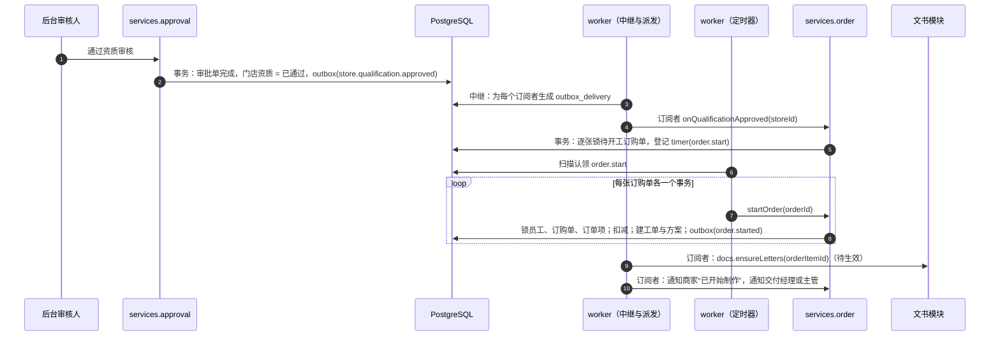

---

## 7. 交付工单：11 步 ＋ 归档 ＋ 暂停与终止

### 7.1 表

```
delivery_ticket
  id                  bigint PK
  ticket_no           text not null UNIQUE              -- JF2026092600018-1
  order_id            bigint not null REFERENCES drama_order
  order_item_id       bigint not null UNIQUE REFERENCES order_item
  entity_id / store_id / drama_id  bigint not null
  step                text not null                     -- 见 7.2
  step_entered_at     timestamptz not null
  step_due_at         timestamptz                       -- 当前环节的员工侧截止时间；等待商家的环节可为 null
  waiting_on          text not null                     -- staff|merchant|none
  hold_count          smallint not null default 0       -- 未解除的暂停原因数（= ticket_hold 中 released_at IS NULL 的行数）
  hold_since          timestamptz                       -- 第一个暂停原因加入的时间
  hold_remaining_min  int                               -- 进入暂停时当前环节剩余的工作分钟数
  manager_id          bigint                            -- 交付经理
  editor_id           bigint                            -- 剪辑师
  publisher_id        bigint                            -- 发布专员
  priority            smallint not null default 0       -- 制作排期：0 标准 1 优先 2 加急（只影响排序）
  sample_round        smallint not null default 0       -- 样片轮次
  current_sample_version smallint
  delivery_target_at  timestamptz not null              -- 成片交付目标（开工时快照）
  assigned_at / plan_confirmed_at / ads_ready_at / sample_first_pushed_at / sample_confirmed_at /
  composed_at / delivered_at / links_submitted_at / live_at / usage_ended_at / archived_at / terminated_at
                      timestamptz                       -- 里程碑，首次到达时写入；除“撤销核验通过”清空 live_at 外不回退
  lock_version        int not null default 0
  created_at / updated_at
  INDEX (step, step_due_at) WHERE step NOT IN ('archived','terminated')
  INDEX (manager_id, step)   INDEX (editor_id, step)   INDEX (publisher_id, step)
  INDEX (store_id)           INDEX (order_id)

ticket_stage                                            -- 每进入一次环节一行
  id                  bigint PK
  ticket_id           bigint not null REFERENCES delivery_ticket
  step                text not null
  visit_no            smallint not null                 -- 同一环节第几次进入（样片制作会多次）
  entered_at          timestamptz not null
  due_at              timestamptz
  completed_at        timestamptz
  exit_event          text
  held_minutes        int not null default 0            -- 暂停累计的工作分钟
  breached            boolean not null default false    -- 离开时或到期时判定
  sla_snapshot        jsonb                             -- { policy, amount, unit, calendarVersion }
  UNIQUE (ticket_id, step, visit_no)

ticket_hold                                             -- 暂停原因集合：一个原因一行
  id                  bigint PK
  ticket_id           bigint not null REFERENCES delivery_ticket
  reason              text not null                     -- cancel_review|plan_amendment
  ref_type            text not null                     -- approval|plan_version
  ref_id              bigint not null
  created_at          timestamptz not null
  created_by          jsonb not null                    -- Actor
  released_at         timestamptz
  release_event       text                              -- rejected|withdrawn|plan_confirmed|terminated
  UNIQUE (ticket_id, reason, ref_id)
  INDEX (ticket_id) WHERE released_at IS NULL
```

**订单项与工单为什么是两张表**：两者一对一，但生命周期不同（待开工、已取消的订单项没有工单），关注点也不同（订单项管计价、冻结、使用期；工单管执行人、环节、时限）。合成一张表会有 50 多列，且“待开工”阶段大半为空。代价是多一次联表，以及需要保证“工单步骤 → 订单项阶段”的推导（§5.2，不变量 I3）。

### 7.2 状态图

步骤枚举（括号内为后台文案）：`assigning`（待分配）、`plan_confirm`（方案确认）、`ad_prep`（广告准备）、`sample_making`（样片制作）、`sample_confirm`（样片确认）、`batch_compose`（批量合成）、`delivering`（成片交付）、`awaiting_launch`（待上线）、`launch_verify`（上线核验）、`in_service`（服务中）、`takedown`（到期下架）、`archived`（已归档）、`terminated`（已终止）。第 10 步 PRD §5.2 称“使用中”、原型称“服务中”，枚举统一为 `in_service`，后台文案用“服务中”，商家端用“上线中”【默认，§28 第 9 项】。

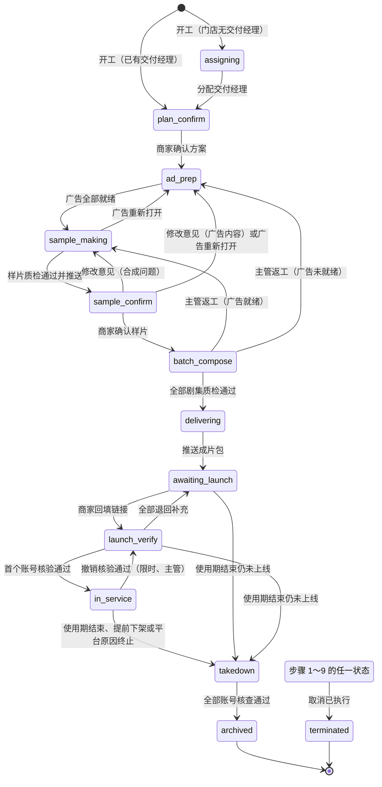

暂停不是步骤，而是工单上的一个**原因集合**（`ticket_hold`）：集合非空即暂停；此时除“加入暂停原因、解除暂停原因、终止”外的迁移全部不发生（§7.4）。

### 7.3 迁移表（状态 × 事件 → 新状态 / 守卫 / 副作用）

通用守卫：工单未暂停（`hold_count = 0`）；操作人具备对应权限点且在数据范围内（“本人任务”只允许 `editor_id`、`publisher_id` 等于本人）。标“系统求值”的行只由 `reevaluate()`（§7.8）触发，暂停时不求值，恢复后补求值。下表只列各行特有的守卫。

| # | 当前步骤 | 事件 | 触发者 | 守卫 | 新步骤 | 副作用 |
| --- | --- | --- | --- | --- | --- | --- |
| 1 | `assigning` | `ticket.assign` | 交付主管 | 被分配人是启用的交付经理（事务开头对其员工行 `FOR SHARE`） | `plan_confirm` | 写 `manager_id`、`assigned_at`；门店尚无交付经理时一并写门店并改派同门店其他待分配工单；通知交付经理 |
| 2 | `plan_confirm` | `plan.confirmed` | 商家（老板）；系统求值（恢复后补） | 方案状态 ＝ 已确认，且已确认版本的内容已落到本订单项 | `ad_prep` | 随即在同一事务求值第 3 行 |
| 3 | `ad_prep` | `ads.ready` | 系统求值 | `adsReady`（§9.5），求值前已对涉及的广告行 `FOR SHARE` | `sample_making` | 写 `ads_ready_at`（首次）；未指派剪辑师时生成“待指派”待办 |
| 4 | `sample_making` | `sample.pushed` | 交付经理 | 当前样片版本质检通过；`adsReady` 为真；样片所用广告版本 ＝ 各广告**当前**确认版本（广告行 `FOR SHARE`）；样片有可用的查看方式（§10.3） | `sample_confirm` | 通知商家；登记 `sample.remind`（§21.5 的 T13） |
| 5 | `sample_confirm` | `sample.confirmed` | 商家（老板） | 版本号 ＝ 当前已推送版本；`adsReady` 为真且所用版本仍是当前确认版本，否则 `409 AD_CHANGED` 并由求值回到广告准备 | `batch_compose` | 钉住广告版本（§9.5）；写 `sample_confirmed_at`；取消 `sample.remind` |
| 6 | `sample_confirm` | `sample.change_requested`（合成问题） | 商家；交付经理代录 | 意见非空 | `sample_making` | `sample_round + 1`；当前样片置 `change_requested`；通知剪辑师 |
| 7 | `sample_confirm` | `sample.change_requested`（广告内容） | 交付经理代录 | 该广告还有免费修改次数（要扣积分的只能由商家在“我的广告”提交，§9.4） | `ad_prep` | 生成广告修改轮次；当前样片置 `superseded` |
| 8 | `sample_making`、`sample_confirm` | `ad.reopened` | 系统求值（绑定的广告被提出修改） | 存在未钉住且广告不处于“已确认”的广告位 | `ad_prep` | 已推送的样片置 `superseded`；通知交付经理 |
| 9 | `batch_compose` | `episodes.all_passed` | 系统求值 | 当前有效剧集数 ＝ 订购集数且全部质检通过；成片包级质检通过 | `delivering` | 写 `composed_at`；待办转发布专员（为空时生成“待指派发布专员”待办） |
| 10 | `batch_compose`、`delivering` | `ticket.rework` | 交付主管 | 必填原因 | `adsReady` 为真 → `sample_making`；否则 → `ad_prep` | 解除广告位钉住；已登记剧集置 `replaced`；已确认样片置 `superseded`；记录返工（计入报表） |
| 11 | `delivering` | `package.pushed` | 发布专员 | §11.3 的四项守卫 | `awaiting_launch` | 建成片包与第 1 次推送记录、上线任务；订单项 → 待上线；登记到期类定时器与上线提醒（§12.5、§21.5）；通知商家 |
| 12 | `awaiting_launch` | `launch.changed` | 系统求值 | 没有已上线的任务，存在核验中的任务 | `launch_verify` | 写 `links_submitted_at`（首次） |
| 13 | `launch_verify` | `launch.changed` | 系统求值 | 没有已上线、也没有核验中的任务 | `awaiting_launch` | 通知商家补充 |
| 14 | `awaiting_launch`、`launch_verify` | `launch.changed` | 系统求值 | 存在已上线（`is_live`）的任务 | `in_service` | 写使用期起点、`live_at`；订单项 → 上线中；`item.live` 事件 |
| 15 | `in_service` | `usage.ended` | 定时器；系统求值 | 今天已过 `usage_end_date`；或该订单项全部未作废下架任务已由商家确认（提前下架） | `takedown` | 确保每个发布账号都有下架任务（§14.2）；写 `usage_ended_at`；`usage_end_source` 置 `expired` 或 `early_end` |
| 15b | `awaiting_launch`、`launch_verify` | `usage.ended` | 定时器；系统求值 | 今天已过 `usage_end_date`（从未上线） | `takedown` | 在途核验单撤回、未上线的上线任务作废（原因“使用期已结束”）；确保每个发布账号都有核查任务；撤销下载授权；`usage_end_source = expired` |
| 16 | `takedown` | `takedown.all_checked` | 系统求值 | 该订单项未作废的下架任务至少 1 条且全部已核查 | `archived` | 写 `archived_at`；订单项 → 已结束或已退回积分；`ticket.archived` 事件 |
| 17 | 步骤 1～9（`assigning`～`launch_verify`） | `ticket.hold(reason, ref)` | 系统 | — | 不变 | 加入一个暂停原因；集合由空变非空时：记录剩余工作分钟，取消本环节 SLA 定时器与面向商家的提醒定时器 |
| 18 | 暂停中 | `ticket.resume(reason, ref)` | 系统 | 该原因存在 | 不变 | 只移除这一个原因；集合变空时：按剩余工作分钟重算 `step_due_at`、重设定时器，并在同一事务调用 `reevaluate()` |
| 19 | 步骤 1～9 | `ticket.terminate` | 系统（取消执行，§16.3） | 只能由取消执行事务调用（审批单已通过、本事务持有其行锁）；暂停中同样可用 | `terminated` | 解除全部暂停原因；撤销成片包下载授权；作废未上线的上线任务；成片包已推送过的，为每个发布账号建核查任务（§14.2）；删除广告位绑定 |
| 20 | `in_service`、`takedown` | `ticket.terminate` | 系统（已上线、平台原因，§16.3） | 同上 | `takedown`（已在该步则不变） | `usage_end_date` 改为申请里固定的终止日、`usage_end_source = early_end`；立即确保下架任务存在；重设到期类定时器 |
| 21 | `in_service` | `launch.verify_revoked` | 系统（撤销核验通过，§12.7） | 撤销后该订单项没有任何已上线的任务；没有已确认或已核查的下架任务 | `launch_verify`（该任务回到核验中） | 清空 `live_at`、订单项使用期起点；订单项 → 待上线；`item.live_revoked` 事件 |
| 22 | 更正白名单内的步骤对 | `admin.force` | 超级管理员（§7.9） | 目标在白名单内；更正后结构性不变量仍成立 | 指定步骤 | 状态历史 `forced = true`；审计；按新步骤重设定时器；不动积分 |

第 12～14 行说明：步骤 8、9、10 之间的迁移不由某个按钮直接触发，而是每次上线任务状态变化后调用求值函数（§12.4）。**工单进入“服务中”之后不再参与第 12～14 行求值**：之后的补充回填、退回只改变上线任务自己的审核状态（§12.3）。

第 17 行的适用范围是步骤 1～9。已上线（步骤 10、11）的取消不走暂停，单独建模（§16）。

### 7.4 暂停、恢复、终止

**来源只有两个**：取消审批单提交（原型 admin/Refunds：“已生成工单……工单已暂停”），原因 `cancel_review`，引用审批单；方案在已确认之后被修订、等待商家重新确认（§8.4），原因 `plan_amendment`，引用方案版本。

**两种暂停可以叠加**。`ticket.hold` 对已暂停的工单同样可用，只是往集合里再加一行；`ticket.resume` 只移除调用方自己的那一个原因。因此：

| 时间线 | 结果 |
| --- | --- |
| 方案修订中（`plan_amendment`）→ 客服提交取消（再加 `cancel_review`） | 允许；工单保持暂停 |
| 取消审批期间，商家想确认新方案 | 被订购单级守卫拒绝（见下），方案保持“待确认” |
| 取消被驳回 | 只移除 `cancel_review`；`plan_amendment` 还在，工单继续暂停，等商家确认方案 |
| 取消被执行 | `ticket.terminate` 解除全部原因并终止 |

**暂停期间谁还能写**。规则按对象归属分两类，不留“抛错还是静默”的模糊地带：

| 对象 | 暂停期间的写操作 | 理由 |
| --- | --- | --- |
| 属于这张工单的对象：样片、成片剧集、质检记录、成片包与补发、发布清单、该订单项的上线任务与回填、核验决定 | **一律拒绝**，返回 `409 TICKET_ON_HOLD`，消息按原因给出：“订购取消审批中，暂不可操作”“方案修订待商家确认，暂不可操作” | 这些工作在取消或方案变更后很可能作废；让员工和商家明确知道为什么不能做 |
| 订购单级对象：交付方案 | 订购单有在途取消申请（`open_after_sale_id` 非空）时，推送、确认、提出修改都拒绝，返回 `409 ORDER_IN_AFTER_SALE` | 整单处于“售后处理中”；避免取消审批期间方案确认把工单恢复 |
| 跨订单共享的对象：广告 | **允许**（确认、提出修改、上传版本照常）；涉及暂停工单的求值跳过，由恢复时的 `reevaluate()` 补上 | 一条广告可被 5 部剧引用，不能因为其中一张订购单在取消审批就不让商家确认广告 |
| 下架任务（已上线的工单不会被暂停） | 不受影响 | — |

**暂停期间不计 SLA**：集合由空变非空时算出当前环节剩余的工作分钟数存入 `hold_remaining_min`；集合变空时 `step_due_at = addWorkingMinutes(now, hold_remaining_min)`。以工作日为单位的时限折算成“工作日 × 每日工作分钟数”。面向商家的提醒（样片未处理、上线提醒）在暂停时取消，恢复时按 §21.5 的重设规则重新登记。

**暂停不能无限期**：取消类审批单有默认时限（§17.4），超时生成财务待办；工单因 `cancel_review` 暂停超过 3 个工作日的，流程运维页单列并告警（§25.7）。

**恢复后必须重新求值**（第 18 行）。否则暂停期间广告已确认、剧集已全部通过的工单会永久停在原步骤。

终止后工单不再接受任何事件；商家端订单项按账本实际结果显示“已终止，已退回 N 积分”或“已终止，未退回积分”（§5.2）。

### 7.5 `transition()`、全局加锁顺序与事务重试

```ts
// packages/services/flow/transition.ts（示意）
export async function transition<M extends MachineName>(
  tx: Tx, machine: M, ref: { id: bigint }, event: EventOf<M>,
  ctx: { actor: Actor; reason?: string; note?: string; payload?: unknown; now: Date; currentTimerId?: bigint },
) {
  const def = MACHINES[machine];                               // packages/shared 的状态机表（纯数据）
  const row = await def.lock(tx, ref.id);                      // SELECT … FOR UPDATE（调用方通常已按锁序锁好，这里是幂等的再锁）
  const rule = def.find(row.state, event);
  if (!rule) {
    if (def.isReplay?.(row, event, ctx)) return row;           // 同一事件重放：已在目标状态，直接返回
    throw AppError.conflict('INVALID_TRANSITION', { machine, state: row.state, event });
  }
  await GUARDS[machine][rule.id]?.(tx, row, ctx);              // 守卫：不满足则抛业务错误，事务回滚
  const next = await def.write(tx, row, rule.to(row, ctx), ctx.now);   // 改状态，lock_version + 1
  await history.append(tx, machine, row, next, event, ctx);    // status_transition（§19）
  await stages.switch(tx, machine, row, next, ctx.now);        // ticket_stage：关旧开新、算 due_at、存快照
  await timers.onStateChange(tx, machine, row, next, ctx);     // 取消旧状态的定时器（跳过 ctx.currentTimerId），登记新状态的
  await EFFECTS[machine][rule.id]?.(tx, row, next, ctx);       // 副作用：子表、账本、父级推导
  await outbox.append(tx, def.eventOf(rule, next, ctx));       // 领域事件（§20）
  if (ctx.actor.type === 'staff' || rule.audit) await audit.append(tx, machine, row, next, ctx);
  return next;
}
```

约定：

1. 业务代码不直接 `UPDATE … SET status`；CI 里用一条 lint 规则（禁止在 `flow/` 之外写这些状态列）加一条数据库侧校验（状态列变化必须伴随同事务的 `status_transition`，由 §25.5 的 I12 核对）。
2. 系统求值类迁移**不允许**在业务代码里各自拼条件触发，只能调用 `reevaluate()`；它对“当前步骤不匹配任何规则”的处理是跳过，而不是抛 `INVALID_TRANSITION`。只有人触发的迁移才会因状态已变而返回 409。
3. 幂等有两层：商家端写接口带 `Idempotency-Key`；迁移本身以“当前状态 ＋ 版本号”为守卫，同一动作重放时返回当前结果而不是报错（如对已确认的同一版本样片再次确认）。

**全局加锁顺序**（常量在 `packages/shared/lock-order.ts`，所有命令、订阅者、定时器处理器都遵守）：

| 次序 | 行 | 方式 | 说明 |
| --- | --- | --- | --- |
| 1 | 分配游标 `assignment_cursor` | `FOR UPDATE` | 只在 `pickNext` 里 |
| 2 | 员工 `staff` | 分配类 `FOR SHARE`；禁用 `FOR UPDATE` | 分配、指派、转派在**事务开头**锁目标员工并校验“启用中” |
| 3 | 审批单 `approval_request` | `FOR UPDATE` | 审批、执行、撤回 |
| 4 | 门店 `store` | 改交付经理、改资质结论 `FOR UPDATE`；开工读取交付经理与资质 `FOR SHARE` | 分配、转移交付经理与开工在门店行上串行化 |
| 5 | 广告 `ad`（多行按 id 升序） | 广告自身迁移 `FOR UPDATE`；别人读它的状态做求值 `FOR SHARE` | **广告排在订购单之前**（见下） |
| 6 | 订购单 `drama_order`（多行按 id 升序） | `FOR UPDATE` | 会改变订单项阶段的迁移先锁订购单 |
| 7 | 订单项 `order_item`（按 id 升序） | `FOR UPDATE` | |
| 8 | 工单 `delivery_ticket`（按 id 升序） | `FOR UPDATE` | |
| 9 | 子表：方案、样片、剧集、成片包、上线任务、下架任务、巡检任务、渠道账号、客服工单 | `FOR UPDATE` | 同级内按表名、再按 id |
| 10 | 主体积分账户 | 账本内部 | 取得账户锁之后不再去锁新的业务行（与 D1 §7.1 一致） |
| — | `timer` 行 | `timers.arm / cancel` 的 `UPDATE`；处理器的完成标记 | 不参与排序：**只有已持有该定时器主体业务行锁的事务才能改它**，因此它总被主体行锁支配（§21.3） |
| — | `outbox_delivery` 行 | 消费事务开头 `FOR UPDATE` | 不参与排序：业务事务从不锁它（§20.3） |

为什么广告在订购单之前：广告是跨订单共享的行。`ad.confirm`、`ad.request_revision` 天然先锁广告、再去找受影响的订单和工单；v1 让 `plan.confirm` 先锁订购单和工单、再**不加锁**地读广告状态，既会丢唤醒（§9.5 的竞态），又与广告侧的加锁方向相反。本稿规定：凡是要读广告状态来决定工单去向的命令（`plan.confirm`、`sample.push`、`sample.confirm`、`ticket.rework`、`reevaluate`），都先对涉及的广告行按 id 升序 `FOR SHARE`，再锁订购单及以下。

“涉及哪些广告”在加锁前只能不加锁地预读（来自不可变的方案版本内容，或 `order_item_placement`）。加锁后必须复核一次：若广告位集合与预读时不同，抛内部错误 `LockSetChanged`，由事务封装整体重试。

**事务封装统一重试**（api 与 worker 共用一个 `withTx`）：

```ts
// packages/services/kernel/tx.ts（示意）
export async function withTx<T>(fn: (tx: Tx) => Promise<T>, opts = { retries: 2 }): Promise<T> {
  for (let i = 0; ; i++) {
    try {
      return await db.$transaction(async tx => {
        await tx.$executeRaw`SET LOCAL lock_timeout = '5s'`;          // 与 D7 §8.3 的连接设置一致
        return fn(tx);
      });
    } catch (e) {
      const retryable = isPgCode(e, '40P01') || isPgCode(e, '55P03') || e instanceof LockSetChanged;
      if (retryable && i < opts.retries) { await sleep(jitter(50 * 2 ** i)); continue; }
      throw retryable ? AppError.busy('BUSY_RETRY') : e;               // 对外是“请重试”（D7 的 50003），不是 500
    }
  }
}
```

重试是安全的：幂等记录、状态守卫、账本幂等键都在事务内，整段回滚后从头再来。固定顺序把死锁降到“理论上不应发生”，重试处理剩下的意外（漏锁、数据库内部锁）。

### 7.6 各环节时限

时限取自参数（PRD §5.2；原型 admin/SysParams 给出默认值与范围），进入环节时计算并快照（§22.4）。

| 环节 | 等待方 | 时限策略（默认） | 起点 | 到期时 |
| --- | --- | --- | --- | --- |
| 待分配 | 员工（交付主管） | 120 工作分钟 | 工单生成 | 提醒主管；工作台预警 |
| 方案确认 | 员工推送 → 商家确认 | 1 个工作日 | 进入环节 | 超时标记；未推送提醒交付经理，已推送提醒商家 |
| 广告准备 | 员工或商家 | 取所绑定广告中最晚的截止时间；全部复用时即时完成 | — | 由广告任务各自的 `sla.breach` 驱动（§9.6） |
| 样片制作 | 员工（剪辑师、交付经理） | 1 个工作日（返修同为 1 个工作日） | 进入环节 | 超时标记；提醒负责人与主管 |
| 样片确认 | 商家 | 无员工时限；推送后 2 个自然日提醒商家（定时器 `sample.remind`） | 推送 | 提醒商家，后台显示“等待商家” |
| 批量合成 | 员工（剪辑师） | 2 个工作日 | 进入环节 | 超时标记；提醒 |
| 成片交付 | 员工（发布专员） | 质检通过当日 18:00；通过时间晚于 18:00 或在非工作日则为下一工作日 18:00 | 进入环节 | 超时标记；提醒 |
| 待上线 | 商家 | 约定上线日 23:59:59 | — | 次日 09:00 起进入逾期跟踪（§12.6） |
| 上线核验 | 员工（发布专员） | 1 个工作日 | 回填时间 | 由核验单的时限驱动（§17） |
| 服务中 | — | 无 | — | — |
| 到期下架 | 商家 → 员工 | 商家：使用期结束当日；员工：商家确认后 1 个工作日 | — | 逾期升级（§14） |

原型示例数据里“1 个工作日”有的跨国庆顺延、有的没有（research/proto-admin-a §2.5 第 7 条）。【默认】凡以“工作日”“工作时间”计的时限一律按工作日历计算；以“小时、天”计且参数说明写明“自然时间”的（客服 24 小时方案、3 天自动解决、样片 2 天提醒）按自然时间。

### 7.7 剪辑师与发布专员的指派

PRD 与原型都没写清由谁指派（research/proto-admin-a §13.6 第 16 条）。【默认，§28 第 8 项】

1. 剪辑师：工单进入“广告准备”或“样片制作”时若 `editor_id` 为空，生成“待指派剪辑师”待办给交付经理（权限点 `delivery.ticket.assign_editor`）；指派弹窗默认推荐在办量最少者（原型 admin/AdTasks 的推荐规则）。广告任务的剪辑师单独指派（§9.3）。
2. 发布专员：**开工时**按 `publisher` 池轮询指派（§6.2 第 0 步），交付主管可改派；池为空则留空，工单进入“成片交付”时生成“待指派发布专员”待办。v1 是“进入成片交付时自动指派”，那一步发生在系统求值的迁移里，此时已持有订购单与工单的锁，再去锁员工行与全局锁序相反；提前到开工事务的开头，既保持锁序，又让发布专员更早知道自己名下有哪些单。
3. 所有显式指派（分配交付经理、指派剪辑师、改派发布专员、指派广告剪辑师、转派客服工单）都在事务开头对目标员工行 `FOR SHARE` 并校验启用，再锁业务行。核验、巡检、下架核查的处理人不单独指派，读取时取工单的 `publisher_id`（§24）。

### 7.8 `reevaluate()`：系统求值类迁移的唯一入口

```
reevaluate(tx, ticketId, ctx):                                   -- 幂等；任何时候多调用一次都无害
  预读工单与其未钉住的广告位，得到广告 id 集合
  按全局锁序加锁：广告（FOR SHARE，id 升序）→ 订购单 → 订单项 → 工单（调用方已持有的跳过）；复核广告集合，变了抛 LockSetChanged
  若 hold_count > 0 或 step ∈ {archived, terminated} → 返回
  循环（最多 4 轮，直到一轮内没有发生迁移）：
    plan_confirm                 方案已确认且内容已落到本订单项          → plan.confirmed（第 2 行）
    ad_prep                      adsReady                                → ads.ready（第 3 行）
    sample_making, sample_confirm 存在未钉住且广告非“已确认”的广告位      → ad.reopened（第 8 行）
    batch_compose                剧集全部通过且成片包级质检通过          → episodes.all_passed（第 9 行）
    awaiting_launch, launch_verify
                                 今天已过 usage_end_date                 → usage.ended（第 15b 行）
                                 否则 stepFromLaunchTasks() ≠ 当前步骤   → launch.changed（第 12～14 行）
    in_service                   今天已过 usage_end_date，或下架任务全部已由商家确认 → usage.ended（第 15 行）
    takedown                     下架任务全部已核查                      → takedown.all_checked（第 16 行）
```

调用点：

| 调用点 | 说明 |
| --- | --- |
| 每个会影响求值条件的写操作末尾 | 方案确认、广告确认或重开、质检写入、回填提交、核验决定、下架确认与核查、版权续期处理 |
| `ticket.resume` 使暂停集合变空时 | 补上暂停期间跳过的求值 |
| 定时器 `usage.end` | 到期当天 |
| 进程内补偿扫描 `flow.reevaluate_sweep`（每 5 分钟，§25.4） | 找出“条件已满足却仍停在原步骤”的未暂停工单，逐张调用；每命中一次写一条 `invariant_violation(code = 'STUCK_TICKET', …)` 并告警，因为这说明某个调用点漏了或出过竞态 |

### 7.9 人工纠偏：`flow.adminTransition`

实际运行中总会有“点错了”“卡住了”。没有受控入口时唯一的办法是改库，而改库会破坏状态历史的连续性（I12）和审计。本稿提供一个且仅一个纠偏入口：

```
flow.adminTransition(tx, { machine, id, to, reason }, actor):
  权限点 flow.admin.transition（默认只授予超级管理员）＋ 第二因子复核（D4 的 step-up）＋ 原因必填（≥ 10 字）
  (machine, from, to) 必须在代码里的更正白名单 ADMIN_CORRECTIONS 内
  走 transition()，事件 admin.force；状态历史 forced = true；写审计；按新状态重设定时器与环节记录
  更正后立即对该对象跑结构性不变量（I1、I3、I5、I6 中与它相关的），不成立则整体回滚
  永远不调用账本：积分的纠正只能走账本的调整或退回审批
```

V1.0 的白名单：

| 状态机 | 允许的更正 | 典型场景 |
| --- | --- | --- |
| 工单 | 步骤 2～7 之间退到任一更靠前的步骤；`in_service → launch_verify`（超过撤销时限后的误核验）；`takedown → in_service`（版权续期合同晚于到期日补录，同时由操作人填写新的止日） | 误推进、返工范围超出第 10 行 |
| 广告 | `pending_confirm → producing`（误推送了错误的版本） | — |
| 上线任务 | `passed → verifying`（超过撤销时限后的误核验） | — |
| 渠道账号 | `abnormal → available`（误标记异常） | — |
| 客服工单 | `closed → processing`（误关闭） | — |

`reevaluate`、定时器重新排期、事件重投都做成后台“流程运维”页面的按钮（§25.7），不是命令行。

---

## 8. 交付方案：版本、修改中、乐观锁

### 8.1 表

```
delivery_plan
  id                 bigint PK
  order_id           bigint not null UNIQUE REFERENCES drama_order
  status             text not null             -- drafting|pending_confirm|revising|confirmed
  draft              jsonb not null            -- 交付经理正在编辑的内容（PlanContent）
  draft_lock_version int not null default 0    -- 草稿的乐观锁
  current_version    int not null default 0    -- 最近一次推送的版本号；0 = 尚未推送
  confirmed_version  int                       -- 商家确认过的最新版本号
  pushed_at / confirmed_at  timestamptz
  staff_due_at       timestamptz               -- 交付经理应推送或应答复修改的时间
  lock_version       int not null default 0

delivery_plan_version                          -- 推送即生成，不可变
  id                 bigint PK
  plan_id            bigint not null REFERENCES delivery_plan
  version_no         int not null
  content            jsonb not null            -- PlanContent 快照
  change_summary     text
  pushed_by          bigint not null           -- 员工
  pushed_at          timestamptz not null
  decision           text                      -- confirmed|change_requested|superseded
  decided_at         timestamptz
  decided_by         jsonb                     -- Actor
  UNIQUE (plan_id, version_no)

plan_change_request                            -- 商家“联系服务经理修改”
  id                 bigint PK
  plan_id            bigint not null
  on_version         int not null
  kinds              text[] not null           -- launch_date|account|customization|placement|ad|other
  note               text not null             -- ≤200 字
  created_by         jsonb not null
  created_at         timestamptz not null
  resolved_by_version int
```

`PlanContent`（Zod 定义在 `packages/contract`）：

```ts
{
  focusTags: string[], referenceAssetIds: Id[], note: string,
  launchMode: 'merchant_self',                       // V1.1：platform | partner
  items: Array<{
    orderItemId: Id,
    accounts: Array<{ channelAccountId: Id, platform: Platform }>,     // 每平台至多 1 个
    placements: Array<{ slot: 'opening' | 'ending', adId: Id, durationSec: number }>,
    agreedLaunchDate: string,                         // YYYY-MM-DD
    expectedDeliveryDate: string | null,
  }>
}
```

一张订购单一份方案、内含逐剧的行（原型 merchant/Plan：一个方案覆盖 2 部剧）。**备选**：每张工单一份方案——逐剧更灵活，但商家要确认 N 次，交付经理也要推送 N 次；整单一份 ＋ 逐剧行既满足原型的交互，又保留逐剧差异。

### 8.2 状态机

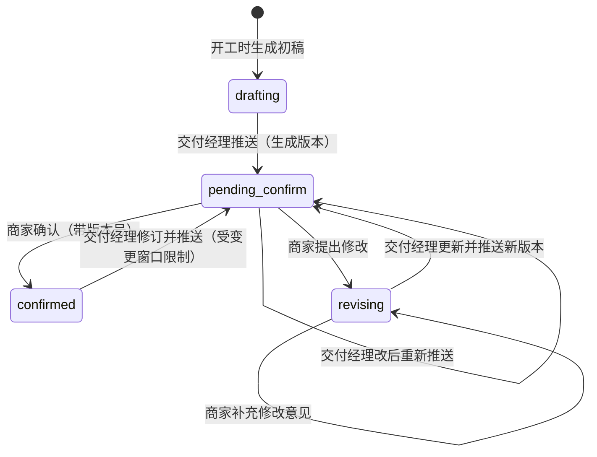

通用守卫：订购单没有在途的取消申请（`open_after_sale_id IS NULL`），否则三个事件都返回 `409 ORDER_IN_AFTER_SALE`（§7.4）。

| 当前状态 | 事件 | 触发者 | 守卫 | 新状态 | 副作用 |
| --- | --- | --- | --- | --- | --- |
| `drafting`、`revising`、`pending_confirm`、`confirmed` | `plan.push` | 交付经理 | 请求带的 `draftLockVersion` ＝ 当前值；内容校验（见下）；`confirmed` 时满足变更窗口（§8.4） | `pending_confirm` | `current_version + 1`，写版本行；上一个未决版本置 `superseded`；未处理的修改请求写 `resolved_by_version`；从 `confirmed` 修订时对受影响工单 `ticket.hold(plan_amendment, 新版本)`；通知商家 |
| `pending_confirm` | `plan.confirm` | 商家（老板） | 请求的 `versionNo` ＝ `current_version` | `confirmed` | 见下面的事务 |
| `pending_confirm`、`revising` | `plan.request_change` | 商家（老板） | 修改项至少 1 项、说明非空 | `revising` | 写 `plan_change_request`；版本置 `change_requested`；交付经理 1 个工作日内答复的时限；通知交付经理 |

`plan.confirm` 的事务（加锁顺序见 §7.5）：

```
预读（不加锁）：方案版本 versionNo 的内容（版本行不可变）→ 涉及的广告 id 集合、订单项 id 集合
BEGIN
 1  SELECT ad WHERE id IN (…) ORDER BY id FOR SHARE                 -- 广告先于订购单
 2  SELECT drama_order FOR UPDATE（守卫：无在途取消）；order_item、delivery_ticket 按 id 升序 FOR UPDATE；delivery_plan FOR UPDATE
 3  守卫：plan.status = pending_confirm 且 versionNo = current_version（否则 409 PLAN_VERSION_STALE）
 4  版本置 confirmed；内容落到 order_item（约定上线日）、order_item_account、order_item_placement（新绑定为浮动）
 5  对每张工单：
      若持有引用本方案的 plan_amendment 暂停 → ticket.resume(plan_amendment)（集合变空时内部会 reevaluate）
      否则 reevaluate(ticket)：处于方案确认的进入广告准备，并立即求值是否广告已全部就绪
 6  outbox：plan.confirmed（载荷含账号是否变化）
COMMIT
```

第 1 步的共享锁是关键：它让“商家确认广告”与“商家确认方案”在广告行上互斥，从而一定有一方能看到另一方已提交的结果（§9.5 的竞态分析）。

推送时的内容校验：

1. 每个未取消的订单项都有一行；每行至少 1 个广告位，且都在该剧允许的植入形式内（PRD §7.2-4）。
2. 广告属于该门店、未取消；类型与广告位一致。广告此时不要求已确认（原型 merchant/Plan：方案确认时片尾广告仍在“修改中”）。
3. 账号属于该门店、状态“可用”、每平台至多 1 个、至少 1 个。
4. 约定上线日不早于“订购日后第 7 个工作日”，且不晚于 `usage_end_date`；早于 `delivery_target_at` 的日期给出警告但允许（交付经理自行判断）。
5. 该订购单所有工单都已离开“待分配”。

### 8.3 乐观锁

1. 草稿编辑：`PUT /admin/delivery/orders/{id}/plan/draft` 带 `draftLockVersion`，`UPDATE … WHERE draft_lock_version = ?`，影响 0 行返回 `409 VERSION_CONFLICT`，前端提示“内容已被他人修改，请刷新”。
2. 商家确认：必须带 `versionNo`。交付经理在商家打开页面后又推送了新版本时，旧版本的确认会被拒绝（`409 PLAN_VERSION_STALE`），小程序刷新后展示新版本。这保证“商家确认的就是他看到的那一版”。

### 8.4 确认之后的变更

原型 merchant/Plan 写“样片确认前，定制内容可联系服务经理调整”，PRD 未定义确认后的变更规则。【默认，§28 第 10 项】

| 变更内容 | 允许的窗口（该订单项工单步骤） | 做法 |
| --- | --- | --- |
| 定制重点、参考素材、补充说明、植入形式、所用广告 | ≤ 样片确认 | 交付经理修订草稿并推送新版本；受影响工单加入暂停原因 `plan_amendment`（引用新版本），商家确认后解除并重新求值，样片按新方案重做 |
| 发布账号 | ≤ 成片交付（未推送成片包） | 同上；确认后 `docs.ensureLetters` 把旧账号的授权书作废、为新账号生成 |
| 约定上线日 | 首个账号核验通过之前 | 不走方案版本：`delivery.rescheduleLaunch(itemIds, newDate, reason)`，写状态历史与审计，通知商家；**同一事务**取消旧日期的 `launch.remind` 定时器并按新日期登记（§21.5 的 T15）；逾期跟踪按新日期自然生效 |
| 样片确认之后改广告或定制内容 | 仅交付主管可操作 | §7.3 第 10 行“返工” |

修订后的方案版本被再次修订（商家未确认前交付经理又推了一版）：旧版本的 `plan_amendment` 暂停原因随旧版本 `superseded` 一并解除，新版本加入新的原因，工单保持暂停。

---

## 9. 广告需求与广告视频

### 9.1 表

```
ad                                             -- 一条广告 = 一次制作需求 + 它的所有版本
  id                 bigint PK
  ad_no              text not null UNIQUE      -- GG20260927006
  entity_id / store_id  bigint not null
  requested_by       bigint not null           -- 提交人（老板）
  type               text not null             -- opening|ending（V1.1：corner|midroll）
  duration_sec       smallint not null         -- 片头 3 或 5；片尾 5 或 10
  promo_points       text[] not null           -- 宣传重点（字典编码）
  copy               text                      -- ≤50 字
  reference_asset_ids bigint[] not null default '{}'
  remark             text                      -- ≤200 字
  status             text not null             -- pending_assign|producing|returned|pending_confirm|revising|confirmed|cancelled
  returned_from      text                      -- 被退回前的状态，补充后回到这里
  returned_at        timestamptz               -- 最近一次被退回补充的时间
  return_reason      text
  editor_id          bigint
  unit_price         int not null              -- 提交时的每条积分（快照）
  discount_bp        int not null              -- 提交时折扣（万分比，快照）
  charge             int not null              -- quoteAd(unit_price, R)
  pricing_snapshot   jsonb not null            -- D1 §5.3 的计价快照（含 freeRevisions；取消扣除比例见 §9.7）
  hold_ref           text not null             -- 账本冻结单 ID
  captured_at        timestamptz
  refund_requested_points / returned_points / converted_points / forfeited_points  int not null default 0   -- 含义同 order_item
  free_revision_quota smallint not null        -- 提交时的免费修改次数（快照，默认 2）
  revision_count     smallint not null default 0     -- 商家提出修改的累计次数
  latest_version_no  smallint not null default 0
  confirmed_version_no smallint                -- 最近一次被确认的版本；非空即“可在订购中选用”
  submitted_at       timestamptz not null
  due_at             timestamptz               -- 当前应交付时间（首版或修改版）；待补充期间为 null
  confirmed_at       timestamptz
  cancel_reason_code text
  cancelled_at       timestamptz
  lock_version       int not null default 0
  INDEX (store_id, status)   INDEX (editor_id, status)   INDEX (status, due_at)

ad_version
  id                 bigint PK
  ad_id              bigint not null REFERENCES ad
  version_no         smallint not null
  file_id            bigint not null
  duration_ms        int not null
  width / height     int not null              -- 1080 × 1920
  segments           jsonb                     -- [{ startMs, endMs, label }]，供修改意见选时间段
  uploaded_by        bigint not null
  uploaded_at        timestamptz not null
  pushed_at          timestamptz
  offline_sent_at    timestamptz               -- 小程序内不可播放时，经企业微信或电脑端提供查看的时间（§10.3）
  decision           text                      -- confirmed|revision_requested|superseded
  decided_at         timestamptz
  UNIQUE (ad_id, version_no)

ad_revision                                    -- 一次修改意见 = 一个修改轮次
  id                 bigint PK
  ad_id              bigint not null REFERENCES ad
  seq                smallint not null         -- 第几次修改
  on_version_no      smallint not null
  source             text not null             -- ad_page|sample_feedback|staff_on_behalf
  chargeable         boolean not null
  charge             int not null default 0
  charge_hold_ref    text                      -- 超次扣减的账本冻结单 ID（幂等键 hold:ad_revision:{id}）
  time_start_ms / time_end_ms  int
  note               text not null             -- ≤200 字
  screenshot_file_ids bigint[] not null default '{}'
  created_by         jsonb not null            -- Actor
  created_at         timestamptz not null
  due_at             timestamptz not null      -- 修改版应交付时间（1 个工作日）
  fulfilled_by_version_no smallint
  UNIQUE (ad_id, seq)
```

广告以 `GG` 编号独立存在，不是订购单（PRD §7.5-1 把广告并入“订购单”，原型把它放在交付模块；取原型，§28 第 13 项）。账本上的引用类型是 `ad_task` 与 `ad_revision`（D1 §5.4）。

### 9.2 状态机

后台 5 个可见状态（原型 admin/AdTasks：待指派、制作中、修改中、待商家确认、已确认）外加“待补充”“已取消”。商家端只显示 PRD §6.4.3 的 4 种：`pending_assign`、`producing` → 制作中；`returned` → 制作中（待补充素材）；`pending_confirm` → 待确认；`revising` → 修改中；`confirmed` → 已确认。

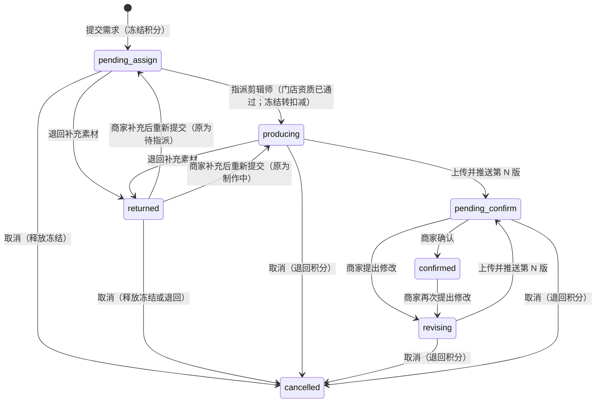

### 9.3 迁移表

| 当前状态 | 事件 | 触发者 | 守卫 | 新状态 | 副作用 |
| --- | --- | --- | --- | --- | --- |
| — | `ad.submit` | 商家（老板） | 套餐生效；`storeGate ∈ {full, parallel}`；类型在 V1.0 开放范围；时长在该类型可选值内；宣传重点至少 1 项；协议版本为《广告制作与交付服务协议》现行版本；带幂等键 | `pending_assign` | 先插入广告行，再 `billing.hold`（`purpose = ad_task`，数量 ＝ `quoteAd(单价, R)`）；快照单价、折扣、免费次数；`due_at = addWorkingDays(now, 2)`，登记 `sla.breach`；记录协议签署；`ad.requested` 事件 |
| `pending_assign` | `ad.assign` | 交付经理或主管（`delivery.ad.assign`） | **`storeGate = full`（门店资质已通过）**；剪辑师启用中（事务开头对其员工行 `FOR SHARE`） | `producing` | `billing.capture(holdId)`；写 `editor_id`；通知剪辑师 |
| `pending_assign`、`producing` | `ad.return` | 剪辑师、交付经理 | 必填原因 | `returned` | 记 `returned_from`、`returned_at`；`due_at` 置空并取消 `sla.breach`；登记 `ad.returned_stale`（退回满 7 个自然日，参数）；通知商家补充 |
| `returned` | `ad.resubmit` | 商家 | — | `returned_from` 的值 | **不重复冻结**（PRD §6.4.2-1）；时限从补充时刻重新计 2 个工作日并重设 `sla.breach`；取消 `ad.returned_stale` |
| `producing`、`revising` | `ad.push_version` | 剪辑师（本人任务） | 文件已确认上传；竖屏 9:16、1080×1920；时长与类型相符 | `pending_confirm` | 写版本行；满足在途修改轮次；取消 `sla.breach`；通知商家；登记 `ad.confirm_remind`（推送后 2 个自然日，§21.5 的 T14） |
| `pending_confirm` | `ad.confirm` | 商家（老板） | `versionNo` ＝ `latest_version_no` | `confirmed` | 写 `confirmed_version_no`、`confirmed_at`；取消 `ad.confirm_remind`；对所有浮动绑定该广告的在办工单 `reevaluate`（加锁步骤见 §9.5） |
| `pending_confirm`、`confirmed` | `ad.request_revision` | 商家（老板）；交付经理代录（仅免费次数内） | 意见非空；见 §9.4 | `revising` | 写修改轮次；`revision_count + 1`；需要时扣积分；`due_at = addWorkingDays(now, 1)`，登记 `sla.breach`；对浮动绑定且在样片制作或样片确认的工单发 `ad.reopened` |
| `pending_assign`；`returned`（原为待指派） | `ad.cancel`（释放） | 审批引擎执行（kind ＝ `ad_cancel` 或 `qualification_cancel`，§9.7） | 没有在办订单项绑定它 | `cancelled` | `billing.release`；按 `ReturnResult` 写三列 |
| `producing`、`revising`、`pending_confirm`；`returned`（原为制作中） | `ad.cancel`（退回） | 审批引擎执行（kind ＝ `ad_cancel`） | 同上 | `cancelled` | `billing.refund`（数量见 §9.7）；按 `ReturnResult` 写三列 |

扣减时点：PRD §2.7 写“剪辑师开始制作时扣减”，原型是“指派即扣减”。【默认】指派 ＝ 开始制作，不另设“开始”按钮（§28 第 14 项）。

**资质未通过不指派、不扣减**：PRD §2.3-1 的原文是“提交订购或**广告需求**时，先冻结应扣积分；**资质审核通过**、开始制作时正式扣减”，§2.8 把“资质审核不通过且无法补正 → 冻结的积分全额退回”同样适用于“订购与广告”。v1 的 `ad.assign` 没有资质守卫，首店资质在审时广告会被指派并扣减；资质最终不通过时，这笔已扣减还会让套餐 7 天全额退款的前提“未使用积分（含冻结）”不成立（D1 §6.10）。本稿加上守卫；首店资质在审期间，广告任务在“待指派”等待，后台广告任务列表对这类任务显示“等待资质审核”。

### 9.4 修改轮次、免费次数与超次扣减

```
requestRevision(adId, input, actor):
  预读（不加锁）：浮动绑定该广告（bound_version_no IS NULL）的订单项及其订购单、工单
  BEGIN
   1  SELECT ad FOR UPDATE；守卫：status ∈ {pending_confirm, confirmed}
   2  按“订购单 id 升序 → 订单项 → 工单 id 升序”对预读到的行 FOR UPDATE
   3  加锁后重新读取这些订单项的广告位与工单步骤，只保留“仍浮动绑定该广告、工单在 sample_making / sample_confirm、未暂停”的工单；
      其余一律跳过（已钉住、已离开这两个步骤、已暂停），不报错
   4  seq = revision_count + 1；chargeable = seq > free_revision_quota
   5  INSERT ad_revision（得到修改记录 ID）；UPDATE ad SET revision_count = seq, status = 'revising', due_at = …
   6  若 chargeable：
        amount = billing.quoteAdUnit(tx, { entityId }).S         -- 按修改当时的单价与套餐折扣（原型 merchant/AdDetail：“每次按 1 条扣 45 积分”）
        守卫：actor 是商家本人（员工代录不允许产生扣减）
        守卫：input.acceptCharge === amount                   -- 前端弹窗展示并回传金额，服务端比对；不一致返回 409 CHARGE_CHANGED
        billing.charge(tx, { purpose: 'ad_revision', refId: 修改记录 ID, amount })   -- 账本内部锁账户、校验套餐生效
   7  对第 3 步留下的工单：transition(ticket, 'ad.reopened')      -- 此时该广告已不是“已确认”，第 8 行守卫必然成立
   8  outbox：ad.revision_requested
  COMMIT
```

第 3 步的“加锁后重读并过滤”修正了 v1 的一个问题：v1 先查受影响工单、再加锁、不重读，期间商家若确认了样片（广告位被钉住、工单进入批量合成），第 7 步会因没有匹配规则抛 `INVALID_TRANSITION`，商家提交修改意见时收到一个与自己操作无关的 409。预读之后才新出现的浮动绑定（另一个事务刚确认方案）不会漏：那个事务确认方案时要对本广告行加共享锁，会排在本事务之后，读到的已是“修改中”，工单自然进入广告准备。

规则：

1. 免费次数、单价在广告创建时快照；参数调整只影响之后提交的广告（PRD §7.3、原型 admin/Params）。超次扣减的金额按修改当时的单价与折扣算。
2. 超出免费次数的修改必须由商家本人在小程序提交，并显式接受金额（PRD §6.4.3-4“提交前弹窗提示”）。套餐过期时免费修改仍可提交，要扣积分的修改被拦截并引导续费【默认】。
3. 样片页的修改意见默认按“合成问题”处理，不计次。商家要改广告内容，样片页引导到“我的广告 › 提出修改”，在那里计次、提示并扣减；交付经理代录“广告内容”类意见仅在还有免费次数时允许。这样不会出现“员工代录导致商家被扣积分”【默认，§28 第 15 项】。
4. 修改意见的时间段：优先从 `ad_version.segments` 里选（原型 merchant/AdDetail 的预置分段），也接受自由输入的起止毫秒；截图最多 1 张。分段由剪辑师上传时填写，可空。

### 9.5 被多单引用时的版本绑定与求值

问题：同一条已确认的广告可被多部剧复用（原型：“使用中：5 部剧”），而广告在确认后仍可再次修改（PRD §6.3.5-7）。改版后各订单项用哪个版本，PRD 没有规则。

规则【默认，§28 第 11 项】：

1. `order_item_placement.bound_version_no` 为空表示**浮动**：跟随该广告最新的已确认版本。
2. 剪辑师上传样片时，记录本次所用的广告版本（`sample.ad_versions_used`）。
3. 商家确认样片时把广告位**钉住**：`bound_version_no` ＝ 该样片所用版本。之后的批量合成、交付、上线都用这个版本。
4. “广告就绪”的判定：

```ts
// 浮动绑定：广告必须处于已确认状态（没有在途修改）；已钉住：恒为就绪，与广告之后的修改无关
const placementReady = (p: Placement, ad: Ad) => p.bound_version_no != null || ad.status === 'confirmed';
const adsReady = (ps: Placement[], ads: Map<Id, Ad>) => ps.length > 0 && ps.every(p => placementReady(p, ads.get(p.ad_id)!));
// 样片可推送、可确认的附加条件：样片所用版本 = 各浮动广告当前的 confirmed_version_no
const sampleUsesCurrentAds = (used: UsedVersion[], ps: Placement[], ads: Map<Id, Ad>) =>
  ps.every(p => p.bound_version_no != null ||
               used.find(u => u.slot === p.slot)?.versionNo === ads.get(p.ad_id)!.confirmed_version_no);
```

5. 广告被提出修改时，对各引用方的影响：

| 引用方所处位置 | 影响 |
| --- | --- |
| 已钉住（样片已确认、批量合成、已交付、已上线、已结束） | 不受影响，继续用钉住的版本 |
| 浮动且工单在样片制作或样片确认 | `ad.reopened` → 回到广告准备；新版本确认后重新做样片；上线日不自动顺延，由交付经理判断是否改期 |
| 浮动且工单在方案确认或广告准备 | 无迁移，继续等待该广告就绪 |
| 新订购 | 只要 `confirmed_version_no` 非空就可以选用；绑定为浮动，在广告准备环节等待在途修改完成 |

6. 已钉住的订单项要换用新版本：交付主管用“返工”（§7.3 第 10 行）解除钉住；返工后的去向按 `adsReady` 求值，广告仍在修改中时回到广告准备而不是样片制作。成片已交付或已上线的不支持换版，需要新订购。

**求值必须在广告行锁之下进行**。`ad.confirm` 的事务：

```
预读（不加锁）：浮动绑定该广告且工单在 ad_prep 的订单项；这些订单项全部广告位涉及的其他广告 id
BEGIN
 1  按 id 升序锁广告：本广告 FOR UPDATE，其他广告 FOR SHARE
 2  守卫：status = pending_confirm 且 versionNo = latest_version_no；置 confirmed
 3  按“订购单 → 订单项 → 工单”id 升序 FOR UPDATE；复核广告位集合（变了抛 LockSetChanged，整体重试）
 4  对每张工单 reevaluate（未暂停且 adsReady → 进入样片制作；暂停中的跳过，恢复时补）
COMMIT
```

v1 的两个竞态及其在本稿中的结果（都因“读广告状态的一方持共享锁、改广告状态的一方持排他锁”而被串行化）：

| 竞态 | v1 的结果 | 本稿 |
| --- | --- | --- |
| A：商家确认广告 X（此时方案尚未确认，查不到工单 T）；B：商家确认方案（读到 X 仍“待确认”，T 进入广告准备）；两者交错提交 | T 停在“广告准备”，所有广告都已确认，再没有事件来求值，永久卡住 | A 先拿到 X 的排他锁：B 在第 1 步等 A 提交，读到 X 已确认，T 直接进入样片制作。B 先拿到 X 的共享锁：A 等 B 提交，随后在自己的事务里查到 T 的浮动绑定并求值，T 进入样片制作 |
| A：商家对 X 提出（可能付费的）修改，X 置为“修改中”；B：确认方案，读到旧的“已确认”，T 直接进入样片制作，之后样片照推、确认样片时把旧版本钉住 | 商家的修改不进成片 | B 等 A 提交后读到“修改中”，T 进入广告准备。B 先提交时，A 在第 3 步过滤到 T（样片制作中），发 `ad.reopened`。另外第 4、5 行守卫都要求“样片所用版本 ＝ 当前确认版本”且 `adsReady`，旧版本不可能再被推送或钉住 |

仍然保留补偿扫描（§7.8）：它不是主流程，而是在哪天有人新增了一个求值点却忘了调用 `reevaluate` 时，把卡住的工单在 5 分钟内捞出来并告警。

**备选与取舍**：(a) 每次改版都生成一条新广告（旧广告不变）——引用关系最简单，但“修改 2 次免费”的计数要跨广告追踪，且“我的广告”列表会出现多条近似广告；(b) 所有引用方始终跟随最新版本——已上线的成片与库里记录的版本不一致，质检与纠纷时说不清。采用“浮动 ＋ 确认样片时钉住”。

### 9.6 时限

| 时限 | 默认 | 起点 | 落点 |
| --- | --- | --- | --- |
| 首版 | 2 个工作日（PRD §6.4.2-2） | 提交需求（退回补充后从补充时刻重计） | 定时器 `sla.breach`，主体 ＝ 广告，键 `sla.breach:ad:{id}:first:{提交或补充的序号}`；到期仍在待指派或制作中 → 超时标记，通知剪辑师、交付经理与主管 |
| 修改版 | 1 个工作日（原型 admin/AdTasks） | 提出修改 | 同上，键 `sla.breach:ad:{id}:rev:{修改轮次}` |
| 商家未确认提醒 | 推送后 2 个自然日提醒一次 | 推送 | 定时器 `ad.confirm_remind`（§21.5 的 T14） |
| 待补充超期 | 退回满 7 个自然日（参数 `ad.returned_stale_days`） | 退回 | 定时器 `ad.returned_stale` → 客服待办“广告待补充素材超期”，由客服联系商家后决定继续或取消 |

广告任务纳入 `sla.breach` 是 PRD 时间规则 T12 的要求（“广告首版 2、广告修改 1”，research/prd-tech §4）；不变量 I7 同样覆盖广告（§25.5）。待指派且门店资质在审的广告，首版时限照常计时但到期只提醒交付经理“等待资质审核”，不计入超时报表。

### 9.7 广告的取消

广告的取消与订购取消共用同一套申请、审批、执行（§16、§17），明细行落在 `cancel_request_line`（`target_type = ad`）。

| 广告所处状态 | 原因 | 路径 | 账本动作与数量 |
| --- | --- | --- | --- |
| 待指派；待补充（原为待指派） | 商家申请、平台原因 | kind ＝ `ad_cancel`，明细 `mode = release`；是否免审批按 §6.5 的两条判定 | `release` 全额 |
| 待指派；待补充（原为待指派） | 资质终局驳回 | 并入该门店的 `qualification_cancel` 申请（§6.5） | `release` 全额，`reasonClass = qualification` |
| 制作中、修改中、待确认；待补充（原为制作中） | 平台原因未能交付（PRD §2.7-3） | kind ＝ `ad_cancel`，客服或交付经理发起，财务审批并执行 | `refund` 全额 |
| 同上 | 商家申请取消 | kind ＝ `ad_cancel`；扣除比例取广告计价快照里的 `cancelDeductionBp.adInProduction` | `refund` ＝ 应扣 − 扣除；扣除比例为 100% 时明细 `mode = terminate_only`，不动积分 |
| 已确认 | — | 不可取消（已交付，可复用） | — |

守卫：没有在办订单项绑定它；有绑定时须先由交付经理修订方案换用其他广告。

【默认，§28 第 44 项】PRD §2.8“制作中取消：扣除已发生成本对应的积分，扣除比例由运营后台配置”写的是“订购与广告”，但原型的三个比例（10%、30%、50%）都是订购的环节，没有给广告的比例。本稿提供参数 `ad.cancel_deduction_bp`（下单时进广告的计价快照，需 D1 在广告快照里增加该字段），占位值 100%（商家原因取消制作中的广告不退），待业务给出数值。原型用“积分调整：平台原因退回”实现广告退回；本设计用专门的 kind，能把退回与原扣减在账本上对应起来。

---

## 10. 样片、成片与质检

### 10.1 表

文件属性、版本号、体检结论、AI 使用声明与水印播放版以 D5 §4.6 的 `deliverable_version` 为准；下面的 `sample`、`episode_output` 是同一批事实的流程视角，以 `deliverable_version_id` 引用它，落地时不重复存文件属性（此处为便于独立阅读仍列出关键列）。

```
sample                                         -- 每个版本一行
  id                 bigint PK
  ticket_id          bigint not null REFERENCES delivery_ticket
  version_no         smallint not null
  deliverable_version_id bigint                -- D5 的产物版本
  file_id            bigint not null
  duration_ms        int not null
  ad_slots           jsonb not null            -- [{ slot, startMs, endMs, label }]，商家端进度条上的广告位标记
  ad_versions_used   jsonb not null            -- [{ slot, adId, versionNo }]
  status             text not null             -- uploaded|qc_rejected|qc_passed|pushed|confirmed|change_requested|superseded
  uploaded_by        bigint not null
  uploaded_at        timestamptz not null
  qc_record_id       bigint
  pushed_by          bigint
  pushed_at          timestamptz
  preview_channels   text[] not null default '{}'   -- 推送时确定的查看方式：weapp|portal|wecom（§10.3）
  offline_sent_at    timestamptz               -- 经企业微信发送水印版、或生成电脑端查看链接的时间
  offline_sent_by    bigint
  decided_at         timestamptz
  decided_by_user_id bigint                    -- 商家用户
  confirm_viewed_via text                      -- 商家确认时声明的查看方式：weapp|portal|wecom
  on_behalf_staff_id bigint                    -- 交付经理代录修改意见时填写
  feedback_kind      text                      -- compose|ad_content
  feedback_note      text                      -- ≤200 字
  feedback_time_ms   int
  feedback_file_ids  bigint[] not null default '{}'
  UNIQUE (ticket_id, version_no)

episode_output
  id                 bigint PK
  ticket_id          bigint not null REFERENCES delivery_ticket
  episode_no         smallint not null
  variant            text not null default 'common'   -- common|douyin|wechat_channels（见 10.4）
  revision_no        smallint not null default 1
  deliverable_version_id bigint                -- D5 的产物版本
  file_id            bigint not null
  size_bytes         bigint not null
  duration_ms        int
  source             text not null default 'manual_upload'  -- V1.1：auto_compose
  status             text not null             -- uploaded|qc_passed|qc_rejected|replaced
  is_current         boolean not null default true
  reissue_id         bigint                    -- 交付后补发时登记的替换集，发布补发前 is_current = false（§11.4）
  qc_record_id       bigint
  uploaded_by        bigint not null
  uploaded_at        timestamptz not null
  UNIQUE (ticket_id, episode_no, variant, revision_no)
  UNIQUE (ticket_id, episode_no, variant) WHERE is_current

checklist_template                             -- 可配置、带版本的清单
  id                 bigint PK
  code               text not null             -- qc.sample|qc.episode|qc.package|delivery.precheck|launch.verify|patrol.check|
                                               -- takedown.check|takedown.absence_check|account.verify
  version            int not null
  items              jsonb not null            -- [{ key, label, required, allowNa, merchantVisible, hint }]
  status             text not null             -- draft|active|retired
  activated_at       timestamptz
  created_by         bigint not null
  UNIQUE (code, version)
  UNIQUE (code) WHERE status = 'active'

qc_record
  id                 bigint PK
  ticket_id          bigint not null
  target_type        text not null             -- sample|episode|package
  target_id          bigint not null
  template_code      text not null
  template_version   int not null
  results            jsonb not null            -- [{ key, result: pass|fail|na, note }]
  verdict            text not null             -- pass|fail
  reject_reason      text
  inspector_id       bigint not null
  inspected_at       timestamptz not null
  INDEX (ticket_id, target_type)
```

### 10.2 质检清单可配置且带版本

PRD §5.2 的质检清单是 7 项；原型 admin/TicketDetail 只有 5 项，且“成片包集数完整”标注为“批量合成后检查”，说明清单按阶段分组。合规口径还在变（PRD §12.3 的 AI 标识样式、差异标准待定）。所以：

1. 清单是数据（`checklist_template`），不是代码。编辑清单 ＝ 新建一个版本并启用，旧版本置 `retired`；**每条质检记录保存模板编码与版本号**，事后能还原当时按哪一版清单检查。
2. 提交质检结果时，服务端按“当前启用的版本”校验：必填项都有结论、`fail` 项必须有说明、`na` 只允许出现在 `allowNa` 的项上。请求里带模板版本号，版本已变则返回 `409 CHECKLIST_VERSION_STALE`，前端重新加载清单。
3. 初始模板（上线时由迁移脚本写入，之后由内容运营或超级管理员在后台维护）：

| 模板 | 条目（来自 PRD §5.2 与原型） |
| --- | --- |
| `qc.sample` v1 | 画面清晰、音画同步；广告位置与时长符合方案且“广告”标识清晰；片头剧名及许可信息完整未被遮挡；字幕与品牌信息同档案一致；定制内容与方案一致且与其他门店成片有明显差异；AI 生成提示标识清晰可见（允许“不适用”） |
| `qc.episode` v1 | 同上第 1、2、3、4、6 项 |
| `qc.package` v1 | 成片包集数完整、文件按集对应发布清单 |
| `launch.verify` v1 | 集数与回填一致；发布账号与授权书一致；“广告”标识可见；未声明原创；**实际上线日期与平台显示的发布时间一致** |

`launch.verify` 的最后一项是本稿新增：上线首日由商家自报，而“按剩余使用期折算退回”（§16.2）里起始日越晚、折算退回越多，需要发布专员核对。

向商家展示的 4 项质检结果（原型 merchant/Sample）取模板里 `merchantVisible = true` 的条目。

同一套模板机制也用于成片交付前检查、链接核验、巡检、下架核查、账号核验（§11～§15）。

### 10.3 样片流程，以及小程序内不能播放时的替代确认

| 动作 | 触发者 | 要点 |
| --- | --- | --- |
| 上传样片 | 剪辑师 | 文件直传后登记；`version_no = current + 1`；记录 `ad_versions_used`；旧版本未决的置 `superseded` |
| 质检 | 交付经理（不能是上传人） | 写 `qc_record`；不通过 → `qc_rejected`，工单留在样片制作，通知剪辑师 |
| 推送 | 交付经理 | §7.3 第 4 行；推送时确定 `preview_channels`（见下） |
| 确认 | 商家（老板） | 带版本号与查看方式；§7.3 第 5 行 |
| 提出修改意见 | 商家；交付经理代录 | 文字必填，时间点与截图选填（PRD §6.9-6；原型缺截图入口，接口按 PRD 支持）；§7.3 第 6、7 行 |

商家确认与交付经理代录同时发生时，两者都要锁工单行，先到者生效，后到者因状态已变收到 `409 INVALID_TRANSITION`。工单暂停期间，样片的上传、质检、推送、确认、提意见一律 `409 TICKET_ON_HOLD`（§7.4）。

**为什么不能只有“小程序内播放”一条路**。样片是一集完整的微短剧（单集数十秒至数分钟），正落在官方“微短剧”的定义内；小程序若被要求补“文娱 > 微短剧”类目，自托管视频会直接播不出来，官方给的另一条出路是移除小程序内的微短剧视频内容（核实 cat-1、cat-3）。D5 §7.4 为此设了开关 `weapp.video.enabled`，关闭后接口不返回任何播放地址。而 V1.0 只有老板能确认样片（PRD §6.16.2-1），交付经理只能代录修改意见、不能代为确认——开关一关，第 5 步就没有可执行的确认方式。

本稿把替代路径写进流程和数据：

1. **开关**：总开关 `weapp.video.enabled`（D5）之下再分两个子开关，`weapp.video.sample.enabled`（样片）与 `weapp.video.ad.enabled`（广告视频）。广告视频是商家自己的 3～10 秒广告，风险低，可在样片关闭时单独保留。键名最终以 D6、D7 统一后的为准。
2. **推送样片时确定查看方式**（第 4 行守卫的最后一项）：
   - 样片可在小程序内播放 → `preview_channels` 含 `weapp`；
   - 不可在小程序内播放 → 交付经理在推送弹窗里至少完成一项，否则不能推送：
     - `wecom`：在后台下载**带明水印的样片版本**（D5 §6.4 的水印版，下载留痕），经企业微信发给老板，然后点“已发送”，写 `offline_sent_at / offline_sent_by`；
     - `portal`：生成电脑端查看链接与提取码（复用 D5 §8 的下载页机制，只读预览水印版）。D7 §14 与 D5 都主张电脑端下载页在 V1.0 必做；若最终不做，则只剩 `wecom` 一种。
3. **小程序样片页**在不可播放时不请求播放地址，展示：海报、广告位标记列表、面向商家的质检结果、查看方式说明（“样片已由服务经理通过企业微信发送给您”或“请在电脑上打开查看链接”），以及勾选项“我已查看第 N 版样片”。
4. **确认接口**：`POST /samples/{id}/confirm { versionNo, viewedVia, ackViewed }`。服务端守卫：
   - `viewedVia ∈ preview_channels`；
   - 样片不可在小程序内播放时，`viewedVia ∈ {wecom, portal}` 且 `ackViewed = true`，并且存在对应的提供记录（`offline_sent_at` 非空，或该版本有电脑端查看记录）；否则 `422 SAMPLE_NOT_VIEWABLE`。
   - 通过后写 `confirm_viewed_via`，进入审计。
5. **提出修改意见**同理：不可播放时时间点由商家手填（可空），截图照常支持。
6. 广告确认页在 `weapp.video.ad.enabled` 关闭时采用同样的做法（`ad_version.offline_sent_at`）。

这样，无论审核最终把小程序推向哪种形态，样片确认始终由老板本人在小程序里完成、留有“看的是哪一版、通过什么方式看的”的记录，而视频本身可以完全不出现在小程序里。【默认，§28 第 45 项】

### 10.4 成片登记与逐集质检

1. 剪辑师把全部剧集直传到对象存储后，调用 `POST /admin/delivery/tickets/{id}/episodes:register`，一次登记多集（`[{ episodeNo, fileId, variant? }]`）。同一集再次登记 ＝ 换版：旧行 `is_current = false`、状态 `replaced`，新行 `revision_no + 1`。可用的步骤：
   - 批量合成：正常登记与换版；
   - 成片交付（尚未推送）：允许换版，换版后该集需重新质检，期间推送成片包的守卫不成立；
   - 待上线、上线核验、服务中：只能通过“补发单”登记（带 `reissueId`，§11.4），不能直接改动当前版本；
   - 其他步骤、或工单暂停：拒绝。
2. 逐集质检支持批量：`POST …/episodes:qc` 传 `{ templateVersion, defaultResults, exceptions: [{ episodeNo, results }] }`，服务端为每集写一条 `qc_record`。质检人是否必须不同于上传人由参数 `qc.episode.four_eyes` 控制，【默认 `false`】（PRD §5.2 步骤 6 的负责人只有剪辑师；小团队强制四眼会卡产能）。
3. 成片包级质检（`qc.package`）由交付经理做一次。
4. 每次质检写入后调用 `reevaluate`：`count(is_current AND status = 'qc_passed') = episode_count × 变体数` 且成片包级质检通过 → 进入成片交付（§7.3 第 9 行）。
5. `variant`：三类微短剧的节目编号按播出平台各自标注、不能跨平台使用（核实 pub-4 额外发现）。若法务确认片头须按平台分别标注，同一订单项发抖音和视频号就需要两套成片。表上预留 `variant`，V1.0 默认只用 `common`；是否启用按剧配置（内容库的字段），启用后下载、回填、核验都按变体对应到账号。这一点需法务拍板（§30）。

---

## 11. 成片交付与发布清单

### 11.1 表

```
delivery_package                               -- 每张工单至多一行，首次推送成片包时创建
  id                 bigint PK
  ticket_id          bigint not null UNIQUE REFERENCES delivery_ticket
  order_item_id      bigint not null
  episode_count      smallint not null
  total_bytes        bigint not null
  release_no         smallint not null default 1       -- 当前生效的推送序号；每次补发 + 1
  pushed_by          bigint not null
  pushed_at          timestamptz not null              -- 首次推送
  grant_expires_at   timestamptz not null              -- 下载业务授权到期（默认 7 天，参数 1～30）
  regrant_count      int not null default 0
  revoked_at         timestamptz                       -- 终止或使用期结束后撤销

delivery_package_release                       -- 每次推送或补发一行，不可变
  id                 bigint PK
  package_id         bigint not null REFERENCES delivery_package
  release_no         smallint not null
  kind               text not null                     -- initial|reissue
  release_id         bigint                            -- D5 的 delivery_release（文件清单快照）
  changed_episode_nos smallint[] not null default '{}' -- 补发时相对上一版变化的集
  reason_code        text                              -- 字典 REISSUE_REASON：错别字、广告版本、AI 标识、画面问题、其他
  note               text
  precheck_version   int not null                      -- delivery.precheck 模板版本
  precheck_results   jsonb not null
  pushed_by          bigint not null
  pushed_at          timestamptz not null
  UNIQUE (package_id, release_no)

package_reissue                                -- 补发单：从发起到发布
  id                 bigint PK
  ticket_id          bigint not null REFERENCES delivery_ticket
  status             text not null                     -- open|published|cancelled
  episode_nos        smallint[] not null               -- 计划替换的集
  reason_code        text not null
  note               text not null
  opened_by          bigint not null
  opened_at          timestamptz not null
  published_release_no smallint
  closed_at          timestamptz
  UNIQUE (ticket_id) WHERE status = 'open'             -- 同一工单同时只有一张在途补发单

publish_list                                   -- 发布清单，进入“成片交付”时创建
  id                 bigint PK
  ticket_id          bigint not null UNIQUE REFERENCES delivery_ticket
  collection_name    text                      -- 合集名称
  cover_file_id      bigint                    -- 默认取剧目竖版海报
  title_template     text                      -- 如 “{剧名} 第{集数}集｜{看点}”
  topics             text[] not null default '{}'
  intro              text                      -- ≤200 字
  ai_declaration     boolean not null default false   -- 发布时是否需要做 AI 内容声明（随剧与制作方式带出）
  saved_by           bigint
  saved_at           timestamptz
  lock_version       int not null default 0

publish_list_episode
  ticket_id          bigint not null
  episode_no         smallint not null
  highlight          text                      -- “看点”，用于模板渲染
  title              text                      -- 逐集覆盖；空则按模板渲染
  topics             text[]
  intro              text
  changed_in_release smallint                  -- 最近一次因补发而变化的推送序号；商家端据此标“已更新”
  PRIMARY KEY (ticket_id, episode_no)
```

### 11.2 发布清单的编辑

1. 发布专员编辑清单用 `lock_version` 做乐观锁；逐集内容支持表格导入（先校验后提交，行级报错；原型 admin/Delivery“可导入表格逐集编辑”）。
2. 标题渲染是 `packages/shared` 里的纯函数，后台预览与小程序“一键复制”用同一份实现。
3. 推送后清单仍可修订（改错别字），每次保存发 `publish_list.updated` 事件通知商家；首个上线任务提交回填后锁定。工单暂停期间不可编辑。

### 11.3 推送成片包（§7.3 第 11 行）的守卫与事务

守卫：

1. 工单在“成片交付”、未暂停；当前有效剧集数 ＝ 订购集数且全部质检通过；今天未过 `usage_end_date`。
2. 发布清单完整：合集名称、封面、简介已填；每集都能得到非空标题；话题至少 1 个。
3. 交付前检查（模板 `delivery.precheck`，原型 4 项：集数完整且与订购一致、文件按集命名并与清单对应、清单已填写、发布账号与授权书一致）全部通过。
4. 每个发布账号：未解绑，且存在一份未作废的授权书（`docs.hasActiveLetters`，§6.4）；约定上线日已确定。账号被**手动标记为异常**（§15.2）时不拦截，但请求必须带 `ackAbnormalAccount = true`，并通知交付经理与商家处理账号——这与 §15.2“手动标记异常不影响在办订单”一致（v1 两处口径相反）。

事务内：

```
1  建 delivery_package（grant_expires_at = now + 参数天数）与第 1 条 delivery_package_release（media.snapshotRelease 固化文件清单）
2  为每个发布账号建 launch_task（review_status = pending）
3  工单 → 待上线、订单项 → 待上线、重新推导订购单状态
4  登记定时器（都以订单项为主体，§21.5）：
     launch.remind      约定上线日前 1 天与当天 09:00（已过去的节点不登记）
     usage.end          usage_end_date 次日 00:00
     takedown.create    usage_end_date − 30 天 00:00；此刻已在 30 天窗口内则不登记定时器，改为本事务内直接建下架任务（§14.2）
     takedown.remind    usage_end_date 前 30、7、1 天与当日 09:00（已过去的节点不登记）
     takedown.overdue   usage_end_date 次日 09:00
5  outbox：package.delivered（通知商家：订阅消息 ＋ 短信，PRD §6.10.1-1）
```

到期类定时器在**推送成片包时**登记，而不是 v1 的“首次进入服务中时”。理由：成片一旦交到商家手里，就存在“已发布但没回填”的可能，到期核查的义务从这一刻起就存在（§14）；同时，停在“待上线”直到授权期结束的订单项也需要 `usage.end` 给它一条终态路径（§7.3 第 15b 行）。

下载：商家每次点击下载，服务端校验“业务授权未过期、未撤销、调用者是该订购的商家”，再现签短时地址（基线 5）。授权过期后商家可在小程序“重新生成”（`regrant_count + 1`，重新计 7 天），条件是订单项未终止且未过使用期。文件命名“剧名_第 NN 集.mp4”在签发下载地址时指定，不改存储对象名。打包、转码、单集体积控制属于媒体设计。

### 11.4 交付后的补发

成片包推送之后才发现某一集有错（错别字、广告版本不对、AI 标识缺失），在 40～100 集的人工制作里是高概率事件。v1 第 10 行“返工”只覆盖批量合成与成片交付两步，推送之后没有任何替换文件并通知商家的路径。本稿增加“补发”，它不改变工单步骤。

| 步骤 | 触发者 | 守卫 | 做什么 |
| --- | --- | --- | --- |
| 发起补发 | 交付经理或主管（`delivery.package.reissue`） | 工单在待上线、上线核验或服务中，未暂停，未过使用期；没有在途补发单；原因与说明必填 | 建 `package_reissue(open)`，列出计划替换的集；通知剪辑师 |
| 登记替换集 | 剪辑师 | 集号在补发单范围内 | `episodes:register` 带 `reissueId`：新行 `revision_no + 1`、`is_current = false`、`reissue_id` 指向补发单；**当前版本不动**，商家此时下载到的仍是旧的已通过版本 |
| 质检 | 按 §10.4 的规则 | — | 写 `qc_record`；不通过可再次登记 |
| 发布补发 | 发布专员（`publish.package.push`） | 补发单内每一集都有一条 `qc_passed` 的替换行；交付前检查通过 | 同一事务：替换行置 `is_current = true`、旧行置 `replaced`；`delivery_package.release_no + 1`，写 `delivery_package_release(kind = reissue, changed_episode_nos, reason)` 与 D5 的新快照；`grant_expires_at = max(原值, now + 参数天数)`；发布清单对应集写 `changed_in_release`；补发单 → `published`；`package.reissued` 事件 |
| 取消补发 | 发起人或主管 | 补发单为 `open` | 替换行置 `replaced`；补发单 → `cancelled` |

发布补发之后：

1. 通知商家（订阅消息 ＋ 短信）：“第 12、15 集已更新，请重新下载；已发布的请替换”。小程序发布任务页在变化的集上标“已更新”。
2. 该订单项已有上线任务通过核验的，生成一条跟进待办给交付经理（`follow_up`，主题“补发后确认商家已替换”），并把该订单项加入下一批巡检的优先名单（§13.2）。
3. 不变量 I5 始终成立：成片包推送之后，“当前有效剧集数 ＝ 订购集数且全部质检通过”在补发的整个过程中都不被破坏，因为替换行在发布前不是当前版本。

---

## 12. 上线任务、链接回填与核验、使用期

### 12.1 粒度：订单项 × 账号

原型 merchant/Publish 的页签计数一处按订单、一处按剧（research/proto-merchant-a §1.14 第 4 条），admin/Verify 一个核验任务覆盖两个账号。本设计统一为“订单项 × 发布账号”一条上线任务，列表按订购单或工单聚合展示。理由：授权书、链接、核验结果、巡检、下架都落在“某部剧在某个账号上”。

### 12.2 表

```
launch_task
  id                 bigint PK
  order_item_id      bigint not null REFERENCES order_item
  ticket_id          bigint not null
  channel_account_id bigint not null REFERENCES channel_account
  platform           text not null
  entity_id / store_id  bigint not null
  executor_type      text not null default 'merchant'   -- V1.1：platform|partner（代发布）
  executor_id        bigint
  review_status      text not null             -- pending|verifying|need_fix|passed|void：最近一轮回填的审核结果
  is_live            boolean not null default false     -- 是否已上线：一旦为真，不因之后的补充回填或退回而变回假
  went_live_at       timestamptz
  current_round      smallint not null default 0
  first_launch_date  date                      -- 该账号核验通过的实际上线首日
  verified_episode_count smallint not null default 0
  completed_at       timestamptz               -- 全部集数核验通过
  last_patrolled_at  timestamptz
  last_patrol_result text
  void_reason        text                      -- terminated|usage_expired|account_changed
  UNIQUE (order_item_id, channel_account_id)
  INDEX (review_status)   INDEX (channel_account_id)   INDEX (store_id, review_status)
  INDEX (order_item_id) WHERE is_live

launch_submission                              -- 每次回填一行
  id                 bigint PK
  launch_task_id     bigint not null REFERENCES launch_task
  round_no           smallint not null
  link_kind          text not null             -- collection|episodes
  collection_url     text
  episode_urls       jsonb                     -- [{ episodeNo, url }]
  reported_episode_count smallint not null     -- 本次声明已发布的集数（累计）
  actual_launch_date date not null             -- 首批发布日期
  submitted_by       jsonb not null            -- Actor
  submitted_at       timestamptz not null
  approval_id        bigint                    -- 对应的核验单（approval_request，kind = launch_link）；同事务内建单后回填
  result             text not null default 'pending'    -- pending|passed|passed_partial|returned|revoked|withdrawn
  verified_episode_count smallint
  UNIQUE (launch_task_id, round_no)
```

**“是否已上线”与“当前回填的审核状态”是两件事**，v1 把它们压在一个 `status` 上（`verified_partial → verifying` 时任务不再被视为已上线），导致部分通过后商家补充回填时，工单求值落到“服务中 → 上线核验”这条不存在的迁移上，补充回填整体回滚。本稿拆成两列：`is_live` 表达事实，`review_status` 只表达最近一轮回填审到哪了。巡检候选、下架任务、工单求值都只看 `is_live`。

### 12.3 上线任务状态机

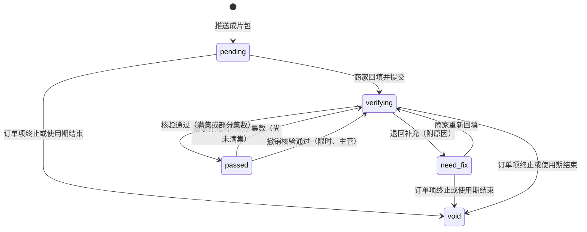

| 当前 `review_status` | 事件 | 触发者 | 守卫 | 新状态 | 副作用 |
| --- | --- | --- | --- | --- | --- |
| `pending`、`need_fix`、`passed`（未满集） | `launch.submit` | 商家（老板）；V1.1 执行人 | 带幂等键；工单未暂停，步骤在待上线、上线核验或服务中；**今天未过 `usage_end_date`**；合集链接或逐集链接至少其一，且都通过链接校验（见下）；`actual_launch_date` 不晚于今天、不早于成片交付日、不晚于 `usage_end_date`；`reported_episode_count` 不小于已核验集数且不大于订购集数 | `verifying` | 写回填行（`round + 1`）；建核验单（1 个工作日，带 `ticket_id`，处理人读取时取工单的发布专员）；`reevaluate(工单)` |
| `verifying` | 核验通过 | 发布专员 | 工单未暂停；清单 `launch.verify` 全部通过；填写 `verifiedEpisodeCount`（不小于已核验集数、不大于本次声明集数） | `passed` | 见 §12.5 |
| `verifying` | 退回补充 | 发布专员 | 原因（字典 `LINK_RETURN`）至少 1 项 | `need_fix` | `is_live` 不变；通知商家（订阅消息 ＋ 短信）；`reevaluate(工单)` |
| `passed` | 撤销核验通过 | 发布主管 | §12.7 | `verifying` | §12.7 |

**链接校验**（契约层的 Zod 校验与服务层各做一次）：长度 ≤ 2,000；能被解析为 URL；协议必须是 `https:`；主机名非空；不含用户名与口令。`javascript:`、`data:`、`http:` 等一律拒绝，返回 `422 LINK_INVALID`。域名只做软校验（不在抖音、视频号常见域名内时提示发布专员留意），不拒绝，因为分享链接形态多变。后台以 `target="_blank" rel="noopener noreferrer"` 打开链接；小程序只提供复制，不内嵌打开。

**支持分批、跨日上线**：PRD §2.5 要求“一次性上线全部剧集”，但单日可发条数没有官方数字，蓝 V 账号可能受限（核实 pub-3）。因此回填带“已发布集数”，核验可以只通过部分集数：`review_status = passed`、`verified_episode_count < 订购集数`，订单项显示“30/80 集”（即原型 merchant/OrderDetail 的“0/80 集”字段），商家补发后再次回填。部分集数通过是否即算“已上线”由参数 `launch.partial_goes_live` 控制，【默认 `true`】；置为 `false` 时部分通过只记录进度，`is_live` 仍为假，满集后才上线（§28 第 19 项）。

### 12.4 工单步骤由上线任务集合求值

```ts
// 只在工单处于待上线、上线核验时由 reevaluate() 调用；工单进入服务中之后不再求值
export function stepFromLaunchTasks(tasks: { reviewStatus: ReviewStatus; isLive: boolean }[]) {
  const alive = tasks.filter(t => t.reviewStatus !== 'void');
  if (alive.some(t => t.isLive))                      return 'in_service';
  if (alive.some(t => t.reviewStatus === 'verifying')) return 'launch_verify';
  return 'awaiting_launch';
}
```

性质：某个任务 `is_live` 为真之后，无论它或别的任务之后如何回填、退回，结果恒为 `in_service`（§26.1）。唯一让 `is_live` 变回假的动作是“撤销核验通过”，它有自己的显式迁移（§7.3 第 21 行）。

双平台时各账号独立核验【默认，§28 第 18 项】：抖音通过、视频号退回补充 → 订单项已上线；视频号的任务 `review_status = need_fix`、`is_live = false`，继续出现在逾期跟踪与商家待办里（§12.6 的判定在任务粒度）。核验退回后工单回到“待上线”，当且仅当没有任何账号已上线或在核验。

### 12.5 核验通过与使用期起算

核验通过的处理器（审批引擎的 `onApproved`，与审批单状态同一事务；锁序：审批单 → 订购单 → 订单项 → 工单 → 上线任务）：

```
1  回填行 result = passed（满集）或 passed_partial；verified_episode_count = 输入值
2  上线任务：review_status = passed；verified_episode_count = 输入值；
             first_launch_date = min(已有值, 回填的 actual_launch_date)；满集时写 completed_at；
             is_live = is_live OR 满集 OR 参数 partial_goes_live；首次变为真时写 went_live_at
3  订单项：live_episode_count = max(各账号 verified_episode_count)
           若存在 is_live 的任务：usage_start_date = min(这些任务的 first_launch_date)   -- “上线首日”取最早上线账号的实际上线日
4  该账号若已有未作废的下架任务（已进入止日前 30 天窗口）：basis 改为 live
5  reevaluate(工单)：首次进入 in_service 时订单项 phase → live，重新推导订购单状态，outbox：item.live
6  outbox：launch.verified（通知商家）
```

使用期规则（PRD §2.5）：

1. 止日 `usage_end_date` 下单时取剧目授权期结束日，延迟上线不顺延。到期类定时器（`usage.end`、`takedown.create`、`takedown.remind`、`takedown.overdue`）在推送成片包时登记（§11.3），与是否通过核验无关。
2. 版权续期：内容库发 `drama.license_extended { dramaId, newEndDate }`。订阅者是**扇出类**：它不在消费事务里逐个处理，只为该剧每个“`usage_end_source = 'license'` 且工单未进入到期下架、未归档、未终止”的订单项登记一条定时器 `usage.resync`（键 `usage.resync:item:{id}:{newEndDate}`，立即到期，关键类）。每个订单项在自己的事务里：

```
usage.resync(orderItemId)：锁订购单 → 订单项 → 工单
  守卫：usage_end_source = 'license'；工单步骤 ∉ {takedown, archived, terminated}；usage_end_date ≠ 剧目当前授权止日
  usage_end_date = 新止日
  成片包已推送的：取消旧止日的 usage.end / takedown.* 定时器并按新止日登记；
                   尚未到新的“止日 − 30 天”的 pending_merchant 下架任务作废（商家已确认或已核查的保留为事实）
  outbox：item.usage_end_changed（docs.ensureLetters 换版、通知商家）
```

3. **进入“到期下架”步骤之后不再顺延**【默认，§28 第 42 项】。进入该步骤时 `usage_end_source` 即被改为 `expired`（自然到期）或 `early_end`（商家提前下架、平台原因终止），续期处理按守卫跳过它。v1 在这里有一个不可达状态：任务被续期作废后，状态图里没有“到期下架 → 服务中”的迁移，“零个未作废任务”时第 16 行是否成立也没定义。本稿的规则是：商家已经按要求下架的作品不因事后续期而自动恢复授权；确需恢复的（续期合同晚于到期日补录），由超级管理员走人工纠偏 `takedown → in_service` 并填写新止日（§7.9），或重新订购。
4. 补偿：进程内对账扫描每小时比对“`usage_end_source = 'license'` 且未进入到期下架的订单项，其 `usage_end_date` 是否等于剧目当前授权止日”，不等则补登记 `usage.resync` 并告警（§25.4）。

### 12.6 逾期未上线

1. 判定是派生的，粒度是**上线任务**：任务未作废、`is_live = false`、`review_status ∈ {pending, need_fix}`，所属订单项 `agreed_launch_date < 今天`、阶段为待上线或上线中、未过使用期、工单未暂停。后台“逾期跟踪”和工作台预警直接按这个条件查询，列表按订单项聚合并标出是哪个账号。这样“抖音已通过、视频号被退回”的订单项，视频号仍在逾期列表里（v1 的判定要求订单项处于待上线，会漏掉它）。
2. 对交付经理的提醒由本模块触发：周期定时器 `launch.overdue` 每天 09:00 触发，处理器按上面的条件取目标集合，对“今天是工作日”或“今天是约定上线日次日”的订单项各发一条 `launch.overdue_due { orderItemId, date, taskIds, reason }`；通知中心按 `launch_overdue:{orderItemId}:{日期}` 去重，并按交付经理合并成一条（D6 §2.7；原型 admin/Overdue：“交付经理每个工作日跟进一次，直至回填链接”）。它每次按当前真相取集合，回填或改期之后自然不再命中，没有需要取消或重设的东西。
3. 成片晚于约定上线日才交付的，不算商家逾期：`reason = late_delivery`，通知文案改为提醒交付经理“请与商家改期”，逾期列表里单独标注。起算日取 `max(约定上线日次日, 成片交付次日)`。
4. 另提供只读查询端口 `publish.listLaunchRemindTargets(date, node)`、`publish.listOverdueLaunchItems(date)`，供通知中心的每日核对使用（D6 §2.7）。
5. 跟进记录与催办限频：

```
follow_up
  id, subject_type（order_item|subscription|store|patrol_task|takedown_task|package_reissue）, subject_id,
  entity_id, store_id, channel（wecom|phone|visit|system）, content（≤200 字）,
  intent（续费意向，可空）, next_follow_at, created_by（员工或 system）, created_at
  INDEX (subject_type, subject_id)   INDEX (next_follow_at) WHERE next_follow_at IS NOT NULL

reminder_log                                   -- 人工催办：同一对象同一场景每日 1 次
  id, subject_type, subject_id, scene（confirm_plan|confirm_ad|confirm_sample|golive|takedown|breach|patrol_fix|renewal）,
  biz_date date, sent_by, created_at
  UNIQUE (subject_type, subject_id, scene, biz_date)
```

催办接口先插 `reminder_log`，唯一冲突即返回 `429 REMINDED_TODAY`，不发通知。

### 12.7 撤销核验通过

发布专员误点“核验通过”后，v1 没有任何回退：使用期起算、授权书生效都已发生。账号核验有“手动标记异常”，链接核验需要对应的动作。

```
revokeVerification(submissionId, reason, actor)：
  权限点 publish.link.verify_revoke（发布主管或交付主管）；原因必填；写审计
  守卫：该回填行是其上线任务最近一条 result ∈ {passed, passed_partial} 的记录；
        距核验决定不超过 1 个工作日（参数 launch.verify_revoke_window）；
        该订单项没有已由商家确认或已核查的下架任务；工单未暂停
  1  回填行 result = revoked；对应核验单重新打开（新建一轮核验单，round + 1），上线任务 review_status = verifying
  2  上线任务：verified_episode_count、first_launch_date、completed_at 按剩余的已通过回填重算；
               没有剩余已通过回填 → is_live = false、went_live_at = null
  3  订单项：live_episode_count、usage_start_date 按各账号重算（没有任何已上线账号则 usage_start_date = null）
  4  若该订单项已没有任何 is_live 的任务且工单在服务中：transition(工单, 'launch.verify_revoked')（§7.3 第 21 行）
       → 工单回到上线核验，订单项 → 待上线，清空 live_at，outbox：item.live_revoked（docs.ensureLetters 把授权书收敛回“待生效”）
  5  该上线任务名下未完成的巡检任务作废；下架任务 basis 改回 delivered_unverified
  6  outbox：launch.verify_revoked（通知商家“核验结果已更正，待重新核验”）
```

到期类定时器不需要任何处理：它们在推送成片包时就已登记，与是否上线无关。超过撤销时限后的更正走人工纠偏（§7.9），同样逐条执行上面的副作用。

---

## 13. 作品巡检

### 13.1 表

```
patrol_batch
  id, week_start date not null UNIQUE, live_total int, sampled int, generated_at

patrol_task
  id                 bigint PK
  batch_id           bigint not null REFERENCES patrol_batch
  launch_task_id     bigint not null REFERENCES launch_task      -- 粒度：订单项 × 账号
  ticket_id          bigint not null                             -- 处理人 = 读取时该工单的 publisher_id
  order_item_id / store_id / entity_id  bigint not null
  source             text not null             -- weekly_sample|manual|reissue（V1.1：data_anomaly）
  status             text not null             -- pending|normal|abnormal|recovered|void
  template_version   int
  results            jsonb
  abnormal_kind      text                      -- 字典 PATROL_ABNORMAL：被删除、仅自己可见、审核异常或限流、被搬运、集数缺失、标识被裁剪
  note               text
  found_at / notified_at / recovered_at  timestamptz
  remind_count       smallint not null default 0
  UNIQUE (batch_id, launch_task_id)
  INDEX (status, ticket_id)
```

### 13.2 每周生成抽查名单

周期任务 `patrol.weekly_generate`（每周一 09:00）：

```
1  INSERT patrol_batch(week_start) ON CONFLICT DO NOTHING            -- 按周幂等
2  候选 = is_live 的上线任务，且订单项处于上线中、工单在服务中
3  排序：近 14 天内发布过补发的优先 → 从未巡检的优先 → last_patrolled_at 最早的优先 → 上线未满 7 天的优先
4  取前 N 条（参数 patrol.weekly_sample，默认按条数 10；可改为按比例）
5  INSERT patrol_task … ON CONFLICT (batch_id, launch_task_id) DO NOTHING
```

候选只看 `is_live`，补充回填正在核验中的任务不会被漏掉。“最久未巡检优先”保证长期全覆盖，抽样量可调。PRD 只写“按周抽查”，原型是 1,392 部抽 10 部（research/proto-admin-a §10.5）；抽样量与规则需业务确认（§28 第 23 项）。

### 13.3 状态机

| 当前状态 | 事件 | 触发者 | 守卫 | 新状态 | 副作用 |
| --- | --- | --- | --- | --- | --- |
| `pending` | 巡检正常 | 发布专员 | 清单 `patrol.check` 全部通过 | `normal` | 回写 `launch_task.last_patrolled_at`、`last_patrol_result` |
| `pending` | 发现异常 | 发布专员 | 异常类型 ＋ 说明（必填） | `abnormal` | 通知商家；定时器 `patrol.followup`（3 个自然日后仍异常 → 交付经理待办） |
| `abnormal` | 再次提醒 | 发布专员 | 催办限频 | `abnormal` | `remind_count + 1`；通知商家 |
| `abnormal` | 复查已恢复 | 发布专员 | 清单全部通过 | `recovered` | 取消跟进定时器；回写上线任务 |
| `pending`、`abnormal` | 作废 | 系统 | 订单项终止、使用期结束或核验被撤销 | `void` | — |

巡检异常不自动修改渠道账号状态，也不自动结束使用期【默认，§28 第 24 项】；确属账号本身问题的，由发布专员手动把账号标为异常（§15）。

---

## 14. 下架任务与核查

### 14.1 表

```
takedown_task
  id                 bigint PK
  order_item_id      bigint not null REFERENCES order_item
  ticket_id          bigint not null                    -- 处理人 = 读取时该工单的 publisher_id
  launch_task_id     bigint not null
  channel_account_id bigint not null
  entity_id / store_id  bigint not null
  trigger            text not null             -- expiry|early_end|platform_termination|terminated_after_delivery
  basis              text not null             -- live：该账号已核验上线；delivered_unverified：成片已交付但该账号未通过核验
  usage_end_date     date not null
  due_date           date not null             -- 商家应完成的日期：到期类 = usage_end_date；终止类 = 终止执行日 + 1 个自然日
  status             text not null             -- pending_merchant|merchant_confirmed|checked|void
  merchant_method    text                      -- delete|private|not_published（最后一项仅 basis = delivered_unverified 可选）
  merchant_confirmed_at timestamptz
  merchant_confirmed_by jsonb
  check_due_at       timestamptz
  still_online_count smallint not null default 0
  escalated_at       timestamptz
  breach_notice_count smallint not null default 0
  template_code      text                      -- takedown.check 或 takedown.absence_check
  template_version   int
  results            jsonb
  evidence_file_ids  bigint[] not null default '{}'   -- 至少 2 张：账号主页、合集页；保存不少于 3 年
  checked_by         bigint
  checked_at         timestamptz
  UNIQUE (order_item_id, channel_account_id) WHERE status <> 'void'
  INDEX (status, due_date)
```

### 14.2 生成规则与状态机

**谁需要下架任务**：只要这个订单项的成片包推送过，它的**每一个发布账号**在使用期结束或订单项终止时都要有一条任务——不管这个账号有没有通过核验。v1 只对“已通过核验”的账号生成任务：商家下载了成片、已发布但没回填（或回填后停在“需补充”“核验中”）的账号，到期时没有任何任务、也没有人核查；双平台时另一账号核查通过后工单即归档，漏掉的账号上的作品仍在线。超期使用构成侵权（PRD §12.1），不能留这个口子。

```
ensureTakedownTasks(tx, orderItemId, trigger)：                       -- 幂等
  前提：该订单项存在 delivery_package（成片包推送过）；否则直接返回
  对该订单项的每条上线任务（含因终止或到期而作废的；不含因账号变更而作废的）：
    已有未作废的下架任务 → 跳过
    INSERT takedown_task(trigger, basis = is_live ? 'live' : 'delivered_unverified', usage_end_date, due_date)
  有新建 → outbox：takedown.created（每订单项一条，载荷含任务 id 列表）
```

调用点：

| 调用点 | `trigger` |
| --- | --- |
| 定时器 `takedown.create`（止日前 30 天 00:00，PRD §6.10.1） | `expiry` |
| 推送成片包时已在止日前 30 天窗口内（§11.3 第 4 步，同事务） | `expiry` |
| 工单进入“到期下架”（§7.3 第 15、15b 行的副作用，兜底） | `expiry` 或 `early_end` |
| 已上线的订单项因平台原因终止（§7.3 第 20 行） | `platform_termination` |
| 待上线、上线核验中的订单项被取消终止（§7.3 第 19 行） | `terminated_after_delivery` |

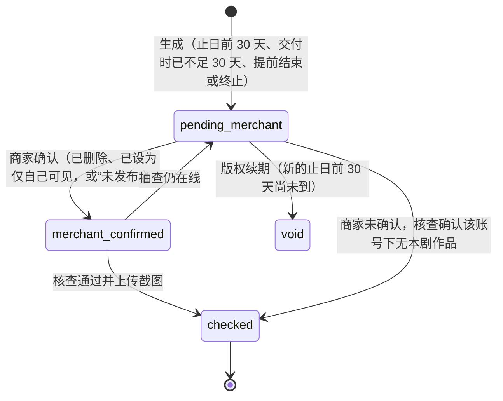

| 当前状态 | 事件 | 触发者 | 守卫 | 新状态 | 副作用 |
| --- | --- | --- | --- | --- | --- |
| `pending_merchant` | 商家确认 | 商家（老板） | 选择方式；`not_published` 仅 `basis = delivered_unverified` 可选 | `merchant_confirmed` | `check_due_at = addWorkingDays(max(now, due_date 当日结束), 1)`；发布专员待办；`reevaluate(工单)`（全部任务都已确认且工单在服务中时触发第 15 行） |
| `merchant_confirmed`、`pending_merchant` | 核查通过 | 发布专员 | `basis = live`：清单 `takedown.check` 全部通过；`basis = delivered_unverified`：清单 `takedown.absence_check`（“该账号主页与合集中无本剧作品”）通过；证据截图 ≥ 2 张 | `checked` | 证据文件打长期留存标记；`reevaluate(工单)`（第 16 行） |
| `merchant_confirmed` | 仍在线 | 发布专员 | — | `pending_merchant` | `still_online_count + 1`；通知商家；升级交付主管 |
| `pending_merchant`（已过 `due_date`） | 升级 | 定时器 `takedown.overdue`（`due_date` 次日 09:00）或发布专员 | — | 不变 | 写 `escalated_at`；通知交付主管与交付经理；工作台预警“逾期未下架” |
| `pending_merchant`（已过 `due_date`） | 违约提醒 | 发布专员、交付经理 | 催办限频 | 不变 | `breach_notice_count + 1`；通知商家“24 小时内下架” |
| `pending_merchant` | 作废 | 系统（`usage.resync`） | 工单未进入到期下架；新的止日前 30 天尚未到 | `void` | — |

**与工单步骤的关系**：

1. 归档条件（§7.3 第 16 行）：该订单项未作废的下架任务**至少 1 条且全部已核查**。成片包推送过的订单项进入“到期下架”时一定有任务（进入时调用 `ensureTakedownTasks`）；进入该步骤后任务不再因续期被作废（§12.5），所以不会出现“零条任务”。
2. 停在“待上线”直到授权期结束的订单项（§7.3 第 15b 行）：到期后同样进入“到期下架”，逐账号核查“无本剧作品”，核查完归档，订单项为“已结束（未上线）”。积分不退回（商家原因未上线，PRD §2.5-4“使用期的截止日不因延迟上线而顺延”）。
3. 已终止的工单（§7.3 第 19 行）是终态，但它名下的核查任务照常进行、照常出现在“待核查下架”待办里；这些任务不驱动任何工单迁移。

口径【默认，§28 第 22、40 项】：

1. PRD 写“平台抽查核验”，原型是每个任务都勾选并截图。默认**逐任务核查并留证**，参数 `takedown.check_mode` 可改为抽查比例。
2. 同一部剧的全部成片同一天到期（原型 admin/Offline 示例 5 个任务同日到期），核查接口支持批量：`POST /admin/publish/takedown-tasks:check` 传任务数组，每个任务各带自己的证据截图。
3. 核查时限的起点取“商家确认时间”与“应完成日结束时间”中较晚者 ＋ 1 个工作日（PRD §5.2 写“使用期结束后 1 个工作日”，原型示例是“商家确认后 1 个工作日”）。
4. 下架提醒（止日前 30、7、1 天与当日 09:00）由定时器 `takedown.remind` 触发（§21.5 的 T18），发送前校验“该订单项仍有待商家下架的任务”。

---

## 15. 渠道账号绑定与核验

### 15.1 表

```
channel_account
  id                 bigint PK
  entity_id / store_id  bigint not null
  platform           text not null             -- douyin|wechat_channels
  account_name       text not null
  account_uid        text not null             -- 抖音号或视频号 ID
  account_uid_norm   text not null             -- 去空格、转小写后的值
  account_type       text                      -- enterprise|personal|none；核验时由发布专员填写
  cert_subject_name  text                      -- 认证主体（企业认证时）
  screenshot_file_ids bigint[] not null
  status             text not null             -- pending_verify|available|abnormal|unbound
  abnormal_source    text                      -- verify|manual
  abnormal_reason_code text
  abnormal_note      text
  submitted_at / verified_at / unbound_at  timestamptz
  verified_by        bigint
  lock_version       int not null default 0
  UNIQUE (platform, account_uid_norm) WHERE status <> 'unbound'      -- 同一账号不能同时绑定两家门店
  INDEX (store_id, status)
```

不存任何平台密码或令牌（PRD §6.10.2-3）。

### 15.2 状态机

| 当前状态 | 事件 | 触发者 | 守卫 | 新状态 | 副作用 |
| --- | --- | --- | --- | --- | --- |
| — | 绑定 | 商家（老板） | `storeGate ∈ {full, parallel}`：首店资质已提交即可（审核中或已通过），新增门店须已通过（PRD §6.16.1-3，与 §4.4 第 2 项同一个判定函数）；唯一约束不冲突 | `pending_verify` | 建核验单（kind ＝ `channel_account`，第 1 轮，1 个工作日） |
| `pending_verify` | 核验通过 | 发布专员 | 比对表没有不一致项；已填账号类型 | `available` | 通知商家；订购页可选 |
| `pending_verify` | 标记异常 | 发布专员 | 原因（字典 `ACCOUNT_REJECT`）＋ 说明 | `abnormal` | `abnormal_source = verify`；通知商家 |
| `abnormal` | 重新提交截图 | 商家 | — | `pending_verify` | 新一轮核验单（类型“重新提交”） |
| `available` | 手动标记异常 | 发布专员 | 原因 ＋ 说明 | `abnormal` | `abnormal_source = manual`；新订购与新方案不可选；**不影响在办订单**：已选用它的订单项照常制作、交付（推送成片包时要求发布专员确认知情，§11.3）、回填与核验 |
| 任意未解绑状态 | 解绑 | 商家 | 不存在引用该账号且阶段为待开工、制作中、待上线、上线中的订单项；不存在该账号上未核查的下架任务 | `unbound` | 在途核验单置 `withdrawn` |

v1 的绑定守卫写成“门店资质已通过”，对首店也生效；与订购校验“至少 1 个可用账号”叠加后，首店在资质通过前既绑不了账号也下不了单，PRD §2.4-2、§5.1 的“资质审核与订购并行”落空。本稿按 PRD §6.16.1-3 的原文区分首店与新增门店。

核验单的 `result.compare` 保存比对表：`[{ field, filled, recognized, match }]`，字段为账号名称、账号 ID、账号类型、认证主体、账号状态。V1.0 的“截图识别”一列由发布专员看截图后手填（不接 OCR），接口与表结构不变，将来可由识别服务预填【默认，§28 第 24 项】。绑定表单不要求商家选“账号类型”，由核验时确定（原型 merchant/Accounts 无此字段）。

“认证主体须与营业执照主体一致”只出现在原型：【默认】企业认证账号不一致时不能通过；个人认证或未认证账号不做主体比对。是否允许个人号承接授权需法务确认（§30）。

---

## 16. 取消与终止（退回积分）

本节覆盖三种取消申请，它们共用同一套“预览 → 申请 → 审批 → 执行”，明细落在同一张表：

| kind | 对象 | 明细覆盖 | 发起 |
| --- | --- | --- | --- |
| `order_cancel` | 订购单 | 该订购单的若干订单项（待开工、制作中、待上线、已上线） | 客服（`order.cancel.submit`） |
| `ad_cancel` | 广告 | 一条广告（§9.7） | 客服或交付经理 |
| `qualification_cancel` | 门店 | 资质终局驳回时，该门店全部待开工订单项与未指派的广告（§6.5） | 系统（代审核人生成） |

### 16.1 流程

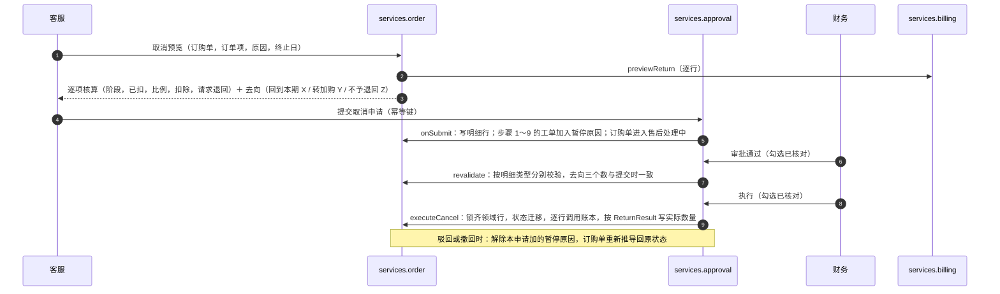

1. **发起**：整单发起、按剧逐行核算（原型 admin/OrderDetail）；接口接受 `itemIds`，数据上支持只取消其中几部，后台界面默认全选【默认，§28 第 4 项】。同一订购单同时只允许一张在途申请（`dedupe_key`）；订购单 `open_after_sale_id` 非空时不能再被别的申请覆盖（含 `qualification_cancel`）。
2. **预览必须包含账本的去向**：每行除“阶段、已扣、扣除比例、扣除、请求退回”外，都调用 `billing.previewReturn` 得到“回到本期套餐积分 X（MM-DD 清零）/ 转为加购积分 Y / 原周期已结束不予退回 Z”，逐行存入明细（原型 admin/OrderDetail 的“退回去向”一栏）。客服据此告知商家；财务审批时看到的是同一份数字。
3. **提交时（`onSubmit`）按订单项所处位置分别处理**：

| 订单项位置 | 提交时 | 审批期间 |
| --- | --- | --- |
| 待开工 | 不涉及工单；`open_after_sale_id` 挡住开工 | 冻结保持 |
| 制作中、待上线（工单步骤 1～9） | `ticket.hold(cancel_review, 申请)`（§7.3 第 17 行，已暂停的工单同样可以叠加） | 工单及其子对象不可写（§7.4），阶段不会变 |
| 已上线（服务中、到期下架） | **不暂停**。申请里固定“终止日”：默认 ＝ 提交当天，客服可填写更早的平台事故日（不早于上线首日、不晚于提交日与使用期止日） | 巡检、补充回填、下架提醒照常；折算只依赖固定的终止日，不随审批跨日而变 |

4. **审批**：默认全部走财务审批（§6.5）；申请总是生成并留痕，免审批开关只影响“全部为释放且全额回到原批次”的申请由系统自动审批并执行。职责分离、二次确认见 §17.4。取消类审批与执行各有 1 个工作日的默认时限，超时生成财务待办并通知财务主管（§17.4）。
5. **重新校验（`revalidate`，审批时与执行时各一次）**按明细类型分别进行，不再是 v1 的“一律要求工单仍暂停、重算恒等”：

| 明细类型 | 校验 |
| --- | --- |
| 释放（待开工订单项、未指派广告） | 对象仍在提交时的状态；冻结单仍有效；`previewReturn` 的三个数与明细一致 |
| 退回或仅终止（工单步骤 1～9） | 工单仍持有本申请的 `cancel_review` 暂停原因；步骤 ＝ 提交时的步骤；已请求退回累计未变；`previewReturn(请求退回量)` 的三个数与明细一致 |
| 退回（已上线） | 工单在服务中或到期下架（未归档）；订单项的上线首日、使用期止日及其来源与明细快照一致；已请求退回累计未变；`previewReturn` 的三个数一致。**不比较“今天”** |
| 广告 | 广告仍在提交时的状态；没有在办订单项绑定它；三个数一致 |

   不一致时返回 `409 PRECONDITION_CHANGED` 并列出差异（最常见的是套餐周期在审批期间结束，去向从“回到本期”变成“转加购”或“不予退回”）；申请保持原状态，由审批人驳回或申请人撤回后重新发起（与 D4 §7.6 的处理一致）。

### 16.2 逐项核算（`packages/shared/refund.ts`，纯函数）

```ts
type LineInput = { phase: ItemPhase; charge: number; refundRequested: number;   // refundRequested：已请求退回累计
                   usageStart?: LocalDate; usageEnd: LocalDate };

export function cancelLine(i: LineInput, step: TicketStep | null, reason: CancelReason,
                           ratiosBp: Record<Stage, number>, terminationDate?: LocalDate): Line {
  const remaining = i.charge - i.refundRequested;                  // 这笔扣减上还留着的数量
  if (['cancelled', 'refunded', 'terminated', 'ended'].includes(i.phase)) return { mode: 'invalid', code: 'ITEM_CLOSED' };
  if (i.phase === 'pending_start') return { mode: 'release', stage: 'pendingStart', deduct: 0, refund: i.charge };

  if (i.phase === 'live') {                                        // 服务中，或已上线后的到期下架核查期间
    if (reason !== 'platform_fault') return { mode: 'invalid', code: 'LIVE_NOT_REFUNDABLE' };   // PRD §2.8：已上线不退回
    const total  = daysInclusive(i.usageStart!, i.usageEnd);                                  // 上线首日至使用期止日
    const remain = clamp(daysBetween(terminationDate!, i.usageEnd), 0, total);                // 终止日次日起的剩余天数
    const refund = Math.min(remaining, roundHalfUp(i.charge * remain, total));
    return refund > 0 ? { mode: 'refund', stage: 'live', deduct: remaining - refund, refund }
                      : { mode: 'terminate_only', stage: 'live', deduct: remaining, refund: 0 };
  }

  if (step === 'takedown') return { mode: 'invalid', code: 'ITEM_EXPIRED' };   // 从未上线、已到期待核查
  const stage   = stageOf(step!);                                              // 步骤 1～9 → planConfirm|adAndSample|samplePending|postSample
  const ratioBp = reason === 'platform_fault' ? 0 : ratiosBp[stage];           // 平台原因全额退回
  const deduct  = Math.min(remaining, roundHalfUp(i.charge * ratioBp, 10_000));
  const refund  = remaining - deduct;
  return refund > 0 ? { mode: 'refund', stage, ratioBp, deduct, refund }
                    : { mode: 'terminate_only', stage, ratioBp, deduct, refund: 0 };
}
```

相对 v1 的三处修正：

1. 已上线分支用申请里固定的 `terminationDate`，不用 `today`。v1 的申请快照存的是提交当天的结果，审批只要跨过零点数额就变，“与快照不一致则拒绝”会让已上线的平台原因退回永远走不通。
2. 已上线分支的扣除改为 `remaining − refund`。v1 写成 `charge − refund`，在已有部分退回时“扣除 ＋ 退回 ＝ 已扣 − 已退”不成立。现在对所有有效分支恒有 `deduct + refund = charge − refundRequested`（§26.1 的性质测试）。
3. 对已关闭的订单项前置拒绝（v1 会落到最后一个分支并取到未定义的阶段键）；请求退回为 0 的终止单独记为 `terminate_only`，不调用账本，订单项落到“已终止”而不是“已退回积分”。

扣除比例取自**下单时的计价快照**（`order_item.pricing_snapshot.cancelDeductionBp`，D1 §5.3：商家下单时看到的取消规则就是这一单适用的规则），不取当前参数。参数保存时校验“随阶段不递减”。

| 阶段键（D1 快照） | 工单步骤 | 默认值 | 出处 |
| --- | --- | --- | --- |
| `planConfirm` | 待分配、方案确认 | 10% | 原型 admin/Params c1 |
| `adAndSample` | 广告准备、样片制作 | 30% | 原型 admin/Params c2 |
| `samplePending` | 样片确认 | 50% | 原型 admin/Params c3 |
| `postSample` | 批量合成、成片交付、待上线、上线核验 | 100%（占位） | PRD 与原型均未规定，§28 第 16 项 |

“已上线按剩余使用期折算”的公式 PRD 未给出，上面按“剩余天数 ÷ 总天数”实现【默认，§28 第 17 项】；终止日的取法见 §28 第 39 项。**本函数只算“请求退回多少”**；这些积分最终回到哪里、有没有被判为不予退回，完全由账本决定并以 `ReturnResult` 为准（PRD §2.3-3，D1 §7.5）。

### 16.3 执行事务（唯一实现）

`order.executeCancel(tx, approvalId, actor)` 是积分类取消申请**唯一**的执行实现。审批引擎的 `execute` 钩子、财务退款管理页的“执行”按钮（D2 §7.6）、免审批时的自动执行都调用它；D2 不再另写一份（§17.7）。

```
BEGIN
 1  SELECT approval_request FOR UPDATE（守卫：status = approved；kind ∈ {order_cancel, ad_cancel, qualification_cancel}）
 2  按全局锁序把本次要用到的领域行全部锁齐：
      明细涉及的广告（id 升序）→ 订购单 → 订单项 → 工单 → 终止会触及的子表行（上线任务、成片包、广告位）
      SELECT cancel_request_line … FOR UPDATE
 3  revalidate（§16.1 第 5 点）；不一致 → ROLLBACK，返回 409 PRECONDITION_CHANGED
 4  先完成全部状态迁移（都不依赖账本结果）：
      待开工订单项：标记取消原因与时间
      工单在步骤 1～9：transition(工单, 'ticket.terminate') → terminated（§7.3 第 19 行：作废上线任务、撤销下载授权、
                        成片包推送过的为每个发布账号建核查任务、删除广告位绑定）
      已上线：transition(工单, 'ticket.terminate')（第 20 行：usage_end_date = 明细里的终止日，建下架任务）
      广告：transition(广告, 'ad.cancel')
 5  再逐行调用账本（账户锁由账本内部取得；从这里起不再锁新的业务行）：
      release        → r = billing.release(tx, { holdId, reasonClass, opRef: 明细 id })          -- 幂等键 release:hold:{holdId}
      refund         → r = billing.refund(tx, { holdId, qty: 明细.refund_qty, reasonClass, opRef: 明细 id })   -- 幂等键 refund:{明细 id}
      terminate_only → 不调用账本，r = { qty: 0, backToOriginal: 0, convertedToAddon: 0, forfeited: 0 }
 6  按 r 写实际数量：
      明细行：result = r；returned_points / converted_points / forfeited_points；executed_at
      订单项或广告：refund_requested_points += r.qty；returned_points += r.backToOriginal；
                    converted_points += r.convertedToAddon；forfeited_points += r.forfeited
      订单项阶段：待开工 → cancelled；其余按 phaseFromTicket 推导（实际退回 > 0 → refunded，否则 terminated；已上线的留在 live，归档时再定）
 7  涉及的订购单：open_after_sale_id = null；重新推导状态；待开工且未被取消的订购单若资质已通过，重新登记 order.start
 8  approval_request → done；关联的客服工单追加一条系统事件
 9  outbox：order.item.cancelled / .refunded / .terminated × n（载荷带三个实际数量）、ad.cancelled、order.status_changed、approval.executed
COMMIT
```

要点：

1. **展示、状态与对账都用第 6 步写下的实际数量**。商家端“已终止，已退回 N 积分”的 N ＝ `returned_points + converted_points`；`forfeited_points > 0` 时同时显示“原周期已结束，Z 积分不予退回”。订单项是“已退回积分”还是“已终止”只看 N 是否大于 0（§5.2）。
2. **幂等**：账本按 `refund:{明细 id}`、`release:hold:{holdId}` 去重（D1 §8.3）；审批单状态守卫保证事务整体只生效一次。因为执行入口只有这一个、幂等键只有这一种写法，同一申请不可能被两条路径各执行一次。
3. **锁序**：先把领域行锁齐并完成迁移，再进账本；取得账户锁之后只更新已经持有锁的行，符合 §7.5。
4. 驳回或撤回（`onRejected` / `withdraw`）：对明细涉及的工单 `ticket.resume(cancel_review, 申请)`（只移除本申请加的原因，集合变空时重新求值）；`open_after_sale_id = null`；重新推导订购单状态；待开工且资质已通过的重新登记 `order.start`；通知申请人并同步到关联的客服工单（原型 admin/Refunds）。

### 16.4 明细表

```
cancel_request_line                            -- 取消申请的逐项核算与实际结果；一行 = 一个订单项或一条广告
  id                 bigint PK                 -- 账本退回的幂等键 refund:{id} 取自这里
  approval_id        bigint not null REFERENCES approval_request
  target_type        text not null             -- order_item|ad
  target_id          bigint not null
  hold_ref           text not null
  mode               text not null             -- release|refund|terminate_only
  stage              text not null             -- pendingStart|planConfirm|adAndSample|samplePending|postSample|live|adUnassigned|adInProduction
  step_at_submit     text                      -- 提交时的工单步骤或广告状态
  reason_class       text not null             -- merchant|platform|qualification
  charge             int not null              -- 应扣（S）
  prior_requested    int not null              -- 提交时已请求退回的累计
  ratio_bp           int                       -- 适用的扣除比例（快照里的值）
  deduct             int not null
  refund_qty         int not null              -- 本次请求退回或释放的数量
  termination_date   date                      -- 仅已上线：固定的终止日
  usage_start_date / usage_end_date  date      -- 仅已上线：提交时的快照
  preview            jsonb not null            -- 提交时 previewReturn 的结果：{ backToOriginal, convertedToAddon, forfeited, lots }
  result             jsonb                     -- 执行时账本返回的 ReturnResult
  returned_points / converted_points / forfeited_points  int    -- 执行后写入
  executed_at        timestamptz
  UNIQUE (approval_id, target_type, target_id)
  INDEX (target_type, target_id)
```

申请单的 `payload` 只存申请级信息（原因、说明、合计、关联客服工单）；逐行数字以这张表为准，提交后不可改。若架构师最终保留 D2 的 `refund_request` 作为独立的领域单据，本表的外键改指向它，其余不变（§17.7）。

---

## 17. 通用“审核/审批”模型

### 17.1 范围与取舍

两类事情结构相同——“有人提交、另一个人按清单和规则作出通过或驳回的决定、有时限、要留痕”：

| 类别 | 例子 | 提交人 |
| --- | --- | --- |
| 审核（review） | 资质审核、账号核验、链接核验、素材复核、开票申请、对公收款确认 | 商家（或系统代商家生成） |
| 审批（approval） | 订购取消退回、广告取消、资质终局驳回后的整店取消、套餐退款、积分调整、套餐延长；V1.1 的改价、商家归属变更、服务商入驻 | 员工（或系统代员工生成） |

做法：**一张 `approval_request` 表 ＋ 按 kind 在代码里注册的处理器**。领域数据仍在各自的表里，引擎只管“状态、时限、原因、留痕、唯一性、谁能看、谁能批、谁能执行”。

| 备选 | 结论 |
| --- | --- |
| 每个领域一张审核表（资质审核表、核验表、退款表、调整表……） | 7～10 张近似的表与 7～10 套近似的接口；后台 6～7 个队列页无法复用；待办聚合要逐表查 |
| 引入工作流引擎（BPMN 类） | V1.0 的审批全部是单级，引擎的学习与运维成本远大于收益 |
| 一张表 ＋ 步骤表 ＋ 参数可配的审批链（v1） | V1.0 注册的 kind 全部是单级；步骤表与 `approval.flow.<kind>` 参数只为 PRD §12.3 第 4 项一个未决问题服务，却让“谁能批退款”变成一个可在后台修改的参数（改它本身又是一个需要审计和审批的敏感操作） |
| **一张表 ＋ 代码注册处理器，单级（采用）** | 表结构稳定；新增 kind 只写一个处理器文件；审批人是代码里的权限点常量。业务确定某个 kind 要两级时再加步骤表（纯增量，不影响已有 kind） |

### 17.2 表

```
approval_request
  id                 bigint PK
  request_no         text UNIQUE               -- 有编号的 kind 才填：TK（退款与取消）、TZ（积分调整）、YQ（延长）、KP（开票）
  kind               text not null
  category           text not null             -- review|approval
  subject_type       text not null
  subject_id         bigint not null
  entity_id          bigint not null
  store_id           bigint
  ticket_id          bigint                    -- 不可变：所属交付工单（launch_link 等）；处理人读取时取该工单的 publisher_id
  round_no           smallint not null default 1       -- 同一对象第几次提交
  status             text not null             -- pending|approved|executing|done|rejected|withdrawn
  payload            jsonb not null            -- 提交内容快照（按 kind 的 Zod schema 校验，不可变）；只放 ID、数值与展示摘要
  precheck           jsonb                     -- 系统比对结论（字段是否一致、异常项、建议原因）；不放证照号等明文
  result             jsonb                     -- 审核时填写的结构化结果（清单结论、比对表、标签）
  checklist_code     text
  checklist_version  int
  reason_codes       text[] not null default '{}'      -- 驳回或退回原因（字典，按 kind）
  decision_note      text
  submitted_by       jsonb not null            -- Actor（商家用户、员工或 system）
  requester_staff_id bigint                    -- 员工发起时填写（system 代员工生成时填该员工）
  submitted_at       timestamptz not null
  due_at             timestamptz               -- 决定时限
  exec_due_at        timestamptz               -- 执行时限（有执行步的 kind，审批通过时写入）
  sla_snapshot       jsonb
  decided_by         bigint                    -- 自动审批时为 null，另记 decided_by_system = true
  decided_by_system  boolean not null default false
  decided_at         timestamptz
  confirm_checks     text[] not null default '{}'      -- 决定时勾选的核对项
  executed_by        bigint
  executed_at        timestamptz
  exec_confirm_checks text[] not null default '{}'
  execution_ref      text                      -- 外部执行凭据，如微信退款单号、线下转账登记号
  execution_error    text
  related_service_ticket_id bigint
  dedupe_key         text                      -- kind 声明“同一对象同时只允许一张在途”时填 kind:subject
  idempotency_key    text
  lock_version       int not null default 0
  CHECK (decided_by IS NULL OR requester_staff_id IS NULL OR decided_by <> requester_staff_id)   -- 发起人 ≠ 审批人（D4 §7.6）
  UNIQUE (dedupe_key) WHERE status IN ('pending','approved','executing') AND dedupe_key IS NOT NULL
  UNIQUE (requester_staff_id, idempotency_key) WHERE idempotency_key IS NOT NULL
  INDEX (kind, status, due_at)   INDEX (ticket_id, status)   INDEX (store_id, kind)   INDEX (entity_id, kind)
```

**敏感内容不进这张表**：证照号码、银行账号与流水号、凭证图片、发票信息等只以引用（资质记录 ID、凭证文件 ID、付款单 ID）出现在 `payload` 里；详情接口由该 kind 的归属模块按引用读取并套用自己的脱敏规则（D4）。这样即使读权限过滤出现疏漏，这张表里也没有可直接泄露的明文。

### 17.3 状态机

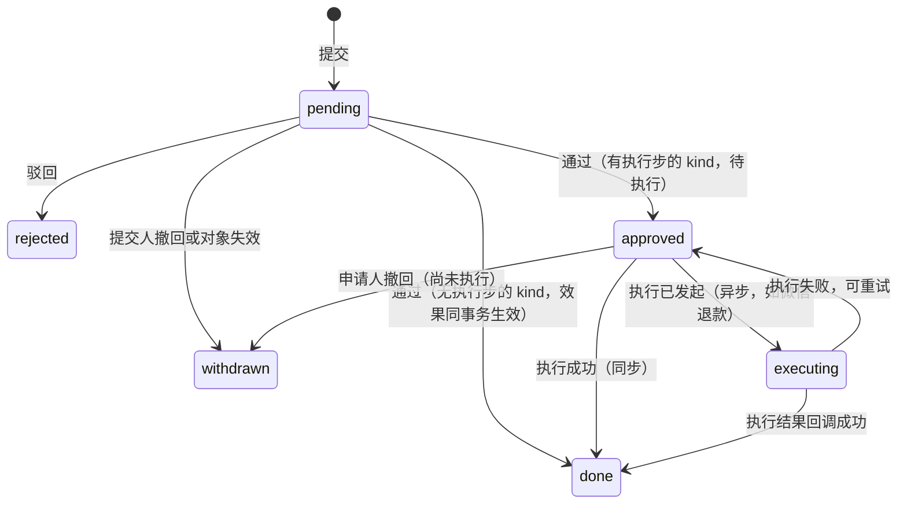

这六个状态与 D2 §7.2 的退款申请单状态机（待审批、待执行、执行中、已退款或已退回、已驳回、已撤回）逐一对应；D4 §7.6 的四个状态是它的子集（§17.7）。

| 当前状态 | 事件 | 守卫 | 新状态 | 副作用 |
| --- | --- | --- | --- | --- |
| — | `submit` | 提交权限；`payloadSchema` 校验；同对象无在途（`dedupe_key`）；`kind.validate(tx)` | `pending` | 算 `due_at` 并登记 `sla.breach`；`kind.onSubmit(tx)`；`approval.submitted` 事件 |
| `pending` | `approve` | 决定权限点且在数据范围内；职责分离；二次确认；清单版本有效；`kind.revalidate(tx)` | `approved` 或 `done` | `kind.onApproved(tx)`；无执行步的 kind 在此事务内生效；有执行步的写 `exec_due_at` 并登记 `sla.breach` |
| `pending` | `reject` | 权限同上；原因至少 1 项；说明必填 | `rejected` | `kind.onRejected(tx)`；通知提交人 |
| `approved` | `execute` | 执行权限；二次确认；`kind.revalidate(tx)` | `done` 或 `executing` | `kind.execute(tx)`；异步执行时记录 `execution_ref` |
| `executing` | `execution.succeeded` / `execution.failed` | 外部回调验签通过或主动查询得到终态 | `done` / `approved` | `kind.onExecuted(tx)`；失败记录 `execution_error` |
| `pending`、`approved` | `withdraw` | 提交人本人或对象已失效（如账号解绑） | `withdrawn` | 与驳回相同的恢复动作（`kind.onRejected`） |

驳回后再次提交 ＝ 新建一行，`round_no + 1`；历史轮次保留，商家详情与审核记录时间线按轮次展示（原型 admin/Review 的“驳回记录”）。`revalidate` 不通过时返回 `409 PRECONDITION_CHANGED`，申请保持原状态。

### 17.4 kind 注册

```ts
// packages/services/approval/kinds.ts（示意）
export interface ApprovalKind<P = unknown> {
  kind: string;  category: 'review' | 'approval';
  numberPrefix?: 'TK' | 'TZ' | 'YQ' | 'KP';
  payloadSchema: ZodType<P>;
  detailSchema: ZodType;                  // 该 kind 的详情响应 schema（按 kind 区分，不共用一个大而全的结构）
  viewPermission: string;                 // 读权限点：列表、详情、计数三处强制
  inScope(req: ApprovalRow, viewer: Viewer): boolean;       // 数据范围规则（本人、本组、全部；发起人是否可见自己发起的）
  submitPermission: string;  decidePermission: string;  executePermission?: string;
  dedupe?: (subject) => string;
  slaPolicy?: string;  execSlaPolicy?: string;  checklist?: string;  reasonDict?: string;
  confirmChecks?: { approve?: string[]; execute?: string[] };       // 二次确认必须勾选的核对项
  separation: { applicantCannotDecide: true; deciderCannotExecute: boolean };
  // 七个钩子。V1.0 冻结为这七个，不再增加；需要第八个时说明它已经不是“审批”而是别的东西
  validate(tx, req): Promise<void>;       onSubmit?(tx, req): Promise<void>;
  revalidate?(tx, req): Promise<void>;    onApproved?(tx, req): Promise<void>;
  onRejected?(tx, req): Promise<void>;    execute?(tx, req): Promise<'done' | 'async'>;
  onExecuted?(tx, req, ok: boolean): Promise<void>;
}
```

V1.0 注册的 kind（全部单级）：

| kind | 对象 | 读权限点（另加数据范围） | 决定权限点 | 执行步 | 时限（决定 / 执行） | 通过后的效果 | 归属模块 |
| --- | --- | --- | --- | --- | --- | --- | --- |
| `qualification` | 门店 | `merchant.qualification.view` | `merchant.qualification.review` | 无 | 1 个工作日 | 门店资质 ＝ 已通过；`store.qualification.approved`（触发开工） | 商家 |
| `channel_account` | 渠道账号 | `publish.account.view` | `publish.account.verify` | 无 | 1 个工作日 | 账号 ＝ 可用（§15） | 发布 |
| `launch_link` | 回填行 | `publish.link.view` | `publish.link.verify` | 无 | 1 个工作日 | §12.5 | 发布 |
| `store_asset` | 门店素材 | `merchant.asset.view` | `merchant.asset.review` | 无 | 1 个工作日 | 写标签、可用性；素材 ＝ 已整理 | 素材 |
| `invoice` | 付款单 | `finance.invoice.view` | `finance.invoice.issue` | 无 | 参数 | 发票已开具（上传文件或登记运单） | 财务 |
| `bank_receipt` | 付款单 | `finance.receipt.view` | `finance.receipt.confirm` | 无 | 1 个工作日 | 付款单 ＝ 已支付 | 支付 |
| `order_cancel` | 订购单 | `finance.refund.view`；发起人可见自己发起的 | `finance.refund.approve` | `finance.refund.execute` | 各 1 个工作日 | §16.3 | 订购 |
| `ad_cancel` | 广告 | 同上 | `finance.refund.approve` | `finance.refund.execute` | 各 1 个工作日 | §9.7、§16.3 | 广告 |
| `qualification_cancel` | 门店 | 同上；资质审核人可见 | `finance.refund.approve` | `finance.refund.execute` | 各 1 个工作日 | §6.5、§16.3 | 订购 |
| `plan_refund` | 付款单 | `finance.refund.view`；发起人可见自己发起的 | `finance.refund.approve` | `finance.refund.execute`（异步：微信退款） | 各 1 个工作日 | 付款单 ＝ 已退款、套餐关闭（D2 §7.3） | 支付 |
| `points_adjust` | 积分账户 | `finance.points_adjust.view`；发起人可见自己发起的 | `finance.points_adjust.approve` | 无（通过即入账） | 1 个工作日 | 账本调整流水（D1 §7.8） | 积分 |
| `subscription_extend` | 订阅周期 | `billing.extension.view`；发起人可见自己发起的 | `delivery.supervisor.approve` | 无 | 1 个工作日 | 周期止日顺延（D1 §6.8） | 订阅 |

规则：

1. **审批链是代码常量、单级**。PRD §12.3 第 4 项（补偿的审批人）未定，默认按上表；原型的“交付主管审批延长、积分入账另经财务审批”用两张单据表达（延长单通过后由执行器另建一张积分调整单，D4 §7.6），不需要多级审批。
2. **职责分离**【默认，§28 第 27 项】：申请人不能审批自己的申请（强制，另有数据库约束兜底）；审批人可以执行自己批准的申请（财务岗位可能只有一个人，原型示例里审批与执行是同一人），由 kind 上的开关控制，对应 D2 的 `refund.require_distinct_executor`。
3. **二次确认**（PRD §3.3-3、§7.9-2）：采用 D4 §7.5 的做法——请求体带 `confirm` 回显（对象编号 ＋ 关键数值，如申请单号与退回合计），服务端与库中当前值比对，不一致返回 `409 CONFIRM_MISMATCH`；标了 step-up 的权限点再验证第二因子。`confirmChecks`（界面上勾选的核对项，如“已核对所处阶段、适用规则与退回数额”）一并写入审批单与审计。
4. **重新校验**：申请时的数额是快照。审批与执行时 `revalidate` 按当前数据重算：积分调整不得扣成负数（原型 admin/CreditAdjust）；取消申请按 §16.1 第 5 点；不满足则拒绝操作并提示重新发起。
5. **时限**：上表每个 kind 都有决定时限，取消与退款类另有执行时限；到期由 `sla.breach` 定时器生成超时待办并通知处理岗位的主管。v1 的 `order_cancel`、`ad_cancel` 没有时限，审批不处理时工单会无限期暂停、订购单一直“售后处理中”。
6. **商家端可见性**：商家只能看到自己提交的审核的状态、原因字典文案和说明；`precheck`、内部说明不下发。

### 17.5 资质审核的两个细节

1. **终局驳回**：驳回弹窗增加“无法补正”勾选。它的后果是该门店全部待开工订购与未指派广告被取消，所以多两道保护：
   - 弹窗先调用 `GET /admin/approvals/{id}/final-reject-preview`，回显“将取消 N 张待开工订购单、M 条待指派广告，共冻结 P 积分”，提交时请求体带回这三个数（D4 的二次确认回显），与库中当前值不一致返回 `409 CONFIRM_MISMATCH`。
   - 驳回本身只把门店资质置为“终局驳回”并发 `store.qualification.rejected { final: true }`；真正的取消由订购模块的订阅者生成一张 `qualification_cancel` 申请（发起人记为该审核人），默认经财务审批并执行（§6.5）。因此“一键不可逆”变成了“审核人决定 ＋ 财务复核”；免审批开关打开且去向全部为原批次时才由系统直接执行。
   - 该订阅者注册为关键类；补偿扫描每 5 分钟检查“终局驳回的门店仍有待开工订购单或未指派广告，且没有在途的 `qualification_cancel`”并补建（§25.4）。
   - 套餐是否全额退款由支付模块按 PRD §2.8 判断；它的前提“未使用积分（含冻结）”要等 `qualification_cancel` 执行完才成立（D1 §6.10），所以后台在该门店有在途 `qualification_cancel` 时提示财务先处理它。
2. **系统比对异常时的人工放行**：原型在比对有异常时禁用“通过”按钮。识别可能出错，【默认】保留拦截，但持有 `merchant.qualification.override` 权限的人可以填写理由后强制通过，理由写入 `decision_note` 与审计。

### 17.6 接口形态与读权限

后台队列页共用一组接口，按 kind 过滤；各业务菜单只是带了固定 `kind` 的同一个页面组件。

```
GET  /api/v1/admin/approvals?kind=&view=todo|done_today|all&page=
GET  /api/v1/admin/approvals/counts?kinds=…
GET  /api/v1/admin/approvals/{id}
GET  /api/v1/admin/approvals/{id}/final-reject-preview        （仅 qualification）
POST /api/v1/admin/approvals/{id}/approve   { lockVersion, result?, checklist?, confirm, confirmChecks }
POST /api/v1/admin/approvals/{id}/reject    { lockVersion, reasonCodes, note, final?, confirm? }
POST /api/v1/admin/approvals/{id}/execute   { lockVersion, confirm, confirmChecks, executionRef? }
POST /api/v1/admin/approvals/{id}/withdraw  { lockVersion, note }
```

读权限在三处强制，规则写在引擎里而不是各页面里：

| 接口 | 规则 |
| --- | --- |
| 列表 | `kind` 缺省时取“调用者持有读权限点的 kind 集合”，不是全部；显式传入无读权限的 kind 返回 `403`；每个 kind 再套 `inScope` 的数据范围（本人负责的门店、本组、全部；发起人可见自己发起的） |
| 计数 | 请求的 kinds 与可读集合求交集，其余不返回 |
| 详情 | 先按 ID 取出 kind，再校验该 kind 的读权限与数据范围；不满足一律返回 `404`（不暴露“这个 ID 存在但你无权看”）。响应按 kind 用各自的 `detailSchema`（契约里是以 `kind` 为判别字段的联合类型），由归属模块组装并脱敏 |

按 PRD §3.3 的矩阵，发布专员、剪辑师对财务管理是“—”：持有 `publish.link.verify` 的员工调用这组接口时，读不到 `plan_refund`、`bank_receipt`、`points_adjust`、`qualification` 的任何一行（§26.4 的契约测试）。

两个人同时处理同一条：都要锁审批单行并校验 `status = pending` 与 `lock_version`，后到者收到 `409`，前端自动跳到下一条。

### 17.7 与 D4（统一审批单）、D2（退款申请单）、D1（调整单、延长单）的合并

三份设计对“取消与退款的申请—审批—执行”各写了一遍，状态和执行入口互相重叠。进入实施前按下面的口径定死，供架构师确认：

| 项 | 合并后的做法 |
| --- | --- |
| 表 | 只保留一张审批表，即本节的 `approval_request`；字段命名以 D4 为准（`no`、`type`、`requester_*`、`approver_staff_id`、`idempotency_key`、`dedupe_key`、“发起人 ≠ 审批人”的 CHECK），本节增加的列：`category`、`round_no`、`ticket_id`、`precheck`、`result`、`checklist_*`、`due_at`、`exec_due_at`、`sla_snapshot`、`executed_*`、`execution_ref` |
| 状态 | D4 的 `pending / approved / rejected / cancelled` 之外增加 `executing`、`done`；`withdrawn` 即 D4 的 `cancelled`。D2 §7.2 的 `refund_request` 六个状态与本表一一对应，因此 D2 的 `refund_request` 不再有自己的状态列：它是 `kind ∈ {plan_refund, order_cancel, ad_cancel, qualification_cancel}` 的审批单加上一张 1:1 的领域扩展表（规则核算、`invoice_guard`、`exec_route`、现金退款的冻结单等 D2 专属字段） |
| **执行入口** | **每个 kind 只有一个 `execute` 实现，由归属模块注册**：积分类（`order_cancel`、`ad_cancel`、`qualification_cancel`）＝ 本文 §16.3 的 `order.executeCancel`；现金类（`plan_refund`）＝ D2 §7.3。财务退款管理页的“执行”按钮只调用 `POST /approvals/{id}/execute`。D4 §7.6“执行器只把退款单置为待执行、由财务另行触发”与此一致：通过 ＝ `approved`（待执行），执行是另一个动作 |
| 幂等键 | 账本退回统一为 D1 §8.3 的 `refund:{明细 id}`，明细即 §16.4 的 `cancel_request_line`；释放为 `release:hold:{holdId}`。D2 §7.6 的 `refund:${requestNo}:${itemId}` 作废 |
| D2 §7.6 的五个接口 | 与本文的对应关系：`dramaOrders.previewCancel` ＝ `order.previewCancel`；`enterAfterSale` ＝ kind 的 `onSubmit`（§16.1 第 3 点）；`leaveAfterSale` ＝ `onRejected`；`closeAsRefunded` 与 `pointsLedger.refundHold` ＝ `order.executeCancel`（§16.3）。不存在第二份实现 |
| 领域单据 | 积分调整单与延长单（D1 §4.5）继续作为领域单据，审批单的 `payload` 只存单据 ID 与展示摘要；通过时在审批事务内调用 `billing.applyAdjustment` / `applyExtension` |
| 审核类（商家提交） | D4 不覆盖。资质审核、账号核验、链接核验、素材复核、开票申请、对公收款确认按本节的 `category = review` 进入同一张表：没有“发起员工”，`submitted_by` 记商家用户 |
| 二次确认与复核 | 采用 D4 §7.5 的 `confirm` 回显与 step-up；本节的 `confirmChecks` 作为界面层的补充 |
| 多级审批 | 不做。D4 是单级，本节也是单级 |

若架构师决定保留 D2 的 `refund_request` 为带自己状态列的独立表，本文的要求只有两条不变：积分类申请的执行只调用 `order.executeCancel`；幂等键用 `refund:{明细 id}`。其余（表名、外键指向）随之调整即可。

---

## 18. 客服工单

### 18.1 表

```
service_ticket
  id                 bigint PK
  ticket_no          text not null UNIQUE      -- KF20260929011
  entity_id / store_id  bigint not null
  source             text not null             -- miniapp|online_chat|phone
  submitter_user_id  bigint                    -- 小程序提交人；后台登记的可空
  registered_by      bigint                    -- 后台登记人
  type_code          text not null             -- 字典 SERVICE_TICKET_TYPE（两端同一份字典）
  priority           text not null             -- high|mid|low；默认取字典上的默认优先级，员工可改
  description        text not null             -- ≤500 字
  image_file_ids     bigint[] not null default '{}'    -- ≤9 张
  contact_phone_enc  bytea                     -- 加密存储
  owner_id           bigint                    -- 当前负责人（客服或交付经理）
  status             text not null             -- pending|processing|awaiting_confirm|resolved|closed
  close_reason       text                      -- duplicate|invalid|withdrawn
  close_note         text
  first_response_due_at timestamptz            -- 仅小程序来源
  first_response_at  timestamptz
  solution_due_at    timestamptz
  solution_at        timestamptz
  awaiting_since     timestamptz
  auto_resolve_at    timestamptz
  resolved_at        timestamptz
  resolved_by        text                      -- merchant|auto
  reopened_count     smallint not null default 0
  escalated_at       timestamptz
  sla_snapshot       jsonb not null
  lock_version       int not null default 0
  created_at         timestamptz not null
  INDEX (status, first_response_due_at)   INDEX (owner_id, status)   INDEX (store_id, created_at DESC)

service_ticket_entry                           -- 会话时间线
  id                 bigint PK
  ticket_id          bigint not null REFERENCES service_ticket
  kind               text not null             -- merchant_message|staff_reply|internal_note|system_event
  tag                text                      -- submit|supplement|reopen|reply|solution|result|transfer|status|biz_event
  actor              jsonb not null            -- Actor
  body               text
  image_file_ids     bigint[] not null default '{}'
  link               jsonb                     -- 深链：{ target: 'ad' | 'order' | 'sample' | …, id }
  visible_to_merchant boolean not null         -- internal_note 恒为 false
  is_solution        boolean not null default false
  created_at         timestamptz not null
  INDEX (ticket_id, created_at)

service_ticket_ref                             -- 关联的业务对象
  ticket_id          bigint not null
  ref_type           text not null             -- order|payment_order|delivery_ticket|ad|approval
  ref_id             bigint not null
  PRIMARY KEY (ticket_id, ref_type, ref_id)
  INDEX (ref_type, ref_id)
```

商家端接口只查 `visible_to_merchant = true` 的条目，过滤写在查询层，响应 schema 也不含内部备注字段（基线 4 的“按角色区分的响应 schema”）。

### 18.2 状态机

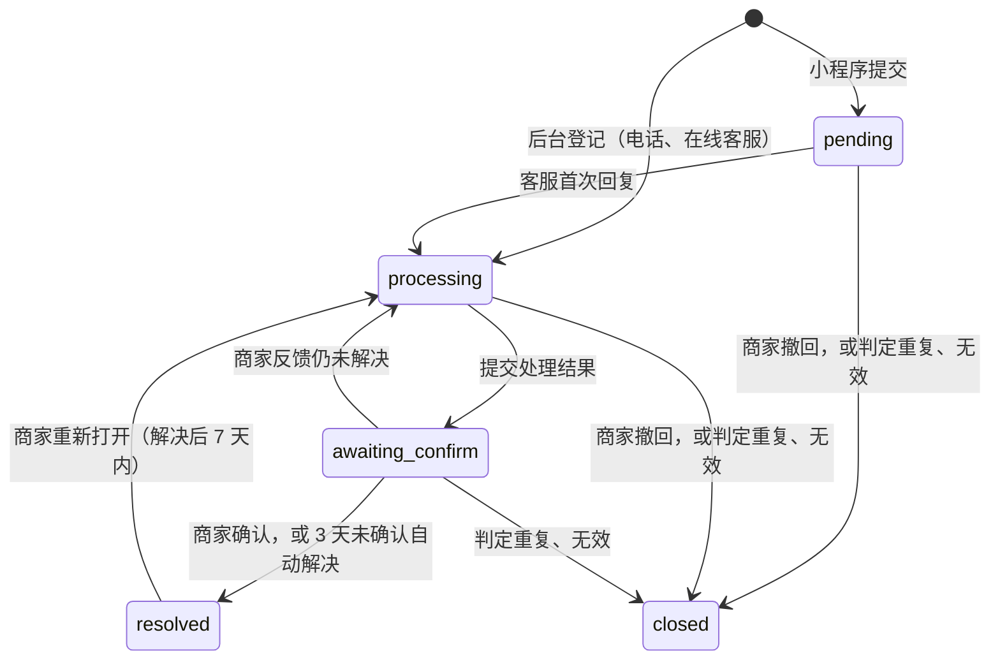

| 当前状态 | 事件 | 触发者 | 守卫 | 新状态 | 副作用 |
| --- | --- | --- | --- | --- | --- |
| — | 提交 | 商家（老板；店员能否提交见 §30） | 幂等键；描述非空；类型在字典内 | `pending` | 生成工单号；轮流分配（§18.4）；首次响应时限（30 工作分钟）与方案时限（24 自然小时）；企业微信提醒负责人 |
| — | 登记 | 客服 | 幂等键 | `processing` | 无首次响应时限；方案时限 24 自然小时（原型 admin/Service） |
| `pending` | 回复商家 | 负责人 | — | `processing` | 写 `first_response_at`；取消响应超时定时器；通知商家 |
| `processing` | 回复、内部备注、商家补充说明 | 负责人、商家 | — | 不变 | 写条目；回复勾选“此回复为处理方案”时写 `solution_at`（首次） |
| `processing` | 提交处理结果 | 负责人 | 结果非空 | `awaiting_confirm` | 写条目（`tag = result`）；`solution_at`（若空）；`auto_resolve_at = now + 3 天`（自然时间）；定时器 `service.auto_resolve`；通知商家 |
| `awaiting_confirm` | 确认解决 | 商家 | — | `resolved` | `resolved_by = merchant`；取消定时器 |
| `awaiting_confirm` | 到期未确认 | 定时器 | 状态仍为 `awaiting_confirm` 且 `auto_resolve_at` 未被改过 | `resolved` | `resolved_by = auto` |
| `awaiting_confirm`、`resolved` | 重新打开 | 商家 | 必填说明；`resolved` 时距解决不超过参数天数（默认 7） | `processing` | `reopened_count + 1`；重新计 30 工作分钟响应时限 |
| `pending`、`processing` | 撤回 | 商家 | 选择原因 | `closed` | `close_reason = withdrawn` |
| 未结状态 | 关闭 | 负责人 | 原因（重复、无效、商家撤回）＋ 说明 | `closed` | 通知商家；之后不可回复 |
| 未结状态 | 转派 | 负责人 | 目标不是当前负责人 | 不变 | 改 `owner_id`；写系统事件；有说明时另写一条内部备注；企业微信提醒；时限不变 |

【默认，§28 第 25 项】

1. “给出处理方案”的判定：回复时勾选“此回复为处理方案”，或提交处理结果，取较早者。原型有“处理方案”用时却没有对应动作（research/proto-admin-c §9.5 第 1 条）。
2. “已解决”后可重新打开：PRD §6.12-5 写“确认解决或重新打开”，原型只在“待您确认”可重开；默认允许解决后 7 天内重开，参数为 0 即关闭此入口。
3. 工单类型以字典为准（原型后台 10 项、小程序 9 项），两端读同一份字典。
4. 自动解决按自然时间精确到分钟（原型 merchant/TicketDone：72 小时，跨国庆照算）。

### 18.3 时限

| 时限 | 口径 | 到期动作 |
| --- | --- | --- |
| 首次响应 30 分钟 | 工作时间内累计（`addWorkingMinutes`） | 定时器 `service.first_response_due`：提醒负责人、升级客服主管（写 `escalated_at`）、列表标红 |
| 给出处理方案 24 小时 | 自工单创建起的自然时间（原型 admin/SysParams） | 定时器 `service.solution_due`：提醒负责人 |
| 自动解决 3 天 | 自进入“待商家确认”起的自然时间 | 定时器 `service.auto_resolve` |

### 18.4 分配与转派

1. 新工单在“当班”客服之间轮流分配（PRD §7.8-1）：`assignment_pool_member(pool = 'cs', on_duty)`，用 §6.3 的 `pickNext`。“当班”没有配置入口（research/proto-admin-c §8.5 第 4 条），【默认】由客服本人或主管在后台切换一个“接单中”开关；没有人当班时工单留在 `owner_id = null`，进入客服主管的待办。
2. 类型字典上标记“可转服务经理”的问题（交付进度、内容修改等）可一键转给该门店的交付经理（PRD §7.8-2）。
3. “投诉建议”类创建时同时通知客服主管（原型 admin/SysDict）。

### 18.5 业务事件进入时间线

原型把“广告任务已上传第 1 版”“取消待财务审批”等写进工单时间线（admin/ServiceDetail）。做法：一个事件订阅者 `support.onBizEvent`，收到 `ad.version_pushed`、`ad.confirmed`、`sample.pushed`、`approval.*`、`ticket.step_changed` 等事件后，查 `service_ticket_ref` 里引用了该对象且未结的客服工单，各追加一条 `system_event`（带深链）。订阅者按投递行去重（§20.3），重复事件不会重复写。

取消申请与客服工单的关联：客服在工单里发起取消时把工单号带到审批单的 `related_service_ticket_id`，列表副说明“取消待财务审批”由此而来。

---

## 19. 状态变更历史（支撑指标）

### 19.1 表

```
status_transition                              -- 只追加；应用账号对此表只有 INSERT、SELECT 权限
  id                 bigint PK
  machine            text not null             -- order|order_item|ticket|plan|ad|sample|launch_task|takedown_task|
                                               -- patrol_task|channel_account|approval|service_ticket
  subject_id         bigint not null
  entity_id          bigint not null
  store_id           bigint
  from_state         text                      -- 创建时为 null
  to_state           text not null
  event              text not null             -- 状态机事件名；暂停、恢复、改派、改期、补发等不改状态的动作 from = to
  actor              jsonb not null            -- { type: merchant|staff|system|partner, id, onBehalfOf? }
  reason_code        text
  note               text
  payload            jsonb                     -- 事件载荷摘要（版本号、轮次、数量、暂停原因等）
  forced             boolean not null default false   -- 人工纠偏（§7.9）
  occurred_at        timestamptz not null
  biz_date           date not null             -- 按 Asia/Shanghai 取日，报表按它分组
  elapsed_seconds    int                       -- 在 from_state 停留的自然秒
  elapsed_work_min   int                       -- 在 from_state 停留的工作分钟（工单、审批单、客服工单才算），写入时按当时的日历算好
  request_id         text                      -- 请求或事件的追踪号
  INDEX (machine, subject_id, occurred_at)
  INDEX (store_id, occurred_at DESC)
  INDEX (machine, to_state, occurred_at)
```

这张表由本文定义，D6 §5.2 不另建表、只使用它，并提出两点要求，本稿都满足：

1. **时长类结果在终点时刻固化**：`elapsed_work_min` 与环节记录上的用时在写入那一刻按当时的工作日历算好并存下，报表直接聚合这些列，不在查询时用日历重算；日历事后修正不让已出的历史指标漂移。
2. **不属于流程域的状态机不强求并入**：付款单、退款现金流水、发票（D2）与订阅（D1 的 `subscription_event`）各有自己的事实表；`machine` 清单只含上面列出的流程域对象。

与审计日志的分工：审计日志记录“谁对什么做了敏感操作、前后值是什么”，服务于合规追责（基线 4）；状态历史记录“对象在各状态之间如何流转、各停留多久”，服务于指标、时间线和排障。两者都由 `transition()` 在同一事务里写入，不互相替代。

### 19.2 指标取数

| 指标（PRD §7.10、§9.1） | 取数 |
| --- | --- |
| 成片交付时长 | `workingDaysBetween(drama_order.started_at, delivery_ticket.delivered_at)`；自开始制作起算（PRD §12.3 第 5 项的原型口径） |
| 按时上线率 | `launch_task.first_launch_date <= order_item.agreed_launch_date` 的订单项占已上线订单项的比例 |
| 样片一次通过率 | `sample_confirmed_at` 非空且 `sample_round = 0` 的工单占比 |
| 超时工单数 | `ticket_stage.breached = true` 的环节数（按环节、负责人、周期分组） |
| 各环节平均用时 | `ticket_stage.completed_at − entered_at`，扣除 `held_minutes` |
| 广告平均修改次数 | `avg(ad.revision_count)`，按确认月份 |
| 客服首次响应时长、解决率 | `workingMinutesBetween(created_at, first_response_at)`；已解决 ÷（工单量 − 已关闭） |
| 审核时效 | `approval_request.decided_at − submitted_at`，按 kind |
| 活动流（商家详情“操作日志”、工作台“实时动态”） | `status_transition` 按门店或全局倒序取最近若干条，用“machine ＋ event → 文案模板”渲染 |

指标口径还没定稿（PRD §12.3 第 5 项），所以只保证明细留痕齐全，报表层用查询或物化视图实现，口径调整不动业务表。

---

## 20. 领域事件与出站表

### 20.1 表

```
outbox_event
  id                 bigint generated always as identity PK
  event_type         text not null             -- 如 order.started
  aggregate_type     text not null
  aggregate_id       bigint not null
  entity_id          bigint
  store_id           bigint
  payload            jsonb not null            -- { v: 1, … } 只放 ID 与必要快照，订阅者回库读当前状态
  actor              jsonb
  occurred_at        timestamptz not null default now()
  dedupe_key         text UNIQUE               -- 可选：同一事实只应发一次时使用（定时器触发的事件用 tmr:{定时器去重键}）
  published_at       timestamptz               -- 含义：已为每个订阅者生成投递行（不是“已入队”）
  INDEX (id) WHERE published_at IS NULL

outbox_delivery                                -- 事件 × 订阅者：投递的真相在库里
  event_id           bigint not null REFERENCES outbox_event
  subscriber         text not null             -- 订阅者注册名
  status             text not null default 'pending'    -- pending|leased|done|retry|dead
  attempts           smallint not null default 0        -- 处理失败次数（含处理器失联）
  dispatch_seq       int not null default 0             -- 每次派发 + 1，用作 jobId 的一部分
  next_attempt_at    timestamptz not null default now()
  lease_until        timestamptz
  enqueued           boolean not null default false     -- 本次派发是否已成功交给执行通道
  last_error         text
  consumed_at        timestamptz
  PRIMARY KEY (event_id, subscriber)
  INDEX (next_attempt_at) WHERE status IN ('pending','retry')
  INDEX (lease_until) WHERE status = 'leased'
  INDEX (status) WHERE status = 'dead'
```

v1 用 `event_consumption` 只记“已消费”，中继把任务加入 BullMQ 后就写 `published_at`。之后 Redis 一旦丢数据（核实 inf-2：腾讯云 Redis 只查到周期性 RDB 快照，主备切换可丢最近写入），这些事件既不在队列里、也不会被再次扫描，而“应有哪些订阅者、谁还没处理”没有任何记录——定时器有租约重领，事件没有。受影响的不只是通知：授权书不生成、终局驳回后不取消、版权续期后使用期不顺延。本稿把“每个订阅者处理到哪了”落成一行数据，重投、死信、积压查询都在这张表上完成；BullMQ 只负责把投递行送到处理器。

### 20.2 中继与派发

两个循环都在 worker 进程内（进程内定时循环，不用 BullMQ 的调度器），都只依赖 PostgreSQL。

```
中继（每秒）：把新事件展开成投递行。纯数据库事务，不碰 Redis。
  BEGIN
    rows = SELECT id, event_type FROM outbox_event
           WHERE published_at IS NULL ORDER BY id LIMIT 200 FOR UPDATE SKIP LOCKED
    INSERT INTO outbox_delivery(event_id, subscriber) 每个事件 × SUBSCRIBERS[event_type] ON CONFLICT DO NOTHING
    UPDATE outbox_event SET published_at = now() WHERE id IN (…)
  COMMIT

派发（每秒，紧跟中继）：把到期的投递行交给执行通道。
  BEGIN
    ds = SELECT … FROM outbox_delivery
         WHERE (status IN ('pending','retry') AND next_attempt_at <= now())
            OR (status = 'leased' AND lease_until < now())               -- 入队丢了、Redis 丢数据、处理器失联
         ORDER BY event_id LIMIT 200 FOR UPDATE SKIP LOCKED
    对其中“租约过期且 enqueued = true”的行：attempts + 1                  -- 处理器失联记一次失败
    UPDATE … SET status = 'leased', dispatch_seq = dispatch_seq + 1, enqueued = false, lease_until = now() + interval '2 minutes'
  COMMIT
  对每行：
    try   events 队列 add({ eventId, subscriber, seq }, { jobId: 'evt-{eventId}-{subscriber}-{seq}', attempts: 1,
                                                          removeOnComplete: { age: 3600 } })
          UPDATE outbox_delivery SET enqueued = true WHERE … AND dispatch_seq = seq
    catch 入队失败（Redis 不可用）：
          订阅者是关键类，或 Redis 已连续不可用 ≥ 60 秒 → 在 worker 进程内直接执行 consume(eventId, subscriber, seq)
          否则 UPDATE outbox_delivery SET status = 'pending', lease_until = null WHERE … AND dispatch_seq = seq   -- 不计失败次数
```

1. 中继按 `published_at IS NULL` 扫描，不用“已处理到的最大 id”做水位：自增 id 在事务提交前就分配，后提交的事务可能拿到更小的 id，水位法会漏。
2. `SKIP LOCKED` 使两个循环都可以多实例并行；本设计不依赖“worker 只有一个实例”来保证不重复（D7 §7.6 的租约只是减少重复劳动）。
3. BullMQ 任务的 `attempts` 固定为 1：**重试由库驱动**，队列不自己重试。这避免了“队列已放弃而库里还在等”的不一致（research/ref-arch §6.2 第 11 条）。
4. `jobId` 含 `dispatch_seq`，每次派发都是新 ID，不会被同名的历史任务静默吞掉；`jobId` 不含冒号（research/ref-arch §6.2 第 9、10 条）。
5. 每个订阅者一行、一条独立任务（D6 §1.4 的要求）：授权书生成失败重试时，不会拖住同一事件的通知。

### 20.3 消费

```
consume(eventId, subscriber, seq)：              -- events 队列的处理器，或派发循环的进程内降级，走同一个函数
  BEGIN
    d = SELECT * FROM outbox_delivery WHERE event_id = ? AND subscriber = ? FOR UPDATE
    d.status = 'done' 或 d.dispatch_seq ≠ seq → COMMIT，结束（已处理，或已被新一次派发接管）
    event = SELECT * FROM outbox_event WHERE id = ?
    await SUBSCRIBERS[event.event_type][subscriber].handle(tx, event)
    UPDATE outbox_delivery SET status = 'done', consumed_at = now()
  COMMIT
  抛错 → ROLLBACK；另开短事务：attempts + 1、last_error；
          attempts < 10 → status = 'retry'，next_attempt_at = now() + 退避（5 秒、15 秒、1 分、5 分、15 分、30 分、之后每小时）
          attempts ≥ 10 → status = 'dead'，告警
```

投递行在消费事务开头加锁是安全的：业务事务从不锁 `outbox_delivery`，派发循环用 `SKIP LOCKED`，不会形成反向等待。

约定：

1. 订阅者是普通函数，注册在 `packages/services/events/subscribers.ts`，注册时声明 `critical: boolean`；一个事件类型的订阅者通常 1～4 个。所有订阅者共用一条 `events` 队列；只有通知发送有自己的队列（通知模块按渠道限速）。**勘误（W0-15，随 2026-10-06 的台账 PR）**：没有集中的注册文件。处理器由各模块在自己的 `packages/services/src/<模块>/register.ts` 里登记（`subscribers` 一项）；名字、所属模块、是否关键类登记在契约的 `packages/contract/src/registry/`；`packages/services/src/events/subscribers.ts` 只是装配后按事件名索引的订阅者表。
2. 订阅者不依赖事件到达顺序：处理前回库读对象当前状态，以状态和版本号为准（授权书用 `ensureLetters` 按状态收敛，§6.4）；需要顺序的展示（时间线）用 `occurred_at` 排序。
3. 订阅者内的写操作同样走 `transition()`、带幂等键，重复事件不产生第二次效果。
4. **扇出类订阅者只登记、不逐个处理**：一个事件要影响多个对象时（资质通过 → 多张订购单开工；版权续期 → 多个订单项重排），订阅者在自己的事务里只为每个对象登记一条定时器（`order.start`、`usage.resync`），每个对象随后在各自的事务里处理。这样一个对象出错（如某张订购单 `HOLD_NOT_ACTIVE`）不会让同批其他对象一起回滚、一起重试失败。
5. 涉及钱和积分的核心路径不放在订阅者里“碰运气”：冻结、扣减、退回都在命令事务内同步完成；订阅者只做“下一步的触发”、通知、文书生成、时间线同步。
6. **关键类订阅者**（`critical = true`）：开工登记、终局驳回后的取消申请生成、版权续期重排登记、授权书收敛、套餐开通后的交付经理分配。它们在 Redis 不可用时由派发循环在进程内直接执行；各自另有一条按状态对账的补偿扫描（§25.4），即使某条投递最终进了死信，业务状态也会在几分钟内被对账扫描纠正并告警。
7. **死信**：`dead` 的投递行在后台“流程运维”页列出（事件类型、订阅者、对象、最后错误），可“重投”（置回 `retry`、清零次数、写审计），不需要命令行（§25.7）。

### 20.4 事件目录

订阅者一栏标 ★ 的为关键类。

| 事件 | 产生时机 | 订阅者（做什么） |
| --- | --- | --- |
| `order.submitted` | 确认订购 | 通知（订购成功）；埋点 |
| `store.qualification.approved` / `.rejected` | 资质审批单决定 | ★订购（通过：为待开工订购单登记 `order.start`；终局驳回：生成 `qualification_cancel` 申请）；通知 |
| `order.started` | 开工 | ★文书（`ensureLetters`）；通知商家；通知交付经理或主管 |
| `order.item.cancelled` / `.refunded` / `.terminated` | 取消执行（载荷带回到原批次、转加购、不予退回三个实际数量） | ★文书（`ensureLetters`）；通知 |
| `order.status_changed` | 订购单状态推导结果变化 | 工作台缓存失效；埋点 |
| `ticket.created` / `ticket.assigned` / `ticket.step_changed` | 工单迁移（人工纠偏时载荷带 `forced`，默认不通知商家） | 通知负责人；客服工单时间线 |
| `ticket.sla_breached` / `ad.sla_breached` / `approval.sla_breached` | 环节、广告任务、审批单到期仍未完成 | 通知负责人与主管 |
| `ticket.held` / `ticket.resumed` / `ticket.terminated` / `ticket.archived` | 暂停原因增减、终止、归档 | ★文书（`ensureLetters`）；通知 |
| `plan.pushed` / `plan.change_requested` / `plan.confirmed` | 方案迁移 | 通知商家或交付经理；★文书（账号变化时 `ensureLetters`） |
| `ad.requested` / `ad.assigned` / `ad.returned` / `ad.version_pushed` / `ad.confirmed` / `ad.revision_requested` / `ad.cancelled` / `ad.returned_stale` | 广告迁移与待补充超期 | 通知；客服工单时间线；客服待办 |
| `sample.pushed` / `sample.confirmed` / `sample.change_requested` | 样片迁移 | 通知；客服工单时间线 |
| `package.delivered` / `package.reissued` / `publish_list.updated` | 推送成片包、发布补发、修订清单 | 通知商家（订阅消息 ＋ 短信） |
| `launch.submitted` / `launch.verified` / `launch.returned` / `launch.verify_revoked` | 回填、核验与撤销 | 通知发布专员或商家 |
| `item.live` / `item.live_revoked` | 首次上线；撤销后不再有已上线账号 | ★文书（`ensureLetters`）；通知；埋点 |
| `item.usage_end_changed` | 版权续期、提前结束 | ★文书（`ensureLetters`）；通知 |
| `takedown.created` / `.merchant_confirmed` / `.checked` / `.escalated` | 下架任务迁移（`created` 的载荷带 `node`：按期生成为 `T-30`，否则为 `created`） | 通知商家、发布专员或主管 |
| `sample.remind_due` / `ad.confirm_remind_due` / `launch.remind_due` / `launch.overdue_due` / `takedown.remind_due` | 对应的提醒定时器到点、且处理器校验业务状态后（载荷 `{ 对象 id, 目标日期, 节点 }`，§21.5） | 通知中心（去重、发送前守卫、额度分配，D6 §2.7） |
| `patrol.abnormal` / `patrol.recovered` | 巡检 | 通知商家；交付经理待办 |
| `account.submitted` / `account.verified` / `account.abnormal` / `account.unbound` | 渠道账号迁移 | 通知 |
| `approval.submitted` / `.approved` / `.rejected` / `.executed` | 审批单迁移 | 通知申请人或处理人；客服工单时间线 |
| `service_ticket.created` / `.replied` / `.result_submitted` / `.resolved` / `.reopened` / `.closed` / `.transferred` / `.escalated` | 客服工单迁移 | 通知商家或员工 |
| `assignment.transferred` / `staff.disabled` | 改派、禁用 | 通知接收人、商家（服务经理变更） |
| `drama.license_extended`（内容库产生） | 版权续期 | ★发布（为受影响订单项登记 `usage.resync`，§12.5） |
| `billing.subscription.activated`（订阅产生） | 套餐开通 | ★订购（按城市轮询分配交付经理，§6.3） |

**备选与取舍**：参考工程的做法是“事务提交后直接入队 ＋ 补偿扫描”，为此修过多次提交（research/ref-arch §2.10）。出站事件表把“业务写”和“要发的事件”放进同一事务，省掉“提交了但没入队”这一类补偿；投递表再把“入队了但没处理完”也收进库里。代价是两张表和两个循环，对本规模可以忽略（每个事件 1～4 行投递，千级订购单对应的事件量在十万级以内）。已完成的投递行保留 30 天后清理；事件行的保留期由数据设计（D6 的埋点派生）决定。

---

## 21. 定时器表：约 38 条时间规则的统一建模

### 21.1 四种建模方式

先分类，再决定要不要建定时器行：

| 方式 | 适用 | 例子 |
| --- | --- | --- |
| **派生** | 只影响“展示什么、能不能做”，没有主动副作用 | 超时标记、逾期列表、邀请过期、停止订购 |
| **版本化** | 配置在某个时间点生效 | 积分价、套餐、协议版本 |
| **定时器行** | 到点要主动做一件事（通知、升级、自动迁移） | 样片提醒、上线提醒、下架提醒、自动解决、使用期结束 |
| **周期任务** | 按固定节奏扫描并生成任务或通知 | 每周巡检名单、逾期未上线的每日提醒、不变量校验 |

原则：能派生就不建任务；“到期没人处理”的展示一律用 `due_at < now()` 实时计算，定时器只负责到期那一刻的通知与升级。

**面向商家的日期型提醒是定时器行，由本模块登记**（样片、广告、上线、下架、逾期）。v1 把它们写成“交给通知域按规则派生”，而通知设计（D6 §2.7）的现行文本是“触发归领域、通知中心只做去重与发送”——两份稿子各自认为归对方，照各自的文字实现就没有任何一方触发。本稿与 D6 对齐：谁拥有到期日，谁登记定时器；到点由处理器校验业务状态后发 `*_due` 事件；通知中心按“场景:对象:目标日期:节点:接收人”去重，并用每日核对兜底。

### 21.2 表与接口

```
timer
  id                 bigint PK
  kind               text not null             -- 规则编码，对应代码里注册的处理器
  subject_type       text not null             -- order|order_item|ticket_stage|ad|sample|approval|service_ticket|… |system
  subject_id         bigint not null           -- 周期任务为 0
  entity_id / store_id  bigint
  fire_at            timestamptz not null      -- 到期时间（业务真相）
  retry_at           timestamptz               -- 处理失败后的下次重试时间；不改 fire_at
  dedupe_key         text not null             -- 语义去重键，含目标日期、轮次或版本
  payload            jsonb                     -- 创建时的参数快照
  status             text not null default 'scheduled'   -- scheduled|dispatched|fired|skipped|cancelled|failed
  dispatch_seq       int not null default 0    -- 每次认领 + 1，用作 jobId 的一部分
  attempts           smallint not null default 0        -- 处理失败次数（处理器抛错或失联）；入队失败不计
  enqueued           boolean not null default false     -- 本次认领是否已成功交给执行通道
  lease_until        timestamptz
  fired_at           timestamptz
  last_error         text
  created_at         timestamptz not null default now()
  UNIQUE (dedupe_key) WHERE status <> 'cancelled'
  INDEX (coalesce(retry_at, fire_at)) WHERE status = 'scheduled'
  INDEX (lease_until) WHERE status = 'dispatched'
  INDEX (subject_type, subject_id) WHERE status IN ('scheduled','dispatched')
  INDEX (status) WHERE status = 'failed'
```

```ts
// 都在业务事务内调用，且调用方已持有该定时器主体业务行的锁（§7.5）
timers.arm(tx, { kind, subject, fireAt, key, payload? })
timers.cancel(tx, { subject, kinds?, keyPrefix? })         // scheduled / dispatched → cancelled；跳过 ctx.currentTimerId
```

`timers.arm` 遇到同键已有行时的行为：

| 同键现有行 | 行为 |
| --- | --- |
| 无（或只有 `cancelled`） | 插入 `scheduled` |
| `scheduled` | 更新 `fire_at` 与 `payload` |
| `dispatched` | 不动（正在执行） |
| `fired`、`skipped` | 不重复创建：同一语义目标已处理过 |
| `failed` | **复活**：置回 `scheduled`、`attempts = 0`、`retry_at = null`、写入新的 `fire_at` |

去重键包含语义目标，例如 `takedown.create:item:981:2027-06-30`、`usage.end:item:981:2027-06-30`、`service.auto_resolve:st:77:r2`（第 2 次进入待确认）、`launch.remind:item:981:2026-10-20:T-1`。同一目标重复登记是幂等的；目标变了（版权续期后的新日期、改期后的新上线日、新一轮）自然是新键，旧键由调用方按 `keyPrefix` 取消。

每个 kind 注册时声明：

```ts
type TimerKind = {
  handler(tx, timer, ctx): Promise<'fired' | 'skipped'>;
  critical: boolean;          // 关键类：晚了也必须做；Redis 不可用时进程内执行；失败不进入终态
  maxLateMinutes?: number;    // 提醒类默认 720：触发时已晚于此则跳过，不补发
};
```

关键类：`order.start`、`usage.end`、`usage.resync`、`takedown.create`、`service.auto_resolve`，以及其他模块登记的 `subscription.expire`（D1）、`po.expire`（D2）。

### 21.3 扫描、认领与执行

```
扫描循环（worker 进程内，每 20 秒；只依赖 PostgreSQL）：
  BEGIN
    rows = SELECT … FROM timer
           WHERE (status = 'scheduled'  AND coalesce(retry_at, fire_at) <= now())
              OR (status = 'dispatched' AND lease_until < now())        -- 入队丢了、Redis 丢数据或处理器失联
           ORDER BY fire_at LIMIT 200 FOR UPDATE SKIP LOCKED
    对其中“租约过期且 enqueued = true”的行：attempts + 1               -- 处理器失联记一次失败（进程被杀时自己记不了）
    UPDATE timer SET status = 'dispatched', dispatch_seq = dispatch_seq + 1, enqueued = false,
                     lease_until = now() + interval '5 minutes'
    对周期任务行：按固定栅格算出下一期并 arm（§21.4）               -- 下一期在认领时就登记，不等本期执行完
  COMMIT
  对每行：
    try   timers 队列 add(kind, { timerId, seq }, { jobId: 'tmr-{id}-{seq}', attempts: 1 })
          UPDATE timer SET enqueued = true WHERE id = ? AND dispatch_seq = seq
    catch 入队失败（Redis 不可用）：
          kind 是关键类，或 Redis 已连续不可用 ≥ 60 秒 → 在 worker 进程内直接执行 runTimer(id, seq)
          否则 UPDATE timer SET status = 'scheduled', lease_until = null WHERE id = ? AND dispatch_seq = seq   -- 不加 attempts

runTimer(timerId, seq)：                         -- timers 队列的处理器，或扫描循环的进程内降级，走同一个函数
  t = SELECT * FROM timer WHERE id = ?            -- 不加锁的预检
  t.status ≠ 'dispatched' 或 t.dispatch_seq ≠ seq → 结束（已取消，或已被新一次认领接管）
  BEGIN
    outcome = HANDLERS[t.kind].handler(tx, t, { currentTimerId: t.id })
        -- 处理器第一步按全局锁序锁住定时器的主体业务行，并在锁下重新校验业务状态；条件已不成立返回 skipped
        -- 只发事件的处理器（提醒类）用 outbox 的 dedupe_key = 'tmr:' + t.dedupe_key 保证只发一次
    UPDATE timer SET status = outcome, fired_at = now() WHERE id = ? AND status = 'dispatched' AND dispatch_seq = seq
        -- 最后才碰 timer 行；影响 0 行（并发被取消或被接管）时照常提交：效果的恰好一次由业务状态守卫与事件去重键保证
  COMMIT
  处理器抛错 → ROLLBACK；另开短事务：attempts + 1、last_error；
      attempts < 6 → status = 'scheduled'，retry_at = now() + 退避（1、2、5、15、30 分钟）
      attempts ≥ 6 且非关键类 → status = 'failed'，告警，进入后台“失败的定时器”列表
      attempts ≥ 6 且关键类   → 保持 'scheduled'，retry_at = now() + 30 分钟，升级告警；不进入终态
```

**加锁方向**。v1 的处理器先 `SELECT timer … FOR UPDATE`、再锁业务行；而业务事务是先锁业务行、再由 `transition()` 去取消或重设 timer 行。两个方向相反，恰好在“到期那一刻有人操作”时相撞：`service.auto_resolve` 到期的同时商家点“确认解决”，`order.start` 触发时客服正在取消。本稿规定：

1. `timer` 行只会被“已经持有它主体业务行锁”的事务修改——业务事务通过 `timers.arm / cancel`，处理器通过最后的完成标记。于是任何两个要改同一 timer 行的事务，都先在主体业务行上排队，不可能互相等待。
2. 扫描循环只锁 timer 行、不等待任何业务行，且用 `SKIP LOCKED`，同样不参与死锁。
3. 处理器在自己触发的迁移里取消同状态下的其他定时器时，跳过正在执行的这一条（`ctx.currentTimerId`）。

性质：

1. **Redis 丢数据不丢业务**：到期时间与状态都在库里；入队丢失或处理器崩溃后，租约到期会重新认领。
2. **Redis 不可用时关键类照常执行**：开工、使用期结束、自动解决、套餐到期清零在 worker 进程内直接执行，只依赖 PostgreSQL（对基线 3 的细化，见 §29）。
3. **业务效果恰好一次**：处理器在主体行锁下重新校验状态并在同一事务里完成业务写；重复执行时第二次读到的状态已变，返回 `skipped`。
4. **执行前重新校验**：例如“样片 2 天未处理提醒”的处理器先读样片，若已确认或已提修改意见则 `skipped`。因此“忘了取消定时器”只会多一次无害的空转，不会误发。
5. **过期的提醒不补发**：提醒类带 `maxLateMinutes`（默认 12 小时），触发时已晚于此的置 `skipped`；关键类不设上限，晚了也要做。
6. **失败有出口**：非关键类失败 6 次后进入 `failed`，在后台列出，可“重新排期”（置回 `scheduled`、清零次数、写审计）；同一语义目标再次 `arm` 时自动复活。关键类永不进入终态。
7. 精度：扫描间隔 20 秒，足够满足最细的时限（客服 30 分钟响应、付款单 30 分钟超时）。

**备选与取舍**：

| 方案 | 结论 |
| --- | --- |
| 用 BullMQ 延迟任务直接承载时限 | 到期时间只在 Redis 里；腾讯云 Redis 的定位是缓存、持久化只有周期快照（核实 inf-2），丢了就丢了；改期要按 `jobId` 找任务删除重建，且同 `jobId` 会被静默去重（research/ref-arch §6.2） |
| 数据库扩展 `pg_cron` | 托管实例未必可用；处理逻辑要写进 SQL，脱离 services 层 |
| 扫描到期后一律在 worker 进程内直接执行，不经 BullMQ | 可行且更简单；保留 BullMQ 是为了统一的并发控制、失败可见性和运维工具（基线 3 也要求以 BullMQ 为执行通道）。本稿只把它作为 Redis 不可用时关键类的降级路径；处理器是同一个函数，将来要全部改成直接执行只动扫描循环 |
| BullMQ 6 自带的 PostgreSQL 后端 | 可以让队列也落在托管 PostgreSQL 上、不再依赖 Redis；官方自己的说法是 Redis 后端仍是默认且最久经考验的选项（核实 inf 额外发现），成熟度需自行评估。作为托管 Redis 兼容性 PoC 不通过时的备选（§30），不影响本设计：到期真相本来就在自己的表里 |
| **定时器表 ＋ 认领租约 ＋ BullMQ 执行 ＋ 关键类进程内降级（采用）** | 到期时间是业务数据，可查询、可改期、可审计；执行通道可丢可换 |

### 21.4 周期任务与进程内循环

**周期任务**是定时器行，不用 BullMQ 的调度器（BullMQ 6 已移除旧 repeatable API，核实 ver-7）：

```ts
// apps/worker/src/recurring.ts —— 纯数据，可单测
export const RECURRING = [
  { kind: 'patrol.weekly_generate',  cron: '0 9 * * 1' },
  { kind: 'launch.overdue',          cron: '0 9 * * *' },     // 逾期未上线：每日 09:00，处理器按工作日历过滤（§12.6）
  { kind: 'invariant.check',         cron: '30 3 * * *' },
  { kind: 'calendar.coverage_check', cron: '0 10 1 * *' },    // 未来 60 天是否已有工作日历
  // 其他模块在此登记：积分发放扫描、微信账单下载对账、报表日快照 …
];
```

1. 每一期的键是 `{kind}:{本期的栅格时刻}`。栅格时刻由 cron（时区 Asia/Shanghai）或 `everyMinutes` 对齐到固定栅格（`floor(epoch / 间隔) × 间隔`）算出，与“现在几点”无关，所以两个 worker 实例算出的下一期是同一个键，唯一约束保证每期只有一行。
2. 下一期在**认领本期时**就登记（§21.3），不等本期执行完；本期处理器即使连续失败进入 `failed`，下一期照常到来。worker 启动时也调用一次 `ensureNext`。
3. worker 停机期间错过的周期不补跑多次：处理器都是“按当前状态扫描”，恢复后跑一次即追平；`launch.overdue` 这类提醒带 `maxLateMinutes`，晚了就跳过当天。

**进程内循环**不建定时器行、不经 BullMQ，直接在 worker 进程里按间隔运行，只依赖 PostgreSQL。它们是“让别的东西转起来”或“检查别的东西转没转”的机制，不能再依赖被自己监控的链路：

| 循环 | 间隔 | 做什么 |
| --- | --- | --- |
| 出站中继与派发 | 1 秒 | §20.2 |
| 定时器扫描 | 20 秒 | §21.3 |
| `order.pending_start_sweep` | 5 分钟 | §6.1 |
| `flow.reevaluate_sweep` | 5 分钟 | §7.8 |
| `flow.reconcile_sweep` | 5 分钟（版权止日对账每小时一次） | 授权书应有而无；终局驳回后未生成取消申请；使用期止日与剧目授权止日不一致（§25.4） |
| SQL 探针 | 1 分钟 | 由 D7 §9 定义与实现，本文提供口径（§25.4） |

v1 把健康检查与补偿扫描也做成定时器行，它们要经“扫描 → BullMQ → 处理器”才能执行；Redis 不可用时，负责报告“定时器没触发”的检查自己也不会执行。每个循环用 `pg_try_advisory_xact_lock` 取一个以循环名为键的咨询锁再干活，两个实例同时运行时只有一个真正扫描，避免重复告警；这把锁只是减少重复，不是正确性的前提。

### 21.5 时间规则对照表

T1～T38 的编号沿用 research/prd-tech §4；N 开头是本设计补充的规则。“归属”为“本文”的由本设计实现处理器，其余模块只借用定时器基础设施。

**面向商家与交付经理的五条提醒**（v1 误归通知域，本稿由本模块登记；通知中心的场景与去重键见 D6 §2.7）：

| # | kind | 主体 | 登记点 | 到期时刻 | 去重键 | 取消或重设点 | 处理器：守卫 → 事件 |
| --- | --- | --- | --- | --- | --- | --- | --- |
| T13 | `sample.remind` | 样片 | 推送样片（§7.3 第 4 行） | 推送时间 ＋ `remind.sample.after_days`（默认 2 个自然日） | `sample.remind:sample:{id}:R1` | 商家确认或提出修改、样片被取代、工单终止 → 取消；工单暂停 → 取消，恢复时若样片仍待确认，以 `max(原到期时刻, 恢复时刻 + 1 个自然日)` 重新登记 | 样片仍为“已推送”、工单在样片确认且未暂停 → `sample.remind_due { sampleId, versionNo, node: 'R1' }` |
| T14 | `ad.confirm_remind` | 广告 | 推送广告版本（§9.3） | 推送时间 ＋ `remind.ad.after_days`（默认 2 个自然日） | `ad.confirm_remind:ad:{id}:v{版本}:R1` | 商家确认、提出修改、广告取消 → 取消；新版本推送自然是新键 | 广告仍“待确认”且最新版本号 ＝ 键里的版本 → `ad.confirm_remind_due { adId, versionNo, node: 'R1' }` |
| T15 | `launch.remind` | 订单项 | 推送成片包（§11.3）；`rescheduleLaunch`；工单恢复 | 约定上线日前 1 天与当天 09:00（`remind.launch.days_before = [1, 0]`、`remind.launch.at`）；登记时已过去的节点不登记 | `launch.remind:item:{id}:{约定上线日}:T-{n}` | **改期**：同一事务按前缀取消旧日期的全部节点，按新日期登记；暂停：取消；恢复：重新登记未过去的节点；订单项终止或到期：取消 | 订单项在待上线或上线中、约定上线日 ＝ 键里的日期、存在“未上线且不在核验中”的上线任务、工单未暂停 → `launch.remind_due { orderItemId, targetDate, node }`。成片交付当下的那次提醒由 `package.delivered` 事件承担 |
| T16 | `launch.overdue` | 系统（周期任务） | — | 每天 09:00 | `launch.overdue:{日期}` | 无：每次按当前真相取目标集合，回填或改期后自然不再命中 | §12.6：对逾期且“今天是工作日或约定上线日次日”的订单项各发 `launch.overdue_due { orderItemId, date, taskIds, reason }` |
| T18 | `takedown.remind` | 订单项 | 推送成片包（§11.3）；`usage.resync`；平台原因终止（§7.3 第 20 行） | 使用期止日前 30、7、1 天与当日 09:00（`remind.offline.days_before = [30, 7, 1, 0]`）；已过去的节点不登记 | `takedown.remind:item:{id}:{止日}:T-{n}` | **止日变更**（续期、提前结束）：同一事务按前缀取消旧止日的全部节点，按新止日登记；订单项终止：取消 | 该订单项仍有“待商家下架”的任务 → `takedown.remind_due { orderItemId, targetDate, node }` |

事件载荷都带 `{ 对象 id, 目标日期, 节点 }`，满足 D6 §2.7 对触发方的要求；定时器因重试、重设而多触发时，出站事件的去重键（`tmr:{定时器去重键}`）与通知中心的去重键各挡一次。本模块另提供只读查询端口 `publish.listLaunchRemindTargets(date, node)`、`publish.listTakedownRemindTargets(date, node)`，供通知中心每日核对“今天该提醒而没提醒”的对象。

**全部规则**：

| # | 规则 | 建模 | kind 或依据 | 触发时刻 | 处理器动作（执行前校验） | 取消或重设 | 归属 |
| --- | --- | --- | --- | --- | --- | --- | --- |
| T1 | 付款单超时取消 | 定时器（关键类） | `po.expire`（D2） | 到期时间 ＋ 60 秒 | 仍待支付 → 先查单，未支付则关单并取消 | 支付成功时取消 | 支付 |
| T2 | 套餐积分月度发放 | 周期扫描 | `billing.grant_scan` | 每小时扫“应发未发” | 逐条发放，幂等键 ＝ 周期 ＋ 月序 | — | 订阅 |
| T3 | 套餐到期清零 | 定时器（关键类） | `subscription.expire` | 到期日次日 00:00 | 清零、挂起加购积分、周期置过期 | 补偿延长后重设 | 订阅 |
| T4 | 排队周期生效 | 同一处理器 | 接在 T3 之后同事务执行 | 同上 | 激活下一周期并发放（保证先清零后发放） | — | 订阅 |
| T5 | 套餐到期与清零提醒 | 每日任务 ＋ 提醒日志 | D1 §6.11，事件 `billing.renewal_reminder_due` | 到期前 7、3、1 天与当天 10:00 | 仍未续费 → 发事件 | 续费、延长后按新日期 | 订阅 |
| T6 | 进入续费跟进队列 | 派生 | 查询“7 天内到期且未续费” | — | — | — | 订阅 |
| T7 | 店员邀请失效 | 派生 | `expires_at` 比较 | — | — | — | 商家 |
| T8 | 客服首次响应超时 | 定时器 | `service.first_response_due` | 创建 ＋ 30 工作分钟 | 仍待受理 → 提醒负责人、升级客服主管 | 首次回复取消；重开重设 | 本文 |
| T9 | 客服处理方案时限 | 定时器 | `service.solution_due` | 创建 ＋ 24 自然小时 | 尚无方案 → 提醒负责人 | 给出方案取消 | 本文 |
| T10 | 工单自动解决 | 定时器（关键类） | `service.auto_resolve` | 进入待确认 ＋ 3 天 | 仍待确认 → 已解决 | 商家确认或重开取消 | 本文 |
| T11 | 资质审核时限 | 派生 ＋ 定时器 | `sla.breach`（审批单） | 提交 ＋ 1 个工作日 | 仍待审 → 通知处理人与主管 | 决定后取消 | 本文 |
| T12 | 交付工单各步时限；广告首版与修改版时限；取消与退款的审批、执行时限 | 派生 ＋ 定时器 | `sla.breach`（环节记录、广告、审批单） | 进入环节、提交需求或提出修改、提交或通过审批时算出 | 仍未完成且未暂停 → 标记超时、通知负责人与主管 | 离开、暂停或退回补充时取消；恢复或补充后重设 | 本文 |
| T13 | 样片未处理提醒 | 定时器 | `sample.remind` | 见上表 | 见上表 | 见上表 | 本文 |
| T14 | 广告待确认提醒 | 定时器 | `ad.confirm_remind` | 见上表 | 见上表 | 见上表 | 本文 |
| T15 | 上线提醒 | 事件 ＋ 定时器 | `package.delivered`；`launch.remind` | 见上表 | 见上表 | 见上表 | 本文 |
| T16 | 逾期未上线 | 派生列表 ＋ 周期任务 | §12.6 的派生条件；`launch.overdue` | 见上表 | 见上表 | — | 本文 |
| T17 | 下架任务生成 | 定时器（关键类） | `takedown.create` | 使用期止日 − 30 天 00:00；交付时已不足 30 天则在推送事务内直接生成 | 订单项未终止、未归档 → `ensureTakedownTasks`（每个发布账号一条）并通知 | 版权续期重设 | 本文 |
| T18 | 下架提醒 | 定时器 | `takedown.remind` | 见上表 | 见上表 | 见上表 | 本文 |
| T19 | 逾期未下架升级 | 定时器 | `takedown.overdue` | 应完成日次日 09:00 | 仍待商家下架 → 升级交付主管 | 续期重设 | 本文 |
| T20 | 版权到期提醒 | 定时器 | `drama.license_remind` | 止日 − 90 天（参数） | 通知内容运营 | 续期后按新日期重设 | 内容库（借用定时器表） |
| T21 | 自动停止订购 | 派生 | 查询“剩余授权期 ≥ 最短可订期” | — | — | — | 内容 |
| T22 | 作品巡检 | 周期任务 | `patrol.weekly_generate` | 每周一 09:00 | §13.2 | — | 本文 |
| T23 | 微信支付账单对账 | 周期任务 | `billing.reconcile` | 每日账单生成后 | 下载并核对 | — | 支付 |
| T24 | 成片包下载链接到期 | 派生 | `grant_expires_at` 比较 ＋ 每次点击现签 | — | — | — | 本文、媒体 |
| T25 | 播放地址签名到期 | 无任务 | 签名自带有效期 | — | — | — | 媒体 |
| T26 | 积分价定时生效 | 版本化 | 按时间取价格版本 | — | — | — | 内容 |
| T27 | 套餐、积分包调整生效 | 版本化 | 按时间取配置版本 | — | — | — | 订阅 |
| T28 | 协议版本生效 | 版本化 | 按时间取现行版本 | — | — | — | 协议 |
| T29 | Banner 下线 | 派生 | 起止时间比较 | — | — | — | 运营 |
| T30 | 消息静默时段 | 通知队列 | 发送记录的最早发送时间 | — | — | — | 通知 |
| T31 | 订阅消息失败补发短信 | 事件 | 发送结果 | — | — | — | 通知 |
| T32 | 对公收款确认时限 | 派生 ＋ 定时器 | `sla.breach`（审批单） | 上传凭证 ＋ 1 个工作日 | 同 T11 | 同 T11 | 支付 |
| T33 | 素材整理时限、素材需求到期 | 派生 ＋ 定时器 | `sla.breach`；`asset_request.due` | 上传 ＋ 1 个工作日；需求完成时间 | 通知负责人或上传人 | — | 素材 |
| T34 | 验证码有效期 | TTL | Redis 键过期 | — | — | — | 身份 |
| T35 | 报表汇总、余额快照 | 周期任务 | `report.daily_snapshot` | 每日 | — | — | 报表 |
| T36 | 数据备份 | 运维 | 托管数据库策略 | — | — | — | 运维 |
| T37 | 跟进到期提醒 | 定时器 | `followup.remind` | `next_follow_at` 当日 09:00 | 通知记录人 | 改期重设 | 本文 |
| T38 | 版权续期后重排 | 事件 ＋ 定时器（关键类） | `drama.license_extended` → `usage.resync` | 立即 | §12.5 | — | 本文 |
| N1 | 开工 | 定时器（关键类） | `order.start` | 提交（或资质通过）＋ 开工延迟（默认 0） | 仍待开工、无在途取消且资质已通过 → `startOrder` | 取消申请提交时由守卫挡住；驳回后重新登记 | 本文 |
| N2 | 待开工补偿 | 进程内循环 | `order.pending_start_sweep` | 每 5 分钟 | §6.1 | — | 本文 |
| N3 | 使用期结束 | 定时器（关键类） | `usage.end` | 止日次日 00:00（推送成片包时登记） | 工单在待上线、上线核验或服务中 → `reevaluate` 进入到期下架 | 续期、提前结束重设 | 本文 |
| N4 | 驳回后待开工超期 | 定时器 | `order.rejected_stale` | 资质驳回 ＋ 7 天（参数） | 仍待开工且未重新提交 → 客服待办 | 重新提交取消 | 本文 |
| N5 | 巡检异常跟进 | 定时器 | `patrol.followup` | 发现异常 ＋ 3 个自然日 | 仍异常 → 交付经理待办 | 恢复取消 | 本文 |
| N6 | 转移后联系商家 | 定时器 | `sla.breach`（改派记录） | 转移 ＋ 1 个工作日（PRD §7.4-4） | 新交付经理未标记“已联系” → 提醒 | 标记后取消 | 本文 |
| N7 | 不变量校验 | 周期任务 | `invariant.check` | 每日 03:30 | §25.5 | — | 本文 |
| N8 | 工作日历覆盖检查 | 周期任务 | `calendar.coverage_check` | 每月 1 日 | 未来 60 天缺日历 → 告警超级管理员 | — | 本文 |
| N9 | 流程健康 | 进程内 SQL 探针 ＋ 外部拨测 | D7 §9；口径见 §25.4 | 每分钟 | 未派发事件、待处理投递、到期未触发定时器、失败定时器、死信 → 告警 | — | 平台（口径归本文） |
| N10 | 求值类迁移补偿 | 进程内循环 | `flow.reevaluate_sweep` | 每 5 分钟 | §7.8 | — | 本文 |
| N11 | 状态对账式补偿 | 进程内循环 | `flow.reconcile_sweep` | 每 5 分钟 | §25.4 | — | 本文 |
| N12 | 广告待补充超期 | 定时器 | `ad.returned_stale` | 退回 ＋ 7 个自然日（参数） | 仍待补充 → 客服待办 | 补充或取消时取消 | 本文 |

提醒节点的配置来源原型有三处（套餐与积分参数、系统参数、消息模板的触发文案，research/proto-admin-e §1.4）。【默认】节点（提前几天、几点）只从参数读取，由本模块在登记定时器时读取并写入载荷快照；消息模板页只展示不保存。参数调整后“之后登记的提醒按新参数执行”。

---

## 22. 工作日历与时限计算（参数快照）

### 22.1 日历数据

```
work_calendar_day
  day                date PRIMARY KEY
  is_workday         boolean not null
  kind               text not null             -- weekday|weekend|holiday|adjusted_workday
  note               text
  calendar_version   int not null              -- 导入批次号；每次导入 + 1
```

每年先按“周一至周五工作、周末休息”铺满全年，再用导入的“年度放假安排”覆盖节假日与调休上班日（原型 admin/SysParams）。工作时间段是参数 `workhours = { start: '09:00', end: '18:00' }`，不扣午休。

### 22.2 计算函数（`packages/shared/workcal.ts`，纯函数）

```ts
type Cal = { isWorkday(d: LocalDate): boolean; start: 'HH:mm'; end: 'HH:mm' };

nextWorkStart(cal, t)             // t 在工作时段内返回 t；否则返回下一个工作时段的起点
addWorkingMinutes(cal, t, m)      // 从 nextWorkStart(t) 起，只在工作时段内累计 m 分钟
addWorkingDays(cal, t, n)         // base = t 所在日是工作日 ? t : 下一个工作日的上班时刻；
                                  // 返回 base 之后第 n 个工作日的同一时刻
nthWorkdayAfter(cal, d, n)        // 日期 d 之后的第 n 个工作日（“订购后第 7 个工作日”）
sameDayCutoff(cal, t, 'HH:mm')    // t 所在日是工作日且未过截止时刻 → 当日截止；否则下一个工作日的截止时刻
workingMinutesBetween(cal, a, b)  // 指标用
```

口径依据原型示例：`09-30 08:15` 回填、时限 1 个工作日 → `10-08 08:15`（跨国庆，原型 admin/Verify）；`09-29 11:40` 提交 → 次日 `11:40`（原型 admin/Review）。全部按 Asia/Shanghai 计算，中国没有夏令时。

### 22.3 时限策略

参数键 `sla.<code> = { amount, unit }`，`unit` 取 `work_minutes`、`work_days`、`natural_hours`、`natural_days`、`same_day_cutoff`。

| code | 默认 | 用在 |
| --- | --- | --- |
| `ticket.assign` | 120 `work_minutes` | 待分配 |
| `ticket.plan_confirm` | 1 `work_days` | 方案确认；交付经理答复方案修改 |
| `ad.first_version` / `ad.revision` | 2 / 1 `work_days` | 广告首版、修改版（定时器 `sla.breach`，主体为广告） |
| `ticket.sample_making` | 1 `work_days` | 样片制作与返修 |
| `ticket.batch_compose` | 2 `work_days` | 批量合成 |
| `ticket.delivering` | `same_day_cutoff` 18:00 | 成片交付 |
| `delivery.target` | 6 `work_days` | 成片交付目标（报表） |
| `review.qualification` / `review.channel_account` / `review.launch_link` / `review.store_asset` | 各 1 `work_days` | 审核类 |
| `review.refund_approve` / `review.refund_execute` | 各 1 `work_days` | 取消与退款类申请的审批、执行（§17.4） |
| `takedown.check` | 1 `work_days` | 下架核查 |
| `service.first_response` | 30 `work_minutes` | 客服首次响应 |
| `service.solution` | 24 `natural_hours` | 客服处理方案 |
| `service.auto_resolve` | 3 `natural_days` | 待确认自动解决 |
| `manager.first_contact` | 1 `work_days` | 转移后联系商家 |

提醒节点参数（由本模块在登记提醒定时器时读取，§21.5）：

| 参数 | 默认 | 用在 |
| --- | --- | --- |
| `remind.sample.after_days` / `remind.ad.after_days` | 各 2 个自然日 | 样片未处理、广告待确认提醒 |
| `remind.launch.days_before` / `remind.launch.at` | `[1, 0]` / `09:00` | 上线提醒 |
| `remind.offline.days_before` / `remind.offline.at` | `[30, 7, 1, 0]` / `09:00` | 下架提醒 |
| `order.rejected_stale_days` / `ad.returned_stale_days` | 各 7 个自然日 | 驳回后待开工超期、广告待补充超期 |
| `launch.verify_revoke_window` | 1 `work_days` | 撤销核验通过的时限（§12.7） |

### 22.4 参数快照

原型 admin/SysParams：“之后产生的工单与提醒按新参数执行”。因此：

1. 进入环节、提交审核、创建客服工单时，按当时的策略算出 `due_at`，并把 `{ policy, amount, unit, calendarVersion, computedAt }` 存进该行的 `sla_snapshot`。之后改参数不影响已存在的截止时间。提醒定时器同理：节点参数在登记时读取并写进定时器的 `payload`。
2. 暂停后恢复，用快照里的策略和暂停时记录的剩余量重算（§7.4）。
3. 日历在任务创建之后才导入或修正（比如放假安排晚于任务创建时公布）：导入事务提交后发 `calendar.imported`，订阅者找出“未完成、`unit` 为工作日或工作分钟、且计算窗口覆盖被修改日期”的行，用**快照里的策略**和**新日历**重算 `due_at` 并重设定时器，写一条状态历史。已经固化的历史时长（`elapsed_work_min`）不回算（§19.1）。
4. 计算需要的日期超出已导入日历的范围时：按“周一至周五工作”兜底计算，同时告警；N8 每月检查未来 60 天的日历覆盖，提前提醒导入下一年度安排（research/prd-tech R-6）。

---

## 23. 工作台待办聚合

### 23.1 做法：按来源注册的派生查询

不建通用的“待办”表。每类待办是领域表上的一个条件查询，登记在 `packages/services/workbench/todo-sources.ts`：

```ts
interface TodoSource {
  key: string;  label: string;
  permission: string;                               // 谁能看到这类待办
  count(tx, scope: DataScope): Promise<{ count: number; sub?: string }>;   // sub：副指标（最早截止、合计金额、超时数）
  link(scope): string;                              // 点击直达的列表地址与筛选参数
}
```

`DataScope` 由权限模块给出（本人、本组、全部），各来源用同一个帮助函数把它翻译成 `WHERE` 条件（`publisher_id = 我`、`manager_id IN 本组成员` 等）。为了让这件事可行，本文所有“任务型”表都遵守同一个列约定：有负责人列（或带不可变的 `ticket_id`，处理人取该工单的 `publisher_id`，§24）、`due_at`（或等价列）、状态列、`store_id`。审批类来源另按 kind 的读权限过滤（§17.6）。

| 待办（PRD §7.1） | 来源与条件 | 负责岗位（原型 admin/Main） | 副指标 |
| --- | --- | --- | --- |
| 待审核商家 | 审批单 `kind = qualification`、`pending` | 客服 | 最早提交时间 |
| 待确认收款 | 审批单 `kind = bank_receipt`、`pending` | 财务 | 合计金额 |
| 待分配工单 | 工单 `step = assigning` | 交付主管 | 最早截止 |
| 待制作广告 | 广告 `status ∈ {pending_assign, producing, revising}` | 剪辑师（本人）；待指派归交付经理 | 今日截止条数 |
| 待交付成片 | 工单 `step = delivering` | 发布专员 | 超时条数 |
| 待核验上线 | 审批单 `kind = launch_link`、`pending` | 发布专员 | 今日截止条数 |
| 套餐即将到期 | 订阅周期 7 天内到期且未续费（订阅模块提供查询） | 交付经理 | — |
| 待核查下架 | 下架任务 `merchant_confirmed`，或已过应完成日的 `pending_merchant`（含已终止工单名下的核查任务） | 发布专员 | 逾期未下架数 |
| 待处理工单 | 客服工单 `status ∈ {pending, processing}` | 客服、被转派的交付经理 | 响应超时数 |
| 退款申请 | 审批单 `kind ∈ {order_cancel, ad_cancel, qualification_cancel, plan_refund}`、`status ∈ {pending, approved}` | 财务 | 合计请求退回；超时条数 |

原型之外补充的待办（同一机制）：待核验账号、待巡检、待推送方案、待质检样片、待指派剪辑师、待指派发布专员、积分调整审批、套餐延长审批、待开工超期未补正、广告待补充超期、补发后确认商家已替换；超级管理员另有“流程运维”四项（卡住的工单、失败的定时器、死信、未处理的不变量违反，§25.7）。

预警四类（PRD §7.1）：超时工单（未完成且 `step_due_at < now()` 的工单）、逾期未上线（§12.6 的派生条件）、逾期未下架（已过应完成日仍 `pending_merchant`）、版权即将到期（内容库查询）。

### 23.2 接口与缓存

1. `GET /api/v1/admin/dashboard/todos`、`/alerts`、`GET /api/v1/admin/nav/badges` 共用同一组来源。每个来源是一条走索引的 `COUNT`，整页十几条查询，数据量在千级，直接查库即可。
2. 结果按“员工 ＋ 数据范围”在 Redis 缓存 30 秒，返回 `updatedAt`（原型“数据更新于 10:30”）。缓存只是加速，丢失后重查。
3. 超级管理员切换“待办视角”（原型 admin/Main）＝ 用所选岗位的权限点集合过滤来源，数据范围取“全部”。

### 23.3 商家端待办

首页待办卡片（PRD §6.2 最多 3 条，按紧急度）与订单卡片的置顶待办（PRD §6.9-4）用同样的方式派生，来源：方案待确认、广告待确认、样片待确认、上线任务待回填或需补充、下架任务待确认、账号核验未通过、资质被驳回、客服工单待您确认。排序：已过期 → 今日到期 → 其余按截止时间。只有老板能看到需要确认的待办；店员只看到素材相关的。

**备选与取舍**：建一张物化的 `work_item` 表，所有待办在状态迁移时同步写入。查询最简单，移交也只改一张表；但每个迁移都要多维护一份“待办是否还开着”，是典型的双写，漏一处就出现“幽灵待办”。待办类型不多、数据量小，派生查询的成本可以接受，且不存在不一致。

---

## 24. 员工禁用时的在办事项移交

### 24.1 在办事项的来源

同样用注册表：每个来源声明“这个人名下还开着什么”以及“怎么改派”。

| 来源 | 在办条件 | 移交动作 |
| --- | --- | --- |
| 门店交付经理 | `store.delivery_manager_id = 该员工` | 改门店；该门店未归档、未终止工单的 `manager_id`；未结订购单的 `delivery_manager_id`（已归档工单保留原交付经理，PRD §7.4-4） |
| 工单剪辑师、发布专员 | 工单未归档、未终止；或已终止但名下还有未核查的下架任务 | 改 `editor_id` 或 `publisher_id`。**链接核验单、巡检任务、下架任务随之移交**：它们自己不存处理人，读取时取所属工单的 `publisher_id` |
| 广告任务 | `status ∈ {producing, revising, pending_confirm, returned}` | 改 `editor_id` |
| 客服工单 | 未结 | 改 `owner_id`，追加一条系统事件 |
| 跟进提醒 | `next_follow_at` 在未来 | 提醒对象改为接收人 |
| 轮询池 | 池内成员 | 移出 |

v1 把处理人**复制**到核验单、巡检任务、下架任务上（`assignee_id`）。这些任务由系统在别的事务里创建，创建时不锁员工行；与禁用事务并发时，新建的行对禁用事务不可见，禁用提交后任务仍落在已禁用的人名下。本稿取消这类复制：处理人只存在工单上一处，改派工单即改派它名下全部任务，这类不一致从结构上不存在。

不移交：已归档的工单与一切历史记录；该员工作为“申请人”的在途审批（申请人保留原值，审批照常进行）；按权限点进入角色队列的审批（任何有权限的人都能处理）。

### 24.2 禁用事务

```
disableStaff(staffId, { handoverTo, reason }, operator):
BEGIN
 1  SELECT staff WHERE id IN (staffId, handoverTo) ORDER BY id FOR UPDATE          -- 员工行先于一切业务行（§7.5）
    守卫：不能禁用自己；汇总在办数量 n
          n > 0 时必须指定接收人，且接收人启用中、与被禁用者同角色（原型 admin/SysStaff）；无人可接则拒绝
 2  按全局锁序逐来源改派：门店 → 广告 → 订购单（冗余的交付经理）→ 工单 → 客服工单、跟进提醒
    affected = source.reassign(tx, from, to)；INSERT assignment_history（同一个 batch_id，逐对象一行）
 3  从轮询池移除该员工
 4  staff.status = disabled；写会话吊销标记（身份模块提供的函数，同事务）
 5  审计；outbox：staff.disabled、assignment.transferred（汇总数量，通知接收人；交付经理变更时通知商家）
COMMIT
```

```
assignment_history
  id, batch_id uuid, source text, subject_type text, subject_id bigint,
  from_staff_id bigint, to_staff_id bigint, reason_code text, note text, operated_by bigint, created_at
  INDEX (subject_type, subject_id)   INDEX (batch_id)
```

并发：所有会把任务落到某个员工名下的操作——手动分配、轮询（含开工时的 `pickNext`）、指派剪辑师、改派发布专员、转派客服工单——都在**事务开头**对目标员工行加共享锁（`FOR SHARE`）并校验“启用中”，再去锁业务行；禁用事务同样是“先员工行、后业务行”。两者加锁方向一致，共享锁与排他锁互斥：要么分配先提交，禁用事务随后看到并改派这条新任务；要么禁用先提交，分配方读到“已禁用”而失败或改选他人。v1 的 `startOrder` 先锁订购单、后选人，方向相反，本稿已调整（§6.2 第 0 步）。

不变量 I13 兜底：发现已禁用员工名下仍有在办事项时，自动改派给该员工最近一次移交批次的接收人并告警（v1 只告警不处理）。

禁用弹窗的“在办事项”摘要（原型：“在办交付工单 13 个、客服工单 1 个”）来自 `GET /api/v1/admin/sys/staff/{id}/handover-preview`，逐来源返回数量。

### 24.3 转移交付经理（单个门店）

PRD §7.4-4 的“转移”复用同一个 `reassign`，范围限定为一个门店：事务开头对新交付经理的员工行 `FOR SHARE`，再锁门店行；改门店的交付经理、该门店在办工单与未结订购单、由原交付经理负责的该门店客服工单；写改派记录；登记“新交付经理 1 个工作日内联系商家”的时限（N6）；通知商家（小程序里的服务经理信息同步更新）和新交付经理。只有主管可操作（权限点 `merchant.manager.transfer`）。

---

## 25. 并发、幂等、失败重试、补偿、对账与不变量

### 25.1 并发控制

| 场景 | 手段 |
| --- | --- |
| 同一主体的订购、广告、超次修改、取消执行与积分发放、清零并发 | 账本函数内部的主体账户行锁，全部串行化；账户锁在各事务里都是最后取得的业务锁 |
| 两个请求对同一对象做状态迁移（商家确认样片 vs 交付经理代录意见；两个发布专员核验同一条） | `transition()` 内 `FOR UPDATE` 锁对象行 ＋ 状态守卫；后到者 `409 INVALID_TRANSITION` |
| 读广告状态决定工单去向（确认方案、推送或确认样片、返工、求值）与广告自身迁移（确认、提出修改）并发 | 前者对广告行 `FOR SHARE`，后者 `FOR UPDATE`，在广告行上串行化；广告排在订购单之前（§7.5、§9.5） |
| 两人同时编辑方案草稿、发布清单 | 客户端带回 `lock_version` 的乐观锁；冲突 `409 VERSION_CONFLICT` |
| 商家确认的是不是最新一版方案、样片、广告 | 确认请求必须带版本号，服务端比对当前版本 |
| 订购单状态推导 | 任何会改变订单项阶段的迁移先锁订购单行，再推导并写回 |
| 分配、指派、转派与禁用员工并发 | 前者事务开头对员工行 `FOR SHARE`，禁用 `FOR UPDATE`（§24.2） |
| 轮询分配 | 游标行 `FOR UPDATE`，在一切业务行之前 |
| 定时器到期与人工操作同一对象并发（自动解决 vs 商家确认；开工 vs 取消） | 处理器先锁主体业务行并重新校验，最后才标记 timer 行；`timers.arm / cancel` 只在持有主体行锁时调用（§21.3） |
| 中继、派发与定时器扫描多实例 | `FOR UPDATE SKIP LOCKED` |
| 加锁顺序 | 分配游标 → 员工 → 审批单 → 门店 → 广告 → 订购单 → 订单项 → 工单 → 子表 → 主体积分账户（最后，账本内部）；`timer` 与 `outbox_delivery` 行不参与排序（§7.5） |
| 死锁（40P01）、锁等待超时（55P03）、加锁集合变化 | 事务封装 `withTx` 统一有限次重试，仍失败则返回“请重试”而不是 500（§7.5） |

### 25.2 幂等

| 层 | 机制 |
| --- | --- |
| 商家端写接口（确认订购、提交广告需求、提出修改、回填链接、提交工单、发送补充说明） | `Idempotency-Key` ＋ `idempotency_record(scope, actor_id, key)` 唯一约束，记录请求哈希与响应；保留 24 小时 |
| 后台写接口 | 状态守卫 ＋ `lock_version`；推送成片包、发布补发、提交与执行取消申请等另带幂等键 |
| 积分动作 | 账本按业务引用生成的唯一键（D1 §8.3）：`hold:drama_order_item:{id}`、`hold:ad_task:{id}`、`hold:ad_revision:{id}`、`capture:hold:{holdId}`、`release:hold:{holdId}`、`refund:{cancel_request_line.id}`。取消执行只有一个实现、一种键（§16.3） |
| 自然唯一约束 | 一个订单项一张工单；`(订单项, 账号)` 一条上线任务；未作废的下架任务唯一；`(批次, 上线任务)` 一条巡检；同对象同类在途审批唯一；样片、广告、方案的 `(对象, 版本号)` 唯一；`(工单, 暂停原因, 引用)` 唯一；一张工单一张在途补发单 |
| 事件订阅者 | `outbox_delivery(event_id, subscriber)` 行锁 ＋ `status = done` |
| 定时器 | 去重键 ＋ 处理器在主体行锁下重新校验 ＋ 触发标记与业务写同事务；只发事件的处理器用出站事件的去重键 |
| 人工催办 | `reminder_log` 的“对象 ＋ 场景 ＋ 日期”唯一 |

```
idempotency_record
  scope text, actor_id bigint, key text, request_hash text, response_status int, response_body jsonb,
  created_at timestamptz, expires_at timestamptz
  PRIMARY KEY (scope, actor_id, key)
```

### 25.3 失败与重试

| 失败点 | 表现 | 处理 |
| --- | --- | --- |
| 命令事务内任何一步失败 | 整体回滚，客户端收到错误 | 客户端用同一幂等键重试；死锁与锁超时由服务端先重试 |
| Redis 不可用 | 入队失败 | 投递行、定时器行留在库里（不计失败次数），恢复后继续；关键类订阅者与关键类定时器在 worker 进程内直接执行；商家端与后台的同步接口不依赖 Redis |
| Redis 丢数据 | 已入队的任务消失 | 投递行与定时器行的租约到期后被重新派发（2 分钟、5 分钟） |
| 订阅者执行失败 | 投递行 `retry` | 由库驱动退避重试 10 次；耗尽后 `dead`，告警，后台“死信”列表可重投；关键类另有状态对账补偿（§25.4） |
| 定时器处理器失败或失联 | 行回到 `scheduled` 并带 `retry_at` | 退避重试；非关键类 6 次后 `failed`，后台可重新排期，再次 `arm` 自动复活；关键类不进入终态，每 30 分钟重试并升级告警 |
| worker 进程全部停止 | 出站表积压、定时器滞后 | 外部拨测 `/health`（`worker`、`probeAgeSec`）直接告警到人（D7 §9）；另一节点的 worker 凭数据库租约接管（D7 §7.6） |
| 外部通知发送失败 | 通知模块的发送记录失败 | 由通知模块重试与降级；不影响业务状态 |
| 授权书生成失败 | 订阅者重试 | 成片交付的守卫会挡住缺授权书的推送；对账扫描在 10 分钟内发现并告警，不等到交付环节 |

### 25.4 补偿扫描与健康口径

补偿扫描都是 worker 进程内的循环，只依赖 PostgreSQL（§21.4）。每命中一次都写告警：命中说明主流程漏了一步或出过竞态，需要查原因。

| 扫描 | 找什么 | 动作 |
| --- | --- | --- |
| `order.pending_start_sweep`（5 分钟） | 资质已通过、仍待开工、无在途取消，且缺定时器、定时器失败或过期未触发的订购单（§6.1） | 补登记、复活或直接执行 `order.start` |
| `flow.reevaluate_sweep`（5 分钟） | 未暂停的工单里“条件已满足却仍停在原步骤”：广告准备且 `adsReady`；样片制作或样片确认且存在未钉住的非已确认广告；批量合成且剧集全过；待上线或上线核验与上线任务集合不一致；已过使用期仍未进入到期下架；到期下架且任务全部已核查 | 逐张 `reevaluate`；写 `invariant_violation(STUCK_TICKET)` |
| `flow.reconcile_sweep`（5 分钟） | ① 开工超过 10 分钟的订单项，仍有发布账号缺未作废的授权书；② 终局驳回的门店仍有待开工订购单或未指派广告，且没有在途 `qualification_cancel`；③ 工单持有暂停原因，但对应的审批单已不在途或方案版本已不是待确认（孤儿暂停）；④（每小时）`usage_end_source = license` 且未进入到期下架的订单项，止日 ≠ 剧目当前授权止日 | ① `docs.ensureLetters`；② 生成申请；③ 解除该原因并 `reevaluate`；④ 登记 `usage.resync` |
| `invariant.check`（每日，周期任务） | §25.5 的全部不变量 | 写 `invariant_violation`；可自愈的自愈，其余告警 |

**健康口径**（探针的实现、阈值与告警通道归 D7 §9：worker 进程内每分钟直接跑 SQL 并告警，不经过 Redis；外部拨测每分钟请求 api 的 `/health`，断言 `worker = ok` 且 `probeAgeSec < 180`，探针自己挂了也能发现）。本文为探针与 `/health` 提供下面这些度量，全部是对本文表的直接查询。其中前两项与“定时器滞后”三条查询由 **api 进程在 `/health` 里自己执行**（走部分索引，毫秒级），任何一项超过 P1 阈值即返回 `flow = degraded`——这条检查既不依赖 Redis，也不依赖 worker 存活：

| 度量 | 查询 | 建议阈值 |
| --- | --- | --- |
| 最老未展开事件的年龄 | `outbox_event` 中 `published_at IS NULL` 的最早 `occurred_at` | > 1 分钟 P2；> 5 分钟 P1 |
| 最老待处理投递的年龄 | `outbox_delivery` 中 `status IN ('pending','leased')` 且不在退避中的最早一行 | > 5 分钟 P2；> 15 分钟 P1 |
| 死信数 | `outbox_delivery.status = 'dead'` | ≥ 1 P2 |
| 定时器滞后 | `timer` 中 `status = 'scheduled'` 且 `coalesce(retry_at, fire_at) < now()` 的最早一行 | > 2 分钟 P2；> 10 分钟 P1 |
| 失败的定时器数；关键类连续失败数 | `status = 'failed'`；关键类 `attempts ≥ 6` | ≥ 1 P2；关键类 P1 |
| 卡住的工单数 | 未解决的 `invariant_violation(STUCK_TICKET)` | ≥ 1 P2 |
| 暂停过久的工单数 | `hold_since` 早于 3 个工作日前 | ≥ 1 P3（每日汇总） |

### 25.5 不变量

```
invariant_violation
  id, code text, subject_type text, subject_id bigint, detail jsonb, detected_at, resolved_at, resolved_note
  UNIQUE (code, subject_type, subject_id) WHERE resolved_at IS NULL
```

| 编号 | 不变量 | 违反时 |
| --- | --- | --- |
| I1 | 阶段在制作中～已结束、已退回、已终止的订单项恰有一张工单；待开工、已取消的没有工单 | 告警 |
| I2 | `drama_order.status = orderStatus(订单项阶段, 是否有在途售后)`；`open_after_sale_id` 非空 ⇔ 存在引用它的在途取消类审批单 | 自愈（重新推导）并告警 |
| I3 | 有工单的订单项：`phase = phaseFromTicket(step, { everLive, effectiveReturn })` | 自愈并告警 |
| I4 | 冻结与阶段一致：待开工 ⇒ 冻结中；制作中及以后 ⇒ 已扣减；已取消 ⇒ 已释放；`refund_requested_points = returned + converted + forfeited ≤ charge`，且三列与账本冻结单上的累计一致 | 告警（涉及积分，不自愈） |
| I5 | 工单越过样片制作 ⇒ 方案有已确认版本；越过样片确认 ⇒ 有已确认样片且广告位都已钉住；越过成片交付 ⇒ 当前有效剧集数 ＝ 订购集数且全部质检通过（补发期间同样成立） | 告警 |
| I6 | 成片包已推送且未归档、未终止的订单项：存在未取消的 `usage.end` 定时器；`usage_end_source = license` 时止日 ＝ 剧目授权止日；距止日不足 30 天时**每个发布账号**都有未作废的下架任务。上线中的订单项：`usage_start_date` ＝ 各已上线任务 `first_launch_date` 的最小值 | 自愈（补建任务、重排定时器）并告警 |
| I7 | 每个未完成且有 `due_at` 的环节、广告任务、审批单、客服工单：要么 `due_at` 已过，要么存在对应的 `scheduled` 定时器；每个 `scheduled` 定时器的对象仍处于需要它的状态；待确认的样片与广告、待上线的订单项存在未到期节点的提醒定时器 | 自愈（补登记、取消孤儿） |
| I8 | 没有超过 5 分钟未展开的出站事件；没有超过 15 分钟仍待处理且不在退避中的投递行 | 告警 |
| I9 | 取消类审批单 `done` ⇒ 每条明细都有执行结果，且与账本里该幂等键的结果一致；其他 kind `done` ⇒ 其效果存在 | 告警 |
| I10 | 渠道账号唯一；上线任务与订单项账号属于同一门店；未解绑账号数与引用一致 | 告警 |
| I11 | 广告：`revision_count` ＝ 修改轮次行数；超出免费次数的轮次都有扣减凭据；已扣减的广告都经历过指派，且指派时门店资质已通过 | 告警 |
| I12 | 状态历史连续：同一对象相邻两行前一行的 `to_state` ＝ 后一行的 `from_state`，最后一行的 `to_state` ＝ 当前状态（人工纠偏的行同样满足） | 告警（说明有人绕过 `transition()` 改了状态） |
| I13 | 已禁用员工名下没有任何在办事项（§24.1 的各来源） | 自愈（改派给移交接收人）并告警 |
| I14 | `hold_count` ＝ 未解除的 `ticket_hold` 行数；每个未解除的原因，其引用的审批单在途、或方案版本仍待确认 | 自愈（解除孤儿原因并 `reevaluate`）并告警 |
| I15 | 未暂停的工单不存在“求值条件已满足仍停在原步骤”（即 `flow.reevaluate_sweep` 的条件） | 自愈并告警 |
| I16 | 上线任务：`is_live` ⇒ 已核验集数 > 0 且存在已通过的回填；工单在服务中 ⇒ 至少一条任务 `is_live`；工单在待上线或上线核验 ⇒ 没有任务 `is_live` | 告警 |
| I17 | 终局驳回的门店没有待开工订购单与未指派广告，除非有在途的 `qualification_cancel` | 自愈（生成申请）并告警 |

### 25.6 与积分账本对账

每日一次（与 I4、I9 同批），全部用**账本实际结果**，不用本模块算出的请求量：

1. 逐订单项、逐广告：`refund_requested_points`、`returned_points`、`converted_points`、`forfeited_points` 与账本该冻结单上的退回累计、转加购累计、不予退回累计逐项相等。
2. 逐订购单：`Σ charge − Σ refund_requested_points` ＝ 账本里这些冻结单“仍留在已消耗或冻结中”的数量之和；广告同理（首次扣减 ＋ 超次扣减 − 请求退回）。
3. 逐取消申请：每条明细的 `result` 与账本按幂等键 `refund:{明细 id}`（或 `release:hold:{holdId}`）查到的操作结果一致；明细的 `preview` 与 `result` 不同的单列出来（说明审批到执行之间周期发生了变化而重新校验没拦住）。

不平的逐条列入 `invariant_violation`，由财务与研发共同处理。账本内部的“余额 ＝ 批次剩余之和 ＝ 流水累计”由账本设计负责（D1 §9）。

### 25.7 流程运维页

出了问题要有受控的出口。后台“系统 › 流程运维”（权限点 `flow.ops.view` / `flow.ops.manage`，默认只授予超级管理员），所有操作写审计：

| 列表 | 内容 | 操作 |
| --- | --- | --- |
| 卡住的工单 | 补偿扫描与不变量发现的工单（步骤、条件、发现时间、是否已自愈） | 重新求值（`reevaluate`）；人工纠偏（§7.9，另需 `flow.admin.transition`） |
| 暂停中的工单 | 暂停原因、起始时间、对应的审批单或方案版本 | 跳转到对应审批单；孤儿原因可解除 |
| 失败的定时器 | kind、对象、到期时间、失败次数、最后错误 | 重新排期（置回 `scheduled`、清零次数）；标记为不再需要（`cancelled`，必填原因） |
| 死信 | 事件类型、订阅者、对象、最后错误 | 重投（置回 `retry`、清零次数） |
| 不变量违反 | 编号、对象、详情、是否已自愈 | 标记已处理（必填说明） |

v1 的恢复手段只有“运维命令行重投事件”，其余情形实际只能改库；改库会破坏 I12 与审计。

---

## 26. 测试策略

### 26.1 必须有基于性质的测试（fast-check）

| 对象 | 性质 |
| --- | --- |
| 计价（`packages/shared/pricing`，D1 负责实现与测试） | 本文只补一条：订购提交时逐部 S 之和 ＝ 订购单 `total_charge` ＝ 各冻结单数量之和；任一部 `QUOTE_CHANGED` 时不留下任何订单与冻结 |
| 订购单聚合 `orderStatus` | 与订单项顺序无关；有在途售后恒为“售后处理中”，去掉后回到无售后时的值；把任一未完成项推进一个阶段，结果阶段不后退；全部关闭时，“已退回积分”当且仅当至少一项实际退回 > 0 |
| 各状态机表 | 终态没有出边；每个状态从初始状态可达；同一（状态，事件）至多一条规则；商家端文案映射覆盖全部内部状态 |
| 工单全流程模型 | 对随机事件序列（含叠加暂停、恢复、返工、终止、广告确认与重开、补发、撤销核验），用内存参考模型比对：永不违反 I1～I5、I14～I16；里程碑时间除撤销核验外不回退；暂停期间只接受加入原因、解除原因与终止；**任意序列结束后对每张未暂停工单调用 `reevaluate` 都不再产生迁移**（没有卡住的工单） |
| 取消核算 `cancelLine` | 对所有有效分支：扣除 ＋ 请求退回 ＝ 应扣 − 已请求退回；比例随阶段不递减时退回随阶段不递增；平台原因恒全额；任何输入下退回不为负、不超过剩余；已上线分支的结果只依赖终止日，与“今天”无关；已关闭的订单项一律返回 `invalid` |
| 工作日历 | `addWorkingDays` 的结果必为工作日；对 n 可加（先加 a 再加 b ＝ 加 a ＋ b）；对起点单调；`addWorkingMinutes` 的结果落在工作时段内；跨节假日与调休上班日的固定用例（国庆、9 月 20 日调休） |
| 上线任务求值 `stepFromLaunchTasks` | 与任务顺序无关；任一任务 `is_live` 之后，对它或其他任务施加任意的回填、退回、部分通过，结果恒为 `in_service` |
| 定时器去重键与栅格 | 同一语义目标生成相同的键；不同日期、轮次生成不同的键；周期任务的下一期键只取决于栅格，与计算时刻无关 |
| 锁序 | 每个命令声明自己的加锁序列（测试桩记录实际 `FOR UPDATE / FOR SHARE` 的表与顺序），断言都是全局锁序的子序列 |

### 26.2 必须有并发测试（真实 PostgreSQL，独立测试 schema）

1. 同一幂等键并发提交两次订购：只生成一张订购单、每部剧一条冻结。
2. 两张订购单并发争用不足的积分：恰好一张成功。
3. 资质审核通过触发开工，与客服提交取消申请并发：结果只能是“已扣减并生成工单（取消申请随后按制作中核算）”或“取消申请在途、开工被守卫挡住”之一；账本无重复动作，**没有死锁导致的 500**。
4. `startOrder` 被定时器、补偿扫描的进程内执行同时调用：扣减一次、工单各一张。
5. 商家确认样片与交付经理代录修改意见并发：一个成功，另一个 `409`。
6. 两个发布专员同时核验同一条回填：一个成功；使用期起点只写一次。
7. 两个扫描实例并行：每个定时器只触发一次；每个投递行只产生一次效果。
8. 广告超次修改并发提交两次：只扣一次（幂等键）；与套餐到期清零并发时账本不出现负数。
9. 禁用员工与向该员工分配工单、开工时轮询到该员工并发：提交后该员工名下无在办事项。
10. 取消申请执行与同一订购单的工单迁移并发：工单已暂停，迁移被拒；执行只生效一次。
11. 版权续期与下架并发：订单项最终状态自洽——要么工单已进入到期下架（不再顺延，任务不被作废），要么仍在服务中且使用期已顺延、待商家下架的任务作废；不出现“到期下架步骤且零条任务”。
12. **商家确认广告与确认方案并发**（§9.5 竞态一）：无论先后，工单最终进入样片制作，不停在广告准备。
13. **商家对广告提出修改与确认方案并发**（§9.5 竞态二）：工单最终在广告准备；旧版本样片不能被推送或确认。
14. **定时器到期与人工操作并发**：`service.auto_resolve` 到期与商家“确认解决”；`sla.breach` 到期与员工完成环节；`order.start` 与客服取消——各跑 200 轮，无死锁，结果二选一。
15. 方案修订暂停期间提交取消申请，再分别走驳回与执行：驳回后工单仍因方案修订而暂停；执行后工单终止。
16. 暂停期间商家确认广告（共享对象，允许），取消被驳回后恢复：工单在恢复事务里直接进入样片制作。
17. 部分通过后商家补充回填、再被退回：工单保持服务中，补充回填不回滚；巡检候选仍包含该任务。
18. 同一取消申请的执行接口被并发调用两次，以及经“审批引擎执行钩子”与“财务页执行按钮”各调用一次：账本只有一次退回。

### 26.3 必须有回放与故障注入测试

1. **事件回放**：每个订阅者对同一事件执行两次、以及对两条事件乱序执行（如 `ticket.terminated` 先于 `order.started`），最终库状态与只执行一次、按序执行相同。
2. **定时器回放**：处理器执行到一半抛错、租约到期后重新认领，业务效果只有一次；已取消的定时器被处理器读到时不产生效果；失败 6 次后非关键类进入 `failed`，再次 `arm` 同键后复活。
3. **崩溃注入**：在“事务提交之后、入队之前”杀掉进程，重启后事件被展开、派发，流程继续。
4. **Redis 丢数据**：事件与定时器都已入队后清空 Redis——投递行与定时器行在租约到期后被重新派发，授权书、终局驳回取消、版权续期重排全部完成，积分无差错（D7 §7.3 第 6 项的硬要求）。
5. **Redis 不可用**：停掉 Redis 10 分钟——下单、开工（进程内执行）、使用期结束、自动解决照常；非关键类提醒在恢复后按 `maxLateMinutes` 补发或跳过；入队失败不增加失败次数；补偿扫描与探针照常运行并告警。
6. **全流程剧本**：用可控时钟（测试里注入 `now`，定时器按虚拟时间推进）跑完整生命周期——订购、开工、方案、广告修改超次、样片退回一次、批量合成、交付、补发一次、分批回填、核验、巡检异常与恢复、版权续期、到期下架、归档——对状态历史、通知意图、定时器登记做快照断言。国庆假期、调休上班日、23:59 与 00:00 边界各一条剧本。**提醒断言**：改期后旧约定上线日的 `launch.remind` 节点不发、新日期的节点发；版权续期后旧止日的 `takedown.remind` 节点不发、新止日的节点发；样片被取代后旧版本不再提醒。
7. **取消剧本**：在每个步骤发起取消，分别走驳回与执行两条路，断言工单暂停与恢复、请求退回数额、订购单状态回到原值。另加：
   - 已上线、平台原因：提交后跨过两个零点再审批、执行，退回数额与提交时一致；`refund_requested > 0` 的二次退回满足“扣除 ＋ 退回 ＝ 剩余”。
   - 跨周期：冻结后套餐到期，分别以商家原因与资质原因取消——预览显示“不予退回”或“转加购”，强制进入审批，执行后订单项的三个实际数量与账本一致，商家端文案不出现“已退回 N”而 N 实际为 0 的情况。
   - 审批期间周期结束：`revalidate` 以 `PRECONDITION_CHANGED` 拒绝。
   - 实际退回为 0 的终止：订单项为“已终止”，订购单为“已取消 · 已终止未退回”。
8. **到期剧本**：成片交付后商家从未回填，直到止日——工单进入到期下架，每个账号有“无本剧作品”核查任务，核查后归档为“已结束（未上线）”；过期后回填被拒绝。双平台一通过一退回，到期时两个账号都有任务，全部核查后才归档。

### 26.4 其他

1. 契约测试：店员角色调用订单、广告、工单接口，响应里不出现积分与金额字段；商家端工单接口不返回内部备注。
2. **审批读权限契约测试**：只持有 `publish.link.verify` 与 `publish.link.view` 的员工，列表不带 `kind` 时只返回 `launch_link`；显式请求 `plan_refund`、`qualification` 返回 403；按 ID 读取这两类的详情返回 404；计数接口不返回这两类。
3. 链接校验：`javascript:`、`data:`、`http:`、带口令的 URL 一律被契约层拒绝。
4. 状态机表与数据库 `CHECK` 约束同源：测试断言迁移文件里的枚举取值与 `packages/shared` 常量一致。
5. 不变量校验任务本身的测试：人为制造每一种违反，断言能被检出（含孤儿暂停、卡住的工单）。
6. 样片不可在小程序内播放时：未提供任何查看方式不能推送；商家未声明查看方式或未勾选不能确认。

---

## 27. V1.1 与 V2.0 的扩展点（只留接口，不提前实现）

| 版本 | 需求 | 已留的扩展点 |
| --- | --- | --- |
| V1.1 | 管理员经授权代为确认方案、样片、广告 | 所有命令与状态历史的 `actor` 已含 `type` 与 `onBehalfOf`；确认类守卫从“必须是老板”改为“老板或持有对应授权的成员” |
| V1.1 | 服务商代订购、代提交广告需求 | `drama_order.acting_as`、`actor.type = partner`；冻结与扣减仍落在商家主体 |
| V1.1 | 平台或服务商代发布、代下架 | `launch_task.executor_type / executor_id`；下架任务加同样两列即可；状态机不变 |
| V1.1 | 批量合成模板、ffmpeg 合成 worker | `episode_output.source = auto_compose`；合成任务表挂在工单的批量合成步骤下，产出仍登记为剧集并走同一套质检；“全部剧集质检通过”的迁移条件不变 |
| V1.1 | 角标字幕条、片中插播 | `order_item_placement.slot`、`ad.type` 的枚举扩展；剧目允许的植入形式已在校验中 |
| V1.1 | 投放数据与“数据异常触发巡检” | `patrol_task.source = data_anomaly`；周指标表另建 |
| V1.1 | 改价、商家归属变更、服务商入驻审核 | 新注册 `approval` kind |
| V1.1 | 商家自助取消、退款申请 | `order_cancel` 的提交权限放开给商家；核算函数不变 |
| V1.1 | 客服评价、快捷回复、常见问题 | 工单表加评分列；其余为独立小表 |
| V2.0 | AI 生成广告、自动化合成 | `ad_version`、`episode_output` 加来源标记；质检清单可加自动检查项，结论仍写 `qc_record` |
| V2.0 | 对接平台数据接口后自动核验链接、自动巡检 | 审批单与巡检任务的处理人可以是 `system`，处理器逻辑不变 |
| V2.0 | 加盟品牌总部 | 本文表上的 `entity_id`、`store_id` 不变；品牌层级加在主体之上 |

---

## 28. PRD 与原型的冲突、空白及架构默认处理

每项都做成参数、字典、模板或单点函数，改规则不改表结构。“拍板”列是需要确认的角色。

| # | 冲突或空白 | 出处 | 架构默认处理 | 可调方式 | 拍板 |
| --- | --- | --- | --- | --- | --- |
| 1 | 一单多部剧时订购单状态如何聚合 | PRD §5.3 未定义；research/prd-tech Q-1 | 有在途售后 → 售后处理中；否则取未关闭订单项中最靠前的阶段；全部关闭时按账本是否**实际**退回了积分区分“已退回积分”与“已取消”；另返回各阶段计数 | `orderStatus()` 单点函数 | 产品 |
| 2 | 商家端 6 个页签与后台 8 种状态的映射 | PRD §6.9-1；原型 merchant/Orders | 待开工并入“制作中”；已取消、售后处理中、已退回积分并入“售后” | 映射表 | 产品 |
| 3 | 开工前取消：PRD §5.3 写“积分全额退回、订单进入已取消”，§3.3-2、§7.5-4 又写“客服发起、财务审批”；原型走财务审批并落到“已退回积分” | PRD §5.3、§3.3、§7.5；原型 admin/Refunds TK20260917001 | **默认走财务审批**（与 D2 §7.6 一致），终态是“已取消”。免审批开关打开后，也只有“全部为释放且全额回到原批次”的申请由系统自动审批并执行；预览出现转加购或不予退回时一律审批（§6.5） | 参数 `refund.points.auto_approve_before_production`（默认关） | 业务、财务 |
| 4 | 取消是整单还是可按剧；审批期间订购单主状态 | 原型 admin/OrderDetail 与 admin/Orders 不一致 | 接口支持按订单项，后台默认全选；审批期间整单“售后处理中 · 取消审批中” | 前端控制 | 业务 |
| 5 | 资质驳回后，待开工订购单与未指派广告的冻结积分何时释放 | PRD §2.8 只写“无法补正” | 审核人勾选“无法补正”（回显受影响的订购单数、广告数与冻结积分并二次确认）后，系统为该门店生成一张 `qualification_cancel` 申请，经财务审批执行；未勾选的，驳回满 7 天生成客服待办，不自动取消 | 参数（天数、免审批开关） | 业务、财务 |
| 6 | 套餐在等待资质审核期间过期，订购能否开工 | research/prd-tech Q-7 | 照常开工并扣减 | `startOrder` 守卫 | 业务 |
| 7 | 交付经理分配时点：开通套餐后还是工单生成后 | PRD §5.2；原型 admin/MerchantDetail | 两者并存：开通后按城市轮询；开工时兜底；仍无人则“待分配” | 轮询池配置 | 业务 |
| 8 | 剪辑师、发布专员由谁指派 | PRD 与原型均未写 | 剪辑师由交付经理指派（推荐在办最少者）；发布专员在**开工时**按池轮询自动指派，主管可改派；核验、巡检、下架核查的处理人取工单的发布专员，不单独指派 | 权限点、池 | 业务 |
| 9 | 工单第 10 步叫“使用中”还是“服务中”；“已归档”未列入状态表 | PRD §5.2、§7.4-4；原型 | 枚举 `in_service`，后台文案“服务中”；增加 `archived`、`terminated` 两个终态 | 文案表 | 产品 |
| 10 | 方案确认之后能否再改 | 原型 merchant/Plan 一句提示 | 按内容分窗口（§8.4）；修订需商家重新确认，其间工单暂停；改期单独处理 | 窗口写在守卫里 | 产品 |
| 11 | 已确认广告再次修改后，引用它的各订单用哪个版本 | PRD §6.3.5-7；原型 merchant/AdDetail | 浮动绑定，确认样片时钉住；已钉住的不受影响 | §9.5 | 产品、交付 |
| 12 | 授权书按“订购 × 平台”还是“剧 × 账号”；何时生成 | PRD §6.10.2-4；原型 merchant/Contracts | 按“订单项 × 账号”；开工后生成（待生效），上线、续期时换版 | 协议模块 | 法务 |
| 13 | 广告是否属于“订购单” | PRD §7.5-1；原型 admin/Orders | 广告是独立对象（GG 编号），不进订购单列表 | — | 产品 |
| 14 | 广告扣减时点与状态数量 | PRD §2.3-1、§2.7、§6.4.3；原型 admin/AdTasks | 指派剪辑师即扣减，且**门店资质通过后才可指派**（PRD §2.3-1“资质审核通过、开始制作时正式扣减”）；内部 7 个状态，商家端映射为 4 个 | 映射表、守卫 | 业务 |
| 15 | 样片修改意见是“合成问题”还是“广告内容”由谁判定 | 原型 merchant/Sample | 样片页意见按合成问题、不计次；改广告内容引导到广告页提交；员工代录不得产生扣减 | 守卫 | 产品 |
| 16 | 样片确认之后、上线之前取消的扣除比例 | PRD §2.8 与原型均未规定 | 沿用账本设计的第四档 `postSample`，占位值 100%（不退）；比例在下单时进计价快照，取消时按快照算 | 参数（D1） | 业务、财务 |
| 17 | “按剩余使用期折算”的公式 | PRD §2.8 | 请求退回 ＝ 应扣 × 剩余天数 ÷ 使用期总天数，四舍五入，且不超过尚未退回的部分；剩余天数从申请里固定的终止日次日起算（第 39 项） | `cancelLine()` | 业务、财务 |
| 18 | 核验退回后工单在哪一步；双平台能否分别通过；上线首日取哪天 | PRD §6.10.1；原型 admin/Verify | 上线任务按账号独立核验；首个账号上线即进入上线中；上线首日取最早上线账号的实际上线日；既无已上线也无核验中时回到“待上线”；未通过的账号继续留在逾期跟踪里（按任务粒度判定） | `stepFromLaunchTasks()` | 业务、法务 |
| 19 | “一次性上线”在平台限制下可能做不到 | PRD §2.5；核实 pub-3 | 回填带已发布集数，核验可只通过部分集数；部分通过即算已上线并起算使用期；此后的补充回填与退回不改变“已上线” | 参数 `launch.partial_goes_live` | 业务 |
| 20 | 质检清单 PRD 7 项、原型 5 项；核验清单 PRD 3 项、原型 5 项；退回原因两处不一致 | PRD §5.2；原型 admin/TicketDetail、admin/Verify、admin/SysDict | 清单做成带版本的模板，初始条目取并集并按阶段分组；原因统一走字典 | 模板、字典 | 内容、法务 |
| 21 | 选剧单按用户还是按门店保存 | research/prd-tech Q-17 | 按门店 | 表结构已定，改动需迁移 | 产品 |
| 22 | 下架是“抽查”还是逐条核查；核查时限起点 | PRD §7.7-7、§5.2；原型 admin/Offline | 逐条核查并留证，支持批量；起点取商家确认与应完成日结束中较晚者 | 参数 `takedown.check_mode` | 业务、法务 |
| 23 | 巡检抽样规则与粒度 | PRD §7.7-6；原型 admin/Patrol | 粒度为“订单项 × 账号”；每周 10 条，最久未巡检优先 | 参数 | 业务 |
| 24 | 账号类型由谁填；“截图识别”是否自动；巡检异常是否改账号状态 | PRD §6.10.2；原型 merchant/Accounts、admin/Accounts | 核验时由发布专员填写；识别值人工录入；巡检异常不自动改账号状态 | — | 产品 |
| 25 | 客服工单：类型 9 项与 10 项；已解决后能否重开；“给出方案”如何判定；“当班”如何配置 | PRD §6.12、§7.8；原型 | 类型以字典为准；解决后 7 天内可重开；回复时勾选或提交结果视为给出方案；“接单中”开关 | 字典、参数 | 业务 |
| 26 | 哪些时限按工作日、哪些按自然时间；原型示例里节假日处理不一致 | PRD §5.2；research/proto-admin-a §2.5 | 以策略表为准（§22.3）；凡工作日口径一律按日历顺延 | 参数 | 业务 |
| 27 | 审批层级与职责分离 | PRD §12.3 第 4 项；原型 admin/CreditAdjust、admin/Refunds | 全部单级，审批人是代码里的权限点常量：积分调整（财务）、套餐延长（主管；需要补发积分时另建一张调整单给财务）；申请人不能审批自己的申请；审批人可执行 | kind 上的开关；确定要两级时再加步骤表 | 业务、财务 |
| 28 | 订购校验的细节：首店资质状态、定制重点是否必选、能否改选门店、多剧时配置归属 | PRD §6.8；原型 merchant/Checkout | 首店须已提交资质；定制重点必选；接口接受门店参数；整单录入、逐项落库 | 校验函数 | 产品 |
| 29 | 资质已通过时下单后几分钟即扣减，“开工前取消”几乎不可用 | research/proto-merchant-a R6 | 开工延迟参数，默认 0；补偿扫描以定时器的到期时间为准，不会击穿该参数 | 参数 `order.start_delay_minutes` | 业务 |
| 30 | 上线日当天是否提醒；逾期后跟进频率 | PRD §6.10.1-1；原型 admin/OpsTemplates、admin/Overdue | 前 1 天与当天都提醒；逾期后每个工作日提醒交付经理一次 | 参数、模板开关 | 业务 |
| 31 | 提交广告需求时是否显式勾选《广告制作与交付服务协议》 | 原型 merchant/Ads 无勾选、merchant/Contracts 有签署记录 | 接口要求带协议版本并记录签署；首次提交时前端显式勾选 | 前端 | 法务 |
| 32 | 成片逐集质检是否必须由他人完成 | PRD §5.2 步骤 6 | 样片质检强制他人；逐集质检默认允许剪辑师自检 | 参数 `qc.episode.four_eyes` | 交付 |
| 33 | “制作排期（标准、优先、加急）”是否影响时限 | PRD §2.2；research/prd-tech Q-8 | 只影响工单列表排序，不改时限 | `priority` 列 | 业务 |
| 34 | 系统比对有异常时能否人工通过资质审核 | 原型 admin/Review | 默认拦截；持有专门权限的人填写理由后可放行 | 权限点 | 业务 |
| 35 | 门店改名称、地址、品类进入重新审核期间，在办订购是否受影响 | research/prd-tech Q-12 | 不影响在办工单与开工判断（以最近一次通过的资质为准） | 商家模块 | 业务 |
| 36 | 提醒节点的配置来源有三处 | research/proto-admin-e §1.4 | 只从参数读取 | — | 产品 |
| 37 | 跨周期的释放与退回：PRD 写“按加购积分退回”，账本设计为堵清零套利，对商家原因默认“不予退回” | PRD §2.3-3；D1 §7.5、§16-B1 | 本模块不做判断：一律以账本 `ReturnResult` 的实际结果记录、展示、对账；取消预览逐行列出去向；出现转加购或不予退回时强制审批 | 账本参数 `expiredTermRefund`（D1） | 业务、财务 |
| 38 | 开工后终止但实际退回为 0（扣除比例 100%，或全部不予退回）时显示什么 | PRD 只有 8 种订购单状态 | 订单项新增阶段“已终止”；订购单不新增状态，归入“已取消”，子状态“已终止 · 未退回积分” | 文案表、`orderStatus()` | 产品 |
| 39 | 已上线、平台原因退回的“终止日”取哪天 | PRD §2.8 未定义 | 申请里固定：默认提交当天，客服可填更早的平台事故日（不早于上线首日）；审批跨日不重算 | 申请字段 | 业务、财务 |
| 40 | 成片已交付但账号未通过核验（未回填、需补充、核验中）时，到期或终止要不要核查 | PRD §2.5-5、§6.10.1-4 只写“商家下架、平台抽查”；§12.1“超期使用构成侵权” | 成片包推送过的订单项，到期或终止时**每个发布账号**都生成核查任务；未核验的账号核查“无本剧作品”并截图 | `ensureTakedownTasks()` | 业务、法务 |
| 41 | 订单项停在“待上线”直到授权期结束 | PRD §2.5-4 只写止日不顺延 | 到期后进入到期下架并逐账号核查，归档为“已结束（未上线）”；积分不退回；过期后不能再回填 | 守卫 | 业务 |
| 42 | 工单进入到期下架后剧目又续期（商家已提前下架，或续期合同晚于到期日补录） | PRD §2.5-3 只写“同步顺延” | 进入到期下架后不再顺延；确需恢复的由超级管理员人工纠偏或重新订购 | §12.5、§7.9 | 业务、法务 |
| 43 | 首店资质审核期间能否绑定渠道账号；订购时账号是否必须已核验 | PRD §6.16.1-3、§2.4-4、§6.8 | 首店资质已提交即可绑定并核验，新增门店须资质通过；订购时账号仍须“可用”（已核验）。是否放宽为“待核验可选、交付前须核验通过”待定 | `storeGate()`、订购校验第 6 项 | 产品 |
| 44 | 广告的取消：待补充状态没有出口；商家要求取消制作中的广告 | PRD §2.8 把规则写给“订购与广告”，原型只给了订购的比例 | 待补充可取消（原为待指派 → 释放；原为制作中 → 按制作中处理）；退回满 7 天生成客服待办；商家原因取消制作中广告的扣除比例占位 100%（不退），平台原因全额退回 | 参数 `ad.cancel_deduction_bp`、`ad.returned_stale_days` | 业务、财务 |
| 45 | 小程序内不能播放样片（或广告）视频时如何确认 | PRD §6.9-6 只写“播放第 1 集样片”；核实 cat-1、cat-3；D5 §7.4 | 推送时须提供“企业微信发送水印版”或“电脑端查看链接”之一；老板在小程序勾选“已查看第 N 版”后确认，记录查看方式 | 开关 `weapp.video.sample.enabled`、`weapp.video.ad.enabled` | 产品、法务 |
| 46 | 成片交付后发现个别集有错；发布专员误点核验通过 | PRD 与原型均未写 | 补发单：替换集重新质检后发布为新的推送序号并通知商家；撤销核验通过：1 个工作日内、主管权限、逐条回退副作用；其余更正走超级管理员的人工纠偏白名单 | 权限点、参数 `launch.verify_revoke_window` | 业务 |
| 47 | 取消与退款的审批、执行没有时限 | PRD §7.9-2；原型 admin/Refunds | 审批、执行各 1 个工作日，超时生成财务待办并通知财务主管；工单因取消审批暂停超过 3 个工作日单列告警 | 参数 `review.refund_approve`、`review.refund_execute` | 财务 |

---

## 29. 与基线的分歧

没有实质分歧，有四点细化，请架构师确认：

1. **不依赖“worker 单活”来保证不重复**（基线 9 写 worker 单活）。出站事件的中继与派发、定时器扫描、补偿扫描都用 `FOR UPDATE SKIP LOCKED` 加业务唯一键，周期任务按固定栅格取键，两个 worker 同时运行是安全的。部署上采用 D7 §7.6 的“两台节点都跑 worker、数据库租约决定谁干活”，本设计与之兼容：租约只是减少重复劳动，不是正确性的前提。理由：开工、30 分钟响应升级、自动解决都经由 worker，单实例停机会让这些流程整体停摆；参考工程靠单实例防重复的做法已被其自身的调研指出不足（research/ref-arch §2.12）。
2. **“分钟级扫描”细化为 20 秒**（基线 3）。最细的业务时限是 30 分钟，20 秒的扫描间隔让提醒与自动流转的延迟不超过半分钟，扫描是一条走部分索引的查询，成本可忽略。周期任务不使用 BullMQ 的 Job Scheduler，而是自重设的定时器行（BullMQ 6 已移除旧 repeatable API，核实 ver-7）。
3. **“BullMQ 只是执行通道”细化为“默认执行通道，关键类可在进程内执行”**（基线 3）。基线的原意是“Redis 丢数据不丢业务”；本稿进一步要求“Redis **不可用**时关键流程不停”：入队失败时，标记为关键类的定时器（开工、使用期结束、版权续期重排、下架任务生成、自动解决，以及 D1、D2 登记的套餐到期与付款单超时）和关键类订阅者（开工登记、终局驳回取消、授权书收敛等）由 worker 进程内直接执行，走同一个处理器函数、同样的恰好一次保护；非关键类（提醒、超时升级、通知）等 Redis 恢复。另外，补偿扫描与探针做成进程内循环，只依赖 PostgreSQL，不经 BullMQ——监控与兜底不能跑在被监控的链路上。BullMQ 仍是常态下全部任务的执行通道。
4. **出站事件按订阅者落投递表**（基线 3 写“事务内写出站事件表，由 worker 中继到 BullMQ，消费者幂等”）。本稿在出站表与 BullMQ 之间多一张 `outbox_delivery`：每个订阅者是否处理完、失败了几次、何时再试都在库里，BullMQ 任务的重试次数固定为 1。这是让“Redis 丢数据不丢业务”对事件也成立所必需的（定时器本来就成立），与 D7 §7.3 提出的“已投递未消费的事件要能重投”是同一个要求的落法。

---

## 30. 待拍板问题

**业务与产品**

1. 订购单聚合规则（§28 第 1 项）与商家端页签映射（第 2 项）是否按默认执行；“实际退回为 0 的终止”的显示（第 38 项）。
2. 开工前取消是否一律走财务审批（第 3 项）；免审批开关是否在试点期就打开；是否需要开工缓冲时间（第 29 项）。
3. 样片确认之后各阶段的扣除比例、已上线按剩余使用期折算的公式与终止日取法（第 16、17、39 项）；跨周期退回的去向（第 37 项，归积分账本设计拍板，但直接决定取消预览里显示什么）。
4. 是否接受“部分集数上线即起算使用期”（第 19 项）；双平台的上线首日口径（第 18 项）。
5. 交付经理分配时点、剪辑师与发布专员的指派规则（第 7、8 项）；客服“当班”是否需要排班功能（第 25 项）。
6. 审批是否保持全部单级（第 27 项）；审批人与执行人是否必须不同；取消与退款的审批、执行时限（第 47 项）。
7. 店员能否提交客服工单、查看订单进度（PRD 只写了店员看不到金额、不能确认；research/prd-tech Q-18）。本设计默认店员不能提交工单、看不到订单。
8. 下架核查做全量还是抽查；巡检每周抽多少（第 22、23 项）；未通过核验的账号到期时是否也要核查（第 40 项，本设计默认要）。
9. 首店资质审核期间绑定账号的口径；订购时是否允许选择“待核验”账号（第 43 项）。
10. 广告：资质通过前不指派是否接受（首店广告要等资质审核）；商家原因取消制作中广告的扣除比例；待补充超期多久由客服介入（第 14、44 项）。
11. 交付后补发与撤销核验通过的规则是否接受（第 46 项）；进入到期下架后续期不再顺延是否接受（第 42 项）。

**法务与内容**

12. 三类微短剧的节目编号按平台标注：同一订单项发抖音与视频号是否必须交付两套片头不同的成片（§10.4 的 `variant` 是否启用），以及按门店定制后的版本是否要重新审核（PRD §12.3 第 11 项）。
13. 授权书粒度（订单项 × 账号）、生成时点（开工后）与“双方签章”的实现方式（第 12 项）；个人认证或未认证账号能否作为被授权账号（§15）。
14. 《广告制作与交付服务协议》是否必须显式勾选（第 31 项）。
15. 质检清单、核验清单的初始条目与 AI 提示标识的检查标准（第 20 项，PRD §12.3 第 12 项）。
16. 下架证据截图保存不少于 3 年是否作为正式要求（原型 admin/Offline）。
17. 小程序内不播放样片时，“经企业微信或电脑端查看 ＋ 小程序内勾选确认”是否足以作为老板确认样片的证据（第 45 项）。

**架构**

18. **BullMQ 在腾讯云托管 Redis（标准架构，带 Proxy）上的端到端兼容性 PoC 排在实施最前面**（核实 inf-2：阻塞命令与 Lua 有文档支持，但没有一手的端到端背书；淘汰策略必须保持 `noeviction`；不要用集群架构）。本设计的定时与事件都以 PostgreSQL 为准，PoC 不通过时的退路是自建 Redis 或 BullMQ 6 的 PostgreSQL 后端（§21.3 备选），表结构与处理器不受影响。
19. §29 第 3、4 点（关键类进程内执行、投递表）是否接受。
20. §17.7 的合并口径：一张审批表；取消与退款的执行入口每个 kind 只有一个；幂等键统一为 `refund:{明细 id}`。需要 D2、D4 的作者同步修改各自的稿子。
21. 积分账本的接口契约（§2.3）需与 D1 逐字段对齐：`ReturnPreview / ReturnResult` 的三类数量；`hold` 的参数名；广告计价快照里增加取消扣除比例。
22. 文书模块提供 `docs.ensureLetters(orderItemId)`（§6.4）并保证分钟级完成；本设计把“授权书齐全”作为成片交付的硬守卫。
23. 媒体模块：样片与广告的水印版可由员工下载并留痕；电脑端查看页是否在 V1.0 实现（§10.3；D5、D7 主张下载页必做）；`deliverable_version`、`delivery_release` 与本文表的引用关系（§2.4）。
24. 特性开关的键名（`weapp.video.*`）与存储需 D5、D6、D7 统一（D6 §1.6 第 11 项）。

---

## 附录 A：本文涉及的权限点

| 权限点 | 用途 |
| --- | --- |
| `order.cancel.submit` | 发起订购取消、广告取消 |
| `delivery.ticket.assign` / `.assign_editor` / `.assign_publisher` / `.rework` | 分配交付经理、指派剪辑师、改派发布专员、返工 |
| `delivery.plan.edit` / `.push` / `.reschedule` | 编辑、推送方案，改期 |
| `delivery.sample.upload` / `.qc` / `.push` / `.feedback_on_behalf` / `.download_watermarked` | 样片上传、质检、推送、代录意见、下载水印版（用于企业微信发送） |
| `delivery.episode.register` / `.qc` | 成片登记、质检 |
| `delivery.package.reissue` | 发起、取消补发 |
| `delivery.ad.assign` / `.upload` / `.return` | 广告指派、上传版本、退回补充 |
| `publish.package.push` / `publish.list.edit` | 推送成片包、发布补发、编辑发布清单 |
| `publish.link.view` / `publish.link.verify` / `publish.link.verify_revoke` | 链接核验的查看、决定、撤销通过 |
| `publish.account.view` / `publish.account.verify` / `publish.account.mark_abnormal` | 账号核验的查看、决定、标记异常 |
| `publish.patrol.do` / `publish.takedown.check` / `publish.takedown.breach_notice` | 巡检、下架核查、违约提醒 |
| `merchant.qualification.view` / `.review` / `.override` / `merchant.asset.view` / `.review` / `merchant.manager.transfer` | 资质审核的查看、决定、异常放行；素材复核；转移交付经理 |
| `finance.refund.view` / `.approve` / `.execute` | 取消与退款申请的查看、审批、执行 |
| `finance.points_adjust.view` / `.approve`；`finance.invoice.view` / `.issue`；`finance.receipt.view` / `.confirm` | 积分调整、开票、对公收款确认 |
| `billing.extension.view` / `delivery.supervisor.approve` | 套餐延长的查看、主管审批 |
| `service.ticket.reply` / `.transfer` / `.close` / `.register` / `.assign` | 客服工单处理 |
| `sys.staff.disable` | 禁用员工并移交 |
| `flow.checklist.manage` | 维护清单模板 |
| `flow.ops.view` / `flow.ops.manage` | 流程运维页：查看；重新求值、重新排期、重投、标记已处理 |
| `flow.admin.transition` | 人工纠偏（默认只授予超级管理员，需第二因子复核） |

## 附录 B：主要接口

商家端（`/api/v1/m`，均带门店上下文；标 ★ 的要求 `Idempotency-Key`）：

| 接口 | 说明 |
| --- | --- |
| `GET/POST/DELETE /stores/{sid}/cart/items`，`POST …/{id}/ack-price` | 选剧单 |
| `POST /orders/quote`，★`POST /orders` | 报价、确认订购 |
| `GET /orders?group=`，`GET /orders/{id}` | 订单列表（按页签）、详情（时间轴、订单项、方案摘要、积分明细含三个实际退回数量、授权书） |
| `GET /orders/{id}/plan`，`POST …/plan/confirm { versionNo }`，★`POST …/plan/change-requests` | 方案 |
| `GET /order-items/{id}/sample`，`POST /samples/{id}/confirm { versionNo, viewedVia, ackViewed }`，★`POST /samples/{id}/feedback` | 样片（不可在小程序内播放时不返回播放地址，返回查看方式说明） |
| `GET /stores/{sid}/ads`，★`POST /stores/{sid}/ads`，`POST /ads/{id}/confirm { versionNo, viewedVia?, ackViewed? }`，★`POST /ads/{id}/revisions { acceptCharge }`，`POST /ads/{id}/resubmit` | 广告 |
| `GET /launch-tasks?tab=`，`POST /order-items/{id}/package/grant`，`GET /order-items/{id}/episodes/{no}/download-url`，★`POST /launch-tasks/{id}/submissions` | 发布任务、下载（含“已更新”标记）、回填 |
| `POST /takedown-tasks/{id}/confirm { method }` | 确认下架（`delete`、`private`、`not_published`） |
| `GET/POST /stores/{sid}/channel-accounts`，`PUT /channel-accounts/{id}/screenshots`，`DELETE /channel-accounts/{id}` | 渠道账号 |
| ★`POST /service-tickets`，`GET /service-tickets/{id}`，★`POST …/messages`，`POST …/confirm`，`POST …/reopen`，`POST …/withdraw` | 客服工单 |
| `GET /todos` | 首页与订单卡片的待办 |

后台（`/api/v1/admin`）：

| 接口 | 说明 |
| --- | --- |
| `GET /orders`，`/orders/stats`，`GET /orders/{no}`，`POST /orders/{no}/cancel-preview`，★`POST /orders/{no}/cancel-requests` | 订购单、取消（预览含账本去向） |
| `GET /delivery/tickets`，`/stats`，`GET /delivery/tickets/{id}`，`POST …/assign`，`…/assign-editor`，`…/assign-publisher`，`…/rework`，`…/remind { scene }` | 工单 |
| `GET/PUT /delivery/orders/{id}/plan/draft`，`POST …/plan/push`，`POST /delivery/order-items/reschedule` | 方案、改期 |
| `POST /delivery/tickets/{id}/samples`，`POST /delivery/samples/{id}/qc`，`…/push { previewChannels }`，`…/offline-sent`，`POST /delivery/tickets/{id}/sample-feedback` | 样片（含不可播放时的提供记录） |
| `POST /delivery/tickets/{id}/episodes:register`，`…/episodes:qc`，`…/package-qc` | 成片与质检 |
| ★`POST /delivery/tickets/{id}/reissues`，`POST /delivery/reissues/{id}/publish`，`…/cancel` | 补发 |
| `GET /delivery/ads`，`POST /delivery/ads/{id}/assign`，`…/return`，`…/versions`（上传并推送），`…/remind`，`POST /delivery/ads/{id}/cancel-preview`，★`…/cancel-requests` | 广告任务与取消 |
| `GET/PUT /publish/tickets/{id}/list`，`POST …/list/episodes:import`，★`POST /publish/tickets/{id}/package/push` | 发布清单、成片交付 |
| `GET /publish/calendar`，`GET /publish/overdue`，`POST /follow-ups` | 上线日历、逾期跟踪（任务粒度）、跟进记录 |
| `POST /publish/launch-submissions/{id}/revoke-verification` | 撤销核验通过 |
| `GET /publish/patrols`，`POST …/{id}/ok`，`…/abnormal`，`…/recover`，`…/remind` | 巡检 |
| `GET /publish/takedown-tasks`，`POST /publish/takedown-tasks:check`，`POST …/{id}/still-online`，`…/breach-notice` | 下架核查 |
| `GET /approvals`，`/approvals/counts`，`GET /approvals/{id}`，`GET …/final-reject-preview`，`POST …/approve`，`…/reject`，`…/execute`，`…/withdraw` | 审核与审批（按 kind 的读权限过滤） |
| `GET /service-tickets`，`POST /service-tickets`（登记），`POST …/{id}/entries`，`…/assign`，`…/transfer`，`…/result`，`…/close` | 客服工单 |
| `GET /dashboard/todos`，`/alerts`，`/feed`，`GET /nav/badges` | 工作台 |
| `GET /sys/staff/{id}/handover-preview`，`POST /sys/staff/{id}/disable`，`POST /stores/{id}/manager-transfer` | 移交 |
| `GET/POST /flow/checklists`，`POST /flow/checklists/{code}/activate` | 清单模板 |
| `GET /flow/ops/stuck-tickets`，`/held-tickets`，`/failed-timers`，`/dead-deliveries`，`/violations`；`POST /flow/ops/tickets/{id}/reevaluate`，`/timers/{id}/reschedule`，`/deliveries/{eventId}/{subscriber}/redeliver`，`/violations/{id}/resolve`；`POST /flow/ops/admin-transition` | 流程运维与人工纠偏 |
| `GET /sys/calendar?year=`，`POST /sys/calendar/import` | 工作日历 |

内部（不经网关对外暴露）：`GET /health` 的流程健康聚合值由 D7 定义，口径见 §25.4。

## 附录 C：评审意见处理表

对 `d3-flow.critique.md` 的 24 条意见逐条处理如下。评审引用的 PRD 条款与并行设计稿内容均已回到原文核对；核对结果一栏写明评审意见本身是否成立。

**Blocker**

| # | 问题 | 核对结果 | 处理方式 | 落点 |
| --- | --- | --- | --- | --- |
| B1 | 商家侧提醒无人触发：D3 与 D6 都认为归对方 | 成立。D6 §2.7、§1.6 第 4 项、§10 第 4 点的现行文本都是“触发归领域（D3 的定时器行）” | 采纳。本模块登记 `sample.remind`、`ad.confirm_remind`、`launch.remind`、`launch.overdue`、`takedown.remind`，逐条写明去重键与重设点；保留查询端口供 D6 每日核对；全流程剧本加“改期、续期后旧节点不发、新节点发”的断言 | §21.1、§21.5、§2.4、§26.3 第 6 条 |
| B2 | 退回数额口径与账本不一致；开工前取消默认免审批 | 成立。D1 §7.5 的 `expiredTermRefund` 默认对商家原因记清零、对平台与资质原因转加购；PRD §3.3-2、§7.5-4 写明取消须财务审批 | 采纳。取消一律先 `previewReturn`；默认走审批，免审批只限“全部释放且全额回到原批次”；订单项与广告新增 `returned / converted / forfeited` 三列，全部取自 `ReturnResult`；实际退回为 0 的终止用单独的阶段“已终止”；明细逐行保存去向三数，`revalidate` 比对这三个数；对账用实际值 | §6.5、§4.3、§5.2、§16、§25.6 |
| B3 | 已上线订单项“平台原因按剩余使用期折算退回”走不通 | 成立（v1 的暂停范围、`today` 依赖、扣除公式三处都有问题） | 采纳。已上线的取消不暂停，申请里固定终止日，`cancelLine` 以终止日计算；`revalidate` 只校验“仍在服务中或到期下架、上线首日与止日未变、已请求退回未变”；扣除改为“剩余 − 退回”；暂停范围与守卫按步骤分开写；取消剧本加跨日用例 | §16.1、§16.2、§7.3 第 17、20 行、§26.3 第 7 条 |

**Major**

| # | 问题 | 核对结果 | 处理方式 | 落点 |
| --- | --- | --- | --- | --- |
| M1 | 暂停语义不完整：叠加、子状态机、恢复后不重新求值 | 成立 | 采纳并细化。(a) 暂停改为原因集合 `ticket_hold`，恢复只移除自己的原因；(b) 评审建议“拒绝或推迟二选一”，本稿按对象归属定规则：属于该工单的对象一律拒绝并给可读错误，订购单级的方案在有在途取消时拒绝，跨订单共享的广告允许并推迟求值——理由是一条广告可被多部剧引用，不能因一张订购单在取消审批就不让商家确认广告；(c) 提供幂等的 `reevaluate`，恢复时调用；(d) 5 分钟补偿扫描；上线任务的回填与核验检查暂停 | §7.1、§7.4、§7.8、§12.3、§25.4 |
| M2 | 系统求值类迁移有竞态；§9.4 的加锁顺序违反 §7.5 | 成立 | 采纳。广告进入全局锁序并排在订购单之前，求值方对广告行 `FOR SHARE`；第 4、5 行守卫改为“`adsReady` 且所用版本 ＝ 当前确认版本”；第 10 行返工的去向按 `adsReady` 求值；§9.4 加锁后重读并过滤、不匹配的跳过；增加补偿扫描与两条并发用例 | §7.5、§8.2、§9.4、§9.5、§7.3、§26.2 第 12、13 条 |
| M3 | 定时器处理器与业务事务加锁方向相反；员工行同理；没有死锁重试约定 | 成立 | 采纳。处理器先锁主体业务行、最后才标记 timer 行，且 timer 行只在持有主体行锁时被修改；`startOrder` 把选人与员工行、门店行加锁提到事务开头；发布专员改为开工时指派；`withTx` 统一对 40P01、55P03 有限次重试并设 `lock_timeout`；锁序表写入游标、员工、门店、timer | §21.3、§6.2、§7.5、§7.7、§25.1 |
| M4 | 出站事件在 Redis 丢数据后不会被补发 | 成立（D7 §7.3 也提出了同样的要求） | 采纳建议 (b)：新增 `outbox_delivery`（事件 × 订阅者，带状态、次数、租约），由库驱动重投，死信在后台列出并可重投；(a) 的“已发布未消费核对”因此成为机制本身；(c) 关键类订阅者各有状态对账补偿 | §20、§25.4、§25.7 |
| M5 | 监控与补偿跑在被监控的链路上；失败的定时器没有再处理路径 | 成立 | 采纳。补偿扫描与探针改为进程内循环，只依赖 PostgreSQL；外部拨测沿用 D7 的 `/health`；入队失败不加失败次数；`failed` 可在后台重新排期，`arm` 同键时复活，关键类不进入终态；周期任务下一期在认领时登记、按固定栅格取键；关键类定时器与订阅者在 Redis 不可用时进程内执行（作为对基线 3 的细化提交确认） | §21.3、§21.4、§25.3、§25.4、§25.7、§29 第 3 点 |
| M6 | 部分通过后再回填，工单求值落到不存在的迁移 | 成立 | 采纳。上线任务拆成 `is_live`（事实）与 `review_status`（最近一轮审核结果）；`stepFromLaunchTasks`、巡检候选、下架任务都只看 `is_live`；服务中的工单不再参与第 12～14 行求值 | §12.2～§12.4、§13.2、§7.3 |
| M7 | 到期或终止时，“已交付未核验通过”的账号没有下架核查 | 成立 | 采纳。成片包推送过的订单项，每个发布账号都生成核查任务（`basis` 区分）；`usage.end` 等到期类定时器在推送成片包时登记；待上线到期走第 15b 行并归档为“已结束（未上线）”；`launch.submit` 加“未过使用期”守卫；进入 30 天窗口后交付的在推送事务内建任务；(d) 取“进入到期下架后不再顺延”，并定义第 16 行在任务数为零时不成立 | §14.2、§11.3、§7.3 第 15、15b、16 行、§12.3、§12.5 |
| M8 | 首店资质审核期间无法绑定渠道账号，使“并行”不可达 | 成立。PRD §6.16.1-3 的限制只针对新增门店 | 采纳前半：绑定守卫改用与订购相同的 `storeGate`（首店已提交即可）。后半（订购时允许选“待核验”账号）不采纳为默认：PRD §2.4-4、§6.8 明文要求“已核验的账号”，且账号核验与资质审核并行、不增加串行等待；列为待产品确认 | §4.4、§15.2、§28 第 43 项、§30 第 9 项 |
| M9 | 广告与资质、广告的取消路径不完整 | 成立。PRD §2.3-1、§2.8 对广告同样适用 | 采纳。(a) `ad.assign` 加“门店资质已通过”守卫，终局驳回时未指派广告并入 `qualification_cancel`；(b) 增加 `returned → cancelled` 与“退回满 7 天”客服待办；(c) 商家原因取消制作中的广告：提供路径与参数，扣除比例占位 100% 并列入 §28 请业务确认；(d) 广告首版与修改版纳入 `sla.breach` 与 I7 | §9.2、§9.3、§9.6、§9.7、§6.5、§28 第 44 项 |
| M10 | 订购取消的执行事务有两份实现，幂等键不同 | 成立（D2 §7.6、D4 §7.6 与 v1 三种说法） | 采纳。积分类申请的执行只有 `order.executeCancel` 一份，D2 的“执行”按钮调用它；幂等键统一为 `refund:{明细 id}`；给出 D2 五个接口与本文函数的对应；审批表合并口径写死并列为架构待确认项 | §16.3、§16.4、§17.7、§30 第 20 项 |
| M11 | 通用审批接口没有按 kind 的读权限，敏感载荷混在一张表里 | 成立 | 采纳。每个 kind 声明读权限点与数据范围规则，列表、计数、详情三处强制；详情按 kind 用各自的响应 schema；证照号、银行信息等只存引用；增加契约测试 | §17.2、§17.4、§17.6、§26.4 第 2 条 |
| M12 | 样片确认依赖小程序内播放整集视频，没有替代路径 | 成立（核实 cat-1、cat-3；D5 §7.4 的开关） | 采纳。推送样片时须提供企业微信水印版或电脑端查看链接之一；小程序确认带查看方式与勾选；`sample` 增加相应列；广告视频单独一个开关 | §10.1、§10.3、§28 第 45 项 |
| M13 | 交付之后没有纠错路径，也没有人工纠偏工具 | 成立 | 采纳。(a) 补发单；(b) 撤销核验通过，副作用逐条写明；(c) `flow.adminTransition`——评审建议“超级管理员走 `transition()`”，本稿进一步限制为代码里的更正白名单、永不动积分、更正后跑结构性不变量；`reevaluate`、定时器重排、事件重投做成后台页面 | §11.4、§12.7、§7.9、§25.7 |

**Minor**

| # | 问题 | 处理方式 | 落点 |
| --- | --- | --- | --- |
| m1 | 补偿扫描会击穿“开工延迟”参数 | 采纳：扫描条件以 `order.start` 定时器的到期时间为准 | §6.1 |
| m2 | 多级审批步骤与参数可配的审批链属过度设计 | 采纳：删除 `approval_step` 与 `approval.flow.*` 参数，审批单级、审批人为代码常量；kind 的钩子冻结为 7 个 | §17.1、§17.4、§1.3 |
| m3 | `cancelLine` 的边界 | 采纳：已关闭的订单项前置拒绝；`launch.verify` 清单增加“实际上线日期与平台显示一致”；扣除公式见 B3 | §16.2、§10.2 |
| m4 | 逾期跟踪的派生条件与双平台说明矛盾 | 采纳：逾期判定改到上线任务粒度 | §12.6 |
| m5 | 商家回填的链接要做协议白名单 | 采纳：强制 `https:`，拒绝其他协议与带口令的 URL；后台 `rel="noopener noreferrer"` 新窗口打开；契约层校验 | §12.3、§26.4 第 3 条 |
| m6 | 订阅者的事务粒度与乱序 | 采纳：扇出类订阅者只登记逐对象的定时器，每个对象各自一个事务；授权书契约改为状态对账式 `docs.ensureLetters` | §6.1、§6.4、§20.3 |
| m7 | 一键不可逆与无时限的审批 | 采纳：终局驳回回显受影响数量并二次确认，取消改由 `qualification_cancel` 经财务审批；取消与退款的审批、执行各 1 个工作日时限与超时待办 | §17.5、§17.4、§22.3 |
| m8 | 隐式指派在员工禁用并发时会漏；账号异常两处口径不一 | 采纳：核验单、巡检、下架任务不再复制处理人，读取时取工单的发布专员；I13 改为自愈；账号手动标记异常不拦截推送成片包，但须确认知情 | §3.3、§24.1、§25.5、§11.3、§15.2 |

**评审“逐角度结论”里顺带提出的接口对齐项**

| 问题 | 处理方式 | 落点 |
| --- | --- | --- |
| §2.4 的合并表引用的对方内容与对方现稿不符 | 逐行对着 D1、D2、D4、D5、D6、D7 的现行文本重写；状态历史表以本文为准（D6 现稿不另建表） | §2.4、§19.1 |
| `refType` 命名、取消原因映射、`hold` 参数与 D1 不一致 | 账本引用类型取 D1 的 `drama_order_item / ad_task / ad_revision`；给出取消原因到 `reasonClass` 的映射表；`hold` 参数按 D1 §7.2 | §2.3 |
| BullMQ 在腾讯云 Redis 上的兼容性需 PoC，且应排在最前 | 列为架构待拍板第一项，并写明不通过时的退路 | §30 第 18 项、§21.3 |

**勘误（计划变更，ADR-041）**

业主 2026-10-04 定了“预发先行、同一个 AppID（由狸有戏接替参考工程）、预发用现有的阿里云服务器”，见 [ADR-041](../../adr/0041-预发先行-单机预发-共用AppID.md)。本文正文未改，生产的设计保留。下表列出正文里与预发先行阶段不一致的地方，以右栏为准。右栏里写“业主已定”的是业主的结论；写“业主提议”的是业主提议、会话同意，以业主合并 ADR-041 的 PR 为确认；写“会话建议”的还没有结论，先按 ADR-041 写的默认做。

| 涉及的节 | 预发先行阶段以什么为准 |
| --- | --- |
| 1.2 的腾讯云 Redis 行；21.3 的备选；30 第 18 项；附录 C 末行 | 托管 Redis 的兼容性验证不再“排在实施最前面”。预发用节点本地的 Redis 7 容器（业主提议；`noeviction`，开 AOF），验证改到建生产时（[开发计划](../../08-development-plan.md) 第 8.6 节 V1：生产默认仍用托管 Redis，实例与脚本都到位的当天验，最晚生产最小集的包开工前；业主定生产不用托管 Redis 时本项不做）。兼容脚本照常随 W0-23（worker 骨架）交付。“队列里的数据可丢、可从 PostgreSQL 重建”的设计不变，退路不变 |
| 21.5 的 T36 | 预发没有托管数据库：备份是 worker 每日的逻辑备份，写预发 `secure` 桶的专用前缀，没有任意时间点恢复（业主提议用本地库的后果）。托管数据库的备份策略随生产 |
