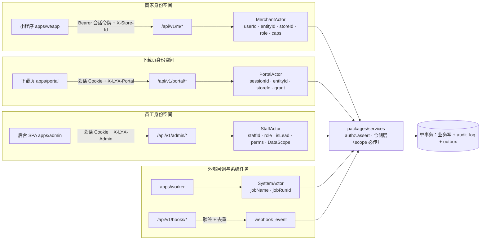
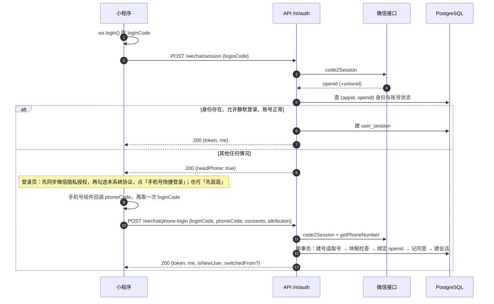
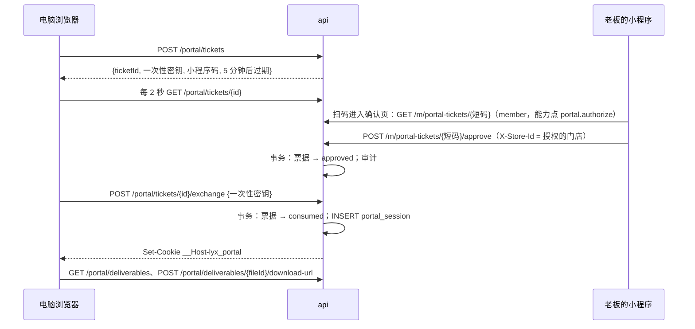
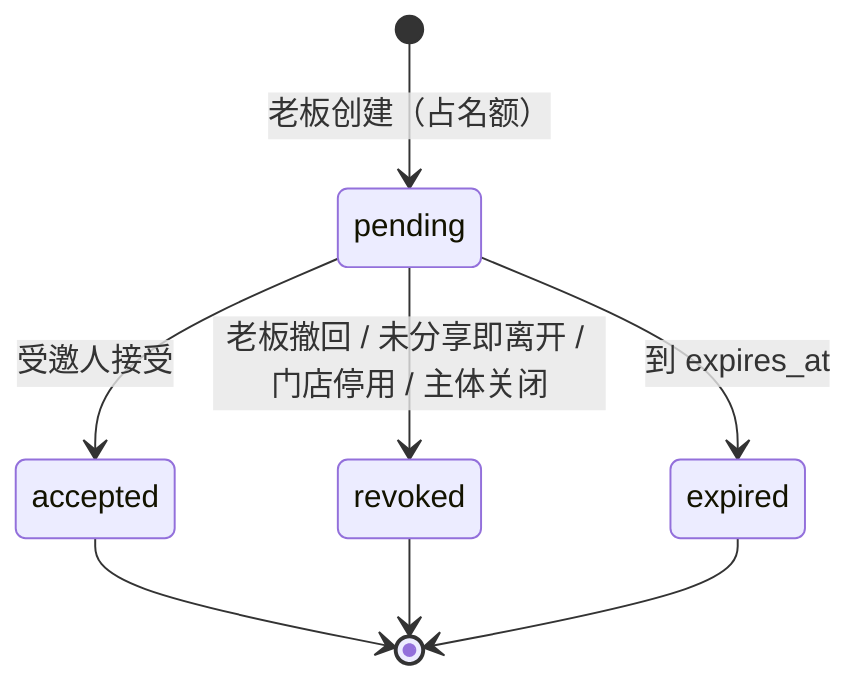
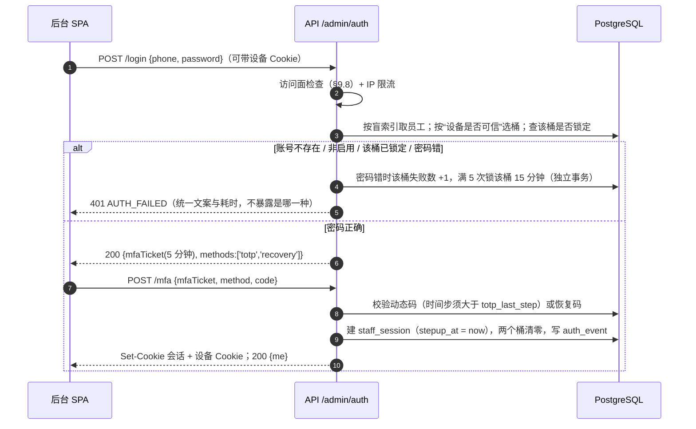
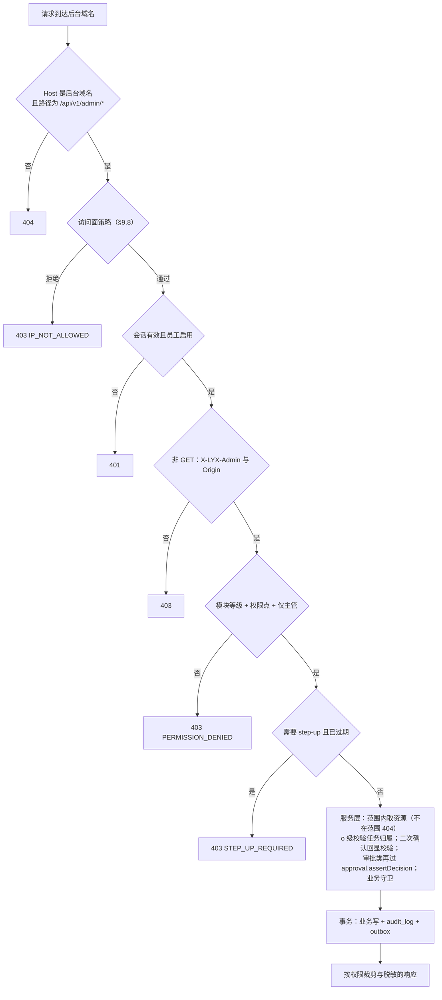
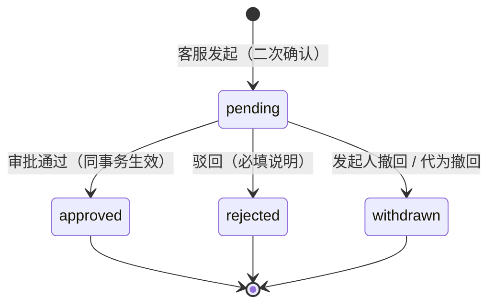

# D4 身份、租户、权限、审计与数据安全 —— 详细设计（修订稿 v2）

> 「狸有戏」V1.0 子系统设计 · 2026-10-02 · 状态：按评审意见修订，待复审
> 读者：后端、前端（小程序 / 后台 / 下载页）、测试、安全与法务对接人。本稿可独立阅读，不需要对照原稿。
> 出处标注：【PRD §x】= `scratchpad/src/PRD.md`；【原型 admin/X】【原型 merchant/X】= `scratchpad/slim/**/X.txt`；【调研 xxx】= `scratchpad/research/xxx.md`；【参考 path】= 参考工程 `timavia-liyo-project/`；【核实 msg-3】等 = 任务书“外部结论核实结果”的条目编号；【D1】【D2】【D3】【D5】【D6】【D7】= 同目录下的 `d1-ledger.md`、`d2-payment.md`、`d3-flow.md`、`d5-media.md`、`d6-notify-docs-data.md`、`d7-platform.md`；【评审 B1 / M3 / m5】= `d4-identity.critique.md` 的条目；【实测】= 本次在本机运行得到；【推断】= 本设计的判断，无直接出处；【未核实】= 没有一手来源，按不确定处理。
> 相对原稿的变化集中在：审批（§7.6）、数据范围（§7.3）、账号接管防护（§3.2、§3.5、§3.6）、令牌（§3.3）、下载页身份（§3.7）、名额与门店停用（§4.4、§4.7）、审计表（§8）、回调框架（§9.6）、后台登录锁定（§6.3）、跨子系统约定（§2.3）。逐条处理见附录 D。

---

## 0. 一页摘要

1. **三个互不提权的身份空间**。商家侧 `merchant_user`（Bearer 会话令牌，只在 `/api/v1/m/*` 有效）；后台侧 `staff`（会话 Cookie，只在后台域名的 `/api/v1/admin/*` 有效）；电脑端下载页 `portal_session`（老板在小程序里授权出来的 2 小时会话，只在下载页域名的 `/api/v1/portal/*` 有效，只能取成片）。三边的表、密钥、中间件、限流键全部分开。
2. **商家登录**：`wx.login` 静默登录（openid → 账号，不花钱）优先；未命中才用手机号快速验证组件（0.03 元/次【核实 msg-3】）。账号以手机号盲索引唯一，一个账号可挂多个 openid【核实 msg-6】。
3. **令牌**：一个登录设备一行 `user_session`，客户端持有不透明令牌，每个请求用一次主键查询核对“会话未吊销 + 账号状态”。没有 JWT、没有 refresh 轮换；会话失效后客户端自动走一次静默登录。禁用、换手机号、退出、移除店员都在下一个请求生效。
4. **账号接管防护**：新微信绑定到已有账号一律先过休眠检查（改绑分支也查）；绑定成功后通知账号的其他微信并在老板首页提示；“账号与安全”里可查看和移除已登录的微信；强制下线同时关闭全部微信的静默登录；长期未登录的老板账号遇到新微信时转人工复核，不再用可公开查询的信用代码当口令。
5. **租户**：`entity`（经营主体）→ `store`（门店）→ `entity_member` + `store_member`。三条部分唯一索引钉死：每主体 1 位老板、同主体同一用户 1 条有效成员关系、V1.0 一个账号只属于一个主体。
6. **名额与超限**：名额是读路径现算的纯函数，不存标记。套餐降级或过期后不自动移除任何人或门店；门店数超限期间禁止新增门店和任何门店的新订购，成员数超限期间禁止新增邀请。老板通过“停用门店”“移除成员”自行消除超限；已停用门店保留只读与收尾能力（下载成片、确认下架）。
7. **门店上下文**走请求头 `X-Store-Id`，服务端逐请求校验成员关系；商家侧授权 = 角色 → 能力点；店员不可见字段用“按角色的响应 schema + 运行时剥离”裁剪。
8. **后台登录**：手机号 + 密码 + TOTP。会话放 PostgreSQL。登录失败锁定分“已登录过的设备 / 陌生来源”两个桶，陌生人刷错密码锁不掉正常员工；锁定状态不通过响应暴露。企业微信扫码因子与按角色的离网策略延后。
9. **后台权限**：13 个模块 × 4 级 + 敏感操作权限点（可带“仅主管”）+ 数据范围（本人 / 本组 / 全部）。**权限点注册表全系统只有一份**，各子系统的路由只能引用注册表里的键（类型约束，写错即编译失败）。
10. **数据范围**折算成“负责人 id 集合 + 待分配池”，以带品牌类型的 `DataScope` 强制传入仓储层；有分配权的主管能看到尚未分配的门店与任务。导出任务按发起人执行时的范围与权限重新查询。
11. **敏感操作** = 二次确认回显 + 第二因子再验证 + 审批。**不设通用审批表**：退款、积分调整、延期各自的申请单就是“批没批”的唯一真相，各有唯一的审批入口；本设计提供统一的审批守卫（发起人 ≠ 审批人、仅主管、兜底审批人、再验证）、权限点和待审批聚合。本设计自己只有一张 `account_change_request`（换绑手机号、老板更换、老板复核）。
12. **审计**：`audit_log` 单表（V1.0 不分区）、只追加（应用数据库角色无 UPDATE / DELETE 权限 + 触发器）、与业务写同事务、系统任务也写；编号与时间在数据库内同源生成；写入永不因文本格式失败。每日摘要链与归档作业延后。
13. **数据安全**：手机号 / 证照号 / 银行账号应用层 AES-256-GCM 加密 + HMAC 盲索引；默认脱敏、查看明文留痕；私有文件“先业务授权、再现签短时 URL”（谁能拿归本设计，有效期与签法归 D5）；客户端 IP 按可信代理跳数从右往左取；外部回调统一验签，去重行与处理结果要么同事务、要么进收件箱由 worker 重投，全系统一张 `webhook_event`。

---

## 1. 目标、约束与不做什么

### 1.1 目标

| # | 目标 | 可验证的验收标准 |
|---|---|---|
| G1 | 商家登录零摩擦且不重复花钱 | 老用户冷启动不出现手机号按钮；手机号组件只在首次登录、退出后重登、换微信号、未登录接受邀请时调用 |
| G2 | 身份与权限变更即时生效 | 禁用账号、移除店员、调整所属门店、禁用员工、改角色、撤销下载页授权后，下一次请求即按新状态判定（角色权限缓存 ≤5 秒） |
| G3 | 店员绝不拿到积分、金额、合同、发票、证照图 | 自动化测试对全部 `/m/*` 路由以店员身份回放，响应体不含禁用键集合 |
| G4 | 租户隔离不依赖前端 | 以 B 主体身份回放 A 主体的全部请求语料，结果只有 403 / 404；下载页会话访问授权范围外的文件得到 404 |
| G5 | 后台“菜单 + 按钮 + 数据范围”三级在服务端强制 | 权限矩阵（路由 × 角色 × 是否主管）有黄金文件；越权范围的列表为空、详情 404；导出文件不含范围外数据；任何未分配的门店或任务至少对一名非超级管理员可见 |
| G6 | 关键操作可追溯 | 每个敏感操作恰好一条审计行，与业务写同事务；应用账号对审计表执行 UPDATE / DELETE / TRUNCATE 被数据库拒绝；保留 ≥3 年【PRD §7.12-5】 |
| G7 | 敏感信息加密存储、脱敏展示【PRD §10.2-1】 | 数据库与日志中搜不到明文手机号 / 证照号 / 银行账号；后台默认脱敏，查看明文有留痕 |
| G8 | 审批不留旁路 | 每类审批单只有一个审批入口；全部入口都调用同一个守卫函数（契约测试核对）；发起人 ≠ 审批人由各申请表的 CHECK 约束兜底 |

### 1.2 约束

- 规模：数百商家、千级订单、几十名员工；并发低，正确性与可审计优先。团队 3–6 人，熟悉 TypeScript，不引入需要专人运维的身份 / 策略中间件。
- 基线：模块化单体；Hono + `@hono/zod-openapi`；Prisma + PostgreSQL 单库；业务逻辑只落在 `packages/services`；钱 / 积分 / 状态机写 = 单事务 + 行锁或唯一约束 + 幂等键 + outbox；Redis 不存业务真相。
- 平台规则：小程序内有账号体系时必须提供微信授权登录，并提供易发现的“退出”入口（运营规范 12.6.1 / 12.6.3）；登录页与手机号组件前置页不得使用“微信”“腾讯”字样与标识（5.14.2）【核实 msg-4 及其额外发现】。按钮文案用“手机号快捷登录”，不放微信图标。
- 手机号组件属于隐私接口：须在《小程序用户隐私保护指引》里声明手机号，并在调用前同步用户的隐私授权；未声明或用户未同意时调用被拒，开发版与体验版同样受约束【调研 ext-wechat §登录与隐私；调研 ref-ops §1.10；D7 §4.14】。
- 手机号与微信身份不是一一对应：一个微信号可授权多个手机号，多个微信号也可授权同一手机号【核实 msg-6】。因此“在微信里验证过该手机号”本身就是本产品的登录凭据，这是 PRD 选定登录方式的固有属性，本设计只能加探测与止损手段（§3.5、§3.6）。
- unionid 需小程序绑定到已认证的开放平台账号【核实 msg-6】；本设计不依赖 unionid，有则记录。
- 短信：签名只能用公司名 / 商标，报备 7–10 个工作日，闲置会失效【核实 inf-3】；参考工程的短信链路从未在生产启用【调研 ref-arch §2.6-3】。因此**任何登录路径都不能把短信当硬依赖**。
- 企业微信：自建应用需可信 IP（固定出口），Web 登录的可信域名要求备案主体与企业微信主体一致或有关联关系【核实 wc-3、wc-5 及额外发现】；新建自建应用拿不到成员手机号，只能靠 `userid` 绑定。主体是否一致尚未确认，所以 V1.0 不把企业微信放进登录链路。
- 内容安全：用户输入并会展示给他人的文本必须过内容安全检测（运营规范 5.18 / 10.2）【核实 cat-4】。本设计范围内是称呼与邀请备注名。

### 1.3 不做什么（V1.0）

| 不做 | 原因 |
|---|---|
| 自定义角色、一人多角色、通用菜单树 / 按钮树 | 原型就是 8 个固定角色、13 个模块、每角色一份预置敏感操作清单【原型 admin/SysRoles】；通用 RBAC 是用不上的复杂度 |
| 通用审批表 / 审批引擎（由本设计提供） | 退款、积分调整、延期已各有申请表【D1 §4.5、D2 §3.4】，再叠一张通用表会让“批没批”存两份、出现两个审批入口【评审 B1】。本设计只提供守卫、权限点与聚合（§7.6） |
| JWT、refresh 轮换 | 每个请求本来就查库；小程序有静默登录兜底；下载页不再复用商家会话（§3.3 的取舍） |
| PostgreSQL 行级安全（RLS）、Casbin / OPA、Keycloak 等 | 团队小、数据量小；RLS 与 Prisma 连接池配合成本高，策略写在 SQL 里难测难改 |
| 一个账号多个主体、管理员角色、授权代为确认、服务商身份与代操作 | V1.1【PRD §12.2-29、§3.1】；本期只留扩展点（§14） |
| 小程序短信验证码登录 | PRD 只要手机号快捷登录【PRD §6.1-1】；短信链路未验证 |
| 存储 `session_key`、商家平台账号密码 | 手机号用 code 换取，不需要 `session_key`；账号密码 PRD 明确不收集【PRD §10.2-3】 |
| 审计表分区、运行期建分区、归档作业、每日摘要链 | 三年内也就百万级行；分区与归档带来的权限与运维矛盾多于收益【评审 M5、m7】。摘要链等是否需要，待网络安全等级保护定级结论（§15）后再定，做法已写在 §14 |
| 企业微信扫码作为登录第二因子、按角色的离网策略矩阵 | 依赖尚未确认的主体一致性；V1.0 只做“白名单 + TOTP”（§9.8） |
| 本人数据导出的自助接口 | 数百商家的量级下由客服工单 + 运维脚本人工办理（§9.7） |
| 数据库透明加密 / pgcrypto 字段加密 | 密钥会进数据库会话与日志；应用层加密更可控，也便于换库 |
| 后台与下载页开放跨域（CORS） | 两个 SPA 都与各自的接口同源部署 |

---

## 2. 总体模型

### 2.1 四类 Actor



四类 Actor 是服务层唯一认识的“谁在操作”：

```ts
// packages/services/src/authz/actor.ts
type Id = string;                                                  // UUID v7（§2.3 第 1 项）
type MerchantActor = {
  kind: 'merchant'; userId: Id; sessionId: Id; identityId: Id;
  entityId: Id; memberId: Id; role: 'owner' | 'clerk';            // V1.1: 'admin'
  storeId: Id; storeMode: 'active' | 'archived';                   // 已停用门店只有收尾能力（§5.1）
  caps: ReadonlySet<MerchantCap>;
  onBehalfOf?: never;                                              // V1.1 服务商代操作的扩展位
};
type PortalActor = {
  kind: 'portal'; sessionId: Id; approvedByUserId: Id;             // 授权它的老板
  entityId: Id; storeId: Id; grant: PortalGrant;                   // 只能调用下载类函数（§3.7）
};
type StaffActor = {
  kind: 'staff'; staffId: Id; sessionId: Id; roleKey: RoleKey; isLead: boolean;
  groupId: Id | null; perms: ReadonlySet<PermissionKey>; scope: DataScope; stepUpAt: Date | null;
};
type SystemActor = {
  kind: 'system'; jobName: string; jobRunId: string;
  onBehalfOfStaffId?: Id;                                          // 导出任务按发起人执行时填（§8.5）
};
type RequestMeta = { requestId: string; ip: string | null; userAgent: string | null; authMethod: string };
```

服务函数的参数类型就是授权边界：只接受 `MerchantActor` 的函数，`PortalActor` 传不进去（编译错误）。下载类函数的签名是 `MerchantActor | PortalActor | StaffActor`。

### 2.2 代码落点

模块名与层次遵循 D7 §2.3（`kernel` → `identity` / `tenant` / `staff` → 资金 → 履约 → 读侧）：

| 位置 | 内容 |
|---|---|
| `packages/contract/src/permissions.ts`、`src/authz/` | 后台权限点注册表（**全系统唯一**）、商家能力点表、路由的 `x-auth` / `x-capability` / `x-permission` 元数据、按角色的响应 schema |
| `packages/services/src/identity/` | 商家登录、会话、微信身份、协议同意、换手机号、注销、下载页会话 |
| `packages/services/src/tenant/` | 主体、门店骨架与生命周期、成员、邀请、名额 |
| `packages/services/src/staff/` | 员工、登录、TOTP、会话、角色权限、分组、禁用 / 移交 / 改角色用例、`account_change_request` |
| `packages/services/src/authz/` | Actor、`assertCap` / `assertPerm`、`DataScope` 与范围谓词、step-up、审批守卫 `approval.assertDecision` |
| `packages/services/src/kernel/audit/` | `audit.record(tx, …)`（表归 `kernel`，结构与只追加保证由本设计规定） |
| `packages/services/src/security/` | 加密 / 盲索引 / 脱敏、可信 IP、限流器、回调验签与收件箱框架 |
| `apps/api/src/middleware/` | `merchantAuth`、`portalAuth`、`adminAuth`、`rateLimit`、`hookRoute`、`respondByRole` |

本设计**依赖**其他子系统提供：`billing.getEntitlements(tx, entityId)`（门店数 / 成员数上限，D1 §11.1）、各任务表的负责人列与“在办事项”来源（D3 §24）、outbox 与定时器表（`kernel`）、通知服务（D6）、协议当前版本查询、文本内容安全检测（Provider）。本设计**提供**：四类 Actor、`authz.*`、`DataScope` 谓词、`audit.record`、审批守卫与权限点注册表、`security.*`、回调框架、“谁能拿哪类文件”的判定（§9.4）、`tenant.assertWithinQuota` 与 `tenant.previewQuota`。

### 2.3 跨子系统约定（一页）

评审指出本设计与兄弟设计在命名、类型、归属上多处不一致【评审 B1、M4、M6、M7、m8】。下表是本设计采用的口径；“需要对方改”的项已在 §15 列给架构师。

| # | 事项 | 约定 | 依据 / 需要谁改 |
|---|---|---|---|
| 1 | 主键 | 业务表主键为 UUID v7，接口里以字符串传输；`audit_log`、`auth_event`、`webhook_event` 这三张只增表用 `bigint identity` | D7 §2.4 的全仓约定；原稿的 `bigint` 作废。D3、D5 的 `bigint` 需同步 |
| 2 | 表名 | 单数 snake_case，枚举用 `text + CHECK`。本设计的表：`merchant_user`、`wechat_identity`、`user_session`、`user_consent`、`portal_session`、`entity`、`store`、`entity_member`、`store_member`、`invitation`、`staff`、`staff_group`、`staff_role`、`staff_activation`、`staff_session`、`account_change_request`、`audit_log`、`auth_event`、`webhook_event` | D7 文首的命名约定；`user`、`role` 在 PostgreSQL 里是关键字，所以用 `merchant_user`、`staff_role` |
| 3 | 操作人枚举 | 全系统一套，取值等于 Actor 的 `kind`：`merchant` / `staff` / `portal` / `system`，V1.1 加 `partner`。老板还是店员另记在角色快照列里 | D1 的 `merchant_user`、D5 的 `member` 改为 `merchant` |
| 4 | 权限点 | 注册表只有 `packages/contract/src/permissions.ts` 一份，键名见 §7.1；查看类权限用模块等级表达，不设 `*.view` 键 | D1、D2、D3、D5 的路由引用注册表常量；旧名对照见 §7.1 |
| 5 | 审批 | 每类审批单一张申请表，就是“批没批”的唯一真相；一类单据只有一个审批入口；所有入口调用 `approval.assertDecision`；申请表带 `CHECK (decided_by IS NULL OR decided_by <> requested_by)` | D1 §4.5、D2 §3.4 保留各自的表并补审批路由；D3 §17 的通用引擎若保留，不得再为这三类资金单据建第二份状态（§7.6） |
| 6 | 外部回调收件箱 | 全系统一张 `webhook_event`，两种处理模式（§9.6）；载荷是否保存、保存多久按 Provider 配置 | D2 §3.10 的表并入；原稿的 `inbound_events` 作废 |
| 7 | 审计与访问留痕 | 改变业务状态的操作、导出、查看字段明文 → `audit_log`；签发文件读地址（成片、证照、合同、回单、发票）→ D5 的 `file_access_log`。同一件事不写两处 | D2 的 `audit_log` 同表；原稿把证照 / 合同下载记进 `audit_log` 的写法作废 |
| 8 | 文件授权 | “谁能拿哪类文件”由本设计判定（§9.4）；读地址有效期、签名方式、上传写入区前缀（`incoming/{fileId}/*`）由 D5 规定 | 原稿 §9.4 里的有效期列与 `stores/{storeId}/uploads/*` 前缀作废 |
| 9 | 名额 | 上限来自 D1 的 `getEntitlements`（字段 `maxStores`、`maxMembers`，`null` = 不限）；是否超限由本设计的纯函数现算，不存标记；D1 的 `rolled_over` 事件只用来触发通知 | D1 §6.6 的“身份子系统把主体标为名额超限”按 §4.4 实现；D1 的降级报价调用 `tenant.previewQuota` |
| 10 | 锁顺序 | 本设计的事务按 `staff`（多行按 id 升序）→ `merchant_user`（多行按 id 升序）→ `wechat_identity` → `entity` → `invitation` → `entity_member` → `store` 取锁；需要账号行与主体行的事务（登录时的休眠处理、注销、老板更换）一律先取账号行。**持有 `entity` 行锁的事务不再取 D1 的 `billing_account` 行锁**（只做不加锁的 `getEntitlements` 读）；资金与账本事务不取 `entity` 行锁。将来若确需同时持有，顺序为 `entity` → 资金单据（D2 的顺序）→ `billing_account` | 需与 D1、D2 定稿的锁序合并成一份 |
| 11 | 下载页 | V1.0 提供；身份、会话存放、域名隔离、限流由本设计规定（§3.7、§9.5、§9.8）；授权入口默认“电脑显示小程序码、老板在小程序里确认”，“链接 + 提取码”是同一会话模型下的降级入口 | D5 §8.3、D7 §6 的会话改放 PostgreSQL；二者的入口方式需统一 |
| 12 | 导出 | 表与流程归 D6 / D7（`export_job`）；本设计规定：按发起人**执行时**的范围与权限重查，发起人失效则任务失败（§8.5） | D7 §5.6 的“以发起时快照为准”需改 |
| 13 | 员工禁用与移交 | 用例（状态变更、守卫、吊销会话、审计）归本设计 `staff` 模块；“名下还开着什么、怎么改派”由各业务模块注册来源，改派记录表 `assignment_history` 归 D3 | 与 D3 §24 同构，接口名见 §6.6 |
| 14 | 公开接口清单 | 一份黄金文件覆盖 `/m/*`、`/portal/*` 的全部 `public` / `optional` / `signed` 路由（含 D5 凭签名访问的播放清单接口） | D5 §7.2 的接口登记进这份文件 |

---

## 3. 商家侧：账号、登录与会话

### 3.1 表

**`merchant_user`** —— 小程序用户；一个手机号一个账号【PRD §6.1-5】。

| 字段 | 类型 | 约束 / 说明 |
|---|---|---|
| `id` | uuid | PK |
| `phone_enc` | text | 加密手机号（§9.2）；注销后置 NULL |
| `phone_bidx` | bytea(32) | 盲索引；**UNIQUE**（NULL 不参与）；注销后置 NULL |
| `phone_last4` | char(4) | 后台按后四位检索用【原型 admin/SysStaff】 |
| `display_name` | text | 称呼（≤20 字，服务层校验并过文本内容安全检测，§9.7）；登录后可填，加入门店时必填 |
| `status` | text | `active` / `disabled` / `deleted`；CHECK |
| `source_type` | text | `organic` / `sales` / `partner`；首触写入，不可改【PRD §6.1-4】 |
| `source_channel_code` / `source_invite_code` / `source_scene` | text / text / int | 渠道码、邀请码、小程序场景值 |
| `last_active_at` | timestamptz | 登录与会话续期时更新（同一天内只写一次）；休眠保护用（§3.6） |
| `dormant_bypass_until` | timestamptz NULL | 人工复核通过后的放行窗口（§3.6）；过期即失效 |
| `created_at` / `updated_at` / `deleted_at` | timestamptz | |

**`wechat_identity`** —— 微信身份，多对一挂到账号【调研 ext-wechat §登录建议；核实 msg-6】。

| 字段 | 类型 | 约束 / 说明 |
|---|---|---|
| `id` | uuid | PK |
| `user_id` | uuid | FK → merchant_user；INDEX |
| `appid` | text | |
| `openid` | text | **UNIQUE (appid, openid)**：一个 openid 同一时刻只指向一个账号 |
| `unionid` | text NULL | 有则记；INDEX |
| `silent_login_enabled` | boolean | 退出登录、被强制下线后置 false，须重新手机号验证才恢复 |
| `first_bound_at` / `last_login_at` / `last_active_at` | timestamptz | `first_bound_at` 用于“新绑定 7 天内不能移除其他微信”（§3.5）；`last_active_at` 供通知服务挑选最近活跃的 openid 发订阅消息 |

**`user_session`** —— 一次登录（一台设备）一行。

| 字段 | 类型 | 约束 / 说明 |
|---|---|---|
| `id` | uuid | PK，即令牌里的 `sid` |
| `user_id` | uuid | FK；INDEX `(user_id) WHERE revoked_at IS NULL` |
| `identity_id` | uuid | 登录所用的微信身份；INDEX |
| `token_hash` | bytea(32) | 令牌密钥部分的 sha256；库里不存令牌本身 |
| `created_at` / `last_seen_at` | timestamptz | `last_seen_at` 同一天内只写一次 |
| `idle_expires_at` | timestamptz | 空闲过期，滑动 30 天（随 `last_seen_at` 一起更新） |
| `absolute_expires_at` | timestamptz | 绝对过期，创建 + 90 天；到期后客户端静默登录换新，用户无感 |
| `last_ip` / `device_info` | inet / text | `device_info` 由服务端截断到 512 字符后写入，列不设长度上限 |
| `revoked_at` / `revoke_reason` | timestamptz / text | `logout` / `identity_rebound` / `identity_removed` / `phone_change` / `admin` / `evicted` / `account_deleted` |

**`user_consent`** —— 协议同意记录【原型 admin/OpsAgreements】。

| 字段 | 类型 | 约束 / 说明 |
|---|---|---|
| `id` | uuid | PK |
| `user_id` | uuid | FK |
| `entity_id` | uuid NULL | 主体级协议（会员服务协议等）由老板代表主体同意时填写 |
| `agreement_key` / `version` | text / text | **UNIQUE (user_id, agreement_key, version)**，重复提交幂等 |
| `scene` | text | `login` / `join` / `plan` / `topup` / `order` / `ad_request` |
| `accepted_at` / `ip` / `client_version` / `session_id` | timestamptz / inet / text / uuid | 法务证据字段 |

### 3.2 登录流程



**两套同意的先后**。微信侧的隐私授权（《小程序用户隐私保护指引》）与本系统的协议同意（`user_consent`）是两回事：前者不同意，手机号组件根本调不起来；后者是法务证据。登录页的顺序固定为：① 端上 `ensurePrivacyAuthorized()` 同步微信隐私授权（D7 §4.14）；② 用户勾选《用户服务协议》《隐私政策》；③ 才允许点击手机号按钮。隐私指引里没有声明“手机号”属于我方配置错误，端上上报并触发告警（§10.3）。

**静默登录 `POST /api/v1/m/auth/wechat/session`**

1. `code2Session(loginCode)`，失败返回 503 `WECHAT_UNAVAILABLE`，客户端保持游客态或继续用现有令牌。
2. 查 `(appid, openid)`。身份不存在、`silent_login_enabled=false`、账号非 `active` → 一律返回 `{needPhone:true}`，不区分原因（不泄露账号是否存在或被禁用）。
3. 命中：建 `user_session`（同一 `identity_id` 的未吊销会话超过 5 条时吊销最旧的，`evicted`），更新 `last_active_at`，签发令牌。
4. 返回 `me`：`{ user, memberships[], pendingConsents[], notices[] }`。`pendingConsents` 非空时客户端先弹重新同意，服务端对受保护接口返回 428 `CONSENT_REQUIRED` 兜底（只放行同意接口、`/m/me`、退出）。`notices` 里有一次性的账号安全提示（如“您的账号于 10-02 09:14 在新的微信上登录”，§3.5）。

**手机号登录 `POST /api/v1/m/auth/wechat/phone-login`**

```
输入：loginCode, phoneCode, consents[{key, version}], attribution{channelCode?, inviteCode?, scene?}
1. 限流：IP 10 次/小时；拿到 openid 后再按 openid 5 次/小时（每次成功都花 0.03 元）
2. s = code2Session(loginCode)；p = getPhoneNumber(phoneCode)      // 先做完全部外部调用，再开事务
   p.countryCode ≠ '86' → 400 PHONE_REGION_UNSUPPORTED（V1.0 只支持中国大陆手机号，可配置）
3. consents 必须覆盖 login 场景下全部“当前生效版本” → 否则 428 CONSENT_REQUIRED
4. 事务：
   a. u = INSERT INTO merchant_user(...) ON CONFLICT (phone_bidx) DO NOTHING；再 SELECT ... FOR UPDATE
      u.status='disabled' → 403 ACCOUNT_DISABLED
      新建账号 → 写 source_*（首触；之后的登录不覆盖）
   b. i = SELECT * FROM wechat_identity WHERE (appid, openid) FOR UPDATE
      newBinding = (i 不存在) OR (i.user_id ≠ u.id)
      if newBinding:                                    // 新建与改绑两个分支统一先过休眠检查（§3.6）
         r = dormantGuard(tx, u)
         r = 'manual_review'  → 回滚事务；另起事务写 auth_event(reverify_required)；返回 403 REVERIFY_REQUIRED
         r = 'clerk_removed'  → 已在本事务内移除其店员成员关系，继续
         r = 'pass'           → 继续
      i 不存在              → INSERT，绑定到 u（first_bound_at = now）
      i.user_id = u.id      → silent_login_enabled = true
      i.user_id ≠ u.id      → prev = i.user_id
                              吊销该身份在 prev 下的会话（identity_rebound）
                              UPDATE i SET user_id = u.id, silent_login_enabled = true, first_bound_at = now
                              写 auth_event(identity_rebound)
                              prev 有有效成员关系 → switchedFrom = { phoneMask: mask(prev.phone) }
      if newBinding 且 u 还有其他微信身份 且 u 有有效成员关系:
         audit.record(ops, 账号安全, 'account.wechat_bound')
         outbox: account.new_wechat_bound（§3.5 的通知与首页提示）
   c. INSERT user_consent ... ON CONFLICT DO NOTHING
   d. 建 user_session，签发令牌；u.last_active_at = now
   e. 写 auth_event(login_success, method='phone')
5. 返回 {token, me, isNewUser, switchedFrom?}
```

要点：

- 步骤 4a 必须用原生 `INSERT … ON CONFLICT DO NOTHING`（或 Prisma 能下推成原生 upsert 的写法）。在交互式事务里“先 create、撞唯一再查”会让整个事务进入中止状态。
- 外部调用在事务之外。手机号 code 是一次性的：若事务失败，用户需要再点一次按钮（再花 0.03 元）。事务只有几条语句，这个代价可以接受，不为它引入缓存手机号的中间状态。
- “首次登录将自动创建商家账号”【原型 merchant/Login】只创建 `merchant_user` 行，**不**自动创建主体与门店（见 §4.2 的理由）。
- 登录页对任何未识别的微信都展示协议勾选（登录前不知道是不是新用户），已同意当前版本的老用户走静默登录，根本看不到登录页——这样同时满足 PRD“首次登录须勾选”与原型“登录页默认未勾选”。
- **`switchedFrom`**【评审 m9】：同一微信在号码选择器里选了另一个号码，会把这个微信改绑到另一个账号（号码没有账号时会新建一个空账号），原账号的门店从界面上“消失”。服务端在这种情况下返回 `switchedFrom`，前端弹一次说明：“当前微信此前登录的是尾号 6021 的账号。如需回到原账号，请退出后用原手机号登录。”由此产生的空账号在换绑手机号时自动清理（§3.5）。

### 3.3 会话令牌

| 项 | 取值 | 说明 |
|---|---|---|
| 令牌 | `lyxm_<sid>.<32 字节随机数的 base64url>` | 不透明令牌；库里只存随机数部分的 sha256，比较用常数时间函数 |
| 有效期 | 空闲 30 天（滑动）、绝对 90 天 | 参数 `SESSION_IDLE_TTL`、`SESSION_ABSOLUTE_TTL` |
| 存放 | 小程序 `wx.setStorageSync` | 请求头 `Authorization: Bearer <令牌>` |
| 失效后的恢复 | 客户端收到 401 `SESSION_INVALID` → 单飞执行一次 `wx.login` + `/auth/wechat/session` → 成功则重放原请求一次；返回 `needPhone` 则回登录页 | 沿用参考工程“401 单飞 + 重放一次”的请求层结构【参考 apps/mobile/src/utils/request.ts】，把“刷新令牌”换成“静默登录” |

**每请求校验（即时生效的来源）**

```sql
SELECT s.token_hash, s.revoked_at, s.idle_expires_at, s.absolute_expires_at, s.last_seen_at, u.status
FROM user_session s JOIN merchant_user u ON u.id = s.user_id
WHERE s.id = :sid;                       -- 主键点查
-- 通过条件：sha256(secret) = token_hash AND revoked_at IS NULL
--          AND now < idle_expires_at AND now < absolute_expires_at AND u.status = 'active'
-- last_seen_at 不是今天 → UPDATE last_seen_at = now, idle_expires_at = now + 30 天；并更新 merchant_user.last_active_at
```

不加缓存：商家端峰值请求量是个位数 QPS，一次主键查询在 1 毫秒量级；不缓存就没有“缓存没失效导致禁用不生效”这类故障。

| 事件 | 处理 | 生效时点 |
|---|---|---|
| 后台禁用商家账号 | `status='disabled'` | 下一请求 401 |
| 换手机号、注销 | 吊销该账号全部会话（换手机号时保留并重发当前设备的会话） | 下一请求 401 |
| 后台 / 风控强制下线 | 吊销该账号全部会话，**并把该账号全部微信身份的 `silent_login_enabled` 置 false** | 下一请求 401；被踢的微信冷启动后不能静默登录回来，须重新手机号验证【评审 M3】 |
| 退出登录 | 吊销当前会话 + 该微信身份 `silent_login_enabled=false` | 下一请求 401；再次进入显示登录页（满足“退出”要求） |
| 移除某个已登录的微信（§3.5） | 删除该身份行 + 吊销其会话 | 下一请求 401 |
| 被移出门店 / 调整所属门店 / 老板更换 | 只改成员关系 | 下一请求 403 `NOT_A_MEMBER`（成员关系每请求现查，见 §5.1） |

吊销一个账号的全部会话是一条 `UPDATE user_session SET revoked_at … WHERE user_id = … AND revoked_at IS NULL`，与触发它的业务写在同一事务里。

备选方案与取舍：

| 方案 | 结论 | 理由 |
|---|---|---|
| A. 参考工程原样（access JWT + refresh，先查后发、不在事务里、无重放检测）【参考 identity/tokens.ts:50-66】 | 不采用 | 两个并发刷新都会成功；旧 token 被盗用无法发现【调研 ref-arch §2.6-1】 |
| B. access JWT + refresh 轮换（一会话一行、当前 / 上一枚哈希、60 秒宽限、重放检测）——原稿方案 | 不采用 | 每个请求本来就要查库核对会话与账号状态，JWT 没有省掉任何查询，却多出签名密钥轮换、宽限状态机、端上的刷新单飞三处复杂度；原稿保留它的两条理由里，“下载页没有 `wx.login`”已不成立（下载页改用独立的 `portal_session`，§3.7），只剩“不依赖微信接口可用性”，而方案 C 同样满足【评审 M7、m7】 |
| **C. 不透明会话令牌 + 每请求查库** | **采用** | 行数 = 活跃设备数；没有刷新接口、没有并发刷新问题；吊销是一条 UPDATE；日常请求不依赖微信接口（只有会话过期或被吊销后的恢复才调 `wx.login`） |
| D. 不发长期令牌，每 30 分钟用 `wx.login` 静默换新 | 不采用 | 每次过期都依赖微信接口可用 |

方案 C 放弃了“令牌被复制后能靠轮换重放检测发现”这一点。评估：令牌只存在小程序本地存储并经 HTTPS 传输，日志与错误上报都对 `authorization` 做了清洗（§9.7）；能读到本地存储的攻击者同样能读到 refresh token。对应的止损手段是 90 天绝对过期、每身份最多 5 条会话、老板可在“账号与安全”里移除设备（§3.5）。【推断】

### 3.4 游客可访问的接口

路由在契约里声明 `x-auth`：

| 取值 | 含义 |
|---|---|
| `public` | 不解析令牌 |
| `optional` | 有令牌则解析，用于“登录后多返回个性化字段” |
| `signed` | 不要登录态，凭 URL 里的签名与过期时间访问（D5 的播放清单接口） |
| `user` | 已登录、不要求成员关系 |
| `member` | 已登录且对 `X-Store-Id` 有成员关系 |
| `portal` | 下载页会话（只出现在 `/api/v1/portal/*`） |

**缺省为 `member`**。`public`、`optional`、`signed` 的全量清单是仓库里的一份黄金文件（覆盖 `/m/*` 与 `/portal/*`），契约测试比对，新增这类接口必须改这份文件并过评审。

| 接口 | `x-auth` | 说明 |
|---|---|---|
| `POST /m/auth/wechat/session`、`/m/auth/wechat/phone-login` | public | 单独限流 |
| `GET /m/bootstrap`、`GET /m/config/public` | public | 功能开关（含“小程序内是否播放视频”【核实 cat-3 额外发现】）、客服入口；D6 / D7 定义内容 |
| `GET /m/home` | optional | 游客：Banner + 热门短剧；登录：加待办与“为你推荐”【PRD §6.2、§12.3-7】 |
| `GET /m/catalog/dramas`、`/m/catalog/dramas/{id}`、`/m/catalog/search` | optional | 游客与店员只看到标价积分，没有折后实扣与余额（§5.3） |
| `GET /m/catalog/dramas/{id}/trailer-url` | public | 现签短时播放地址；按 IP 限流 |
| `GET /m/play/{playableId}/{exp}.{sig}/master.m3u8` | signed | D5 §7.2；签名由上一条接口签发 |
| `GET /m/agreements/current?scene=` | public | |
| `GET /m/invitations/{token}` | public | 只返回门店名、邀请人称呼、角色、有效期、状态；按 IP 限流 |
| `POST /m/client-logs`、`/m/telemetry/envelope` | public | 前端错误上报（自有已备案域名【核实 misc-4】）；严格限流与体积上限 |
| `POST /portal/tickets`、`GET /portal/tickets/{id}`、`POST /portal/tickets/{id}/exchange` | public | 下载页扫码授权的三个接口（§3.7）；按 IP 限流 |

加入选剧单、建档、开通套餐、订购、联系服务经理均须登录【PRD §6.1-2】。

### 3.5 账号安全：换手机号、已登录的微信、退出、注销

**新微信绑定后的通知**【评审 M3】。事件 `account.new_wechat_bound`（触发条件见 §3.2 步骤 4b）的消费者做三件事：

1. 给该账号**其余**微信身份发站内消息；有订阅消息额度时加发订阅消息；短信 Provider 已配置时再发一条短信到账号手机号（短信不是硬依赖）。文案：“您的账号于 {时间} 在一个新的微信上登录。如非本人操作，请到 我的 › 设置 › 账号与安全 移除该微信。”
2. 给账号写一条一次性提示（`me.notices`），老板下次打开首页时置顶展示，点“知道了”后消失。
3. 审计行已在登录事务里写入（`ops` 流，类别“账号安全”）。

**已登录的微信**（“我的 › 设置 › 账号与安全”【PRD §6.13 设置】）

| 接口 | 规则 |
|---|---|
| `GET /m/me/identities` | 返回该账号的全部微信身份：首次绑定时间、最近登录时间、最近一次会话的设备信息摘要、是否当前设备。不返回 openid |
| `DELETE /m/me/identities/{id}` | 删除该身份行并吊销其全部会话（`identity_removed`）；写审计（账号安全）；通知被移除的身份所在设备下次打开时回到登录页。移除当前身份等同退出登录 |

移除规则：`first_bound_at` 距今不足 7 天的身份**不能移除其他身份**（参数 `auth.identity_remove_min_age_days`，默认 7）。否则一个刚混进来的微信可以反过来把账号主人的微信踢掉。账号主人的微信若确实都不在了（换了微信号），走后台强制下线后重新用手机号登录。

**后台强制下线**（权限点 `merchant.user.force_logout`，客服）：吊销该账号全部会话与下载页会话，并把全部微信身份的 `silent_login_enabled` 置 false；写审计。

**换手机号**【PRD §6.1-5：须验证原手机号或经人工审核】

- 自助路径（短信 Provider 已配置时可用）：① 向原手机号发短信验证码；② 用手机号组件验证新号码（微信已核验）；③ 提交 `{oldSmsCode, newPhoneCode}`。
- 人工路径（原手机号不可用，或短信未配置）：客服在后台发起 `account_change_request(kind='phone_rebind')`（上传证明），客服主管或超级管理员审批后执行同一事务（§7.6）。
- 短信 Provider 未配置时自助入口隐藏，只留人工路径——符合“未配置不崩溃、可降级”。

执行事务：

```
1. 锁当前账号 u；按新号码盲索引查占用方 o
2. o 存在：
     o 从未有过任何成员关系（entity_member 里没有它的任何行）→ 这是 §3.2 误建的空账号：
        清空 o 的手机号三列与称呼、删其微信身份与会话、o.status = 'deleted'，继续      【评审 m9】
     否则 → 409 PHONE_TAKEN
3. 更新 u 的 phone_enc / phone_bidx / phone_last4；吊销 u 的其他会话；给当前设备签发新会话
4. 写审计（ops 流，账号安全）；outbox：向原号码发通知短信（已配置时）、站内消息
```

**退出**：`POST /m/auth/logout` 吊销当前会话并关闭该微信身份的静默登录。

**注销**（个人信息删除权，§9.7）：`POST /m/me/deletion`。

| 身份 | 处理 |
|---|---|
| 无成员关系 | 立即执行 |
| 店员 | 立即执行：成员关系置 `removed`（`account_deleted`），上传的素材留在门店，上传人显示为“已注销成员” |
| 老板 | 主体存在生效套餐、在办订购、上线中的成片、未完结的付款 / 退款 / 发票任一项 → 拒绝并引导联系客服（走老板更换或主体关闭）；否则主体置 `closed`（联动见 §4.7）后执行 |

执行内容：`phone_enc / phone_bidx / phone_last4 / display_name` 置空，删除 `wechat_identity`、吊销并删除全部会话与下载页会话，`status='deleted'`。交易、合同、发票、审计记录按法定义务保留，其中的操作人只剩内部 id 与“已注销用户”。

**账号状态机**（`merchant_user.status`）

| 当前状态 | 事件 | 新状态 | 守卫 | 副作用 |
|---|---|---|---|---|
| — | 首次手机号登录 | active | 协议已同意 | 写注册来源 |
| active | 后台禁用 | disabled | 权限点 `merchant.user.disable`（仅主管）；原因必填；二次确认；step-up | 下一请求 401；吊销下载页会话；审计（账号安全）；老板被禁用时提示操作人该主体将无人可操作 |
| disabled | 后台启用 | active | 同上 | 审计 |
| active | 注销 | deleted | 上表的前置条件 | 清空个人信息、删微信身份与会话；审计 |
| active | 换绑手机号时被判定为空账号 | deleted | 从未有过成员关系 | 同上；审计记“空账号清理” |
| deleted | 任何 | 不变 | — | 同一手机号再次登录会新建账号 |

### 3.6 休眠保护（二次放号）

风险：手机号被运营商回收再发放后，新机主用微信验证该号码，会直接进入原账号——原账号可能是持有套餐、积分、合同的老板。

规则（参数 `auth.dormant_days`，默认 180，设 0 关闭）。`dormantGuard(tx, u)` 在“**任何此前没绑定到账号 `u` 的 openid** 要绑定到 `u`”时执行——包括 `(appid, openid)` 不存在的分支，也包括它原本绑在别的账号上、现在要改绑过来的分支【评审 M3：原稿只在前一个分支判断，改绑分支可绕过】：

```
dormantGuard(tx, u):
  u 是本次请求刚建的账号                         → pass
  u 没有有效成员关系                             → pass
  u.dormant_bypass_until > now                    → pass（人工复核已放行）
  u.last_active_at ≥ now - auth.dormant_days       → pass
  u 是店员   → 成员关系置 removed（原因 dormant），清空 display_name；
               outbox 通知老板“店员 X 长期未登录且更换了微信，已移出，如需请重新邀请” → clerk_removed
  u 是老板，其主体满足“空草稿”条件（§4.2）         → 按让位处理（主体置 abandoned）→ pass
  u 是老板，其他情况                             → manual_review
```

| 结果 | 对用户 | 后续 |
|---|---|---|
| `clerk_removed` | 按没有主体的普通账号登录 | 老板可重新邀请 |
| `manual_review` | 不绑定、不发会话；返回 403 `REVERIFY_REQUIRED`，页面说明“该账号长期未登录，为保护账号安全需人工核实”，展示客服入口 | 客服核实身份后在后台发起 `account_change_request(kind='owner_reverify')`，客服主管或超级管理员审批（step-up）；通过后 `dormant_bypass_until = now + 72 小时`，用户在此窗口内重新手机号登录即可绑定 |

原稿让老板输入“统一社会信用代码后 6 位”自助通过。评审指出信用代码可公开查询、界面上的脱敏串还露出其中 2 位，它不是一道有效的校验【评审 M3-5】。修订后去掉这道自助校验，直接转人工：180 天没登录、又换了微信的老板账号是少数情形，人工核实（回拨营业执照上的联系电话、核对近期付款或合同信息，具体口径由客服 SOP 规定）比一个形同虚设的口令可靠，也少一组接口与计数器。

**对风险的评估**（修正原稿的说法）：老板账号可以消耗主体积分下单（进入制作后不可退）、改发票接收邮箱、绑定渠道账号、下载成片，积分是付费买的。因此“被他人进入老板账号”不只是信息泄露。本设计的防线是：休眠检查挡住二次放号；新微信绑定即通知原有微信并在首页提示；可查看与移除已登录的微信；可后台强制下线。仍然存在的残余风险：在账号活跃期间，任何“微信里验证过该手机号”的人都能登录（例如老板把验证码报给上门的销售），系统只能事后提示而不能事前阻止。是否要对“持有生效套餐的老板账号”增加“新微信须经已有微信确认”的开关，列入 §15 待业务拍板。

### 3.7 电脑端下载页的身份（portal）

**为什么 V1.0 就要有**：小程序单次下载上限 200MB、切后台 5 秒中断、压缩包进不了相册【核实 file-1、file-2】；一部剧几十集、几个 GB，“打包下载”只能在电脑上完成【D5 §18 分歧 6；D7 §13 分歧 1】。原稿把它排到 V1.1 并复用商家会话，与 D5、D7 冲突【评审 M7】。修订后：下载页进 V1.0，是独立的第三类身份；若架构师最终否决下载页进 V1.0，本节整体延后，其余章节不受影响。

**模型**

- 下载页没有账号与登录。它的会话是“老板在小程序里对某台电脑的一次授权”，范围是该老板当前门店的成片下载，2 小时绝对过期。
- 授权入口有两种，产出的是同一种 `portal_session`：

| 入口 | 流程 | 定位 |
|---|---|---|
| 扫码授权（默认，`portal.auth_mode='scan'`） | 电脑打开下载页 → 显示小程序码 → 老板微信扫码进入小程序确认页（显示发起时间、浏览器、IP 归属地）→ 点“允许这台电脑下载本店成片” → 电脑端换取会话【D7 §6 的 `portal_ticket`】 | 确认动作发生在已登录的小程序里，没有可被转发的口令 |
| 链接 + 提取码（降级，`portal.auth_mode='code'`） | 老板在小程序里生成链接与 6 位提取码 → 电脑打开链接输入提取码【D5 §8.3 的 `download_portal_link`】 | 小程序码接口不可用时启用。生成“指向未发布页面的小程序码”是否可行，本设计没有一手来源【未核实】，上线前需实测；所以保留这条降级入口 |

  两种入口的票据表归各自设计（D7、D5）；本设计规定会话、Actor、撤销与限流。D7 选的是扫码，D5 的评审也认为扫码确认更合适【`d5-media.critique.md` B1 第 5 条】；最终二选一还是并存由架构师定（§15）。

**`portal_session`**

| 字段 | 类型 | 约束 / 说明 |
|---|---|---|
| `id` | uuid | PK |
| `token_hash` | bytea(32) | **UNIQUE**；Cookie 里是 32 字节随机数 |
| `source` / `source_ref` | text / uuid | `scan` → `portal_ticket.id`；`code` → `download_portal_link.id`；**UNIQUE (source, source_ref)**：一张票据只能换一次会话 |
| `approved_by_user_id` | uuid | 授权的老板 |
| `entity_id` / `store_id` | uuid | 授权范围 |
| `grant` | jsonb | `{scope:'store'}` 或 `{orderItemIds:[…]}`（提取码入口按订单项） |
| `created_at` / `expires_at` | timestamptz | `expires_at = created_at + 2 小时`，不滑动 |
| `ip` / `user_agent` | inet / text | |
| `revoked_at` / `revoke_reason` | timestamptz / text | `owner_revoked` / `membership_changed` / `account_action` / `expired` |

**每请求校验**（`portalAuth` 中间件，一条查询）：Cookie 对应的会话未吊销、未过期；`approved_by_user_id` 的账号仍为 `active`，且仍是 `entity_id` 的有效老板；门店属于该主体（已停用的门店仍可下载，§5.1）。任何一条不满足 → 401，前端回到扫码页。之后每次取下载地址还要过 D5 的 `canDownload`（下载授权未过期 + 订单归属），与小程序是同一个函数。

**规则**

| 项 | 规则 |
|---|---|
| Cookie | `__Host-lyx_portal`，`HttpOnly; Secure; SameSite=Strict; Path=/`；非 GET 请求须带 `X-LYX-Portal: 1` 且 `Origin` 等于下载页源（与后台同一套防跨站做法，§6.5） |
| 域名 | 只在 `portal.<域名>` 上提供；该域名只放行静态资源与 `/api/v1/portal/*`（§9.8） |
| 能做什么 | 只有下载类接口：列出授权范围内的成片、取单集或压缩包的短时地址、查询打包进度。类型上 `PortalActor` 传不进其他服务函数 |
| 撤销 | 老板在小程序“账号与安全 › 已授权的电脑”查看并撤销（`GET /m/portal-sessions`、`DELETE /m/portal-sessions/{id}`）；老板被禁用、被更换、注销、被强制下线、退出登录时，同事务吊销其授权出的全部下载页会话 |
| 存放 | PostgreSQL。D5、D7 原写“会话放 Redis，丢了重新授权即可”；放数据库的理由与 §13 相同：撤销要与“老板更换 / 禁用账号”同事务，且认证不依赖 Redis。量级是每天几十行 |
| 留痕 | 授权成功写 `audit_log`（`activity` 流，操作人 = 老板，`meta` 记电脑的 IP 与浏览器）；每次签发下载地址写 D5 的 `file_access_log`（`actor_type='portal'`） |
| 限流 | 见 §9.5 |



---

## 4. 商家侧：主体、门店、成员与邀请

### 4.1 表

**`entity`** —— 经营主体。资质审核的流程与证照明细归“商家建档”设计，这里只定义租户骨架与唯一性所需字段。

| 字段 | 类型 | 约束 / 说明 |
|---|---|---|
| `id` | uuid | PK |
| `lifecycle` | text | `active` / `abandoned`（空草稿被放弃）/ `closed`；CHECK |
| `verification_status` | text | `unsubmitted` / `pending` / `verified` / `rejected`（主体营业执照的审核结论，由建档模块维护） |
| `name` | text NULL | 营业执照主体名称，合同 / 授权书 / 发票抬头【PRD §6.3.5-5】 |
| `entity_type` | text NULL | `enterprise` / `individual` |
| `uscc_enc` / `uscc_bidx` / `uscc_mask` | text / bytea(32) / text | 统一社会信用代码：密文、盲索引、脱敏串（`91510104MA6B****2R`） |
| `legal_rep_name_enc` | text NULL | 法定代表人 / 经营者姓名（个体工商户即自然人姓名） |
| `store_limit_override` / `member_limit_override` | int NULL | 大客户覆盖值【PRD §12.3-14】；NULL = 按套餐；由超级管理员设置（权限点 `merchant.quota.override`，step-up，留痕） |
| `source_type` / `source_channel_code` / `source_invite_code` | 同 merchant_user | 创建时从创建人账号复制的归因快照 |
| `created_by_user_id` | uuid | |
| `version` | int | 乐观锁 |
| `created_at` / `updated_at` / `closed_at` | timestamptz | |

索引：`UNIQUE (uscc_bidx) WHERE verification_status='verified' AND lifecycle='active'`（已认证主体的信用代码全局唯一）；普通索引 `(uscc_bidx)` 用于查重。主体创建时同事务建 D1 的 `billing_account` 行（D1 §4.2 的要求）。

**`store`**（仅列与租户有关的列，其余归建档设计）

| 字段 | 类型 | 约束 / 说明 |
|---|---|---|
| `id` | uuid | PK |
| `entity_id` | uuid | FK；**UNIQUE (id, entity_id)** 供复合外键引用 |
| `name` | text | |
| `is_primary` | boolean | 首家门店（历史标记，不随停用转移） |
| `lifecycle` | text | `active` / `archived`（已停用，§4.7）；CHECK |
| `archived_at` / `archived_by` / `archive_reason` | timestamptz / text / text | `archived_by` 记操作者标识（`merchant:<id>` / `staff:<id>`）；原因：`by_owner` / `draft_deleted` / `entity_closed` |
| `delivery_manager_id` | uuid NULL | FK → staff；后台数据范围的依据（§7.3）；NULL = 待分配 |

**`entity_member`** —— 用户在主体中的角色。

| 字段 | 类型 | 约束 / 说明 |
|---|---|---|
| `id` | uuid | PK；**UNIQUE (id, entity_id)** |
| `entity_id` / `user_id` | uuid | FK |
| `role` | text | `owner` / `clerk`；CHECK（V1.1 加 `admin`） |
| `status` | text | `active` / `removed` |
| `display_name` | text | 加入时自填，老板可改为备注名（≤20 字，过文本内容安全检测） |
| `last_store_id` | uuid NULL | 仅用于恢复界面上次选择，不参与授权 |
| `joined_at` / `invitation_id` / `invited_by_member_id` | | |
| `removed_at` / `removed_by` / `remove_reason` | timestamptz / text / text | `removed_by` 记操作者标识（`merchant:<id>` / `staff:<id>` / `system`）；原因：`by_owner` / `self` / `dormant` / `owner_transfer` / `account_deleted` / `draft_abandoned` / `store_archived` / `entity_closed` |

三条**部分唯一索引**就是三条不变量：

```sql
CREATE UNIQUE INDEX uq_member_entity_user ON entity_member (entity_id, user_id) WHERE status = 'active';
CREATE UNIQUE INDEX uq_member_one_owner   ON entity_member (entity_id)          WHERE status = 'active' AND role = 'owner';
CREATE UNIQUE INDEX uq_member_one_entity  ON entity_member (user_id)            WHERE status = 'active';  -- V1.0 专用，V1.1 删除
```

**`store_member`** —— 店员所属门店（老板隐含拥有全部门店，不建行）。

| 字段 | 类型 | 约束 / 说明 |
|---|---|---|
| `entity_member_id` / `store_id` | uuid | **PK (entity_member_id, store_id)**；INDEX `(store_id)` |
| `entity_id` | uuid | FK `(entity_member_id, entity_id)` → `entity_member(id, entity_id)`；FK `(store_id, entity_id)` → `store(id, entity_id)`。两条复合外键保证“店员不可能挂到别的主体的门店上” |
| `added_at` / `added_by_member_id` | | |

**`invitation`**

| 字段 | 类型 | 约束 / 说明 |
|---|---|---|
| `id` | uuid | PK |
| `entity_id` / `store_id` | uuid | 复合 FK → `store(id, entity_id)` |
| `role` | text | V1.0 固定 `clerk` |
| `inviter_member_id` | uuid | FK |
| `token_hash` | bytea(32) | **UNIQUE**；token 为 32 字节随机数，只出现在卡片路径里；接受时按它查找 |
| `token_enc` | text | token 的密文（§9.2 的数据密钥）；只用于把同一张未分享的卡片再次返回给邀请人，接受后清空 |
| `remark_name` | text NULL | 老板填写的备注名（≤10 字；原型待接受列表里的“小何”【原型 merchant/Members】） |
| `target_phone_bidx` | bytea(32) NULL | 可选的定向手机号；填了则只有该号码能接受 |
| `status` | text | `pending` / `accepted` / `revoked` / `expired` |
| `shared_at` | timestamptz NULL | 端上在用户点“发送给微信好友”时尽力上报；用于判断卡片是否可复用 |
| `expires_at` | timestamptz | 创建 + 24 小时【PRD §6.16.2】 |
| `accepted_at` / `accepted_user_id` / `accepted_member_id` | | |
| `revoked_at` / `revoked_by` / `revoke_reason` | | 原因：`by_owner` / `unshared_leave` / `store_archived` / `entity_closed` |
| `client_request_id` | uuid | **UNIQUE (inviter_member_id, client_request_id)**，创建幂等 |
| `created_at` | timestamptz | |

索引：`(entity_id) WHERE status='pending'`。到期翻转由通用定时器表触发（`kind='invitation.expire'`，`due_at=expires_at`）。

### 4.2 主体与门店的创建

- **懒创建**：登录只建 `merchant_user`。用户第一次点“开始建档”或“加入选剧单”时，客户端调 `POST /api/v1/m/entities`，服务端在一个事务里建 `entity`（`unsubmitted`）+ 首家 `store`（`is_primary`）+ `entity_member(owner)` + D1 的 `billing_account`。
- 幂等与冲突：调用者已是某主体的**老板** → 返回已有主体（200）；调用者是别的主体的**店员** → 409 `ALREADY_IN_ENTITY`，提示“您已是 XX 门店的店员，如需自己开店请先退出该门店”【评审 m4：原稿对两种情况都返回“已有”，对店员是错的】。并发创建由 `uq_member_one_entity` 兜底。
- 不在登录时自动建，理由有两个：一是不给每个只逛不买的访客留一个空主体；二是先登录逛过商城、后来收到店员邀请的人，如果已被自动建了主体，会被“一个账号只属于一个主体”卡住。
- **空草稿**的定义：主体 `unsubmitted`、从未有过订阅和付款单、除老板外没有有效成员、**没有待接受的邀请**。
- **空草稿让位**：账号名下是空草稿主体时，接受他人邀请会把该主体置 `abandoned`（联动见 §4.7）后再加入。其余情况拒绝（§4.5）。

### 4.3 统一社会信用代码唯一性

| 时点 | 规则 |
|---|---|
| 商家提交资质 | 用盲索引查重。命中**已认证**主体 → 409 `USCC_TAKEN`，文案引导“联系老板邀请您加入，或联系客服办理老板更换”。命中其他**审核中**主体 → 允许提交，两张审核单都打 `duplicate_claim` 标记 |
| 审核通过（建档模块的事务内） | 置 `verified`；部分唯一索引保证只有一个赢家；撞唯一的那一方自动驳回，原因码 `DUPLICATE_ENTITY`；同时把同代码的其他审核中申请自动驳回 |
| 审核中开通了套餐而最终被驳回 | 走既有“审核不过全额退款”流程【调研 prd-tech Q-11】 |

为什么不在“提交”时就强制唯一：任何人拿到一张营业执照照片都能抢先提交，把真正的主体挡在外面。把裁决放在人工审核环节，抢注只会产生一张带重复标记的审核单。

### 4.4 名额、超限与降级

PRD 的规则：门店数与成员数按主体合计，成员不含老板，待接受的邀请也占名额【PRD §2.2-1、§6.16.2-2】；降级在当前周期结束后生效，“新版本的门店数、成员数低于现有数量的，须在生效前移除超出部分”【PRD §2.2-6】。原稿把超限行为推给套餐设计，D1 又推回身份设计，结果没人实现【评审 M6】。门店与成员的生命周期在本设计，所以由本设计写清。

**上限与用量**

```
limits(tx, entity):
  ent = billing.getEntitlements(tx, entity.id)        -- D1 §11.1；不加锁的读；字段 subStatus / maxStores / maxMembers
  on  = (ent.subStatus = 'active')
  storeLimit  = entity.store_limit_override  ?? (on ? ent.maxStores  : param tenant.default_store_limit)   -- 默认 1
  memberLimit = entity.member_limit_override ?? (on ? ent.maxMembers : param tenant.default_member_limit)  -- 默认 3；NULL = 不限（旗舰版）
  reason      = on ? 'plan' : 'inactive'              -- 仅用于文案：未开通 / 已过期时提示“开通或续费后可继续新增”

usage(tx, entity):
  storesUsed = count(store        WHERE entity_id = :id AND lifecycle = 'active')
  seatsUsed  = count(entity_member WHERE entity_id = :id AND status = 'active' AND role <> 'owner')
             + count(invitation    WHERE entity_id = :id AND status = 'pending' AND expires_at > now())

quotaStatus(limits, usage) → { storesOver, seatsOver, ok, reason }      -- 纯函数，放 packages/shared
  storesOver = max(0, storesUsed - storeLimit)
  seatsOver  = memberLimit = NULL ? 0 : max(0, seatsUsed - memberLimit)
```

- 超限**不存标记**：读路径现算，不会与实际数量漂移。D1 的 `billing.subscription.rolled_over` / `expired` 事件只用来触发“需移除 N 家门店 / M 位成员”的通知。
- 过期邀请是否占名额由 `expires_at > now()` 决定，**不依赖**定时任务把状态翻成 `expired`；定时任务只管展示与通知。
- 所有改变用量的操作（新增 / 停用 / 恢复门店、发邀请、接受、撤回、移除成员、空草稿让位）开头先 `SELECT … FROM entity WHERE id=:id FOR UPDATE`，在锁内现数。不维护计数列。
- 草稿门店创建即占门店额度；从未提交资质且无业务数据的草稿门店可由老板删除（§4.7）。

**各动作的守卫**

| 动作 | 守卫 | 不满足时 |
|---|---|---|
| 新增门店、恢复已停用门店 | 锁主体后 `storesUsed + 1 ≤ storeLimit` | 409 `STORE_LIMIT_REACHED`（`reason='plan'` 引导升级【PRD §6.16.1】；`'inactive'` 引导开通或续费） |
| 新增邀请（把已有店员加入更多门店不占名额，不受此限） | 锁主体后 `seatsUsed + 1 ≤ memberLimit` | 409 `SEAT_LIMIT_REACHED` |
| 新订购、新广告制作需求（任何门店） | `tenant.assertWithinQuota(tx, entityScope, 'order')`：`storesOver = 0` | 409 `QUOTA_EXCEEDED`，带需停用的门店数；由订购 / 广告模块在提交入口调用 |
| 在办订单、交付、上线、下载、续费、加购 | 不受超限影响 | — |

**超限时系统做什么**（默认，待业务确认，§12 第 11 项）

1. **不自动移除**任何门店或成员。自动挑选“停用哪家门店、移除哪位店员”没有可辩护的规则，且门店上可能有在办订单。
2. 门店数超限（`storesOver > 0`）：禁止新增与恢复门店；**所有门店都不能新订购、不能提交新的广告需求**，直到老板把启用中的门店停用到上限以内。不采用“只有超出的那几家不能订购”——那需要一条“哪几家算超出”的规则（最晚创建的？老板指定？），而老板停用哪家本来就是他自己的选择【评审 M6 的建议】。
3. 成员数超限（`seatsOver > 0`）：禁止新增邀请；已有店员照常工作；不影响订购。
4. 老板首页置顶提示“当前套餐可管理 3 家门店，您有 5 家，请停用 2 家后继续订购”，并直达“我的门店”。每日巡检输出超限主体清单给运营。
5. **生效前的提示**（落实“须在生效前移除”）：D1 判定一笔购买为降级时调用 `tenant.previewQuota(tx, entityId, {maxStores, maxMembers})`，把 `{storesToRemove, membersToRemove}` 放进报价响应；确认页必须勾选“我知道新版本生效前需停用 N 家门店、移除 M 位成员”才能付款；到期前 7 / 3 / 1 天的提醒带上这两个数字【D1 §6.6、§6.11】。到生效时仍超限，按第 2、3 点处理（钱已收，降级照常生效）。

套餐过期（`reason='inactive'`）时，上限回落到参数默认值（1 家 / 3 位），效果是“不能再新增门店与邀请”；订购本来就被 D1 以“套餐未生效”拒绝【D1 §6.7】。续费后上限恢复。

### 4.5 邀请

**状态机**



| 当前状态 | 事件 | 新状态 | 守卫 | 副作用 |
|---|---|---|---|---|
| — | 创建 | pending | 操作人是老板；主体 `active`；门店 `active`（审核中也可预先邀请【原型 merchant/Members】）；锁主体后 `seatsUsed + 1 ≤ memberLimit`；该主体当天**未撤回**的创建数 ≤ 20；`remark_name` 过文本检测 | 写定时器、审计（`activity` 流） |
| pending | 接受 | accepted | 未过期；**主体与门店都是 `active`**；受邀人已登录且通过下文的归属判定；若有 `target_phone_bidx` 则须相等 | 建或复用成员关系 + `store_member`；清空 `token_enc`；通知老板；审计 |
| pending | 撤回 | revoked | 操作人是老板，或系统联动（§4.7） | 审计 |
| pending | 到期 | expired | `expires_at ≤ now` | 无（名额早已按时间释放） |
| accepted / revoked / expired | 任何事件 | 不变 | — | 返回对应错误码；终态不可逆 |

**创建与分享**。`onShareAppMessage` 需要同步拿到带 token 的路径，所以老板进入邀请页时客户端调 `POST /m/invitations` 预创建（门店取自 `X-Store-Id`），拿到 token 后“发送给微信好友”按钮才可点【D7 §4.5】。微信不回传分享是否成功，服务端这样处理“进了页面但没发出去”的卡片【评审 m4：原稿每进一次页面就新占一个名额并计入每日上限】：

1. **复用**：同一邀请人对同一门店已有一条 `pending`、未过期、`shared_at IS NULL` 且定向手机号相同的邀请时，`POST /m/invitations` 不新建，返回同一行（用 `token_enc` 解出同一个 token），并把 `expires_at` 重置为 now + 24 小时。反复进出页面只占一个名额、只计一次每日上限。
2. **上报已分享**：用户点分享按钮时端上尽力调用 `POST /m/invitations/{id}/mark-shared`（不等待结果）。此后再进邀请页会新建一张卡片——老板可能要连续邀请两个人。上报丢失的后果是下一次拿到同一张卡片，发给第二个人后其中一人会看到“邀请已被使用”，老板再生成一张即可。
3. **离开页面**：没点过分享就离开时端上尽力撤回（`unshared_leave`）；撤回失败的由 24 小时到期回收。撤回的不计入每日上限。
4. 邀请页展示名额时用 `GET /m/members` 返回的 `seats: {used, limit, includesThisDraft}`，文案为“发送后将占用 1 个名额”，避免未分享的草稿让数字无故加一。

**接受 `POST /api/v1/m/invitations/{token}/accept`**（`x-auth: user`；未登录的受邀人先在加入页走手机号登录，已登录的不再弹手机号组件）

```
输入：token, displayName(必填, ≤20), consents
0. displayName 过文本内容安全检测（事务之外，§9.7）
1. inv0 = 按 sha256(token) 查（不加锁）→ 不存在 404 INVITATION_INVALID
2. 事务：
   a. e = SELECT ... FROM entity WHERE id = inv0.entity_id FOR UPDATE
      （当前用户名下另有主体、可能要让位时，两把主体锁按 id 升序一次取齐，避免交叉等待）
      e.lifecycle ≠ 'active' → 410 INVITATION_REVOKED
   b. inv = SELECT ... FROM invitation WHERE id = inv0.id FOR UPDATE
      status ≠ pending → 410 INVITATION_{USED|REVOKED|EXPIRED}；expires_at ≤ now → 410 INVITATION_EXPIRED
      门店 lifecycle ≠ 'active' → 410 INVITATION_REVOKED
      target_phone_bidx 非空且 ≠ 当前用户 → 403 INVITATION_NOT_FOR_YOU
   c. m = 当前用户的有效成员关系（V1.0 至多一条）
      · 无                         → 新建 entity_member(clerk) + store_member(该门店)
      · 同主体、店员               → store_member 追加该门店（已在则无操作）；不新增名额
      · 同主体、老板               → 409 ALREADY_OWNER，邀请保持 pending
      · 其他主体、满足“空草稿”条件 → 让位（§4.2、§4.7）后按“无”处理
      · 其他主体、其他情况         → 409 PHONE_IN_OTHER_ENTITY，邀请保持 pending
   d. inv.status = accepted，写 accepted_*，token_enc = NULL；写 user_consent；写审计；outbox：通知老板
3. 撞 uq_member_one_entity（同一用户并发接受两个主体的邀请）→ 映射为 409 PHONE_IN_OTHER_ENTITY
```

- **卡片被转发 / 多人并发点击**：token 一次性，步骤 2b 的行锁保证只有第一个事务成功，其余得到 `INVITATION_USED`；加入页为四种失效状态各给一个说明页（原型未画，需补）。
- **卡片落到陌生人手里**：默认不定向手机号（PRD 的交互就是发给微信好友）。缓解手段是一次性、24 小时、加入后立刻通知老板（带称呼与脱敏手机号）、老板可一键移除。老板想更稳妥可以在邀请页填“对方手机号”，此时只有该号码能接受。参数 `invitation.require_phone` 可把定向改成必填（参考工程 ADR-029 的做法【参考 docs/02-architecture.md ADR-029】）。
- 幂等：同一 token 同一用户重复提交，第二次看到 `accepted` 且 `accepted_user_id` 是自己 → 返回 200 与当前成员关系。

**成员管理**（均为老板专属，事务内锁主体行）

| 操作 | 规则 |
|---|---|
| 调整所属门店 `PUT /m/members/{id}/stores` | 目标门店集合全量替换，至少 1 家，且都是 `active` 门店【原型 merchant/Members】；立即生效；通知该成员；审计 |
| 移除 `DELETE /m/members/{id}` | `status='removed'`，删其 `store_member`；素材保留【PRD §6.16.2-3】；通知该成员；审计。被移除者下一次请求得到 `NOT_A_MEMBER` |
| 店员主动退出 `POST /m/me/membership/leave` | 同移除，原因 `self`；通知老板（PRD 未写，架构默认提供） |

**成员关系状态机**（`entity_member`；`removed` 为终态，重新加入会新建一行）

| 当前状态 | 事件 | 新状态 | 守卫 | 副作用 |
|---|---|---|---|---|
| — | 创建主体 | active（owner） | 该账号没有有效成员关系 | 建主体与首店 |
| — | 接受邀请 | active（clerk） | §4.5 的归属判定 | 建 `store_member`；通知老板；审计 |
| active（clerk） | 老板移除 / 本人退出 / 休眠保护 / 注销 / 所属门店全部停用 / 主体关闭 | removed | 操作人合法或系统联动 | 删 `store_member`；释放名额；通知；审计 |
| active（clerk） | 老板更换时被指定为新老板 | active（owner） | 审批通过；原老板已在同事务内移除 | 删 `store_member`；审计 |
| active（owner） | 老板更换 | removed | 审批通过 | 吊销其下载页会话；审计；通知 |
| active（owner） | 空草稿让位 / 主体关闭 | removed | 主体满足“空草稿”条件 / 注销或后台关闭 | 主体置 `abandoned` / `closed` |

被移除的店员若正在上传：已签发的临时密钥最长还能用 30 分钟，文件可能传到写入区，但登记接口会因成员关系失效而拒绝，孤儿对象由写入区的生命周期规则清理【D5 §3.5】。

### 4.6 老板更换

V1.0 只提供后台办理（PRD 未定义，Q-10【调研 prd-tech §10.2】）：

1. 客服发起 `account_change_request(kind='owner_transfer')`：新老板手机号、证明材料（加盖公章的变更说明或新营业执照）、原因。
2. 客服主管或超级管理员审批（需 step-up，守卫见 §7.6）。
3. 审批事务内执行，顺序固定：
   1. 按手机号取号或建号得到新老板账号并锁账号行，再锁主体行（顺序见 §2.3 第 10 项）；新老板在其他主体有有效成员关系 → 回滚，409 `PRECONDITION_CHANGED`。
   2. 原老板的成员关系置 `removed`（`owner_transfer`），吊销其授权出的下载页会话。必须先做这一步：`uq_member_one_owner` 是即时检查的唯一索引。
   3. 新老板是本主体店员 → 该行改为 `owner` 并删除其 `store_member`（释放一个名额）；否则新建 `owner` 成员关系。
   4. 写审计（`ops` 流，账号安全），outbox 通知双方与服务经理。

   事务提交前后，主体都恰有一位老板。

在办订购、套餐、积分、合同都挂在主体上，不随老板变化；需要老板确认的待办自然落到新老板。小程序内“老板转让”（原老板发起、新老板接受）列为 V1.1 候选。

### 4.7 主体与门店的生命周期联动

原稿只定义了 `store.lifecycle = archived` 这个取值，没有定义何时可以停用、停用后能做什么、店员怎么办；主体被放弃或关闭时也没有处理挂在它上面的邀请与成员【评审 M6、m4】。

**门店状态机**（`store.lifecycle`；“停用”是商家端的叫法）

| 当前 | 事件 | 新状态 | 守卫 | 副作用（同一事务，先锁主体行） |
|---|---|---|---|---|
| — | 新增门店 | active | 老板；主体 `active`；`storesUsed + 1 ≤ storeLimit` | 审计 |
| active | 老板停用 | archived | 该主体至少还剩 1 家 `active` 门店；各业务模块注册的 `StoreCloseGuard.countBlocking(tx, storeId)` 之和为 0（在办订购、未归档的交付工单、制作中的广告任务、审核中的资质与渠道账号；由 D3 注册）；二次确认 | ① 该门店待接受的邀请置 `revoked`（`store_archived`）；② 删除该门店的 `store_member`；③ 只属于该门店的店员，成员关系置 `removed`（`store_archived`）并通知；④ 清空其他成员指向它的 `last_store_id`；⑤ 审计（`activity` 流）；outbox 通知交付经理 |
| active | 老板删除草稿门店 | archived（`draft_deleted`） | 从未提交资质且没有任何业务数据；不是最后一家 | 同上 ①–④；列表里不再展示 |
| archived | 老板恢复 | active | `archive_reason='by_owner'`；`storesUsed + 1 ≤ storeLimit` | 审计 |

停用**不要求**门店上没有上线中的成片：成片使用期可能长达数月，要求先全部下架才能停用会让降级后的老板无法消除超限。已停用门店保留“收尾上下文”（§5.1）：老板仍可查看该门店的订单与交付记录、下载授权期内的成片、确认到期下架；不能新订购、提交广告需求、绑定渠道账号、上传素材、邀请店员、修改档案。它不计入门店额度。

**主体生命周期的联动**

| 事件 | 同一事务内的联动 |
|---|---|
| 主体 → `abandoned`（空草稿让位） | 老板成员关系置 `removed`（`draft_abandoned`）；空草稿的定义已排除“有待接受邀请”的情形，所以没有邀请需要处理 |
| 主体 → `closed`（老板注销，或后台关闭） | 全部待接受邀请置 `revoked`（`entity_closed`）；全部有效成员关系置 `removed`（`entity_closed`）并通知；全部门店置 `archived`（`entity_closed`）；吊销该主体下的下载页会话；审计 |

这样不会再出现“店员挂在一个已放弃或已关闭、没有老板的主体上，被 `uq_member_one_entity` 卡住，既进不去也加入不了别的主体”【评审 m4】。

---

## 5. 商家侧授权：门店上下文、能力点与字段裁剪

### 5.1 门店上下文

- 所有 `x-auth: member` 的请求必须带 `X-Store-Id`。主体由门店推出，不单独传。
- 中间件 `merchantAuth` 在会话校验之后执行一条查询，得到角色并确认成员关系：

```sql
SELECT em.id AS member_id, em.entity_id, em.role, st.lifecycle AS store_lifecycle, e.lifecycle AS entity_lifecycle
FROM store st
JOIN entity e          ON e.id = st.entity_id
JOIN entity_member em  ON em.entity_id = st.entity_id AND em.user_id = :uid AND em.status = 'active'
LEFT JOIN store_member sm ON sm.entity_member_id = em.id AND sm.store_id = st.id
WHERE st.id = :storeId AND (em.role = 'owner' OR sm.store_id IS NOT NULL);
-- 无行 → 403 NOT_A_MEMBER（门店不存在与无权访问不作区分）
```

- 主体 `lifecycle` 不是 `active` → 403 `NOT_A_MEMBER`（按 §4.7，此时成员关系本来也已移除）。
- 门店 `archived`：店员不会有行（`store_member` 已删）；老板得到 `storeMode='archived'` 的**收尾上下文**——能力点集合与 `ARCHIVED_STORE_CAPS` 取交集（§5.2），其余请求返回 403 `STORE_ARCHIVED`。`archive_reason='draft_deleted'` 的门店一律 403。
- 客户端收到 `NOT_A_MEMBER` 后重拉 `/m/me`，回到门店选择或“未加入门店”状态。
- 切换门店是纯客户端行为（换请求头、失效本地缓存）；`PUT /m/me/current-store` 只把选择记到 `entity_member.last_store_id`，用于下次启动恢复。
- 按 id 取资源时，仓储函数的签名强制带租户范围，且 where 条件里必须有它：

```ts
type StoreScope  = { readonly __brand: 'StoreScope';  entityId: Id; storeId: Id };
type EntityScope = { readonly __brand: 'EntityScope'; entityId: Id };
// 只能由 authz.storeScopeOf(actor) / authz.entityScopeOf(actor) 构造；PortalActor 也只能经这两个函数得到范围
orders.findById(scope: StoreScope, id: Id)            // WHERE id = :id AND store_id = :scope.storeId
wallet.getBalance(scope: EntityScope)                 // WHERE entity_id = :scope.entityId
```

  不属于当前门店的资源返回 404。路由处理函数拿不到不带范围的查找函数（ESLint 规则禁止在 `repo.ts` 之外直接访问门店 / 主体归属的 Prisma 模型）。

备选方案与取舍：

| 方案 | 结论 | 理由 |
|---|---|---|
| 当前门店存在会话 / 令牌里 | 不采用 | 多设备、多页面会串门店；切店要换令牌 |
| 路径参数 `/m/stores/{storeId}/…` | 不采用 | 几乎所有商家接口都带门店语义（首页待办、选剧单、消息角标），每条路径都加前缀很啰嗦；按 id 取资源的接口仍需另一套校验 |
| **请求头 `X-Store-Id` + 逐请求校验** | **采用** | 一处中间件、一种语义；V1.1“全部门店汇总”可扩展为 `X-Store-Id: all`；多主体上线后接口不变 |

### 5.2 能力点

能力点表在 `packages/contract/src/authz/merchant-caps.ts`，路由用 `x-capability` 声明，中间件统一断言；服务层的入口函数再断言一次（防旁路调用）。

| 能力点 | 老板 | 店员 | 已停用门店（老板） | 说明 / 出处 |
|---|---|---|---|---|
| `catalog.read` | ✔ | ✔（游客视图） | ✔ | 【原型 merchant/Join：店员可浏览短剧商城】 |
| `store.profile.read` | ✔ | ✔（裁剪） | ✔ | 店员只读档案【PRD §6.16.2】 |
| `store.profile.edit`、`store.qualification.edit` | ✔ | ✘ | ✘ | 【PRD §6.16.2-1】 |
| `store.create`、`store.archive`、`store.restore` | ✔ | ✘ | 仅 `store.restore` | §4.7 |
| `asset.read`、`asset.demand.read` | ✔ | ✔ | ✔ | 老板与店员都能看本店全部素材【PRD §6.16.3】 |
| `asset.upload` | ✔ | ✔ | ✘ | 上传另受门店审核状态门控（素材模块判定） |
| `member.list` | ✔ | ✔（裁剪） | ✘ | 店员可看成员列表【原型 merchant/StaffProfile】 |
| `member.manage`（邀请、调整、移除、撤回） | ✔ | ✘ | ✘ | |
| `cart.*`、`order.create` | ✔ | ✘ | ✘ | |
| `order.read` | ✔ | ✘ | ✔ | |
| `plan.purchase`、`points.topup`、`wallet.read`、`ledger.read` | ✔ | ✘ | ✔（主体级，不随门店变化） | 【PRD §6.15-5】 |
| `delivery.confirm_plan`、`delivery.confirm_sample`、`ad.confirm`、`ad.request` | ✔ | ✘ | ✘ | V1.1 可经授权委托给管理员（§14）；停用前这些事项须已办结（§4.7 守卫） |
| `channel.manage`、`publish.submit_link` | ✔ | ✘ | ✘ | |
| `publish.read`、`publish.takedown_confirm`、`delivery.download`、`portal.authorize` | ✔ | ✘ | ✔ | 收尾：看发布任务、确认到期下架、下载成片、授权电脑下载 |
| `contract.read`、`invoice.*` | ✔ | ✘ | ✔（主体级） | |
| `ticket.*`（客服工单） | ✔ | ✘ | ✔ | PRD 未说明店员能否提工单，默认不能（§12） |
| `message.read` | ✔ | ✔（仅“门店”类） | ✔ | |
| `me.*`（资料、账号与安全、退出、注销、退出门店） | ✔ | ✔ | ✔ | |

能力点只回答“这个角色在这种门店状态下能不能做这类事”。门店是否已认证、套餐是否生效、名额是否超限这类**业务状态**门控由各业务服务判断，不进能力表。

### 5.3 店员字段裁剪

做法：凡是老板与店员都能访问、但可见字段不同的资源，在契约里定义**按角色区分的响应 schema**，用 `viewerRole` 作判别字段；API 层用角色对应的 schema 对输出做一次运行时 `parse`，Zod 对象默认剥离未声明字段，所以即使服务层多返回了字段也出不去。

```ts
// packages/contract/src/merchant/store-profile.ts
export const StoreProfileForOwner = z.object({
  viewerRole: z.literal('owner'),
  basic: StoreBasic, image: StoreImage, service: StoreService,
  qualification: z.object({ status: QualStatus, entityName: z.string(), usccMask: z.string(),
                            licenses: z.array(LicenseWithImage) }),
});
export const StoreProfileForClerk = z.object({
  viewerRole: z.literal('clerk'),
  basic: StoreBasic, image: StoreImage, service: StoreService,
  qualification: z.object({ status: QualStatus }),            // 只有状态，没有证照号与证照图
});
export const StoreProfileView = z.discriminatedUnion('viewerRole', [StoreProfileForOwner, StoreProfileForClerk]);

// apps/api/src/middleware/respond.ts
export function respondByRole<V extends Record<string, z.ZodTypeAny>>(c, actor, variants: V, data: unknown) {
  const schema = variants[actor.role];
  if (!schema) throw AppError.forbidden();                    // 该角色没有对应视图 = 不可访问
  return c.json(ok(schema.parse({ ...(data as object), viewerRole: actor.role })));
}
```

V1.0 有店员视图的资源：门店档案（无证照号、证照图）、首页 / “我的”聚合（无套餐积分卡、无订单与发布入口）、成员列表（无手机号、无名额数字）、短剧目录（与游客一致：标价积分，无折后实扣与余额）、消息（仅门店类）。其余资源店员没有能力点，直接 403。

“店员看不到积分”的口径：指主体的积分余额、流水、订单实扣与金额；商城标价对游客公开，对店员隐藏没有意义。此口径需业务确认（§12）。

防回归：

1. 黄金文件 `clerk-visible-keys.snap` 记录每条路由店员视图的字段路径集合，变更须评审。
2. 测试以店员身份调用全部 `/m/*` 路由，递归扫描响应键名，命中禁用模式（`points`、`balance`、`amount`、`price`（目录标价白名单除外）、`contract`、`invoice`、`uscc`、`license`、`phone` 明文）即失败。

---

## 6. 后台：员工账号、登录与会话

### 6.1 表

**`staff`**

| 字段 | 类型 | 约束 / 说明 |
|---|---|---|
| `id` | uuid | PK |
| `staff_no` | int | **UNIQUE**；序列从 1001 起【原型 admin/SysStaff】 |
| `name` | text | |
| `phone_enc` / `phone_bidx` / `phone_last4` | text / bytea(32) / char(4) | 登录名即手机号；`phone_bidx` **UNIQUE**；后四位供列表检索 |
| `role_key` | text | FK → staff_role；一人一角色 |
| `is_lead` | boolean | 本岗位主管 |
| `group_id` | uuid NULL | FK → staff_group |
| `status` | text | `pending`（待启用：账号已建但尚未开放登录，如 V1.1 才启用的渠道运营）/ `active` / `disabled`；CHECK |
| `password_hash` | text NULL | `scrypt$N$r$p$salt$hash`；NULL = 尚未激活或已被重置（列表显示“从未登录 / 待激活”） |
| `password_changed_at` | timestamptz | |
| `totp_secret_enc` / `totp_enrolled_at` | text / timestamptz | TOTP 密钥用独立的 MFA 密钥加密；`totp_enrolled_at` 非空表示已绑定 |
| `totp_last_step` | bigint | 最近一次通过校验的时间步；新校验必须严格大于它（防同码重放） |
| `recovery_codes` | jsonb | 10 个一次性恢复码的 sha256，用掉即移除 |
| `wecom_userid` / `wecom_bind_status` / `wecom_bound_at` | text **UNIQUE** NULL / text / timestamptz | `none` / `invited` / `bound` / `unbound`；V1.0 用于员工通知与“联系我”二维码，不用于登录 |
| `fail_untrusted` / `locked_until_untrusted` | int / timestamptz | 陌生来源的连续失败计数与锁定截止（§6.3） |
| `fail_trusted` / `locked_until_trusted` | int / timestamptz | 已登录过的设备的连续失败计数与锁定截止 |
| `last_login_at` / `last_login_ip` | timestamptz / inet | |
| `disabled_at` / `disabled_reason` / `disabled_by` / `handover_to_staff_id` | | 原因：离职 / 调岗 / 长期休假 / 其他 |
| `created_by` / `created_at` / `updated_at` / `version` | | `version` 为乐观锁 |

锁定状态放 PostgreSQL，Redis 清空不会解除锁定。

**`staff_group`**：`id`、`name`、`role_key`、`created_at`。迁移时为每个角色各建一个默认组（如“交付组”），新员工默认进所属角色的默认组。原型把“本组”描述为“同岗位全部数据”、没有组织实体【调研 proto-admin-e §4.1-8】；这张表只有三列，却能在将来按城市拆成两个交付组时不改模型。

**`staff_activation`** —— 一次性激活码 / 重置码。

| 字段 | 类型 | 约束 / 说明 |
|---|---|---|
| `id` | uuid | PK |
| `staff_id` | uuid | FK；INDEX |
| `purpose` | text | `activate` / `reset_password` |
| `code_hash` | bytea(32) | 8 位数字字母码的 sha256；库里没有明文 |
| `expires_at` / `used_at` / `attempts` | timestamptz / timestamptz / int | 24 小时有效；错 5 次作废 |
| `delivery` | text | `sms` / `manual`（由超级管理员在界面上看到一次并转交） |
| `created_by` / `created_at` | | |

**`staff_session`**

| 字段 | 类型 | 约束 / 说明 |
|---|---|---|
| `id` | uuid | PK |
| `staff_id` | uuid | FK；INDEX `(staff_id) WHERE revoked_at IS NULL` |
| `token_hash` | bytea(32) | **UNIQUE**；Cookie 里是 32 字节随机数 |
| `auth_method` | text | `password+totp` / `password+recovery`；审计日志“登录方式”取自这里 |
| `ip` / `user_agent` | inet / text | UA 由服务端截断到 512 字符 |
| `created_at` / `last_seen_at` | timestamptz | |
| `idle_expires_at` / `absolute_expires_at` | timestamptz | 空闲 60 分钟滑动、绝对 12 小时（配置项） |
| `stepup_at` | timestamptz | 最近一次验证第二因子的时间；**登录成功时即写为登录时刻** |
| `revoked_at` / `revoke_reason` | | `logout` / `disabled` / `password_reset` / `mfa_reset` / `phone_changed` / `admin`（被强制下线） |

### 6.2 第二因子：TOTP、短信、企业微信的取舍

| 维度 | TOTP（动态码） | 短信验证码（原型的做法） | 企业微信扫码 |
|---|---|---|---|
| 外部依赖 | 无 | 短信通道：签名报备 7–10 个工作日、闲置失效【核实 inf-3】；参考工程从未在生产启用过短信 | 企业微信主体须与域名备案主体一致；自建应用须可信 IP【核实 wc-3、wc-5】 |
| 上线首日可用 | 是 | 不确定 | 取决于主体是否一致，尚未确认 |
| 通道故障的后果 | 无 | 全体员工（含财务）登不进后台 | 需回落到另一因子 |
| 强度 | 中（可被钓鱼） | 中偏低（SIM 交换、短信转发） | 较高（绑定设备与企业身份） |
| 成本与体验 | 需装验证器（微信小程序版即可），首次绑定多一步 | 每次登录等短信 | 扫码即可，体验最好 |
| 已有实现 | 参考工程自研 RFC 6238，带官方测试向量【参考 admin/totp.ts、totp.test.ts】 | 无 | 无 |

**决定**

1. 登录 = 手机号 + 密码 + TOTP，首次登录强制绑定。V1.0 只有这一种第二因子。
2. **企业微信扫码因子延后**：它依赖尚未确认的主体一致性（§15），V1.0 不实现，只在 §14 留扩展位（第二因子校验处多实现一种方法，表结构不变）【评审 m7】。
3. **短信不作为登录因子**，只用于下发一次性激活码 / 重置码；短信未配置时退化为超级管理员线下转交。
4. 丢失验证器：先用恢复码；没有恢复码则由超级管理员“重置第二因子”（权限点 `sys.staff.mfa_reset`，step-up + 审计：清空 `totp_*` 与密码、吊销其全部会话、下发新的激活码；该员工用激活码重新设置密码并绑定验证器，等同重新激活）；最后一位超级管理员自己丢失时，用 CLI `staff:reset-mfa`（需要服务器权限，执行同样写审计，操作人记为 `system`）。

这与原型“账号密码 + 短信验证码”不同，列入 §12 待业务与安全负责人确认。若最终坚持短信，只需在第二因子校验处多实现一种方法。

**密码**：scrypt，参数 `N=16384（2^14）、r=8、p=1`，与参考工程一致【参考 admin/crypto.ts:24-26】。原稿写的 2^15 在 Node 默认内存上限下会直接抛 `ERR_CRYPTO_INVALID_SCRYPT_PARAMS`【实测：Node v24.20.0；显式传 `maxmem` 64MB 后单次约 40ms，2^14 约 20ms】。实现要求：

- 哈希串自带参数（`scrypt$N$r$p$salt$hash`）；校验时**从哈希串解析参数**并显式传入 `maxmem`（取 `128 * N * r * 2`），不要依赖库的默认值——这样日后调高 N 不会让旧哈希校验失败，也不会撞默认上限。
- “账号不存在时也跑一次校验”用的假哈希，必须用**当前生效的同一组参数**生成（启动时生成一次放内存）。
- 哈希串带算法前缀，日后可无停机迁到 Node 内置 argon2id（Node ≥24.19 才是稳定接口【核实 misc-7】）。

口令规则：≥10 位、含字母与数字、不得包含手机号、不在内置弱口令表中；默认不强制定期更换（参数 `admin.password_max_age_days`，0 = 关闭）。

### 6.3 登录流程



**两个桶的锁定**【评审 m3】。原稿按账号计失败次数、5 次锁 15 分钟：知道财务手机号的人每 15 分钟发 5 次错误密码，就能让财务一直登不进；而且锁定时返回 429、未锁定时返回 401，攻击者能据此判断口令对错与账号是否存在。修订：

| 项 | 规则 |
|---|---|
| 设备 Cookie | 员工每次完成两步登录后下发 `__Host-lyx_dev = <staffId>.<签发时间>.<随机数>.<HMAC>`（HttpOnly、Secure、SameSite=Strict、90 天）。它只证明“这台浏览器曾经用这个账号成功登录过”，不是会话 |
| 选桶 | 请求带有验签通过且 `staffId` 相符的设备 Cookie → `trusted` 桶；否则 → `untrusted` 桶 |
| 计数与锁定 | 各桶独立：连续失败 5 次锁该桶 15 分钟；第二步（动态码）失败累加同一个桶。陌生来源刷错密码只会锁住 `untrusted` 桶，员工在自己用过的浏览器上照常登录；偷到设备 Cookie 的人也只有 5 次机会 |
| 响应 | 锁定中、密码错、账号不存在、账号未启用**一律 401 `AUTH_FAILED`**，文案“账号或密码不正确，或暂时无法登录，请稍后再试”；不再有 429 `ACCOUNT_LOCKED`。锁定中即使密码正确也返回同样的 401 |
| 耗时 | 账号不存在、锁定中也各跑一次同参数的 scrypt 校验，避免用耗时区分【参考 admin/admin-auth.service.ts:139-147】 |
| 告警 | 同一账号的 `untrusted` 桶一天内被锁 ≥3 次 → 告警给超级管理员（有人在试这个账号） |
| 新设备 | 员工换电脑后第一次登录走 `untrusted` 桶；若此时该桶恰被攻击者锁住，等 15 分钟或由超级管理员在员工行上“解除登录锁定”（`sys.staff.manage`，留痕） |

- 白名单已配置时，白名单外的来源在第 2 步“访问面检查”就被拒绝（403 `IP_NOT_ALLOWED`），不触碰任何账号状态，也就不可能从外网锁账号（§9.8）。
- `mfaTicket` 是 HMAC 签名的短票据（`staffId`、`purpose`、`exp`、随机数），**不是会话**，访问不了任何业务接口。
- 登录成功即 `stepup_at = now`：员工登录后 10 分钟内做敏感操作不需要再输一次动态码。否则会出现“刚登录就被要求再验证，而同一个 30 秒时间步内的码不能复用，只能干等下一个码”【评审 m2】。

### 6.4 账号的来源、激活与重置

**第一位超级管理员**【评审 m2】：CLI `staff:bootstrap --name --phone`（随 worker 镜像提供，需要服务器权限）。仅当库里**没有任何启用状态的超级管理员**时可执行；建 `staff(role_key='super_admin', status='active', password_hash=NULL)`，生成激活码并只在终端输出一次；写审计（操作人 `system`，`job_name='cli.staff.bootstrap'`）。之后的账号都从后台界面新增。

**新增员工**：`POST /admin/sys/staff`（权限点 `sys.staff.manage`）在一个事务里建 `staff(status='active', password_hash=NULL)`、生成激活码、写审计；提交后经 outbox 发短信。创建时也可选“暂不启用”（`pending`），之后“启用”时才生成并下发激活码【原型 admin/SysStaff：待启用 → 启用时发送登录信息】。

**短信未配置或发送失败时**：库里只有激活码的哈希，没有“查看”一说。超级管理员在员工行上点“重新生成激活码”（`POST /admin/sys/staff/{id}/activation-code`）：旧码作废、新码在响应里**只返回这一次**（`delivery='manual'`），由超级管理员线下转交；该动作写审计【评审 m2：原稿写“查看一次激活码”与只存哈希矛盾】。

**首次登录（激活）**：

```
1. POST /admin/auth/activate {phone, activationCode}   → 校验 staff_activation（未过期、未用、attempts<5）→ 票据(purpose=set_password)
2. POST /admin/auth/password {ticket, newPassword}     → 写 password_hash；激活码置 used
       totp_enrolled_at 为空   → 票据(purpose=enroll_totp)，进入第 3 步
       totp_enrolled_at 非空   → 不发任何票据，返回 {next:'login'}：用新密码 + 原有动态码走正常登录
3. POST /admin/auth/totp/enroll {ticket}               → 仅接受 purpose=enroll_totp 的票据，且再次核对 totp_enrolled_at IS NULL，
                                                          否则 409 TOTP_ALREADY_ENROLLED；生成密钥（加密暂存）→ 返回 otpauth:// URI
4. POST /admin/auth/totp/confirm {ticket, code}        → 校验通过：totp_enrolled_at=now；生成 10 个恢复码（只显示这一次）；建会话
（全程要求 staff.status='active'；pending 与 disabled 的账号激活码无效）
```

第 2、3 步的分支是为了堵一个降级口子【评审 m2】：重置密码与重新启用都会下发激活码，如果拿到这条短信的人还能接着重新绑定 TOTP，两步验证就退化成了单短信因子。修订后**已绑定过 TOTP 的账号，激活码只能用来设置密码**；要换验证器必须由超级管理员显式执行“重置第二因子”。

这就是 PRD / 原型要求的“首次登录须修改密码并完成二次验证”：系统从不生成也不发送可长期使用的密码。

**重置密码**（超级管理员，原型“重置登录密码”）：事务内 `password_hash=NULL`、吊销该员工全部会话（`password_reset`）、生成 `reset_password` 激活码、写审计。不能重置自己。

**绑定企业微信**【PRD §7.12-1】。交付经理的企业微信身份是“1 个工作日内通过企业微信联系商家”【PRD §7.4-4】的前提，不能因为 Web 登录落不了地就没有实现方式【评审 m2】。两条路：

| 方式 | 前提 | 做法 |
|---|---|---|
| 员工自己扫码 | 企业微信 Web 登录可用（主体一致、可信域名与可信 IP 已配置） | 登录后在个人设置里用内嵌扫码面板扫一次，后端用 code 换到 `userid` 写入 `staff.wecom_userid` |
| 超级管理员手工录入（兜底，V1.0 默认） | 无 | 在员工行上填写企业微信通讯录里的成员 `userid`（权限点 `sys.staff.wecom_bind`，写审计）；`wecom_userid` 唯一 |

超级管理员的“邀请绑定”只把状态置为 `invited` 并提醒该员工，不尝试按手机号自动匹配企业微信成员——新建的自建应用拿不到成员手机号【核实 wc-3 额外发现】。员工被禁用时状态置 `unbound`。

**修改手机号**：原型编辑态不允许改手机号【原型 admin/SysStaff】。默认作为超级管理员的独立敏感操作：改号 + 吊销会话 + 审计；TOTP 不受影响。

### 6.5 会话与防跨站

- Cookie：`__Host-lyx_admin`，`HttpOnly; Secure; SameSite=Strict; Path=/`；本地开发用无前缀的名字【参考 apps/api/src/middleware/admin-auth.ts】。
- 每请求校验（一条联表查询）：会话未吊销、未超空闲与绝对时限、`staff.status='active'`；距上次更新超过 60 秒才写 `last_seen_at` 与 `idle_expires_at`。
- 非 GET 请求还须带 `X-LYX-Admin: 1`，且 `Origin` 等于后台源。表单发不出自定义头，跨源 `fetch` 带自定义头要过预检，而后台不开 CORS。下载页用同一套做法（`X-LYX-Portal`）。
- 角色与权限每请求从库里取：`staff` 行随会话查询一并读出；`staff_role` 行与“本组成员 id 列表”用进程内缓存，TTL 5 秒。对应原型“修改后在员工下次刷新页面时生效”，同时后端不信任前端缓存。
- 吊销某员工全部会话是一条 `UPDATE staff_session SET revoked_at … WHERE staff_id = …`，与触发它的业务写在同一事务里（参考工程要 `SCAN` 全量 Redis 键【参考 admin/admin-auth.service.ts:217-227】）。

### 6.6 禁用、移交与改角色

“名下还开着什么、怎么改派”由各业务模块注册来源（交付经理名下的门店、工单的剪辑师与发布专员、广告任务、巡检与下架任务、客服工单、轮询池成员等，清单与改派记录表 `assignment_history` 见 D3 §24）；本设计的 `staff` 模块负责用例本身：

```ts
interface StaffWorkSource {                  // 各业务模块实现并注册
  key: string;
  countOpen(tx, staffId: Id): Promise<number>;
  reassign(tx, from: Id, to: Id, batchId: Id): Promise<number>;
}
```

**禁用** `POST /admin/sys/staff/{id}/disable {handoverTo, reason}`（`sys.staff.manage`，step-up）——单事务：

```
1. SELECT ... FROM staff WHERE id IN (:id, :handoverTo) ORDER BY id FOR UPDATE
   :id 是当前操作人 → 409 CANNOT_DISABLE_SELF；:id 是最后一位启用的超级管理员 → 409 LAST_SUPER_ADMIN
2. open = Σ source.countOpen(tx, :id)
   open > 0 时 handoverTo 必填，且须同角色、status='active'；无人可接 → 409 NO_HANDOVER_CANDIDATE【原型 admin/SysStaff】
3. 依次调用 source.reassign(tx, :id, :handoverTo, batchId)
4. UPDATE staff SET status='disabled', disabled_* , handover_to_staff_id
5. UPDATE staff_session SET revoked_at=now, revoke_reason='disabled' WHERE staff_id=:id AND revoked_at IS NULL
6. audit.record(...)；outbox：通知接收人
```

**只移交不禁用** `POST /admin/sys/staff/{id}/handover {handoverTo, reason}`：执行上面的第 1–3 步与第 6 步。用于改角色前的清场和长期休假。

**改角色、取消主管标记、换组** `PUT /admin/sys/staff/{id}`【评审 M8：原稿禁用有移交、改角色没有】——同一事务先锁该员工行，然后：

| 变更 | 守卫 |
|---|---|
| `role_key` 变化 | `Σ countOpen > 0` → 409 `OPEN_WORK_EXISTS`，须先移交（上一个接口）。否则交付经理改成财务后，名下门店与工单的负责人仍是他，他却已没有交付模块的编辑权。不能改自己的角色；不能把最后一位启用的超级管理员改走 |
| `is_lead` 由 true 变 false，或把主管调离本组 | 检查该组是否还有别的启用主管。没有 → 请求须带 `ackNoLead: true`，界面提示“该组将没有主管：组内待审批的申请会改由超级管理员处理，待分配的门店与任务只有超级管理员可见”；写审计 |
| `group_id` 变化 | 无额外守卫；数据范围在下一个请求按新组计算 |

改动本人作为“发起人”的在途审批不移交（发起人保留原值，审批照常进行）；发起人已被禁用的申请可由有审批权的人代为撤回（§7.6）。

**员工账号状态机**（`staff.status`）

| 当前状态 | 事件 | 新状态 | 守卫 | 副作用 |
|---|---|---|---|---|
| — | CLI 引导 | active（待激活） | 库里没有启用的超级管理员 | 终端输出激活码；审计 |
| — | 新增（立即启用） | active（待激活） | `sys.staff.manage`；手机号未占用 | 生成激活码并下发；审计 |
| — | 新增（暂不启用） | pending | 同上 | 审计 |
| pending | 启用 | active（待激活） | `sys.staff.manage` | 生成激活码并下发；审计 |
| active | 禁用 | disabled | 不是本人；在办事项已指定同角色的启用员工接收；不是最后一位启用的超级管理员 | 移交、吊销会话、通知接收人、审计 |
| disabled | 启用 | active（待激活） | `sys.staff.manage` | 清空密码并下发新的激活码（TOTP 保留，按 §6.4 激活码只能设置密码）；两个失败桶清零；审计 |
| active | 某个桶连续 5 次认证失败 | active（该桶锁定至 `locked_until_*`） | — | 15 分钟后自动解除；写 `auth_event` |

重新启用时一律重置密码：账号停用期间口令可能已经外泄或被遗忘，这比“原密码照旧可用”稳妥，代价只是一条短信。

**与分派并发**：分派类写操作（手动分配、轮询、转派）在事务开头对目标员工行加共享锁（`FOR SHARE`）并校验 `status='active'`，再去锁业务行；禁用与移交事务对员工行加排他锁。共享锁与排他锁互斥，所以不会出现“禁用提交后又有新任务落到这个人身上”；多个分派之间互不阻塞【与 D3 §24.2 一致】。

---

## 7. 后台权限：权限点、数据范围、敏感操作

### 7.1 模型与权限点注册表

`权限判定 = 模块等级 × 敏感操作权限点（可带“仅主管”）× 数据范围 × 任务归属`【原型 admin/SysRoles；PRD §3.3】。

**`staff_role`**（8 行，迁移时从代码注册表的默认值写入）

| 字段 | 类型 | 约束 / 说明 |
|---|---|---|
| `key` | text | PK：`super_admin` / `cs` / `delivery_manager` / `editor` / `publisher` / `content_ops` / `channel_ops` / `finance` |
| `name` / `description` | text | |
| `module_levels` | jsonb | `{ "merchant": "e", "order": "v", … }`，13 个模块，取值 `n`/`v`/`o`/`e`；`o` 只允许出现在 `delivery`、`publish` |
| `actions` | jsonb | `{ "order.refund.request": {"on": true}, "billing.extension.approve": {"on": true, "leadOnly": true}, … }` |
| `data_scope` | text | `own` / `group` / `all` |
| `locked` | boolean | 超级管理员为 true：不可编辑 |
| `available_from` | text | `v1.0` / `v1.1`（渠道运营为 `v1.1`，由功能开关控制是否展示） |
| `version` / `updated_by` / `updated_at` | | 保存 = 带 `version` 的整体替换；变更前后写审计 |

把模块等级和权限点放在一行的两个 jsonb 里而不是拆成关联表：只有 8 行，保存是整体替换，前后对比就是两份 JSON 的差异；读写都经 Zod 校验（缺失键取代码默认值；库里有而注册表里没有的键被丢弃，并在启动日志里列出）。

**权限点注册表**在 `packages/contract/src/permissions.ts`，**全系统只有这一份**。每个权限点声明：键、所属菜单模块（角色页按它分组）、名称、说明、是否需要 step-up、是否附带“待分配池”、各角色默认值、起始版本。规则：

1. 键名按 `<领域>.<对象>.<动作>`；领域取拥有该动作的服务模块（`billing`、`finance`、`delivery`…），不要求等于菜单模块名。
2. **查看类不设权限点**，由模块等级表达。D1、D2 接口清单里的 `*.view` 键在契约里写成 `{ module, need: 'view' }`，不进注册表。
3. 路由只能引用注册表里的键：`adminRoute()` 的 `action` 参数类型是由注册表生成的联合类型 `PermissionKey`，写错即编译失败；CI 另有一条契约测试遍历全部 `/admin/*` 路由核对【评审 B1：原稿的注册表里没有 D2、D5 路由引用的键，按“未知键丢弃”的规则那些路由会永远 403】。
4. 同一个动作只有一个键。兄弟设计里对同一动作起的不同名字，以下表为准，旧名作废。

V1.0 的权限点（`*` = 仅主管；超级管理员拥有全部权限点，下表不再逐行写）：

| 菜单模块 | 权限点 | 默认授予 | step-up | 待分配池 | 来源与作废的旧名 |
|---|---|---|---|---|---|
| 商家管理 | `merchant.profile.proxy_edit`（代改档案） | 客服、交付经理 | | | 原型 |
| 商家管理 | `merchant.manager.assign`（首次分配交付经理） | 交付经理* | | `store_manager` | 【PRD §7.4-4】；D3 的 `delivery.ticket.assign` 并入此键 |
| 商家管理 | `merchant.manager.transfer`（转移交付经理） | 交付经理* | | `store_manager` | D3 同名 |
| 商家管理 | `merchant.qualification.review`（资质审核） | 客服（PRD 未指明岗位，默认值，待拍板） | | | 原稿 `qualification.review` 作废 |
| 商家管理 | `merchant.qualification.override`（比对异常时放行） | 仅超级管理员 | | | D3 同名；D5 的 `merchant.review.override` 作废 |
| 商家管理 | `merchant.asset.review`、`merchant.asset.demand.create` | 交付经理 | | | D3；原稿 `asset.review` 作废 |
| 商家管理 | `merchant.user.disable`（禁用 / 启用商家账号） | 客服* | 要 | | 原稿 `user.disable` 作废 |
| 商家管理 | `merchant.user.force_logout`（强制下线） | 客服 | | | 新增（§3.5） |
| 商家管理 | `merchant.account_change.request` / `.approve`（换绑手机号、老板更换、老板复核） | 客服 / 客服* | 审批要 | | 原稿 `user.phone_rebind.*`、`entity.owner_transfer.*` 合并 |
| 商家管理 | `merchant.quota.override`（门店 / 成员上限覆盖） | 仅超级管理员 | 要 | | 新增（§4.1） |
| 商家管理 | `pii.phone.reveal`、`pii.license.view` | 客服、交付经理、财务 | | | |
| 订单管理 | `order.refund.request`（发起套餐退款、订购取消、广告取消） | 客服 | | | D2 同名；原稿 `refund.request`、D3 `order.cancel.submit` 作废（原型是同一个开关“发起取消与退款申请”【原型 admin/SysRoles】） |
| 订单管理 | `order.payment.create_offline`（线下开单） | 财务（默认值由 D2 确认） | | | D2 |
| 订单管理 | `billing.extension.request` / `.approve`（补偿延长有效期） | 交付经理 / 交付经理* | | | D1 同名；原稿 `plan.extend.*`、D3 `delivery.supervisor.approve` 作废 |
| 订单管理 | `billing.adjust.request`（发起积分调整） | 客服、交付经理 | | | D1 同名；原稿 `points.adjust.request` 作废 |
| 交付管理 | `delivery.ticket.assign_editor`、`delivery.ad.assign` | 交付经理 | | `ticket_editor`、`ad_editor` | D3 |
| 交付管理 | `delivery.ticket.assign_publisher`（改派发布专员） | 交付经理、发布专员* | | `ticket_publisher` | D3 §28 第 8 项的“主管可改派” |
| 交付管理 | `delivery.ticket.rework`、`delivery.plan.*`、`delivery.sample.*`、`delivery.episode.*`、`delivery.ad.upload` / `.return` | 见 D3 附录 A（剪辑师的上传类仅限本人任务） | | | D3；原稿 `media.upload.own_task` 作废 |
| 交付管理 | `delivery.download`（员工下载成片与原片） | 交付经理、剪辑师、发布专员 | | | D5 |
| 发布管理 | `publish.link.verify`、`publish.account.verify`、`publish.account.mark_abnormal`、`publish.package.push`、`publish.list.edit`、`publish.patrol.do`、`publish.takedown.check`、`publish.takedown.breach_notice` | 发布专员（`package.push`、`list.edit` 另含交付经理） | | | D3；原稿 `publish.verify`、`takedown.inspect` 作废 |
| 客服工单 | `service.ticket.reply` / `.transfer` / `.close` / `.register` | 客服、交付经理 | | | D3 |
| 客服工单 | `service.ticket.assign`（改派） | 客服* | | | D3；原稿 `service_ticket.reassign` 作废 |
| 短剧库 | `drama.shelf`（上架与下架） | 内容运营 | | | 原型 |
| 套餐与积分 | `billing.plan.edit`、`billing.pack.edit`、`billing.param.edit`、`billing.price.edit` | 内容运营 | | | D1；原稿 `plan.config.edit`、`drama.price.adjust` 作废 |
| 财务管理 | `finance.refund.approve`、`finance.refund.execute` | 财务 | 要 | | D2、D3 同名；原稿 `refund.approve`、`refund.execute` 作废 |
| 财务管理 | `billing.adjust.approve`（审批积分调整） | 财务 | 要 | | D1 同名；原稿 `points.adjust.approve`、D3 `finance.points_adjust.approve` 作废 |
| 财务管理 | `finance.receipt.confirm` / `.reject`（对公收款） | 财务 | 确认要 | | D2、D3 同名；原稿 `payment.transfer.confirm` 作废 |
| 财务管理 | `finance.invoice.issue` / `.red`、`finance.recon.resolve`、`billing.month.close`、`billing.invariant.resolve`、`pii.bank.reveal` | 财务 | | | D1、D2；原稿 `invoice.issue`、`invoice.reject`、`reconcile.resolve` 作废 |
| 各模块 | `<菜单模块>.export`（如 `order.export`、`finance.export`、`merchant.export`、`report.export`） | 对该模块有查看权的角色（默认开） | | | D7 §5.6；D1 的 `billing.report.export` 并入 `report.export` |
| 各模块 | `export.unmasked`（明文导出） | 财务 | 要 | | D6 §5.4；评审 M2 |
| 系统设置 | `sys.staff.manage`（新增、编辑、禁用、移交、重置密码、解除锁定） | 仅超级管理员 | 要 | | 原稿 `staff.manage`、D3 `sys.staff.disable` 作废 |
| 系统设置 | `sys.staff.mfa_reset`、`sys.staff.wecom_bind`、`sys.session.revoke` | 仅超级管理员 | `mfa_reset` 要 | | |
| 系统设置 | `sys.role.edit`、`sys.param.edit`、`sys.dict.edit`、`flow.checklist.manage` | 仅超级管理员 | `role.edit` 要 | | 原稿 `role.edit`、`param.edit`、`dict.edit` 作废 |
| 系统设置 | `audit.export` | 仅超级管理员 | 要 | | 原型 |
| （V1.1，默认关） | `order.price_override.request` / `.approve`、`publish.proxy`、`partner.*` | 见原型 | | | |

13 个模块的默认等级与 PRD §3.3 矩阵逐格一致（调研已核对【调研 proto-admin-e §1.7】）。

两点说明：

- 对账差异的“原路退款”由处理差异的财务触发，系统据此生成退款申请，申请人记为该财务【D2 §8.4】。这一步的权限是 `finance.recon.resolve`，财务不需要 `order.refund.request`；审批人不能是他本人（§7.6 的兜底规则）。
- “待分配池”一列的含义见 §7.3：持有该权限点**且是主管**的员工，能看到负责人为空的对应资源。

### 7.2 路由如何声明权限

```ts
// packages/contract/src/routes/admin/refunds.ts
export const executeRefund = adminRoute({
  method: 'post', path: '/admin/finance/refunds/{no}/execute',
  permission: { module: 'finance', need: 'edit', action: 'finance.refund.execute', scope: 'entity' },
  confirm: z.object({ refundNo: z.string(), amountFen: z.number().int() }),   // 二次确认回显（§7.5）
  // …
});
```

- `adminRoute()` 的 `permission` 是必填参数——不声明就编译不过；`action` 的类型是 `PermissionKey`；契约测试再断言所有 `/admin/*` 路由都带 `x-permission`。`apps/api` 启动时核对声明了 `x-permission` 的路由都挂了权限中间件（D7 §2.4）。
- `need: 'view'` 要求模块等级 ≠ `n`；`need: 'edit'` 要求等级为 `e` 或 `o`（`o` 的进一步限制在资源层：只能改分派给自己的任务）。
- 权限点独立于模块编辑等级授予：带 `action` 的路由通常只要求 `need: 'view'`。例如交付经理对“订单管理”只有查看，却要能发起补偿延长——PRD 矩阵与流程在这里本来就不对齐【调研 prd-tech C-9】，靠权限点而不是把整个模块提到“编辑”来解决。
- `scope` 声明资源归属类型：`global`（短剧库、字典、参数、平台汇总报表，无数据范围）/ `store` / `entity` / `task`。
- SPA 启动与每次刷新调 `GET /admin/auth/me`，拿到 `{staff, moduleLevels, actions, isLead, dataScope}`，据此渲染菜单、只读态与按钮；这只是体验，判定以后端为准。

### 7.3 数据范围

**有效范围**

```ts
type AssignPool = 'store_manager' | 'ticket_editor' | 'ticket_publisher' | 'ad_editor';
type DataScope =
  | { kind: 'all' }
  | { kind: 'staff'; staffIds: readonly Id[]; unassigned: ReadonlySet<AssignPool> };   // 带品牌，外部无法构造

function scopeOf(staff: Staff, role: Role, groupStaffIds: Id[], perms: ReadonlySet<PermissionKey>): DataScope {
  const eff = role.dataScope === 'all' ? 'all'
            : role.dataScope === 'group' || staff.isLead ? 'group'
            : 'own';
  if (eff === 'all') return ALL_SCOPE;
  // 待分配池：只有主管才有；按他持有的“分配类”权限点决定是哪几类
  const pools = staff.isLead ? poolsGrantedBy(perms) : EMPTY;        // 注册表里声明了 unassignedPool 的权限点
  return staffScope(eff === 'group' ? groupStaffIds : [staff.id], pools);
}
```

- “本人”与“本组”都折算成一个**负责人 id 集合**，于是每种资源只需要回答一个问题：它的负责人是谁。
- 角色范围与主管标记的优先级（PRD 未定义）：取较大者；主管只会放大，不会缩小；角色页把范围设成“全部”时主管标记不再有影响。
- **待分配池**【评审 M1】。负责人为空的资源不在任何 id 集合里：新商家建档后门店的 `delivery_manager_id` 为空（轮询未命中或关闭时），交付主管的“本组”范围看不到它，能看到它的客服、财务又没有分配权限——结果只有超级管理员能做首次分配，与“支持主管手动分配”【PRD §7.4-4】不符。修订：有效范围里多一个显式字段 `unassigned`，由 `scopeOf()` 一处计算，仓储层不自己拼 `IS NULL`。默认配置下：交付主管能看到待分配的门店、没有剪辑师的工单与广告任务、没有发布专员的工单；发布主管能看到没有发布专员的工单。非主管不获得任何池（否则一名普通交付经理会看到全平台缺剪辑师的工单）。

**范围谓词**（`packages/services/src/authz/scope.ts`，门店级谓词全系统只有这一处定义）

```ts
const ids = (s: StaffScope) => [...s.staffIds];

// 我（们）负责的门店：是它的交付经理；有 store_manager 池时再加上待分配的门店
export const managedStore = (s: DataScope): Prisma.StoreWhereInput =>
  s.kind === 'all' ? {} : { OR: [
    { deliveryManagerId: { in: ids(s) } },
    ...(s.unassigned.has('store_manager') ? [{ deliveryManagerId: null, lifecycle: 'active' }] : []),
  ] };

// 门店可见 = 我（们）负责它，或在它名下有分派给我（们）的【未归档】任务
export const storeScope = (s: DataScope): Prisma.StoreWhereInput =>
  s.kind === 'all' ? {} : { OR: [
    managedStore(s),
    { tickets: { some: { archivedAt: null, OR: [{ editorId: { in: ids(s) } }, { publisherId: { in: ids(s) } }] } } },
    { adTasks: { some: { closedAt: null, editorId: { in: ids(s) } } } },     // 表与列名以 D3 为准
  ] };

export const entityScope = (s: DataScope) => s.kind === 'all' ? {} : { stores: { some: storeScope(s) } };
export const byStore     = (s: DataScope) => s.kind === 'all' ? {} : { store:  storeScope(s) };   // 订购明细、渠道账号、素材、客服工单
export const byEntity    = (s: DataScope) => s.kind === 'all' ? {} : { entity: entityScope(s) };  // 付款单、订阅、积分流水、发票、合同

// 任务类资源：门店归我（们）负责，或任务负责人在集合内，或（有对应的池且负责人为空）
// W 是该模型的 WhereInput；列名受 keyof 约束，写错即编译错误
export function taskScope<W>(s: DataScope, spec: {
  store: (w: Prisma.StoreWhereInput) => W;
  assignees: ReadonlyArray<{ col: StaffCol<W>; pool?: AssignPool }>;
}): W;

// 例：广告任务
export const adTaskScope = (s: DataScope): Prisma.AdTaskWhereInput =>
  taskScope<Prisma.AdTaskWhereInput>(s, {
    store: (w) => ({ store: w }),                       // 传入的是 managedStore(s)，不是 storeScope(s)
    assignees: [{ col: 'editorId', pool: 'ad_editor' }],
  });
```

交付工单用工单自己的负责人列（`managerId`、`editorId`、`publisherId`）而不是门店的 `delivery_manager_id` 推导：转移交付经理时在办工单一并移交、已归档工单保留原负责人【PRD §7.4-4】（由 D3 落实）。

几条边界（评审 m5 指出的旁路）：

| 旁路 | 处理 |
|---|---|
| 嵌套关联把范围外的兄弟数据带出来（如取门店详情时 `include` 了主体及其全部门店） | 约定：带范围的仓储函数只返回该资源自身的列与“向下”的子资源；主体下的门店列表、门店下的任务列表等一律另调各自带范围的函数。回放测试增加“标识泄漏扫描”：以甲的身份回放全部请求，响应体里不得出现乙独有的门店 / 主体 id（测试数据的 id 可识别） |
| 原生 SQL 不受 lint 约束 | `$queryRaw` 只允许出现在各模块的 `repo.ts` 与 `report` 模块；用到门店 / 主体归属表的原生查询必须接收 `DataScope` 并拼接 `scopeSql(scope)` 片段（与上面的谓词同源生成）；lint 规则禁止其他位置调用 `$queryRaw` |
| 做过任务就对门店永久可见 | `storeScope` 的任务分支只认未归档 / 未结束的任务；任务结束后剪辑师、发布专员不再能看到该门店之后新增的素材与档案修改 |
| 字符串列名写错不报错 | `taskScope` 的列名类型取自该模型的 `WhereInput` |
| 报表的范围未定义 | 【默认】数据报表是平台汇总口径（`scope: 'global'`），有报表模块查看权即可见，不按负责人过滤——PRD §3.3 给了交付经理报表查看权，汇总数字不暴露单个商家；凡是能下钻到商家明细行的报表与其导出，按 `byStore` / `byEntity` 过滤。待业务确认（§12） |

**统一注入方式**

1. 后台用到的每个仓储函数第一个参数是 `scope: DataScope`，在函数内部把谓词 `AND` 进 where：

   ```ts
   export function listDeliveryTickets(db: Db, scope: DataScope, filter: TicketFilter, page: Page) {
     return db.deliveryTicket.findMany({ where: { AND: [ticketScope(scope), toWhere(filter)] }, ...keyset(page) });
   }
   export async function getDeliveryTicket(db: Db, scope: DataScope, id: Id) {
     const t = await db.deliveryTicket.findFirst({ where: { AND: [{ id }, ticketScope(scope)] } });
     if (!t) throw AppError.notFound();          // 范围之外与不存在不作区分
     return t;
   }
   ```
2. `DataScope` 只能由 `authz.scopeOf()` 产生。worker 里的系统任务用显式的 `SYSTEM_SCOPE`；**代某个员工执行的任务（导出）不用 `SYSTEM_SCOPE`**，而是用 `authz.rebuildStaffContext(tx, staffId)` 按该员工当前状态重建范围与权限（§8.5）。类型上“忘传范围”编译不过。
3. ESLint 规则：带租户 / 范围语义的 Prisma 模型只能在各模块的 `repo.ts` 里访问。
4. 写操作：`e` 级 = 资源须在范围内；`o` 级 = 资源的负责人列必须是本人。由 `authz.assertCanWrite(actor, level, resource)` 统一判断。分配类写操作（把待分配的门店或任务指给某人）要求操作人持有对应的分配权限点，被指派的人须在操作人的 `staffIds` 内（主管只能指派给本组的人）。
5. 兜底测试：范围隔离回放与性质测试（§11）。

备选方案与取舍：

| 方案 | 结论 | 理由 |
|---|---|---|
| PostgreSQL RLS + 每事务 `set_config` | 不采用 | 每个查询都要包事务并设会话变量，与连接池、Prisma 配合脆弱；策略写在 SQL 里，团队不熟、难做单测 |
| Prisma `$extends` 查询钩子按 AsyncLocalStorage 自动注入 | 不采用为主手段 | 隐式上下文在 worker、原生 SQL 下会漏，而且漏了没有任何提示 |
| **显式仓储参数 + 类型强制 + lint + 回放测试** | **采用** | 机制全在 TypeScript 里，评审时一眼可见；漏传是编译错误而不是线上越权。它同样管不住嵌套关联与原生 SQL，所以配了上表的约定与泄漏扫描 |

各角色在常见资源上的实际效果：

| 角色 | 门店 / 主体 | 交付工单 | 广告 / 发布任务 | 付款单、积分 |
|---|---|---|---|---|
| 客服、财务、内容运营、超级管理员 | 全部 | 全部（按模块等级） | 全部（按模块等级） | 全部（按模块等级） |
| 交付经理（非主管） | 自己负责的门店 | 自己是交付经理的工单 | 这些门店的任务 | 这些门店所属主体的（只读） |
| 交付主管 | 本组负责的门店 + **待分配的门店** | 本组的工单 + 缺剪辑师 / 发布专员的工单 | 本组门店的任务 + 待指派的广告任务 | 同上 |
| 剪辑师（非主管） | 有自己未结束任务的门店（只读） | 含自己任务的工单；只能改自己的任务（`o`） | 自己的广告任务 | 无（模块等级 `n`） |
| 发布专员（非主管） | 有自己未结束任务的门店（只读） | 自己是发布专员的工单（`o`） | 自己的发布任务 | 无 |
| 发布主管 | 本组有任务的门店 | 本组的 + 缺发布专员的工单 | 本组的 | 无 |

某个岗位没有任何启用的主管时，对应的待分配池只有超级管理员（范围为“全部”）看得到；每日巡检对此告警（§10.4）。

### 7.4 请求授权管线



### 7.5 敏感操作的二次确认与 step-up

PRD 要求改价（V1.1）、退款、手动调整套餐有效期、手动调整积分、变更商家归属“二次确认、经审批并记录操作日志”【PRD §3.3-3】，退款“审批、执行每一步均须二次确认”【PRD §12.2-17】。落成三层，前两层是全系统共用的中间件与工具函数，各子系统的敏感路由都要接入（D2 的确认到账、审批、执行、补单同样适用）：

| 层 | 适用 | 机制 |
|---|---|---|
| L1 二次确认 | 全部敏感权限点 | 前端确认弹层展示摘要；请求体必须带 `confirm` 回显（对象编号 + 关键数值，如退款单号与金额分）。服务端在事务内与库中当前值比对，不一致返回 409 `CONFIRM_MISMATCH`。防的是界面数据过期与误点，不是摆设的 `confirmed: true`。业务模块自己的勾选核对项（D2 的 `ack`、D3 的 `confirmChecks`）是界面层补充，可以并存，一并写进审计 |
| L2 再验证（step-up） | 注册表里标了 step-up 的权限点（资金、账号、权限、明文导出） | 会话的 `stepup_at` 距今超过 10 分钟 → 403 `STEP_UP_REQUIRED`；SPA 弹出动态码 → `POST /admin/auth/step-up` → 重放原请求。登录本身算一次验证（§6.3） |
| L3 审批 | §7.6 的各类申请 | 发起人与审批人分离 |

### 7.6 审批：一类单据一张表、一个入口、同一个守卫

**为什么不再有通用审批表**。原稿设计了一张通用的 `approval_requests`，并说“各业务仍保留自己的单据，审批单只管批没批”。但 D2 的 `refund_request` 自带申请、审批、执行字段与状态【D2 §3.4、§7.2】，D1 的 `point_adjustment_request`、`term_extension_request` 也自带 `pending / approved` 与 `decided_by`【D1 §4.5】。两份都实现的后果是：同一张退款申请可以从两个入口审批，两边守卫不同（一边不重算规则与核对项，一边不查 step-up 与回显），任一入口都能绕过另一边；两张表的状态还会漂移【评审 B1】。

本设计的裁决（需架构师确认，§15）：

1. **“批没批”的真相只存一处**：就是各领域的申请表。本设计删除 `approval_requests`。
2. **一类单据只有一个审批入口**，由拥有申请表的模块提供（D2：`/admin/finance/refunds/{no}/approve`；D1：积分调整与延期的审批路由，D1 需补上——它原写“走审批设计的接口”）。
3. **所有审批入口调用同一个守卫** `approval.assertDecision`，并在各自的申请表上带同一条 CHECK。
4. 工作台“我的待审批”用聚合查询，不用通用表。

D3 §17 另有一套“审核 / 审批引擎”（一张 `approval_request` + 步骤表 + 按 kind 注册处理器），并建议以原稿的表为基础合并。按上面的裁决，它如果保留，只应承载**没有领域申请表**的事项（商家提交的资质审核、链接核验、素材复核等）；退款、订购取消、积分调整、延期不得在其中再建一份状态。这一点已列给架构师（§15）。

**审批单据约定**（D1、D2 与本设计的申请表都遵守）

| 项 | 约定 |
|---|---|
| 列 | `no`、`status`（含 `pending`，决定后的取值至少有 `approved` / `rejected` / `withdrawn`）、`requested_by`、`requester_group_id`（发起时的快照）、`requested_at`、`decided_by`、`decided_at`、`decision_note`、`version` |
| 约束 | `CHECK (decided_by IS NULL OR decided_by <> requested_by)`；需要“同一对象只允许一张在审”的，用申请表自己的部分唯一索引（D2 的退款按付款单 / 订购单；D1 的延期按周期）。积分调整是否“每主体一张在审”由 D1 定，只写在 D1【评审 B1 第 3 点】 |
| 决定 | `UPDATE … WHERE id = ? AND status = 'pending' AND version = ?` 影响 1 行，否则 409 `APPROVAL_NOT_PENDING` |
| 生效 | 终审与生效在同一事务（D1 的 `applyAdjustment` / `applyExtension`、本设计的换绑与老板更换）；退款的“执行”是财务另一步操作，状态机归 D2 |
| 重新校验 | 审批事务内重算业务前提；已变化则回滚并返回 409 `PRECONDITION_CHANGED`，申请保持 `pending` |
| 审计 | “发起”“通过 / 驳回”“撤回”各一条【原型 admin/SysLogs】 |
| 提醒 | 发起时写定时器（`kind='approval.remind'`）：超过 1 个工作日未处理提醒有审批权的人；超过 2 个工作日在工作台置顶并抄送兜底审批人（参数 `approval.remind_workdays`、`approval.escalate_workdays`） |

**守卫**

```ts
// packages/services/src/authz/approval.ts
approval.assertDecision(tx, actor: StaffActor, req: {
  kind: ApprovalKind; requestedBy: Id; requesterGroupId: Id | null; entityId?: Id; storeId?: Id;
}, decision: 'approve' | 'reject'): void
  1. p = POLICY[req.kind]
  2. actor.staffId = req.requestedBy → 403 APPROVAL_SELF_FORBIDDEN（超级管理员也不例外）
  3. eligible =
        actor.roleKey = 'super_admin'                                   // 兜底审批人
     OR ( actor 持有 p.approvePerm（含“仅主管”判断）
          AND ( NOT p.groupBound OR (actor.isLead AND actor.groupId = req.requesterGroupId) )
          AND 对象在 actor 的数据范围内 )
     不满足 → 403 PERMISSION_DENIED
  4. decision = 'approve' 且 p.stepUp 且 actor.stepUpAt 已过期 → 403 STEP_UP_REQUIRED

approval.assertWithdraw(tx, actor, req): void
  actor.staffId = req.requestedBy                                        → 允许
  发起人已不是 active，且 actor 满足上面的 eligible                       → 允许（代为撤回，审计写明）
  其余                                                                   → 403

approval.eligibleApprovers(tx, req): Staff[]     // 通知与“无人可批”检测用
  返回满足第 3 步、且 ≠ 发起人的启用员工；除超级管理员外为空时，通知超级管理员并在其工作台标注“无常规审批人”
```

**策略表**（在代码里；审批节点可改而不动表结构；PRD §12.3-4 的审批人待确认）

| kind | 申请表（归属） | 发起 | 审批权限点 | 仅限发起人所在组的主管 | 兜底审批人 | 审批需 step-up |
|---|---|---|---|---|---|---|
| `refund`（套餐退款、订购取消、广告取消） | `refund_request`（D2） | `order.refund.request`；差异单转入时为 `finance.recon.resolve` | `finance.refund.approve` | 否 | 超级管理员 | 要（执行也要） |
| `points_adjust` | `point_adjustment_request`（D1） | `billing.adjust.request` | `billing.adjust.approve` | 否 | 超级管理员 | 要 |
| `term_extension`（补偿延长） | `term_extension_request`（D1） | `billing.extension.request` | `billing.extension.approve` | 是 | 超级管理员 | 否 |
| `account_change`（换绑手机号、老板更换、老板复核） | `account_change_request`（本设计） | `merchant.account_change.request` | `merchant.account_change.approve` | 否（任一客服主管） | 超级管理员 | 要 |
| V1.1：改价、归属变更 | 各自的申请表 | — | — | — | — | — |

兜底审批人解决的是小团队下的死锁【评审 M8】：

- 交付主管自己就带商家【原型 admin/SysStaff】，她为自己的商家发起延期时，“本组主管且不是发起人”的人不存在 → 由超级管理员审批。
- 只有一名财务时，由他处理差异单生成的退款申请没人能批 → 由超级管理员审批（D2 §8.4 的写法与此一致）。
- 主管休假、被禁用、被取消主管标记后，其组内 `pending` 的延期申请由超级管理员审批；也可由超级管理员代为撤回后重新发起。
- 超级管理员仍受“发起人 ≠ 审批人”约束。只有一名超级管理员且他自己是发起人时无解，所以上线清单要求至少两名能审批资金类申请的人（两名财务，或一名财务加一名超级管理员；与 D2 §18 第 7 项一致）。

**待审批聚合**。各模块注册来源，工作台调用（D3 §23 的待办来源用同一机制）：

```ts
interface ApprovalSource {
  kind: ApprovalKind;
  listPending(db, actor: StaffActor, page): Promise<PendingItem[]>;   // 内部用 assertDecision 的同一套条件过滤“我能批的”
  countPending(db, actor: StaffActor): Promise<number>;
}
// GET /admin/approval-inbox → 逐来源查询后合并排序；数据量是个位数到几十条，不需要视图或通用表
```

**`account_change_request`**（本设计唯一的申请表）

| 字段 | 类型 | 约束 / 说明 |
|---|---|---|
| `id` | uuid | PK |
| `no` | text | **UNIQUE**；`ZH` + yyyyMMdd + 3 位（`kernel` 的单号） |
| `kind` | text | `phone_rebind` / `owner_transfer` / `owner_reverify`；CHECK |
| `status` | text | `pending` / `approved` / `rejected` / `withdrawn`；CHECK |
| `user_id` | uuid NULL | 目标账号（换绑、复核） |
| `entity_id` | uuid NULL | 目标主体（老板更换；其余两类填账号所属主体，供门店活动流用） |
| `payload` | jsonb | 按 kind 的 Zod schema 校验，创建后不可改。`phone_rebind`：新手机号的密文 / 盲索引 / 后四位、证明材料文件 id；`owner_transfer`：新老板手机号（同上三件）、证明材料；`owner_reverify`：核实方式与记录 |
| `reason_code` / `reason_text` | text | 必填 |
| `requested_by` / `requester_group_id` / `requested_at` | | |
| `decided_by` / `decided_at` / `decision_note` | | 驳回必须填说明 |
| `idempotency_key` | uuid | **UNIQUE (requested_by, idempotency_key)** |
| `version` / `created_at` | | |

约束：`CHECK (decided_by IS NULL OR decided_by <> requested_by)`；`UNIQUE (kind, user_id) WHERE status='pending' AND user_id IS NOT NULL`；`UNIQUE (entity_id) WHERE status='pending' AND kind='owner_transfer'`。



| 当前 | 事件 | 新状态 | 守卫 | 副作用（同一事务） |
|---|---|---|---|---|
| — | 发起 | pending | `merchant.account_change.request`；目标在发起人数据范围内；同对象无在审（部分唯一索引）；按 kind 的前置校验（换绑：新号码未被有成员关系的账号占用；老板更换：新老板不在其他主体） | 审计“发起…”；写提醒定时器；outbox 通知有审批权的人 |
| pending | 通过 | approved | `approval.assertDecision`（含 step-up）；条件更新影响 1 行；重新校验前置条件 | `phone_rebind` → §3.5 的换绑事务；`owner_transfer` → §4.6 第 3 步；`owner_reverify` → `dormant_bypass_until = now + 72 小时`。审计“通过…”；通知发起人与商家 |
| pending | 驳回 | rejected | `approval.assertDecision`（不要求 step-up）；说明必填 | 审计；通知发起人 |
| pending | 撤回 | withdrawn | `approval.assertWithdraw` | 审计 |
| 终态 | 任何 | 不变 | — | 409 `APPROVAL_NOT_PENDING` |

### 7.7 职责分离

| 规则 | 强度 | 实现 |
|---|---|---|
| 发起人不能审批自己的申请（超级管理员也不例外） | 硬约束 | 各申请表的 CHECK + `approval.assertDecision` |
| 审批人与执行人是否必须不同（退款） | 可配置，默认允许同一人 | PRD 写“由财务审批并执行”【PRD §3.3-2】，小团队通常只有一名财务；参数只有一个，归 D2：`refund.require_distinct_executor`（原稿的 `sod.refund.distinct_executor` 作废）。待拍板（§15） |
| 不能禁用自己、不能重置自己的密码或第二因子、不能改自己的角色 | 硬约束 | 服务层判断 |
| 至少保留一名启用状态的超级管理员 | 硬约束 | 禁用 / 改角色事务内计数校验 |
| 超级管理员角色不可编辑 | 硬约束 | `staff_role.locked` |
| 审计日志任何角色不能改删 | 硬约束 | 数据库权限（§8.3） |
| 权限变更、员工变更本身进审计 | — | `category='员工与权限'` |

每日巡检输出“权限过宽”清单供超级管理员复核：同时拥有发起与审批同类权限点的角色、超级管理员人数、30 天未登录的启用账号、没有启用主管的岗位组。

---

## 8. 审计与活动流

### 8.1 表

```sql
-- 展示用编号的序列：循环范围取 7 位，日内不可能绕回（见下）
CREATE SEQUENCE audit_no_seq MINVALUE 1 MAXVALUE 9999999 CYCLE;

CREATE TABLE audit_log (
  id            bigint GENERATED ALWAYS AS IDENTITY PRIMARY KEY,
  created_at    timestamptz NOT NULL,          -- 由插入触发器写 clock_timestamp()，应用传什么都被覆盖
  log_no        text NOT NULL UNIQUE,          -- 由同一个触发器生成：'RZ' + yyyyMMdd(Asia/Shanghai) + 序号（不足 5 位补零）
  stream        text NOT NULL CHECK (stream IN ('ops','activity','access')),
  category      text NOT NULL,                 -- 退款 / 积分调整 / 套餐有效期调整 / 积分价调整 / 积分清零 / 档案修改 / 员工与权限 / 参数修改 / 导出 / 成员 / 账号安全 …
  action        text NOT NULL,                 -- 机器可读：finance.refund.execute、member.invite、system.points.expire …
  summary       text NOT NULL,                 -- 写入时渲染好的中文标题，之后不再变化
  actor_type    text NOT NULL CHECK (actor_type IN ('merchant','staff','portal','system','partner')),
  actor_id      uuid,
  actor_name    text NOT NULL,                 -- 快照：员工姓名 / “商家”“店员” / “系统”
  actor_role    text NOT NULL,                 -- 快照：“交付主管”“财务”“老板”“自动任务”…
  on_behalf_of_entity_id uuid,                 -- 代操作：员工代改档案时填被代理主体；V1.1 服务商代操作同列
  target_type   text,
  target_id     text,
  target_label  text,                          -- 快照：“星河洗车 · TZ20260930002”
  entity_id     uuid,
  store_id      uuid,
  reason_code   text,
  reason_text   text,
  before        jsonb,                         -- 仅变更字段；敏感字段按 §9.3 脱敏后写入
  after         jsonb,
  meta          jsonb,                         -- 审批状态、规则、通知、影响范围等扩展键值
  request_id    text,
  session_id    uuid,
  auth_method   text,                          -- password+totp / 系统任务 / 小程序 / 下载页
  ip            inet,                          -- 原值入库，展示时脱敏
  user_agent    text,
  job_name      text,
  job_run_id    text
);

CREATE FUNCTION audit_log_before_insert() RETURNS trigger LANGUAGE plpgsql AS $$
DECLARE n bigint := nextval('audit_no_seq');
BEGIN
  NEW.created_at := clock_timestamp();
  NEW.log_no := 'RZ' || to_char(NEW.created_at AT TIME ZONE 'Asia/Shanghai', 'YYYYMMDD')
                     || lpad(n::text, greatest(5, length(n::text)), '0');
  RETURN NEW;
END $$;
CREATE TRIGGER trg_audit_log_bi BEFORE INSERT ON audit_log FOR EACH ROW EXECUTE FUNCTION audit_log_before_insert();

CREATE INDEX ON audit_log (stream, category, created_at DESC);
CREATE INDEX ON audit_log (actor_type, actor_id, created_at DESC);
CREATE INDEX ON audit_log (store_id, created_at DESC)  WHERE store_id  IS NOT NULL;
CREATE INDEX ON audit_log (entity_id, created_at DESC) WHERE entity_id IS NOT NULL;
CREATE INDEX ON audit_log (target_type, target_id);
```

相对原稿的改动与理由【评审 M5】：

| 项 | 原稿 | 修订 | 理由 |
|---|---|---|---|
| 分区 | 按月分区 + worker 每月建分区 + DEFAULT 分区兜底 | **V1.0 不分区** | 应用角色不是表属主，建不了分区；DEFAULT 分区里有行时补建分区会被拒绝，搬行又要删行，与只追加矛盾；`ATTACH / DETACH` 期间所有业务写跟着阻塞。量级上，日均按 2,000–5,000 行估，三年是 200–500 万行【推断】，单表加上面的索引足够 |
| 文本列 | `varchar(n)` | 全部 `text`，长度由 `audit.record` 截断 | 审计写失败会让业务事务回滚；安卓小程序的 UA 常超过 255 字符【推断】，不能让长度约束把订购弄回滚 |
| `log_no` 与时间 | 应用拼日期、数据库落时间；编号只有普通索引 | 同一个插入触发器里取一次 `clock_timestamp()`，同时生成 `created_at` 与 `log_no`；`log_no` 唯一 | 零点前后编号日期与 `created_at` 不会不同日；详情接口按编号取，要有唯一保证 |
| 序号范围 | 循环 1–99,999，“日写入超过 80,000 告警” | 循环 1–9,999,999，不足 5 位补零、超过 5 位自然变长 | `log_no` 唯一后，日内绕回会让插入失败、进而让业务事务失败。7 位的循环范围要一天写近一千万行才会绕回，不可能发生；代价是编号在累计 10 万行后变成 6–7 位（原型写的是“5 位序号”，属展示差异，已列入 §12） |

编号**不保证从 1 起、不保证连续**（序列值在事务回滚时不回收）。不为一个展示用编号让所有业务事务去抢同一行计数器锁。

三条流：

| `stream` | 含义 | 出现在哪 |
|---|---|---|
| `ops` | 关键操作（PRD §7.12-5 列举的类型、员工与权限、参数、导出、账号安全） | 系统 › 操作日志；有 `store_id` / `entity_id` 的也出现在门店活动流 |
| `activity` | 商家、店员、系统对门店的日常动作（邀请与加入、上传素材、提交需求、订购冻结、系统发放积分、授权电脑下载…） | 仅门店活动流 |
| `access` | 查看**字段**明文（手机号、银行账号等，§9.3） | 安全巡检；默认不进页面 |

签发**文件**读地址（成片、证照、合同、回单、发票）的留痕在 D5 的 `file_access_log`，不进本表（§2.3 第 7 项）。

**`auth_event`**（登录与安全事件，三个身份空间共用；普通表，不分区）：`id bigint identity`、`created_at`、`space`（`merchant` / `staff` / `portal`）、`subject_id`、`event`（`login_success` / `login_fail` / `locked` / `step_up` / `identity_rebound` / `identity_removed` / `reverify_required` / `logout` / `offnet_denied`…）、`method`、`ip`、`user_agent text`、`detail jsonb`。失败登录不属于任何业务事务，量可能被攻击放大，所以不进 `audit_log`。保留 12 个月，每日清理（§8.4）。

### 8.2 写入

```ts
// 只接受事务句柄：类型上保证“与业务写同事务”
audit.record(tx: Tx, who: Actor, meta: RequestMeta, e: {
  stream: 'ops' | 'activity' | 'access';
  category: AuditCategory; action: string; summary: string;
  target?: { type: string; id: string; label: string };
  entityId?: Id; storeId?: Id; onBehalfOfEntityId?: Id;
  before?: object; after?: object;                 // 传整对象，内部按字段白名单求差并脱敏
  reason?: { code: string; text?: string }; meta?: Record<string, unknown>;
}): Promise<void>
```

规则：

1. 业务写与审计行在同一事务。事务回滚则两者都不存在；不存在“做了没记”或“记了没做”。
2. **`record` 永不因内容格式失败**（契约）：内部先清洗再写——去掉 NUL 字符与不成对的代理项（PostgreSQL 的 `text` / `jsonb` 不接受 NUL）；`summary` 截到 200 字、`target_label` 120 字、`actor_name` 32 字、`reason_text` 500 字、`user_agent` 512 字符，超出部分以“…”结尾；`before` / `after` / `meta` 序列化后超过 16KB 的，只存键名、长度与 sha256。`record` 只会因数据库本身不可用而失败，那时业务事务也应该失败。有一条性质测试覆盖（§11.1）。
3. 审批类操作“发起”与“通过 / 驳回 / 撤回”各记一条【原型 admin/SysLogs】。
4. **系统任务也写**：`actor_type='system'`、`actor_name='系统'`、`actor_role='自动任务'`、`auth_method='系统任务'`、`ip=NULL`、带 `job_name` 与 `job_run_id`。批处理按“每次运行一条汇总（`ops`，如‘清零 09-29 周期结束的套餐积分，6 个经营主体共 2,140 积分’）+ 每个受影响主体一条明细（`activity`）”记录。
5. 只读的敏感动作（查看明文）先在独立事务里写审计，成功后才返回数据；写不进就不给数据。
6. `before` / `after` 不存口令、令牌、动态码密钥；手机号、证照号、银行账号存脱敏值。
7. 路由层把 `RequestMeta`（`requestId`、可信 IP、UA、登录方式）传给服务层——参考工程的审计表 `ip` 列实际从未写入【调研 ref-arch §3.2】，这里把它做成 `record` 的必传参数来避免重蹈覆辙。

必须留痕的事件（节选；完整清单随权限点注册表维护，每个敏感权限点必须有对应的审计动作，契约测试核对）：

| 类别 | 动作 |
|---|---|
| 退款 / 积分调整 / 套餐有效期调整 | 发起、通过、驳回、撤回、执行（由 D1、D2 的事务写入） |
| 积分价调整、套餐与积分包调整、参数修改、字典修改 | 变更前后 |
| 档案修改 | 员工代改（原因、前后值、通知结果）；商家自行修改记 `activity` |
| 员工与权限 | 引导建号、新增、编辑（含改角色、主管标记）、禁用 / 启用（含移交对象与数量）、移交、重置密码、重置第二因子、重新生成激活码、解除锁定、手工绑定企业微信、角色权限保存 |
| 成员 | 邀请、接受、撤回、移除、调整门店、主动退出、老板更换【PRD §6.16.2-3】；门店停用与恢复 |
| 账号安全 | 新微信绑定、移除微信、换手机号、强制下线、禁用商家账号、注销、老板复核、授权电脑下载与撤销 |
| 交付经理分配与转移 | 原因、移交工单数 |
| 导出 | 申请（类型、筛选条件、是否明文与原因）、完成（行数、文件摘要）、每次下载 |
| 积分清零、积分发放等自动任务 | 汇总与明细 |

### 8.3 只追加如何保证

| 手段 | 内容 |
|---|---|
| 数据库角色分离 | 应用连接（api 与 worker）用 `lyx_app`：对 `audit_log` 只有 `INSERT, SELECT`，对 `audit_no_seq` 有 `USAGE`；`UPDATE / DELETE / TRUNCATE` 没有授予。表属主与迁移用 `lyx_migrator`（仅 CI 发布流程持有）。运行期与迁移期因此是两条数据库连接串 |
| 触发器兜底 | `BEFORE UPDATE OR DELETE` 行级触发器与 `BEFORE TRUNCATE` 语句级触发器直接 `RAISE EXCEPTION`，防高权限角色误操作 |
| 没有改删接口 | 服务层只有 `record` 与查询；后台无任何修改入口【原型 admin/SysLogs：“任何角色均不能修改或删除”】 |
| 事务时长上限 | `ALTER ROLE lyx_app SET idle_in_transaction_session_timeout = '30s'`，并设置语句超时与事务超时（`transaction_timeout` 为 PostgreSQL 17 起的参数，按所选版本确认【推断】）；长批处理在任务代码里按批提交。这条与只追加无直接关系，但它保证“审计行的写入时刻与提交时刻不会相差很久”，是将来做每日摘要的前提 |
| 备份 | 随主库 PITR 与每日备份（基线，≥30 天） |

**每日摘要链与对象存储副本：V1.0 不做**。原稿每天 01:00 计算前一日的 SHA-256 链并写到开启“对象锁定”的 COS 桶。评审指出三点【评审 M5、m7、m10】：它防的是持有迁移账号的内部人，V1.0 的主要防线是角色分离；跨零点提交的长事务与 PITR 回档都会造成误报；COS 对象锁定不在任务书的核实范围内，按未核实处理。是否需要这一层取决于网络安全等级保护的定级结论（§15）。需要时的做法已写在 §14，届时不改表结构。

### 8.4 保留与清理

- `audit_log`：V1.0 只增不删，在线保留 ≥36 个月【PRD §7.12-5“建议保留不少于 3 年”】。第一次需要清理最早在 2029 年第四季度；届时以**一次发布流程内的迁移**完成（迁移账号把表改造成按年分区后 `DROP` 过期分区，或导出到归档存储后受控删除），不是运行期能力，现在不建设。归档文件再保留多久待法务确认（§15）。
- `auth_event`：保留 12 个月。应用角色没有它的 `DELETE` 权限；迁移里提供一个 `SECURITY DEFINER` 函数 `purge_auth_event(before timestamptz)`，函数体内强制 `before ≤ now() - interval '12 months'`，worker 每日调用。十来行 SQL，换来“拿到应用账号的人删不掉近 12 个月的登录失败记录”。
- 会话表、激活码：每日清理过期 / 吊销超过 30 天的行（应用角色对这些表有 `DELETE`）。

### 8.5 查询与导出

- 列表：按 `(created_at DESC, id DESC)` 游标分页；筛选时间范围、类别、操作人（含“系统”）；默认近 7 天。
- 详情（按 `log_no`）：键值、变更前后并排、完整时间、登录方式、来源 IP **脱敏**（`182.139.**.52`）、关联页面链接【原型 admin/SysLogs】。IP 明文只有 `audit.export` 权限可见。
- 导出的表、状态机与前端交互归 D6 §5.4 / D7 §5.6（`export_job`，异步、服务端生成文件、前端不引入 Excel 库【核实 fe-9】）。**本设计规定它的授权规则**【评审 M2：原稿没有说 worker 按谁的范围执行，照字面实现会让范围为“本人”的交付经理导出全平台数据】：

| 时点 | 规则 |
|---|---|
| 申请 | 路由权限：该模块的 `<菜单模块>.export`；`masked=false`（明文）另需 `export.unmasked` + step-up + 填写原因。操作日志的导出需 `audit.export` + step-up【原型：导出须超级管理员权限，导出行为同样记入日志】。同事务写一条“导出申请”审计 |
| 执行（worker） | `ctx = authz.rebuildStaffContext(tx, job.staff_id)`：按发起人**此刻**的状态、角色、主管标记与分组重建权限与 `DataScope`。发起人已不是 `active`，或已失去该导出权限点（明文导出则含 `export.unmasked`）→ 任务置 `failed`（`REQUESTER_NOT_ALLOWED`）并写审计。查询调用与列表接口**同一个**带范围的仓储函数，传入 `ctx.scope`。worker 的 Actor 是 `SystemActor{ onBehalfOfStaffId }`，不使用 `SYSTEM_SCOPE` |
| 完成 | **另写一条**“导出完成”审计（行数、文件 sha256）；行数同时记在 `export_job` 上。不回填申请时那条审计行——审计行不可更新 |
| 下载 | 只有发起人能取；取的时候再核对一次“仍为 `active` 且仍持有该导出权限点”；每次点击现签短时地址并写一条下载审计 |
| 内容 | 默认脱敏（规则同 §9.3）；以 `= + - @` 开头的单元格防公式注入（D6 / D7 已规定） |

  D7 §5.6 写的是“记录发起时的数据范围快照，执行时以它为准”。本设计要求以执行时为准：快照里的“本组成员 id 列表”会过期，而且发起后被降权或禁用的人不应该再拿到数据；快照可以保留，只作审计用途。此项需 D7 同步修改（§15）。

### 8.6 门店维度活动流

后台商家详情的“操作日志”页签【原型 admin/MerchantDetail】按时间倒序混排商家、店员、员工、系统对该门店的动作。它就是 `audit_log` 的一个查询：

```sql
SELECT created_at, actor_name, actor_role, summary, action, target_type, target_id
FROM audit_log
WHERE (store_id = :storeId OR (entity_id = :entityId AND store_id IS NULL))
  AND stream IN ('ops', 'activity')
  AND (created_at, id) < (:cursorAt, :cursorId)
ORDER BY created_at DESC, id DESC LIMIT 50;
```

- 主体级事件（发放积分、加购、套餐变更）`store_id` 为空，在该主体每家门店的活动流里都出现。
- 访问控制：商家管理模块等级 ≥ 查看，且门店在数据范围内。
- 展示名：老板显示“商家”、店员显示“店员”、员工显示姓名、任务显示“系统”，与原型一致；商家端不提供这条流。
- 写入方是各业务模块；本设计提供 `audit.record` 与 `category` / `action` 的命名约定（`<领域>.<对象>.<动作>`）。

---

## 9. 数据安全

### 9.1 数据分级

| 级别 | 数据 | 存储 | 接口展示 | 日志 / 审计 |
|---|---|---|---|---|
| L4 凭证 | 口令哈希、TOTP 密钥、会话令牌、激活码、邀请 token、各 Provider 密钥、支付私钥 | 哈希或专用密钥加密；密钥只在凭据管理服务与进程内存 | 永不出接口（邀请 token 只返回给邀请人） | 永不出现 |
| L3 敏感 | 手机号（用户、员工、资质联系人）、统一社会信用代码与许可证编号、法定代表人 / 经营者姓名、银行账号、证照图片、合同、发票、转账凭证 | 字段：加密 + 盲索引；文件：私有桶独立前缀 | 默认脱敏；明文需权限并留痕 | 只写脱敏值 |
| L2 内部 | 积分、金额、订单、工单、素材、openid | 明文 | 按角色 / 权限裁剪 | 可写 |
| L1 公开 | 短剧目录、预告片、协议文本、门店对外电话（会出现在广告里【PRD §6.3.1】） | 明文 | 公开 | 可写 |

### 9.2 字段加密与盲索引

- 算法：AES-256-GCM，随机 12 字节 IV，AAD = `表名.列名`（防止密文被挪到别的列）。
- 密文格式：`v1:<kid>:<base64url(iv ‖ ciphertext ‖ tag)>`，存 `text` 列。`kid` 指向密钥环里的一把密钥；加密用“当前”那把，解密按 `kid` 取，轮换时新旧并存，后台任务逐行重加密。
- 盲索引：`HMAC-SHA256(K_bidx[用途], normalize(value))`，32 字节 `bytea`。归一化：手机号只留数字并去掉 `+86`；信用代码去空白转大写。手机号与信用代码用不同的盲索引密钥。盲索引支持等值查询与唯一约束，不支持模糊查询；“手机号后 4 位”检索靠 `phone_last4` 明文列【原型 admin/SysStaff】。
- 列命名约定：`*_enc`、`*_bidx`、`*_last4` / `*_mask`。响应 schema 里不允许出现 `_enc` / `_bidx` 字段（契约测试扫描）。
- 代码：`packages/services/src/security/pii.ts` 提供 `sealPhone(p) → {phoneEnc, phoneBidx, phoneLast4}`、`openPhone(enc)`、`phoneBidx(p)`、`sealUscc`、`sealBankAccount` 等；只有各模块的 `repo.ts` 与 `security/` 调用解密函数。
- 需要加密的列：`merchant_user.phone`、`staff.phone`、资质联系人手机号、`entity.uscc` 与 `legal_rep_name`、行业许可证编号、专用发票的开户行账号、对公转账付款账号（如采集）、`invitation.token`、`account_change_request.payload` 里的手机号、V1.1 服务商收款账户。`openid` 不加密（发送订阅消息要用，且本身不是可直接联系到人的标识）。
- **统一社会信用代码仍然加密**。评审建议把它降为明文（企业的信用代码是公示信息）【评审 m7】。不采纳的理由：PRD 明文要求“手机号、证照等敏感信息加密存储、脱敏展示”【PRD §10.2-1】；商家里有个体工商户，其证照信息与一个自然人直接对应；加密与盲索引的代码因手机号本来就要写，多一个用途只多一把盲索引密钥。若法务确认可以明文，改动是一次迁移（§15）。
- 密钥环：数据加密密钥（可多把）、盲索引密钥（按用途）、MFA 密钥、票据与设备 Cookie 的签名密钥，全部经 `packages/config` 的 Zod 校验加载，来源是腾讯云凭据管理 / KMS 解密后的容器环境变量，不进镜像与仓库。启动时做一次“加密—解密—盲索引”自检，失败即拒绝启动。（不再有 JWT 签名密钥。）
- 盲索引密钥轮换代价高（需重算整列）：流程是加新列、双写、回填、切换、删旧列；写进运维手册，不做成自动化。

备选：pgcrypto 在库内加解密（密钥要传进 SQL，可能进慢查询日志）——不采用；整库透明加密只防磁盘被盗，不防应用层越权与备份外泄，可作为云侧默认叠加项，但不替代字段加密。

### 9.3 脱敏展示

统一的纯函数放 `packages/shared/src/mask.ts`，前后端共用规则、由后端执行：

| 数据 | 规则 | 示例 |
|---|---|---|
| 手机号 | 前 3 后 4 | `138****6021` |
| 统一社会信用代码 | 前 12 后 2 | `91510104MA6B****2R` |
| 银行账号 | 仅后 4 | `**** **** 3309` |
| 姓名（法定代表人 / 经营者） | 仅姓 | `王**` |
| IP | 隐去第三段 | `182.139.**.52` |

- 后台与商家端接口默认返回脱敏值；本人看自己的手机号也是脱敏值。
- 查看明文：`POST /admin/pii/reveal {subjectType, subjectId, field, purpose}`，需要相应的 `pii.*` 权限点，对象须在数据范围内；先写一条 `access` 审计再返回；每名员工 60 次 / 小时、300 次 / 天，超限告警给超级管理员。客服与交付经理要给商家打电话，这是日常动作，所以不设审批，只留痕与限频。
- 证照图片对店员不可见（§5.3）；对员工需要 `pii.license.view` 或 `merchant.qualification.review`。

### 9.4 私有文件：谁能拿

原则：**先做业务授权，再现签短时地址**；客户端永远拿不到桶内路径之外的长期凭据。分工（§2.3 第 8 项）：本节只规定“谁能拿到哪类文件”；读地址有效期、签名方式（COS 预签名还是 CDN 鉴权）、上传写入区与 STS 策略由 D5 规定（D5 §3.7、§5.4、§7.1、§8.1），本设计不再另列一套数值。

| 文件类别 | 商家侧可取 | 下载页可取 | 后台可取 | 留痕 |
|---|---|---|---|---|
| 预告片、海报、封面 | 游客即可 | — | 全员 | 否 |
| 样片（带水印） | 订单门店的老板 | — | 范围内的交付、发布、客服 | 按 D5 |
| 成片、成片包 | 订单门店的老板，且下载授权有效（业务授权 7 天，过期可重新生成【PRD §6.10.1、§10.2-2】）；已停用门店同样可取 | 会话授权范围内，且下载授权有效 | `delivery.download` 且在范围内 | `file_access_log` |
| 门店素材 | 该门店成员（老板、店员） | — | 范围内的交付经理、有未结束任务的剪辑师 | 按 D5 |
| 证照图片 | 老板 | — | `merchant.qualification.review` / `pii.license.view` 且在范围内 | `file_access_log` |
| 合同、授权书、发票 | 老板 | — | 财务、范围内的客服 | `file_access_log` |
| 转账凭证 | 上传的老板 | — | 财务 | `file_access_log` |
| 导出文件 | — | — | 仅发起人，且仍持有导出权限（§8.5） | `audit_log`（`ops`） |

实现约定：

- 文件以内部 `fileId` 引用；D5 的签发函数内部先调用本设计的 `authz.canReadFile(actor, fileMeta)`（按文件登记的归属与类别套用上表），不接受客户端传对象键。
- 上传：先过本设计的成员关系 / 权限点与数据范围判断（店员只能为自己所属的启用门店申请；剪辑师只能给分派给自己的任务上传），再由 D5 登记并签发只能写 `incoming/{fileId}/*` 的凭证。
- V1.1 “授权的服务商可下载”只需在 `canReadFile` 里多认一种 Actor 与授权记录。

### 9.5 限流与可信代理链

**客户端 IP 的取法**

```
resolveClientIp(req):
  peer = 套接字对端地址
  if peer ∉ TRUSTED_PROXY_CIDRS:  return peer            // 不是从我们的负载均衡进来的，忽略一切转发头
  chain = X-Forwarded-For 按逗号切分后的列表
  if len(chain) < TRUSTED_PROXY_HOPS: return peer
  return chain[len(chain) - TRUSTED_PROXY_HOPS]          // 从右往左数第 N 个：最外层可信代理亲眼看到的对端
```

- `TRUSTED_PROXY_HOPS` = 请求经过的自有代理层数（只有负载均衡时为 1；前面再加 WAF / CDN 则为 2），`TRUSTED_PROXY_CIDRS` = 负载均衡回源网段。两者是部署配置，按环境设置。
- 客户端自己伪造的 `X-Forwarded-For` 只会出现在列表左侧，从右取值不受影响。参考工程取第一跳，可被伪造绕过限流【调研 ref-arch §2.8-1】。
- 负载均衡对 `X-Forwarded-For` 是追加还是覆盖、是否另有专用头，**没有一手核实**【未核实】。这是**上线阻塞项**，已进上线清单（§16）：在预发用后台调试接口 `GET /admin/sys/debug/client-ip`（仅超级管理员）实测一次并把结果写进部署文档；实测与假设不符时只需改这两个配置。未完成实测前，后台 IP 白名单不得作为唯一防线启用。
- 审计、会话、白名单、限流用的都是这同一个函数的结果。

**限流器**：Redis 上用一段 Lua 脚本实现固定窗口（`INCR` 与首次 `EXPIRE` 原子完成，修掉参考工程两条命令之间进程退出导致计数键永不过期的问题【调研 ref-arch §2.8-2】）。腾讯云 Redis 标准架构支持 `EVAL`【核实 inf-2】。Redis 不可用时降级为进程内计数（每实例各算各的，限额减半），不放开也不整体拒绝。

**额度**（初始值，配置化）

| 接口 | 维度与额度 |
|---|---|
| `/api/v1/m/*` 全局 | 每 IP 300 次 / 分；登录后每用户 600 次 / 分 |
| `POST /m/auth/wechat/session` | 每 IP 30 次 / 分 |
| `POST /m/auth/wechat/phone-login` | 每 IP 10 次 / 小时；每 openid 5 次 / 小时（每次成功 0.03 元） |
| `GET /m/invitations/{token}` | 每 IP 30 次 / 分 |
| `POST /m/invitations/{token}/accept` | 每用户 10 次 / 分 |
| 创建邀请 | 每主体每天 20 条未撤回的（在事务内计数，不靠 Redis） |
| 短信发送 | 每号码 1 次 / 60 秒、5 次 / 小时、10 次 / 天；每 IP 20 次 / 小时；全局日上限（熔断） |
| `POST /admin/auth/login`、`/mfa`、`/activate` | 每 IP 10 次 / 分；账号维度分桶锁定（存 PostgreSQL，§6.3） |
| `/api/v1/admin/*` 全局 | 每会话 600 次 / 分 |
| 查看明文、导出 | 见 §9.3；每员工同时至多 2 个导出任务（D7） |
| `POST /portal/tickets` | 每 IP 10 张 / 分 |
| `GET /portal/tickets/{id}`（轮询） | 每票据 60 次 / 分 |
| `POST /portal/tickets/{id}/exchange` | 每票据 5 次；密钥不符即作废票据 |
| 提取码校验（降级入口） | 每链接连续错 5 次锁 15 分钟，计数存 PostgreSQL（D5 §8.3）；另每 IP 20 次 / 小时 |
| `/api/v1/portal/*` 全局 | 每会话 300 次 / 分 |
| `/api/v1/hooks/*` | 不按用户限流；每来源 IP 高上限保护；请求体 ≤1 MB |

涉及钱或安全状态的计数（账号锁定、每日邀请数、提取码错误次数）都以 PostgreSQL 为准；Redis 只做流量整形。

### 9.6 回调验签与收件箱

所有外部回调进 `/api/v1/hooks/{provider}/…`，共用一个框架和**一张表** `webhook_event`（D2 §3.10 的同名表并入，原稿的 `inbound_events` 作废）。

原稿的写法是“先插去重行，已存在就直接应答成功，再在另一个事务里处理”。评审给出的时间线【评审 M4】：第一次到达时去重行已提交、处理事务失败；平台重试时发现行已存在，应答成功；平台停止重试，事件永久丢失。对有主动查询兜底的回调（支付、退款、数据万象任务）后果是延迟，对**没有查询接口**的回调后果是丢——微信内容安全的异步结果只靠推送【核实 cat-4 额外发现】，企业微信的添加外部联系人事件也是推送。修订为两种模式，每个 Provider 在注册时写死其一：

```ts
hookRoute({
  provider, verify, eventId,
  mode: 'inline' | 'inbox',
  payload: 'none' | 'minimal' | 'full',      // 存什么
  retainDays,                                 // 载荷保留多久
  handle(tx, evt): Promise<'processed' | 'ignored'>,   // 必须幂等
})
```

**公共前三步**

```
1. 在任何 JSON 解析之前取原始请求体字节（验签要用原文）
2. v = verify(rawBody, headers)            // 各 Provider 实现；失败按该 Provider 协议应答（4xx / 5xx），绝不回成功
3. 带时间戳的协议：|now - ts| > 5 分钟 → 拒绝
```

**内联模式（inline）**——去重行与处理结果在同一事务，适用于必须在应答前落定、且平台会重试的回调：

```
4. 事务：
     ins = INSERT INTO webhook_event(provider, event_id, …, process_state='processed') ON CONFLICT (provider, event_id) DO NOTHING RETURNING id
     未插入（已存在）：row = SELECT … FOR UPDATE
         row.process_state ∈ {processed, ignored} → 提交，按协议应答成功（幂等）
         否则（历史遗留的 received / failed）      → 继续执行 handle
     r = handle(tx, evt)；把行的 process_state 置为 r
   提交成功 → 应答成功
   事务失败 → 整体回滚（去重行也不存在）→ 按协议应答失败，让平台重试
```

  “行存在”与“已处理”在内联模式下是同一件事，所以不会出现“存在但没处理、又应答了成功”。这与 D2 §4.4 的 T1 事务是同一个做法。内联模式下，如果处理函数持续失败直到平台用完重试次数，事件不会留在库里；因此**内联模式只允许用于有主动查询或轮询兜底的 Provider**，且每次处理失败都记错误日志并计入告警指标。没有兜底的一律用收件箱模式。

**收件箱模式（inbox）**——先落库再异步处理，适用于**没有主动查询接口**、或处理较慢的回调：

```
4. 事务：INSERT INTO webhook_event(…, payload=处理所需的最小载荷, process_state='received', next_attempt_at=now)
         ON CONFLICT (provider, event_id) DO NOTHING；可同时写 outbox 以便立即触发
   提交成功 → 应答成功（无论是否新插入）；事务失败 → 应答失败
5. worker：出站事件触发，另有分钟级扫描兜底
     SELECT … FROM webhook_event
     WHERE process_state IN ('received','failed') AND next_attempt_at <= now()
     ORDER BY next_attempt_at LIMIT 50 FOR UPDATE SKIP LOCKED
   逐条开事务执行 handle：成功 → processed；抛错 → attempts + 1、process_state='failed'、
   next_attempt_at 按 1 分 / 5 分 / 15 分 / 1 小时 / 6 小时退避；attempts ≥ 8 → 'dead' 并告警（人工处理后可重置）
```

  处理不依赖平台重试：只要事件进了库，就一定会被处理或进入需要人工介入的 `dead`。

**`webhook_event`**

| 字段 | 类型 | 约束 / 说明 |
|---|---|---|
| `id` | bigint identity | PK |
| `provider` / `event_id` | text | **UNIQUE (provider, event_id)** |
| `event_type` / `mode` | text | |
| `received_at` | timestamptz | |
| `payload` | jsonb NULL | 按 Provider 的 `payload` 策略：`none` 不存；`minimal` 只存处理所需字段；`full` 存解密后的资源 |
| `payload_digest` | bytea(32) | 原始报文的 sha256，始终保存 |
| `process_state` | text | `received` / `processed` / `ignored` / `failed` / `dead`；CHECK |
| `attempts` / `next_attempt_at` / `processed_at` / `error` | int / timestamptz / timestamptz / text | |
| `payload_purge_at` | date NULL | 到期后每日任务把 `payload` 置 NULL（行与摘要保留） |

| Provider | 验证方式 | 模式 | 载荷与保留 | 要点 |
|---|---|---|---|---|
| 微信支付 APIv3（支付、退款） | 按 `Wechatpay-Serial` 选微信支付公钥或平台证书验签，再解密资源 | inline | `full`，≥3 年，用于回放测试与争议举证（D2 的要求）；只有 `payment` 模块读取 | 必须真实验签：平台会发送 `WECHATPAY/SIGNTEST/` 开头的探测签名，验签失败须回 4xx / 5xx【核实 pay-1、pay-4 额外发现】；5 秒内应答；另有主动查单兜底 |
| 微信小程序消息推送（内容安全异步结果等） | `signature` / `msg_signature` + AES 解密（安全模式） | **inbox** | `minimal`（trace_id、结论），90 天 | 没有查询接口，丢了就没了 |
| 企业微信回调（启用客户联系时） | `msg_signature` + AES 解密 | **inbox** | `minimal`，90 天 | 同时处理 `add_external_contact` 与 `add_half_external_contact`【核实 wc-1 额外发现】 |
| 数据万象任务回调 | **无验签机制**【核实 cos-8】 | inline | `none` | 回调地址带每任务的 HMAC 令牌；收到后只当“提醒”，一律回查任务状态为准（D5 另有轮询兜底） |
| 短信回执、电子签（V1.1）等 | 各自协议 | 按是否有查询接口选择 | `minimal` | 同框架 |

回调路由不走 Cookie / Bearer，不套用户限流，不记录请求体到应用日志。

### 9.7 个人信息保护

**最小必要**【PRD §10.3】

| 数据 | 用途 | 是否必需 | 保留 |
|---|---|---|---|
| 手机号 | 账号标识、通知、服务经理联系 | 是 | 注销即删除（置空） |
| openid / unionid | 登录、订阅消息 | 是 | 注销即删除 |
| 称呼 | 成员列表、通知 | 加入门店时必填 | 注销即清空 |
| 营业执照、行业许可证及其字段 | 资质审核、合同、开票 | 是（主体信息；个体工商户的经营者姓名属于个人信息） | 主体存续期间 + 法定期限 |
| 设备信息、IP | 安全审计 | 是 | 会话过期后 30 天；安全事件 12 个月；操作日志 ≥3 年 |
| 微信头像、昵称、地理位置、通讯录、身份证件 | — | **不采集** | — |

- 原型《隐私政策》节选写了“法人身份证件用于资质审核”，但表单与 PRD 都不采集身份证件【调研 proto-merchant-b D7】。按不采集实现，隐私政策文本须由法务改正，否则小程序审核会追问。
- **两套同意**【评审 m6】：微信侧的《小程序用户隐私保护指引》必须逐项声明代码里实际调用的隐私接口（本设计涉及“手机号”），端上在调用前同步用户的隐私授权（D7 §4.14）；本系统的 `user_consent` 记录“谁、哪份协议、哪个版本、何时、何场景、IP、客户端版本”。先后顺序见 §3.2。需要重新同意的协议版本生效后，登录态接口返回 428 直到同意；场景协议（会员服务协议、定制内容授权使用协议等）在对应提交动作上校验。
- **用户输入文本的内容安全**【评审 m6；核实 cat-4】：称呼（`display_name`）与邀请备注名（`remark_name`）会展示给同主体的其他成员与后台员工，写入前调用内容安全 Provider 的文本检测（微信 `msgSecCheck` 需要提交人的 openid，取当前会话的身份）。命中 → 400 `CONTENT_REJECTED`。Provider 不可用时先接受并经 outbox 排队复检；复检命中则把该名称替换为默认值（“成员 + 手机尾号”）、通知本人并写审计。小程序未上架时该接口上限 100 次 / 天【核实 cat-4 额外发现】，测试环境用“未配置”实现。
- **查阅与复制**：V1.0 **不提供自助接口**。用户经客服工单提出后，由运维用脚本 `user:export-data` 生成本人数据包（账号资料、成员关系、同意记录、近 12 个月登录记录），客服经小程序客服会话或邮件交付并在工单中留痕；隐私政策写明受理渠道与时限。量级是数百商家，人工办理成本低于维护一条异步导出链路【评审 m7】。
- **更正**：称呼自助改；手机号见 §3.5。
- **删除**：§3.5 注销。因法定义务保留的交易、合同、发票、审计记录，在隐私政策中明示保留依据与期限。
- **员工侧最小化**：默认脱敏、查看留痕、导出默认脱敏且按发起人范围执行、数据范围限制。
- **日志卫生**：pino 的 `redact` 覆盖 `authorization`、`cookie`、`set-cookie`、`*.phone`、`*.code`、`*.password`、`*.token`、`*.secret`；Sentry `beforeSend` 做同样清洗；请求体默认不记录。
- **第三方处理**：OCR、ASR、LLM 等 Provider 会收到证照与门店素材（可能含顾客肖像）。本设计的要求是：仅用境内服务、在隐私政策的第三方清单中逐项披露。参考工程生产环境的模型调用走了境外网关【调研 ref-arch §6.4-26】，新项目不得沿用该配置处理商家数据。选型归对应设计。

### 9.8 访问面收敛：后台与下载页

1. **按域名隔离接口面**（与 D7 §7.2 一致）：`api.<域名>` 只放行 `/api/v1/m/`、`/api/v1/hooks/` 与探活；`admin.<域名>` 只放行后台静态资源与 `/api/v1/admin/`；`portal.<域名>` 只放行下载页静态资源与 `/api/v1/portal/`。其余组合一律 404。网关转发规则与应用内的 Host 判断各做一层。三个域名的 Cookie 都带 `__Host-` 前缀，互不可见。
2. **后台 IP 白名单**：配置 `ADMIN_IP_ALLOWLIST`（办公网出口、VPN 出口的网段）。在负载均衡 / WAF 上配置同样的名单是首选，应用内用 `resolveClientIp` 再判一次。白名单**非空**时，名单外的来源在进入任何认证逻辑之前就被拒绝（403 `IP_NOT_ALLOWED`，写 `auth_event(offnet_denied)`）：不触碰账号状态，所以既不能从外网锁账号，也不能借响应差异试探口令【评审 m3】。已登录会话的后续请求若来源变到名单外，同样拒绝。
3. 白名单为空时（开发、预发，或生产没有固定出口时）不做来源限制，登录保护靠密码 + TOTP + 分桶锁定（§6.3）。生产是否有固定办公出口或 VPN 需要运维确认（§15）。
4. **按角色的离网策略矩阵与企业微信扫码准入：V1.0 不做**【评审 m7】。原稿允许“剪辑师在白名单外用 TOTP 登录、财务只能用企业微信扫码”，这依赖企业微信登录可用，而主体是否一致尚未确认。V1.0 是全员同一条规则；需要在外办公的岗位走 VPN。扩展位见 §14。
5. 下载页不设 IP 白名单（商家的电脑在任意网络），防线是：会话只能由老板在小程序里授权产生、2 小时过期、只能取成片、可撤销（§3.7）。
6. 安全头（后台与下载页）：严格 CSP（不允许内联脚本）、`frame-ancestors 'none'`、`Referrer-Policy: no-referrer`、HSTS（只在一层下发，避免重复【调研 ref-arch §6.1-5】）；`robots` 禁止收录。
7. 企业微信相关调用（通知、客户联系）需要固定出口 IP【核实 wc-5】：容器所在子网经 NAT 网关出网，NAT 的公网 IP 登记为可信 IP。
8. 超级管理员可在后台查看在线会话并强制下线任意会话（`sys.session.revoke`）。

---

## 10. 并发、幂等、失败、补偿与不变量

### 10.1 并发控制

| 场景 | 机制 | 结果 |
|---|---|---|
| 同一手机号并发首次登录（连点、两台设备） | `INSERT … ON CONFLICT (phone_bidx) DO NOTHING` + `SELECT … FOR UPDATE` | 只有一行 `merchant_user` |
| 同一 openid 并发绑定 | `(appid, openid)` 唯一 + 行锁 | 一个 openid 只指向一个账号 |
| 同一微信并发静默登录 | 各建一条会话；每身份超过 5 条时吊销最旧的 | 无冲突 |
| 多人并发点击同一邀请卡片 | 锁主体行 → 锁邀请行，状态守卫 | 恰好一人成功，其余 `INVITATION_USED` |
| 名额只剩 1 个时并发发邀请 | 锁主体行后现数 | 恰好一条成功，其余 `SEAT_LIMIT_REACHED` |
| 同一用户并发接受两个主体的邀请 | `uq_member_one_entity` | 一条成功，另一条 `PHONE_IN_OTHER_ENTITY` |
| 老板更换与接受邀请并发 | 都先锁主体行；`uq_member_one_owner` | 任何时刻恰有一位老板 |
| 门店停用与接受该门店的邀请并发 | 都先锁主体行；接受时复查门店 `lifecycle` | 要么先加入后被停用联动移除，要么邀请已被撤回 |
| 门店额度只剩 1 时并发新增 / 恢复门店 | 锁主体行后现数 | 恰好一个成功 |
| 审核通过两个同信用代码的主体 | 部分唯一索引 | 一个通过，另一个自动驳回 |
| 两名审批人同时处理同一申请 | `UPDATE … WHERE status='pending' AND version=?` | 一个成功，另一个 `APPROVAL_NOT_PENDING` |
| 同一对象重复发起同类申请（换绑、老板更换、复核） | 申请表的部分唯一索引 | 第二次 409 |
| 禁用 / 移交员工与给他分派任务并发 | 分派取员工行共享锁并复查状态，禁用取排他锁 | 不产生挂在已禁用员工名下的在办事项 |
| 并发保存同一角色的权限 | `staff_role.version` 乐观锁 | 后保存者 409，提示刷新 |
| TOTP 同一个码被用两次 | `totp_last_step` 严格递增（`UPDATE … WHERE totp_last_step < :step`） | 第二次失败 |
| 并发创建员工（同手机号） | `phone_bidx` 唯一 | 409 |
| 同一张下载页票据并发换会话 | 票据状态条件更新 + `UNIQUE (source, source_ref)` | 恰好一条会话 |
| 同一回调并发到达 | `webhook_event (provider, event_id)` 唯一；内联模式下后到者等待行锁后看到 `processed` | 只生效一次 |

加锁顺序见 §2.3 第 10 项：`staff`（多行按 id 升序）→ `merchant_user` → `wechat_identity` → `entity` → `invitation` → `entity_member` → `store`；持有 `entity` 行锁时不取 `billing_account` 行锁。

### 10.2 幂等

| 写操作 | 幂等键 / 手段 |
|---|---|
| `POST /m/entities` | `uq_member_one_entity`：已是老板则返回已有；是别处的店员则 409 |
| 创建邀请 | `(inviter_member_id, client_request_id)` 唯一；未分享的卡片复用同一行 |
| 接受邀请 | token 自身 + 状态守卫；同一人重复提交返回 200 |
| 撤回邀请、移除成员、调整门店、停用 / 恢复门店、移除微信 | 状态守卫 / 全量替换，重复执行结果相同 |
| 协议同意 | `(user_id, agreement_key, version)` 唯一 |
| 发起账号类申请 | `(requested_by, idempotency_key)` 唯一 |
| 审批通过 / 驳回 | 状态守卫；生效动作以申请单号为业务键 |
| 新增员工 | 手机号唯一；激活码短信经 outbox，消费者按 `activation_id` 去重 |
| 禁用 / 启用 / 移交员工、保存角色 | 状态守卫 / 乐观锁；移交以 `batch_id` 记录 |
| 下载页换会话 | 票据状态 + `UNIQUE (source, source_ref)` |
| 外部回调 | `webhook_event (provider, event_id)` 唯一 + 幂等的处理函数 |

其余写接口遵循全局约定的 `Idempotency-Key` 请求头与幂等表（D7 §3.1）。

### 10.3 失败、重试与降级

| 故障 | 行为 |
|---|---|
| 微信 `code2Session` / `getPhoneNumber` 失败或超时 | 503 `WECHAT_UNAVAILABLE`；已登录用户不受影响（日常请求不依赖微信）；会话恰好过期的用户与未登录用户保持游客态，稍后重试。不重试一次性 code |
| 《隐私保护指引》里没有声明手机号（我方配置错误），或用户拒绝微信隐私授权 | 前者：端上上报 `/m/client-logs` 并触发告警，登录页提示稍后再试；后者：保持游客态，提示“同意后才能使用手机号登录”【调研 ref-ops §1.10】 |
| 手机号组件额度耗尽（前端收到 `errno 1400001`【核实 msg-3】） | 前端上报，触发告警；登录页提示稍后再试并展示客服入口。运维清单：购买资源包 + 余量告警 |
| 手机号已换到但事务失败 | 返回 5xx，用户重点按钮（多花一次 0.03 元）；不缓存手机号明文 |
| 短信 Provider 未配置 / 发送失败 | 员工激活：超级管理员重新生成激活码并线下转交；商家换手机号自助入口隐藏，只走人工审批；“新微信登录”提醒只发站内与订阅消息 |
| 文本内容安全 Provider 不可用 | 先接受，outbox 排队复检（§9.7） |
| 企业微信不可用 | 不影响登录（V1.0 不在登录链路上）；员工通知降级到后台站内 |
| Redis 不可用 | 限流降级为进程内计数；登录、会话、权限、下载页会话都不受影响（都不依赖 Redis） |
| 通知发送失败（成员加入、被移除、审批结果、新微信登录） | 经 outbox 重试；不回滚业务 |
| 审计写入失败 | 只会因数据库不可用发生（内容格式不会导致失败，§8.2）；所在业务事务整体失败——宁可操作不成功，也不允许无痕操作 |
| 回调处理失败 | 内联模式：事务回滚、应答失败、平台重试，另有主动查询兜底；收件箱模式：worker 按退避重试，8 次后进入 `dead` 并告警 |
| 审批无人可批（组内没有别的主管、只有一名财务） | 通知并流向超级管理员；工作台标注“无常规审批人”（§7.6） |
| 邀请到期任务没跑 | 不影响正确性（名额与可接受性都看 `expires_at`）；列表里会多显示一会儿“待接受” |
| 小程序码接口不可用（下载页扫码授权） | 切换 `portal.auth_mode='code'`，走链接 + 提取码（§3.7） |

### 10.4 对账与巡检

| 任务 | 频率 | 内容 | 处置 |
|---|---|---|---|
| 租户不变量巡检 | 每日 | 下表 I1、I5、I6、I11、I14、I20 等无法完全由约束表达的不变量 | 告警到研发群；不自动修复 |
| 名额超限清单 | 每日 | `quotaStatus` 不为 `ok` 的主体及超出数量 | 发给运营跟进 |
| 手机号组件用量对账 | 每月 | `auth_event(login_success, method='phone')` 次数 vs 微信公众平台付费管理的调用量 | 偏差 >5% 排查是否有接口被刷 |
| 敏感操作—审计配对 | 每日 | 已决的申请都能找到“发起”和“通过 / 驳回 / 撤回”两条审计；执行类业务单据能找到执行审计 | 缺失即缺陷 |
| 权限复核清单 | 每周 | §7.7 末的“权限过宽”清单、30 天未登录的启用账号、白名单外被拒记录、没有启用主管的岗位组、`untrusted` 桶被反复锁定的账号 | 发给超级管理员 |
| 回调积压 | 每 5 分钟 | `webhook_event` 中 `received` 超过 10 分钟、`failed` 与 `dead` 的数量 | 告警 |
| 待审批超期 | 每个工作日 | 超过 `approval.escalate_workdays` 未处理的申请 | 工作台置顶并通知兜底审批人 |
| 会话与事件清理 | 每日 | 删除过期 / 吊销超过 30 天的 `user_session`、`staff_session`、`portal_session`，已用 / 过期的激活码；调用 `purge_auth_event`；清空到期的回调载荷 | — |

### 10.5 不变量

| # | 不变量 | 由谁保证 |
|---|---|---|
| I1 | 每个 `active` 主体恰有 1 位有效老板 | “至多 1”由 `uq_member_one_owner`；“至少 1”由创建 / 更换 / 关闭事务 + 每日巡检 |
| I2 | 同主体内同一用户至多 1 条有效成员关系 | `uq_member_entity_user` |
| I3 | V1.0：一个账号至多属于 1 个主体 | `uq_member_one_entity` |
| I4 | 店员所属门店与其成员关系属于同一主体 | `store_member` 的两条复合外键 |
| I5 | 有效店员至少属于 1 家**启用中**的门店 | 调整门店至少保留 1 家；门店停用时联动移除（§4.7）；巡检 |
| I6 | `seatsUsed ≤ memberLimit`、`storesUsed ≤ storeLimit`，除非上限被调低（降级、过期） | 锁主体行后校验；超限主体由巡检列出 |
| I7 | 已认证主体的统一社会信用代码唯一 | 部分唯一索引 |
| I8 | 手机号在 `merchant_user`、`staff` 内各自唯一 | 盲索引唯一 |
| I9 | `(appid, openid)` 唯一 | 唯一索引 |
| I10 | 邀请终态不可逆；`accepted` ⇔ `accepted_member_id` 非空 | 状态守卫 + CHECK |
| I11 | 已禁用员工没有有效会话、没有在办事项 | 禁用事务 + 巡检 |
| I12 | 审批人 ≠ 发起人 | 每张申请表的 CHECK（本设计、D1、D2） |
| I13 | 同一对象至多一张在审的同类申请 | 申请表的部分唯一索引 |
| I14 | 至少 1 名启用的超级管理员 | 禁用 / 改角色事务内校验 |
| I15 | 每个敏感操作恰有 1 条审计且同事务 | `audit.record` 只收事务句柄 + 测试 + 每日配对 |
| I16 | 审计行写入后不变 | 数据库权限 + 触发器 |
| I17 | 非 `active` 的主体、已停用的门店上没有待接受的邀请；非 `active` 的主体没有有效成员关系 | §4.7 的联动事务 + 巡检 |
| I18 | 响应体不含 `_enc` / `_bidx`；店员响应不含禁用键 | 契约测试 |
| I19 | `staff_role.module_levels` 的 `o` 只出现在 `delivery`、`publish`；路由引用的权限点键都在注册表内 | Zod 校验（读写两侧）+ `PermissionKey` 类型 + 契约测试 |
| I20 | 每个下载页会话的授权人此刻仍是该主体的有效老板 | 每请求校验；老板变更事务内吊销；巡检 |
| I21 | 内联模式的 `webhook_event` 行都是 `processed` 或 `ignored` | 同事务写入；巡检 |

---

## 11. 测试策略

测试分层沿用参考工程（Vitest；集成测试用真实 PostgreSQL，`test_*` schema 隔离【调研 ref-arch §2.16、§6.3-25】）。

### 11.1 必须有基于性质的测试（fast-check）

| 对象 | 性质 |
|---|---|
| 商家会话（模型化状态机：随机序列的“登录 / 请求 / 拨快时钟 / 退出 / 强制下线 / 移除微信 / 再次静默登录”） | 被吊销或过期的令牌永不通过校验；强制下线后任何身份都不能静默登录，直到再次手机号验证；每身份有效会话数 ≤ 5 |
| 休眠检查（随机生成账号活跃时间、角色、主体状态、openid 是否已绑到别的账号） | 对休眠的老板账号，任何“新绑定”路径（新建或改绑）都不会产生会话，除非在放行窗口内 |
| 名额（随机序列的“发邀请 / 接受 / 撤回 / 到期 / 移除 / 新增门店 / 停用 / 恢复 / 调上限 / 套餐过期与恢复”） | 上限不变或调高时 `seatsUsed ≤ memberLimit` 与 `storesUsed ≤ storeLimit` 恒成立；用量永不为负；接受不改变 `seatsUsed`；`quotaStatus` 是用量与上限的纯函数（同输入同输出） |
| 邀请状态机 | 终态吸收；任何事件序列下 `accepted` 至多发生一次 |
| 门店停用联动 | 对任意生成的成员—门店分布，停用后不存在只挂在停用门店上的有效店员，也不存在该门店的待接受邀请 |
| 权限求值 | 单调性：打开一个权限点或提高模块等级不会让原本允许的请求变成拒绝；主管权限 ⊇ 非主管；`super_admin` 对所有 V1.0 路由允许 |
| 数据范围 | `own ⊆ group ⊆ all`；主管的可见集合 ⊇ 同组非主管；转移交付经理后原负责人对在办工单不可见；**对任意生成的门店 / 任务 / 员工分布，只要对应岗位组有启用的主管，每个未分配的门店或任务至少对一名持有分配权限的非超级管理员可见**【评审 M1】 |
| 审批守卫 | 发起人永远不能通过自己的申请；对任意生成的员工集合，`eligibleApprovers` 为空当且仅当除发起人外没有启用的超级管理员且没有满足策略的常规审批人 |
| 客户端 IP 解析 | 在 `X-Forwarded-For` 左侧拼接任意内容不改变结果；对端不在可信网段时结果恒为对端地址 |
| 加密与盲索引 | 任意输入加密后可还原；同值不同次加密密文不同、盲索引相同；归一化等价的输入盲索引相同；篡改密文或 AAD 解密失败；旧 `kid` 的密文在轮换后仍可解 |
| 脱敏函数 | 输出中明文字符数不超过规则上限；幂等；任意长度输入不抛错 |
| `audit.record` | **任意长度、任意字符（含 NUL、不成对代理项、超长 UA、深层嵌套对象）的输入都不会让写入抛错**；`before` / `after` 只含变化的键；敏感键永不以明文出现【评审 M5】 |
| 店员字段裁剪 | 对任意生成的领域对象，经店员 schema 输出后不含禁用键 |
| 后台登录锁定 | 任意失败序列下：`untrusted` 桶的失败不影响带有效设备 Cookie 的登录；锁定期间的响应与普通失败逐字节一致 |

### 11.2 必须有并发测试（真实数据库，多连接并行）

1. 20 个并发请求接受同一邀请 → 恰好 1 个成功，成员关系 1 条，名额占用正确。
2. 名额剩 1 时并发创建 10 条邀请 → 恰好 1 条成功。
3. 同一新手机号并发登录 10 次 → `merchant_user` 1 行，`wechat_identity` 1 行。
4. 同一用户并发接受两个主体的邀请 → 恰好 1 个成功。
5. 两个审批人并发通过同一张 `account_change_request` → 生效动作恰好执行 1 次。
6. 禁用员工与向其分派任务并发 → 事后该员工名下无在办事项。
7. 老板更换与店员接受邀请并发 → 老板恰好 1 位，名额计数正确。
8. 两张同信用代码的审核单并发通过 → 1 个 `verified`，1 个自动驳回。
9. 门店停用与接受该门店邀请并发 → 事后不存在挂在停用门店上的店员或待接受邀请。
10. 门店额度剩 1 时并发新增与恢复 → 恰好 1 个成功。
11. 同一张下载页票据并发换会话 10 次 → 恰好 1 条 `portal_session`。
12. 同一回调并发投递 20 次（内联模式）→ 处理函数的副作用恰好 1 次，`webhook_event` 1 行。

### 11.3 必须有回放测试

| 回放 | 做法 |
|---|---|
| 权限矩阵回放 | 由契约生成“全部 `/admin/*` 路由 × 8 角色 ×（主管 / 非主管）”的期望允许 / 拒绝表（黄金文件，改动须评审），对测试服务逐格请求比对 |
| 范围隔离回放 | 造两名同角色、范围为“本人”的员工各负责一批门店，以甲的身份回放乙的全部列表 / 详情 / 写请求语料 → 列表不含乙的数据、详情 404、写 404；并做标识泄漏扫描（响应体不含乙独有的门店 / 主体 id）。**导出同样回放：甲发起的每一种导出，文件里不得出现乙的数据**；发起后把甲禁用或改角色，再执行 → 任务失败【评审 M2】 |
| 租户隔离回放 | 录制主体 A 在端到端流程中的全部 `/m/*` 请求，改用主体 B 老板、主体 A 店员、游客、主体 B 授权的下载页会话重放 → 只有 401 / 403 / 404，且响应体不含 A 的任何标识 |
| 店员禁用键回放 | 以店员身份请求全部 `/m/*` 路由，递归扫描键名与黄金文件 |
| 回调回放 | 用录制的微信支付回调（含 `SIGNTEST` 探测、重复通知、乱序）重放 → 验签失败的回 4xx / 5xx；重复通知只生效一次。**注入用例：首次处理抛错后重放同一事件，断言最终恰好生效一次**（内联与收件箱两种模式各一组）；收件箱模式另测“应答成功后进程被杀，重启后由扫描补处理”【评审 M4】 |
| 审计回放 | 对每个敏感权限点跑一遍端到端用例，断言恰好新增一条对应审计；在审计写入后注入失败 → 业务与审计都不存在 |
| 审批入口回放 | 枚举契约里全部审批类路由，断言每类申请只有一条审批路由，且以发起人身份调用一律 403 |

### 11.4 其他必须覆盖的用例

- 认证安全：TOTP 用 RFC 6238 官方向量；同一时间步重放被拒；账号不存在、密码错误、锁定中的响应文案与耗时分布一致；锁定后清空 Redis 仍锁定；`mfaTicket` 不能访问业务接口；激活码过期 / 用过 / 错 5 次作废；**已绑定 TOTP 的账号用重置激活码调用 `/auth/totp/enroll` 被拒**；登录后 10 分钟内的敏感操作不要求再验证；scrypt 哈希串的参数被正确解析（含一条 N=2^15 的历史哈希用例，验证显式 `maxmem` 生效）。
- 账号接管：已有 openid 改绑到休眠老板账号被拦【评审 M3 的时间线】；新微信绑定到有成员关系的账号后，其余身份收到通知、审计有记录；绑定不足 7 天的身份不能移除其他身份；强制下线后被踢的微信不能静默登录；同一微信换号码登录返回 `switchedFrom`；换绑手机号时占用方为空账号则自动清理、非空账号则 409。
- 会话与跨站：缺 `X-LYX-Admin` / `X-LYX-Portal` 或 `Origin` 不符的写请求 403；Cookie 属性检查；商家令牌访问后台或下载页接口、后台 Cookie 访问商家接口、下载页 Cookie 访问商家接口均 401；三个域名互相访问对方的路由前缀均 404。
- 即时生效：禁用商家账号 / 移除店员 / 禁用员工 / 老板更换 / 撤销电脑授权后，手持旧令牌或旧 Cookie 的下一请求即失败。
- 生命周期联动：空草稿让位、主体关闭、门店停用后的邀请与成员状态（§4.7）；店员调用 `POST /m/entities` 得到 409；已停用门店的收尾上下文只放行 §5.2 标注的能力点。
- 名额与降级：降级报价带 `quotaPreview`；生效后门店超限时任何门店的新订购被拒、停用到上限内后恢复；套餐过期后不能新增邀请、续费后恢复。
- 后台账号：`staff:bootstrap` 在已有启用超级管理员时拒绝执行；有在办事项时改角色被拒；取消最后一位主管的标记须带 `ackNoLead`。
- 数据库层：用 `lyx_app` 角色对 `audit_log` 执行 `UPDATE` / `DELETE` / `TRUNCATE` 被拒；`log_no` 的日期部分与 `created_at`（上海时区）一致（在 23:59:59 前后各插一批验证）；`purge_auth_event` 拒绝删除 12 个月内的行。
- 契约：所有路由声明了 `x-auth` 或 `x-permission`；游客与签名接口清单和黄金文件一致；每个敏感权限点都有对应审计动作；路由引用的权限点键都在注册表内。

---

## 12. PRD 与原型的冲突、空白 → 架构默认处理

“拍板人”是建议；默认处理都做成配置或单点可改，开发不必等待。

| # | 冲突或空白（出处） | 架构默认处理 | 可改之处 | 拍板人 |
|---|---|---|---|---|
| 1 | 后台二次验证方式：PRD 只写“须二次验证”【§10.2-4】，原型为短信验证码【admin/SysStaff、SysLogs】 | 密码 + TOTP；短信只发一次性激活码；企业微信扫码延后（§6.2） | 第二因子是可插拔的方法 | 业务 + 安全负责人 |
| 2 | 权限粒度：PRD“菜单 + 按钮 + 数据范围”，原型是 13 模块 × 4 级 + 每角色预置敏感操作、8 个固定角色、一人一角色【admin/SysRoles】 | 按原型；权限点注册表在代码里，可随时加细 | 注册表 | 产品 |
| 3 | “本组”没有组织实体，原型称“同岗位全部数据” | `staff_group`，每角色一个默认组 | 新建分组、调整归属 | 业务 |
| 4 | 角色数据范围与“主管”标记的优先级未定义 | 取较大者 | `scopeOf()` 一处 | 产品 |
| 5 | 资质审核由哪个岗位执行未写【调研 prd-tech Q-14】 | 权限点 `merchant.qualification.review` 默认给客服，可在角色页开关 | 角色页 | 业务 |
| 6 | 退款审批与执行能否同一人【Q-14】；补偿审批人【§12.3-4】；小团队下无人可批 | 发起 ≠ 审批为硬约束；审批 = 执行默认允许；补偿按原型（交付主管批延期，积分另经财务）；所有类型由超级管理员兜底审批 | 参数 + 策略表 | 业务 + 财务 |
| 7 | 店员能否看商城积分价、资质证照、订单进度、提交工单【调研 proto-merchant-b D22、D23；prd-tech Q-18】 | 商城同游客（看标价，不见折后与余额）；证照只见状态；无订单、工单、发布、合同、发票能力；消息只见门店类 | 能力表与店员 schema | 产品 |
| 8 | 邀请：待接受列表显示姓名但无处填写【调研 proto-merchant-b D24】；取消分享仍占名额；卡片转发；多人点击；手机号已属其他主体【技术风险 9】 | 邀请页可填备注名与（可选）定向手机号；预创建，未分享的卡片复用同一行、离开时自动撤回；一次性 token；四种失效说明页；属于其他主体时拒绝（空草稿主体自动让位） | `invitation.require_phone` | 产品 |
| 9 | 成员姓名来源未定义（微信昵称已不可得） | 加入时必填称呼（过内容安全检测），老板可改备注 | — | 产品 |
| 10 | 草稿门店是否占门店额度、能否删除【proto-merchant-b 待拍板 18】 | 创建即占额度；从未提交资质且无业务数据的草稿门店可由老板删除 | — | 产品 |
| 11 | 降级或过期后门店 / 成员超限的系统行为【PRD §2.2-6“须在生效前移除超出部分”；Q-4】；门店能否停用；无套餐时的名额 | 不自动移除；降级付款前必须确认需移除的数量，到期前提醒带数字；生效后门店超限 → 全部门店不能新订购，成员超限 → 不能新增邀请；老板“停用门店”消除超限，已停用门店保留只读与收尾能力；无生效套餐时上限取参数（1 家 / 3 位）（§4.4、§4.7） | 参数；`assertWithinQuota` 一处 | 业务 |
| 12 | 同一信用代码能否被多个账号建档、老板更换、主账号转让【Q-10】 | 已认证主体唯一；审核中允许并存并打重复标记，由审核裁决；老板更换仅后台审批办理 | — | 业务 + 法务 |
| 13 | 更换手机号“验证原手机号或经人工审核”【§6.1-5】未给流程 | 自助：原号短信码 + 新号手机号组件；人工：后台申请 + 审批；短信未配置时只有人工 | — | 产品 |
| 14 | 登录页每次都要勾选（原型）与“首次登录须勾选”（PRD）【调研 proto-merchant-a §1.1】；重新同意的拦截点“登录或下单”口径不一【proto-admin-e §1.3】 | 老用户静默登录不见登录页；未同意当前版本时接口返回 428 并弹窗；场景协议在对应提交动作校验 | — | 产品 + 法务 |
| 15 | 《隐私政策》写了采集法人身份证件，但表单与 PRD 都不采集【调研 proto-merchant-b D7】 | 不采集；要求法务改文本 | — | 法务 |
| 16 | 资质联系人手机号可改成任意号码且无验证【proto-merchant-b §1.5】 | 改为非登录手机号时须短信验证；短信未配置时标记“未验证”并提示审核人（归建档设计落实） | — | 产品 |
| 17 | 操作日志：PRD“建议保留不少于 3 年”，类型清单与原型不一致；原型加“任何角色不可改删、导出仅超级管理员且留痕” | 取更严的一侧；类别是可扩展枚举；在线保留 ≥36 个月，V1.0 不删除 | — | 业务 + 法务 |
| 18 | 日志编号“RZ + 日期 + 5 位序号” | 数据库序列生成，不保证连续、不从 1 起；累计超过 10 万行后序号为 6–7 位 | — | 产品（知会即可） |
| 19 | 员工手机号编辑态不可改【admin/SysStaff】 | 作为超级管理员的独立敏感操作 | — | 产品 |
| 20 | 账号注销、店员主动退出门店 PRD 未提 | 提供（§3.5、§4.5）；老板注销受业务状态限制 | — | 法务 + 产品 |
| 21 | 审核中的门店可被切换为当前门店、可预先分配店员（原型），而 PRD 写审核通过前店员不能上传本店素材【§6.16.1-3】 | 成员关系与门店上下文不看审核状态；“能否上传 / 订购”由业务服务按门店状态门控 | — | 产品 |
| 22 | 二次放号导致账号被新机主接管（PRD 未涉及）；任何在微信里验证过该手机号的人都能登录 | 休眠保护（默认 180 天，老板转人工复核）；新微信绑定即通知并可移除；强制下线关闭静默登录（§3.5、§3.6） | `auth.dormant_days` | 业务 |
| 23 | 后台访问限制（IP 白名单）PRD 未写 | 独立域名 + 可配置白名单，全员同一规则（§9.8） | 配置 | 运维 + 业务 |
| 24 | 查看手机号等明文是否需要审批（PRD 只写“脱敏展示”）；导出是否可含明文 | 查看：不审批，按权限点 + 留痕 + 限频。导出：默认脱敏，明文需 `export.unmasked` + 再验证 + 原因 | 权限点、限额 | 业务 |
| 25 | 超过 10 家门店的客户【§12.3-14】 | 主体级 `store_limit_override` / `member_limit_override`，由超级管理员设置并留痕 | — | 业务 |
| 26 | 服务商归属挂主体还是门店【proto-admin-e §4.1-4】 | V1.0 归因快照挂主体（付款按主体）；V1.1 归属表建议也挂主体 | — | 业务（V1.1 前） |
| 27 | “支持主管手动分配”【PRD §7.4-4】但未说明主管如何看到尚未分配的商家；首次分配与转移是否同一权限 | 主管的数据范围含“待分配池”；首次分配 `merchant.manager.assign` 与转移 `merchant.manager.transfer` 分开，默认都给交付主管 | 注册表 | 业务 |
| 28 | 数据报表对“本人”范围的岗位展示什么【PRD §3.3 给了交付经理报表查看权】 | 汇总口径不按负责人过滤；可下钻到商家明细的部分按数据范围过滤 | 路由的 `scope` 声明 | 业务 + 数据 |
| 29 | 成片“打包下载”在小程序内不可行（PRD §6.10.1 未涉及载体） | 电脑端下载页，身份为老板在小程序里授权的 2 小时会话（§3.7） | `portal.auth_mode` | 产品 |
| 30 | 员工改角色时名下在办事项如何处理（原型编辑员工可改角色，未提移交） | 有在办事项须先移交；取消最后一位主管须确认 | — | 业务 |
| 31 | 个人信息的查阅与复制渠道 PRD 未提 | V1.0 人工受理（客服工单 + 运维脚本），不做自助接口 | — | 法务 |

---

## 13. 与基线的分歧

| # | 基线表述 | 本设计 | 理由 | 影响 |
|---|---|---|---|---|
| 1 | “Redis 只做队列、缓存、**会话**、限流” | 商家会话（`user_session`）、后台会话（`staff_session`）、下载页会话（`portal_session`）的真相都放 PostgreSQL，Redis 不参与认证 | ① “禁用员工 = 置禁用 + 移交 + 吊销会话 + 写审计”“老板更换 = 换人 + 吊销其授权出的下载页会话”要求同一事务，会话在 Redis 做不到原子，只能靠每请求再查库兜底，那就不如直接放库里；② 审计行引用 `session_id`，会话行本身是证据（登录方式、IP、step-up 时间）；③ 腾讯云把 Redis 定位为可丢数据的缓存【核实 inf-2】，放 Redis 意味着一次故障全员掉线、锁定计数清零；④ 量级是每请求一到两次主键查询 | 认证链路不依赖 Redis；基线的“Redis 不存业务真相”反而更彻底。若架构师坚持 Redis，可在会话表前加 60 秒读缓存，表结构不变 |
| 2 | “`apps/portal`（可选：商家电脑端成片下载页）” | 按 V1.0 提供来设计其身份（§3.7） | D5、D7 都把它列为 V1.0 必做（打包下载在小程序内不可行【核实 file-1、file-2】）；身份模型必须同期给出，否则下载页没有 Actor、域名隔离与限流规则【评审 M7】 | 新增路由组 `/api/v1/portal/*` 与一类 Actor。若架构师决定下载页不进 V1.0，§3.7 及相关条目整体延后，不影响其余部分 |

另有三处是对基线的**细化而非分歧**，在此说明以免误读：

- “审计日志与业务写同事务”适用于所有改变业务状态的操作。登录成败等安全事件没有业务事务，写入独立的 `auth_event`；查看明文这类只读敏感动作用独立事务先写审计再返回数据。
- “数据范围（本人 / 本组 / 全部）”中的“本组”落成 `staff_group`，并补了“待分配池”。
- “敏感操作审批”落成“各领域申请表 + 统一守卫 + 统一权限点”，不设通用审批表（§7.6）。基线没有规定审批的存储形态；这是在 D1、D2、D3 三种互不兼容的做法之间给出的口径，需架构师确认（§15）。

---

## 14. 扩展点（只留位置，不提前建设）

### V1.0 延后项（评审建议裁剪，做法先写下，等触发条件）

| 延后的东西 | 触发条件 | 届时怎么做 |
|---|---|---|
| 审计的每日摘要链与外存副本 | 网络安全等级保护定级结论要求，或出现内部人风险 | worker 每天计算 **D-2 日**（不是前一日）的行按 `id` 顺序的 SHA-256，写 `audit_digest(day, row_count, sha256, prev_sha256)`；依赖 §8.3 的事务时长上限保证 D-2 日不再有在途事务；校验不一致时先重算再告警；PITR 回档后，回档点之后各日的摘要作废重算并在手册中登记。外存副本用另一个云账号下的桶或发到运维邮箱；COS“对象锁定”可用性须先核实【未核实】 |
| 审计表分区与归档作业 | 最早 2029 年第四季度（首批记录满 3 年） | 一次迁移把表改造成按年分区，之后每年随发布流程预建下一年分区（迁移账号执行，不在运行期建）；过期分区导出到归档存储后 `DROP` |
| 企业微信扫码作为第二因子；按角色的离网策略（`deny` / `wecom_only` / `allow`） | 确认企业微信主体、小程序主体、后台域名备案主体一致【核实 wc-3 额外发现】 | 第二因子校验处增加 `wecom` 方法（内嵌扫码面板，code 在页面内回调，避开跨站跳转丢 Cookie 的问题）；`staff_session.auth_method` 增加 `password+wecom`；离网策略在两个因子都通过之后按角色判定，拒绝时返回与失败相同的 401 |
| 本人数据导出的自助接口 | 人工受理量明显上升 | `POST /m/me/data-export`，复用 `export_job` |
| 老板账号“新微信须经已有微信确认” | 业务拍板（§15 第 8 项） | 参数 `auth.owner_new_wechat_confirm`；新 openid 绑定前在已有身份上弹确认，10 分钟内未确认则转人工 |

### V1.1

| 需求 | 现在留的位置 | 届时要做的 |
|---|---|---|
| 管理员（店长、运营） | `entity_member.role` 的取值与能力表按角色索引；`store_member` 对任何非老板角色通用 | CHECK 加 `admin`；能力表加一列；补管理员的响应 schema |
| 授权代为确认【PRD §12.3-13】 | `authz.assertCap` 是唯一判定点；确认类动作已是独立能力点 | 新增委托表（委托人、受托成员、能力点、门店范围、有效期）；判定改为“角色能力 ∪ 有效委托”；审计 `meta` 记委托 id |
| 一个账号管理多个主体 | `/m/me` 已返回 `memberships[]`；上下文靠 `X-Store-Id` 不靠会话 | 删除 `uq_member_one_entity`；去掉接受邀请时的“其他主体”拒绝分支与 `POST /m/entities` 的 409；门店切换器加主体层 |
| 服务商身份与代操作（代操作人留痕） | `MerchantActor.onBehalfOf` 扩展位；`audit_log.actor_type='partner'` 与 `on_behalf_of_entity_id` 列已存在 | 新 Actor 类型与路由组；业务单据加操作人列；归属与授权记录表；`authz.canReadFile` 认服务商授权 |
| 渠道运营的数据范围 | `managedStore()` 是唯一的门店负责人谓词 | 加一个 OR 分支：门店所属主体归属的服务商由我（们）负责 |
| 改价审批、归属变更审核 | 审批单据约定、`approval.assertDecision`、策略表 | 各建一张申请表，注册策略与待审批来源 |
| 后台一人多角色 | 权限求值的入参已是“模块等级表 + 权限点集合” | 加员工—角色关联表，求值前取并集 |
| 小程序内老板转让 | §4.6 的执行事务 | 增加“原老板发起、新老板接受”的前端流程与接口 |
| 下载页承担样片预览或电脑端上传 | `PortalActor.grant` 是结构化范围 | `grant` 增加能力项；`portalAuth` 不变 |
| 全部门店汇总 | 请求头方案 | `X-Store-Id: all`，仅老板 |

### V2.0

| 需求 | 位置 |
|---|---|
| 加盟品牌总部 | `entity` 之上加品牌层；`EntityScope` 由单个主体扩成集合 |
| 自动化与 AI 执行操作 | `SystemActor` 增加执行体标识（规则 / 模型名与版本）；自动发起的敏感操作仍走各自的申请表（发起人为 system，审批人为人），职责分离天然成立 |
| 平台数据接口授权（如抖音数据同步） | 第三方令牌按 L4 凭证用密钥环加密存放；回调接入 §9.6 框架 |

---

## 15. 待拍板事项

**架构师（跨子系统，先定这几项，其余设计才能定稿）**

1. **审批的存储形态**：本设计的口径是“每类一张申请表（D1、D2 已有）+ 统一守卫 + 统一权限点，不设通用审批表”。D3 §17 提出相反方向（一张通用 `approval_request` + 步骤表，并以原稿的表为基础合并）。请裁决；无论哪种，都须满足“批没批只存一处、一类单据一个审批入口、入口都调用 `approval.assertDecision`”。若保留 D3 的引擎，本设计的 `account_change_request` 可作为三个 kind 迁入，守卫与执行函数不变。（§7.6）
2. **权限点键名**：接受 §7.1 的统一表，D1、D2、D3、D5 按“作废的旧名”一列改名。
3. **下载页**：是否进 V1.0；授权入口用扫码确认（D7、本设计默认）、链接 + 提取码（D5），还是并存；会话放 PostgreSQL（本设计）还是 Redis（D5、D7）。（§3.7）
4. **主键与命名**：业务表统一 UUID v7、表名单数（§2.3 第 1、2 项）；D3、D5 的 `bigint` 主键需同步。
5. **锁顺序**：把 §2.3 第 10 项与 D1、D2 的锁序合并成全系统唯一的一份。
6. **导出按发起人执行时的范围与权限重查**，而不是发起时的快照（需 D7 §5.6 修改）。（§8.5）
7. 接受“会话真相放 PostgreSQL”这一处与基线的分歧。（§13）

**业务 / 产品**

8. 账号接管的残余风险：是否对“持有生效套餐的老板账号”启用“新微信须经已有微信确认”（体验变差，但能事前拦截“验证码被别人拿去登录”）。默认不启用，只做事后通知与移除。（§3.6）
9. 休眠保护是否启用及阈值（默认 180 天）；老板账号命中后转人工复核的核实口径（客服 SOP）。（§3.6）
10. 降级 / 过期后的超限行为：接受“不自动移除、门店超限时全部门店不能新订购、成员超限时不能新增邀请、老板停用门店消除超限”；还是阻断降级购买，或到期自动停用最晚创建的门店。无套餐时的名额（默认 1 家 / 3 位）。（§4.4）
11. 门店停用：停用的前置条件（默认：无在办订购、未归档工单、制作中的广告、审核中的资质与账号）与停用后可做的事（默认：查看、下载成片、确认下架、客服工单）。（§4.7、§5.2）
12. 后台第二因子：接受“密码 + TOTP”，还是坚持原型的短信验证码。（§6.2）
13. 退款的审批人与执行人是否必须不同；补偿延长与补发积分的审批人；接受“超级管理员兜底审批”。（§7.6、§7.7；PRD §12.3-4）
14. 资质审核归哪个岗位；首次分配与转移交付经理是否都只给交付主管。（§7.1）
15. 店员可见范围的四个默认：商城标价可见、证照只见状态、无工单能力、消息只见门店类。（§5.2、§5.3）
16. 邀请是否要求填写对方手机号（定向）；是否保留备注名。（§4.5）
17. 数据报表对“本人”范围岗位的口径：汇总不过滤、明细过滤。（§7.3）
18. 老板更换需要的证明材料与审批岗位；小程序内自助转让是否进 V1.1。（§4.6）

**运维**

19. 生产环境是否有固定的办公网出口或 VPN（决定后台 IP 白名单能否启用）。（§9.8）
20. 负载均衡对 `X-Forwarded-For` 的实际行为，预发实测后确定 `TRUSTED_PROXY_HOPS`——上线阻塞项。（§9.5）
21. “获取不限制的小程序码”能否为尚未发布的页面生成码（影响下载页扫码授权在首发版本是否可用）。【未核实】（§3.7）

**法务**

22. 注销规则：老板注销的前置条件、是否设冷静期；交易、合同、审计数据的留存期限（默认：操作日志在线保留 ≥3 年，之后是否归档再保留若干年）。
23. 《隐私政策》中“法人身份证件”表述与实际采集不一致，需改文本；第三方处理者清单（OCR、ASR、LLM、短信、电子签、内容安全）；个人信息查阅与复制的受理渠道与时限。
24. 统一社会信用代码是否可以明文存储（默认加密）。（§9.2）
25. 同一营业执照被多个账号申请时的裁决口径，以及是否需要对公打款 / 法人核验等更强的主体认证。
26. 是否需要做网络安全等级保护定级备案——会影响口令策略、日志留存与审计防篡改（§14 的摘要链）的硬性下限。本设计未按任何等级的条款逐项核对。

**其他**

27. 小程序是否在上线前绑定开放平台以取得 unionid（本设计不依赖，但企业微信打通与多端需要）【核实 msg-6】。
28. 企业微信主体、小程序主体、后台域名备案主体是否为同一家公司——决定 §14 的企业微信扫码因子与员工自助扫码绑定能否落地【核实 wc-3 额外发现】。
29. 商家日常动作与关键操作共用 `audit_log`（靠 `stream` 区分）是否可接受，还是拆成两张表。（§8.1）

---

## 16. 落地顺序、工作量与上线清单

粗估，1 人周 = 1 名工程师 5 个工作日。相对原稿的 15 人周：去掉了 refresh 轮换、审计分区与摘要链、通用审批单、企业微信登录因子与离网矩阵、自助数据导出；增加了下载页会话、门店停用与超限、账号安全页、审批守卫与待审批聚合、收件箱模式。

| 阶段 | 内容 | 估算 | 依赖 |
|---|---|---|---|
| P0 | `security/`：加密、盲索引、脱敏、密钥环、可信 IP、限流器；`audit.record` + 表、触发器、数据库角色 | 1.5 | 数据库与配置骨架 |
| P1 | 商家：`merchant_user` / 微信身份 / 会话 / 登录 / 同意；`merchantAuth`；账号安全（已登录的微信、新微信通知、强制下线） | 2 | 微信 Provider、通知服务 |
| P2 | 租户：主体、门店骨架与停用、成员、邀请、名额与超限；能力表与 `respondByRole`；租户隔离回放测试 | 3 | P1、定时器表、`getEntitlements` 桩 |
| P3 | 后台：员工、引导与激活、登录与分桶锁定、TOTP、会话、`adminAuth`、step-up | 1.5 | P0 |
| P4 | 权限：注册表与 `PermissionKey` 类型、角色页接口、`DataScope` 与谓词（含待分配池）、权限矩阵黄金文件、禁用 / 移交 / 改角色用例 | 2.5 | P3、任务表负责人列（D3） |
| P5 | 审批守卫与策略表、`account_change_request`、待审批聚合；查看明文；导出的授权钩子（`rebuildStaffContext`） | 1.5 | P4；D1、D2 的申请表 |
| P6 | 回调框架（两种模式）接入各 Provider；下载页会话与 `portalAuth`；换手机号、注销、休眠保护、老板更换 | 1.5 | 各 Provider；D5 / D7 的票据表 |
| 合计 | | 约 13.5 | |

建议 P0 → P1 → P3 并行起步（一人做商家侧、一人做后台侧），P2 与 P4 是其他子系统开工的前置（它们需要 Actor、范围谓词、权限点注册表与 `audit.record`）。

**上线清单（本设计相关，逐项打勾后才能发布）**

1. 预发实测负载均衡的 `X-Forwarded-For` 行为，确定 `TRUSTED_PROXY_HOPS` 与 `TRUSTED_PROXY_CIDRS` 并写入部署文档【评审 m10】。
2. 《小程序用户隐私保护指引》已勾选“手机号”，端上隐私授权流程在开发版、体验版验证通过。
3. 手机号快速验证组件资源包已购买，余量告警已配置【核实 msg-3】。
4. 数据库角色 `lyx_app` / `lyx_migrator` 已分离；用 `lyx_app` 对 `audit_log` 执行 UPDATE / DELETE / TRUNCATE 被拒（自动化测试在预发库跑一次）。
5. `staff:bootstrap` 建立第一位超级管理员；至少两名能审批资金类申请的人（两名财务，或一名财务 + 一名超级管理员）；每个有待分配池的岗位至少一名启用的主管。
6. 密钥环在凭据管理服务中就位（数据密钥、盲索引密钥 × 2、MFA 密钥、票据与设备 Cookie 签名密钥），启动自检通过；密钥备份流程演练过一次。
7. 三个域名的接口面隔离在网关与应用两层都验证过（互相访问对方前缀返回 404）。
8. 下载页授权入口实测：小程序码能生成并落到确认页；不可用则切到提取码入口。
9. 内容安全 Provider 已配置消息推送接收地址（收件箱模式），并用一条测试推送验证“应答后杀进程、重启后补处理”。
10. 客服 SOP 就绪：休眠老板账号的人工复核口径、换绑手机号与老板更换的证明材料、个人信息查阅请求的受理。

---

## 附录 A　接口清单（本设计范围）

商家端（前缀 `/api/v1/m`）

| 方法与路径 | `x-auth` | 能力点 | 说明 |
|---|---|---|---|
| `POST /auth/wechat/session` | public | — | 静默登录 |
| `POST /auth/wechat/phone-login` | public | — | 手机号登录 / 注册；可能返回 `REVERIFY_REQUIRED`、`switchedFrom` |
| `POST /auth/logout` | user | — | |
| `GET /me` | user | — | 账号、成员关系、待同意协议、一次性提示 |
| `PATCH /me` | user | `me.*` | 称呼（过内容安全检测） |
| `POST /me/notices/{id}/ack` | user | `me.*` | 关闭一次性提示 |
| `PUT /me/current-store` | member | — | 记住上次门店 |
| `POST /me/consents` | user | — | |
| `GET /me/identities`、`DELETE /me/identities/{id}` | user | `me.*` | 已登录的微信：查看与移除 |
| `POST /me/phone-change/old-code`、`POST /me/phone-change` | user | `me.*` | |
| `POST /me/deletion` | user | `me.*` | 注销 |
| `POST /me/membership/leave` | member | `me.*` | 店员退出 |
| `POST /entities` | user | — | 懒创建主体 + 首店；店员调用返回 409 |
| `GET /stores` | user | — | 我可见的门店（含额度与超限概况，店员不含额度；含已停用门店并标注） |
| `POST /stores/{id}/archive`、`POST /stores/{id}/restore` | member | `store.archive` / `store.restore` | 停用（返回阻断项清单或成功）与恢复；新增门店的接口归建档设计，名额守卫调用本设计 |
| `GET /members` | member | `member.list` | 当前门店的成员与待接受邀请、名额；按角色裁剪 |
| `PUT /members/{id}/stores`、`DELETE /members/{id}` | member | `member.manage` | |
| `POST /invitations`、`POST /invitations/{id}/mark-shared`、`DELETE /invitations/{id}` | member | `member.manage` | 创建（幂等、未分享的复用）、上报已分享、撤回 |
| `GET /invitations/{token}` | public | — | 落地页信息 |
| `POST /invitations/{token}/accept` | user | — | |
| `GET /portal-tickets/{code}`、`POST /portal-tickets/{code}/approve｜reject` | member | `portal.authorize` | 扫码授权确认页（票据表归 D7） |
| `GET /portal-sessions`、`DELETE /portal-sessions/{id}` | user | `me.*` | 已授权的电脑：查看与撤销 |

下载页（前缀 `/api/v1/portal`；下载类接口的内容归 D5 / D7）

| 方法与路径 | `x-auth` | 说明 |
|---|---|---|
| `POST /tickets`、`GET /tickets/{id}`、`POST /tickets/{id}/exchange` | public | 扫码授权：建票据、轮询、换会话 |
| `POST /links/{token}/verify` | public | 提取码入口（降级；D5） |
| `GET /session`、`POST /session/logout` | portal | 当前授权范围与到期时间；主动结束 |
| `GET /deliverables`、`POST /deliverables/{fileId}/download-url` 等 | portal | 下载类接口 |

后台（前缀 `/api/v1/admin`）

| 方法与路径 | 权限 | 说明 |
|---|---|---|
| `POST /auth/login`、`/auth/mfa`、`/auth/activate`、`/auth/password`、`/auth/totp/enroll`、`/auth/totp/confirm` | 登录前 | |
| `POST /auth/step-up`、`/auth/logout`、`GET /auth/me`、`POST /auth/password/change`、`POST /auth/wecom/bind` | 已登录 | `wecom/bind` 仅在企业微信 Web 登录可用时开放 |
| `GET/POST /sys/staff`、`PUT /sys/staff/{id}`、`POST /sys/staff/{id}/disable｜enable｜handover｜reset-password｜activation-code｜unlock`、`GET /sys/staff/{id}/open-work` | `sys.staff.manage` | `PUT` 含改角色 / 主管标记 / 分组的守卫（§6.6） |
| `POST /sys/staff/{id}/reset-mfa`、`PUT /sys/staff/{id}/wecom` | `sys.staff.mfa_reset` / `sys.staff.wecom_bind` | |
| `GET /sys/sessions`、`DELETE /sys/sessions/{id}` | `sys.session.revoke` | 在线会话与强制下线 |
| `GET /sys/roles`、`GET /sys/roles/{key}`、`GET /sys/roles/{key}/defaults`、`PUT /sys/roles/{key}` | system 模块查看 / `sys.role.edit` | |
| `GET /sys/audit-logs`、`GET /sys/audit-logs/{no}` | system 模块查看 | 导出走统一的导出接口，资源键 `audit_logs`，需 `audit.export` |
| `GET /merchants/{storeId}/activity` | merchant 模块查看 + 范围 | 门店活动流 |
| `POST /merchants/users/{id}/disable｜enable｜force-logout` | `merchant.user.disable` / `merchant.user.force_logout` | |
| `PUT /merchants/entities/{id}/quota-override` | `merchant.quota.override` | |
| `GET /account-changes`、`GET /account-changes/{no}`、`POST /account-changes`、`POST /account-changes/{no}/approve｜reject｜withdraw` | `merchant.account_change.request` / `.approve` | 本设计唯一的申请表 |
| `GET /approval-inbox` | 已登录 | 我能审批的全部申请（各来源聚合） |
| `POST /pii/reveal` | `pii.*` | |
| `GET /sys/debug/client-ip` | 超级管理员 | 部署核对用 |

退款、积分调整、延期的发起与审批路由分别在 D2、D1；导出路由在 D6 / D7。

CLI（worker 镜像内）：`staff:bootstrap`、`staff:reset-mfa`、`user:export-data`。

## 附录 B　错误码（符号名；数值段由契约统一分配）

| 符号 | HTTP | 含义 |
|---|---|---|
| `AUTH_REQUIRED` / `SESSION_INVALID` | 401 | 未登录 / 会话失效（商家端收到后走静默登录） |
| `AUTH_FAILED` | 401 | 后台登录失败：账号不存在、密码或动态码错误、锁定中，统一一个码 |
| `ACCOUNT_DISABLED` | 403 | 手机号登录时账号已禁用 |
| `REVERIFY_REQUIRED` | 403 | 休眠保护，需人工复核 |
| `CONSENT_REQUIRED` | 428 | 有未同意的现行协议版本 |
| `WECHAT_UNAVAILABLE` | 503 | 微信接口不可用 |
| `PHONE_REGION_UNSUPPORTED` / `PHONE_TAKEN` | 400 / 409 | |
| `CONTENT_REJECTED` | 400 | 称呼或备注名未通过内容安全检测 |
| `IDENTITY_TOO_NEW` | 403 | 绑定不足 7 天的微信不能移除其他微信 |
| `NOT_A_MEMBER` / `ROLE_FORBIDDEN` / `STORE_ARCHIVED` | 403 | 对该门店无成员关系 / 角色无此能力 / 门店已停用，仅可收尾 |
| `ALREADY_IN_ENTITY` | 409 | 已是其他主体的成员，不能再创建主体 |
| `SEAT_LIMIT_REACHED` / `STORE_LIMIT_REACHED` | 409 | 成员名额 / 门店额度已满 |
| `QUOTA_EXCEEDED` | 409 | 门店数超过套餐上限，需先停用门店才能订购 |
| `STORE_HAS_OPEN_WORK` / `LAST_ACTIVE_STORE` | 409 | 门店有在办事项 / 是最后一家启用门店，不能停用 |
| `INVITATION_INVALID` | 404 | token 不存在 |
| `INVITATION_USED` / `INVITATION_REVOKED` / `INVITATION_EXPIRED` | 410 | |
| `INVITATION_NOT_FOR_YOU` | 403 | 定向手机号不匹配 |
| `ALREADY_OWNER` / `PHONE_IN_OTHER_ENTITY` | 409 | |
| `USCC_TAKEN` | 409 | 信用代码已属已认证主体 |
| `PORTAL_TICKET_INVALID` / `PORTAL_SESSION_INVALID` | 410 / 401 | 票据过期或已用 / 下载页会话失效 |
| `IP_NOT_ALLOWED` | 403 | 后台访问面策略拒绝 |
| `PERMISSION_DENIED` | 403 | 模块等级或权限点不足 |
| `STEP_UP_REQUIRED` | 403 | 需要再验证第二因子 |
| `TOTP_ALREADY_ENROLLED` | 409 | 已绑定动态码，不能用激活码重新绑定 |
| `CONFIRM_MISMATCH` | 409 | 二次确认回显与当前值不一致 |
| `APPROVAL_SELF_FORBIDDEN` | 403 | 不能审批自己的申请 |
| `APPROVAL_NOT_PENDING` / `PRECONDITION_CHANGED` | 409 | |
| `CANNOT_DISABLE_SELF` / `NO_HANDOVER_CANDIDATE` / `LAST_SUPER_ADMIN` / `OPEN_WORK_EXISTS` | 409 | |
| `REQUESTER_NOT_ALLOWED` | —（导出任务的失败原因） | 执行时发起人已失效或失去权限 |

原稿的 `ACCOUNT_LOCKED`（429）、`SESSION_REVOKED` 作废。

## 附录 C　配置项与参数

| 键 | 默认 | 类别 | 说明 |
|---|---|---|---|
| `TICKET_KEY`、`DEVICE_COOKIE_KEY`、`DATA_KEYS`、`BIDX_KEYS`、`MFA_KEY` | — | 密钥（凭据管理服务） | 启动时校验与自检 |
| `SESSION_IDLE_TTL` / `SESSION_ABSOLUTE_TTL` | 30 天 / 90 天 | 部署配置 | 商家会话 |
| `ADMIN_IDLE_TTL` / `ADMIN_ABSOLUTE_TTL` / `ADMIN_STEPUP_TTL` | 60 分钟 / 12 小时 / 10 分钟 | 部署配置 | |
| `ADMIN_LOCK_THRESHOLD` / `ADMIN_LOCK_MINUTES` / `ADMIN_DEVICE_COOKIE_DAYS` | 5 / 15 / 90 | 部署配置 | 分桶锁定 |
| `PORTAL_SESSION_TTL` / `PORTAL_TICKET_TTL` | 2 小时 / 5 分钟 | 部署配置 | |
| `portal.auth_mode` | `scan` | 功能开关 | `scan` / `code` |
| `TRUSTED_PROXY_HOPS` / `TRUSTED_PROXY_CIDRS` | 1 / 负载均衡网段 | 部署配置 | 预发实测后确定 |
| `ADMIN_HOST`、`PORTAL_HOST`、`ADMIN_IP_ALLOWLIST` | — / — / 空 | 部署配置 | |
| `admin.password_max_age_days` | 0 | 部署配置 | |
| `SCRYPT_N` / `SCRYPT_R` / `SCRYPT_P` | 16384 / 8 / 1 | 部署配置 | 只影响新生成的哈希 |
| `auth.dormant_days` | 180 | 业务参数 | 0 = 关闭 |
| `auth.identity_remove_min_age_days` | 7 | 业务参数 | |
| `tenant.default_member_limit` / `tenant.default_store_limit` | 3 / 1 | 业务参数 | 无生效套餐时 |
| `invitation.ttl_hours` / `invitation.require_phone` / `invitation.daily_cap` | 24 / 否 / 20 | 业务参数 | |
| `approval.remind_workdays` / `approval.escalate_workdays` | 1 / 2 | 业务参数 | |
| `refund.require_distinct_executor` | 否 | 业务参数（归 D2） | |
| 限流额度 | 见 §9.5 | 部署配置 | |

安全相关的阈值（会话时长、锁定、白名单）放部署配置而不是后台“参数配置”页，避免后台账号被接管后先把防线调松。

## 附录 D　评审意见处理表

评审结论 needs-revision：1 个 blocker、8 个 major、10 个 minor。“核对”一列是回到 PRD、兄弟设计与核实结果复核后的结论。

| 条目 | 问题 | 核对 | 处理方式 | 位置 |
|---|---|---|---|---|
| **B1** | 审批有三套互斥模型，钱路上会出现两个审批入口；权限点名不一致 | 属实，且比评审写的更多：D3 §17 还有第四套（通用审批引擎），并提出与评审相反的合并方向 | **采纳主体**：删除 `approval_requests`；每类一张申请表、一个入口；提供 `approval.assertDecision` / `assertWithdraw` / `eligibleApprovers`、各表统一 CHECK、待审批聚合；权限点注册表统一命名并用类型 + 契约测试约束；参数只留 D2 的 `refund.require_distinct_executor`；积分调整的去重只写在 D1。本设计自己的两类（换绑、老板更换）加老板复核落成 `account_change_request`。与 D3 的分歧无法由本设计单方解决，列给架构师 | §7.1、§7.6、§2.3 第 4、5 项、§15 第 1、2 项 |
| **M1** | 未分配的门店、工单、任务对非全量范围的角色不可见，主管无法首次分配 | 属实【PRD §7.4-4】 | **采纳**：`DataScope` 增加显式的 `unassigned` 池，由 `scopeOf()` 一处计算；注册表补 `merchant.manager.assign`；性质测试增加“未分配资源至少对一名有分配权的非超级管理员可见”。与建议的差别：池只给主管，不给普通持权人（否则一名交付经理会看到全平台缺剪辑师的工单） | §7.1、§7.3、§11.1 |
| **M2** | 导出没有规定按发起人的范围与脱敏权限执行 | 属实；另发现 D7 §5.6 写的是“以发起时快照为准” | **采纳**：worker 用 `rebuildStaffContext` 按发起人执行时的状态重建范围与权限，发起人失效则任务失败；明文导出单列 `export.unmasked`（沿用 D6 的键名而不是建议的 `export.pii`）+ step-up + 原因；下载时再核对一次；回放测试加导出项。范围以执行时为准而非快照，需 D7 同步 | §8.5、§7.3、§11.3、§15 第 6 项 |
| **M3** | 新微信绑定既不确认也不通知；休眠保护在改绑分支漏判；强制下线后可静默登录回来；复验凭据是公开信息 | 时间线逐步核对属实【核实 msg-6】 | **采纳**：休眠检查提到两个分支之前统一执行；新绑定通知其余身份 + 审计 + 首页提示；“已登录的微信”列表与移除（另加“新绑定 7 天内不能移除他人”，防止反客为主）；强制下线关闭全部身份的静默登录；去掉信用代码校验。**与建议不同处**：复验没有改用“最近一笔付款金额”，而是直接转人工复核（少一组接口，且付款金额同样可能被知情人掌握）。事前确认开关列为待拍板 | §3.2、§3.3、§3.5、§3.6、§15 第 8 项 |
| **M4** | “事件已存在就应答成功”会吞掉首次处理失败的事件；与 D2 的收件箱重复且保留策略相反 | 属实【核实 cat-4：内容安全结果只靠推送】 | **采纳**：框架改成内联 / 收件箱两种写死的模式；与 D2 合并为一张 `webhook_event`，载荷保存策略按 Provider 配置；无查询兜底的 Provider 必须用收件箱；回放测试加首次失败后重放的注入用例 | §9.6、§11.3、§2.3 第 6 项 |
| **M5** | 审计表的分区、DEFAULT 分区回迁、导出回填、长度约束、编号来源、摘要链误报、COS 对象锁定未核实 | 七点均属实 | **采纳**：V1.0 不分区、无运行期 DDL；导出完成另写一条审计；文本列全部 `text`，`record` 内部清洗截断并有性质测试；`log_no` 与 `created_at` 由同一个插入触发器生成，`log_no` 唯一（序号范围扩到 7 位以免日内绕回导致插入失败）；应用角色设事务时长上限；摘要链与对象锁定延后，正确做法写入扩展点 | §8.1–§8.4、§14 |
| **M6** | 降级 / 过期后的名额与门店超限规则两头落空 | 属实【PRD §2.2-6】；D1 §6.6 确实把判断推给本设计 | **采纳主体**：`quotaStatus` 纯函数现算不存标记；门店超限时全部门店不能新订购（建议的“简单”口径）；降级付款前预览并确认需移除的数量；定义门店停用 / 恢复状态机与联动；函数名对齐 D1 的 `getEntitlements`。**与建议不同处**：停用的守卫没有采用“无使用期内成片、无待下架任务”——成片使用期可长达数月，那样老板无法消除超限；改为停用后保留“收尾上下文”（可下载、可确认下架） | §4.4、§4.7、§5.1、§5.2 |
| **M7** | 电脑端下载页是 V1.0 的第三种身份，原稿排到 V1.1 且模型不同 | 属实；另发现 D5（链接 + 提取码）与 D7（扫码授权）彼此也不一致 | **采纳**：新增 `PortalActor`、`portal_session`（PostgreSQL）、`x-auth: portal`、域名隔离、限流、枚举补齐；默认扫码授权，提取码作降级入口；入口方式与是否进 V1.0 列给架构师。同时按建议重新权衡了 refresh 轮换（见 m7） | §3.7、§2.1、§9.5、§9.8、§13、§15 第 3 项 |
| **M8** | 小团队下审批链卡死；改角色、取消主管没有移交 | 属实【原型 admin/SysStaff；D2 §8.4】 | **采纳**：策略表加兜底审批人（超级管理员，仍受发起人 ≠ 审批人约束）；有审批权的人可代为撤回；提醒与超期升级；改角色与禁用共用在办事项守卫，新增“只移交不禁用”；取消最后一位主管须确认；差异单退款的申请人为财务、由 `finance.recon.resolve` 触发，与 D2 对齐 | §7.6、§6.6、§7.1 |
| m1 | scrypt 参数写错，默认内存上限下抛错 | 属实【实测；参考 admin/crypto.ts】 | 采纳：改为 N=2^14；校验时从哈希串解析参数并显式传 `maxmem`；假哈希用同一组参数 | §6.2 |
| m2 | 后台账号生命周期缺口（首位超管、查看激活码、TOTP 重绑、`stepup_at` 初值、企业微信绑定兜底） | 五点均属实 | 采纳：`staff:bootstrap`；改为“重新生成并展示一次”；已绑定 TOTP 的账号激活码只能设密码，`enroll` 显式拒绝；登录即 `stepup_at = now`；超级管理员可手工录入 `userid` | §6.3、§6.4 |
| m3 | 登录失败锁定可被用来打掉任意员工账号，并留下判别口 | 属实 | 采纳并加强：白名单非空时名单外来源在认证前拒绝；锁定分“已登录过的设备 / 陌生来源”两个桶；所有失败统一 401 `AUTH_FAILED`，取消 429 | §6.3、§9.8 |
| m4 | 主体 / 门店生命周期与邀请、成员联动有洞；`POST /entities` 对店员返回错误；邀请页反复进出占名额 | 属实 | 采纳：空草稿定义排除有待接受邀请的主体；主体放弃 / 关闭、门店停用时联动撤回邀请与移除成员；接受时校验主体与门店状态；店员调用返回 409；未分享的邀请复用同一行，每日上限只计未撤回的 | §4.2、§4.5、§4.7 |
| m5 | 数据范围的旁路（嵌套关联、原生 SQL、报表口径、任务结束后仍可见、字符串列名） | 属实 | 采纳：仓储约定 + 标识泄漏扫描；`$queryRaw` 限定位置并强制 `scopeSql`；报表汇总不过滤、明细过滤（待业务确认）；只认未归档任务；`taskScope` 的列名受类型约束 | §7.3、§11.3 |
| m6 | 未提微信隐私授权；称呼与备注名未过内容安全 | 属实【核实 cat-4；调研 ref-ops §1.10】 | 采纳：写明两套同意的先后与故障处理；两个字段过文本检测，Provider 不可用时先接受后复检 | §3.2、§9.7、§10.3 |
| m7 | 对小团队偏重的部分 | 逐项评估 | **多数采纳**：审计不分区、`auth_event` 普通表、摘要链延后、去掉 refresh 轮换（改不透明会话令牌）、去掉离网矩阵与企业微信因子、不做自助数据导出接口。**一项不采纳**：统一社会信用代码降为明文——PRD §10.2-1 明文要求证照信息加密，且个体工商户的证照对应自然人；边际成本只有一把盲索引密钥；列为法务待定 | §3.3、§8、§9.2、§9.7、§9.8、§14 |
| m8 | 与其他子系统命名与类型不一致 | 属实；D7 的全仓约定是 UUID v7 与单数表名 | 采纳：新增“跨子系统约定”一页；主键、表名、操作人枚举、审计表名、文件留痕去向、上传前缀与有效期归属、锁顺序、公开接口清单逐项给出口径与需要对方修改之处 | §2.3 |
| m9 | 换手机号与误建账号的收尾 | 属实 | 采纳：改绑时返回 `switchedFrom` 由前端提示；换绑时占用方为从未有过成员关系的空账号则自动清理 | §3.2、§3.5 |
| m10 | 引用的外部能力有未核实项 | 属实 | 采纳：COS 对象锁定不再使用（随摘要链延后，并标注未核实）；`X-Forwarded-For` 实测进上线清单并标为阻塞项；新增一条未核实项（小程序码能否指向未发布页面）并给出降级入口 | §9.5、§14、§16、§15 第 21 项 |

**勘误（计划变更，ADR-041）**

业主 2026-10-04 定了“预发先行、同一个 AppID（由狸有戏接替参考工程）、预发用现有的阿里云服务器”，见 [ADR-041](../../adr/0041-预发先行-单机预发-共用AppID.md)。本文正文未改，生产的设计保留。下表列出正文里与预发先行阶段不一致的地方，以右栏为准。右栏里写“业主已定”的是业主的结论；写“业主提议”的是业主提议、会话同意，以业主合并 ADR-041 的 PR 为确认；写“会话建议”的还没有结论，先按 ADR-041 写的默认做。最后一行与预发先行无关，是顺带记下的一处与接口契约不一致。

| 涉及的节 | 预发先行阶段以什么为准 |
| --- | --- |
| 9.5；15 第 20 项；16 上线清单第 1 条；附录 C 的 `TRUSTED_PROXY_HOPS`、`TRUSTED_PROXY_CIDRS` | 预发先不上负载均衡（业主提议）。预发最外层的自有代理是宿主机 nginx，由它覆盖写 `X-Forwarded-For`：`TRUSTED_PROXY_HOPS` 仍为 1，`TRUSTED_PROXY_CIDRS` 填宿主机 nginx 进网关容器的来源地址，Compose 网络用固定网段。预发启用时实测这一跳能取到真实客户端 IP；负载均衡对 `X-Forwarded-For` 的行为改到引入负载均衡时实测（[开发计划](../../08-development-plan.md) 第 8.6 节 V6）。它仍是上线阻塞项：上线前在生产的负载均衡上实测 |
| 9.1 的 L4 行；9.2 的密钥环；16 上线清单第 6 条；附录 C 的密钥各行 | 预发不建凭据管理服务：密钥环放节点上逐项的密钥文件，只读挂载进容器，进程经 `*_FILE` 读，不走“KMS 解密后的容器环境变量”（会话建议，待业主定；ADR-041“决定”第 4.6 节）。启动自检不变。凭据管理服务随生产；上线清单第 6 条在生产上核对 |
| 16 上线清单第 2 条 | 隐私保护指引配在预发与生产共用的那个 AppID 上（业主已定共用）；现值是参考工程留下的，改之前先核对 |
| 9.5；附录 A 的 `GET /sys/debug/client-ip` | 调试接口的路径以接口契约为准：`GET /admin/debug/client-ip`（`admin.debug.clientIp.get`，[a01](../../api/a01-system.md) 第 3.85 节），不是正文写的 `/admin/sys/debug/client-ip` |
