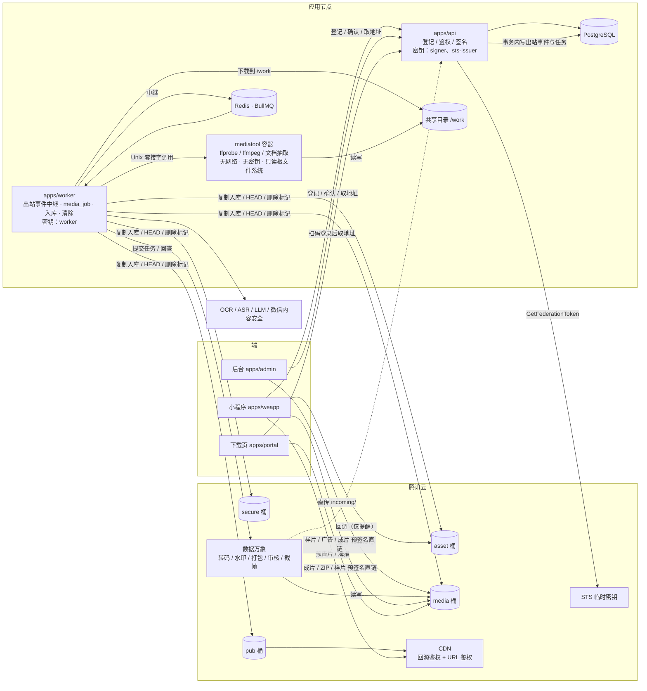
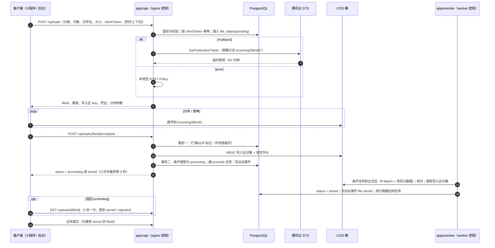
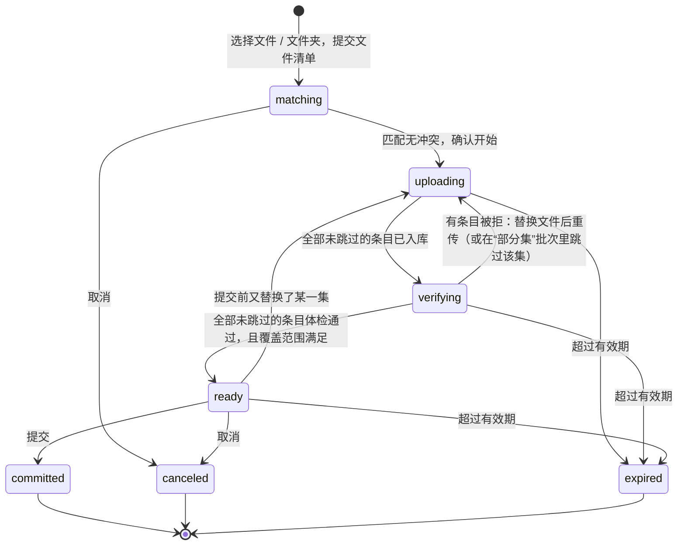
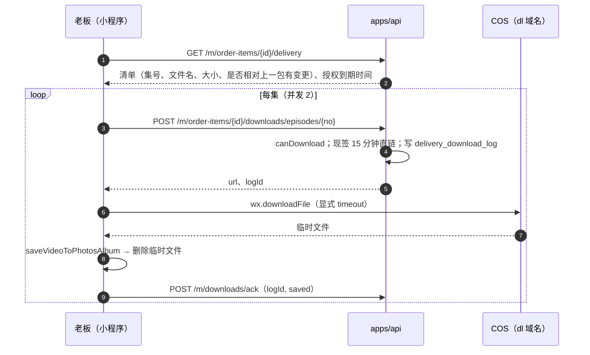
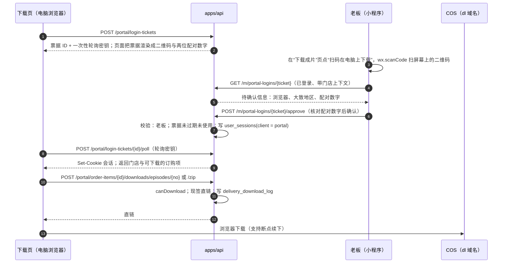
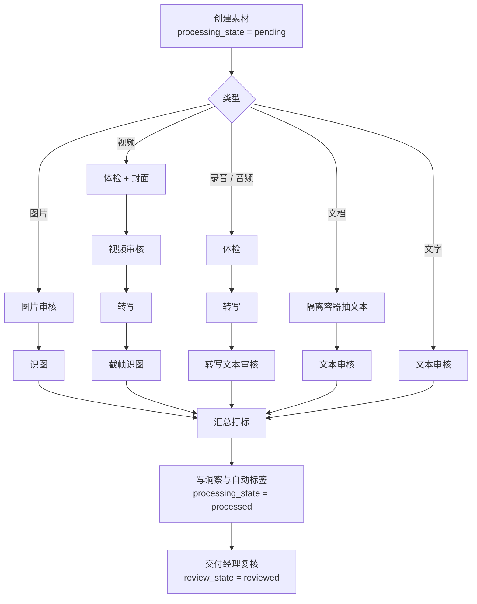
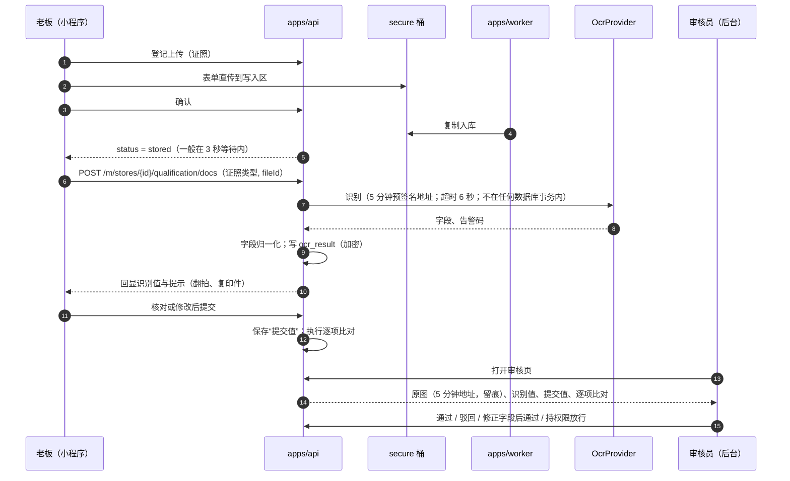
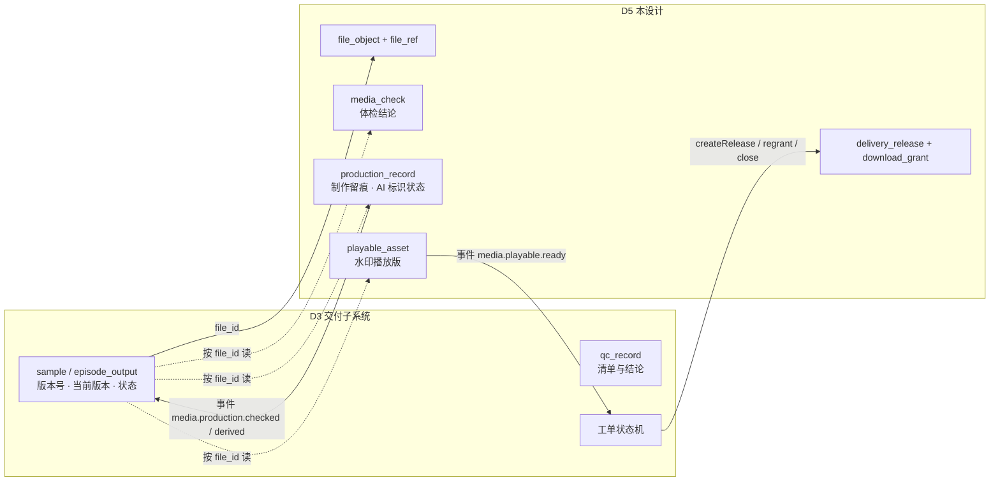

# D5 媒体与文件子系统详细设计（修订稿 v2）

存储、上传、转码、播放、下载、素材理解与制作边界

- 版本：v2.0 修订稿　日期：2026-10-02　适用：「狸有戏」V1.0（商家端小程序 + 运营后台 + 电脑端下载页），并标出 V1.1 / V2.0 扩展点
- 本稿是完整设计，可独立阅读；相对 v1.0 评审稿的改动逐条列在 §22“评审意见处理表”
- 出处标注：【PRD §x】= PRD 原文；【原型 X】= 原型画板或原型调研报告；【核实 id】= 任务书给出的外部结论核实项（如 file-4、cos-3）；【实查】= 本次修订现场抓取的官方文档；【参考工程 path】= timavia-liyo-project 代码；【D2 / D3 / D4 / D6 / D7 §x】= 同批其他子系统设计；【推断】= 本设计的判断；【待 PoC】= 没有一手依据、必须实测后才能写死
- 书写约定：主键按 `bigint` 书写（D7 §2.4 的统一建议）；表名用单数（D7 §13 第 1 项的统一建议）；金额为整数“分”；时间为 `timestamptz`；凡涉及“某一天”的规则一律按 `Asia/Shanghai` 的日界计算（§3.5）

---

> Q9 当期覆盖（2026-10-29）：样片一期仅小程序内查看、确认必须勾选，新推送仅 weapp；开关缺省/新 seed 开、不覆盖已有显式 false。关停拒绝推送/播放签发/确认，GET 只读事实但无 sources/confirmableVia；禁样片相册签发，portal 样片接口未落地且本次不实现。历史四渠道/字段/快照/确认记录保留，不自动迁移；后文旧评审、迁移设想及时间点反馈不代表当前一期范围。以 [03 §3.8](../../03-key-designs.md)、[Q9 工作包](../../plan/changes/plan-q9-sample-player.md)及现行 m05 为准。

## 0. 一页结论

1. **四个私有桶，按“暴露面”切分**：`secure`（证照、回单、发票、授权书、许可文件、留证、导出、印章）、`asset`（门店素材、档案媒体、工单附件）、`media`（原片、广告、样片、成片、成片包）、`pub`（预告片、海报、Banner，唯一挂 CDN 的桶，客户端不可写）。任何桶都不开公有读。`secure`、`asset`、`media` 开启版本控制，误删可在 30–90 天内恢复。
2. **一张 `file_object` 表登记所有对象，一张 `file_ref` 表登记所有引用**。业务表只存 `file_id`，从不存 URL；业务模块用同一个函数 `files.link()` 声明“我在用这个文件”，用 `files.release()` 声明“我不用了，保留到某天”。文件能否清除只由引用表推导，不再由各业务事件分头写清除时间。
3. **上传 = 登记 → 直传写入区 `incoming/` → 确认 → worker 复制到正式区 → 入库**。API 进程只持有“读 + 写入区写”权限，不持有正式区的写与删；确认分三段执行，不持数据库锁调用对象存储；业务只能引用已入库的文件。
4. **小程序视频上限先按 100MB 落地**（有官方文档依据的上限），200MB / 500MB 在真机 PoC 通过后只改一个参数放开【核实 file-4、file-5】。
5. **后台批量上传不支持 ZIP**：多选或选文件夹，按文件名自动对集，逐文件分块续传，整批核对通过后一次性提交。批次未结束期间，其文件算作被引用，不会被清扫。
6. **不可信媒体文件只在一个无网络、无密钥的隔离容器里解析**（`mediatool`：ffprobe / ffmpeg / 文档抽取）。worker 把对象下载到共享目录交给它，再把结果取回；ffmpeg 不联网、强制解复用器、禁用外部引用。
7. **V1.0 不转码原片和成片，只做“入库即体检”**；声明使用了 AI 的样片与成片，在进入正式区的那一步由系统写入隐式标识并回读，读不回即拒收。云端转码只用于预告片（两档 MP4 + 明水印）、样片水印版、不合规广告与成片的规格化，转码产物同样补写标识。
8. **预告片 V1.0 用两档 MP4（480P / 720P，CDN 鉴权），按网络类型选档**；HLS 多码率自适应保留为 PoC 通过后的增强，不在上线关键路径上。小程序内的预告片、样片、广告三类视频各有独立的服务端开关；样片与广告在电脑端下载页有只读预览，样片另可“保存到相册查看”，所以任何一个开关被迫关闭时主流程都不中断。
9. **下载 = 成片包快照（可多次推送）+ 业务授权（默认 7 天，可重新生成）+ 每次点击现签 15 分钟直链 + 留痕**。小程序只做按集存相册；打包下载只在电脑端下载页提供。下载页用“电脑显示二维码、小程序扫码确认”登录，身份就是商家用户本人，不引入第三种身份。ZIP 是可丢弃的缓存，过期即删，再用再打。
10. **素材理解是一条可重跑的异步流水线**，每一步是 `media_job` 表里的一行；多个任务汇合时先锁父对象，另有 10 分钟一次的收敛扫描兜底；模型输出只是“建议”，可用性以交付经理复核为准。
11. **OCR 只预填，不裁决**：识别值、商家提交值、审核员修正值三份分开存；识别结果只存在 `ocr_result`（加密）。
12. **制作边界与归属**：样片 / 成片的版本行、质检记录与状态流转归交付子系统（D3）；本设计只持有“关于文件的事实”——体检结论、制作留痕（原片版本、广告版本、AI 声明、标识状态）、可播放资产、成片包快照与下载授权。同一事实只存一处。
13. **队列只是执行通道**：所有外部异步任务以 `media_job` 行为准，带租约、可被重新领取；回调只当“提醒”，状态靠回查；Redis 丢数据不丢任务。
14. **清除是可恢复的**：清除任务只写删除标记，带数量熔断，上线初期只出“待删除清单”经人工确认后执行。

---

## 1. 目标、约束与不做什么

### 1.1 目标（可验收）

| # | 目标 | 验收口径 |
| --- | --- | --- |
| G1 | 所有文件私有、读必鉴权 | 四个桶匿名 GET 全部 403；敏感文件每次签发都能对上“谁、凭什么业务关系、读了哪个文件” |
| G2 | 大文件不过 API 进程 | API 进程不接收、不转发任何 >1MB 的文件体 |
| G3 | 上传可续传、可核对 | 断网或关页后重新选择同一文件，已传分块不重传（经端上压缩后再选的视频不保证命中，见 §5.5）；入库对象的大小、ETag、CRC64 与登记一致 |
| G4 | 预告片首帧 ≤1.5 秒（PRD §10.1） | 小程序端埋点 P75 ≤1.5 秒（Wi-Fi 与蜂窝网络分开统计） |
| G5 | 成片可在手机逐集存相册、可在电脑整包下载 | 单集 ≤200MB 的 H.264 MP4；真机 80 集连续下载通过；电脑端 ZIP 可断点续下 |
| G6 | 下载受业务授权约束 | 授权过期、被替换、订单取消后，已签发地址最迟 15 分钟内失效（ZIP 为 3 小时） |
| G7 | 素材上传后自动整理 | ≤5 分钟的录音在 3 分钟内出转写与要点（P90）；worker 正常发布后任务立即被新实例接手，进程被强杀时在租约到期（≤5 分钟）内自动恢复；Provider 故障时素材仍可进入人工复核 |
| G8 | 文件与库一致 | 每日对账：库里“已入库”的对象在桶里都存在且大小一致；桶里无主对象可被列出 |
| G9 | 误删可恢复 | 任一被清除任务删除的对象，在 30 天内（`secure` 桶 90 天）可由运维一步恢复；单次清除超过阈值自动停下等人确认 |
| G10 | 解析不可信文件的进程拿不到任何凭据 | `mediatool` 容器内没有密钥、没有数据库连接、没有网络；渗透测试用例“恶意 mp4 / 播放列表 / PDF”不能读到任何其他文件或发出任何网络请求 |

### 1.2 硬约束

| 约束 | 出处 | 对设计的影响 |
| --- | --- | --- |
| COS 私有读桶 + 数据万象 + CDN；STS + 分块直传；API 不经手大文件；下载用“业务授权 + 现签短时 URL” | 基线决策 5 | 本设计的骨架 |
| 小程序网络并发共 10、切后台 5 秒中断、默认超时 60 秒 | 【核实 file-2】 | 上传并发压到 2；下载并发 2；每次调用显式设超时（§5.5、§8.2）；大文件上传期间要求停留前台 |
| `readFile`“单个文件大小上限为 100M”，>100MB 能否分段读无一手依据；`cos-wx-sdk-v5` 分块正是用它 | 【核实 file-4、file-5】 | 小程序上传上限先定 100MB；PoC 后放开 |
| `wx.downloadFile` 单次最大 200MB，部分机型更低时也有报错线索；`saveVideoToPhotosAlbum` 官方只保证 mp4 | 【核实 file-1、file-3】 | 成片单集硬上限 200MB、目标 ≤100MB；统一 H.264 + AAC 的 MP4 |
| 临时文件运行时最多 4GB，退出后超 2GB 清理 | 【核实 file-7】 | 逐集“下载 → 存相册 → 删临时文件” |
| 预签名 URL 用临时密钥签时受临时密钥有效期约束 | 【核实 cos-1】 | 读地址用服务端长期子账号密钥在本地签，有效期取“够用的最短” |
| 私有桶接 CDN = 回源鉴权 + CDN 鉴权，可按后缀限定鉴权对象；CDN 时间戳鉴权（TypeA、TypeD 的文档都写明）不支持带其他查询参数的 URL，URL 不能含中文 | 【核实 cos-3 及其额外发现】；TypeD 文档【实查 https://cloud.tencent.com/document/product/228/41625 】 | CDN 只挂 `pub` 桶；`pub` 桶 key 全 ASCII；走 CDN 的地址不能再用查询参数指定下载文件名 |
| 数据万象任务回调无验签；任务记录只保留一个月 | 【核实 cos-8、cos 额外发现】 | 回调只触发回查；任务结果自己落库 |
| 多文件打包：异步、`KeyConfig` 方式 ≤1000 个文件、0.05 元/GB；`KeyConfig` 每项可带 `Rename` 指定包内文件名 | 【核实 cos-2】；`Rename`【实查 https://cloud.tencent.com/document/api/436/83112 ：“文件重命名，打包后文件名将以该值为准，不填表示不更改文件名”】 | 一单 ≤100 集，远在限制内；对象键全部用 ASCII，包内文件名在打包时指定 |
| 审核规范“禁止多媒体自动播放”；“涉及提供微短剧播出服务的小程序”须申请微短剧类目，而类目通过后“账号内仅支持播放官方过审链接” | 【核实 msg-5、cat-1、cat-3 及额外发现】 | 三类视频各一个服务端开关 + 自动播放、预告片流两个开关；保留纯图文形态与小程序外的样片查看途径 |
| 运营规范 5.18“必须调用内容安全检测接口校验文本 / 图片”；`mediaCheckAsync` 只支持图片与音频、≤10MB、需用户 openid | 【核实 cat-4】 | 商家与店员上传的图片默认走微信接口；视频、后台上传内容走数据万象（§11） |
| AI 生成内容须显式 + 隐式标识，传播平台核验元数据；任何组织和个人不得恶意删除、篡改、隐匿标识；微短剧每集加提示标识 | 【核实 pub-6、pub-7】；【ext-aigc §3.5】 | 声明使用 AI 的产物入库即写入并回读隐式标识；系统自己的转码不得洗掉标识（§6.2、§12.1） |
| 三类剧节目编号按播出平台各自标注 | 【核实 pub 组额外发现】 | 产物与成片包带 `variant` 维度（V1.0 只用 `common`） |
| 每日备份，保留 30 天 | PRD §10.2-5 | 数据库由平台设计负责；文件侧用桶版本控制达到同等效果（§3.5） |
| 团队 3–6 人，熟 TypeScript | 任务书 | 不自建转码集群、不引入对象存储以外的文件系统、不引入搜索引擎、不引入工作流引擎 |

### 1.3 V1.0 不做什么

1. 不在系统内合成或生成视频：不建渲染队列，不接视频生成模型（V1.1 / V2.0）。
2. 不对原片、成片做云端转码（成片不合规时拒收；仅提供“云端规格化”作为人工触发的补救动作）。
3. 不做数字水印 / 溯源水印（点播溯源水印要求 ≥7 分钟且仅 HLS，短剧单集不满足【核实 cos-6】）。
4. 不做小程序内 ZIP 下载、不做小程序后台上传。
5. 不做 ZIP 上传与服务端解包。
6. 不把成片、样片、广告接 CDN（量小，直接走 COS 源站预签名）；量上来后再接。
7. 不做归档存储（恢复要等分钟到小时级，需要额外的“恢复中”状态【核实 cos 额外发现】）；只用标准与低频两档。
8. 不做 HLS 多码率自适应（两档 MP4 按网络选档；HLS 是 §19 的增强项）。
9. 不做差异度计算：只在 `production_record` 上留一个空字段，不写任务、不建文件分类（PRD §2.6-4 的最低标准未定）。
10. 不做人脸识别库、不做声纹；“含顾客正脸”只是视觉模型给出的提示。
11. 不对接开票、电子签接口：发票与授权书在这里只是“文件”。
12. 不做费用与云账单的自动对账：`media_job` 记用量与估算成本，后台按类汇总展示。

### 1.4 与其他子系统的边界

| 事项 | 本设计负责 | 只提供接口，规则在别处 |
| --- | --- | --- |
| 文件对象、引用登记、上传、签名读、生命周期与清除 | 全部 | “谁能读哪类文件”的授权矩阵以 D4 §9.4 为准；本设计定有效期与签法 |
| 短剧库 | 预告片转码与播放、原片版本与体检、海报与许可文件的存取 | 上架校验规则、许可信息建模（本设计提供 `media.dramaMediaReadiness()`） |
| 交付工单 | 体检结论、制作留痕与 AI 标识、样片水印版、成片包快照、下载授权与下载记录 | 样片 / 成片的版本行与“当前版本”、质检清单与结论、工单状态机、修改轮次与积分（D3） |
| 广告视频 | 广告文件的体检、规格化、播放 | 广告任务与版本行、分段标注、修改次数与扣积分（D3 §9） |
| 门店素材 | 素材行、素材文件、理解流水线、洞察与自动标签、复核写入 | 素材需求、通知 |
| 资质审核 / 对公收款 | OCR 调用、识别结果存储、逐项比对函数 | 审核流、驳回原因、收款确认（不依赖 OCR） |
| 授权书、协议、发票、导出 | 文件存取 | PDF 生成与印章（D6）、开票流程（D2）、导出任务表与内容（D6 §5.4） |
| 电脑端下载页 | 页面内容、下载与预览接口 | 登录票据与会话（D4 的 `user_sessions.client = 'portal'`） |
| 敏感文件访问留痕 | 调用留痕接口 | 审计表（D4 `audit_logs` 的 `access` 流）；本设计只自建“成片下载记录”这一张业务表 |

### 1.5 同一业务对象只留一套：归属裁定与需回写的改动

v1.0 评审稿与 D2、D3、D4、D6 对同一批对象各建了一套模型。本稿按“**D5 持有关于文件的事实，D3 持有关于工作流的事实**”重新划分，并把自己这一侧全部改掉；需要对方改的列在最右一栏，由首席架构师合并时确认（见 §20 Q1）。

| 对象 | 归属与唯一模型 | 本稿的改动 | 需要对方改的 |
| --- | --- | --- | --- |
| 样片 / 成片的版本行、版本号、“当前版本”、质检结论 | **D3**：`sample`、`episode_output`、`qc_record` | 删除 v1.0 的 `deliverable_version` 及其状态机；本设计改为按 `file_id` 提供 `media_check`（体检结论）与 `production_record`（制作留痕、AI 标识状态） | D3：`episode_output.is_current` 改为“质检通过才置真”，不再 `default true`（否则已推送包之外的未质检文件会被当作当前）；同一集上传新版本时，未决的旧版本自动置 `superseded`，质检只能作用于最新版本；`sample`、`episode_output` 监听 `media.production.checked` 事件后才可进入质检（§12.1） |
| 成片包 | **D5**：`delivery_release`，一次推送一行、不可变清单、可多次推送（补发） | 增加 `ticket_id`、`precheck`（D3 传入的交付前检查结果，原样保存）、`closed → pushed` 的重开 | D3：删除 `delivery_package`（含 `UNIQUE(ticket_id)` 与 `grant_expires_at / regrant_count / revoked_at`）；推送动作改为在自己的事务里调用 `media.createRelease(tx, …)`；D3 评审 M13 要求的“补发”直接落在多次推送上 |
| 下载授权 | **D5**：`download_grant` | 不变 | D3：不再自己记授权到期；“重新生成”调用 `media.regrant()` |
| 成片文件名 | 只存在成片包清单里，下载与打包时指定；对象键不含文件名 | 取消 v1.0“成片键含中文文件名”的例外（§3.3） | 无（与 D3 §11.3 一致） |
| 平台维度 | `variant text NOT NULL DEFAULT 'common'`，取值 `common / douyin / wechat_channels` | 弃用 v1.0 的可空 `platform` 列 | 无（采用 D3 §10.1 的写法） |
| 文件校验与引用接口 | **D5**：`files.link(tx, fileIds, {refType, refId, role, expect})`，可重复调用、幂等；表名 `file_object` | 取消“一次性归属”的 `attach` 与 `attached_at`；新增 `file_ref` | D3：`media.assertFiles()` 改名为 `files.link()`（调用点不变，多传一个引用标识）；业务对象作废时调用 `files.release()`。D6：外键写 `file_object`（不叫 `files`：Prisma 模型名 `File` 与 Node / 浏览器的全局 `File` 类型同名） |
| 上传凭证 | **D5**：写入区 `incoming/{fileId}/*`；≤20MB 走预签名 POST，其余走 STS | 不变 | D4 §9.4：STS 前缀改为 `incoming/{fileId}/*`，函数名统一为 `files.register()`。D2 §5.2：“STS 直传转账回单”改为“表单直传”（回单 ≤10MB，`secure` 桶不签发 STS） |
| 下载页身份 | **D4**：小程序扫码确认 → `user_sessions.client = 'portal'`，操作人仍是商家用户 | 删除 v1.0 的 `download_portal_link`、提取码、Redis 会话与 `portal` 操作人类型 | D4：把“portal 登录”从 V1.1 提到 V1.0，补登录票据表与确认接口（§8.3 给出本设计需要的最小语义）；能力白名单见 §8.3。D7 §13 第 6 项（“以 D5 的提取码为准”）作废 |
| 操作人枚举 | **D4**：`user / staff / system / partner` | 本稿各表的 `uploader_type`、`actor_type` 一律用这组值 | 无 |
| 敏感文件访问留痕 | **D4**：`audit_logs` 的 `access` 流 | 删除 v1.0 的通用 `file_access_log`；只保留 `delivery_download_log`（成片下载进度是业务数据，要回报“已存相册”） | D4：`audit.recordAccess()` 接受 `fileId`、`category`、`urlTtlSec` |
| 读地址有效期 | **D5** §3.7 | 不变 | D4 §9.4：有效期一栏改为引用本设计（样片 60 分钟、COS 预签名，不是“2 小时 CDN 鉴权”） |
| 导出文件 | 任务表归 **D6**；文件分类 `export` 归 D5 | 保留期由 7 天改为 24 小时（与 D4、D6 一致），桶规则 2 天兜底 | 无 |
| 回单 / 证照的 OCR 结果 | **D5**：`ocr_result`（应用层加密）；业务表只存 `ocr_result_id` 与比对结论 | 不变 | D2 §3.3：`transfer_proof.ocr_result jsonb` 改为 `ocr_result_id bigint`；`check_result` 里不存识别出的原值 |
| 印章图片、同意记录日摘要（D6 §3.3）、授权书 PDF | 文件归 **D5**，键由 `buildObjectKey()` 生成 | 新增分类 `seal_image`（仅 worker 可读）、`consent_digest`；`signer` 密钥显式拒绝 `seal/*` | D6：不自定对象键（`docs/license/…`、`evidence/consents/…`），改为调用 `files.putSystemFile()` 并保存返回的 `file_id` |
| 小程序视频开关 | 键名登记在 `packages/contract`，存储与求值归 **D6 / D7** | `weapp.video.enabled` 拆为 `weapp.video.trailer.enabled`、`weapp.video.sample.enabled`、`weapp.video.ad.enabled` | D6 §4、D7 §3.2：登记三个新键，删除旧键 |
| worker 镜像里的 ffmpeg | 独立镜像 `liyoxi/mediatool` | `liyoxi/server` 不装 ffmpeg | D7 §7.4、§13 第 12 项：节点上的 Compose 增加第四个服务 `lyx-mediatool`（无网络、无密钥） |
| 权限点 | 键名以 D4 的注册表为准 | 本稿用到的键列在 §14 | D4：注册 §14 列出的键 |

---

## 2. 总体结构



代码落点（`packages/services/src/`）：

| 模块 | 职责 |
| --- | --- |
| `files/` | `file_object` 的登记、确认、入库、签名读；`file_ref` 的引用与释放；清除与恢复；上传类别登记表（沿用【参考工程 packages/shared/src/uploads.ts】的“扩展名 → MIME、上限”单表做法，放 `packages/shared`） |
| `media/` | `media_job` 调度、体检、制作留痕、预告片 / 样片 / 广告的转码编排、`playable_asset`、成片包与下载授权、原片版本 |
| `playback/` | 播放地址签发、开关 |
| `asset-insight/` | 素材理解流水线、洞察与标签写入 |
| `ocr/` | 识别、字段归一、比对函数 |
| `providers/storage`、`providers/media`、`providers/mediatool`、`providers/ocr`、`providers/asr`、`providers/llm` | 外部能力，全部有“未配置实现”【参考工程 P6 原则，ref-arch §2.4】 |

依赖方向：D3、D2、D6 依赖本设计；本设计不反向调用它们。本设计需要对方判断的地方（如“这名剪辑师能不能给这张工单传成片”）用登记表注入：每个文件分类在组合根登记 `authorizeUpload(actor, ctx)` 与 `authorizeRead(actor, file)`，由拥有该业务的模块提供实现。

Provider 接口（节选，决定了替换边界）：

```ts
interface StorageProvider {
  readonly configured: boolean;
  readonly capabilities: { sts: boolean; copy: boolean; ciProcess: boolean; versioning: boolean };
  presignPost(i: { bucket: Bucket; key: string; mime: string; maxBytes: number; expiresSec: number }): PresignedPost; // 本地计算
  issueSts(i: { bucket: Bucket; keyPrefix: string; durationSec: number }): Promise<StsCredential>;                    // 调 STS
  presignGet(i: { bucket: Bucket; key: string; expiresSec: number; alignSec?: number;
                  downloadName?: string; responseContentType?: string; inline?: boolean;
                  process?: string }): string;                                                                         // 本地计算
  signCdnUrl(path: string, now: Date): string;                                                                          // 本地计算（TypeD）
  purgeCdn(paths: string[]): Promise<void>;                                                                             // CDN 刷新
  head(bucket: Bucket, key: string): Promise<{ exists: boolean; size: number; mime?: string; etag?: string; crc64?: string }>;
  copy(src: ObjRef, dst: ObjRef, o: { ifMatchEtag: string; contentType: string; contentDisposition?: string;
                                      cacheControl?: string }): Promise<{ etag: string; crc64?: string }>;             // 条件复制 + 替换元数据
  delete(bucket: Bucket, key: string): Promise<void>;                             // 版本控制桶上 = 写删除标记
  restore(bucket: Bucket, key: string): Promise<boolean>;                         // 移除最新的删除标记
  eraseAllVersions(bucket: Bucket, key: string): Promise<number>;                 // 彻底删除（个人信息删除请求）
  abortMultipart(bucket: Bucket, keyPrefix: string): Promise<number>;
  getRange(bucket: Bucket, key: string, o: { start: number; end: number }): Promise<Uint8Array>;
  downloadTo(bucket: Bucket, key: string, localPath: string, o: { maxBytes: number }): Promise<void>;  // 仅 worker
  putFile(i: { bucket: Bucket; key: string; localPath: string; mime: string;
               contentDisposition?: string }): Promise<{ etag: string; crc64?: string; size: number }>; // 仅 worker
}
interface MediaProvider {                      // 数据万象
  readonly configured: boolean;
  submitTranscode(i: { src: ObjRef; dst: ObjRef; template: string; watermarks?: Watermark[]; userData: string }): Promise<{ jobId: string }>;
  submitZip(i: { bucket: Bucket; items: { key: string; name: string }[]; dstKey: string; userData: string }): Promise<{ jobId: string }>;
  submitVideoAudit(i: { src: ObjRef; scenes: string[]; userData: string }): Promise<{ jobId: string }>;
  auditImage(i: { src: ObjRef; scenes: string[] }): Promise<AuditVerdict>;   // 同步
  auditText(i: { text: string; scenes: string[] }): Promise<AuditVerdict>;   // 同步
  describeJob(kind: MediaJobKind, jobId: string): Promise<{ state: 'running' | 'success' | 'failed'; output?: unknown; error?: string }>;
  findJobByUserData?(kind: MediaJobKind, userData: string, since: Date): Promise<string | null>;  // 提交后崩溃时找回任务号
  snapshotProcess(atMs: number, width: number): string;                        // 返回可拼进 presignGet 的处理参数
}
interface MediaToolProvider {                  // 隔离容器，见 §6.6
  readonly configured: boolean;
  probe(i: { path: string; demuxers: string[] }): Promise<ProbeReport>;
  poster(i: { path: string; demuxer: string; atMs: number; outPath: string }): Promise<void>;
  stampAigc(i: { path: string; outPath: string; aigcJson: string }): Promise<ProbeReport>;   // 流拷贝重封装 + 回读
  docText(i: { path: string; ext: string; maxChars: number }): Promise<{ text: string; truncated: boolean }>;
}
```

驱动选择：预发与生产用 **COS 原生 SDK 驱动**（`cos-nodejs-sdk-v5` + 腾讯云 API 签名，复用【参考工程 providers/tencent/sign.ts】）；本地开发保留 S3 兼容驱动接 MinIO（`capabilities.sts = false`、`versioning = false`，只支持预签名 POST 通道）。分块上传、续传、越权前缀在 MinIO 上测不到，所以 `files/` 与 `providers/storage` 有改动的合并请求必须跑真实开发桶的集成测试（§15.4）。取舍见 §5.9。

---

## 3. 文件分类、桶与前缀、访问级别、保留期

### 3.1 桶

每个环境一套（`lyx-{env}-{name}-{appid}`，与应用服务器同地域）：

| 桶 | 内容 | CDN | 服务端加密 | 版本控制 | 客户端写入区 | 读方式 |
| --- | --- | --- | --- | --- | --- | --- |
| `secure` | 证照、回单、发票、授权书与协议、短剧许可与权属文件、核查留证、导出文件、印章、同意记录日摘要 | 否 | 开（SSE-COS） | 开，非当前版本保留 90 天 | `incoming/`（只收预签名 POST） | 预签名 GET 5 分钟；每次签发记审计 |
| `asset` | 门店素材、档案媒体、渠道账号主页截图、工单附件、修改意见截图 | 否 | 关 | 开，非当前版本保留 30 天 | `incoming/` | 预签名 GET，图片 30–60 分钟（对齐窗口，可被客户端缓存），音视频 60 分钟 |
| `media` | 原片、预告片源、广告、样片（原版与水印版）、成片、成片包 ZIP、发布清单文件、转码暂存 | 否（V1.0） | 关 | 开，非当前版本保留 30 天 | `incoming/` | 预签名 GET：样片 / 广告播放 60 分钟，成片下载 15 分钟，ZIP 3 小时，原片下载（员工）30 分钟 |
| `pub` | 预告片转码产物、海报、Banner、发布指引图 | **是（唯一）** | 关 | 关（内容都能从源文件重建） | **无**：海报、Banner 先传到 `asset` 桶写入区，入库时由 worker 跨桶复制过来 | CDN 域名；`.mp4` 需 CDN 鉴权签名，图片不鉴权 |

为什么是四个桶而不是一个桶加前缀【备选与取舍】：

- **一个桶 + 前缀**：最省事，但 CDN 回源鉴权是桶级授权——只要 CDN 能回源，桶里任何“没被 CDN 鉴权规则覆盖到的路径”都能被 CDN 域名直接读到，一条规则配错就是证照外泄。把“会挂 CDN 的东西”单独成桶，暴露面由桶边界而不是由规则正确性保证。`pub` 桶不设写入区，是同一个理由：客户端刚传上来、还没确认的对象不应出现在挂了 CDN 的桶里。
- **按环境、按类别各一个桶（十几个）**：权限最细，但 CORS、生命周期、万象绑定、合法域名都要配十几遍，小团队维护不动。
- **四个桶**：恰好对应四种读策略（短签留痕 / 可缓存短签 / 中等短签 / CDN），每个桶的 CAM 策略、加密、版本控制各一套即可。

版本控制的代价：被覆盖或被删除的对象多存 30 天（`secure` 90 天）。按 §3.6 的量级，每月多出的存储在几十元以内。换来的是清除任务、人为误操作、程序缺陷造成的删除都可以恢复（G9），这是 PRD §10.2-5“每日备份保留 30 天”在文件侧的对应物。

### 3.2 分类表

`file_object.category` 的取值、落点与规则。访问级别：L0 = CDN 可缓存公开素材；L1 = 登录后按门店 / 主体关系可读；L2 = 仅限特定角色且每次读取留痕；L3 = 仅内部员工；L4 = 仅 worker 进程（任何人工接口都取不到）。“保留”一栏是引用被释放之后的保留时长（机制见 §3.5），全部是可配参数。

| 分类码 | 内容 | 桶 / 正式区前缀 | 上传方 | 级别 | 大小与类型上限 | 保留（默认） |
| --- | --- | --- | --- | --- | --- | --- |
| `kyc_license` | 营业执照、分支机构执照 | secure `kyc/{entityId}/` | 老板 | L2 | 图片 ≤5MB（jpg/png） | 主体终止合作后 3 年（待法务） |
| `kyc_permit` | 行业许可证 | secure `kyc/{entityId}/` | 老板 | L2 | 同上 | 同上 |
| `pay_receipt` | 对公转账回单、返佣打款回单（V1.1） | secure `pay/{entityId}/` | 老板 / 财务 | L2 | 图片 ≤5MB 或 PDF ≤10MB | 不释放（会计凭证口径，待财务） |
| `invoice` | 电子发票 PDF / OFD / XML | secure `inv/{entityId}/` | 财务 | L2 | ≤10MB | 不释放 |
| `legal_doc` | 《定制内容授权书》PDF、协议正文（Word / PDF） | secure `legal/{entityId 或 platform}/` | 系统 / 运营 | L2（协议正文 L1） | ≤20MB | 不释放 |
| `seal_image` | 平台印章图片 | secure `seal/` | 运维（命令行导入） | **L4** | PNG ≤1MB | 不释放 |
| `consent_digest` | 同意记录日摘要（D6 §3.3） | secure `evid/consents/` | 系统 | L4（运维经命令行取） | — | 不释放 |
| `drama_license_doc` | 短剧许可文件扫描件、权属证明 | secure `drama/{dramaId}/` | 内容运营 | L3 | PDF / 图片 ≤20MB | 剧目授权期结束后 3 年 |
| `evidence` | 下架核查截图、巡检截图、链接核验截图 | secure `evid/{orderItemId}/` | 发布专员 | L3 | 图片 ≤5MB | ≥3 年【原型 Offline，prd-tech §8.1】 |
| `export` | 列表导出文件 | secure `export/{staffId}/` | 系统 | L2（仅发起人） | — | 24 小时（与 D4、D6 一致） |
| `profile_image` | Logo、门头、店内、服务或产品实拍图 | asset `store/{storeId}/profile/` | 老板 | L1 | 图片 ≤5MB（端上先压缩） | 被替换后 30 天；门店注销后 180 天 |
| `profile_video` | 建档“服务或产品实拍”视频（PRD §6.3.2：≤3 条、≤60 秒、≤200MB） | asset `store/{storeId}/profile/` | 老板 | L1 | 见 §5.5 | 同上 |
| `profile_promo` | 建档“已有宣传素材”（图片、视频） | asset `store/{storeId}/profile/` | 老板 | L1 | 图片 ≤5MB；视频见 §5.5 | 同上 |
| `store_asset` | 门店素材（图 / 视频 / 录音 / 音频 / 文档） | asset `store/{storeId}/lib/` | 老板、店员、代传员工 | L1 | 见 §5.5 上限表 | 素材删除后 7 天；门店注销后 180 天 |
| `channel_screenshot` | 渠道账号主页截图 | asset `store/{storeId}/chan/` | 老板 | L1 | 图片 ≤5MB | 账号解绑后 1 年 |
| `ticket_attachment` | 客服工单图片、样片 / 广告修改意见截图 | asset `store/{storeId}/tk/` | 商家 / 员工 | L1 | 图片 ≤5MB | 关联单据关闭后 3 年 |
| `video_cover` | 系统为素材、广告、样片、原片抽取的封面帧 | 与源文件同桶 `cover/` | 系统 | 同源文件 | 约 100KB | 随源文件 |
| `drama_master` | 每集原片 | media `master/{dramaId}/` | 内容运营 | L3（下载留痕） | 视频 ≤500MB / 集（参数；原型写 200MB，见 §17） | 被新版本取代后 180 天；剧目归档时：授权期与名下成片使用期全部结束后 90 天 |
| `trailer_src` | 预告片源文件 | media `trailer-src/{dramaId}/` | 内容运营 | L3 | ≤500MB、≤180 秒 | 同原片 |
| `ad_video` | 广告视频各版本 | media `ad/{storeId}/` | 剪辑师 | L1（所属门店老板）/ L3 | ≤200MB | 已确认版本不释放（会被长期复用，体量小）；被取代的未确认版本 90 天 |
| `sample_video` | 样片原版（被采用为第 1 集成片时同一个文件再被成片行引用） | media `sample/{orderItemId}/` | 剪辑师 | L3；被成片包引用后按成片 | ≤200MB | 被取代后 30 天；订单结束后 180 天 |
| `sample_wm` | 样片水印版 | media `sample/{orderItemId}/` | 系统 | L1（老板） | — | 随样片原版 |
| `final_episode` | 成片各集各版本 | media `final/{orderItemId}/` | 剪辑师（V1.1 起含渲染产物） | L2（老板、被授权服务商、有权限员工） | **≤200MB 硬上限**，>100MB 预警 | 见 §3.5“引用与释放”表 |
| `package_zip` | 成片包 ZIP（缓存） | media `pkg/{orderItemId}/` | 系统 | L2 | — | 所属成片包最晚的有效授权到期后 1 天 |
| `publish_list` | 发布清单文本文件（打包时由成片包上的清单文本生成，随包） | media `final/{orderItemId}/` | 系统 | L2 | — | 随成片包 |
| `trailer_out` | 预告片两档 MP4 | pub `t/{dramaId}/{rand16}/` | 系统 | L0（地址需签名） | — | 停用后 30 天；因版权或许可问题下架时立即 |
| `poster` | 竖版海报、预告片封面 | pub `p/` | 内容运营 / 系统 | L0 | 图片 ≤5MB | 随剧目 |
| `banner` | 首页 Banner、发布指引图 | pub `b/` | 运营 | L0 | Banner ≤1MB、690×280【原型 OpsHome】 | 下线后 180 天 |

说明：

- 系统派生物（封面、水印版、ZIP、发布清单、转码产物）都进 `file_object`，`uploader_type = system`。派生物不登记就管不到它的生命周期【参考工程 media/probe.ts 的教训】。
- 档案媒体（`profile_*`）与素材库（`store_asset`）在文件层是同一套（同一个桶、同一张登记表、同样的审核与识图步骤）；业务行分开：档案媒体有槽位与数量约束、随档案保存与资质审核走，素材库有复核与可用性。【原型调研 proto-merchant-b §1.3】建议合成一张表；本设计不合并业务表，但广告需求的“参考素材”允许同时引用两者（引用的都是 `file_id`），避免两套存储。
- 类型白名单里没有 `html`、`svg`、`js` 等可在浏览器里执行的类型。

### 3.3 Key 规则

1. 写入区：`incoming/{fileId}/{objToken}.{ext}`；批量上传为 `incoming/b{batchId}/{fileId}.{ext}`。`objToken` 为 16 字节随机数的 base32。
2. 正式区：`{分类前缀}/{归属ID}/{objToken}.{ext}`，一律小写 ASCII，**没有例外**。成片的可读文件名（`夜巷疑云_第01集.mp4`）不进对象键：它在推送成片包时按当时的集号生成，存进成片包清单；单集下载用响应头指定，打包用 `KeyConfig.Rename` 指定（§8）。这样集号映射在提交前随便改，都不需要动对象。
3. 数据万象转码任务的输出一律落在 `media` 桶的暂存前缀 `ci-out/{jobId}/`，由 worker 核对后取回正式键（必要时先补写 AI 标识）。数据万象不直接写正式区，也不跨桶写 `pub`。唯一的例外是打包任务：ZIP 可达数 GB、不需要改写，直接输出到 `pkg/` 下预先确定的键。
4. 正式区对象只写一次、不被覆盖（新版本 = 新 key）。
5. Key 总长 ≤ 512 字节；不含 `..`、不以 `/` 开头（由 `buildObjectKey()` 纯函数保证，见 §15 性质测试）。
6. `pub` 桶的预告片目录带 16 位随机段，地址不可枚举。

### 3.4 域名

| 域名（示例） | 指向 | 用途 | 小程序合法域名 |
| --- | --- | --- | --- |
| `media.<主域>` | CDN → `pub` 桶 | 预告片、海报、Banner | 不需要登记（`<image>` / `<video>` 的 `src` 不走 request 域名校验【待 PoC P8】）；若用 `downloadFile` 取海报则登记到 downloadFile |
| `dl.<内容域>` | `media` 桶自定义源站域名 | 成片与 ZIP 下载、样片 / 广告播放 | **downloadFile** |
| `f.<内容域>` | `asset` 桶自定义源站域名 | 素材与档案媒体读取 | downloadFile（文档预览用 `downloadFile + openDocument`） |
| 各桶默认域名 | COS | 客户端上传（SDK 默认）；服务端内网读写（同地域走默认域名才保证内网免流量费【核实 inf-8】） | **request + uploadFile**（`cos-wx-sdk-v5` 的分块走 `wx.request`、简单上传可能走 `wx.uploadFile`【核实 file-5 额外发现】） |
| `<下载页域名>` | apps/portal | 电脑端下载页 | 不登记（不在小程序内打开） |

- **用户上传内容的域名与后台、接口域名隔离**。`dl`、`f` 承载的是商家与员工上传的文件，建议放在独立的注册域（上表的 `<内容域>`）下，而不是主域的子域：万一某个对象被浏览器当成页面执行，它与后台不同站，拿不到也改不了后台的 Cookie。独立域需要另行备案（周期约两周），赶不上时退到主域子域，此时后台与接口的会话 Cookie 必须是不带 `Domain` 属性的 `__Host-` 前缀 Cookie（由 D4 规定）。无论哪种，§5.3 的“入库时改写 Content-Type 与 Content-Disposition”都是必做项。
- 2024 年 1 月后创建的桶，默认域名不支持浏览器内预览【ext-media §3.4】，后台要内嵌预览 PDF、图片，所以读一律用自定义域名。自定义源站域名上的预签名是否需要把 `host` 纳入签名，由驱动统一处理【待 PoC P8】。
- 所有域名须已备案且备案主体与小程序主体一致或有关联【核实 msg-7】。

### 3.5 生命周期、引用与清除

三层机制，职责不重叠：

| 机制 | 管什么 | 规则 |
| --- | --- | --- |
| COS 生命周期规则（按前缀，纯时间） | 写入区、暂存区、存储类型沉降、历史版本 | ① `secure / asset / media` 的 `incoming/`：创建 3 天后删除；② 所有桶：未完成分块 7 天后清除；③ `media` 桶 `ci-out/`：3 天后删除；④ `media` 桶 `final/`：创建 60 天后转低频；⑤ `secure` 桶 `export/`：2 天后删除（兜底，正常由 worker 在 24 小时删除）；⑥ 非当前版本：`asset`、`media` 30 天后删除，`secure` 90 天后删除；清理过期的删除标记 |
| 引用登记（`file_ref`） | “这个文件现在还有谁在用、不用之后还要留多久” | 业务模块在自己的事务里调用 `files.link()` / `files.release()`；`file_object.purge_after` 由引用推导，是缓存 |
| worker 清除任务 | 一切“以业务时间为准”的删除 | 每日 03:00（北京时间）扫描 `status = 'stored' AND purge_after <= now()`，按下文算法执行 |

**时间口径**：所有“某日之前 / 之后”都用 `packages/shared` 的日界函数按 `Asia/Shanghai` 计算。使用期结束日为 D 时：D 当天 24:00（北京时间）之前可下载（PRD §2.5-5“到期当日下架”）；保留期从 D 的次日 00:00 起算。

**引用与释放**（`purge_after` 不再由业务事件直接写，全部经由这两个函数）：

```ts
files.link(tx, fileIds, {
  refType, refId, role?,                 // 引用标识，(file, refType, refId, role) 唯一
  expect: { categories, storeId? , entityId?, allowBlocked?: false }
}): void
// 1. 按 id 升序 SELECT … FOR UPDATE 锁文件行
// 2. 断言：status = 'stored'；分类在 expect.categories 内；归属门店 / 主体相符；moderation_state <> 'block'
// 3. INSERT file_ref(state = 'live') ON CONFLICT (file_id, ref_type, ref_id, role) DO UPDATE SET state = 'live', keep_until = NULL
// 4. UPDATE file_object SET purge_after = NULL, first_linked_at = COALESCE(first_linked_at, now())

files.release(tx, { refType, refId, role? }, { keepUntil }): void
// 1. 把匹配的引用置 released，keep_until = max(keepUntil, now + 该分类的最短缓冲)   -- 最短缓冲默认 7 天；ZIP、导出为 0
// 2. 对受影响的每个文件重算 purge_after：
//      仍有 live 引用            → NULL
//      否则                      → 该文件全部引用的 keep_until 的最大值
```

- 同一个文件可以被多处引用（样片文件被样片行与第 1 集成片行同时引用；成片文件被版本行与多个成片包清单引用；门店间复制素材只复制引用）。只要有一处是 `live`，文件就不会被清除；全部释放后，保留到最晚的那个 `keep_until`。
- **从未被引用的文件**（上传后没有提交业务）：入库 24 小时后 `purge_after = now`。批量上传的文件在入库的同一个事务里就被批次引用（`ref_type = 'upload_batch'`），所以不存在“已入库但暂时没人引用”的空档，批次未结束期间不属于此类。
- 引用类型在代码里有一张登记表 `FILE_REF_TYPES`（类型码 → 所属模块、对应的业务表与列、可选的“在用判定”）。“在用判定”是一段直接查业务表的条件，只给丢不起的几类对象声明：`pushed` 成片包的清单、当前原片、当前版本的样片与成片、已确认的广告版本、未删除的素材。CI 里有一条静态检查：Prisma schema 中所有名字含 `file_id` 的列都必须出现在登记表里。

主要的引用与释放规则（参数可配）：

| 引用方（`ref_type`） | 建立 | 释放事件 → `keep_until` |
| --- | --- | --- |
| 样片行、成片行（D3，`sample` / `episode_output`） | 登记版本 | 被新版本取代、质检不通过、体检拒收 → 30 天；订购项取消或退回 → 90 天；使用期结束并归档 → 使用期结束日次日 + 90 天（成片）/ + 180 天（样片） |
| 成片包清单（`release`，角色 `ep` / `list`） | 推送成片包 | 成片包被新包取代 → 30 天；成片包关闭（使用期结束、订单终止）→ 使用期结束日次日 + 90 天 |
| 成片包 ZIP（`release`，角色 `zip`） | 打包成功（建立时即为 `released`，缓存语义） | `keep_until = 该成片包有效授权的最晚到期时间 + 1 天`，每次新建授权时顺延 |
| 广告版本行（D3） | 登记版本 | 已确认版本不释放；未确认且被取代 → 90 天 |
| 可播放资产（`playable`，角色 `source` / `rendition` / `cover`） | 资产就绪 | 资产停用 → 30 天；因版权或许可问题下架 → 立即，并刷新 CDN |
| 原片版本（`drama_master`） | 批次提交 | 被新版本取代 → 180 天；剧目归档 → 授权期与名下成片使用期全部结束后 90 天（由短剧库模块调用 `media.retireDramaMedia()`） |
| 素材文件（`store_asset`）、档案媒体行 | 创建素材 / 保存档案 | 素材删除、档案媒体被替换 → 7 天 / 30 天；门店注销 → 180 天 |
| 批次条目（`upload_batch`） | 文件入库（与置 `stored` 同一事务） | 批次提交 → 立即（此时已被原片行或成片行引用）；批次取消或过期 → 3 天 |
| 证照、截图、工单附件等其余业务行 | 业务提交 | 见 §3.2“保留”栏 |
| 派生封面（`derivative`，`ref_id` = 源文件） | 抽帧成功 | 源文件被清除时一并释放 → 立即 |
| 导出任务（D6） | 导出完成 | 建立时即 `released`，`keep_until = now + 24 小时` |

版权续期使使用期顺延（PRD §2.5-3）：D3 发 `order_item.usage_extended` 事件，本设计对该订购项名下已关闭的成片包执行“重开”（§8.1），其清单引用回到 `live`，`purge_after` 清空。已经过了保留期、被清除的文件不可恢复（超过 30 天的历史版本也已过期），所以“使用期结束 + 90 天”的缓冲不能短于续期谈判的常见时长（§20 Q2）。

**清除算法**

```text
purgeRun():                                             # 每日 03:00；同一时刻只有一个运行（worker 单活 + 行锁）
  1. 候选：SELECT … WHERE status = 'stored' AND purge_after <= now() ORDER BY purge_after LIMIT 5000
  2. 建一行 purge_run（候选数、候选字节数、分分类计数）
  3. 熔断：任一条件成立 → purge_run.state = 'held'，P2 告警，等待有权限的员工在后台“放行”或“驳回”
       候选对象数  > files.purge.max_objects      （默认 500）
       候选字节数  > files.purge.max_bytes        （默认 50GB）
       其中 drama_master > 100 个，或 secure 桶对象 > 50 个
     模式 files.purge.mode = 'list_only'（上线初期的默认值）时，无论数量多少都停在 'proposed'，人工放行后才执行
  4. 执行（逐个文件，各自一个短事务）：
       a. SELECT … FOR UPDATE 锁文件行；复核：
            status = 'stored' 且 purge_after <= now()
            file_ref 中没有 live 引用，且所有引用的 keep_until <= now()
            文件不属于未结束的批次
            登记表里声明的“在用判定”逐条直接查业务表，没有任何一条命中该文件            # 第二道独立防线，不经 file_ref
          任一不满足 → 重算 purge_after、记 purge.guard_tripped 告警；本次运行累计 3 次即中止整个运行
       b. 置 deleting，提交
       c. 调对象存储 delete（版本控制桶上只是写删除标记；pub 桶为真删除，并对其 CDN 地址执行刷新）
       d. 事务：置 deleted、deleted_at；执行分类的“清除后钩子”
            package_zip → 所属成片包 zip_state = 'none'、zip_file_id = NULL
            任意文件     → 释放以它为源的 derivative 引用
  5. purge_run.state = 'done'，写统计
```

- `deleted` 行不物理删除（留痕）。
- **恢复**：后台“已清除文件”列表可在保留期内执行 `files.restore(fileId)`（移除删除标记，行回到 `stored`、`purge_after = NULL` 并要求填写原因、写审计）。超过保留期后不可恢复。
- **彻底删除**：个人信息删除请求需要“立即、不可恢复”时，走 `files.erase(fileId)`：删除全部历史版本，需审批（D4 的敏感操作审批），写审计。对外答复“已删除”的口径：普通清除以非当前版本过期（30 / 90 天）为准，`erase` 以执行时刻为准。
- 版本控制只防“删错、写错”，不防桶或地域级故障。V1.0 不做跨地域复制（COS 标准存储的设计持久性已远高于本业务的其他环节）；若业务要求，可对 `secure` 桶与 `master/` 前缀开启跨地域复制，属运维配置，不影响设计。

低频存储的注意点【核实 cos-9】：不足 30 天按 30 天计费、读取有取回费（约 0.02 元/GB）、可直接读不需要恢复；多文件打包对低频对象会产生取回费【ext-media §5.1】。所以 `final/` 设 60 天后才沉降（覆盖交付后的下载高峰），沉降后再打包只是多几分钱。存储类型由桶规则管理，库里不记。

### 3.6 成本估算（刊例价，量级判断用）

假设（沿用 ext-media §2）：每月 100 单、每单 60 集 × 50MB ≈ 3GB；原片库 200 部 × 60 集 × 80MB ≈ 1TB；素材累计 300GB；成片每单被下载 1.5 遍；预告片播放 135GB/月。

| 项 | 第 12 个月的月费用 | 算式 |
| --- | --- | --- |
| 原片（标准） | 约 118 元 | 1,000GB × 0.118 |
| 成片（60 天标准 + 其余低频） | 约 310 元 | 600GB × 0.118 + 3,000GB × 0.08 |
| 素材、样片、广告、证照等 | 约 45 元 | 380GB × 0.118 |
| 版本控制多存的历史版本 | 约 20–40 元 | 每月被取代与被清除的对象约 200–300GB × 0.118（存 30 天） |
| 成片下载（COS 源站外网下行） | 约 225 元 | 450GB × 0.5 |
| 预告片与海报（CDN + 回源） | 约 50 元 | 135GB × (0.21 + 0.15)【核实 cos 额外发现】 |
| 打包 | ≤15 元 | 100 单 × 3GB × 0.05（按需打包会更少） |
| 样片水印转码 | 约 15 元 | 100 单 × 2.1 分钟 × 0.0325 × 约 2 轮 |
| 预告片转码（一次性） | 约 24 元 | 200 条 × 2.5 分钟 ×（0.0325 + 0.016）【核实 cos-7】 |
| 素材理解（ASR + 模型 + 审核） | 约 150–250 元 | ASR 100 小时 × 0.8【核实 inf-5】+ 模型几十元 + 审核几十元 |
| OCR | 0–100 元 | 营业执照在每月 1,000 次共享免费额度内【核实 inf-4】；行业许可证与回单走文档抽取 0.288–0.48 元/次【核实 inf-6】 |
| **合计** | **约 1,000–1,200 元/月** | 增长到 10 倍规模时约 1 万元/月，其中成片存储与下载占七成 |

读法：钱不是选型因素；真正要控制的是“成片只增不减”。本设计用“被取代的版本 30 天后可清、使用期结束 90 天后可清、60 天沉降低频”三条规则封顶，并用 §13.2 的不变量 I13 保证“任何已结束的业务对象名下的文件，要么仍被有效对象引用，要么有清除时间”。

上线清单里必须有的三件事：OCR 与 ASR 的后付费默认关闭，免费额度或资源包用完会直接停服【核实 inf-4、inf-5 额外发现】——开通后付费或预购资源包，并对余量设告警；数据万象在 `asset`、`media`、`pub` 三个桶上分别开通绑定；在 `secure`、`asset`、`media` 三个桶上开启版本控制并配置 §3.5 的规则 ⑥。

### 3.7 密钥、桶配置与读地址时效

| 项 | 约定 |
| --- | --- |
| CAM 子账号 | ① `signer`（API 进程持有）：`secure / asset / media / pub` 的读（`GetObject`、`HeadObject`），以及 `secure / asset / media` 的 `incoming/*` 的写（用于本地签发预签名 POST）；**没有**正式区的写、没有任何删除权；显式拒绝 `secure` 桶的 `seal/*` 与 `evid/consents/*`。② `sts-issuer`（API 进程持有）：只允许调用 `GetFederationToken`，自身权限上界为 `asset / media` 的 `incoming/*` 的写。③ `worker`（只有 worker 进程持有）：四个桶读写删（含按版本号删除）+ 数据万象任务 + CDN 刷新。三把密钥都只在服务端配置里；`mediatool` 容器一把都没有；客户端只拿到 STS 临时密钥或已签名的地址 |
| 桶访问权限 | 全部私有读写；关闭“公有读”；`secure` 桶另加桶策略：拒绝除 `signer`、`worker` 之外的一切主体，`seal/*` 与 `evid/consents/*` 只允许 `worker`（该桶的上传都 ≤20MB，只走预签名 POST，不签发 STS） |
| CORS | `asset`、`media`、`secure` 三个桶：后台域名允许 `GET / HEAD / PUT / POST`，暴露 `ETag`、`Content-Length`、`x-cos-hash-crc64ecma`、`x-cos-request-id`（浏览器分块上传需要读 `ETag`）；下载页域名只允许 `GET / HEAD`。`pub` 桶只允许 `GET / HEAD` |
| 对象元数据 | 入库（复制到正式区）时由 worker 用“替换元数据”写入：`Content-Type` = 按扩展名推出的规范类型（不沿用客户端声明）；`secure / asset / media` 的对象统一带 `Content-Disposition: attachment` |
| 内嵌预览 | 需要在页面里直接显示（图片、MP4、PDF、音频）时，预签名地址带 `response-content-disposition=inline` 与 `response-content-type`，取值只能是该分类登记表允许的类型；这两个参数纳入签名 |
| 服务端读写 | worker 一律经桶默认域名访问（同地域内网，流量免费，请求次数仍计费【核实 inf-8】） |
| 读地址时效 | 证照、回单、发票、授权书、导出：5 分钟；素材与档案图片：30 分钟对齐窗口（实际 30–60 分钟）；素材音视频、样片、广告播放：60 分钟；员工下载原片、成片：30 分钟；商家下载成片单集、保存样片：15 分钟；ZIP：3 小时；给 OCR / 模型 / 微信内容安全拉取：10–30 分钟；给转写拉取：2 小时 |
| 缩略图 | 图片列表用数据万象基础图片处理参数（如按宽度缩到 400）拼进预签名地址，处理参数纳入签名；不落派生文件 |

“谁能取哪类文件”以 D4 §9.4 的授权矩阵为准（一处定义）；本表只定有效期与签法。

---

## 4. 核心数据模型

约定：枚举用 `text + CHECK`（Prisma 层映射为 enum）；所有表有 `created_at`、`updated_at`，下文省略；外键指向其他子系统的表（`store`、`entity`、`users`、`staff`、`drama`、`drama_episode`、`order_item`、`delivery_ticket`、`sample`、`episode_output`、`ad_video_version`）时只写列名。操作人类型统一为 D4 的 `user / staff / system / partner`；商家角色“老板 / 店员”对应 D4 的 `owner / clerk`。

本设计建的表（17 张）：`file_object`、`file_ref`、`media_info`、`purge_run`、`upload_batch`、`upload_batch_item`、`media_job`、`media_check`、`production_record`、`material_issue`、`playable_asset`、`drama_trailer`、`drama_episode_master`、`delivery_release`、`download_grant`、`delivery_download_log`、`ocr_result`，另有素材域 5 张（`store_asset`、`store_asset_file`、`asset_insight`、`store_asset_tag`、`asset_usage`）。相对 v1.0：删除 `deliverable_version`、`download_portal_link`、`file_access_log`；新增 `file_ref`、`purge_run`、`media_check`、`production_record`、`material_issue`、`drama_trailer`、`delivery_download_log`。

### 4.1 文件对象、引用与媒体信息

```sql
CREATE TABLE file_object (
  id                 bigint PRIMARY KEY,
  bucket             text NOT NULL CHECK (bucket IN ('secure','asset','media','pub')),
  object_key         text NOT NULL,                 -- 正式区 key（登记时即确定，全 ASCII）
  incoming_bucket    text CHECK (incoming_bucket IN ('secure','asset','media')),  -- 写入区所在桶；pub 类文件为 asset
  incoming_key       text,                          -- 写入区 key；入库后置 NULL；系统生成的文件为 NULL
  category           text NOT NULL,                 -- §3.2 分类码
  scope_type         text NOT NULL CHECK (scope_type IN ('platform','entity','store')),
  entity_id          bigint,                        -- scope_type IN ('entity','store') 时必填
  store_id           bigint,                        -- scope_type = 'store' 时必填
  uploader_type      text NOT NULL CHECK (uploader_type IN ('user','staff','system')),
  uploader_id        bigint,                        -- system 时为 NULL
  on_behalf_store_id bigint,                        -- 员工代商家上传时的门店
  status             text NOT NULL CHECK (status IN
                       ('pending','promoting','stored','rejected','expired','deleting','deleted')),
  reject_reason      varchar(64),                   -- size_mismatch | bad_magic | changed_after_confirm | copy_verify_failed | stamp_failed
  upload_mode        text CHECK (upload_mode IN ('post','multipart','server')),
  client_token       varchar(64),                   -- 端上生成的幂等 / 续传标识
  batch_id           bigint REFERENCES upload_batch(id),
  declared_size      bigint NOT NULL CHECK (declared_size >= 0),
  declared_mime      varchar(128) NOT NULL,
  ext                varchar(16) NOT NULL,
  original_name      varchar(255),
  size_bytes         bigint,                        -- 正式区对象的大小
  mime               varchar(128),                  -- 入库时写入的规范类型（由扩展名推出）
  etag               varchar(128),
  crc64              varchar(32),                   -- 正式区对象的 x-cos-hash-crc64ecma
  incoming_etag      varchar(128),                  -- 确认时记录的写入区对象 ETag（条件复制用）
  incoming_crc64     varchar(32),
  sha256             char(64),                      -- 仅在服务端完整读过该文件时填写
  moderation_state   text NOT NULL DEFAULT 'none'
                       CHECK (moderation_state IN ('none','pending','pass','review','block')),
  moderation_detail  jsonb,
  sts_issued         int NOT NULL DEFAULT 0,
  upload_expires_at  timestamptz,
  confirming_until   timestamptz,                   -- “确认中”标记；见 §5.3
  stored_at          timestamptz,
  first_linked_at    timestamptz,                   -- 首次被引用的时间；NULL = 从未被引用
  purge_after        timestamptz,                   -- 由 file_ref 推导的缓存；NULL = 不清除
  deleted_at         timestamptz,
  CHECK (scope_type <> 'store'  OR store_id  IS NOT NULL),
  CHECK (scope_type =  'platform' OR entity_id IS NOT NULL)
);
CREATE UNIQUE INDEX uq_file_key        ON file_object (bucket, object_key);
CREATE UNIQUE INDEX uq_file_client_tok ON file_object
        (uploader_type, uploader_id, category, COALESCE(store_id, 0), COALESCE(batch_id, 0), client_token)
        WHERE status = 'pending' AND client_token IS NOT NULL;
CREATE INDEX ix_file_pending  ON file_object (upload_expires_at) WHERE status = 'pending';
CREATE INDEX ix_file_orphan   ON file_object (stored_at)
        WHERE status = 'stored' AND first_linked_at IS NULL AND purge_after IS NULL;
CREATE INDEX ix_file_purge    ON file_object (purge_after)       WHERE status = 'stored' AND purge_after IS NOT NULL;
CREATE INDEX ix_file_store    ON file_object (store_id, category, id DESC);
CREATE INDEX ix_file_batch    ON file_object (batch_id) WHERE batch_id IS NOT NULL;

CREATE TABLE file_ref (                  -- 谁在用这个文件；清除只看这张表
  id               bigint PRIMARY KEY,
  file_id          bigint NOT NULL REFERENCES file_object(id),
  ref_type         varchar(40) NOT NULL,            -- FILE_REF_TYPES 登记表的键，如 'episode_output'、'release'、'store_asset'
  ref_id           bigint NOT NULL,
  role             varchar(24) NOT NULL DEFAULT 'main',
  state            text NOT NULL CHECK (state IN ('live','released')),
  keep_until       timestamptz,                     -- 仅 released 时有意义：此前不得清除
  released_at      timestamptz,
  UNIQUE (file_id, ref_type, ref_id, role)
);
CREATE INDEX ix_ref_target ON file_ref (ref_type, ref_id);
CREATE INDEX ix_ref_live   ON file_ref (file_id) WHERE state = 'live';

CREATE TABLE purge_run (                 -- 清除任务的每次运行；熔断与人工确认的载体
  id               bigint PRIMARY KEY,
  mode             text NOT NULL CHECK (mode IN ('list_only','auto')),
  state            text NOT NULL CHECK (state IN ('proposed','held','approved','running','done','aborted','rejected')),
  candidate_count  int NOT NULL,
  candidate_bytes  bigint NOT NULL,
  by_category      jsonb NOT NULL,                  -- {category: {count, bytes}}
  candidate_ids    bigint[] NOT NULL,               -- 本次候选的文件 id（上限 5000）
  held_reason      varchar(200),
  decided_by       bigint, decided_at timestamptz,  -- 放行或驳回的员工
  deleted_count    int, guard_trips int,
  started_at       timestamptz, finished_at timestamptz
);
```

注：外部返回值写入定宽列前一律归一化并截断（`toLowerCase().split(';')[0].trim().slice(0,128)`）——【参考工程 media.service.ts confirm()】记录过“外部串直接写定宽列导致 500”的事故。

```sql
CREATE TABLE media_info (               -- 与 file_object 1:1，仅图片 / 音频 / 视频；纯事实，不含结论
  file_id          bigint PRIMARY KEY REFERENCES file_object(id),
  kind             text NOT NULL CHECK (kind IN ('video','audio','image')),
  container        varchar(32),                      -- 实际探测到的容器
  duration_ms      int,
  width            int,  height int,                 -- 编码尺寸
  rotation         smallint NOT NULL DEFAULT 0,      -- 0/90/180/270
  display_width    int,  display_height int,         -- 旋转后的显示尺寸，判横竖只用它
  fps_num          int,  fps_den int,
  vcodec           varchar(32), vprofile varchar(32), pix_fmt varchar(32),
  acodec           varchar(32), audio_sample_rate int, audio_channels smallint,
  audio_stream_count smallint,
  bitrate_kbps     int,
  faststart        boolean,                          -- moov 在 mdat 之前
  av_drift_ms      int,                              -- 音视频流时长差
  aigc_meta        jsonb,                            -- 回读到的 AIGC 隐式标识；没有为 NULL
  cover_file_id    bigint REFERENCES file_object(id),
  probe_version    smallint NOT NULL,
  raw              jsonb NOT NULL,                   -- ffprobe 原始输出（裁剪后）
  probed_at        timestamptz NOT NULL
);
```

“手机竖拍视频是 1920×1080 加 90° 旋转元数据，拿编码尺寸判横竖会全部判错”——这条来自【参考工程 media/probe.ts】，所以 `display_*` 单列存储。

### 4.2 批量上传

```sql
CREATE TABLE upload_batch (
  id               bigint PRIMARY KEY,
  purpose          text NOT NULL CHECK (purpose IN ('drama_master','final_release')),
  target_id        bigint NOT NULL,                  -- drama_id 或 order_item_id
  variant          text NOT NULL DEFAULT 'common' CHECK (variant IN ('common','douyin','wechat_channels')),
  staff_id         bigint NOT NULL,
  state            text NOT NULL CHECK (state IN
                     ('matching','uploading','verifying','ready','committed','canceled','expired')),
  expected_count   int NOT NULL,                     -- 该剧总集数（登记时快照）
  scope            text NOT NULL CHECK (scope IN ('full','partial')),   -- 整部 / 部分集
  replace_reason   text,                             -- 替换原片时必填（画质修复 / 片头许可信息更正 / 其他）
  content_changed  boolean NOT NULL DEFAULT false,   -- 原片内容有实质变更，须重新核验许可信息
  ai_usage         jsonb,                            -- 成片批次必填：整批的 AI 使用声明（可被条目覆盖）
  production_ctx   jsonb,                            -- 成片批次：{headAdVersionId, tailAdVersionId}
  note             varchar(200),
  idempotency_key  varchar(64) NOT NULL,
  expires_at       timestamptz NOT NULL,             -- 最近一次活动后 72 小时，且不超过创建后 7 天
  committed_at     timestamptz
);
CREATE UNIQUE INDEX uq_batch_idem ON upload_batch (staff_id, idempotency_key);
CREATE INDEX ix_batch_open ON upload_batch (expires_at) WHERE state IN ('matching','uploading','verifying','ready');

CREATE TABLE upload_batch_item (
  id               bigint PRIMARY KEY,
  batch_id         bigint NOT NULL REFERENCES upload_batch(id),
  file_id          bigint NOT NULL REFERENCES file_object(id),
  original_name    varchar(255) NOT NULL,
  episode_no       int,                              -- NULL = 未匹配
  match_method     text CHECK (match_method IN ('pattern','sequence','manual')),
  state            text NOT NULL CHECK (state IN ('pending','uploaded','checked','rejected','skipped','replaced')),
  ai_usage         jsonb                             -- 条目级覆盖；NULL = 用批次的
);
CREATE UNIQUE INDEX uq_batch_item_file ON upload_batch_item (batch_id, file_id);
CREATE UNIQUE INDEX uq_batch_item_ep   ON upload_batch_item (batch_id, episode_no)
                                         WHERE episode_no IS NOT NULL AND state NOT IN ('skipped','replaced');
```

条目的体检结论不另存，读 `media_check`（按 `file_id`）。

### 4.3 媒体任务

所有“要等结果的外部或本机工作”统一成一行，队列只是唤醒通道。

```sql
CREATE TABLE media_job (
  id               bigint PRIMARY KEY,
  kind             text NOT NULL CHECK (kind IN (
                     'promote','probe','restamp',
                     'transcode_mp4','watermark_sample','normalize','zip_package',
                     'audit_image','audit_image_wx','audit_video','audit_text',
                     'asr','vision','doc_extract','digest','ocr')),
  provider         varchar(32) NOT NULL,             -- 'ci' | 'local' | 'mediatool' | 'wechat' | 'asr:tencent' | 'llm:ark' …
  mode             text NOT NULL CHECK (mode IN ('local','remote')),  -- local：本机或同步调用；remote：提交后回查
  subject_type     varchar(32) NOT NULL,             -- 任务处理的对象：'file' | 'release' | 'store_asset' | 'ocr'
  subject_id       bigint NOT NULL,
  parent_type      varchar(32),                      -- 收尾时要先锁的父对象：'store_asset' | 'playable' | 'upload_batch' | 'production' | 'release'
  parent_id        bigint,
  dedupe_key       varchar(160) NOT NULL,            -- kind + 输入指纹 + 参数版本（+ 代次）
  state            text NOT NULL CHECK (state IN
                     ('queued','running','submitting','submitted','succeeded','failed','canceled')),
  attempt          smallint NOT NULL DEFAULT 0,
  max_attempts     smallint NOT NULL DEFAULT 3,
  lease_owner      varchar(64),                      -- 领取它的 worker 实例标识
  external_job_id  varchar(128),
  input            jsonb NOT NULL,                   -- 含预先确定的输出 key（重跑不产生第二个对象）
  output           jsonb,
  error_code       varchar(64),
  error_message    varchar(500),
  retryable        boolean,
  next_run_at      timestamptz NOT NULL,             -- queued：下次执行时间；running / submitting：租约到期时间；submitted：下次回查时间
  deadline_at      timestamptz NOT NULL,             -- 超过即判超时
  billable_qty     numeric(12,3),                    -- 分钟 / 次 / 千 tokens / GB
  billable_unit    varchar(16),
  est_cost_micro   bigint,                           -- 估算成本，单位 10^-6 元
  started_at       timestamptz,
  finished_at      timestamptz
);
CREATE UNIQUE INDEX uq_job_dedupe ON media_job (dedupe_key);
CREATE INDEX ix_job_due     ON media_job (next_run_at) WHERE state IN ('queued','running','submitting','submitted');
CREATE INDEX ix_job_parent  ON media_job (parent_type, parent_id) WHERE parent_id IS NOT NULL;
CREATE INDEX ix_job_subject ON media_job (subject_type, subject_id, kind);
CREATE INDEX ix_job_failed  ON media_job (finished_at DESC) WHERE state = 'failed';
```

### 4.4 体检结论、制作留痕与取料记录

这三张表是本设计向交付子系统提供的“关于文件的事实”。它们都以 `file_id` 为键：D3 的版本行只存 `file_id`，需要这些事实时按 `file_id` 取，不在自己的表里再存一份。

```sql
CREATE TABLE media_check (              -- 一个文件按其分类对应的规格做一次体检，结论存这里
  file_id          bigint PRIMARY KEY REFERENCES file_object(id),
  profile          text NOT NULL CHECK (profile IN ('master','trailer_src','ad','sample','final','asset')),
  rule_version     smallint NOT NULL,
  gate             text NOT NULL CHECK (gate IN ('pass','reject')),
  hard             jsonb NOT NULL,                   -- [{code, pass, actual, expected}]
  soft             jsonb NOT NULL,                   -- [{code, level:'warn', actual, note}]
  context          jsonb,                            -- 体检时用到的上下文快照：{masterId, masterDurationMs, headAdMs, tailAdMs, aiUsed}
  checked_at       timestamptz NOT NULL
);

CREATE TABLE production_record (        -- 每个样片 / 成片 / 广告文件一行：它是怎么来的、AI 标识状态、流水线进度
  file_id          bigint PRIMARY KEY REFERENCES file_object(id),
  kind             text NOT NULL CHECK (kind IN ('sample','final','ad')),
  order_item_id    bigint,                          -- 样片 / 成片
  ad_id            bigint,                          -- 广告
  episode_no       int,
  variant          text NOT NULL DEFAULT 'common' CHECK (variant IN ('common','douyin','wechat_channels')),
  source           text NOT NULL CHECK (source IN ('manual_upload','normalized','restamped','render','ai_assisted')),
  derived_from_file_id bigint REFERENCES file_object(id),           -- 规格化、补标产物指向来源文件
  render_item_id   bigint,                                          -- V1.1；V1.0 恒为 NULL
  production_tier  text CHECK (production_tier IN ('standard','advanced','premium')),  -- 订购项档位快照（广告为 NULL）
  master_id        bigint REFERENCES drama_episode_master(id),      -- 所用原片版本
  master_source    text CHECK (master_source IN ('issue_log','declared','current_fallback')),
  head_ad_version_id bigint,                                        -- 所用片头广告版本
  tail_ad_version_id bigint,                                        -- 所用片尾广告版本
  ai_usage         jsonb NOT NULL,                  -- {used, tools:[{name,version,usedFor}], declaredBy, declaredAt, forcedByDrama}
  aigc_state       text NOT NULL CHECK (aigc_state IN ('not_required','pending','verified','failed')),
  aigc_origin      text CHECK (aigc_origin IN ('upstream','stamped')),  -- 标识是上游工具带来的，还是本系统写入的
  pipeline_state   text NOT NULL CHECK (pipeline_state IN ('uploading','checking','ready','rejected')),
  similarity       jsonb,                           -- 预留；V1.0 恒为 NULL
  uploaded_by      bigint,
  CHECK (kind = 'ad' OR order_item_id IS NOT NULL),
  CHECK (kind <> 'ad' OR ad_id IS NOT NULL)
);
CREATE INDEX ix_prod_item ON production_record (order_item_id, kind, episode_no) WHERE order_item_id IS NOT NULL;
CREATE INDEX ix_prod_pipe ON production_record (pipeline_state) WHERE pipeline_state IN ('uploading','checking');

CREATE TABLE material_issue (           -- 取料记录：这名剪辑师为这个订购项的这一集最近一次取到的是哪版原片
  order_item_id    bigint NOT NULL,
  episode_no       int NOT NULL,
  staff_id         bigint NOT NULL,
  master_id        bigint NOT NULL REFERENCES drama_episode_master(id),
  issued_at        timestamptz NOT NULL,
  issue_count      int NOT NULL DEFAULT 1,
  PRIMARY KEY (order_item_id, episode_no, staff_id)
);
```

`production_record` 的归属说明：`ai_usage`、`master_id`、广告版本是在**上传登记时**随文件一起声明的（上传表单必填），不是版本行的属性——同一个文件无论被样片行还是成片行引用，这些事实都不变。广告位标记（`ad_slots`）、质检结论、是否当前版本属于 D3 的 `sample` / `episode_output` / `qc_record`。

### 4.5 可播放资产

预告片、样片、广告共用一个“可播放资产”抽象，播放接口只认它。

```sql
CREATE TABLE playable_asset (
  id               bigint PRIMARY KEY,
  kind             text NOT NULL CHECK (kind IN ('trailer','sample','ad')),
  source_file_id   bigint NOT NULL REFERENCES file_object(id),
  owner_type       text NOT NULL CHECK (owner_type IN ('drama','order_item','ad')),
  owner_id         bigint NOT NULL,
  state            text NOT NULL CHECK (state IN ('processing','ready','failed','retired')),
  duration_ms      int,
  width            int, height int,
  renditions       jsonb,                            -- [{quality:'sd'|'hd'|'source', fileId, width, height, bitrateKbps}]
  cover_file_id    bigint REFERENCES file_object(id),
  watermark        jsonb,                            -- {template, text} 实际使用的水印
  spec_version     smallint NOT NULL,                -- 转码规格版本；规格变更后可批量重转
  error            varchar(500),
  ready_at         timestamptz,
  retired_at       timestamptz
);
CREATE UNIQUE INDEX uq_playable_source ON playable_asset (kind, source_file_id, spec_version);
CREATE INDEX ix_playable_owner ON playable_asset (owner_type, owner_id, kind);

CREATE TABLE drama_trailer (            -- 每部剧当前生效的预告片；防止迟到的转码结果覆盖较新的设置
  drama_id            bigint PRIMARY KEY,
  target_playable_id  bigint NOT NULL REFERENCES playable_asset(id),  -- 最近一次设置的资产（可能还在转码）
  current_playable_id bigint REFERENCES playable_asset(id),           -- 当前对外播放的资产
  set_by              bigint NOT NULL,
  set_at              timestamptz NOT NULL
);
```

- 预告片：`renditions` 为两档转码产物（`sd` 480P、`hd` 720P），都在 `pub` 桶。
- 样片：`renditions` 只有一项，指向水印版（`sample_wm`）。
- 广告：不转码，`renditions` 指向源文件本身（`quality = 'source'`），体检通过即 `ready`。
- 业务侧通过 `source_file_id` 找到资产：D3 的 `sample.file_id`、`ad_video_version.file_id` 不需要再存 `playable_id`。

### 4.6 原片版本

```sql
CREATE TABLE drama_episode_master (
  id               bigint PRIMARY KEY,
  drama_id         bigint NOT NULL,
  episode_no       int NOT NULL CHECK (episode_no >= 1),
  rev              int NOT NULL CHECK (rev >= 1),
  file_id          bigint NOT NULL REFERENCES file_object(id),
  state            text NOT NULL CHECK (state IN ('ready','superseded')),
  is_current       boolean NOT NULL DEFAULT false,
  duration_ms      int,
  batch_id         bigint REFERENCES upload_batch(id),
  replace_reason   text,
  content_changed  boolean NOT NULL DEFAULT false,   -- 内容有实质变更，须重新核验许可信息【原型 DramaEdit】
  created_by       bigint NOT NULL,
  activated_at     timestamptz,
  -- V1.1 预留
  mezzanine_file_id bigint REFERENCES file_object(id),
  UNIQUE (drama_id, episode_no, rev)
);
CREATE UNIQUE INDEX uq_master_current ON drama_episode_master (drama_id, episode_no) WHERE is_current;
```

原片行只在批次提交时创建（那时已通过体检），所以没有“体检中 / 被拒”状态；体检结论读 `media_check`。

`drama_episode`（短剧库的表）上另留：`insert_points jsonb`（中插点位，V1.1）、`custom_slots jsonb`（可定制镜头位，V2.0）。`drama` 上建议补 `is_ai_generated boolean`（原片本身是否 AI 制作，PRD §7.2 字段组里没有，【ext-aigc §4.3】建议补）与 `body_modifiable boolean`。短剧库的数据模型目前没有归属设计【D7 §13 第 14 项】，这两列随其一并确定。

### 4.7 成片包、下载授权与下载记录

```sql
CREATE TABLE delivery_release (          -- 一次“推送成片包”的不可变快照；同一订购项可多次推送（返工、补发）
  id               bigint PRIMARY KEY,
  order_item_id    bigint NOT NULL,
  ticket_id        bigint NOT NULL,
  release_no       int NOT NULL,                    -- 同一订购项内从 1 递增
  variant          text NOT NULL DEFAULT 'common' CHECK (variant IN ('common','douyin','wechat_channels')),
  state            text NOT NULL CHECK (state IN ('pushed','superseded','closed')),
  episode_count    int NOT NULL,
  total_bytes      bigint NOT NULL,
  manifest         jsonb NOT NULL,       -- [{episodeNo, outputId, fileId, name, size, crc64}]；name 为推送时生成的文件名
  changed_episodes int[] NOT NULL DEFAULT '{}',     -- 相对上一包变更的集号（补发时提示商家）
  publish_list_text text,                           -- D3 渲染好的发布清单文本（≤200KB）；推送后可修订
  publish_list_file_id bigint REFERENCES file_object(id),  -- 打包时由文本生成的文件；清单修订后置空
  precheck         jsonb,                           -- D3 传入的交付前检查结果，原样保存
  zip_state        text NOT NULL DEFAULT 'none' CHECK (zip_state IN ('none','building','ready','failed')),
  zip_gen          int NOT NULL DEFAULT 0,          -- 打包代次；每次重新打包 +1
  zip_file_id      bigint REFERENCES file_object(id),
  pushed_by        bigint NOT NULL,
  pushed_at        timestamptz NOT NULL,
  superseded_at    timestamptz, closed_at timestamptz, close_reason varchar(32),
  idempotency_key  varchar(64) NOT NULL,
  UNIQUE (order_item_id, release_no),
  UNIQUE (order_item_id, idempotency_key)
);
CREATE UNIQUE INDEX uq_release_live ON delivery_release (order_item_id, variant) WHERE state = 'pushed';

CREATE TABLE download_grant (
  id               bigint PRIMARY KEY,
  order_item_id    bigint NOT NULL,
  release_id       bigint NOT NULL REFERENCES delivery_release(id),
  grantee_type     text NOT NULL CHECK (grantee_type IN ('entity','partner')),  -- partner 为 V1.1
  grantee_id       bigint NOT NULL,
  state            text NOT NULL CHECK (state IN ('active','superseded','revoked')),  -- “过期”由 expires_at 判定
  expires_at       timestamptz NOT NULL,
  valid_days       smallint NOT NULL,              -- 生成时取系统参数（1–30，默认 7）的快照
  created_by_type  text NOT NULL CHECK (created_by_type IN ('system','user','staff')),
  created_by_id    bigint,
  revoke_reason    varchar(200),
  ended_at         timestamptz
);
CREATE UNIQUE INDEX uq_grant_active ON download_grant (release_id, grantee_type, grantee_id) WHERE state = 'active';
CREATE INDEX ix_grant_item ON download_grant (order_item_id, id DESC);

CREATE TABLE delivery_download_log (     -- 成片下载记录（业务数据：后台要看“商家已保存 45 / 80”）；只追加
  id               bigint PRIMARY KEY,
  at               timestamptz NOT NULL DEFAULT now(),
  release_id       bigint NOT NULL,
  grant_id         bigint,                          -- 员工下载为 NULL
  order_item_id    bigint NOT NULL,
  kind             text NOT NULL CHECK (kind IN ('episode','zip','publish_list')),
  episode_no       int,
  file_id          bigint NOT NULL,
  actor_type       text NOT NULL CHECK (actor_type IN ('user','staff','partner')),
  actor_id         bigint NOT NULL,
  client           text NOT NULL CHECK (client IN ('weapp','portal','admin')),
  url_ttl_sec      int NOT NULL,
  ip               inet, user_agent varchar(255),
  client_ack       text CHECK (client_ack IN ('saved','failed')),   -- 小程序回报“已存相册 / 失败”
  client_ack_at    timestamptz
);
CREATE INDEX ix_ddl_item ON delivery_download_log (order_item_id, episode_no, at DESC);
```

`client_ack` 是唯一允许的事后更新列（数据库触发器限制只能从 NULL 改一次）。证照、回单、发票、授权书、原片的读取留痕不在这张表里，统一写 D4 的 `audit_logs`（`access` 流）。

### 4.8 门店素材与理解结果

PRD §6.16.3 把“整理中、可直接使用、仅供参考、需补拍、需肖像授权、已采用”列成一个状态集合；原型表明它们是三个正交维度（处理进度 / 可用性 / 是否被采用）【原型 AssetDetail，proto-merchant-b §1.19】。模型按三个字段存，列表展示值由纯函数 `assetDisplayStatus()` 计算。

```sql
CREATE TABLE store_asset (
  id               bigint PRIMARY KEY,
  store_id         bigint NOT NULL,
  entity_id        bigint NOT NULL,                -- 冗余，用于识别结果在主体内复用
  type             text NOT NULL CHECK (type IN ('image','video','recording','audio','document','text')),
  title            varchar(60),                    -- 系统生成，可被复核人修改
  text_body        varchar(500),                   -- 文字类素材正文
  note             varchar(200),
  uploader_type    text NOT NULL CHECK (uploader_type IN ('user','staff')),
  uploader_id      bigint NOT NULL,
  demand_id        bigint,                         -- 响应的素材需求
  source_asset_id  bigint REFERENCES store_asset(id),  -- 从同主体其他门店复制而来（只复制引用，不复制文件）
  processing_state text NOT NULL CHECK (processing_state IN ('pending','processing','processed')),
  insight_partial  boolean NOT NULL DEFAULT false, -- 有步骤失败或被跳过
  review_state     text NOT NULL CHECK (review_state IN ('unreviewed','reviewed')),
  usability        text CHECK (usability IN ('ready','reference_only','need_reshoot','need_portrait_auth')),
  adopted_count    int NOT NULL DEFAULT 0,
  moderation_state text NOT NULL DEFAULT 'none' CHECK (moderation_state IN ('none','pending','pass','review','block')),
  search_text      text,                           -- 标题 + 标签 + 转写摘录 + 上传人；pg_trgm 索引
  reviewed_by      bigint, reviewed_at timestamptz,
  deleted_at       timestamptz,
  idempotency_key  varchar(64) NOT NULL,
  UNIQUE (store_id, idempotency_key)
);
CREATE INDEX ix_asset_store ON store_asset (store_id, id DESC) WHERE deleted_at IS NULL;
CREATE INDEX ix_asset_review ON store_asset (review_state, id) WHERE deleted_at IS NULL AND processing_state = 'processed';
CREATE INDEX ix_asset_stuck  ON store_asset (updated_at) WHERE processing_state IN ('pending','processing');
CREATE INDEX ix_asset_search ON store_asset USING gin (search_text gin_trgm_ops);

CREATE TABLE store_asset_file (
  asset_id         bigint NOT NULL REFERENCES store_asset(id),
  seq              smallint NOT NULL,
  file_id          bigint NOT NULL REFERENCES file_object(id),
  PRIMARY KEY (asset_id, seq)
);
CREATE INDEX ix_asset_file ON store_asset_file (file_id);

CREATE TABLE asset_insight (                       -- 机器产出，一步一行，可重跑
  id               bigint PRIMARY KEY,
  asset_id         bigint NOT NULL REFERENCES store_asset(id),
  file_id          bigint REFERENCES file_object(id),   -- 汇总步骤为 NULL
  kind             text NOT NULL CHECK (kind IN
                     ('transcript','vision','doc_text','structured_items','digest','tech_spec')),
  prompt_version   smallint NOT NULL,
  provider         varchar(32), model varchar(64),
  status           text NOT NULL CHECK (status IN ('ok','skipped','failed')),
  content          jsonb NOT NULL,                 -- 各 kind 的结构见 §9.3
  reused_from_id   bigint REFERENCES asset_insight(id),  -- 同主体内复用时指向来源
  job_id           bigint REFERENCES media_job(id)
);
CREATE UNIQUE INDEX uq_insight ON asset_insight (asset_id, COALESCE(file_id, 0), kind, prompt_version);

CREATE TABLE store_asset_tag (
  id               bigint PRIMARY KEY,
  asset_id         bigint NOT NULL REFERENCES store_asset(id),
  dimension        text NOT NULL CHECK (dimension IN ('content','usage','timeliness')),
  tag_code         varchar(32) NOT NULL,           -- 字典码，封闭词表
  valid_from       date, valid_to date,            -- 时效为日期区间时使用
  source           text NOT NULL CHECK (source IN ('auto','uploader','reviewer')),
  confirmed        boolean NOT NULL DEFAULT false, -- 复核后为 true；复核会覆盖 auto 标签
  UNIQUE (asset_id, dimension, tag_code, source)
);

CREATE TABLE asset_usage (
  id               bigint PRIMARY KEY,
  asset_id         bigint NOT NULL REFERENCES store_asset(id),
  used_by_type     text NOT NULL CHECK (used_by_type IN ('ad_request','order_item','ad_version','episode_output')),
  used_by_id       bigint NOT NULL,
  role             text NOT NULL CHECK (role IN ('reference','adopted')),
  UNIQUE (asset_id, used_by_type, used_by_id, role)
);
```

### 4.9 OCR 结果

```sql
CREATE TABLE ocr_result (
  id               bigint PRIMARY KEY,
  file_id          bigint NOT NULL REFERENCES file_object(id),
  doc_type         text NOT NULL CHECK (doc_type IN ('business_license','industry_permit','bank_receipt')),
  permit_type      varchar(32),                    -- 行业许可证的字典码，如 food_business
  provider         varchar(32) NOT NULL,           -- 'tencent' | 'aliyun' | 'llm' | 'none'
  status           text NOT NULL CHECK (status IN ('ok','unavailable','unreadable')),
  fields_enc       bytea,                          -- 归一化字段 JSON，应用层加密（D4 的字段加密约定）
  warnings         jsonb NOT NULL DEFAULT '[]',    -- 如 [{code:'photocopy'},{code:'reshoot'}]
  raw_enc          bytea,                          -- 厂商原始返回，加密，30 天后清空
  raw_purge_at     timestamptz,
  requested_by_type text NOT NULL, requested_by_id bigint NOT NULL,
  latency_ms       int
);
CREATE INDEX ix_ocr_file ON ocr_result (file_id, id DESC);
```

识别值只存这一处。资质文件、回单的业务表（属 D3 的审核模型与 D2 的凭证表）按下面的口径保存：`ocr_result_id`、`submitted_fields_enc`（商家提交值）、`reviewed_fields_enc`（审核员修正值，可空）、`field_checks jsonb`（§10.3 的逐项结论，只含“通过 / 不通过 / 提醒”与字段名，不含识别出的原值）。

### 4.10 为 V1.1 / V2.0 预留的字段一览

| 概念 | V1.0 已落的字段 | 何时启用更多 |
| --- | --- | --- |
| 制作档位 | `order_item.production_tier / tier_source / tier_surcharge_rate`（订购快照，属订购子系统）；`production_record.production_tier`（制作时快照） | — |
| 原片版本 | `drama_episode_master`（含 `mezzanine_file_id` 空列）；`production_record.master_id` | V1.1 规格化 |
| 产物来源 | `production_record.source`（V1.0 只出现 `manual_upload`、`normalized`、`restamped`）、`derived_from_file_id`、`variant` | V1.1 `render`；V2.0 `ai_assisted` |
| 渲染任务 | `production_record.render_item_id` 空列；`media_job` 通用任务表 | V1.1 新建 `render_job` / `render_item` 表 |
| 模型调用记录 | `media_job`（素材理解的模型调用已经按次落行，含模型名、用量、估算成本）；`production_record.ai_usage`（人工声明） | V2.0 新建 `model_invocation`（生成类调用，带预算） |
| 差异度指标 | `production_record.similarity` 空列 | 标准确定后（PRD §12.3）再建任务与指纹存储 |
| AI 标识 | `ai_usage`、`aigc_state`、`aigc_origin`、`media_info.aigc_meta`；V1.0 已在入库时写入并回读 | V1.1 渲染收尾复用同一写入函数 |
| HLS | `playable_asset.renditions` 可容纳新的档位类型 | PoC 通过后（§19） |

---

## 5. 上传

### 5.1 两条通道

| 通道 | 适用 | 机制 | 凭证 | 续传粒度 |
| --- | --- | --- | --- | --- |
| `post` | ≤20MB：图片、证照、回单、录音、文档、截图、发票、Banner | COS 表单直传（POST Object）。小程序 `wx.uploadFile`，后台 `fetch + FormData`。Policy 固定 key、`content-length-range = [1, declared_size]` | 服务端用 `signer` 密钥**本地**签 Policy，10 分钟有效 | 整文件重传 |
| `multipart` | >20MB：视频、大音频；后台批量上传的全部文件 | `cos-wx-sdk-v5` / `cos-js-sdk-v5` 的 `uploadFile`（自动分块、并发、续传） | STS 临时密钥 30 分钟，可续签；权限只到本次上传的写入区前缀 | 分块 |

通道由服务端在登记时决定并下发（客户端不自选）；存储驱动 `capabilities.sts = false`（本地 MinIO）时一律 `post`。客户端声明的 `Content-Type` 不被信任：入库时由 worker 按扩展名重写（§3.7）。

### 5.2 流程



要点：

- API 进程没有正式区的写权限，也没有删除权限，所以“复制入库”只由 worker 做。小文件（≤32MB）在 `complete` 请求里最多等 3 秒看它入库（每 200 毫秒查一次库），证照 OCR 这类“传完马上要读”的场景一般在这 3 秒内拿到 `stored`。
- **业务只能引用 `stored` 的文件**（`files.link()` 的断言）。端上的上传工具把“等到入库”封装在内部，业务页面拿到的 `fileId` 一定是已入库的；这样就不存在“业务行引用了一个后来被拒收的文件”。

### 5.3 算法

**登记 `register(actor, req)`**

1. 鉴权：调用该分类登记的 `authorizeUpload(actor, ctx)`。商家侧校验门店成员关系与角色（如证照、回单仅老板；素材老板与店员均可，但新增门店资质审核通过前店员不可上传，PRD §6.16.1-3）；后台侧校验权限点与数据范围（剪辑师只能给分派给自己的任务上传，由 D3 提供实现）。
2. 校验：扩展名在该分类的登记表内，并由扩展名推出规范 MIME（小程序从聊天记录选文件时拿不到可靠 MIME，只能信扩展名【参考工程 uploads.ts 注释】）；`declared_size` 不超过“分类 × 端”的上限（§5.5）；同一业务动作的文件数不超限。
3. 幂等与续传：若带 `client_token`，查“同一上传人 + 同一分类 + 同一归属门店 + 同一批次 + `status = 'pending'`”且 `declared_size` 相同的行，命中则直接复用（同一个写入区 key，分块续传才成立【核实 file-5 额外发现】）。分类或归属不同就是另一次上传，不复用。
4. 新建：生成 `id`、`objToken`、正式区 `object_key`、写入区 `incoming_key`；`upload_expires_at = now + 24h`（批量上传随批次）。
5. 样片、成片、广告三类（`sample_video`、`final_episode`、`ad_video`）必须带**制作上下文**，同事务插入 `production_record(pipeline_state = 'uploading')`：
   - `ai_usage`：上传表单必填；`used = 声明值 OR drama.is_ai_generated`（原片本身是 AI 制作的，成片必然要带标识），后者成立时记 `forcedByDrama = true`。登记后不可修改；填错了走“补标”（§12.1）。
   - `master_id`：优先取 `material_issue` 里这名员工为该订购项该集最近一次取料的版本（`master_source = 'issue_log'`）；表单显式指定的次之（`declared`，须属于该剧该集）；都没有则取当前原片并在体检里给出预警（`current_fallback`）。
   - 片头 / 片尾广告版本、档位快照：取自订购项与交付方案（由 D3 的 `authorizeUpload` 实现一并返回）。
6. 选通道并签发凭证（`multipart` 时 `sts_issued = 1`）。
7. 返回 `{ fileId, mode, bucket, region, key, post | sts, chunkSize, chunkParallel, expiresAt }`。

**续签 `renewSts(actor, fileId)`**：仅 `pending`、未过期、本人、`sts_issued < 30`。

**确认 `complete(actor, fileId)`**——三段执行，任何一段都不持数据库锁调用对象存储

1. 事务一：`UPDATE file_object SET confirming_until = now() + 30s WHERE id = ? AND status = 'pending' AND 上传人相符 AND (confirming_until IS NULL OR confirming_until < now()) RETURNING …`。
   - 命中 0 行时读一次当前行：`promoting / stored` → 直接返回当前状态（幂等）；`pending` 且标记未过期 → 409 `CONFIRM_IN_PROGRESS`（客户端 1 秒后重试）；其余 → 409。
2. 事务外：`HEAD` 写入区对象；读前 4KB 按扩展名核对文件头（jpg / png / pdf；mp4 / mov / m4a 的 `ftyp`；mp3 的 `ID3` 或帧同步字；wav 的 `RIFF…WAVE`；aac 的 ADTS 同步字）。文件头核对只是“尽早拦住明显传错的文件”，不是安全边界——安全边界是 §6.6 的隔离容器。
3. 事务二：`UPDATE … WHERE id = ? AND status = 'pending' AND confirming_until = <事务一写入的值>`：
   - 对象不存在 → 清空标记，返回 409 `UPLOAD_NOT_FOUND`（客户端可重试）。
   - 大小与 `declared_size` 不等、超过上限或文件头不符 → `rejected`（记 `reject_reason`），出站事件 `file.rejected`，返回 422。写入区对象由 worker 清扫删除。
   - 相符 → 记 `incoming_etag / incoming_crc64`，置 `promoting`，同事务插入 `media_job(kind = 'promote', dedupe_key = 'promote:{fileId}')` 与出站事件 `file.uploaded`。
   - 命中 0 行（标记被别人抢走或已过期）→ 回到第 1 步的“读当前行”分支。
4. 提交后尽力直接唤醒队列；`declared_size ≤ 32MB` 时轮询本行最多 3 秒，返回当前状态。

**入库 `promote`**（`media_job`，只由 worker 执行）

```text
1. 读文件行（须为 promoting）与 production_record（如有）
2. 需要写入 AI 隐式标识（production.ai_usage.used = true）：
     a. 带 If-Match: incoming_etag 把写入区对象下载到 /work/{jobId}/in.mp4；412 → rejected(changed_after_confirm)
     b. mediatool.probe；已带 AIGC 元数据（上游工具写的）→ 不改动文件，走第 3 步，aigc_origin = 'upstream'
     c. 否则 mediatool.stampAigc(in → out)（流拷贝重封装 + 回读）；worker 把 out 上传到正式 key；aigc_origin = 'stamped'
        不是合法 MP4 或回读不到 → rejected(stamp_failed)
3. 其余文件：COPY 写入区 → 正式 key（pub 类为跨桶），请求头带
     x-cos-copy-source-If-Match: incoming_etag          # 检查与复制合成一步
     x-cos-metadata-directive: Replaced，Content-Type = 规范类型，Content-Disposition: attachment（pub 桶不加）
   412 → rejected(changed_after_confirm)，告警
4. HEAD 正式区对象：普通复制须 size、crc64 与确认时记录的写入区值一致；不一致 → 删除正式区对象，rejected(copy_verify_failed)
5. 事务：条件更新 WHERE status = 'promoting' → stored（写 size / etag / crc64 / mime / stored_at，incoming_key = NULL）；
        production_record：pipeline_state = 'checking'、aigc_state、aigc_origin；
        批次文件：同事务建立批次引用（file_ref: upload_batch，live），条目置 uploaded；
        按分类创建后续任务（体检、审核等，见 §6.1、§9、§11）；出站事件 file.stored
6. 删除写入区对象（失败不影响结果，生命周期规则兜底）
```

**引用与释放**：见 §3.5 的 `files.link()` / `files.release()`。门店间复制素材不复制文件，只新增一条引用。

**清扫**（每 10 分钟）

- `pending` 且过期：中止该写入区前缀下的分块上传、删除对象、置 `expired`。
- `rejected` 且 `incoming_key` 非空：删除写入区对象，清空 `incoming_key`。
- `stored` 且从未被引用（`first_linked_at IS NULL`）且入库超过 24 小时：`purge_after = now`。批次里的文件在入库时就被批次引用，不会落入这一条。
- `promoting` 的恢复不在这里：`promote` 是 `media_job`，按 §6.5 的租约机制被重新领取。

### 5.4 STS 策略

```json
{
  "version": "2.0",
  "statement": [{
    "effect": "allow",
    "action": [
      "name/cos:PutObject", "name/cos:PostObject",
      "name/cos:InitiateMultipartUpload", "name/cos:UploadPart",
      "name/cos:CompleteMultipartUpload", "name/cos:AbortMultipartUpload",
      "name/cos:ListMultipartUploads", "name/cos:ListParts"
    ],
    "resource": ["qcs::cos:{region}:uid/{appid}:{bucket}/incoming/{fileId}/*"]
  }]
}
```

- 两个 `List*` 动作是续传必需的，少了会退化为重传【核实 file-5 额外发现】。`ListMultipartUploads` 是桶级操作，按对象前缀收窄是否生效【待 PoC P6】；不生效时的退路是单独一条语句允许它并加 `cos:prefix` 条件——最坏结果是能列出写入区里别人的上传任务名，读不到任何数据。
- 批量上传的前缀为 `incoming/b{batchId}/*`（一份凭证覆盖整批）。
- 只对 `asset`、`media` 两个桶签发；`secure` 只走预签名 POST，`pub` 没有写入区。
- 不授予任何读、删正式区的权限。策略由纯函数 `buildStsPolicy()` 生成并有性质测试（§15）。
- 用专用 CAM 子账号调用 `GetFederationToken`，该子账号自身权限上界就是“`asset / media` 的 `incoming/*` 的写”；即使策略拼错也越不过上界。子账号最长可签 36 小时，我们只签 30 分钟【核实 cos-1】。
- STS 不可用时：`post` 通道不受影响（证照、回单、图片、录音照常）；`multipart` 登记返回 503 并提示稍后重试。
- 被移除的店员若正在上传：已签发的临时密钥最长还能用 30 分钟，对象可能传到写入区，但确认接口会因成员关系失效而拒绝，写入区对象 3 天后由桶规则清理（与 D4 §4.5 一致）。

### 5.5 小程序端的现实方案与上限建议

事实基础：`cos-wx-sdk-v5` 的分块读取用 `FileSystemManager.readFile(position, length)`，而微信对 `readFile` 的官方限制是“单个文件大小上限为 100M”；>100MB 能否分段读没有任何一手依据【核实 file-4、file-5】。PRD §10.1 的 200MB 与 §6.16.3 的 500MB 都落在未验证区间。

**建议**：上限做成服务端参数 `upload.weapp_video_max_mb`，三步走。

| 阶段 | 参数值 | 前提 |
| --- | --- | --- |
| 开发与提测 | 100 | 无（有文档依据） |
| PoC P1 在 iOS、安卓各两档机型上 150MB / 300MB 均通过 | 200（满足 PRD §10.1） | 真机报告 |
| P1 在 500MB 也稳定通过，且弱网续传通过 | 500（满足 PRD §6.16.3） | 真机报告 + 产品确认 |

超限时的处理顺序（端上实现，文案明确告诉用户发生了什么）：

1. 相册视频默认以 `sizeType: ['compressed']` 选取【核实 file-6】；多数 5 分钟视频压缩后在 100MB 以内。
2. 仍超限：调用 `wx.compressVideo` 再试一次。
3. 还超限：提示“视频较大，请发给服务经理代传”，并提供“复制服务经理企业微信”入口；后台提供“代商家上传素材”（`uploader_type = staff`、`on_behalf_store_id`），素材归属与通知与商家自传一致。

各场景上限（登记表，`packages/shared`，服务端、契约、端上共用）：

| 场景 | 分类 | 选择方式 | 上限 | 端上预处理 | 通道 |
| --- | --- | --- | --- | --- | --- |
| 档案 / 素材图片 | `profile_image` / `store_asset` | `chooseMedia`（图片，每次 ≤9） | 5MB | 超限逐级降质压缩（PRD §10.1）；宽度不足 1080 的门头照提示重拍（PRD §6.3.2） | post |
| 证照 | `kyc_*` | `chooseMedia`（拍照 / 相册） | 5MB | 只在超限时压缩，长边不低于 1600 像素 | post |
| 录音 | `store_asset` | `RecorderManager`，aac、16k、单声道，≤5 分钟 | 约 2MB | — | post |
| 音频（聊天文件） | `store_asset` | `chooseMessageFile`，mp3 / m4a / wav / aac | 50MB | — | ≤20MB post，否则 multipart |
| 文档（聊天文件） | `store_asset` | `chooseMessageFile`，pdf / docx / txt / xlsx | 20MB | — | post |
| 拍摄视频 | `store_asset` | `chooseMedia` 相机，`maxDuration = 60` | `weapp_video_max_mb` | — | 按大小 |
| 相册视频（素材） | `store_asset` | `chooseMedia` 相册，时长 ≤5 分钟 | `weapp_video_max_mb` | 见上 | multipart |
| 建档实拍视频、已有宣传视频 | `profile_video` / `profile_promo` | 同上；实拍 ≤60 秒、≤3 条 | min(200MB, `weapp_video_max_mb`) | 见上 | 按大小 |
| 转账回单 | `pay_receipt` | 图片或聊天文件 PDF | 图片 5MB / PDF 10MB | — | post |
| 修改意见截图、渠道主页截图 | `ticket_attachment` / `channel_screenshot` | `chooseMedia` | 5MB | 压缩 | post |

小程序端 SDK 参数与行为：

- `SimpleUploadMethod: 'putObject'`（源码默认是 `postObject`，官方 README 强烈建议显式设置【核实 file-5】）；`ChunkSize = 4MB`；`ChunkParallelLimit = 2`、`FileParallelLimit = 1`（SDK 默认 3×3 会占掉 9 个并发额度，业务接口会排队【核实 file-5 额外发现】）。
- **超时显式设置**（小程序网络请求默认 60 秒超时【核实 file-2】）：`app.json` 的 `networkTimeout` 设为 `request 30 秒、uploadFile 300 秒、downloadFile 600 秒`；表单直传的 `wx.uploadFile` 单次传 `timeout = 300000`；SDK 的单请求超时设为 120 秒（4MB 分块在 120 秒内传完只需约 0.3Mbps）。SDK 的超时参数名与是否生效并入 P1 验证。
- `getAuthorization` 回调向 `/uploads/{fileId}/sts` 取凭证。
- 上传期间 `wx.setKeepScreenOn(true)`，页面显示“请勿切出小程序”；`fail interrupted` 后在 `onAppShow` 自动用同一 key 续传。
- `client_token = sha1(storeId | 分类 | size | durationMs | width × height | 首 256KB 的 md5)`；读不到首 256KB 时退化为前五项。冷启动后临时文件不保证还在【核实 file-7】，用户重新选择同一视频即可命中同一登记并续传。
- **压缩路径不保证续传命中**：超限处理的第 1、2 步会让系统重新压缩视频，两次压缩的产物是否逐字节一致没有依据。此时 `client_token` 可能对不上，端上提示“将重新上传”并整文件重传；这一点并入 P1 验证，G3 的口径相应排除压缩路径。
- 蜂窝网络下 >50MB 的文件上传前二次确认（PRD §8.3-5 的流量提示同理）。

“断点续传”（PRD §10.1）的对外口径【默认处理】：前台内断网或失败后自动续传；杀进程后重新选择同一文件可续传（未经压缩的文件）；不支持切到后台继续上传。

若 P1 失败且业务坚持 >100MB：改用 `FileSystemManager.open + read(fd, …)` 自研分块读 + 后端逐块预签名 `UploadPart`（该接口文档未写 100M 限制，但同样无保证【核实 file-4 额外发现】），工作量约 1–2 人周，届时另行评估。

### 5.6 后台批量上传与逐集匹配

对象：整部原片（30–100 集，单集约 60–90MB，合计 3–8GB）与成片（36–80 集，2–5.4GB【原型 Delivery】）。



规则只有一条：**批次要么整批提交，要么不提交**。被体检拒收的条目必须被替换（旧条目置 `replaced`、为同一集新建条目）或被跳过（仅 `scope = partial` 允许），否则批次到不了 `ready`。v1.0 里“提交时为通过的文件生成版本、被拒的另行列出”的说法作废。

有效期：每次有条目完成确认，`expires_at` 顺延为“当时 + 72 小时”，但不超过创建后 7 天。批次处于未结束状态期间，它名下已入库的文件被批次引用（`ref_type = 'upload_batch'`，在文件入库的同一事务里建立），清扫与清除都不会动它们；批次取消或过期时才统一释放（保留 3 天）。

步骤：

1. 后台页面选择多个文件或一个文件夹（`<input webkitdirectory>` / 拖拽）。前端只读文件名、大小、修改时间，调用 `POST /admin/upload-batches`（`purpose`、`target_id`、文件清单、`scope`、`replace_reason`、成片批次另带 `ai_usage`，幂等键）。
2. 服务端执行**逐集匹配**（纯函数 `matchEpisodes(names, episodeCount)`）：
   1. 规范化：去扩展名、全角数字转半角、去首尾空白；再反复剥掉末尾的技术后缀——`[\s._-]*(\d{3,4}p|[248]k|\d{3,4}x\d{3,4}|h\.?26[45]|hevc|uhd|hd|final|v\d{1,2}|20\d{6})$`（不区分大小写），直到不再匹配。
   2. 按序尝试，取第一个命中：
      - P1 `第\s*0*(\d{1,3})\s*集`
      - P2 `(?<![a-z])(?:ep|e)[\s._-]*0*(\d{1,3})(?!\d)`（不区分大小写）
      - P3 `(?<!\d)0*(\d{1,3})$`（末尾的一段完整数字；`夜巷疑云_01_1080` 的末尾是四位数，不命中，不会被读成第 80 集）
      - P4 `^0*(\d{1,3})(?!\d)`（开头的一段完整数字）
   3. 命中的集号须在 `1..episodeCount` 内，否则视为未匹配。
   4. 两个及以上文件命中同一集：这些文件全部置为未匹配（不猜）。
   5. 全部未命中且文件数等于待传集数：按自然排序给出顺序建议（`match_method = 'sequence'`），必须人工点确认才采用。
   6. 单文件替换（批次里只有一个文件）时不自动采用 P3、P4 的结果，页面要求人工确认集号——只有一个文件时没有“冲突即不猜”这道保险。
3. 页面展示对照表“文件 → 第 N 集 · 大小 ·（替换时）原时长”，未匹配行可手工指定或跳过。`scope = full` 时必须恰好覆盖 `1..episodeCount`，否则不能开始。集号在提交前随时可改：对象键里没有集号，改映射只是改一列。
4. 开始上传：一份 STS 覆盖 `incoming/b{batchId}/*`（批次未结束期间可经批次接口续签）；`cos-js-sdk-v5` `uploadFiles`，`ChunkSize = 8MB`、文件并发 3、分块并发 4；逐文件完成后调用 `…/items/{id}/complete`。
5. 每个文件入库后自动体检（§6.2），结论在 `media_check`；替换原片时对照表补上“时长（原 → 新）”，差异超过 2 秒标黄【原型 DramaEdit】。体检任务的父对象是批次：任务收尾时先锁批次行，再判断是否该进入 `verifying / ready`（§6.5）。
6. 提交（批次须为 `ready`）：
   - **原片**（本设计的一个事务）：锁批次行；逐集 `rev = 当前最大 + 1` 插入 `drama_episode_master(state = 'ready', is_current = true)`，原当前版本置 `superseded`；`files.link()` 建立原片引用，释放被取代版本的引用（180 天）与批次引用；更新剧集时长；写出站事件 `drama.masters_changed`（短剧库据此重算上架校验；`content_changed` 时标记“须重新核验许可信息”）。已交付成片不受影响，之后的制作使用新版本【原型 DramaEdit】。
   - **成片**：由 D3 的“登记剧集”接口提交。D3 在自己的事务里调用 `media.consumeBatch(tx, batchId, register)`：本设计锁批次行、校验 `ready`，把 `[{episodeNo, fileId, variant}]` 交给回调 `register`（D3 在回调里建 `episode_output` 行并 `files.link()`），回调返回后本设计核对每个文件都已有批次之外的有效引用，再释放批次引用、置 `committed`。
7. 续传：刷新或换浏览器后重新打开批次、重新选择同一批文件即可；SDK 按 key 找到远端已传分块。

原片的下载（剪辑师取料）：工单“制作素材”页列出每集当前原片、已确认广告、门店素材，逐文件 30 分钟预签名直链；Chrome / Edge 提供“下载到文件夹”（File System Access API 顺序写入）。每次签发原片地址时同事务 upsert `material_issue`（记下这名剪辑师取到的原片版本），并写访问审计。

### 5.7 ZIP 的取舍

原型 DramaEdit 写“支持多选视频文件或上传 ZIP 压缩包”。**V1.0 不支持上传 ZIP**：

| | 多文件直传（采用） | ZIP 上传 + 服务端解包 |
| --- | --- | --- |
| 续传与重试 | 以集为单位，坏一集传一集 | 5GB 一个对象，任何问题整包重来 |
| 逐集核对 | 上传前就能匹配、提示缺集 | 解包后才知道缺什么 |
| 体积 | 视频已压缩，ZIP 不省空间 | 同左，且多一份 ZIP 的存储 |
| 实现 | SDK 现成 | 需数据万象解压任务或 worker 流式解包、临时盘、解压炸弹防护 |

如业务坚持（例如片方只给 ZIP）：由内容运营本地解压后上传；或后续用数据万象“文件解压”任务补一个入口，不影响数据模型。

### 5.8 状态机：`file_object`

| 状态 | 事件 | 新状态 | 守卫 | 副作用 |
| --- | --- | --- | --- | --- |
| — | 登记 | `pending` | 权限、类型、大小、数量通过 | 生成 key，签发凭证；制作类文件同事务建 `production_record` |
| `pending` | 续签 | `pending` | 本人、未过期、`sts_issued < 30` | `sts_issued + 1` |
| `pending` | 确认且对象相符 | `promoting` | 条件更新命中（`confirming_until` 相符）；大小等于登记值；文件头与扩展名相符 | 记写入区 etag / crc64；建 `promote` 任务；出站事件 `file.uploaded` |
| `pending` | 确认但不符 | `rejected` | 同上条件更新命中 | 出站事件 `file.rejected`；写入区对象由清扫删除 |
| `pending` | 过期清扫 / 客户端取消 | `expired` | 过期或本人取消 | 中止分块、删除写入区对象 |
| `promoting` | 入库成功 | `stored` | 条件复制成功（写入区 etag 未变）；正式区对象核对一致 | 出站事件 `file.stored`；建后续任务；删除写入区对象 |
| `promoting` | 复制前提不成立或核对失败、加标失败 | `rejected` | 条件更新 `WHERE status = 'promoting'` 命中 | 出站事件 `file.rejected`；告警；批次条目置 `rejected` |
| `stored` | 引用 / 释放 | `stored` | `files.link()` 的断言 | 写 `file_ref`，重算 `purge_after` |
| `stored` | 审核判定 | `stored` | — | 更新 `moderation_state`；`block` 时通知并禁止被新引用 |
| `stored` | 清除任务 | `deleting` → `deleted` | §3.5 的四项复核全部通过 | 写删除标记；执行清除后钩子 |
| `deleted` | 恢复 | `stored` | 在历史版本保留期内；有权限；填写原因 | 移除删除标记；`purge_after = NULL`；写审计 |

### 5.9 备选方案与取舍

| 决策点 | 采用 | 备选 | 取舍 |
| --- | --- | --- | --- |
| 小文件通道 | 预签名 POST | 全部走 STS + SDK | POST 的签名是本地计算、不依赖 STS 可用性、能在 MinIO 上本地联调，且参考工程已在生产跑通【参考工程 providers/storage/s3.ts】；代价是端上多一种上传代码，封装在一个上传工具里即可 |
| 大文件通道 | STS + 官方 SDK | 后端逐块预签名 `UploadPart`，端上自己切块 | 自研切块要自己做并发、重试、续传比对，约多 2 人周；只在小程序 >100MB 的 PoC 失败时才值得 |
| 入库确认 | 客户端 `complete` + 服务端 HEAD | COS 事件通知（只能到云函数）；COS 上传回调（白名单功能）【核实 cos-8】 | 不引入云函数与白名单依赖；与参考工程一致 |
| 写入区 / 正式区 | 分离，确认后由 worker 条件复制 | 直接写正式 key | 直接写时，凭证有效期内客户端可在确认后改写对象，体检与审核的结论就对不上实际内容；分离后正式区对客户端只读，入库时还能统一改写元数据。代价是每个文件多一次同地域复制（内网、不计流量；大文件复制耗时【待 PoC P7】） |
| 同步入库 | API 不做，最多等 worker 3 秒 | API 也持有正式区写权限，在请求内复制 | 后者让 API 进程拿到写与删正式区的能力，三把密钥的划分就失去意义；前者的代价只是小文件多等不到 1 秒 |
| 可引用的状态 | 只有 `stored` | 允许引用 `promoting` | 允许的话，被拒收时要通知并回滚每一个引用方；不允许则这类回路不存在，代价是大文件提交前多等几秒到十几秒（端上的上传工具内部消化） |
| 服务端 SDK | COS 原生驱动（生产）+ S3 驱动（本地） | 全用 AWS SDK v3 | 原生签名可覆盖数据万象处理参数、STS、条件复制、版本操作；AWS SDK v3 新版默认的请求校验和在 COS 上的行为官方未覆盖【核实 cos 额外发现】 |

---

## 6. 体检、转码与任务执行

### 6.1 各类视频的入库动作

| 对象 | 入库动作 | 规格要求 | 不满足时 |
| --- | --- | --- | --- |
| 原片 | 体检 + 封面；不转码（V1.1 起加规格化产物） | 可解码；竖屏且显示尺寸 ≥720×1280（推荐 1080×1920）；有音轨；20 秒 ≤ 时长 < 20 分钟（办法第二条：单集少于二十分钟）；≤500MB | 该集被拒，整批不能提交 |
| 预告片源 | 体检 → 两档 MP4 + 明水印 | ≤180 秒（PRD §7.2）、竖屏、≥720×1280 | 拒收 |
| 广告 | 体检 + 封面；不合规格可“云端规格化” | 1080×1920（PRD §6.4.3-5）；H.264 + AAC；时长在广告类型范围 ±0.5 秒内（片头 3–5 秒、片尾 5–10 秒） | 拒收或规格化 |
| 样片 | （声明用 AI 则入库时加标）→ 体检 → 水印播放版（720×1280）+ 封面 | 与成片相同 | 拒收 |
| 成片 | （声明用 AI 则入库时加标）→ 体检；不转码 | §6.2 | 硬性项不过拒收；可人工触发“云端规格化”生成新文件 |
| 门店素材、档案视频、录音、音频 | 体检 + 封面（视频） | 只记录规格，不拒收 | — |

原型 DramaEdit 的剧集状态“转码中 / 已就绪”在 V1.0 对应“体检中 / 已就绪 / 未通过”【默认处理】。

### 6.2 入库即体检

`probe` 任务（worker 执行，解析动作全部在隔离容器里，见 §6.6）：

1. worker 把正式区对象下载到共享目录 `/work/{jobId}/in.{ext}`（同地域内网，200MB 约 2–5 秒【待 PoC P9】）。
2. `mediatool.probe`：按登记的扩展名强制解复用器执行 ffprobe，得到容器、流、时长、标签；读取顶层 box 判断 `moov` 是否在 `mdat` 之前（沿用【参考工程 render/finalize.ts 的 topLevelBoxTypes】）；从 `format.tags.AIGC` 回读隐式标识。
3. 视频再调 `mediatool.poster` 抽第 1 秒一帧；worker 校验输出是合法 JPEG 且 ≤1MB 后上传为 `video_cover`。
4. 收尾事务（先锁父对象）：写 `media_info`；按文件分类对应的规格生成 `media_check`；制作类文件更新 `production_record`（`pipeline_state`、`aigc_state`）并写出站事件 `media.production.checked`。
5. 清理 `/work/{jobId}`。

成片 / 样片体检项（`H` = 硬性，不过即 `gate = 'reject'`；`S` = 预警，进入质检页由人判断）：

| 编号 | 项 | 规则 | 依据 |
| --- | --- | --- | --- |
| H1 | 容器 | MP4 | `saveVideoToPhotosAlbum` 官方只保证 mp4【核实 file-3】 |
| H2 | 视频编码 | H.264（High / Main），`yuv420p`，8 bit | iOS 存相册对 H.265 报错属非官方经验，按保守处理【核实 file-3】 |
| H3 | 画面 | 竖屏 9:16（宽高比误差 ≤1%）；显示宽度 ≥720，且不低于 min(1080, 所用原片的显示宽度) | PRD 只对广告规定了 1080×1920（§6.4.3-5），成片没有规定；原片允许 720P，要求成片一律 1080P 只会逼着放大，没有画质收益 |
| H4 | 音频 | 恰好一条 AAC 音轨 | — |
| H5 | 大小 | ≤200MB（参数 `final_max_mb`，上限锁死 200） | `wx.downloadFile` 上限【核实 file-1】 |
| H6 | 时长 | 20 秒 ≤ 时长 < 20 分钟 | 办法第二条 |
| H7 | AI 隐式标识 | `ai_usage.used = true` 时必须能回读到 `AIGC` 元数据（`aigc_state = 'verified'`） | 标识办法第五条【核实 pub-6】；入库时系统已写入，读不回说明写入失败或文件被换过 |
| S1 | 大小 | >100MB | 部分机型在低于上限时也有下载失败线索【核实 file-1】 |
| S2 | 时长一致性 | ｜时长 −（所用原片 + 片头广告 + 片尾广告）｜> 1.5 秒 | 深度定制可能改变正片长度，所以只预警 |
| S3 | 单集总时长 | >180 秒（参数，可关） | 抖音真人短剧单集 3 分钟上限为二手信息【核实 pub 额外发现】 |
| S4 | 起播 | `faststart = false` | 仅影响边下边播；成片不流式播放 |
| S5 | 帧率 | 非恒定帧率，或不在 {25, 30} | 平台二次压缩风险 |
| S6 | 音画 | `av_drift_ms > 80` | 【ext-aigc §2.2 实测】拼接处会累积漂移 |
| S7 | 码率 | >8Mbps | 同 S5 |
| S8 | 分辨率 | 显示宽度 <1080 | 推荐 1080×1920 |
| S9 | 原片版本 | `master_source = 'current_fallback'`（没有取料记录，按当前原片比对） | S2 的比对对象可能不准 |
| S10 | 原片已更新 | 所用原片版本已不是当前版本 | 提醒剪辑师确认是否要按新版原片重做 |

`media_check` 的结论由质检页预填到清单里能机器判的项（分辨率、时长、AI 隐式标识），其余仍由人判；“集数完整、文件与集对应”由成片包推送时的守卫保证（§8.1）。这是缓解“80 集逐集质检”产能问题的唯一 V1.0 手段【ext-aigc §4.2】。

“云端规格化”（人工触发，成片与广告）：数据万象转码模板 `lyx-final-normalize`（H.264 High、1080×1920、≤30fps、AAC 48k、MP4 faststart、码率上限 6Mbps），约 0.063 元/分钟【核实 cos-7】。产物先落暂存区，由 worker 取回：来源文件带 `AIGC` 元数据或声明用了 AI 的，**补写标识并回读**后再写入正式键——云端转码会丢掉非标准元数据键，不补写就是系统自己把标识洗掉了。产物是一个新文件（`production_record.source = 'normalized'`，`derived_from_file_id` 指向来源），走同样的体检；写出站事件 `media.production.derived`，D3 据此登记为该集的新版本，仍须重新质检。

### 6.3 预告片流水线

1. 内容运营上传预告片源（multipart，`media` 桶）→ 入库 → 体检（时长、画幅）。
2. `PUT /admin/dramas/{id}/trailer { fileId }`（事务）：要求该文件体检通过；新建 `playable_asset(kind = 'trailer', state = 'processing')` 并引用源文件；`drama_trailer.target_playable_id` 指向它；登记两个转码任务（父对象为该资产）。
3. worker 向数据万象提交两个独立转码任务，输出到 `media` 桶暂存区 `ci-out/{jobId}/`：

   | 档位 | 视频 | 音频 | 计费档【核实 cos-7】 |
   | --- | --- | --- | --- |
   | `sd` | H.264 Main，480×854，约 700kbps | AAC 64kbps | 标清 0.016 元/分钟 |
   | `hd` | H.264 High，720×1280，约 1.5Mbps | AAC 96kbps | 高清 0.0325 元/分钟 |

   共同参数：MP4、`faststart`、帧率 ≤30、GOP 2 秒；每个任务挂明水印模板 `lyx-wm-brand`（角落半透明品牌标）；`drama.is_ai_generated = true` 时再挂一条文字水印“AI 生成”（字高不低于画面短边 5%，全程显示【ext-aigc §2.4，数值为二手转述，待法务】）。水印是独立模板、在任务上关联，每个任务最多 3 个【核实 cos-7】。
4. 每个任务回查成功后，worker 把产物从暂存区取到 `pub` 桶的正式键 `t/{dramaId}/{rand16}/{sd|hd}.mp4`（`drama.is_ai_generated` 时经隔离容器补写隐式标识；否则直接跨桶复制），登记为 `trailer_out` 文件，然后进入收尾事务。
5. 收尾事务（先锁资产行）：两个任务都成功 → 写 `renditions`、置 `ready`，然后看 `drama_trailer`：
   - `target_playable_id` 就是本资产 → `current_playable_id` 指向它；原当前资产置 `retired` 并释放引用（保留 30 天）；写出站事件 `drama.trailer_ready`。
   - 不是（运营在转码期间又设置了更新的预告片）→ 本资产直接置 `retired`，不改 `current_playable_id`。迟到的结果不会覆盖较新的设置。
6. 任一任务重试耗尽：置 `failed`，后台提示重传；旧预告片继续可用。
7. 预告片的封面用剧目的竖版海报（上架必填），不另抽帧。

停用与下架：资产 `retired` 时，其档位文件在保留期后清除；剧目因版权或许可问题下架时，短剧库模块调用 `media.retireDramaMedia(tx, dramaId, { immediate: true })`，本设计立即释放引用、把清除时间置为当前，并对这些文件的 CDN 地址执行刷新——否则源站删了，CDN 缓存里还在。

转码模板在预发与生产各建一套，模板 ID 放配置；规格调整时递增 `spec_version` 并用脚本批量重转（200 条预告片重转一次约 24 元）。

### 6.4 样片水印版

样片体检通过后，自动提交 `watermark_sample`：720×1280 MP4（faststart）+ 文字水印 `样片 · 仅供「{门店简称}」确认 · {MM-DD}`（画面中部、约 30% 不透明度；门店简称经 `sanitizeWatermarkText()` 去除特殊字符并截到 10 个字；日期取北京时间）。产物落暂存区，worker 取回正式键并登记为 `sample_wm`（样片带 AI 标识的，取回时补写并回读）。水印版就绪后 `playable_asset(kind = 'sample')` 置 `ready`，写出站事件 `media.playable.ready`；D3 以此作为“推送商家确认”按钮可用的前提。

商家端只接触水印版（播放、保存到相册、下载页预览）；后台质检播原版（水印会妨碍核对“广告”标识与片头许可信息）。

### 6.5 `media_job`：状态机、租约、回查与汇合

| 状态 | 事件 | 新状态 | 守卫 | 副作用 |
| --- | --- | --- | --- | --- |
| — | 创建 | `queued` | `dedupe_key` 唯一 | `next_run_at = now`；尽力唤醒 |
| `queued` | 领取（`mode = local`） | `running` | 扫描抢到行锁 | `lease_owner`、`started_at`；`next_run_at = now + 租约`；`attempt + 1` |
| `queued` | 领取（`mode = remote`） | `submitting` | 同上 | `next_run_at = now + 2 分钟`；`attempt + 1` |
| `submitting` | Provider 返回任务号 | `submitted` | 条件更新 `WHERE state = 'submitting' AND attempt = ?` | 记 `external_job_id`；`next_run_at = now + 轮询间隔` |
| `submitting` | 租约到期（提交后、记录前崩溃） | `submitted` 或重新提交 | — | Provider 支持按 `userData` 查找（数据万象：任务列表里比对 `UserData = '{jobId}:{attempt}'`）→ 找回任务号；不支持或找不到 → 重新提交。输出键在任务创建时已确定，重复提交不产生第二个对象，最坏多付一次费用（单次几分钱到几角） |
| `running` | 执行成功 | `succeeded` | 收尾事务内条件更新 `WHERE state = 'running' AND attempt = ?` 命中 | 同一事务执行结果处理器 |
| `running` | 租约到期（进程被杀、重启、OOM） | `running`（再次领取） | `attempt < max_attempts`；否则 `failed` | 新租约，`attempt + 1`；本机任务都是幂等的（输出键确定） |
| `submitted` | 回查：进行中 | `submitted` | — | `next_run_at` 退避（5 秒起，上限 60 秒） |
| `submitted` | 回查：成功 | `succeeded` | 条件更新 `WHERE state = 'submitted'` 命中 | 需要取回产物的任务先在事务外取回（幂等），再进收尾事务 |
| `running` / `submitted` | 失败且可重试且 `attempt < max_attempts` | `queued` | — | `next_run_at = now + 1 分 / 5 分 / 15 分` |
| 任意未结束状态 | 失败且不可重试，或次数耗尽，或超过 `deadline_at` | `failed` | — | 执行失败处理器（如 `playable_asset → failed`）；进入后台“媒体任务”失败列表并告警 |
| `failed` | 人工重试 | `queued` | 权限 | `attempt = 0`，新的 `deadline_at` |
| `queued` / `submitted` | 取消 | `canceled` | 业务对象已作废 | 尽力取消远端任务 |

执行循环（worker，每 15 秒一次，另由出站事件即时唤醒；BullMQ 只负责唤醒，不承载状态）：

```sql
SELECT id FROM media_job
 WHERE state IN ('queued','running','submitting','submitted') AND next_run_at <= now()
 ORDER BY next_run_at
 LIMIT 20
 FOR UPDATE SKIP LOCKED;
```

`next_run_at` 对 `running`、`submitting` 就是租约到期时间，所以扫描到的 `running` 行一定是“租约已过、没人在跑”的。租约长度大于该类任务的硬超时（超时到点 worker 自己杀掉子调用并按失败处理），避免正常执行被二次领取：

| 任务 | 硬超时 | 租约 | `deadline_at` |
| --- | --- | --- | --- |
| `promote`（含加标） | 4 分钟 | 5 分钟 | 30 分钟 |
| `probe`（含下载、封面） | 3 分钟 | 4 分钟 | 30 分钟 |
| `vision`、`digest`、`ocr`、`audit_image`、`audit_text` | 90 秒 | 2 分钟 | 15 分钟 |
| `doc_extract` | 90 秒 | 2 分钟 | 15 分钟 |
| 转码类、`audit_video` | —（远端） | 提交租约 2 分钟 | 30 分钟 |
| `zip_package` | —（远端） | 同上 | 60 分钟 |
| `asr` | —（远端） | 同上 | 30 分钟 |
| `audit_image_wx` | —（等回调） | 同上 | 35 分钟（到点改走数据万象） |

**优雅退出**：worker 收到 SIGTERM（每次发布都会发生，D7 的 `stop_grace_period` 为 60 秒）后停止领取，等在跑的本机任务最多 45 秒；到点仍未完成的，杀掉子调用并执行 `UPDATE media_job SET state = 'queued', next_run_at = now(), attempt = attempt - 1 WHERE lease_owner = <本实例> AND state = 'running'`。这样正常发布后任务立刻被新实例接手，不必等租约；只有进程被强杀时才等租约（≤5 分钟）。

**收尾事务与汇合**（所有结果处理器共用，顺序固定）：

```text
finish(jobId, result):
  1. 不加锁读任务行，取 parent_type / parent_id
  2. BEGIN
  3. 有父对象 → SELECT … FOR UPDATE 锁父行（store_asset / playable_asset / upload_batch / production_record / delivery_release）
  4. 条件更新任务行（WHERE state = 期望状态 AND attempt = ?）；命中 0 行 → ROLLBACK，结束（别人已收尾）
  5. 执行结果处理器：读该父对象名下全部任务的当前状态 → 调用纯决策函数（nextAssetSteps / nextPlayableSteps / nextBatchState …）
     → 创建下一步任务或把父对象收尾
  6. COMMIT
```

锁顺序是“父对象 → 任务行 → 文件行”，所有路径一致。两个兄弟任务并发收尾时，后到者在第 3 步等前者提交，之后在第 5 步读到的是前者已提交的状态，不会出现“两边都以为对方没结束”。

**收敛扫描**（每 10 分钟）：找出“处于处理中、最近 2 分钟没有更新、名下没有未结束任务”的父对象（`store_asset.processing_state IN ('pending','processing')`、`playable_asset.state = 'processing'`、`upload_batch.state = 'verifying'`、`production_record.pipeline_state = 'checking'`），对每个父对象执行“锁父行 → 调同一个决策函数”。它是汇合逻辑出错、处理器抛异常、任务被人工取消等情况的统一兜底。

回调：提交数据万象任务时带 `CallBack = https://<api>/api/v1/hooks/ci/{jobId}/{sig}`，`sig = HMAC(密钥, jobId)`。回调处理只做两件事：验 `sig`，把该行 `next_run_at` 置为当前并唤醒；**不读回调体里的状态**，因为数据万象回调没有验签机制【核实 cos-8】。任务结果以 `describeJob` 回查为准，并整份落到 `media_job.output`（云端任务记录只留一个月【核实 cos 额外发现】）。唯一的例外是微信内容安全的异步结果：它经微信消息推送到达，D6 的接收端已按微信规范验签解密，结果可直接采信（§11）。

队列并发（V1.0 单活 worker）：远程类 8、本机类 2（受隔离容器并发限制）。

### 6.6 隔离容器 `mediatool`

商家上传的视频、录音、文档来自任意注册用户；ffmpeg 是历史漏洞密集的解析器，且默认按内容探测格式——内容是播放列表类格式时会去取其中引用的地址。v1.0 把 ffprobe 放在持有全部桶密钥与数据库连接的 worker 进程里，这一点改掉。

| 项 | 约定 |
| --- | --- |
| 形态 | 独立镜像 `liyoxi/mediatool`（钉死版本的 ffmpeg / ffprobe + 一个约两百行的 Node 服务 + `unpdf`、`mammoth`）；每个应用节点一个容器，与 worker 同机 |
| 网络 | `network_mode: none`——容器没有网卡，连内网与云元数据服务都到不了 |
| 凭据 | 不注入任何环境变量密钥，不挂载密钥文件，没有数据库连接 |
| 文件系统 | 根文件系统只读；`/tmp` 为 64MB 内存盘；只挂载一个与 worker 共享的目录 `/work`（worker 为每个任务建子目录，用完即删，启动时清扫残留） |
| 进程限制 | 非 root 用户；`cap_drop: ALL`；`no-new-privileges`；`pids_limit: 128`；内存上限 1GB、CPU 上限 1 核；并发 2 |
| 调用方式 | worker 经 `/work/.sock/mediatool.sock`（Unix 套接字，HTTP + JSON）调用；请求只带共享目录里的相对路径与参数 |
| 输入 | worker 用自己的密钥把对象下载到 `/work/{jobId}/`（按登记大小设上限）；容器自己不取任何远端内容 |
| ffprobe / ffmpeg 参数 | 一律 `-nostdin -protocol_whitelist file`（没有任何网络协议，也没有 `concat`、`subfile`、`data`）；`-f <解复用器>` 按登记的扩展名强制（mp4 / mov / m4a → `mov`，mp3 → `mp3`，wav → `wav`，aac → 依次尝试 `aac`、`mov`）；`mov` 解复用器显式 `-enable_drefs 0 -use_absolute_path 0`（不跟随外部引用）；`-probesize`、`-analyzeduration` 设上限；每次调用 30–90 秒硬超时，超时杀进程组 |
| 输出 | 都写回 `/work/{jobId}/`。worker 把输出当作不可信数据：JSON 用 Zod 校验且 ≤4MB；封面须是合法 JPEG 且 ≤1MB；加标产物大小须在输入大小 ±1MB 内，并由 worker 上传 |
| 四个操作 | `probe`（媒体信息 + box 顺序 + AIGC 标签）、`poster`（抽一帧）、`stampAigc`（`-map 0 -c copy -metadata AIGC=<JSON> -movflags +faststart+use_metadata_tags` 后回读；参数沿用【参考工程 render/finalize.ts】，`use_metadata_tags` 不带则 mp4 封装器会静默丢掉该键）、`docText`（pdf / docx / txt 抽文本，带页数与字符上限） |
| 未配置或不可用 | `MediaToolProvider.configured = false`：素材的体检步骤记 `skipped`，流水线照常；制作类文件停在 `checking`（不能进入质检），并告警。生产环境把它列为必配 |
| 本地开发 | 同一镜像用 Compose 起；没有 Docker 时可用进程内实现（仅 `NODE_ENV = development` 允许） |

代价：每个应用节点多一个容器（常驻内存几十 MB）；体检要把整个文件下载到本机而不是按 Range 读头部，每月多出约 300–400GB 的同地域内网读（流量免费，只计请求次数）；单集体检耗时从约 1 秒变为 3–6 秒，80 集的成片批次并发 2 约 3–4 分钟。换来的是：解析器被攻破时，攻击者得到的是一个没有网络、没有凭据、只能读写当前任务目录的进程。

xlsx 在 V1.0 不抽取文本：npm 上的 `xlsx` 有未修复的高危漏洞、`exceljs` 已停更【核实 fe-9】，不为一个可有可无的步骤引入它们；素材详情显示“未能提取文字”，原文件仍可下载查看。

### 6.7 备选方案与取舍

| 决策点 | 采用 | 备选 | 取舍 |
| --- | --- | --- | --- |
| 预告片多码率 | 两档 MP4，端上按网络类型选档 | HLS 三档 + API 生成主清单 + 子清单 CDN 鉴权；数据万象“自适应码流工作流”；云点播 | 每部剧只有一条 ≤3 分钟的预告片，MP4 首帧也能达标；HLS 会带来一条匿名接口、一组不可按文件登记的分片对象、两个 PoC 和机型黑名单。把它留作增强（§19），PRD §10.1 的“多码率自适应”按建议值处理（§17） |
| 数据万象输出位置 | 一律落 `media` 桶暂存区，由 worker 取回正式键 | 任务直接输出到正式键 / 跨桶输出到 `pub` | 取回这一步让“核对产物、补写 AI 标识、改写元数据、登记文件”有了统一落点，也不再依赖“任务能否跨桶输出”这个未核实的能力；代价是每个产物多一次内网复制 |
| 原片 / 成片转码 | 不转，只体检 | 入库即云端规格化 | V1.0 成片是人做的，转码只会二次损失画质并产生每单约 8 元的成本；V1.1 自动合成需要统一规格时再做 |
| 体检实现 | 隔离容器内 ffprobe，整文件下载 | ① worker 进程内 ffprobe 读预签名地址（v1.0）；② 数据万象媒体信息接口；③ 按来源分流（商家文件走 ②，员工文件走 ①） | ① 见 §6.6 的风险；② 读不到 AIGC 元数据、判断不了 faststart 与音画时长差，而且写不了标识；③ 两套实现、两套结论格式，员工上传的文件同样可能来自外部（片方给的原片）。隔离容器一套实现覆盖全部来源 |
| 隔离方式 | 无网络容器 + 共享目录 | 容器保留出站网络、只放行 COS 域名；gVisor 等沙箱运行时 | 按域名放行出站在 Docker Compose 上要另架代理；沙箱运行时对小团队是新的运维对象。无网络最简单，也最彻底 |

---

## 7. 播放

### 7.1 播放地址的签发

原则：列表与详情接口返回 `playableId`、封面地址、时长；**播放地址在返回时现签、带过期时间，不落库、不进任何可缓存的公共响应**。地址过期或播放报错时，端上调用 `GET /m/playables/{id}/play` 换新。

| 资产 | 谁能拿到（以 D4 §9.4 为准） | 地址 | 有效期 |
| --- | --- | --- | --- |
| 预告片 | 所有人（含游客），前提：剧已上架、`weapp.video.trailer.enabled` 为开 | 两档 MP4 的 CDN 鉴权地址 | 2 小时（CDN 域名级配置） |
| 样片（水印版） | 该订购项所属主体的老板；开关开启、原快照含 weapp、当前版本与订单守卫及真正水印 ready | COS 预签名 MP4；GET 样片现签 | 播放 60 分钟；Q9 禁用样片相册签发，portal 未落地 |
| 样片（原版）、成片预览 | 有该工单数据范围的员工 | COS 预签名 MP4 | 30 分钟 |
| 广告 | 所属门店的老板（小程序内须 `weapp.video.ad.enabled` 为开）；有任务数据范围的员工 | COS 预签名 MP4 | 60 分钟 |

响应结构（预告片）：

```json
{
  "playableId": "812",
  "durationMs": 72000,
  "posterUrl": "https://media.example.com/p/…jpg",
  "sources": [
    { "quality": "sd", "url": "https://media.example.com/t/55/a1b2…/sd.mp4?sign=…&t=…", "width": 480, "height": 854,  "bitrateKbps": 760 },
    { "quality": "hd", "url": "https://media.example.com/t/55/a1b2…/hd.mp4?sign=…&t=…", "width": 720, "height": 1280, "bitrateKbps": 1600 }
  ],
  "expiresAt": "2026-10-02T12:13:20Z",
  "autoplay": false,
  "muted": true
}
```

端上选档：`wx.getNetworkType` 为 Wi-Fi 或 5G 取 `hd`，其余取 `sd`；播放中 `waiting` 事件 10 秒内出现两次则换到 `sd` 并从当前进度续播，同时上报 `playback_fallback`。

### 7.2 CDN 配置

1. CDN 只挂 `pub` 桶，开启回源鉴权 + URL 鉴权，鉴权对象选“指定文件后缀”：`mp4`【核实 cos-3】。图片不鉴权。`pub` 桶里只有系统写入的 MP4 与图片，没有客户端写入区，也没有其他后缀的对象。
2. 鉴权模式用 TypeD（`?sign=md5(密钥 + 路径 + 时间戳)&t=时间戳`），域名级有效时长配 7200 秒；主备密钥轮换。文档给出的时间戳是十进制 Unix 时间戳；进制是否为控制台可选项本次未能确认，所以做成配置 `cdn.auth.ts_radix`（默认 10），`signCdnUrl()` 的已知向量测试以控制台“鉴权计算器”的实际输出为准【待 PoC P2】。
3. 鉴权地址不附加任何其他查询参数、路径不含中文——TypeA 与 TypeD 的文档都写明“不支持含 ? 带参数的 URL 鉴权”“访问 URL 中不能包含中文”【实查】。
4. 其他配置：Referer 白名单（`servicewechat.com`、后台域名），允许空 Referer；MP4 与图片缓存 30 天，缓存键忽略鉴权参数；开启 Range 回源。
5. 文件停用或下架时由 worker 调 CDN 刷新（§6.3）；图片缓存定为 30 天而不是更长，是为了让“刷新失败”的最坏后果有上限。

这满足 PRD §10.2-2 的“播放地址签名并设有效期、防盗链、加水印”：每个播放地址都有时效签名、带 Referer 限制，画面带明水印。

### 7.3 首帧 ≤1.5 秒

| 环节 | 蜂窝网络预算 | 手段 |
| --- | --- | --- |
| 取播放地址 | 0（随列表 / 详情返回） | 不单独请求 |
| 建连 | 约 0–150ms | 海报与视频同域，连接已被海报请求预热 |
| 文件头（`moov`） | 约 100–200ms | `faststart`，72 秒的预告片 `moov` 约几十 KB |
| 首个关键帧组 | 约 250–400ms | `sd` 档 2 秒 GOP 约 180KB |
| 解码出帧 | 约 100–250ms | H.264 Main / High |
| 合计 | 约 0.5–1.0 秒 | 余量留给弱网与低端机 |

配套：`<video>` 始终带 `poster`；列表不预加载视频，只预取海报。

度量：端上记录从调用播放到首个 `timeupdate` 的毫秒数，上报 `trailer_first_frame`（网络类型、机型、档位）。后台看 P50 / P75 / P95。不达标时按序调整：降 `sd` 码率 → GOP 改 1 秒 → 评估 HLS（§19）。

### 7.4 小程序内视频的开关与替代途径

背景：官方口径是“涉及提供微短剧播出服务的小程序”须申请微短剧类目，单集数十秒到 15 分钟都在定义内；而类目一旦通过，“账号内仅支持播放官方过审链接”，自托管视频全部播不出来；审核规范禁止多媒体自动播放【核实 cat-1、cat-3、msg-5】。三类视频的风险并不一样：

| 内容 | 性质 | 被认定为“播出服务”的风险【推断】 |
| --- | --- | --- |
| 样片 | 完整的第 1 集成片，约 2 分钟【PRD §5.2、原型 TicketDetail】 | 最高：就是一集微短剧 |
| 预告片 | ≤3 分钟的剧目介绍，面向所有访客 | 高：时长在定义区间内，且是公开浏览 |
| 广告 | 商家自己的 3–10 秒贴片 | 低：不是剧集内容 |

五个服务端开关（键名登记在 `packages/contract`，存储与求值归 D6 / D7；改后即时生效，变更记审计）：

| 开关 | 默认 | 关闭后的表现 | 替代途径（V1.0 随版本一起做） |
| --- | --- | --- | --- |
| `weapp.video.trailer.enabled` | 关（ADR-028） | 商城与详情不返回预告片地址，只有海报与剧情简介（纯图文形态） | 无需替代 |
| `weapp.video.sample.enabled` | 开（仅缺省/新 seed，不覆盖已有显式 false） | 只读事实但无播放源、无可确认渠道；拒绝新推送/播放签发/确认 | Q9 无相册/portal/企业微信查看替代出口；历史记录不变 |
| `weapp.video.ad.enabled` | 开 | “我的广告”详情不内嵌播放器 | 同上两条途径 |
| `weapp.trailer.autoplay` | **关** | 点击播放 | — |
| `weapp.trailer.feed` | **关** | 不提供“预告片模式”全屏滑动流，只有列表与详情页内播放 | — |

- 三个 `weapp.video.*` 开关互相独立：被要求整改预告片时，不会连带关掉样片与广告。
- Q9 样片内播由业主明确；关停会暂停样片确认，不声称交付仍可经其他渠道继续。旧版无 weapp 的待确认样片提示联系服务经理；当前没有安全重推/回退链，恢复待 W5-03/05/08 后继。类目、提审、真机及法务仍未验。
- 开关是产品形态的选择，不用于对审核与线上展示不同内容（与 D6 §4.4 一致）。
- 服务端对受开关控制的接口同样拦截并返回 `FEATURE_DISABLED`，不只靠端上隐藏入口。

### 7.5 带区间标注的播放器所需数据

样片使用 m05 §2.4 的 SampleView/Playable，与真实契约同源，不另造 play/alternatives/feedback DTO。广告位数据是 sample.ad_slots 的 slot/startMs/endMs/label，用于本页广告位定位。样片私有 Taro Video 为 9:16、点击播放，移动网络先显示流量 Sheet，离开暂停，版本/店切换废弃旧实例与勾选。到期或错误重试重新 GET 样片现签，不调用未落地的 m.playable.get。

确认必须 hasViewed=true、viewedVia=weapp、原快照含 weapp，且当前版本/老板/广告/暂停/真实水印 ready 守卫成立；勾选是自声明，不要求看完。Q9 不扩展修改意见、时间点反馈或其他 M5 功能。

广告（`GET /m/ads/{id}`）：`segments = [{ index, fromMs, toMs, label }]`，来自 D3 的 `ad_video_version.segments`。原型 AdDetail 是“预置分段选择”，PRD §6.4.3-3 是“时间点标注”——两者都支持：修改意见可带 `segmentIndex` 或自由的 `fromMs / toMs`【默认处理】。

### 7.6 备选方案

| 方案 | 何时启用 | 代价 |
| --- | --- | --- |
| A（采用）两档 MP4 + CDN 鉴权，端上按网络选档 | 默认 | 播放中不能无缝切档；不满足“多码率自适应”的字面要求（§17 第 26 项） |
| B HLS 三档：独立转码任务出三档子清单，主清单由 API 现场生成（内含带签名的子清单地址），分片靠不可猜路径 | 首帧或卡顿指标不达标，且 PoC（主清单绝对地址、鉴权子清单、跨档切换在小程序 `<video>` 上的机型矩阵）通过 | 新增一条凭签名访问的匿名接口；`file_object` 要支持“前缀对象”才能管住几百个分片的清除与对账；CDN 需按目录刷新；安卓个别机型播 HLS 失败只有社区线索【ext-media §3.1】，要配机型黑名单 |
| C 云点播子应用只承载预告片 | 法务要求分片级签名 | 新增一套媒资 ID、上传与回调；播放器端水印不可用，仍靠转码明水印【核实 cos-6 额外发现】 |

---

## 8. 下载

### 8.1 规则

“链接 7 天有效”是业务对象的属性，不是 URL 签名的属性：后台参数可配 1–30 天【原型 SysParams `pkg`】，而预签名用临时密钥最长 36 小时、S3 兼容签名最长 7 天【核实 cos-1】，把业务有效期写进签名既撞上限也无法撤销。

`canDownload(now, actor, grant, release, orderItem, file)`（纯函数，全部为真才签发）：

| # | 条件 |
| --- | --- |
| 1 | `grant.state = 'active'` 且 `now < grant.expires_at` |
| 2 | `release.state = 'pushed'` 且 `grant.release_id = release.id` |
| 3 | 订购项未取消、未退回，且 `now < 使用期结束日的次日 00:00（Asia/Shanghai）` |
| 4 | 身份：该授权所属主体的老板（小程序会话或下载页会话都是同一个用户身份；店员不可：PRD §3.1“下载成片包”仅老板）；V1.1 增加被授权的服务商 |
| 5 | `file` 在 `release.manifest` 内且 `status = 'stored'` |

套餐过期不影响下载【原型 WalletExpired“可下载成片”】。员工下载不经授权表，凭权限点 `delivery.download` 与数据范围，每次留痕。

成片包与授权的生命周期（都由 D3 在自己的事务里调用本设计的函数；本设计不改工单状态）：

| 事件 | 函数与动作（单事务） |
| --- | --- |
| 推送成片包（含返工后再次推送、补发） | `media.createRelease(tx, { orderItemId, ticketId, variant, items: [{episodeNo, outputId, fileId}], dramaTitle, publishListText, precheck, pushedBy, idempotencyKey })`，守卫与动作见下 |
| 推送后修订发布清单 | `media.updateReleasePublishList(tx, releaseId, text)`：更新清单文本；ZIP 作废（`zip_state = 'none'`，旧 ZIP 的保留期置为当前） |
| 商家点“重新生成” | `media.regrant(tx, actor, orderItemId)`。守卫：老板；订购项处于待上线 / 上线核验 / 上线中；未过使用期；每日 ≤5 次。旧授权置 `superseded`；新建授权；ZIP 若还在则顺延其保留期 |
| 订购项取消 / 退回 | `media.revokeGrants(tx, orderItemId, reason)`：授权置 `revoked`；成片包置 `closed`（`close_reason = 'canceled'`），清单引用释放（保留 90 天） |
| 到期 | 不需要任务：判定时比较 `expires_at` |
| 使用期结束并归档 | `media.closeReleases(tx, orderItemId, { usageEndDate })`：成片包置 `closed`，授权置 `revoked`；清单引用释放（使用期结束日次日 + 90 天） |
| 版权续期使使用期顺延（成片包已关闭、文件仍在） | `media.reopenReleases(tx, orderItemId)`：最后一个因到期关闭的成片包，若清单内文件全部仍为 `stored`，置回 `pushed`，清单引用回到 `live`；不自动建授权，商家点“重新生成”即可。有文件已被清除则不重开，返回缺失的集号，由交付经理安排补传并再次推送 |

`createRelease` 的守卫（本设计只核对“关于文件的事实”；质检是否通过由 D3 在调用前判定）：

1. `items` 的集号恰好是 `1..N` 且不重复，`N` 等于订购项总集数。
2. 每个文件：`status = 'stored'`；分类为 `final_episode` 或 `sample_video`；`production_record` 属于该订购项且 `pipeline_state = 'ready'`；`media_check.gate = 'pass'`；`size_bytes ≤ 200MB`；`aigc_state` 为 `not_required` 或 `verified`。
3. 按当时的集号生成文件名 `deliverableFileName(剧名, 集号, 总集数)`（安全剧名 = 去掉 `\ / : * ? " < > |`、空白与控制字符后截到 40 个字符；集号按总集数补零），清单内互不重复。

动作：同订购项同 `variant` 的上一个 `pushed` 成片包置 `superseded`（其授权一并 `superseded`，清单引用释放保留 30 天，ZIP 的保留期置为当前 + 1 天）；插入新成片包（`release_no + 1`，`changed_episodes` = 与上一包相比文件变了的集号）；对清单内每个文件 `files.link(ref_type = 'release')`；新建一条 `download_grant`（`expires_at = now + 参数天数`）。事务内没有任何对象存储调用：发布清单以文本存在成片包行上，打包时才落成文件。

已签发的直链无法撤回，所以直链有效期取“下完一集够用”的 15 分钟（ZIP 为 3 小时）。

### 8.2 小程序：按集下载并存相册



端上规则：

1. 首次下载前申请相册写入权限；被拒后引导到设置页。
2. 开始前提示“共 N 集、约 X GB，建议在 Wi-Fi 下进行，请保持小程序在前台”；`setKeepScreenOn(true)`。
3. 队列并发 2（给业务接口留并发额度）；每集“取地址 → 下载 → 存相册 → 删临时文件 → 回报”，边存边删避免顶到临时文件 4GB / 2GB 清理线【核实 file-7】。
4. `wx.downloadFile` 的 `timeout` 按文件大小设置：`clamp(size / 100KB 每秒, 120 秒, 900 秒)`——默认的 60 秒下完一个 60MB 的文件需要约 8Mbps，蜂窝网络下经常不够【核实 file-2】。超时值不超过直链有效期（15 分钟）。
5. 进度按集记在本地存储（键含 `releaseId`），重进页面只下未完成的集；服务端 `delivery_download_log.client_ack` 用于后台查看“商家已保存 45 / 80”。
6. 失败换新地址重试，最多 3 次；仍失败的集标红可单独重试。切到后台时暂停并提示，回到前台自动继续。
7. 补发后（新的成片包），页面只提示并默认勾选“有变更的集”（`changed_episodes`）。
8. 页面主推“在电脑上下载”（§8.3）：抖音与视频号的整部发布多在电脑端操作，手机逐集存 80 次再逐集选 80 次体验很差【ext-wechat §7.2】。

Q9 一期不复用成片保存链查看样片；所有样片 album-download 签发服务端 FEATURE_DISABLED，不新增访问审计或 first_viewed_at。成片逐集下载不受此变更影响。

### 8.3 电脑端下载页：扫码登录

下载页（`apps/portal`）在 V1.0 承担成片逐集 / 整包下载、发布清单查看及广告只读预览；Q9 一期排除样片 portal 预览，相关两接口当前未落地且本次不实现。它的登录方式是“电脑显示二维码，小程序扫码确认”，登录后的身份就是扫码的那位商家用户（D4 的 `user_sessions.client = 'portal'`），不是一种新的身份。



本设计对登录的最小要求（票据表、接口与会话由 D4 落地，§1.5）：

| 项 | 取值 |
| --- | --- |
| 二维码 | 普通二维码（内容是票据 ID 与校验段），由小程序页面内的 `wx.scanCode` 读取，不需要生成小程序码，也不依赖微信服务端接口【待 PoC P11】 |
| 票据 | 128 位随机数；2 分钟有效；一次性；轮询密钥只存在发起的浏览器里 |
| 确认页 | 显示“你正在让一台电脑登录下载页”、浏览器与大致地区、两位配对数字（与电脑屏幕一致才确认）；防止被人诱导扫别人屏幕上的码 |
| 确认人 | 必须是该经营主体的老板（V1.0 只有老板能下载成片与确认样片）；店员扫码直接提示无权限 |
| 会话 | D4 的 `user_sessions`（存 PostgreSQL，不依赖 Redis）；HttpOnly、Secure、SameSite=Strict 的 `__Host-` Cookie；闲置 2 小时或自确认起 12 小时失效；绑定确认时的门店；老板可在小程序“登录设备”里注销 |
| 能力白名单 | 只读：`delivery.download`（成片、ZIP、发布清单）、`sample.view`、`ad.view`。不能确认样片、不能提交修改意见、不能订购与付款；唯一的写操作是下载记录 |
| 路由 | `/api/v1/portal/*`，Cookie 会话 + CSRF 校验；服务层收到的操作人仍是 `MerchantActor`（`client = 'portal'`），与小程序共用同一套授权函数 |
| 页面内容 | 成片：剧名、集数、到期时间、逐集下载、“全部下载到文件夹”（Chrome / Edge）、打包下载、发布清单。样片 / 广告：水印版播放器、广告位标记、时长；页面写明“请回到小程序确认或提出修改意见”。**不放价格、套餐、购买入口或任何付款引导**（运营规范 5.13 禁止引导到网站完成支付【核实 vpay-3】，下载页只做文件交付与预览） |
| 其他 | `noindex`；`Referrer-Policy: no-referrer`；严格 CSP；所有访问留痕（IP、UA） |

为什么不用 v1.0 的“链接 + 提取码”：

| | 扫码登录（采用） | 链接 + 提取码 |
| --- | --- | --- |
| 身份 | 就是老板本人；成员关系变更、被移除时会话随之失效 | 持有链接与提取码的任何人；老板把链接转发出去就绕过了“仅老板可下载” |
| 能看到什么 | 该门店名下全部可下载的订购项，以及待确认的样片、广告 | 一条链接对应一个授权；样片预览要再造一种链接 |
| 服务端 | 复用商家侧的授权函数与会话表；没有第三种操作人 | 新的操作人类型、新的会话存储、提取码防爆破 |
| 用户操作 | 电脑打开固定网址 → 手机扫码 → 确认 | 手机生成链接 → 想办法把链接发到电脑 → 输入提取码 |
| 代价 | 老板本人须在场扫码；小程序多一个扫码确认页 | — |

“老板不在电脑旁，由员工发布”的场景，V1.0 请老板扫码一次（会话 12 小时）；V1.1 管理员角色开放后，由管理员用自己的身份扫码（§19）。

### 8.4 打包（数据万象异步）：ZIP 是可丢弃的缓存

ZIP 不是业务数据：它能从成片包清单随时重打。所以它没有独立的状态机，只有“在 / 不在”。

```text
ensureZip(releaseId):                       # “取 ZIP 直链”与“预打包”都调它
  锁成片包行
  zip_state = 'ready' 且 zip_file 的 status = 'stored'
        → 把 ZIP 的 keep_until 顺延到“有效授权最晚到期 + 1 天”；返回可签发
  zip_state = 'building'
        → 返回“打包中”
  其余（none / failed / ZIP 文件已不在）
        → zip_gen += 1；zip_state = 'building'；zip_file_id = NULL
          建 media_job(kind = 'zip_package', dedupe_key = 'zip:{releaseId}:{zip_gen}', parent = 该成片包)
          返回“打包中，约需几分钟”
```

1. 触发：商家在下载页点“打包下载”时，或发布专员在推送时勾选“预打包”。
2. 打包任务：worker 先把成片包上的发布清单文本写成一个 `publish_list` 文件；再提交多文件打包任务，`KeyConfig` 逐项列出 `{ Key: 对象键, Rename: 清单里的文件名 }` 与发布清单文件，格式 zip，输出到 `pkg/{orderItemId}/{releaseId}-{zip_gen}.zip`。一单 ≤100 个文件，在 `KeyConfig` 方式 1000 个的限制内【核实 cos-2】；包内文件名由 `Rename` 指定，与对象键无关【实查】。ZIP 可达数 GB，是唯一直接输出到正式键、不经暂存区取回的数据万象产物。
3. 成功（收尾事务，先锁成片包行）：任务的代次等于成片包当前的 `zip_gen` → 登记 `file_object(category = 'package_zip')`，建立引用（`released`，`keep_until = 有效授权最晚到期 + 1 天`），`zip_state = 'ready'`。代次对不上（期间清单被修订或成片包被取代）→ 登记后立即把保留期置为当前，等清除。
4. 失败：`zip_state = 'failed'`，下载页显示逐集下载并提供重试（重试即再调 `ensureZip`，新的代次、新的任务）。逐集下载始终可用，打包失败不阻塞交付。
5. 清除：ZIP 过了保留期被清除任务删除时，清除后钩子在同一事务把 `zip_state` 置回 `none`、`zip_file_id` 置空。之后任何一次 `ensureZip` 都会重新打包。桶上不再有“`pkg/` 31 天后删除”的规则。
6. 下载文件名（`{安全剧名}_全{N}集.zip`）用预签名地址的响应头参数指定。
7. 待验证【PoC P5】：`Rename` 为中文文件名、80 个文件约 5GB、含低频对象时的结果与耗时。`Rename` 对中文名不可用时的退路：包内用 `E01.mp4` 这样的 ASCII 名，发布清单里附对照。

### 8.5 留痕与指标

- 成片与 ZIP 的每次签发写 `delivery_download_log`；证照、回单、发票、授权书、原片、样片保存的每次签发写 D4 的访问审计。
- PRD §9.3 的 `package_download` 埋点由服务端在签发时产生（属性：按集 / 打包、渠道 weapp / portal）。
- 后台订单详情展示：成片包历史（第几次推送、变更的集）、授权历史、每集最近一次下载时间与渠道、已保存集数。

### 8.6 备选方案与取舍

| 决策点 | 采用 | 备选 | 取舍 |
| --- | --- | --- | --- |
| 打包方式 | 数据万象异步打包 | API 流式 ZIP | 流式要让 5GB 流量过应用服务器、占长连接、不能断点续下【ext-media §5.2】 |
| 打包时机 | 按需 | 每单预打包 | 预打包让每单存储翻倍；按需只对真正用电脑端的订单打包，等待几分钟可接受 |
| 包内文件名 | 打包时用 `Rename` 指定 | 把文件名写进对象键 | 后者要求登记时就定死集号，而集号在提交前可改；中文对象键还会挡住日后接 CDN |
| 下载出口 | COS 源站（自定义域名）预签名 | CDN + URL 鉴权 | 早期每月几百 GB，CDN 加回源合计约 0.36 元/GB，只比源站 0.5 元/GB 省几十元，却多一层鉴权与缓存问题【核实 cos 额外发现】；月下行超过约 5TB 时再接。届时 CDN 鉴权地址不能带查询参数，下载文件名要改由对象的 `Content-Disposition` 元数据承载（入库时已统一写入 `attachment`，接 CDN 前补上文件名即可），不是“只换签名函数” |
| 电脑端身份 | 扫码登录 | 链接 + 提取码；PC 微信内打开小程序用 `saveFileToDisk` | 见 §8.3；`saveFileToDisk` 仍是逐文件且受 200MB 限制【ext-wechat §7.2】 |

---

## 9. 素材理解流水线

### 9.1 编排

PRD §6.16.3-1：上传后系统自动转写、识别内容并打内容标签；交付经理复核内容、用途与时效并标注可用性，原则上 1 个工作日内完成。原型把自动处理结果画得很具体：图片识别、转写与要点、视频规格、文档抽取菜品与价格、人脸提示【原型 MerchantDetail，proto-admin-b §2.5-6】。



不引入工作流引擎。编排是一个可重入的纯决策函数 `nextAssetSteps(asset, files, insights, jobs)`，返回“现在该创建哪些任务 / 是否可以收尾”。它在三个地方被调用，三处都**先锁素材行**：

1. 素材创建的事务里；
2. 该素材任何一个 `media_job` 的收尾事务里（§6.5 的 `finish`）；
3. 收敛扫描里（素材停在处理中、名下没有未结束任务）。

每一步的产出是一行 `asset_insight`，每一次外部调用是一行 `media_job`（`parent_type = 'store_asset'`），所以任何时刻都能从库里看出卡在哪一步，也能单步重跑。素材一旦所有步骤都已结束（成功、失败或跳过），`processing_state` 一定会被置为 `processed` 并进入复核队列；不存在“任务都结束了但素材永远整理中”的状态（不变量 I11）。

### 9.2 步骤

| 步骤 | 适用 | 执行者 | 输入 | 产出 | 失败或未配置时 |
| --- | --- | --- | --- | --- | --- |
| 审核 | 图片、视频、转写与文档文本、文字 | 见 §11（商家上传的图片走微信内容安全，其余走数据万象） | 对象引用 / 文本 | `moderation_state` | 留 `pending`，由复核人放行；`block` 则流水线终止、素材不可选用并提醒员工 |
| 体检 + 封面 | 视频、录音、音频 | 隔离容器（§6.6） | worker 下载到共享目录的文件 | `media_info`、`tech_spec`（如“竖屏 1080P”） | 跳过，不阻塞 |
| 转写 | 录音、音频、视频音轨 | AsrProvider 录音文件识别（提交任务 + 回查） | 2 小时预签名地址（视频直接给 mp4 地址） | `transcript`：全文 + 分句时间戳 | 详情页显示“暂未转写”，可重跑 |
| 识图 | 图片；视频按时长截 6–14 帧 | LlmProvider（vision 角色） | 图片：缩到长边 1280 的预签名地址；视频帧：带数据万象截帧处理参数的预签名地址 | `vision`：描述、画面质量、是否有人、是否有可辨认的顾客正脸、画面中的文字 | 跳过 |
| 文档抽文本 | pdf、docx、txt | 隔离容器（`unpdf`、`mammoth`，GBK 文本兜底解码，沿用【参考工程 media/document.ts】） | 文件（≤20MB） | `doc_text` | 扫描件无文本层、xlsx → 记“未能提取文字”（V1.0 不转图片识别） |
| 汇总打标 | 全部 | LlmProvider（text 角色） | 上面各步结果（截断：转写 ≤6,000 字、文档 ≤8,000 字）+ 上传人填的标签与说明 | `digest`（§9.3）；自动内容标签写 `store_asset_tag(source = 'auto')` | 标题用“类型 + 数量 / 时长 + 时间”兜底，无要点；`insight_partial = true` |

视频抽帧数 = `clamp(6 + 2 × ⌈max(0, 分钟数 − 1)⌉, 6, 14)`（沿用【参考工程 ADR-049】的曲线）。

转写与要点分两步做而不是让音频大模型一步到位：逐字稿要原样展示给商家（PRD §6.16.3 素材详情），专用转写更稳定、带时间戳【ext-media §7】。

### 9.3 汇总输出（契约）

```ts
const DigestSchema = z.object({
  title: z.string().max(20),
  keypoints: z.array(z.string().max(60)).max(6),
  contentTags: z.array(z.enum(CONTENT_TAG_CODES)).max(4),      // 字典：菜品与产品、门店环境、人物出镜、活动优惠、菜单价目、品牌故事、顾客评价、创意想法
  suggestedUsage: z.array(z.enum(USAGE_CODES)).max(3),          // 仅作复核预选
  suggestedTimeliness: z.object({ code: z.enum(TIMELINESS_CODES),
                                  from: IsoDate.optional(), to: IsoDate.optional() }).optional(),
  faceHint: z.enum(['none', 'people_unclear', 'identifiable_customer']),
  qualityNotes: z.array(z.string().max(40)).max(3),             // 如“竖图、光线良好”
  structuredItems: z.array(z.object({ name: z.string().max(30),
                                      price: z.string().max(20).optional() })).max(50).optional(),  // 菜单：菜名与价格
});
```

- 模型以 JSON 模式调用；解析或校验失败时带着错误信息重试一次，仍失败则该步 `failed`。
- 词表外的标签直接丢弃，不算失败；这样不会每次生成不同的近义标签【ext-media §8.3】。
- `faceHint = 'identifiable_customer'` 时，复核弹窗把可用性预选为“需肖像授权”（PRD §6.16.3-4），是否成立由复核人决定。系统不做人脸比对、不建人脸库。

### 9.4 标签与“人工复核为准”

| 维度 | 机器 | 上传人 | 交付经理 |
| --- | --- | --- | --- |
| 内容标签 | 自动写入（`source = 'auto'`），商家端显示时带“系统识别”字样 | 可选填（`source = 'uploader'`） | 复核后写 `source = 'reviewer', confirmed = true`，展示时覆盖前两者 |
| 用途、时效 | 只给建议，存在 `digest` 里，不落标签表 | — | 复核时确定 |
| 可用性 | 只给建议（来自 `faceHint`、画面质量） | — | **只有复核人能写** `store_asset.usability` |

复核保存（单事务，锁素材行）：写标签、可用性、`review_state = 'reviewed'`、重建 `search_text`；可用性为“需补拍 / 需肖像授权”时写出站事件通知上传人（PRD §6.16.3-2）。

选用规则（服务端守卫，不靠前端）：

- 作参考素材（提交广告需求、订购时选择）：`moderation_state` 不为 `block` 即可，不要求已复核。
- 记为“已采用”（`asset_usage.role = 'adopted'`）：`usability` 必须是“可直接使用”或“仅供参考”；“需肖像授权”一律拒绝（PRD §6.16.3-4、§12.1）。

列表展示状态由 `assetDisplayStatus(processing_state, review_state, usability, adopted_count)` 计算：未处理完或未复核 → “整理中”；已复核 → 可用性；被采用过 → 追加“已采用”。

### 9.5 Provider 选型与降级

| 能力 | 主 | 备 | 说明 |
| --- | --- | --- | --- |
| 转写 | 腾讯云录音文件识别，大模型 2.0 引擎（含 31 种方言，0.8 元/小时，无免费额度）【核实 inf-5】 | 火山豆包录音文件识别（同价位） | 接口形态都是“提交任务 + 查询”；引擎名放配置 |
| 识图 | 火山方舟豆包视觉模型 | 阿里云百炼千问视觉、DeepSeek-flash（支持图片）【核实 inf-7】 | 模型名与地址全部放配置，不写进代码：方舟模型已换代、百炼兼容地址已带工作空间 ID【核实 inf 额外发现】 |
| 文本汇总 | DeepSeek 或豆包 | 另一家 | OpenAI 兼容协议，按角色（text / vision）各配主备 |
| 审核 | 微信内容安全（商家图片）+ 数据万象 | 互为兜底 | 见 §11 |

规则：

1. **只用境内端点**。素材里有门店照片、可能入镜的顾客、录音；参考工程生产环境走过境外聚合网关，本项目不沿用【ext-media §8.1，ref-arch §9.1-11】。
2. 识图调用里不带人名、主体全称（“人脸不与真名同调用”，【参考工程 ADR-038】）。
3. 任一 Provider `configured = false` 时对应步骤记 `skipped`，流水线照常收尾；启动时不因缺配置而崩溃（基线决策 7）。
4. 主失败自动切备一次；都失败按 §6.5 的重试策略；最终失败不影响素材进入复核。
5. 预算护栏：每门店每日最多处理 200 个文件、全局每日模型调用预算（参数）；超出后步骤记 `skipped(reason = 'budget')` 并告警。
6. 结果复用**只在同一经营主体内**：键为（`entity_id`、`crc64`、`size_bytes`、步骤、`prompt_version`），命中则复制结果并记 `reused_from_id`，不再付费（门店间复制素材、同主体重复上传会命中）。不跨主体复用：CRC 是线性校验，可以被构造出指定值，而且一个主体的转写与识图结果不应在没有归属校验的情况下进入另一个主体的素材。`prompt_version` 递增后，下次“重新识别”才重跑。

### 9.6 需要法务确认的展示口径

转写、要点是机器生成的文字。《人工智能生成合成内容标识办法》要求对生成合成内容做显式标识【核实 pub-6】；同时小程序里出现“AI 生成功能”可能被要求补“深度合成”类目【核实 cat-5】。默认处理：商家端在要点与自动标签旁标注“系统自动整理，仅供参考”，具体措辞（是否写“AI”）由法务定，文案放配置。

---

## 10. 证照与回单 OCR

### 10.1 流程：识别 → 回显核对 → 系统比对 → 人工可修正



三份值分开存：识别值（`ocr_result`）、提交值、审核员修正值。合同、授权书、发票抬头取“修正值，否则提交值”。

### 10.2 接口与字段归一

```ts
interface OcrProvider {
  readonly configured: boolean;
  recognizeBusinessLicense(i: { imageUrl: string }): Promise<OcrOutcome<BusinessLicenseFields>>;
  extractFields(i: { fileUrl: string; fieldNames: string[] }): Promise<OcrOutcome<Record<string, string>>>;
}
type BusinessLicenseFields = {
  name: string; uscc: string;
  principal: string;                       // 法定代表人 / 经营者 / 负责人，统一成一个字段
  principalRole: 'legal_rep' | 'operator' | 'branch_head';
  subjectType: 'enterprise' | 'individual' | 'branch' | 'unknown';
  validFrom?: string; validTo?: string | 'long_term';
  address?: string; businessScope?: string;
};
```

| 证照 | 驱动 | 说明 |
| --- | --- | --- |
| 营业执照 | 腾讯云营业执照识别（0.15 元/次，每月 1,000 次免费额度为同组接口共享；可返回翻拍、复印件告警）【核实 inf-4】 | 主 |
| 行业许可证 | 通用抽取 `extractFields`：腾讯云文档抽取（多模态版，0.288–0.48 元/次）；字段清单由后台字典按许可证类型配置（食品经营许可证：经营者名称、许可证编号、经营场所、经营项目、有效期至）【核实 inf-6】 | 腾讯云没有食品经营许可证专用接口；阿里云有（0.0825 元/次）可作备选驱动 |
| 转账回单 | 通用抽取：付款户名、收款户名、收款账号、金额、附言、交易时间 | 在 worker 里异步跑（`media_job(kind = 'ocr')`）；仅辅助 |

PRD §6.3.4 只要求营业执照 OCR，原型对食品经营许可证与回单也做了识别与比对【原型 ProfileCert、Review、Receipts】。默认处理：通用抽取做成按证照类型的开关，V1.0 默认只开食品经营许可证与回单；关闭时该证照只上传图片、人工审核。

约束：证照只发给 OCR 厂商的境内接口；配置项 `ocr.allow_llm_for_kyc` 默认 `false`（不把证照发给大模型）。同一文件同一类型的识别结果直接复用；每门店每日识别上限 20 次。回单的识别结果同样只存 `ocr_result`，D2 的凭证表存 `ocr_result_id` 与比对结论（§1.5）。

### 10.3 系统比对（纯函数 `runFieldChecks`）

| 码 | 检查 | 结论取值 |
| --- | --- | --- |
| C1 | 执照主体名称与档案主体名称一致（先做全半角括号、空白归一） | 通过 / 不通过 |
| C2 | 统一社会信用代码：18 位、字符集与校验位（GB 32100-2015） | 通过 / 不通过 |
| C3 | 营业期限：长期或未到期；30 天内到期（“今天”按北京时间） | 通过 / 不通过 / 提醒 |
| C4 | 识别出的主体类型与商家所选一致（企业 / 个体工商户） | 通过 / 不通过 |
| C5 | 住所与门店地址：省、市、区一致 | 通过 / 需人工 |
| C6 | 商家修改过识别值（列出字段名） | 提示 |
| C7 | 识别告警：翻拍、黑白复印件 | 提醒 |
| C8 | 许可证经营者名称与执照主体名称一致 | 通过 / 不通过 |
| C9 | 许可证有效期 | 通过 / 不通过 / 提醒 |
| C10 | 分支机构执照名称以主体名称为前缀 | 通过 / 需人工 |
| C11 | OCR 不可用或无法识别 | 需人工 |

回单比对（P1 付款户名 = 主体名称；P2 金额 = 应付金额，先用 `parseYuanToFen()` 转成整数分再比；P3 附言含付款单号；P4 交易时间不早于付款单创建）只产生“一致 / 不一致 / 无法识别”的提示，**不参与任何自动决策**：确认到账以财务核对银行流水为准（PRD §7.5-3）。

审核动作的守卫：

| 动作 | 守卫 |
| --- | --- |
| 通过 | 没有“不通过”项 |
| 修正字段后通过 | 审核员按原图修正识别或提交错误，比对在修正值上重跑后无“不通过”项；修正前后值记审计 |
| 持权限放行 | 存在“不通过”项，但操作人有权限点 `merchant.review.override`，且填写不少于 10 个字的理由 |
| 驳回 | 选择驳回原因并定位到具体证照（原型 ProfileReview 按证照粒度驳回） |

原型是“有异常时‘通过’按钮禁用”【原型 Review】；这里加了“修正后通过”与“持权限放行”两条出口，否则 OCR 误读（竖版执照、个体户字段映射）会把合规商家卡死【默认处理，待业务确认】。

### 10.4 降级

OCR 超时、未配置或额度耗尽：接口返回 `ocrStatus = 'unavailable'`，端上直接展示空表单让商家手填；比对结果只有 C11“需人工”；审核照常进行。OCR 与 ASR 的后付费默认关闭，额度用完会停服【核实 inf-4、inf-5 额外发现】，上线清单里必须包含“开通后付费或购买资源包 + 余量告警”。

---

## 11. 内容安全审核的范围

原则：机器审核是过滤与提示，不是裁决；公开发布的内容（广告、成片）的合规责任在人工质检（PRD §10.3 广告标识、广告法义务）。

| 内容 | 来源 | 机审 | 通道 | 判定后的动作 |
| --- | --- | --- | --- | --- |
| 商家填写的文本（素材文字、补充说明、广告文案、修改意见、工单内容、档案文本、成员称呼） | 小程序 | 做，提交时同步 | 微信 `msgSecCheck`（需 openid，免费） | 命中 → 拒绝提交并提示修改；接口不可用 → 放行并标记待补检 |
| 素材 / 档案图片、渠道截图、修改意见截图（商家与店员上传，≤5MB） | 小程序 | 做，入库后 | **微信 `mediaCheckAsync`**（异步，结果经消息推送到达）；微信通道未配置、调用失败或 35 分钟内没有结果时改走数据万象图片审核 | `block` → 素材不可选用、通知员工；`review` → 复核页标黄 |
| 员工代传的图片 | 后台 | 做，入库后 | 数据万象图片审核（同步；员工没有 openid） | 同上 |
| 素材视频、档案视频 | 小程序、代传 | 做，入库后 | 数据万象视频审核（截帧 + 音轨，异步；微信接口不支持视频） | 同上 |
| 录音、音频 | 小程序 | 审转写后的文本，不单独审音频 | 数据万象文本审核 | 同上 |
| 文档 | 小程序 | 审抽取出的文本 | 同上 | 同上 |
| 证照、回单、发票、授权书 | — | 不做 | — | 不是传播内容 |
| 广告视频各版本 | 剪辑师 | 做，作为质检辅助 | 数据万象视频审核；广告文案另做“广告法极限用语”词表检查（字典可维护） | 结果供质检人参考；不自动拦截 |
| 预告片源、海报、Banner | 运营 | 做（一次性，成本可忽略） | 数据万象 | `block` → 不可上架 / 不可发布 |
| 样片、成片 | 剪辑师 | 不做全片机审 | — | 正片已有许可；广告段已审；整片靠质检清单 |

通道选择的理由：运营规范 5.18 的原文是“必须调用内容安全检测接口校验文本 / 图片”【核实 cat-4】。商家与店员上传的图片 ≤5MB、有 openid、上传人刚刚访问过小程序，微信接口的条件全部满足且免费，所以默认走它——提审被驳回一次的代价高于多接一个驱动。视频、员工上传的内容微信接口覆盖不了，走数据万象。

`mediaCheckAsync` 的工程约束【核实 cat-4 额外发现】：须带近两小时访问过小程序的用户 openid；结果 30 分钟内经消息推送到达 D6 的 `/hooks/wechat/message`（该入口已验签解密，D6 §6 的接口清单写明“由媒体设计复用”），再转给本设计按 `trace_id` 找到任务收尾；没有查询接口，所以这类任务（`audit_image_wx`）到 `deadline_at` 仍无结果时自动改建一个数据万象审核任务。

状态与默认值：`moderation_state: none → pending → pass | review | block`。素材对本店成员始终可见（私有内容，不是公开传播），但 `block` 的不可被选用（`files.link()` 拒绝）、不进入模型调用；Provider 故障时停在 `pending`，复核人可手工放行。

---

## 12. 制作子系统边界

### 12.1 V1.0：人工制作，系统管文件事实、标识与交付包

PRD §7.6-4 只要求“上传样片和成片；按质检清单逐项检查”；批量合成模板是 V1.1（§7.6-5），自动化合成是 V2.0【ext-aigc §1.1】。“制作模型（标准 / 高级 / 顶级）”在 V1.0 是计价与标签（基线决策 8）。

分工（§1.5 的落地）：



系统在 V1.0 做的事（媒体视角）：

1. **取料**：工单“制作素材”页给剪辑师逐集原片（当前版本）、已确认广告、门店素材、档案文字的下载地址；签发原片地址时记 `material_issue`（之后上传成片时据此认定“所用原片版本”，原片中途被替换也不会记错）。
2. **上传样片**（第 1 集）：登记上传时必填 **AI 使用声明**（是否用了 AI、工具与版本、用在哪）→ 直传 → 入库（声明用 AI 的在这一步写入隐式标识）→ 体检 → 写出站事件 `media.production.checked`。D3 收到事件后其 `sample` 行才可质检；体检通过的样片同时生成水印播放版。
3. **质检数据**：质检页按 `file_id` 读 `media_check`（硬性项与预警项）与 `production_record`（AI 声明、标识状态、所用原片与广告版本）。清单里“AI 隐式标识”一项由 `aigc_state` 自动判定；“广告”标识、片头许可信息、AI 显式标识三项由人判。清单模板、逐项结论、质检人都在 D3 的 `qc_record`。
4. **样片采用为第 1 集成片**：不复制文件。D3 新建一行 `episode_output` 指向样片的同一个 `file_id` 并 `files.link()`——同一个文件可以被多处引用，体检结论与制作留痕本来就按文件存。
5. **批量上传成片**（§5.6）→ 逐集入库、加标、体检 → D3 经 `media.consumeBatch()` 登记版本 → 逐集质检。
6. **推送成片包**：D3 在质检全部通过后调用 `media.createRelease()`（§8.1），得到不可变的清单快照与下载授权。
7. **返工与补发**：任何一集上传新文件即 D3 的一行新版本；通过质检后再次推送，得到新的成片包（旧包置 `superseded`），商家端提示变更的集。推送之后发现问题（错别字、广告版本不对）同样走这条路，不限于“批量合成、成片交付”两个步骤。
8. **补标**：AI 声明填错（实际用了 AI 却声明未用）时，`POST /admin/productions/{fileId}/restamp` 带上更正后的声明：worker 取原文件、写入标识、存为一个新文件（`source = 'restamped'`，`derived_from_file_id` 指向原文件），走同样的体检，并写出站事件 `media.production.derived`；D3 据此登记为该集的新版本，重新质检。原文件的声明不被修改。

`production_record.pipeline_state` 状态机（它只描述“这个文件的入库流水线走到哪了”，不是版本状态）：

| 状态 | 事件 | 新状态 | 守卫 | 副作用 |
| --- | --- | --- | --- | --- |
| — | 上传登记（或规格化、补标产物登记） | `uploading` | 上传人有该工单任务（D3 的 `authorizeUpload`）；填写了 AI 使用声明 | 记录原片版本、广告版本、档位快照；`aigc_state = pending`（声明用 AI）或 `not_required` |
| `uploading` | 文件入库 | `checking` | — | 写 `aigc_origin`；登记体检任务（父对象为本行，批次文件为批次） |
| `uploading` | 文件被拒收或上传过期 | `rejected` | — | 出站事件 `media.production.checked(gate = 'reject')` |
| `checking` | 体检完成，硬性项全过 | `ready` | 收尾事务先锁本行 | 写 `media_check`；`aigc_state = verified`（声明用 AI 且回读成功）；出站事件 `media.production.checked(gate = 'pass')`；样片登记水印任务；广告的可播放资产置 `ready` |
| `checking` | 体检完成，有硬性项不过 | `rejected` | 同上 | 写 `media_check`；`aigc_state = failed`（H7 不过时）；出站事件带原因列表；D3 把对应版本置为拒收并通知上传人 |
| `ready` / `rejected` | 规则版本升级后人工触发重检 | `checking` | 权限 | 重新登记体检任务 |

本设计对 D3 的要求（即 §1.5 需回写的部分）：

- 版本行进入“可质检”以 `media.production.checked(gate = 'pass')` 为前提；`gate = 'reject'` 时版本置为拒收，并释放对文件的引用（保留 30 天）。
- `is_current` 只在质检通过时置真；上传新版本时同一集未决的旧版本自动作废；质检只能作用于该集最新的版本。这样“v3 先通过、之后有人把 v2 也点了通过”不会发生。
- `createRelease` 传入的每一集都取自“当前版本”。本设计在守卫里再核一遍文件事实（§8.1），但不替 D3 判断质检结论。

本设计提供的查询函数：`media.productionFacts(fileIds)`（逐文件返回流水线状态、体检结论、AI 声明与标识状态、所用原片与广告版本、时长与大小、水印版是否就绪）；`media.orderItemMediaSummary(orderItemId)`（当前成片包、授权到期、已保存集数）。

关于“档位”的留痕：订购项上有档位快照；每个制作文件再记一次 `production_tier` 与 `ai_usage.tools`。这是 V1.0 能给出的全部举证材料——三档在工序上到底差在哪，需要业务给出定义（§20）。

关于隐式标识的内容：写入的 `AIGC` JSON 沿用【参考工程 render/finalize.ts】按 GB 45438-2025 实现的七个字段（`Label`、`ContentProducer`、`ProduceID`、`ReservedCode1`、`ContentPropagator`、`PropagateID`、`ReservedCode2`）。`ContentProducer` 取配置里的平台主体编码，`ProduceID` 取文件号；上游工具已经写入的标识原样保留、不覆盖。各字段的取值口径与“部分镜头用了 AI 算不算”由法务确认（§20 Q9）；显式标识（画面上的提示文字）在 V1.0 由剪辑师制作、质检人核对。

### 12.2 V1.1：批量贴片合成（扩展点，不在 V1.0 建设）

| 要素 | 设计要点 |
| --- | --- |
| 部署 | 独立的 `apps/render-worker`（镜像内钉死 ffmpeg 版本），独立主机（≥4 核 8G），与 COS 同地域内网；BullMQ `render` 队列并发 1–2。1080×1920 整集重编码单进程内存约 0.8–1.3GB，不能与 API 或现有 worker 同机【ext-aigc §2.2 实测；参考工程同机渲染使接口 P95 上升一到两倍】。它处理的输入都是系统内已体检过的文件，但仍按 §6.6 的参数约束调用 ffmpeg |
| 规格化 | 原片入库、广告确认时各转一次“中间规格”（1080×1920、30fps 恒定、H.264 High、固定 GOP 2 秒、AAC 48k、统一响度）；每单合成只做流拷贝拼接，每集不到 1 秒 CPU【ext-aigc §2.2】。产物落在 `drama_episode_master.mezzanine_file_id` |
| RenderSpec | `{ specVersion, orderItemId, episodeNo, variant, master:{masterId, fileId, crc64}, head?:{adVersionId, fileId}, tail?:{…}, overlays:[{kind:'adLabel' 或 'aiDisclosure', text, fromMs, toMs, minHeightRatio}], output:{profile, maxBytes}, aigc?:{…} }`；整份落库，`specHash = sha256(规范化 JSON)` 唯一确定产物（沿用【参考工程 render/spec.ts】的原则，schema 重写） |
| 任务 | 新表 `render_job`（单）→ `render_item`（集）：`spec`、`spec_hash`、`driver`、状态、次数、错误、耗时；输出 key 在领取时预生成，重跑不产生第二个对象（沿用【参考工程 studio/render.task.ts】） |
| AIGC 标识 | 渲染收尾复用 V1.0 已有的写入与回读函数 |
| 产物入库 | 渲染产物登记为 `production_record(source = 'render', render_item_id)`，走与人工上传完全相同的体检、事件与质检 |
| 驱动 | `RenderProvider.driver` 取 `ffmpeg` 或 `ci`（数据万象拼接模板作为产能溢出与灾备） |
| 质检 | “自动体检全量 + 人工抽检”，否则 80 集 × 2 分钟的观看时间仍是瓶颈 |

V1.0 已为此留好的东西：体检模块（就是 V1.1 的验收器）、`production_record.source / render_item_id / master_id`、`mezzanine_file_id`、`media_job` 的任务框架、隔离容器里的 ffmpeg 调用约束。

### 12.3 V2.0：生成类模型（扩展点）

- `GenerationProvider`（提交 → 轮询或回调 → 结果落自家存储 → 估算成本），与确定性的 `RenderProvider` 分开。
- 新表 `model_invocation`：provider、模型与版本、外部任务号、输入输出文件引用、计量、单价快照、成本、所属订购项、操作者；按档位设单笔预算上限。
- `drama_episode.custom_slots`（可定制镜头位）与差异度闸门。
- 不自建 GPU【ext-aigc §3】。

---

## 13. 并发、幂等、重试、补偿、对账与不变量

### 13.1 写操作一览

| 操作 | 幂等键 | 并发控制 | 失败与重试 | 补偿 |
| --- | --- | --- | --- | --- |
| 上传登记 | `(上传人, 分类, 门店, 批次, client_token)` 部分唯一索引 | 唯一约束冲突即读回已有行 | STS 失败返回 503，可重试 | 过期清扫 |
| 上传确认 | 状态机（`promoting` / `stored` 直接返回） | “确认中”标记 + 条件更新；不持锁调用对象存储 | 对象未见返回 409，客户端退避重试；标记 30 秒自动过期 | — |
| 入库 | `promote:{fileId}` | 任务租约 + 条件复制（If-Match）+ 条件更新 | 租约到期被重新领取 | 写入区对象被改写则拒收并告警 |
| 引用 / 释放 | `(file, ref_type, ref_id, role)` 唯一 | 按 id 升序锁文件行 | 随调用方事务回滚 | — |
| 批次提交 | `(员工, idempotency_key)` | 锁批次行；原片“当前版本”部分唯一索引 | 事务整体回滚 | — |
| 制作文件登记 | 随上传登记 | `production_record` 主键 = `file_id` | — | — |
| 推送成片包 | `(订购项, idempotency_key)` | D3 已锁订购项与工单；本设计锁上一个成片包行；`uq_release_live` | 事务回滚 | — |
| 生成 / 重新生成授权 | — | 锁成片包行；`uq_grant_active` | 冲突即读回 | — |
| 打包 | `zip:{releaseId}:{zip_gen}` | 锁成片包行后才递增代次 | 失败后再次 `ensureZip` 即新代次 | 清除后钩子把状态置回 `none` |
| 设置预告片 | — | 锁 `drama_trailer` 行；就绪时比较 `target_playable_id` | 转码失败不影响旧预告片 | 迟到的结果直接 `retired` |
| 签发读地址 | 天然幂等 | Redis 限流（每用户每小时 600 次；Redis 不可用时放行并记日志） | — | — |
| 媒体任务创建 | `dedupe_key` | 唯一约束 | §6.5 | 失败列表 + 人工重试 |
| 媒体任务收尾 | 状态 + `attempt` 条件更新 | 先锁父对象，再条件更新任务行 | 回调与轮询并发只生效一次 | 收敛扫描 |
| 素材创建 | `(门店, idempotency_key)` | 唯一约束 | — | — |
| 素材复核 | — | 锁素材行；后写覆盖并留审计 | — | — |
| 清除 | 状态条件更新 | 逐文件行锁；四项复核；熔断 | 删除对象幂等 | 30 / 90 天内可恢复 |

全局锁顺序（与 D3 §2.4 的“领域行在前、积分账户最后”相容）：业务单据（订购单 → 订购项 → 工单 → 子表）→ 本设计的聚合行（批次 / 素材 / 可播放资产 / 成片包）→ `media_job` → `file_object`（按 id 升序）→ 积分账户。清除任务只锁文件行，不向前要别的锁，所以不会与业务事务形成环。

与基线决策 3 的对应：所有“事务内要触发的后续动作”都是同事务插入 `media_job` 行或出站事件行；`media_job.next_run_at` 就是数据库里的到期时间。Redis 整体丢失时：出站事件按未投递状态重新中继，未结束的任务被 15 秒一次的扫描重新拾起，不丢任务。任何持锁事务内都不调用对象存储、数据万象、OCR、模型等外部接口（与 D2 §9.1 的约定一致）。

### 13.2 不变量（校验任务 `media.invariants`，违例写告警）

| # | 不变量 | 频率 |
| --- | --- | --- |
| I1 | `status = 'stored'` 的文件在桶里存在，且大小、`crc64` 与库一致 | 见 §13.3 |
| I2 | `status` 不是 `stored` 的文件没有 `live` 引用 | 每日 |
| I3 | 每个（剧, 集号）至多一个当前原片；每个（订购项, `variant`）至多一个 `pushed` 成片包 | 每日（唯一索引已保证，这里防人工改库） |
| I4 | `pushed` 的成片包：清单集数 = 订购项总集数；清单内每个文件 `stored` 且存在指向该成片包的 `live` 引用 | 每日 |
| I5 | 每个成片包对每个被授权方至多一个 `active` 授权；`active` 授权所属成片包为 `pushed` | 每日 |
| I6 | 清单内成片文件 `size_bytes ≤ 200MB`，且 `aigc_state` 为 `not_required` 或 `verified` | 每日 |
| I7 | `playable_asset.state = 'ready'`：预告片两档文件都 `stored`；样片有水印版；广告源文件 `stored` | 每日 |
| I8 | `zip_state = 'ready'` 时 ZIP 文件 `stored`。违例时自动修复为 `none`（ZIP 是缓存）并记录 | 每小时 |
| I9 | `incoming_key IS NOT NULL` 仅出现在 `pending / promoting / rejected` | 每日 |
| I10 | `media_job` 没有超过 `deadline_at` 仍未结束的行。违例的置 `failed` 并按策略重试 | 每 5 分钟 |
| I11 | 处于处理中的父对象（素材、可播放资产、批次、制作文件）名下都有未结束的任务，或在 15 分钟内有过更新 | 每 10 分钟（即收敛扫描；修不好的才告警） |
| I12 | `usability = 'need_portrait_auth'` 的素材没有 `role = 'adopted'` 的使用记录 | 每日 |
| I13 | `stored` 文件的 `purge_after` 与引用一致：有 `live` 引用 ⇔ `purge_after IS NULL`（从未被引用且入库不足 24 小时的除外）；没有 `live` 引用时 `purge_after` = 各引用 `keep_until` 的最大值。即：不存在“没人用、也永远不会被清除”的文件 | 每日 |
| I14 | 登记表 `FILE_REF_TYPES` 里的每个业务列所指向的文件，在 `file_ref` 里都有对应的引用行（防“忘了调用 `files.link()`”） | 每周 |
| I15 | `production_record.pipeline_state = 'ready'` 且 `ai_usage.used = true` ⇒ `aigc_state = 'verified'` | 每日 |

### 13.3 对账

| 对账 | 频率 | 做法 | 差异处理 |
| --- | --- | --- | --- |
| 库 → 桶 | 每日 | 近 24 小时入库的文件全量 HEAD；`pushed` 成片包的清单文件、当前原片、`ready` 的 ZIP 每周全量 HEAD | 缺失或不符 → P1 告警；先尝试 `restore`（版本控制桶上多半是被误写了删除标记），恢复不了再人工处理（成片缺失需重新上传并再次推送）；ZIP 缺失直接置回 `none` |
| 桶 → 库 | 每周 | 开启 COS 清单功能导出各桶对象列表，与 `file_object` 比对 | 正式区无主对象：列入报告，不自动删除；写入区与暂存区由生命周期规则处理 |
| 清除演练 | 上线前一次、之后每季度 | 在预发桶上执行“清除 → 恢复 → 核对内容”的全流程 | 写进运维手册 |
| 用量 | 后台页面 | `media_job` 的用量与估算成本按类、按月汇总展示 | 不做自动对账；月度看一眼与云账单的量级是否相符 |
| 配额 | 每日 | OCR / ASR 资源包余量、STS 调用失败率 | 余量低于 20% 告警 |

---

## 14. 接口清单

路由前缀遵循基线：`/api/v1/m/*`、`/api/v1/admin/*`、`/api/v1/hooks/*`；本设计新增 `/api/v1/portal/*`（见 §18 分歧 5）。所有写接口接受 `Idempotency-Key`。样片、成片版本的登记与质检，推送成片包，广告版本等接口属于 D3，这里只列本设计的接口。

商家端：

| 方法与路径 | 说明 | 权限 |
| --- | --- | --- |
| `POST /m/uploads` | 登记（可一次登记多个文件） | 按分类 |
| `POST /m/uploads/{fileId}/sts` | 续签临时密钥 | 上传人 |
| `POST /m/uploads/{fileId}/complete` | 确认（小文件最多等 3 秒入库） | 上传人 |
| `GET /m/uploads/{fileId}` | 查询入库状态 | 上传人 |
| `DELETE /m/uploads/{fileId}` | 取消 | 上传人 |
| `GET /m/playables/{id}/play` | 换取播放地址（受 §7.4 开关控制） | 按资产类型（§7.1），预告片允许匿名 |
| `POST /m/stores/{id}/assets`、`GET /m/stores/{id}/assets`、`GET /m/assets/{id}` | 素材创建、列表（游标分页、类型 / 状态 / 标签 / 关键词）、详情（含签名地址、转写、要点、标签、使用记录） | 本店成员 |
| `POST /m/stores/{id}/qualification/docs` | 上传证照并识别回显 | 老板 |
| `GET /m/order-items/{id}/delivery` | 成片清单与授权状态 | 老板 |
| `POST /m/order-items/{id}/downloads/episodes/{no}` | 取单集直链 | 老板 |
| `POST /m/order-items/{id}/sample/download` | 历史草案路径；正式 m.sample.downloadUrls 由 Q9 禁用，返回 FEATURE_DISABLED | 老板 |
| `POST /m/downloads/ack` | 回报保存结果 | 本人 |
| `POST /m/order-items/{id}/download-grants` | 重新生成授权 | 老板 |
| `GET /m/portal-logins/{ticket}`、`POST /m/portal-logins/{ticket}/approve` | 扫码后查看并确认下载页登录（表与实现归 D4） | 老板 |

后台：

| 方法与路径 | 说明 |
| --- | --- |
| `POST /admin/uploads`、`…/sts`、`…/complete`、`GET …/{fileId}` | 单文件上传（证照代传、发票、回单、Banner、广告版本、样片、预告片源、代商家上传素材等） |
| `POST /admin/upload-batches`、`PATCH …/{id}/items`、`POST …/items/{itemId}/complete`、`POST …/{id}/commit`（仅原片）、`DELETE …/{id}` | 批量上传；成片批次的提交走 D3 的“登记剧集”接口 |
| `PUT /admin/dramas/{id}/trailer` | 设置预告片（触发转码） |
| `GET /admin/dramas/{id}/media-readiness` | 预告片、海报、原片就绪情况（供上架校验） |
| `GET /admin/tickets/{id}/materials` | 制作素材下载地址（留痕；记取料） |
| `GET /admin/productions?fileIds=`、`POST /admin/productions/{fileId}/normalize`、`POST /admin/productions/{fileId}/restamp`、`POST /admin/productions/{fileId}/recheck` | 制作文件的事实查询、云端规格化、补标、重检 |
| `GET /admin/files/{id}/url` | 员工读文件（权限点 + 数据范围 + 留痕） |
| `POST /admin/assets/{id}/reprocess`、`PUT /admin/assets/{id}/review` | 素材重新识别、复核 |
| `GET /admin/media-jobs`、`POST /admin/media-jobs/{id}/retry` | 媒体任务监控与重试 |
| `GET /admin/order-items/{id}/download-history`、`POST /admin/releases/{id}/zip` | 成片包、授权与下载记录；预打包 |
| `GET /admin/purge-runs`、`POST /admin/purge-runs/{id}/approve`、`…/reject` | 清除任务的待确认清单、放行、驳回 |
| `GET /admin/files/deleted`、`POST /admin/files/{id}/restore`、`POST /admin/files/{id}/erase` | 已清除文件列表、恢复、彻底删除（后者走审批） |

下载页：`POST /portal/login-tickets`、`POST /portal/login-tickets/{id}/poll`（D4）；`GET /portal/session`、`GET /portal/order-items`、`GET /portal/order-items/{id}/delivery`、`POST /portal/order-items/{id}/downloads/episodes/{no}`、`POST /portal/order-items/{id}/downloads/zip`、`GET /portal/order-items/{id}/publish-list`、`GET /portal/order-items/{id}/sample`、`GET /portal/ads/{id}`。

回调：`POST /hooks/ci/{jobId}/{sig}`、`POST /hooks/asr/{jobId}/{sig}`（都只做唤醒）；微信内容安全结果经 D6 的 `/hooks/wechat/message` 转入。

供其他模块调用的服务函数（都在调用方的事务里执行）：

```ts
files.link(tx, fileIds, { refType, refId, role?, expect })            // 断言 + 登记引用（原 media.assertFiles）
files.release(tx, { refType, refId, role? }, { keepUntil })
files.putSystemFile({ category, scope, localPath | bytes, ext })        // 系统生成的文件（授权书 PDF、导出文件等）；仅 worker 进程可调用；返回已入库的 fileId
files.signRead(actor, fileId, purpose)                                 // 业务鉴权之后签发读地址
media.consumeBatch(tx, batchId, register)                              // 成片批次提交
media.productionFacts(fileIds) / media.orderItemMediaSummary(orderItemId)
media.createRelease / updateReleasePublishList / regrant / revokeGrants / closeReleases / reopenReleases
media.dramaMediaReadiness(dramaId) / media.retireDramaMedia(tx, dramaId, opts)
ocr.recognize(actor, { fileId, docType }) / ocr.runFieldChecks(input)
```

`files.putSystemFile` 是唯一不在调用方事务里执行的函数：它要把字节写到对象存储，属于外部调用，而且需要正式区写权限（只有 worker 有）。用法是先在事务外生成并上传，得到 `stored` 的 `fileId`，再在业务事务里 `files.link()`；上传了却没有引用的文件 24 小时后按“从未被引用”清除。

出站事件：`file.uploaded`、`file.stored`、`file.rejected`、`file.moderated`、`media.production.checked`、`media.production.derived`、`media.playable.ready`、`media.playable.failed`、`media.release.zip_ready`、`asset.processed`、`asset.review_needed`、`drama.masters_changed`、`drama.trailer_ready`。

下载页会话的商家侧能力白名单（D4 的能力表）：`delivery.download`、`sample.view`、`ad.view`。

本设计用到的后台权限点（键名须登记到 D4 的注册表）：`delivery.download`、`merchant.review.override`、`asset.review`、`asset.upload_on_behalf`、`drama.media.manage`、`production.normalize`、`production.restamp`、`media.job.retry`、`files.purge.approve`、`files.restore`、`files.erase`（敏感操作，走审批）。

原则重申：没有“凭 fileId 换地址”的通用商家接口；地址只出现在通过业务鉴权的响应里。图片列表的签名用对齐窗口（`alignSec = 1800`）：同一文件在 30 分钟窗口内签出的地址相同，端上图片缓存可以命中。

---

## 15. 测试策略

### 15.1 必须有基于性质的测试（fast-check）的纯函数

| 函数 | 性质 |
| --- | --- |
| `matchEpisodes(names, n)` | 结果是从文件到集号的单射；按任一受支持模板由集号生成的文件名能被还原；输入顺序打乱结果不变；集号越界必为未匹配；有冲突时冲突文件全部未匹配；**文件名末尾追加分辨率、年份、编码、版本号后缀（`_1080`、`_1080p`、`_2026`、`_h264`、`_v2`）时，要么还原出原集号，要么未匹配，绝不得到别的集号** |
| `buildObjectKey()` | 只含小写 ASCII、数字与 `/ . - _`；不含 `..`、不以 `/` 开头、长度受限；不同 `fileId` 输出不同 |
| `deliverableFileName()` / `safeTitle()` | 任意 Unicode 剧名输出不含禁用字符；同一成片包内各集文件名互不相同；按文件名排序的顺序等于集号顺序 |
| `buildStsPolicy()` | 资源全部以 `incoming/{该会话前缀}` 开头；动作是白名单子集；不含任何读、删正式区的动作；桶只可能是 `asset`、`media` |
| `signCdnUrl()` / `presignGet()` | 与官方算法的已知向量一致；过期时间单调；对齐窗口内输出稳定、跨窗口变化；`response-content-type` 只取登记表允许的值 |
| `canDownload()` | 五个条件任一为假则为假；对时间单调（过期后不会再变真）；使用期结束日当天 23:59:59（`Asia/Shanghai`）为真、次日 00:00:00 为假 |
| `refPurgeAfter(refs, now)` | 有 `live` 引用必为空；否则等于 `keep_until` 的最大值；不早于任何一个引用的 `keep_until` |
| 文件生命周期模型（有状态性质测试） | 随机生成“登记版本、取代、推送、再次推送、重新生成授权、取消、到期关闭、续期重开、删除素材”的操作序列，在内存模型与真实函数上同时执行：任何时刻 I13 成立；**任何已结束的业务对象名下的文件，要么仍被有效对象引用，要么有清除时间**；被 `pushed` 成片包引用的文件永不出现在清除候选里 |
| `deriveAdSlots()` | 区间在 `[0, 时长]` 内且互不重叠；片头片尾之和超过时长时报错 |
| `nextAssetSteps()` / `nextPlayableSteps()` / `nextBatchState()` | 任意步骤完成顺序下最终都到达收尾；不重复创建已存在的步骤；`block` 后不再产生模型调用；对同一输入重复调用结果相同 |
| `mediaJobTransition()` | 任一时刻一个任务至多一个有效租约；`attempt` 单调不减；到达 `succeeded / failed / canceled` 后不再变化（人工重试除外） |
| `ffArgs.*()`（隔离容器的命令行构造） | 输出恒含 `-protocol_whitelist file` 与 `-f`；输入输出路径恒在任务目录内；不含任何 URL |
| `assetDisplayStatus()` | 全枚举真值表 |
| `validateUscc()` | 按校验位算法生成的代码全部通过；任改一位必不通过 |
| `parseYuanToFen()` | 与十进制字符串往返一致；拒绝多于两位小数 |
| `sanitizeWatermarkText()` | 输出只含允许字符且长度受限 |

### 15.2 必须有并发测试（真实 PostgreSQL，并行事务）

1. 同一 `client_token` 并发登记 20 次 → 只有一行，所有调用拿到同一个 key；分类或门店不同 → 各自一行。
2. 同一文件并发确认 → 只有一个 `promote` 任务，只产生一条 `file.stored` 事件；确认的第二段（访问对象存储）期间数据库里没有该连接的未提交事务。
3. 入库与“客户端在确认后改写写入区对象”并发 → 文件被拒收，不出现内容与记录不一致的 `stored` 文件。
4. **批次与清扫**：批次创建后把时钟推进 48 小时并运行清扫与清除 → 批次内已入库的文件没有 `purge_after`、没有被删除；批次取消后再推进 4 天 → 文件被清除。
5. **多任务汇合**：用同步屏障让同一父对象的两个兄弟任务在各自事务里同时收尾（素材的两张图片识图、预告片的两档转码、批次的最后两个体检）→ 父对象恰好被收尾一次、下一步任务恰好创建一次。去掉“先锁父行”这条用例必须失败（回归保护）。
6. **任务租约**：任务处于 `running` 时模拟进程消失 → 租约到期后被另一个 worker 领取并完成；优雅退出 → 任务立刻回到 `queued`；远程任务在“已提交、未记录任务号”时崩溃 → 能按 `userData` 找回时不重复提交。
7. 两个 worker 同时扫描 `media_job` → 每个任务只被执行一次；回调唤醒与定时轮询同时到达 → 结果处理器只执行一次。
8. 并发推送成片包 → 只有一个 `pushed`；并发重新生成授权 → 只有一个 `active`，其余请求读回它。
9. **ZIP**：ZIP 被清除 → 成片包 `zip_state` 回到 `none`；随后并发调用 `ensureZip` 10 次 → 只建一个新代次的任务；授权过期后重新生成再取 ZIP → 重新打包成功。
10. 清除任务与“重新引用该文件”的事务并发 → 要么引用失败（文件已 `deleting`），要么清除被跳过，不出现“被引用但已删除”。
11. 清除熔断：候选超过阈值 → 运行停在 `held`，一个对象都没删；放行后才执行。
12. **预告片乱序**：先后设置 A、B，B 先就绪、A 后就绪 → 当前预告片保持为 B，A 为 `retired`。

### 15.3 必须有回放测试

- 数据万象：转码成功、失败、部分输出缺失；打包成功、失败；审核各判定——把真实 `describeJob` 返回与回调体存成固定样本，经处理器回放；同一样本重放三次、乱序重放，状态不变。
- 微信内容安全：`wxa_media_check` 推送的通过、可疑、违规样本；迟到的推送（任务已改走数据万象）被忽略。
- 转写：正常、空结果、超时后成功。
- OCR：企业、个体工商户、分支机构、竖版、翻拍告警、识别失败的样本（脱敏后入库）；字段归一与比对结论与预期一致。
- 模型输出：不合法 JSON、词表外标签、超长字段的样本 → 修复重试或丢弃的行为固定。

### 15.4 集成、安全与真机

- **合并前必跑**（`packages/services/src/files/**`、`providers/storage/**`、`providers/mediatool/**` 有改动的合并请求，对开发用 COS 桶）：STS 分块上传与按 key 续传、越权前缀被拒、条件复制在对象被改写后返回 412、入库后的 `Content-Type` 与 `Content-Disposition`、版本控制桶上的“删除 → 恢复”、预签名下载名与内嵌预览参数。
- **夜间**：5 秒视频的转码、取回与登记；3 个文件带中文 `Rename` 的打包；CDN 上未签名 MP4 返回 403 而已签名返回 200；CDN 刷新后旧地址不可取。
- **隔离容器的对抗用例**（CI 里对真实镜像运行）：伪装成 mp4 的播放列表（引用内网地址与 `file:///etc/passwd`）、带外部引用的 mov、超大分辨率声明、截断文件、解压炸弹式 PDF → 调用以错误结束，容器内没有发出任何网络请求（它没有网卡），没有读到任务目录以外的文件，worker 进程不受影响。
- 故障注入：STS 不可用（小文件通道照常）、数据万象超时（任务重试并最终进失败列表）、OCR 不可用（手填通过）、Redis 清空（任务与事件不丢）、隔离容器停止（素材照常进入复核，制作文件停在体检中并告警）、worker 在任务执行中被强杀（租约到期后恢复）。
- 真机矩阵见 §16。

---

## 16. PoC 与真机验证清单（技术评审冻结前完成）

| # | 验证项 | 通过标准 | 不通过的退路 |
| --- | --- | --- | --- |
| P1 | `cos-wx-sdk-v5` 分块上传 150MB / 300MB / 500MB（iOS、安卓各两档机型，Wi-Fi 与蜂窝网络，含切后台续传、杀进程后重选续传、压缩后重选是否命中续传、SDK 单请求超时参数是否生效） | 成功率 ≥95%，未压缩文件续传不重传已完成分块 | 上限维持 100MB + 压缩 + 代传；或自研 `open/read` 分块 |
| P2 | 预告片两档 MP4 经 CDN TypeD 鉴权在小程序 `<video>` 上的 iOS / 安卓矩阵；首帧耗时；时间戳进制与控制台“鉴权计算器”一致；CDN 刷新生效时间 | 主流机型可播；蜂窝网络下首帧 P75 ≤1.5 秒 | 调低 `sd` 码率、缩短 GOP；仍不达标再评估 HLS 或云点播 |
| P3 | 数据万象转码任务挂两条水印（品牌标 + “AI 生成”文字）并输出到同桶暂存前缀 | 输出正确、水印位置与字高符合要求 | 调整模板；文字水印改由隔离容器之外的 V1.1 合成 worker 压制（V1.0 则要求预告片源自带标识） |
| P4 | 成片规格在 iOS / 安卓存相册；80 集连续下载（约 4GB）含切后台恢复、低存储、按大小设置的 `timeout`；样片水印版存相册 | 全部保存成功；临时文件不堆积 | 调整编码参数；主推电脑端 |
| P5 | 多文件打包：80 个对象、`Rename` 为中文文件名、约 5GB、含低频对象 | 包内文件名正确、可解压、耗时 ≤10 分钟 | 包内用 ASCII 文件名（`E01.mp4`）并在发布清单里附对照 |
| P6 | STS 策略把 `ListMultipartUploads` / `ListParts` 收窄到写入区前缀后续传仍可用 | 续传成功且越权访问被拒 | 桶级列举 + 前缀条件 |
| P7 | 同地域条件复制（`If-Match` + 替换元数据）200MB / 500MB 对象的耗时；跨桶复制到 `pub` | ≤10 秒 | 大文件入库保持异步（设计已如此），端上“处理中”提示延长 |
| P8 | `<video>` / `<image>` 的地址不需登记合法域名；自定义源站域名上的预签名；`downloadFile` 域名配置；独立内容域的备案 | 真机可用 | 把相应域名登记到合法域名；读改用默认域名；内容域退到主域子域 |
| P9 | 隔离容器：`network_mode: none` + 共享目录 + Unix 套接字在生产节点的 Compose 上可用；200MB 文件“下载 → 体检 → 封面”的耗时；`stampAigc` 后各平台（抖音、视频号上传页）与 ffprobe 都能读到标识 | 单文件 ≤10 秒；标识可回读 | 套接字改为共享目录里的请求 / 应答文件；耗时过长则对素材改用数据万象媒体信息接口（制作文件仍走隔离容器） |
| P10 | 用 30–50 张真实证照（含个体户、分支机构、竖版、翻拍）验收 OCR 字段归一 | 四个必需字段准确率可接受（由业务定） | 调整归一规则或换驱动 |
| P11 | 小程序 `wx.scanCode` 扫电脑屏幕上的普通二维码完成下载页登录（iOS、安卓；亮度与屏幕摩尔纹） | 识别成功率 ≥95%，全流程 ≤15 秒 | 增加“手动输入 8 位配对码”作为同一票据的另一种确认方式 |
| P12 | 微信 `mediaCheckAsync`：带预签名地址提交、消息推送到达、按 `trace_id` 关联 | 结果在 30 分钟内到达并正确落库 | 商家图片也改走数据万象，并把“未调用微信接口”的提审风险报给产品 |
| P13 | 版本控制桶：删除标记、恢复、非当前版本过期规则、过期删除标记清理、与“转低频”规则并存 | 演练通过并写入运维手册 | 调整规则；最坏情况下 `asset` 桶不开版本控制，仅 `media`、`secure` 开 |

---

## 17. PRD、原型冲突与空白 → 架构默认处理

| # | 冲突或空白 | 默认处理（可配置 / 易改） | 拍板人 |
| --- | --- | --- | --- |
| 1 | 视频上限：§10.1 写 200MB，§6.16.3 写相册视频 500MB，§6.3.2 建档视频 200MB / 60 秒 | 按场景的上限登记表；小程序端总上限参数 `weapp_video_max_mb` 默认 100，PoC 通过后放开 | 产品 + 架构 |
| 2 | §6.10.1“打包下载”在小程序内做不到（单文件 200MB） | 小程序只做按集存相册；打包下载只在电脑端下载页 | 产品 |
| 3 | §6.5-3、§6.6 预告片“自动播放”与审核规范冲突 | 默认点击播放；`weapp.trailer.autoplay` 开关默认关 | 产品 + 法务 |
| 4 | “预告片模式”全屏滑动流可能被判为微短剧播出服务 | `weapp.trailer.feed` 开关默认关；保留纯图文形态 | 产品 |
| 5 | §6.9-6“样片确认页：播放第 1 集样片”：在小程序内播放完整一集，类目风险最高 | `weapp.video.sample.enabled` 默认关；样片经“保存到相册”或电脑端下载页查看，确认仍在小程序提交 | 产品 + 法务 |
| 6 | PRD 写下载链接 7 天，原型参数 1–30 天可配 | 有效期是授权表的属性，参数默认 7；URL 签名固定为短时效 | 运营 |
| 7 | 原型支持上传 ZIP 原片 | V1.0 不支持，改为多选 / 选文件夹 | 内容运营 |
| 8 | 原型剧集状态“转码中” | V1.0 不转码原片；状态为“体检中 / 已就绪 / 未通过” | 架构 |
| 9 | 原片单集上限：原型 DramaEdit 写 200MB | 参数默认 500MB（后台浏览器上传没有 100MB 的限制；片方原片规格不一） | 内容运营 |
| 10 | 成片分辨率：PRD 只规定了广告 1080×1920，没有规定成片；原片最低允许 720P | 成片硬性项为“竖屏 9:16、宽 ≥720 且不低于 min(1080, 原片宽)”；低于 1080 预警 | 内容运营 |
| 11 | 样片修改意见：PRD 含截图，原型没有 | 支持 0–3 张截图 + 可选时间点 | 产品 |
| 12 | 广告时间点标注：PRD 自由时间点，原型预置分段 | 两者都支持：版本带分段元数据，意见可引用分段或自由区间 | 产品 |
| 13 | 行业许可证与回单 OCR：原型有，PRD 没写 | 做成按证照类型的开关；默认开食品经营许可证与回单；回单比对只作提示 | 业务 |
| 14 | 原型“比对异常时禁用通过” | 增加“修正后通过”与“持权限放行（填理由）” | 业务 |
| 15 | 成片、原片、素材保留期未定义（修订记录只写“成片保留到剧目授权期结束”） | §3.2、§3.5 的默认值；全部是引用释放时的 `keep_until` 参数，改参数即可 | 业务 + 财务 |
| 16 | 素材状态在 PRD 是单一集合，原型是多个维度 | 三个正交字段 + 计算出的展示状态 | 架构 |
| 17 | 建档媒体（§6.3.2 的实拍视频、已有宣传素材）与门店素材库是不是一套 | 文件层一套（同桶、同登记、同审核与识图），业务行两套；广告需求的参考素材可同时引用两者 | 产品 |
| 18 | 素材没有删除入口；个人信息保护法有删除权 | 商家端不提供自助删除；后台可按素材 / 门店软删除，7 天后清除（30 天内可恢复）；明确的个人信息删除请求走“彻底删除”，需审批 | 法务 |
| 19 | 新增门店“复制品牌故事素材” | 只复制引用与洞察，不复制文件；标签与可用性一并复制，采用次数归零 | 产品 |
| 20 | 成片是否加水印 | 不加（商家要公开发布）；只有预告片与样片加明水印 | — |
| 21 | 三类剧节目编号按平台各自标注，双平台发布时片头信息可能不同 | 制作文件与成片包带 `variant` 维度，V1.0 只用 `common` | 法务 |
| 22 | AI 使用：PRD 要求每集标识，但 V1.0 系统不知道是否用了 AI | 上传时强制填写 AI 使用声明（剧目本身是 AI 制作的强制为“已使用”）；声明使用的，入库时写入隐式标识并回读，读不回即拒收；显式标识由质检人核对 | 法务 |
| 23 | §10.1“断点续传”含义 | 前台自动续传；杀进程后重选同一文件续传（未经压缩的文件）；不支持后台上传 | 产品 |
| 24 | 原型 Publish 只有一个“下载”按钮 | 页面提供两个入口：“保存到相册（逐集）”与“在电脑上下载（扫码）” | 产品 |
| 25 | 电脑端下载页的登录方式 PRD 未提 | 电脑显示二维码，小程序扫码确认；只有老板能确认 | 产品 |
| 26 | §10.1“多码率自适应” | V1.0 为两档 MP4、按网络类型选档、卡顿时降档；HLS 自适应作为增强项（PRD 该表标题即“要求（建议值）”） | 产品 |
| 27 | 证照到期提醒（原型有，PRD 无） | OCR 抽取的有效期落库（`validTo`），提醒规则由商家子系统定 | 业务 |
| 28 | 协议正文“上传 Word / PDF 后自动转换为小程序展示格式”（原型 OpsAgreements） | PDF 原样存储并用 `openDocument` 打开；docx 转展示格式的规则归 D6，解析 docx 的动作须放在隔离容器里执行 | 运营 |
| 29 | 抖音真人短剧单集 3 分钟上限（二手信息） | 体检预警项 S3，可关 | 内容运营 |
| 30 | 商家端“语音转文字与要点”的标识文案 | 默认“系统自动整理，仅供参考”，文案可配置 | 法务 |
| 31 | 列表导出的文件保留多久 | 24 小时（与 D4、D6 一致），仅发起人可下载，下载留痕 | — |
| 32 | 推送成片包之后发现个别集有问题怎么办（PRD 未写） | 替换该集并再次推送，得到新的成片包；商家端标出变更的集 | 产品 |
| 33 | §10.2-5“每日备份保留 30 天”是否包括文件 | 文件用桶版本控制达到同等效果：被删除或覆盖的对象 30 天内可恢复（`secure` 桶 90 天） | 架构 |

---

## 18. 与基线的分歧（不悄悄偏离，逐条说明）

| # | 基线 | 本设计 | 理由 | 若不同意 |
| --- | --- | --- | --- | --- |
| 1 | “COS 私有读桶为文件底座”（未说几个） | 四个私有桶 | CDN 回源鉴权是桶级的，把会挂 CDN 的内容单独成桶，暴露面靠桶边界保证（§3.1） | 退回单桶 + 前缀时，必须把 CDN 鉴权改为“全部文件鉴权”，海报也要签名，列表页签名量与缓存命中都变差 |
| 2 | “上传走 STS 临时密钥 + 分块续传直传” | ≤20MB 走预签名 POST，其余走 STS 分块 | 小文件不依赖 STS 可用性、可在 MinIO 上本地联调、参考工程已有实现 | 可统一为 STS，本地开发改用开发桶 |
| 3 | “V1.0 成片由剪辑师在系统外制作…系统只管任务、文件、版本、质检与流转”“V1.1 再引入独立部署的 ffmpeg 合成 worker” | V1.0 就有一个带 ffmpeg / ffprobe 的**隔离容器** `mediatool`（每个应用节点一个，无网络、无密钥），做四件事：体检、抽封面、文档抽文本、**给声明使用 AI 的文件写入隐式标识并回读**（流拷贝重封装，不重编码）。不做转码与合成；`liyoxi/server` 镜像里没有 ffmpeg | 质检的机器可判项、faststart 判断、AI 标识的写入与回读都离不开它；隐式标识是法定义务【核实 pub-6】，人工导出的成片基本不带，系统不写就等于每单都交付不合规文件。代价：多一个镜像与一个常驻容器；体检需整文件下载；解析不可信文件的风险被限制在一个无网络、无凭据的容器内（§6.6） | 改用数据万象媒体信息与截帧接口：放弃 AIGC 标识的写入与回读（H7 退回为人工声明 + 预警，合规风险由法务评估）、放弃 faststart 与音画时长差检查；文档抽文本仍需要一个隔离的执行位置 |
| 4 | “CDN 鉴权分发” | CDN 只用于预告片、海报、Banner；成片、样片、广告走 COS 源站预签名 | 量小、少一层鉴权、可即时按业务授权控制（§8.6） | 接 CDN 需把 `dl` 域名切到 CDN，并把下载文件名从查询参数改为对象元数据（CDN 鉴权地址不能带其他参数） |
| 5 | 路由只有 `/m`、`/admin`、`/hooks` | 新增 `/api/v1/portal/*`（Cookie 会话 + CSRF 校验，能力白名单为只读） | 下载页在浏览器里运行，凭 Cookie 访问；与小程序的令牌方式分开路由，避免把整个 `/m/*` 暴露给 Cookie 会话。操作人仍是商家用户，没有新的身份类型 | 可挂在 `/m` 下，但中间件要按客户端类型逐路由限制 |
| 6 | `apps/portal`“可选” | V1.0 必做，承担成片下载与样片 / 广告只读预览 | “打包下载”在小程序内不可行；样片在小程序内播放的类目风险最高，下载页是它的主要替代途径之一（§7.4） | 不做则 V1.0 放弃打包下载，样片只剩“保存到相册查看”一条替代途径 |
| 7 | 小程序“cos-wx-sdk-v5 分块续传” | 认可，但未经 PoC 只承诺 ≤100MB | 【核实 file-4、file-5】 | — |
| 8 | “数据万象做转码 / HLS” | V1.0 用数据万象出两档 MP4，不做 HLS | 每部剧一条 ≤3 分钟的预告片，MP4 首帧可达标；HLS 带来的匿名主清单接口、分片对象管理、机型兼容问题与收益不相称（§6.7、§7.6） | 按 §7.6 方案 B 实施 HLS，需先完成对应 PoC，并给 `file_object` 增加“前缀对象” |

---

## 19. 扩展点汇总

| 版本 | 扩展 | 接入位置 |
| --- | --- | --- |
| V1.1 | 服务商下载成片 | `download_grant.grantee_type = 'partner'`；`canDownload` 第 4 条 |
| V1.1 | 管理员代确认样片、代下载；员工用自己的身份扫码登录下载页 | 播放与下载的身份判断函数；下载页确认人的角色条件 |
| V1.1 | 批量贴片合成 | §12.2；`render_job / render_item` 新表；`production_record.source = 'render'` |
| V1.1 | 原片规格化 | `drama_episode_master.mezzanine_file_id`；`media_job.kind` 增加 `mezzanine` |
| V1.1 | 中插点位、角标字幕条 | `drama_episode.insert_points`；RenderSpec `overlays` |
| V1.1 | 选集试看 | `playable_asset.kind` 增加 `episode_preview`，沿用预告片流水线；受 `weapp.video.*` 开关约束 |
| V1.1 | 商家上传投放数据截图 | 新分类码，`asset` 桶 |
| V1.1 | 渲染产物可重建后缩短成片保留期 | 释放引用时的 `keep_until` 按 `source` 区分 |
| V1.1 | 成片差异度 | `production_record.similarity`；新增指纹任务与存储 |
| V1.1 | 成片下载接 CDN | 见 §8.6：签名实现 + 对象元数据里的文件名 |
| V1.1 | 按平台各出一套成片 | `variant` 已在批次、制作文件、成片包上；D3 的 `episode_output.variant` 同名 |
| V2.0 | 生成类模型、预算、可定制镜头位 | §12.3 |
| V2.0 | 素材智能推荐 | `asset_insight` 与标签已结构化 |
| 任意 | 预告片 HLS 多码率自适应 | §7.6 方案 B：`playable_asset.renditions` 增加 HLS 档位；`file_object` 增加“前缀对象”类型（按前缀列举删除、按前缀对账）；主清单接口 |
| 任意 | 预告片改云点播 | `playable_asset` 增加点播文件号；播放接口不变 |
| 任意 | 小程序内播放样片 | 打开 `weapp.video.sample.enabled`（随一次版本提审） |
| 任意 | 文件跨地域容灾 | 对 `secure` 桶与 `master/` 前缀开启跨地域复制 |

---

## 20. 待拍板

| # | 问题 | 谁定 | 影响 |
| --- | --- | --- | --- |
| Q1 | §1.5 的归属裁定是否接受：版本行与质检归 D3、文件事实与成片包归 D5；D3 / D4 / D2 / D6 / D7 按该表回写 | 首席架构师 | 不裁定则交付与媒体两组各建一套表 |
| Q2 | 成片、被取代版本、原片、样片、素材、证照的保留期（§3.2、§3.5 默认值是否接受）；版权续期的谈判周期是否短于“使用期结束 + 90 天” | 业务、财务、法务 | 存储成本、能否在续期后继续提供下载 |
| Q3 | 小程序视频上限最终取 100 / 200 / 500MB（取决于 P1）；超限时是否接受“压缩 + 代传” | 产品、架构 | 上限参数与端上流程 |
| Q4 | **提审形态**：首次提审是否按“预告片点击播放、样片不在小程序内播放（保存到相册或电脑端查看）、广告可播”提交；过审后是否、何时打开小程序内样片播放（建议随新版本提审打开） | 产品、法务 | `weapp.video.*` 三个开关的默认值；样片确认页的两套形态都要做 |
| Q5 | 小程序内是否保留预告片模式（全屏滑动流）与静音自动播放 | 产品、法务 | 两个开关的默认值 |
| Q6 | 下载页用扫码登录（老板本人须在场）是否可接受；V1.0 是否需要“老板授权他人代下载” | 产品 | 是否提前做委托；否则 V1.1 随管理员角色解决 |
| Q7 | V1.0 引入隔离容器 `mediatool`（分歧 3）是否接受 | 架构 | 体检与 AI 标识的实现方式；节点上多一个容器 |
| Q8 | 三类剧双平台发布是否需要按平台各出一套成片（片头节目编号不同） | 法务、内容 | 是否启用 `variant`（成片量与存储翻倍） |
| Q9 | AI 隐式标识各字段的取值口径（生产者编码、内容编号）；“部分镜头使用 AI”是否整集都算；显式标识的样式与位置 | 法务、内容 | 写入内容；质检项；V1.1 合成是流拷贝还是整集重编码 |
| Q10 | 三档“制作模型”的可验证定义 | 业务、内容 | 档位留痕字段的填写规范 |
| Q11 | 清除任务何时从“只出清单、人工放行”切到自动执行；熔断阈值 | 架构、运维 | `files.purge.mode` 与阈值参数 |
| Q12 | 资质比对异常时是否允许“修正后通过 / 持权限放行” | 业务 | 审核守卫 |
| Q13 | 行业许可证、回单是否做 OCR；预算 | 业务、财务 | 开关默认值 |
| Q14 | 商家端机器生成文字的标识文案（是否出现“AI”） | 法务 | 文案；是否触发“深度合成”类目的风险判断 |
| Q15 | 用户内容域名是否单独注册并备案（§3.4） | 架构、运维 | 上线清单与备案周期 |
| Q16 | 商家素材能否由商家自助删除 | 法务、产品 | 是否增加删除入口 |
| Q17 | 仅用境内模型端点是否作为硬性规定；主备各选哪家 | 架构、法务 | Provider 配置 |
| Q18 | 回单、发票是否按会计档案年限保留（默认不释放） | 财务 | 生命周期 |
| Q19 | 预告片“两档 MP4”是否满足 §10.1 的“多码率自适应”与 §10.2 的“播放地址签名” | 产品、法务 | 是否需要把 HLS 提到 V1.0 |
| Q20 | 短剧库（剧目、剧集、许可）的数据模型归属【D7 §13 第 14 项】；`drama.is_ai_generated` 等列随之确定 | 首席架构师 | 本设计对 `drama` 的引用落在哪张表 |

---

## 21. 主要出处

- PRD：§2.2、§2.4–2.7、§3.1、§5.2、§6.3–6.6、§6.9、§6.10、§6.16.3、§7.2、§7.4–7.7、§8.3、§9.3、§10.1–10.5、§12.1–12.3（`scratchpad/src/PRD.md`）。
- 原型调研：`research/proto-admin-a.md`（TicketDetail、AdTasks、Delivery）、`proto-admin-b.md`（MerchantDetail 素材、Review、Receipts）、`proto-admin-c.md`（Dramas、DramaEdit）、`proto-admin-d.md`（Invoices）、`proto-admin-e.md`（OpsHome、OpsAgreements）、`proto-merchant-a.md`（Trailer、Detail、Sample、Publish、WalletExpired）、`proto-merchant-b.md`（ProfileCert、Ads、AdDetail、AssetLib、AssetUpload、AssetDetail）；`slim/admin/SysParams.txt`（`pkg` 参数）、`slim/admin/AdTasks.txt`（广告规格）。
- 外部调研：`research/ext-media.md`（§3–§9、§12）、`research/ext-aigc.md`（§1–§5、§7）、`research/ext-wechat.md`（§3.2–3.3、§7、§13）、`research/prd-tech.md`（§2.14–2.15、§8.1、§9.1）、`research/ref-arch.md`（§2.4、§2.13、§9.1）。
- 任务书的外部结论核实项：file-1 至 file-7、cos-1 至 cos-9、cat-1、cat-3、cat-4、cat-5、msg-5、msg-7、pub-4、pub-6、pub-7、inf-4 至 inf-8、vpay-3、fe-9，以及各组“额外发现”。
- 本次修订现场核对的官方文档：腾讯云“提交多文件打包压缩任务”（`KeyConfig.Rename`，https://cloud.tencent.com/document/api/436/83112 ）；腾讯云 CDN 鉴权 TypeD（URL 格式、十进制时间戳、“不支持含 ? 带参数的 URL 鉴权”“访问 URL 中不能包含中文”，https://cloud.tencent.com/document/product/228/41625 ）。
- 同批设计：D2（`d2-payment.md` §3.3、§5.2、§9.1）、D3（`d3-flow.md` §2.3、§10、§11；`d3-flow.critique.md` M12、M13）、D4（`d4-identity.md` §3.1、§9.4、§14；`d4-identity.critique.md` M7）、D6（`d6-notify-docs-data.md` §3.3、§3.5、§4.4、§5.4、§6）、D7（`d7-platform.md` §2.4、§3.2、§7.4、§13）。
- 参考工程：`packages/services/src/providers/storage/s3.ts`（预签名 POST、HEAD、流式写入）、`media/media.service.ts`（presign / confirm 与外部值归一化教训）、`media/probe.ts`（体检、旋转后显示尺寸、抽帧；其 ffprobe 调用没有强制解复用器与协议白名单，本设计不沿用该调用方式）、`media/document.ts`（文档抽文本）、`render/finalize.ts`（AIGC 元数据写入与回读、faststart 判断）、`render/spec.ts`（RenderSpec 与 AI 标识）、`render/process.ts`（子进程护栏）、`ai/media-understanding.ts`（结果按对象缓存、失败不上抛）、`packages/shared/src/uploads.ts`（上传类别登记表）。
- 本设计中标注【待 PoC】的事项没有一手依据，结论以 §16 的实测为准。

---

## 22. 评审意见处理表

评审结论为 needs-revision，共 22 条（blocker 1、major 10、minor 11）。逐条处理如下；“采纳”表示按评审建议修改，“采纳并调整”表示接受问题、做法与建议不完全相同，并写明差别。

| # | 问题 | 处理 | 本稿位置 |
| --- | --- | --- | --- |
| B1 | 样片、成片、成片包、授权、上传凭证、下载页会话在多份设计里重复建模且冲突 | **采纳**。本稿选定一套并改掉自己这一侧：删除 `deliverable_version`（版本行与质检归 D3），改为按 `file_id` 提供 `media_check`、`production_record`；成片包与授权只留 D5 的 `delivery_release`、`download_grant`（可多次推送）；平台维度改用 D3 的 `variant`；文件接口统一为 `files.link()`、表名 `file_object`；上传前缀以写入区为准；下载页身份改用 D4 的扫码登录；导出保留 24 小时；OCR 结果只存 `ocr_result`；新增 `seal_image`、`consent_digest` 分类并收紧 `signer` 密钥。需要 D2 / D3 / D4 / D6 / D7 回写的逐项列出。归属是否接受仍须首席架构师确认 | §1.5、§4、§8、§12.1、§20 Q1 |
| M1 | 无主文件 24 小时清扫与批次 72 小时有效冲突 | **采纳并调整**。不只是在清扫里加一个排除条件，而是把“批次持有文件”做成正式的引用（`ref_type = 'upload_batch'`）：批次未结束期间文件有 `live` 引用，清扫与清除都看引用；批次取消或过期才释放。并发测试第 4 条覆盖评审给出的时间线 | §3.5、§5.3、§5.6、§15.2 |
| M2 | ZIP 三套生命周期互相矛盾 | **采纳**。ZIP 按缓存建模：删除桶规则“`pkg/` 31 天”；`dedupe_key` 带代次 `zip:{releaseId}:{zip_gen}`；清除 ZIP 的同一事务把 `zip_state` 置回 `none`；取 ZIP 直链前经 `ensureZip` 校验文件仍在，否则自动重打；I8 违例自动修复 | §3.5、§8.4、§13.2 |
| M3 | 多任务汇合没有锁父对象 | **采纳**。`media_job` 增加 `parent_type / parent_id`；收尾事务第一步锁父行，锁顺序“父对象 → 任务 → 文件”；另加 10 分钟一次的收敛扫描（I11）；并发测试第 5 条用同步屏障复现评审的时间线，并要求去掉父锁时用例失败 | §4.3、§6.5、§9.1、§15.2 |
| M4 | `media_job` 状态机与扫描 SQL 不一致 | **采纳**。扫描与索引纳入 `running`、`submitting`，`next_run_at` 即租约到期时间，租约大于硬超时；远程提交拆成 `submitting → submitted`，租约到期先按 `userData` 找回任务号再决定是否重提；I10 改为每 5 分钟。另加“优雅退出时把任务退回队列”，使每次发布不必等租约 | §4.3、§6.5、§13.2 |
| M5 | 清除不可逆、无回收、无熔断 | **采纳**。`secure / asset / media` 开启版本控制，清除只写删除标记（30 / 90 天内可恢复）；清除任务带数量与字节熔断，上线初期只出待删除清单、人工放行；引用检查统一为 `file_ref`，另按登记表里的“在用判定”直接反查业务表作为第二道防线；写明“已删除”的对外口径与“彻底删除”的审批路径 | §3.1、§3.5、§4.1、§14 |
| M6 | 在持有全部密钥的 worker 里解析不可信媒体 | **采纳并调整**。采用建议 1、2 并做得更彻底：解析放进无网络、无密钥的隔离容器，ffmpeg 只读本地文件（`-protocol_whitelist file`、强制 `-f`、禁用外部引用），由 worker 负责下载与回传。没有采用建议 3（按来源分流到数据万象）：会有两套实现，而且员工上传的原片同样来自外部。代价写进了分歧 3 | §2、§6.6、§6.7、§18 |
| M7 | 样片类目风险被低估、开关过粗、主流程无退路 | **采纳**。开关拆成预告片、样片、广告三个；下载页在 V1.0 增加样片 / 广告只读预览；另加“保存样片到相册查看”作为纯手机的替代途径；样片在小程序内默认不播放，作为首次提审形态列入待拍板 | §7.4、§8.3、§17 第 5 项、§20 Q4 |
| M8 | AI 隐式标识无硬保证，且被系统自己的转码洗掉 | **采纳并调整**。声明用 AI 的样片 / 成片在入库那一步写入标识并回读（比“入库后再生成一个新版本”少一次版本切换，正式区对象仍只写一次）；规格化、样片水印版、AI 剧的预告片产物在取回正式键时补写；S8 升为硬性项 H7；成片包守卫再核一遍。声明填错的走“补标”，产生新文件与新版本 | §5.3、§6.2–6.4、§8.1、§12.1 |
| M9 | 成片文件名写死在对象键里 | **采纳**。成片键改为随机 ASCII 段；文件名只在推送时生成、存清单，单集下载用响应头、打包用 `KeyConfig.Rename`（已现场核对官方文档）；`submitZip` 改为 `items: [{key, name}]`；P5 改为验证 `Rename` | §3.3、§8.1、§8.4、§16 |
| M10 | 上传确认流程内部不自洽 | **采纳**。① API 不做复制，最多等 worker 3 秒；API 密钥仍无正式区写与删除权限。② 确认拆成三段，不持锁访问对象存储。③ 业务只能引用 `stored` 文件，并增加 `file.rejected` 事件。④ `client_token` 的命中条件加入分类、门店、批次。⑤ 复制带 `x-cos-copy-source-If-Match`，拒收用条件更新 | §3.7、§5.2、§5.3、§5.8 |
| m1 | 迟到与乱序 | **采纳**。预告片：新增 `drama_trailer.target_playable_id`，迟到的结果直接 `retired`。旧版本质检：属 D3 的规则，已写入对 D3 的要求。原片版本归属：新增 `material_issue` 取料记录，上传时据此认定 | §4.4、§4.5、§6.3、§12.1 |
| m2 | HLS 目录没有对象模型、CDN 缓存长期可取 | **采纳并调整**。V1.0 不做 HLS（见 m10），预告片两档 MP4 各是一个登记对象；停用与下架时刷新 CDN；图片缓存由 365 天降为 30 天。HLS 作为增强项时须先给 `file_object` 增加“前缀对象” | §6.3、§7.2、§19 |
| m3 | 生命周期漏项 | **采纳**。改为引用计数后逐项消解：被取代但在已推送包里的版本，随成片包被取代或关闭而释放；质检不通过、订购项取消都有释放规则；成片包增加 `closed → pushed` 的重开；`storage_class` 列删除（由桶规则管理）；新增有状态性质测试与 I13 | §3.5、§8.1、§13.2、§15.1 |
| m4 | 小程序端超时与压缩后续传 | **采纳**。上传、下载的超时显式设置并并入 P1、P4；压缩路径不保证续传命中，G3 口径相应排除 | §1.1、§5.5、§8.2、§16 |
| m5 | 匹配正则与批次状态机 | **采纳**。P3 改为带数字边界；规范化时剥掉分辨率、年份等后缀；单文件替换不自动采用 P3 / P4；性质测试加入后缀生成器。批次统一为“整批提交”，状态图与步骤一致；原片行只在提交时创建 | §5.6、§15.1 |
| m6 | 规格与分类漏洞 | **采纳**。H3 改为“不低于 min(1080, 原片宽)”；新增 `profile_video`、`profile_promo` 分类，并回应“档案媒体与素材库是否一套”；原片上限与原型不一致列入 §17 | §3.2、§6.2、§17 |
| m7 | Content-Type 与域名隔离 | **采纳**。入库时替换元数据、统一 `attachment`；内嵌预览用白名单内的响应头参数；建议独立内容域（赶不上备案时的退路已写）；`pub` 桶取消写入区；下载页域名的 CORS 只留 `GET / HEAD` | §3.1、§3.4、§3.7 |
| m8 | 识别结果按 crc64 跨门店复用 | **采纳**。复用范围限定在同一经营主体，键加入大小 | §9.5 |
| m9 | 日期与时区 | **采纳**。统一按 `Asia/Shanghai` 日界；`canDownload` 的性质测试覆盖 23:59:59 与 00:00:00 | §3.5、§8.1、§15.1 |
| m10 | 对小团队偏重的部分 | **采纳**。HLS 移出 V1.0；帧指纹不写任务与分类，只留一个空字段；存储相关改动合并前必跑真实桶集成测试；成本对账降为按类汇总展示 | §1.3、§6.7、§13.3、§15.4 |
| m11 | 图片审核通道默认值 | **采纳并调整**。商家与店员上传的图片默认走微信 `mediaCheckAsync`，数据万象作为未配置、失败、超时未回时的兜底（而不是两边都调，省一份费用）；员工上传与视频走数据万象 | §11 |

评审“外部事实核对”的三处更正：

| 更正 | 处理 |
| --- | --- |
| 多文件打包 `KeyConfig` 支持 `Rename` | 已现场核对官方文档原文并采用（§1.2、§8.4） |
| CDN TypeD 同样不支持带其他查询参数、URL 不能含中文 | 已现场核对；§1.2 改为对 TypeA、TypeD 都成立；“成片接 CDN 只需切换签名实现”的说法已更正（§8.6、§18 分歧 4） |
| 时间戳进制 | 文档写十进制；是否可选未能确认，做成配置并纳入 P2（§7.2） |

没有采纳的评审建议只有一处：M6 的建议 3（按来源分流），理由见该行。评审未提出、本稿主动调整的两点：数据万象转码产物一律先落暂存区再由 worker 取回（顺带去掉了“任务能否跨桶输出”这个未核实的依赖）；敏感文件访问留痕并入 D4 的审计表，本设计只保留成片下载记录一张业务表（回应 D4 评审“文件访问留痕只进一处”）。

**勘误（计划变更，ADR-041）**

业主 2026-10-04 定了“预发先行、同一个 AppID、预发用现有的阿里云服务器”，见 [ADR-041](../../adr/0041-预发先行-单机预发-共用AppID.md)。本文正文未改，生产的设计保留。下表列出与预发先行阶段不一致的地方，以右栏为准。右栏里写“业主已定”的是业主的结论，写“待业主定”“会话建议”的还没有结论，先按 ADR-041 写的默认做，写“待核”的是没有核实的事实。本文第 16 节的 P1–P13 是真机验证项的编号，与 ADR-041 里的“建议 N”不是一套。

| 涉及的节 | 预发先行阶段以什么为准 |
| --- | --- |
| 3.1 | 桶仍在腾讯云 COS 上海，命名不变；`{appid}` 是腾讯云账号的 APPID，不是小程序 AppID。先开 `lyx-stg-*` 四个与开发桶 `lyx-dev-*`（会话建议，照本节）。预发节点在阿里云，“与应用服务器同地域”不成立；生产建在哪朵云待业主定 |
| 3.4 | `<主域>`、`<下载页域名>`：业主已定生产用 `liyoxi.timavia.com`、预发用 `stg.liyoxi.timavia.com`，下载页即 `portal.`。`<内容域>` 待业主定：ADR-041 的建议是预发用主域子域，本节写的两条前提照做（后台与接口的 Cookie 用不带 `Domain` 的 `__Host-` 前缀；入库时改写 `Content-Type` 与 `Content-Disposition`）。域名备案：主域已备案；接入商与对象存储自定义域名、CDN 的接入要求待核 |
| 3.4、3.7、6.2、6.6 里写“同地域内网”的各处 | 预发节点与桶不在一朵云：worker 经公网读写对象，下载按对象存储一侧的外网流量计费，加标产物回传与备份占节点的出网带宽。6.2 的“200MB 约 2–5 秒”与 6.6 的“流量免费”在预发不成立，耗时以预发实测为准；节点的公网带宽待核。桶与桶之间的复制仍在同地域，不受影响 |
| 3.6 | 成本表没有服务端读写的流量项（原设同地域内网免费），跨云后多出这一项 |
| 3.7 | 三把子账号密钥为狸有戏新建，不借参考工程现有的；预发先行阶段长期放在节点的密钥文件里，只在节点上用的两把限定来源 IP（会话建议，待业主确认）。CORS 里的后台域名、下载页域名填预发那一组 |
| 6.6 | `mediatool` 的“内存上限 1GB”在预发节点（内存 1.87GB）上调低并依赖交换区，体检会变慢；M3 按实测再定是否升配（会话建议） |
