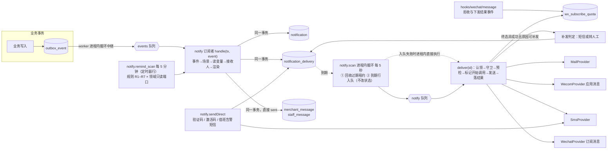
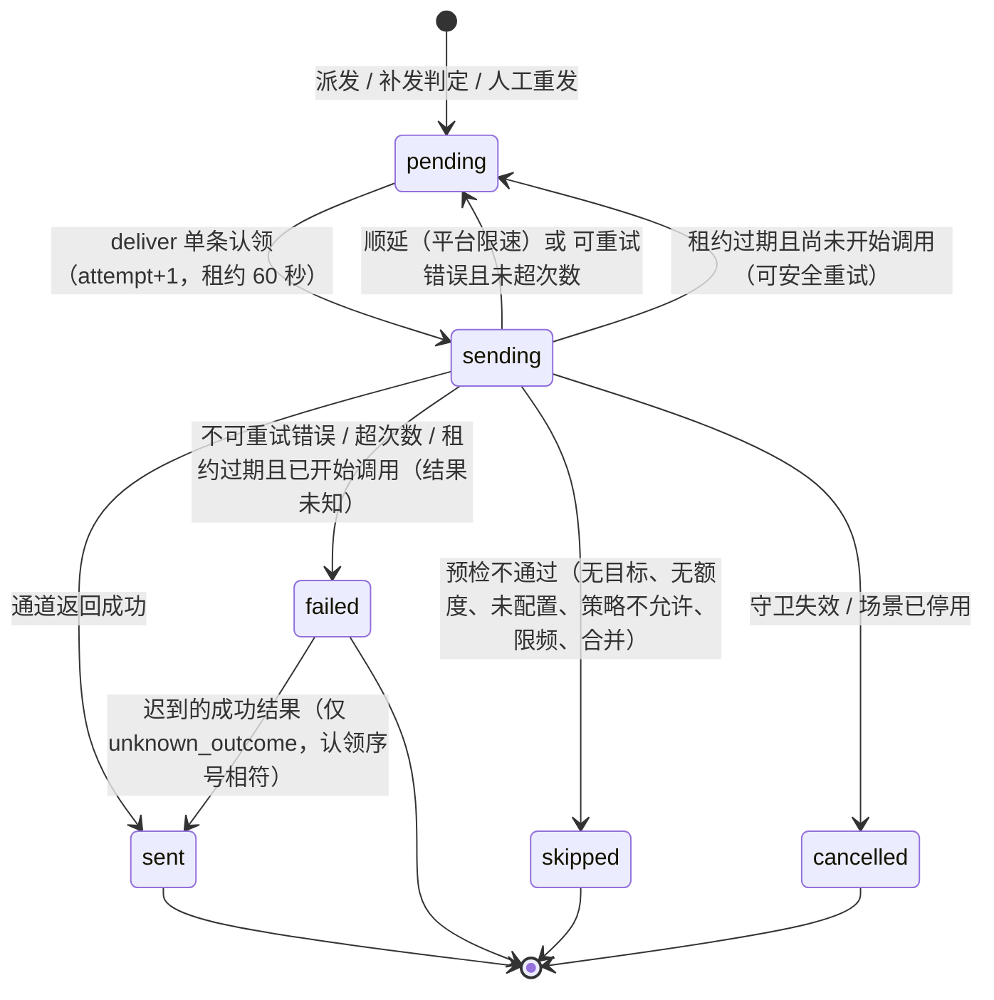
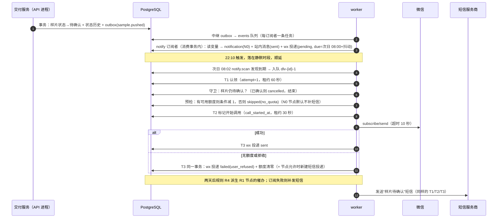
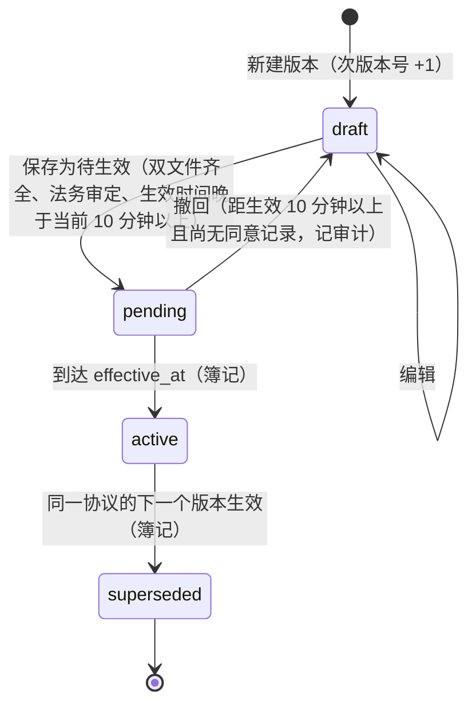
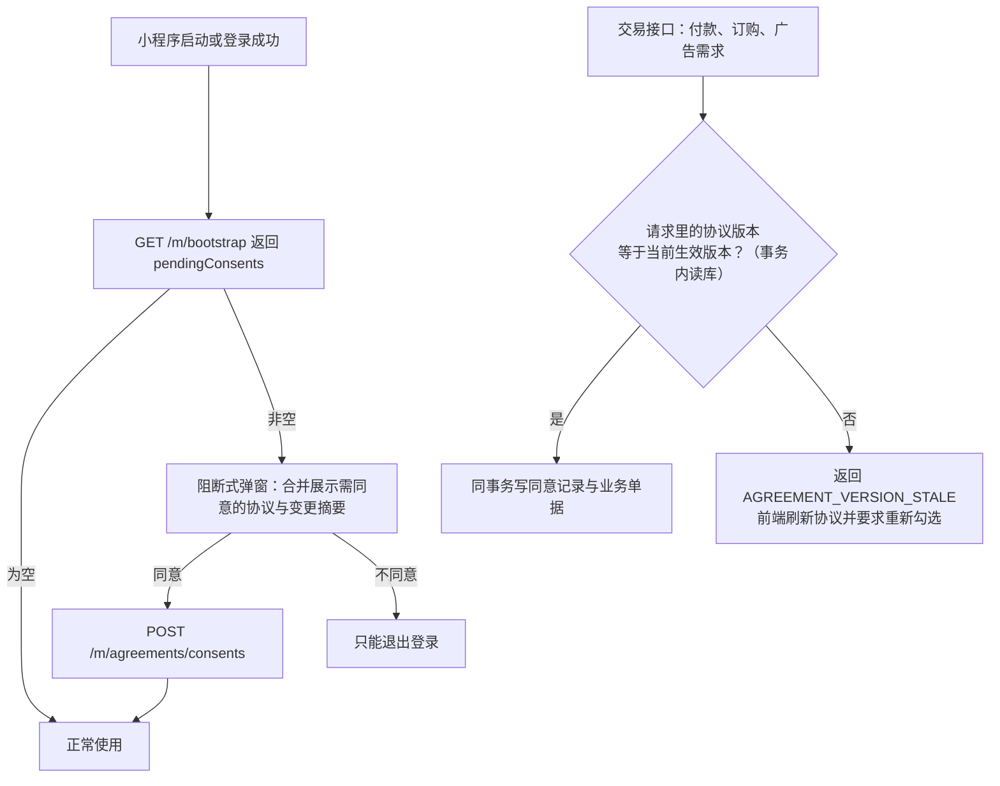
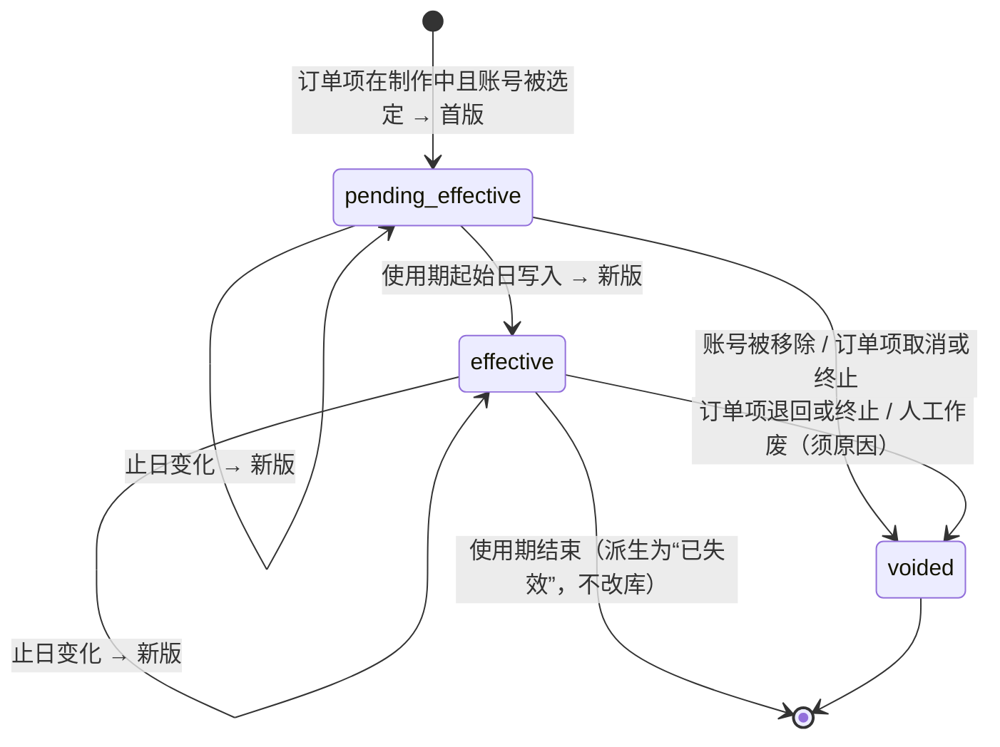
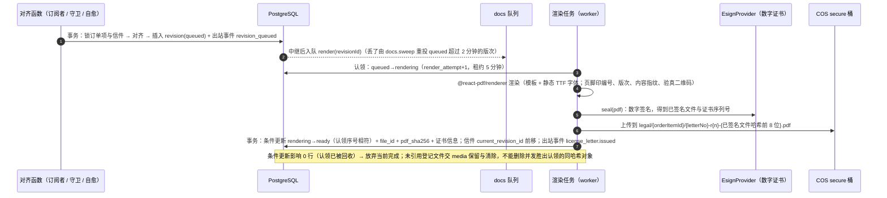
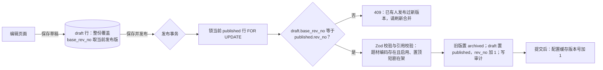
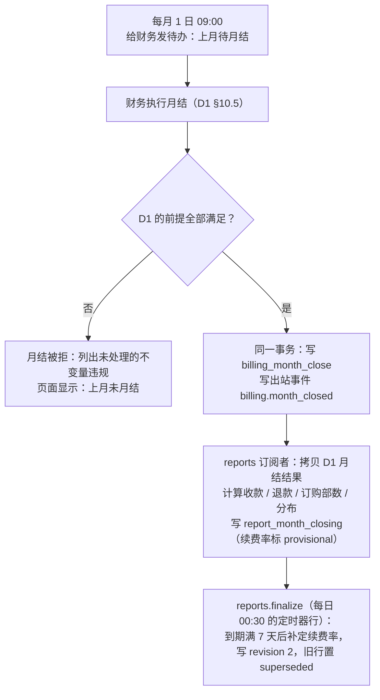
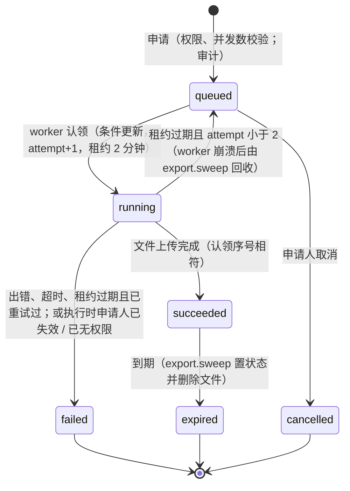

# D6 通知、文书、配置字典参数、报表与埋点 —— 子系统详细设计（修订稿 v2）

> 项目：「狸有戏」V1.0（商家端微信小程序 + 运营管理后台）
> 撰写日期：2026-10-02　状态：修订稿（针对评审结论 needs-revision：blocker 1、major 7、minor 12；逐条处理见附录 C）
> 范围：通知中心（站内 / 订阅消息 / 短信 / 企业微信 / 邮件）、文书（协议版本与同意记录、《定制内容授权书》）、配置（数据字典、参数、首页与商城配置、规则变更公告、特性开关）、数据（埋点、状态变更历史的使用、报表、导出、工作台今日数据）。
> 出处标注：【PRD §x】= `scratchpad/src/PRD.md`；【原型 admin/X】【原型 merchant/X】= `scratchpad/slim/**/X.txt`；【核实 xxx-n】= 任务书“外部结论核实结果”的条目编号；【调研 文件 §n】= `scratchpad/research/*.md`；【D1】–【D7】= 同目录下的同批设计（`d1-ledger`、`d2-payment`、`d3-flow`、`d4-identity`、`d5-media`、`d7-platform`；引用的是 2026-10-02 当日文本，D4、D5 正在同步修订，凡引用其修订稿处标“修订稿”）；【评审 B1 / M3 / m5】= `d6-notify-docs-data.critique.md` 的条目；【参考工程】= `timavia-liyo-project`；【推断】= 本设计的工程判断，需评审确认；【未核实】= 没有一手来源，按不确定处理并给出两手准备。

---

## 0. 一页摘要

1. **通知是一条流水线**：业务事务只写出站事件；worker 把事件翻译成“通知（notification）+ 逐通道投递（delivery）”，站内消息在这一步同事务落库（必达），订阅消息 / 短信 / 企业微信 / 邮件按投递行上的到期时间 `due_at` 发送。投递表本身就是发送日志，也是成功率的唯一数据源。
2. **日期型提醒由通知域按规则派生，不建定时器行**【评审 B1】：样片 / 广告催办、上线提醒、下架提醒、套餐到期提醒、逾期未上线、版权到期共 7 条规则（R1–R7），每 5 分钟用所属领域提供的只读端口取“此刻该提醒的对象”，以“场景 × 对象 × 目标日期 × 节点 × 接收人”的去重键保证只发一次，发送前再跑守卫。改期、续期、延长之后不需要取消或重排任何东西。这与 D3 §21.5 的现行文本一致；原稿的“领域定时器触发 + 每日核对补发”双机制删除。
3. **投递的认领发生在真正要发送的那一刻**【评审 M1】：扫描只负责把到期行入队，不改状态；发送任务单条认领、守卫、预检，发起外部调用前再落一次“已开始调用”标记。租约到期时，没开始调用的退回重发，已开始调用的记为结果未知、不重发。迟到的任务因认领序号不符而放弃，不会重复发送。
4. **不依赖 Redis 里的调度定义**【评审 M2】：投递扫描是 worker 进程内循环；其余周期任务登记为 D3 的定时器行（库里可见、可查上次执行时间）；积压与漏跑由 D7 的 SQL 探针直接告警，告警通道不经过本设计的通知流水线。
5. **订阅消息的额度只当估计值用，并且做了减法**【评审 m11】：一次性订阅“可累加”没有官方出处【核实 msg 额外发现 1】。V1.0 只保留一张额度表与客户端上报；有过授权就尝试发送，微信返回“无额度”即清零并按规则补短信。多节点提醒不做额度预留——到期前 1 天的节点本来就有短信兜底，额度留给更早的节点反而触达更多。
6. **协议同意是证据**：每次交易落一条只追加记录（谁、哪个版本及内容哈希、哪个场景、哪张单据、何时、从哪台设备）；版本到点生效按 `effective_at` 实时解析，重新同意的拦截同样从读路径派生，不依赖 worker 的簿记【评审 m1】。
7. **《定制内容授权书》按“订单项 × 平台账号”一份、逐版留存，生成逻辑是收敛函数**【评审 M3】：任何相关事件到达都执行同一段“读当前真相 → 算应有信件 → 对齐”的逻辑，事件乱序不留下错误的授权书；成片交付的守卫同步调用同一函数。**上线必备档改为“平台用机构数字证书对 PDF 做数字签名”**【评审 M4；核实 misc-1 额外发现】，只贴印章图片降为须法务书面同意的临时降级，并在文件与验真页如实标注。
8. **计费规则变更的“提前 30 天公告”有了实体**【评审 M5】：一张公告记录表 `site_notice`，由 D1 在保存价目修订 / 需公告参数的同一事务里调用本设计的 `notices.announce()` 建立（即 D1 要求关联的“公告记录”），随后给全部主体的老板发站内消息，并在首页公共部分显示公告条。协议版本的预告并入同一机制。
9. **通知文案、深链、授权点位接入购买入口策略**【评审 M6】：D2 的策略切到“线下签约”或“隐藏”后，指向续费、加购的订阅消息与授权点位不发版即可停掉，只留中性的“服务到期提醒”。
10. **配置四件套共用一个缓存机制**（进程内缓存 + Redis 版本号探测，Redis 不可用退化为 60 秒 TTL）：字典、参数、首页 / 商城配置与公告、特性开关。
11. **报表直接查业务库**：当月实时聚合，历史月读月结快照；属于 D1 的积分与订阅数字从 D1 的月结结果原样拷贝，本设计只算收款、退款与跨域比率，收款按渠道成功时间落日（与对账、原型“按支付时间”一致）【评审 m3】。
12. **埋点 26 个事件逐个定了来源**【评审 M7】：端上 7 个、出站事件派生 11 个、用例里直接记录 8 个（登录成功、邀请、加入、素材、加入选剧单、下载成片这类没有出站事件的）。出站事件的 `actor` 统一携带发起人与发起端。
13. **导出只有异步一条路**，每次申请与每次下载都留痕；下载时复核申请人仍在职且仍有权限。

---

## 1. 目标、约束与不做什么

### 1.1 目标

| 编号 | 目标 | 验收口径 |
| --- | --- | --- |
| G1 | 重要事项商家一定“看得到” | 站内消息与业务事件最终一致（事件不丢即消息不丢）；订阅消息发不出时按规则补短信，短信也失败的关键提醒转给服务经理人工跟进；PRD 明文要求的每类提醒都有唯一的触发方（§2.7 的规则表） |
| G2 | 不重复、不打扰 | 同一“场景 × 业务对象 × 节点 × 接收人”只发一次；一店多剧、双平台的同日提醒合并成一条；21:00–08:00 不发非验证码消息；过期的提醒（商家已处理）不再发 |
| G3 | 协议与授权书可举证 | 任一笔付款 / 订购 / 广告需求都能回答“当时同意的是哪一版、原文是什么、谁在何时何地点的同意”；授权书每一版 PDF 不可变、带数字签名、可验真；不存在“订单项已取消却仍有未作废授权书” |
| G4 | 运营改配置不找研发、改错能追溯 | 字典、参数、Banner、商城、模板开关、特性开关全部后台可改，带范围校验、生效时间、变更前后留痕 |
| G5 | 报表数字“对得上、不漂移” | 报表上的积分与订阅数字等于 D1 的对应数字；已月结月份的数字不因事后补单、退款、调整而变化；口径变更有版本 |
| G6 | 小团队维护得动 | 新增一个通知场景 = 注册表加一项 + 模板槽位配置；新增一条提醒规则 = 规则表加一项 + 一个只读端口；新增一个导出 = 注册一个查询函数；不引入新中间件 |
| G7 | Redis 丢数据不丢通知 | 清空 Redis 后：到期投递在 5 秒内被重新入队，周期任务照常触发，积压有告警（D7 §7.3 验证清单第 6 项的口径） |

### 1.2 硬约束（已核实的外部事实 → 对设计的含义）

| 事实 | 出处 | 设计含义 |
| --- | --- | --- |
| 一次性订阅：用户订阅一次只能下发一条；一次调用最多 5 个模板，标题须互不相同；只能由点击或支付回调触发 | 核实 msg-1 | “到期前 7/3/1 天及当天”需要 4 份额度，不可能只靠订阅消息；授权请求必须挂在真实业务按钮上，模板清单要**预取**（点击回调里不能再等网络请求） |
| “商业服务”类目不能申请长期订阅 | 核实 msg-2 | 不存在“一次授权长期可发”的退路，短信是必备通道 |
| “同一模板多次订阅可累加额度”无官方出处 | 核实 msg 额外发现 1 | 额度只做估计值 + 上限参数，按两种假设都能正确运行；不围绕它建复杂机制（§2.9） |
| 不得强制 / 利诱订阅；不得诱导触发操作以获得下发资格；不得下发营销模板 | 运营规范 5.21、12.8（核实 msg 额外发现 3） | 用户拒绝后流程照常继续；不送积分换订阅；续费提醒写成“服务到期提醒”；模板内容必须与模板标题、关键词相符（§2.9.1 的合并规则） |
| 小程序内售卖虚拟商品须走虚拟支付，不得引导到小程序外支付；官方客服已把面向企业的会员判为虚拟支付 | 核实 vpay-1、vpay-3 及额外发现 | 通知文案、深链、授权点位全部接入 D2 的购买入口策略（§2.2.4）；策略切换后不发版即可停掉指向续费、加购的推送 |
| 订阅弹窗结果、用户拒收、下发结果会以事件推到开发者服务器 | 调研 ext-wechat §5.1 | 配置消息推送接收端（`/api/v1/hooks/wechat/message`），用于拒收清零与下发结果回写 |
| 短信签名只支持公司 / 机构 / 商标三类，运营商报备 7–10 个工作日；签名长期不发会失效且不提前告知 | 核实 inf-3 及其额外发现 | 签名与模板是**上线前置项**；“【狸有戏】”只有是公司全称连续子串或已注册商标才能用；需要保活发送与失效探测 |
| 企业微信应用消息：同一成员 30 次/分钟、1000 次/小时，超出丢弃；自建应用须配置企业可信 IP，出口 IP 固定 | 核实 wc-4、wc-5 | 员工通知要限速与合并；worker 出口走固定 IP（NAT 网关） |
| 仅叠加印章图片不构成可靠电子签名；《电子印章管理办法》（国办发〔2025〕33 号）要求电子印章含依法设立的电子认证服务机构签发的证书，对外出具的授权书以“机构数字证书签 PDF”为合规基线；《电子签名法》第十三条末款允许当事人约定可靠条件，但只约束约定的双方 | 核实 misc-1 及其额外发现 | 授权书的出示对象是抖音、视频号（不是约定的当事人），所以**上线必备档是机构数字证书签署**（§3.5.4）；只贴印章图片只作为经法务书面同意的临时降级 |
| 腾讯电子签 API 有版本门槛，企业认证链接需另购实名包；发起即扣份数 | 核实 misc-2 | 双方电子签不是“每份几元”的小事，V1.0 不默认接入；平台单方签署可以用自持证书，也可以用电子签平台的企业自动签，两者都留驱动 |
| @react-pdf/renderer 只支持 TTF / WOFF，不支持 OTF 与可变字体；中文换行有未关闭 issue | 核实 misc-6 额外发现 | 镜像内打包静态 TTF；用 `Font.registerHyphenationCallback` 逐字切分；上线前用真实长文本验证 |
| We分析基础版：业务类上报 5,000 条/日、保存 30 天、最多 10 个分析、无导出 | 核实 misc-5 | 不能作为埋点主存储 |
| npm 上 `xlsx` 0.18.5 有 2 个 high 级 CVE 且无 npm 修复版；`exceljs` 停在 4.4.0（2023-10） | 核实 fe-9 | 前端不引 Excel 库；后端生成，库的选择见 §5.4 |
| Prisma 7 稳定线为 7.10.0，`prisma` 的 latest 标签指向 8.0.0-rc | 核实 ver-4 | 分区表、部分唯一索引、CHECK、触发器需在迁移里手写 SQL，见 §10 |
| 腾讯云 Redis 的官方定位是缓存，只确认了周期性 RDB；BullMQ 6 的调度器定义存在 Redis 里 | 核实 inf-2 及其额外发现、ver-7 | 周期任务不用 BullMQ 的调度器；BullMQ 只做执行通道，丢了可由库重建（§1.5） |
| 小程序切后台 5 秒内未完成的请求被中断；request 并发上限 10 | 核实 file-2 | 埋点上报在 `onHide` 立即发送并把未确认的事件落本地缓存；上报同时只占 1 路并发 |
| 小程序 request / downloadFile 合法域名必须已备案 | 核实 misc-4、msg-7 | 埋点、验真页、文书下载都走已登记的域名（D7 §4.15 的清单已含 `secure` 桶读域名） |

规模假设（来自任务书与原型示例数据）：数百经营主体、订购单千级、后台员工几十人；通知约 10²–10³ 条/日，埋点 10³–10⁵ 条/日，授权书每月数百份，导出每次百到万行。

### 1.3 不做什么

- 不做营销触达：无群发、无用户分群、无 A/B、无优惠券通知（V2.0）。
- 不做模板正文在线编辑：订阅消息与短信模板都要在平台 / 运营商侧审核，后台只管“场景开关、补发开关、模板 ID 绑定、测试发送”【原型 admin/OpsTemplates：页面只有开关与测试发送】。
- 不做服务号模板消息、不做企业微信“客户群发”【调研 ext-wechat §5.3-7】。
- 不做 WebSocket / SSE 实时推送：角标与未读数用进入页面拉取 + 轮询【调研 proto-admin-e §2.5-19】。
- 不做完整的公告管理与常见问题（V1.1，原型 admin/OpsNotice）；V1.0 只做“规则变更公告”这一种系统生成的公告记录、站内消息与首页公告条（§4.3.4），表结构即 V1.1 公告管理的起点。
- 不做双方电子签、数电发票接口对接：`EsignProvider` 只实现“平台单方签署”，`InvoiceProvider` 驱动为 `manual`。
- 不做通用 BI、自助分析、指标平台；不建数仓、不引 ClickHouse / Kafka。
- 不做按比例灰度的实验平台；特性开关只有“规则命中 → 取值”。
- 不做订阅额度的精确台账、不留存逐次弹窗事件、不做服务端点位冷却（§2.9）。
- 不做通用工作流 / 审批引擎；本设计只在需要处调用审计服务。

### 1.4 与其他子系统的边界与接口假设

本设计**使用**以下由同批设计定义的基础设施；命名以对方为准。全仓约定按 D7 §2.4：主键 `bigint generated always as identity`、接口以十进制字符串传输；表名单数 snake_case；枚举用 `text + CHECK`；时间 `timestamptz`。原稿的复数表名已全部改为单数（对照见附录 A）。本文表格里的 `varchar(n)` 表示“业务上的长度上限”，落地为 `text + CHECK (char_length(col) <= n)`。

| 依赖 | 定义方 | 语义 | 本设计怎么用 |
| --- | --- | --- | --- |
| 出站事件 `outbox_event` + 消费登记 `event_consumption` | D3 §20 | 业务事务内写事件；worker 进程内循环中继到 BullMQ；每个订阅者一条独立任务（`jobId = evt-{id}-{subscriber}`，不含冒号）；订阅者在消费事务 `tx` 内执行，消费记录与处理同事务 | 订阅者：`notify`、`docs`、`analytics`、`reports`。订阅者函数一律写成 `handle(tx, event)`，不自开事务、不回滚 |
| 定时器 `timer` 与周期任务登记表 `RECURRING` | D3 §21 | 定时器行到点执行；周期任务也是定时器行，不用 BullMQ 的调度器 | 本设计的周期任务全部登记在 `RECURRING`（§1.5）；日期型提醒**不**建定时器行（§2.7） |
| 状态历史 `state_transition`（D3 §19.1 记作 `state_transitions`）与 `transition()` | D3 §19、§7.5 | 所有状态机的迁移同事务写一条历史 | 漏斗、时长指标的取数（§5.2）。表与函数都归 D3，本设计不建、不定义字段 |
| 工作日历 `work_calendar_day` 与工作日函数 | D3 §22 | 节假日、调休、时限计算与参数快照 | 员工通知的工作时间顺延；R6 的“每个工作日”；参数页的日历导入入口 |
| 审计 `audit_log`、敏感文件读取留痕 | D4；D5 的读地址签发接口 | 与业务写同事务、只追加；每次签发授权书、导出文件的读地址都留痕 | 参数 / 字典 / 配置发布 / 模板开关 / 特性开关 / 协议版本 / 导出申请写审计；文书与导出下载经 D5 的签发接口，由它留痕，本设计不另记一份 |
| 身份 | D4 | 商家账号、微信身份（含 `last_active_at`；手机号与 openid 不是一一对应【核实 msg-6】）、成员关系、`staff`（`wecom_userid`）、数据范围 `DataScope`、权限点注册表 | 接收人解析、额度表的主键、可见范围、导出的数据范围 |
| 积分账本与订阅 | D1 | 每日快照 `billing_entity_daily`、月结 `billing_month_close`（`payload` 为当月各数）、订阅事件、计费参数修订 | 积分报表与经营概览的数据源（§5.3）；R1 的查询端口；规则变更公告的调用方 |
| 付款、退款、发票 | D2 | 付款单 `paid_at` = 入账时间，交易 `channel_success_at` = 微信 `success_time` / 财务确认到账时间；事件 `payment.paid`、`invoice.issued` 等；购买入口策略 `resolvePurchasePolicy` | 收款额口径、付款 / 退款 / 发票通知、通知文案的策略上下文 |
| 订购与交付 | D3 | 订单项（开工、交付、使用期起止、约定上线日）、上线 / 下架任务（粒度“订单项 × 账号”）、渠道账号 | 授权书、通知、漏斗；R2–R6 的查询端口 |
| 文件与媒体 | D5 | 文件登记、四个私有桶、每次现签的短时 URL；`secure` 桶 `legal/`、`export/` 前缀 | 协议正文、授权书 PDF、导出文件、Banner 图 |
| 短剧库 | 内容库（D7 §13 第 14 项：归属待定） | 授权期结束日；按“剧 × 播出平台”的许可信息【核实 pub 额外发现 1】；版权信息里的“授权平台与地域” | 授权书快照；R7 的查询端口 |
| 运行框架 | D7 | worker 数据库租约单活、周期任务运行记录 `job_run`、SQL 探针与告警 `alert_event`、不变量校验框架 `ops_invariant_*` | 周期任务写运行记录；积压探针与不变量检查项登记到 D7 的框架，不自建告警与校验调度 |

本设计**提供**给其他子系统的能力：

| 能力 | 签名（均在调用方事务内，除非注明） | 调用方 |
| --- | --- | --- |
| 通知 | 写出站事件即可；另有 `notify.sendDirect(input)`（不在事务内，验证码 / 激活码 / 值班告警短信） | 全部领域；D4、D7 |
| 协议 | `agreements.currentVersions(keys)`；`agreements.assertConsents(tx, { userId, entityId?, storeId?, code, version, scene, ref?, request }): consentId`（名称与签名按 D3 §2.3，多份协议逐份调用） | D2（付款单）、D3（订购、广告）、D4（登录、加入） |
| 授权书 | `docs.ensureLetters(tx, orderItemId): { ok, missing[] }`（先对齐再判断，成片交付守卫用）；`docs.reconcileLetters(tx, orderItemId, trigger)` | D3 §11.3 |
| 公告 | `notices.announce(tx, { kind, ref, title, summary, effectiveAt, link }): noticeId`；`notices.withdraw(tx, { kind, ref })` | D1 §6.9；本设计的协议版本 |
| 配置 | `params.get() / snapshot()`、`dicts.assertEnabled() / label()`、`flags.evaluate()` | 全部领域 |
| 埋点 | `track.record(tx \| null, { name, props, eventId?, subject? })` | 没有出站事件的写用例与读路径（§5.1.1） |
| 导出 | `exports.register({ key, permission, columns, query, … })` | 各列表页所属领域 |

本设计**要求**其他子系统提供的端口（由上层模块在装配时注册，D7 §2.3 规则 3）：提醒规则的查询端口与守卫（§2.7 的规则表，D1 / D3 / 内容库）；通知渲染所需的只读解析函数（§2.2.3，事件负载只带 ID，变量回库读取）；授权书的事实端口 `delivery.getLicenseFacts`（§3.5.2，D3）与 `content.getLicenseScope`（内容库）；出站事件 `actor` 的统一字段（§5.1.2，D3）；付款单上的发起人与发起端快照（§5.1.1，D2）。

### 1.5 模块划分与代码落点

```
packages/contract/src/
  notify/      scene keys、DeepLink 联合类型、订阅授权点位常量、消息与模板管理的 schema
  docs/        协议、同意、授权书 schema
  config/      DictTypeKey + 各类型 ext schema、参数读写 schema、站点配置与公告 schema、flags 登记表
  analytics/   26 个事件的判别联合（每个事件一份 props schema）
  reports/     报表响应 schema、导出任务 schema
packages/shared/src/
  time/        deferToWindow()（纯函数；工作日计算用 D3 的 workcal）
  notify/      toWeappPath(link)、订阅消息字段截断规则
  params/defs.ts   全部参数的定义（类型、单位、默认值、范围、交叉校验）
packages/services/src/
  kernel/track/   track.record()（L0：只有一个插入函数，供任何层在事务里调用）
  config/      dicts.ts、params.ts、site-config.ts、banners.ts、notices.ts、flags.ts、cache.ts          （L0）
  notify/      registry.ts（场景注册表）、rules.ts（提醒规则表）、dispatch.ts、deliver/{inbox,wx,sms,wecom,mail}.ts、direct.ts、quota.ts、policy.ts   （L1）
  docs/        agreements.ts、consents.ts、license-letter/{reconcile.ts, templates/v1.tsx, render.ts, sign.ts}   （L1）
  analytics/   ingest.ts、from-outbox.ts          （L4）
  reports/     overview.ts、points.ts、closing.ts、dashboard.ts   （L4）
  exports/     registry.ts、runner.ts            （L4）
  providers/   wechat、sms、wecom、mail、esign（platform_cert | esign_seal | stamp）、storage
apps/worker/   进程内循环：notify.scan；队列消费者：events（订阅者）、notify、docs、export；周期任务处理器（见下表）
apps/api/      /api/v1/m/*、/api/v1/admin/*、/api/v1/hooks/wechat/message、/api/v1/hooks/sms/status/{token}、/v/{code}（授权书验真页，由 gateway 从 portal 域名反代，D7 §13 第 13 项）
```

层次按 D7 §2.3。`track` 放在 L0 是本次修订新增的要求：登录、邀请、素材、选剧单这些 L1 / L3 的用例要在自己的事务里记埋点，而 `analytics` 在 L4，不能被下层调用（§10 第 6 点）。

BullMQ 队列（登记在 D7 §2.5 的队列表）：`notify`（并发 4；按通道限速）、`docs`（并发 2；PDF 渲染吃内存）、`export`（并发 1）。队列只是执行通道：任务一律 `attempts: 1`，重试、到期、租约都由数据库行驱动。D7 队列表里登记在本设计名下的 `maintenance` 队列不再需要：周期任务是 D3 的定时器行，经 D3 的 `timers` 队列执行。

**周期任务**【评审 M2】不使用 BullMQ 的 `upsertJobScheduler`，分两种：

| 任务 | 机制 | 频率 | 说明 |
| --- | --- | --- | --- |
| `notify.scan` | worker 主实例的**进程内循环**（与 D3 的出站中继、定时器扫描同类；Redis 不可用时循环照跑） | 每 5 秒 | 租约回收 + 到期投递入队；入队失败则在进程内直接执行（§2.5） |
| `notify.remind_scan` | D3 `RECURRING` 的定时器行 | 每 5 分钟 | 提醒规则 R1–R7 的派生（§2.7） |
| `docs.sweep` | 同上 | 每 5 分钟 | 重投停在 `queued` / 租约过期的授权书版次；协议版本的簿记翻转 |
| `export.sweep` | 同上 | 每 5 分钟 | 回收租约过期的导出任务；到期置 `expired` 并删除明文导出文件 |
| `notify.sms_keepalive`、`notify.sms_balance` | 同上 | 每日 10:20 | 短信签名保活与余量检查（§2.10） |
| `evidence.consent_digest` | 同上 | 每日 00:40 | 同意记录日摘要（§3.3） |
| `analytics.partitions`、`analytics.dedup_purge` | 同上 | 每月 20 日；每日 04:10 | 预建分区；清理去重表 |
| `reports.finalize` | 同上 | 每日 00:30 | 续费率到期满 7 天后的定稿（§5.3.4） |
| `reports.verify` | 同上 | 每周一 05:00 | 已月结月份的收款 / 退款重算比对 |

“每 5 分钟及更稀”的任务每次执行写一条 D7 的 `job_run`，并登记进 D7 的“应有任务表”（到期限没有成功记录即告警，D7 §9.4 第 12 条）。`notify.scan` 不写运行记录，由探针直接量表里的滞后（§7.5）。不变量检查项登记到 D7 §9.6 的框架，由它调度。

D7 §7.6 的文本里 worker 成为主实例时有一步“登记 Job Scheduler”，与 D3 §21.4“周期任务也是定时器行，不用 BullMQ 的调度器”不一致；本设计按 D3 实现，这一处请架构师在合并时统一（§13 第 21 项）。

### 1.6 与同批设计的重叠点：归属与差异

本表按 2026-10-02 当日各设计的文本逐条核对过；评审意见里有几处引用的是对方更早的文本，已在“核对结果”一栏注明。标 ⚠ 的仍需架构师裁决。

| # | 重叠点 | 对方文本（核对结果） | 本文的处理 |
| --- | --- | --- | --- |
| 1 | 日期型提醒由谁触发【评审 B1】 | D3 §2.4、§21.5：纯提醒（T5、T13–T16、T18、T20）“交给通知域按规则派生”，D3 只提供查询端口与发送前守卫，并已命名 `publish.listOverdueLaunchItems(date)`；D1 §6.11 另有每日 10:00 任务 + `renewal_reminder_log` 发 `billing.renewal_reminder_due` | 通知域规则派生是唯一主路径（§2.7 的 R1–R7）。R1 建议 D1 改为提供端口、删除每日任务与日志表；D1 若暂时保留，其事件命中同一去重键，不会重复 |
| 2 | 周期任务机制【评审 M2】 | D3 §21.4：`RECURRING` 定时器行；D7 §9.3：`job_run` 与“应有任务表”；D7 §7.6 提到“登记 Job Scheduler” ⚠ | 按 D3；运行记录按 D7（§1.5） |
| 3 | 状态历史表【评审 m10】 | D3 §19.1 给出了完整字段（`state_transitions`），又写“表名与基础字段以 d6 为准”；原稿写“由 D3 定义” | 归 D3（`flow` 模块，D7 §2.3 的 L0），字段以 D3 §19.1 为准，表名按单数约定为 `state_transition`。本设计只提一项补充：增加 `biz_date date`（北京时间日期，报表按它分组） |
| 4 | 协议同意记录 ⚠ | D3 §2.3：`agreements.assertConsents(tx, {…, ref}): consentId`，订购单存 `agreement_consent_id`；D4 原稿与修订稿都保留 `user_consent`（唯一键“用户 × 协议 × 版本”）；D7 §2.3 把“协议、同意记录、授权书”都放在 `docs` 模块 | 接口名与签名按 D3；表只保留本文的 `agreement_consent`（按单据一条，登录类每版本一条），D4 的登录与加入流程调用同一接口（§3.3）。若架构师决定两表并存，须明确交易类同意的举证以本表为准 |
| 5 | 特性开关 | D7 §3.2（现行文本）：开关的存储与求值在 D6（`feature_flag` 表），D7 只登记前端消费的键并给出统一键名；购买入口不走通用开关，端上只认 D2 报价接口返回的策略 | 表归本文（§4.4），键名用 D7 §3.2 的统一键名；购买策略的规则表是 D2 的 `sys_config.billing.purchase_policy`，本文的参数服务只是它的存储落点。评审 m11 所说“D7 另有 `client_flag`”在现行文本里不存在 |
| 6 | 埋点表与上报接口 | D7 §4.12（现行文本）：事件归属、批量接口与表在 D6；路径 `POST /m/events/batch` | 表与接口归本文（§5.1）。评审 m10 所列 `/m/analytics/batch` 在现行文本里不存在 |
| 7 | 导出任务 | D7 §5.6、§13 第 7 项（现行文本）：表、状态机、登记表、脱敏与留痕规则在 D6，D7 只定义前端构件；D4 修订稿 §2.3 第 12 项：按发起人**执行时**的范围与权限重查 | 表归本文（§5.4）；数据范围按 D4 修订稿改为执行时重查 |
| 8 | 启动引导接口 | D7 §3.2：`GET /api/v1/m/bootstrap` 可匿名，含 `subscribePlan` | 以 D7 为准。本次修订把 `subscribePlan` 改成“每个点位一份固定清单”，不再按用户额度排序、不做服务端冷却（冷却放端上），因此可以进匿名可缓存的响应；D7 §4.8 第 1 条的“服务端已排好序、去掉冷却中的槽位”相应改为“端上过滤冷却中的槽位”（§2.9.3） |
| 9 | 订阅结果上报路径 | D7 §4.8：`POST /m/notify/subscribe-results` | 一致 |
| 10 | 小程序下载域名 | D7 §4.15（现行文本）：downloadFile 清单已含“`secure` 桶的读域名：授权书、发票 PDF” | 一致；评审 m10 的这一条按现行文本已不成立 |
| 11 | 文件键 | D5 §3：`secure` 桶 `legal/{orderItemId 或 agreementId}/`；导出 `export/`（7 天生命周期） | 按 D5 的前缀（§3.6、§5.4） |
| 12 | 发票邮件 ⚠ | D2 §11.2 第 4 点：D2 用 `mail` Provider 发送并维护 `email_state`；§9.3：`invoice.issued` → 消息 + 邮件 | 邮件只经通知中心的 `mail` 通道发一次，D2 不直接调用 Provider，`email_state` 由通知中心的结果事件回写（§2.12）。须 D2 改文，否则会发两封 |
| 13 | 计费类参数与规则变更公告【评审 M5】 | D1 §4.1、§6.9：计费参数整页一版；“需提前公告”的改动要求关联一条公告记录，只发 `billing.plan_revision_scheduled` | 计费参数不进本文的参数服务；公告记录由本文的 `notices.announce(tx, …)` 在 D1 的事务里同步建立（§4.3.4） |
| 14 | 后台登录第二因子与员工短信 | D4：TOTP；激活码短信“经 outbox，消费者按 `activation_id` 去重”；换手机号向原号码发通知短信 | 员工与验证码短信走 `notify.sendDirect`（§2.10）；D4 的出站事件消费者调用它并传去重键 |
| 15 | 授权书的触发与守卫【评审 M3】 | D3 §6.4 给出事件与动作表；§11.3 以“每个发布账号有一份未作废授权书”作为成片交付守卫 | 事件只作“请重新对齐”的信号，动作由收敛函数决定；守卫改为同步调用 `docs.ensureLetters`（§3.5.2），授权书事件消费失败不再挡住交付 |
| 16 | 工作台 | D3 §23：待办、预警、角标、动态 | 本文只负责“今日数据”卡片（§5.3.5） |
| 17 | 告警与不变量 | D7 §9.3、§9.6：探针规则或 `ops.alerts.raise()`；`s.system_alert` 只是后台铃铛通道 | 本文所有“告警”都落到 D7 的机制；`s.system_alert` 不承担告警的送达责任 |
| 18 | 主键类型 ⚠ | D7 §2.4：`bigint identity`；D4 修订稿 §2.3 第 1 项称“D7 §2.4 的全仓约定”是 UUID v7（与 D7 现行文本相反）；D1 为 uuid | 本文按 D7 现行文本写 `bigint`；引用 D1 对象的列用 `text` 存。任何约束与算法都不依赖主键类型 |


---

## 2. 通知中心

### 2.1 总体模型



三个对象：

- **场景（scene）**：代码里的注册表项，定义“哪个事件或规则触发、发给谁、站内分类、文案变量、深链、各通道怎么发”；库里只存可切换的开关（`notify_scene`）。
- **通知（notification）**：一次“场景 × 业务对象 × 节点 × 接收人”，带去重键。
- **投递（delivery）**：通知在某个通道上的一次发送，带 `due_at`、状态、结果码。它同时是“到点要做的那件事”“发送日志”“成功率数据源”。验证码这类不属于任何通知的短信是“直发投递”（§2.10），只共用这张表的限频、日志与对账。

### 2.2 场景注册表

#### 2.2.1 面向商家：原型的 17 个订阅消息场景【原型 admin/OpsTemplates】

事件名以 D1 §11.3、D2 §9.3、D3 §20.4 的目录为准；“规则 Rn”指 §2.7 的提醒规则。

| scene_key | 场景 | 触发 | 接收人 | 站内分类 | 发送时段 | 短信策略（默认） | 深链 route |
| --- | --- | --- | --- | --- | --- | --- | --- |
| `m.pay_success` | 付款成功 | `payment.paid`（对公为财务确认） | 老板 | 套餐与积分 | 立即 | 不发 | `payment.result` |
| `m.order_submitted` | 订购成功 | `order.submitted` | 老板 | 订单 | 立即 | 不发 | `order.detail` |
| `m.plan_pending` | 方案待确认 | `plan.pushed` | 老板 | 交付 | 时段 | 不发 | `delivery.plan` |
| `m.ad_pending` | 广告待确认 | `ad.version_pushed`（节点 N0）；规则 R5（节点 R1） | 老板 | 交付 | 时段 | 仅 R1 补发 | `ad.detail` |
| `m.sample_pending` | 样片待确认 | `sample.pushed`（N0）；规则 R4（R1） | 老板 | 交付 | 时段 | 仅 R1 补发 | `delivery.sample` |
| `m.delivered` | 成片已交付 | `package.delivered` | 老板 | 交付 | 时段 | 补发（PRD 口径，§9 冲突 1） | `publish.task` |
| `m.launch_remind` | 上线提醒 | 规则 R2（上线日前 1 天、当天） | 老板 | 上线 | 定时 | 补发 | `publish.task` |
| `m.verify_result` | 核验结果 | `launch.verified` / `launch.returned` | 老板 | 上线 | 时段 | 仅“需补充”补发 | `publish.task` |
| `m.plan_expiring` | 套餐到期提醒 | 规则 R1（7/3/1 天及当天） | 老板 | 套餐与积分 | 定时 | 仅 T-1 补发 | `wallet.home` |
| `m.offline_remind` | 下架提醒 | `takedown.created`；规则 R3（30/7/1 天及当天） | 老板 | 上线 | 定时 | 仅 T-1 补发 | `offline.task` |
| `m.ticket_reply` | 工单回复 | `service_ticket.replied` / `.result_submitted` | 提交工单的用户 | 客服 | 立即 | 不发 | `ticket.detail` |
| `m.invoice_issued` | 发票已开具 | `invoice.issued` | 老板 | 订单 | 时段 | 不发（另发邮件，§2.12） | `invoice.detail` |
| `m.points_changed` | 积分变动 | `billing.points.granted` / `.purchased` / `.returned` / `.adjusted` | 老板 | 套餐与积分 | 时段 | 不发 | `points.ledger` |
| `m.review_result` | 资质审核结果 | `store.qualification.approved` / `.rejected`（含新增门店） | 老板 | 审核 | 立即 | 补发 | `profile.review` |
| `m.member_changed` | 成员变动 | 成员加入、被移除、调整门店的出站事件（D4 的事务已写出站事件，事件名由 D4 定稿） | 老板及相关店员 | 门店 | 立即 | 不发 | `store.members` |
| `m.asset_feedback` | 素材反馈 | 素材被采用、复核为“需补拍 / 需肖像授权”、素材需求发起的出站事件（D5） | 上传人或门店成员 | 门店 | 时段 | 不发 | `asset.detail` |
| `m.refund_result` | 退款结果 | `refund.done` / `refund.rejected`（D2） | 老板 | 套餐与积分 | 立即 | 不发 | `payment.detail` |

原型的短信补发文案“样片已上传 2 天，请进入小程序确认”只适合催办节点【评审 m7】，所以样片、广告的短信默认只在 R1 节点补发；报备的短信模板正文改成与节点无关的写法（§2.10），运营若要让首发也补短信，只需改 `sms_nodes`。

另有只发站内（必要时复用某个订阅槽位）的场景，同样进注册表：积分已扣减（`billing.points.captured`）、本期套餐积分已发放与上期清零（`billing.points.granted` 的月度发放、`billing.points.expired`）、套餐已开通 / 续费成功 / 有效期延长（`billing.subscription.*`）、新增门店已提交审核、渠道账号核验结果（`account.verified` / `.abnormal`）、对公收款驳回（`transfer.rejected`）、代改档案通知、巡检异常（`patrol.abnormal`）、人工催办（D3 §12.6 的 `reminder_log` 写入后发出的事件）、发票驳回（`invoice.rejected`）、授权书已更新（`license_letter.issued`）、**规则变更公告 `m.rule_change_notice`（`site_notice.announced`，§4.3.4）**【原型 merchant/Messages；调研 prd-tech §5.1】。新增场景不需要改表结构。

站内分类共 8 个：`order` 订单、`delivery` 交付、`launch` 上线、`plan_points` 套餐与积分、`review` 审核、`store` 门店、`service` 客服、`system` 公告（V1.1 才有页签；V1.0 的规则变更公告归 `plan_points`）【PRD §6.13】。

#### 2.2.2 面向员工（企业微信应用消息 + 后台铃铛）

PRD 只写“后台 / 企微”【调研 prd-tech §5.2】，本设计给出默认清单：

| scene_key | 触发 | 接收人 | 企微 | 后台铃铛 |
| --- | --- | --- | --- | --- |
| `s.work_ticket_assigned` | `ticket.assigned`、`assignment.transferred` | 交付经理 | ✔ | ✔ |
| `s.step_overdue` | `ticket.sla_breached`（交付各步时限，D3 的定时器行） | 当前负责人 | ✔ | ✔ |
| `s.kf_assigned` | `service_ticket.created` / `.transferred` | 客服 / 服务经理 | ✔ | ✔ |
| `s.kf_response_overdue` | `service_ticket.escalated`（首次响应超时） | 负责人 + 客服主管 | ✔ | ✔ |
| `s.complaint_created` | “投诉建议”类工单创建 | 客服主管 | ✔ | ✔ |
| `s.launch_overdue` | 规则 R6：约定上线日次日起每个工作日 09:00 | 交付经理 | ✔（按人按日一条） | ✔ |
| `s.offline_overdue` | `takedown.escalated` | 交付经理 → 主管 | ✔ | ✔ |
| `s.copyright_expiring` | 规则 R7：授权期结束前 N 天 | 内容运营 | ✔（按人按日一条） | ✔ |
| `s.approval_pending` / `s.approval_decided` | `approval.submitted` / `.approved` / `.rejected` | 审批人 / 申请人 | ✔ | ✔ |
| `s.receipt_pending` | `transfer.proof_submitted` | 财务 | ✔ | ✔ |
| `s.merchant_unreached` | 关键提醒订阅与短信均未送达（§2.5 补发判定） | 该商家的交付经理 | ✔ | ✔ |
| `s.export_ready` | 导出完成 | 申请人 | — | ✔ |
| `s.system_alert` | D7 的告警事件在送达值班人的同时，复制一条到后台铃铛（D7 §9.3） | 超级管理员 | — | ✔ |

`s.system_alert` 只是铃铛里的一份副本：告警的送达走 D7 的企业微信群机器人与值班短信，不经过本设计的投递流水线，所以“通知流水线停了”这件事本身能被告出来【评审 M2】。

#### 2.2.3 注册表的代码形态

出站事件的负载只带 ID 与必要快照，订阅者回库读当前状态（D3 §20.1、§20.3）。所以场景不直接从事件负载取文案变量，而是经**只读解析函数**读取——这些函数由拥有数据的领域在装配时注册（`ctx.read.*`），通知模块不反向 import 上层【评审 m10】。

```ts
// packages/services/src/notify/registry.ts
type Trigger =
  | { kind: 'event'; event: OutboxEvent }
  | { kind: 'rule'; ruleKey: string; node: string; group: RuleGroup }     // §2.7
  | { kind: 'manual'; sceneKey: string; ref: unknown; operatorId: string }; // 人工催办、测试发送

defineScene({
  key: 'm.sample_pending',
  audience: 'merchant',
  category: 'delivery',
  ownerOnly: true,                                    // 站内消息只有当前老板可读（§2.8）
  on: ['sample.pushed'],                              // 催办节点由规则 R4 触发，不订阅事件
  node: (t) => (t.kind === 'rule' ? t.node : 'N0'),   // 每个场景必须给出节点：首发 N0、催办 R1、日期型 T-n
  load: (t, ctx) => ctx.read.sampleForNotify(refOf(t)),            // 回库读：剧名、集号、订单项、门店、主体
  recipients: (v, ctx) => ctx.ownersOf(v.entityId),               // 返回 userId[]；店员场景用 membersOf(storeId, …)
  dedupe: (v, node, r) => `sample:${v.sampleId}:v${v.version}:${node}:${r.userId}`,   // 签名里 node 是必填参数
  vars: z.object({ sampleId: z.string(), version: z.number(), dramaName: z.string(), episode: z.number(),
                   orderItemId: z.string(), storeId: z.string(), entityId: z.string() }),
  inbox: (v, node, c) => ({ title: '样片待确认',
           body: `《${v.dramaName}》第 ${v.episode} 集样片${node === 'R1' ? '等待您确认已超过 2 天' : '已送达'}，确认后开始批量合成全部剧集。`,
           cta: '去确认样片' }),
  link: (v) => ({ route: 'delivery.sample', params: { orderItemId: v.orderItemId, storeId: v.storeId } }),
  wx:  (v) => ({ thing1: `《${v.dramaName}》第${v.episode}集样片`, phrase2: '待确认', thing3: '确认后开始批量合成全部剧集' }),
  sms: (v) => [v.dramaName],
  revalidate: async (n, ctx) => ({ valid: await ctx.read.isSamplePending(n.vars.sampleId, n.vars.version) }),  // 发送前守卫
});
```

- `revalidate` 返回 `{ valid: false }` 时投递取消；聚合类场景（上线、下架提醒）还可以返回 `{ valid: true, vars }` 用当前真相重渲外部通道的文案（§2.7）。
- 渲染函数的第三个参数 `c` 是策略上下文：`{ purchaseMode, copy }`（§2.2.4）。
- 启动时自检：注册表里的每个 `key` 在 `notify_scene` 必须有行（由迁移播种）；`wx()` 返回的字段名必须与槽位登记的字段一致（否则 47003，“发一条挂一条”【调研 ref-arch §6.2-14】）。不一致时预发环境启动失败；生产环境调用 `ops.alerts.raise()` 并把该场景的订阅通道当作未配置。
- 契约测试（CI）：任取两个不同节点，`dedupe()` 的结果必须不同；任取两个不同接收人亦然【评审 m5：原稿示例的键里没有节点，催办会被首发吞掉】。

#### 2.2.4 购买入口策略对通知的影响【评审 M6】

D2 的 `resolvePurchasePolicy` 按“平台 × 版本 × 主体 × 类型 × 金额”给出 `mode`（`in_app` / `offline_contract` / `hidden`）与文案集（D2 §10.3）。通知是异步发给“人”的，不知道对方会在哪台设备上打开，所以通知侧取**该主体在各平台上最严的一档**：

```ts
// packages/services/src/notify/policy.ts
notifyPurchaseMode(entityId): 'in_app' | 'offline_contract' | 'hidden'
  = strictest( resolvePurchasePolicy({ platform: p, entityId, kind: 'plan', … }).mode  for p in ['ios','android','harmony','windows','mac'] )
  // 严格程度：hidden > offline_contract > in_app；规则表存在参数服务里，结果随 param 命名空间的配置缓存失效
```

派发时把模式写进 `notification.copy_mode`（站内消息的文案在派发时定格）；发送外部通道前再取一次当前模式（策略可能在顺延期间被切换）。各场景的表现写成一张表，同时就是契约测试的用例：

| 场景 / 点位 | `in_app` | `offline_contract` | `hidden` |
| --- | --- | --- | --- |
| `m.plan_expiring` 站内 | “套餐将于 X 到期，N 积分届时清零”；按钮“查看套餐”→ `wallet.home` | 标题“服务到期提醒”，正文不出现“续费”“购买”，按钮“查看详情”→ `wallet.home`（该页此时只展示状态） | 同左 |
| `m.plan_expiring` 订阅消息 | 发；提示语“已上线的短剧不受影响” | 发；同一提示语 | **不发**（派发时不建订阅投递；已建未发的记 `skipped: policy_suppressed`） |
| `m.plan_expiring` 短信（T-1） | 发 | 发 | 发（短信在小程序之外，文案本身不含购买引导；可用场景开关关闭） |
| `m.pay_success` | 站内 + 订阅“付款成功 ¥…”，深链付款结果页 | 站内改为“服务已开通 / 已续期”（不含金额，深链 `wallet.home`）；订阅消息不发 | 同左 |
| `m.points_changed` | 站内 + 订阅 | 站内 + 订阅，名词用策略下发的 `pointsNounKey` | 仅站内；“加购到账”子类型不含金额 |
| `m.rule_change_notice` | 站内 + 首页公告条 | 站内 + 公告条，正文不含价格数字（`showPrice=false`） | 仅站内 |
| `m.refund_result`、`m.invoice_issued` | 照常 | 照常（售后与票据，不是购买引导） | 照常 |
| 授权点位 `pay_success`、`renew_enter` | 下发 | 不下发（按钮不存在） | 不下发 |
| 授权点位里的到期、积分类槽位 | 请求 | 请求 | 不请求 |

规则落在场景定义里：`policy: { wx: ['in_app','offline_contract'], sms: 'any', … }` 声明各通道在哪些模式下可发；渲染函数用 `c.purchaseMode` 与 `c.copy`（D2 下发的名词键：套餐、积分的称呼）选文案。不论哪种模式，文案都不出现“联系我们购买”“联系服务经理续约”这类引导（D2 §10.3 的同一条约束）；线下续约的沟通由服务经理在小程序之外发起，后台的“套餐即将到期”待办与续费跟进队列（D3 §23、§21.5 的 T6）已覆盖员工侧。

订阅模板在公共模板库选型时，标题与关键词取“服务进度 / 到期提醒 / 额度变动”一类中性措辞，不取“会员”“充值”类措辞；槽位键也用中性名（`svc_expiry`、`quota_change`）。

### 2.3 核心表

通用约定见 §1.4。所有表有 `created_at`。

**`notify_scene`**（场景开关，后台可改）

| 字段 | 类型 | 约束 | 说明 |
| --- | --- | --- | --- |
| scene_key | varchar(48) | PK | 与注册表一致 |
| audience | varchar(8) | `merchant` / `staff` | 冗余自注册表，便于筛选 |
| name | varchar(32) | not null | 后台显示名 |
| ext_enabled | boolean | default true | **原型的开关**：停用后不再发订阅消息、短信、企微、邮件，**站内消息照发**【评审 m4】 |
| scene_enabled | boolean | default true | 场景总开关：停用后站内也不发。仅超级管理员可改，须填原因并写审计；用于“这个场景本身有错”的极端情况 |
| wx_slot_key | varchar(32) | null，FK → `wx_template_slot` | 订阅消息槽位；null = 不发订阅消息 |
| sms_policy | varchar(8) | `never` / `fallback` / `always` | 原型的“补发短信”开关 = `fallback` ⇄ `never` |
| sms_template_key | varchar(32) | null，FK → `sms_template` | |
| sms_nodes | jsonb | null | 仅这些节点允许短信，如 `["T-1"]`、`["R1"]`；null = 全部节点 |
| send_window | varchar(10) | `immediate` / `window` / `scheduled` | 原型的“立即发送 / 08:00～21:00 / 定时发送” |
| escalate_to_manager | boolean | default false | 订阅与短信均未送达时转 `s.merchant_unreached` |
| collapse_window_sec | int | default 0 | >0 时同一接收人同一场景在窗口内的外部通道合并（只保留第一条，站内照发） |
| rev | int | default 1 | 乐观锁 |
| updated_by / updated_at | bigint / timestamptz | | |

**`wx_template_slot`**（订阅消息模板槽位；每个环境各自配置）

| 字段 | 类型 | 约束 | 说明 |
| --- | --- | --- | --- |
| slot_key | varchar(32) | PK | 如 `service_progress` |
| title | varchar(32) | not null | 模板标题（同一次授权调用里标题不能重复【核实 msg-1】） |
| provider_template_id | varchar(64) | null | 为空 = 未配置，全链路 no-op（Provider 原则“未配置不崩溃”） |
| fields | jsonb | not null | `[{name:"thing1", type:"thing", label:"剧目"}]`，与微信后台逐字一致 |
| status | varchar(12) | `active` / `unconfigured` / `disabled` | |
| fail_streak | int | default 0 | 字段类错误（47003）的连续失败通知数；任一次成功清零 |
| disabled_reason | varchar(32) | null | `template_invalid` / `field_mismatch_streak` / `manual` |

自动停用只有两种情况【评审 m4】：微信返回“模板 ID 不正确或已删除”一类错误（整个模板不可用），立即置 `disabled`；字段类错误 47003 往往只是某一条数据的值不合法，只累计 `fail_streak`，连续 `notify.wx.field_fail_streak`（默认 5）条**不同通知**失败才停用。两种情况都调用 `ops.alerts.raise()`（D7 §9.4 第 15 条）。具体错误码以官方下发接口文档为准，开发时逐条核对（本次核实清单未覆盖错误码表）。

**`sms_template`**

| 字段 | 类型 | 约束 | 说明 |
| --- | --- | --- | --- |
| template_key | varchar(32) | PK | 见 §2.10 的清单 |
| kind | varchar(8) | `verify` / `notice` | `verify` 不受发送时段限制 |
| provider_template_id | varchar(32) | null | |
| sign_name | varchar(16) | | 签名（按环境配置） |
| params | jsonb | | 有序变量定义 `[{name, maxLen}]` |
| status | varchar(16) | `active` / `pending_carrier` / `unconfigured` / `suspect` / `disabled` | `suspect`：近 N 次全部失败，疑似签名失效 |
| last_ok_at | timestamptz | null | 保活与失效探测用 |

**`notification`**

| 字段 | 类型 | 约束 | 说明 |
| --- | --- | --- | --- |
| id | bigint | PK | |
| scene_key | varchar(48) | FK | |
| dedupe_key | varchar(160) | **UNIQUE** | `{场景业务键}:{节点}:{接收人}`；重复事件、规则重扫都靠它幂等 |
| source_event_id | bigint | null | 出站事件 id；规则派生、人工、测试发送的为 null |
| source_rule | varchar(24) | null | 规则键（`R2.launch` 等） |
| biz_type / biz_id | varchar(32) / varchar(40) | | 便于按单据查通知 |
| node | varchar(16) | not null，default `N0` | `N0` 首发、`R1` 催办、`T-7` / `T-1` / `T-0` 日期型节点、`M` 人工 |
| user_id / staff_id | bigint | CHECK 恰有一个非空 | 两套身份空间分列 |
| entity_id / store_id | bigint | null | 可见范围 |
| vars | jsonb | | `load()` 读出的渲染变量；不放手机号、证照号；验证码不经过本表 |
| copy_mode | varchar(16) | | 派发时的购买入口模式（§2.2.4） |
| is_test | boolean | default false | 测试发送，不计入统计 |
| created_at | timestamptz | | 索引：`(scene_key, created_at)`、`(biz_type, biz_id)` |

**`notification_delivery`**

| 字段 | 类型 | 约束 | 说明 |
| --- | --- | --- | --- |
| id | bigint | PK | |
| notification_id | bigint | null，FK | 直发投递为 null |
| is_direct | boolean | default false；CHECK (`is_direct` = (`notification_id IS NULL`)) | |
| channel | varchar(12) | `inbox` / `wx_subscribe` / `sms` / `wecom` / `mail` | |
| seq | smallint | default 0；**UNIQUE(notification_id, channel, seq)** | 自动产生的投递 `seq = 0`（一个通知在一个通道上至多一条）；人工重发 `seq = 上一条 + 1` |
| origin | varchar(8) | `primary` / `fallback` / `manual` / `direct` | |
| status | varchar(10) | `pending` / `sending` / `sent` / `failed` / `skipped` / `cancelled` | 状态机见 §2.5 |
| reason | varchar(32) | null | 见 §2.5 的原因表 |
| due_at | timestamptz | not null | 到期时间（已按发送时段顺延） |
| attempt / max_attempts | smallint | default 0 / 3 | `attempt` 即“认领序号”，所有结果落库都以它为条件 |
| lease_until | timestamptz | null | `sending` 的租约 |
| call_started_at | timestamptz | null | **发起外部调用前写入**；租约回收据此区分“没调过”与“调了没结果”【评审 M1】 |
| target_ref | varchar(64) | | 微信身份 id / 手机号 HMAC / 企微 userid / 邮箱 HMAC（明文不落此表） |
| target_masked | varchar(64) | | `138****5678`、`a***@x.com`，供发送日志页展示 |
| purpose | varchar(24) | null | 直发：`verify_code` / `staff_activation` / `account_notice` / `ops_alert` / `keepalive` |
| direct_key | varchar(120) | null，UNIQUE | 直发的幂等键（出站事件消费者重试时用） |
| provider_template_id / provider_msg_id | varchar(64) | null | |
| error_code / error_msg | varchar(32) / varchar(200) | null | |
| carrier_status / carrier_reported_at | varchar(16) / timestamptz | null | 短信状态回执，只追加写这两列，不改变状态机（§2.10） |
| sent_at / finished_at | timestamptz | null | |

索引：`(due_at) WHERE status='pending'`（扫描）、`(lease_until) WHERE status='sending'`（租约回收）、`(channel, created_at)`（统计）、`(target_ref, channel, created_at)`（限频）。

**`merchant_message`**（站内消息）

| 字段 | 类型 | 约束 | 说明 |
| --- | --- | --- | --- |
| id | bigint | PK | |
| notification_id | bigint | UNIQUE，FK | |
| user_id | bigint | not null，FK | 收件人 |
| entity_id | bigint | not null | |
| store_id | bigint | null | 为空 = 主体级消息（套餐、积分、发票…） |
| owner_only | boolean | not null | 取自场景的 `ownerOnly`；读取时再校验当前角色（§2.8）【评审 m9】 |
| category | varchar(12) | 8 个分类之一 | |
| title / body | varchar(40) / varchar(200) | | 按接收人角色与购买模式渲染后的成品文案（店员版本不含积分与金额） |
| cta_text | varchar(12) | null | |
| link | jsonb | not null | `{route, params}`，见 §2.8 |
| read_at | timestamptz | null | |
| created_at | timestamptz | | |

索引：`(user_id, entity_id, id DESC)`；部分索引 `(user_id, entity_id, category, store_id) WHERE read_at IS NULL`（未读数）。

**`staff_message`**：`id, notification_id UNIQUE, staff_id, kind(todo|alert|approval|system), title, body, link, read_at, created_at`；索引 `(staff_id, id DESC)`、部分索引 `(staff_id) WHERE read_at IS NULL`。

**`wx_subscribe_quota`**（额度估计值；V1.0 订阅相关只有这一张表【评审 m11】）

| 字段 | 类型 | 约束 | 说明 |
| --- | --- | --- | --- |
| wechat_identity_id | bigint | PK(1)；FK `ON DELETE CASCADE` | 额度属于“点了允许的那个 openid”【核实 msg-6】；账号注销删除微信身份时随之删除（D4 §3.5），本表不是证据表 |
| slot_key | varchar(32) | PK(2) | |
| user_id | bigint | not null | 冗余，便于按用户查 |
| est_remaining | int | CHECK (est_remaining >= 0) | 估计剩余可发条数 |
| state | varchar(8) | `ok` / `rejected` / `banned` | `rejected`：用户在服务通知里关闭；`banned`：模板被封 |
| last_accept_at / last_send_at | timestamptz | null | |
| last_error_code | varchar(16) | null | |

### 2.4 派发算法（事件 / 规则 → 通知 → 投递）

派发函数永远在调用方给的事务里执行：事件路径用 D3 消费框架传入的 `tx`（消费记录与派发同事务，抛错则整体回滚、任务重试）；规则路径由 `remind_scan` 为每个分组各开一个事务。函数内部不开事务、不回滚【评审 m10】。

```
dispatch(tx, trigger):                   # trigger = 出站事件 | 规则分组 | 人工
  for scene in registry.match(trigger):  # 一个事件可命中多个场景
    cfg = sceneConfig(scene.key)         # 走配置缓存
    if !cfg.scene_enabled: continue
    v    = scene.load(trigger, ctx)      # 经领域只读端口回库读变量；对象已不存在 → 跳过
    node = scene.node(trigger)
    for r in scene.recipients(v, ctx):   # 已按角色过滤；店员只会出现在 m.member_changed / m.asset_feedback / m.ticket_reply
      mode = audience == merchant ? notifyPurchaseMode(v.entityId) : null
      n = INSERT notification(dedupe_key = scene.dedupe(v, node, r), node, vars = v, copy_mode = mode, …)
            ON CONFLICT (dedupe_key) DO NOTHING RETURNING id
      if n is null: continue                           # 幂等：重复事件、规则重扫、D1 的兼容事件
      # ① 站内：同事务写入，直接终态
      INSERT merchant_message / staff_message(…, owner_only = scene.ownerOnly)
      INSERT notification_delivery(channel='inbox', status='sent', due_at=now, sent_at=now)
      if !cfg.ext_enabled: continue                    # 原型的开关：只停外部通道
      # ② 外部通道的首发投递
      base = now()
      due  = cfg.send_window == 'window' ? deferToWindow(base) : base
      if audience == merchant and cfg.wx_slot_key and scene.policy.wx.includes(mode):
        INSERT notification_delivery(channel='wx_subscribe', status='pending', due_at=due)
      else if audience == merchant and cfg.sms_policy == 'fallback' and nodeAllowed(cfg, node) and scene.policy.sms 允许 mode:
        INSERT notification_delivery(channel='sms', origin='fallback', due_at=smsWindow(base))   # 没有订阅投递时直接走短信
      if audience == merchant and cfg.sms_policy == 'always' and nodeAllowed(cfg, node):
        INSERT notification_delivery(channel='sms', status='pending', due_at=smsWindow(base)) ON CONFLICT DO NOTHING
      if audience == staff and scene.wecom:
        INSERT notification_delivery(channel='wecom', status='pending', due_at=staffWindow(base))   # 工作时间内，见 §2.11
      if scene.mail:                                   # 仅 m.invoice_issued
        INSERT notification_delivery(channel='mail', status='pending', due_at=base)
```

要点：

- **站内消息与通知同事务**：只要出站事件被消费成功，消息就在；消费失败由框架重试，去重键保证不重复。
- **没有“提交后快速入队”这一步**：`notify.scan` 每 5 秒扫一次到期行，“立即发送”的延迟上限就是 5 秒加排队时间，少一条需要兜底的路径。
- **接收人在派发时定格**：之后老板更换、店员被移除，不追溯改历史消息；读取时再按成员关系与当前角色过滤（§2.8）。
- **补发短信不预建**：在订阅消息投递到达“终态非成功且原因可补发”时再建（§2.5），避免订阅成功后还要去取消短信。
- **大扇出**：规则变更公告发给全部主体的老板（数百行），在一个消费事务里完成；接收人超过 `notify.fanout.batch`（默认 1,000）时订阅者只写分页任务，由 `notify` 队列逐页派发，去重键保证幂等。

### 2.5 投递状态机与发送流程



| 当前状态 | 事件 | 新状态 | 守卫 | 副作用 |
| --- | --- | --- | --- | --- |
| pending | 认领（T1） | sending | `UPDATE … WHERE id=? AND status='pending' AND due_at<=now()` 影响 1 行 | `attempt+1`，`lease_until = now()+60s`，`call_started_at = NULL` |
| sending | 守卫失效 | cancelled | `scene.revalidate()` 为假；`scene_enabled` / `ext_enabled` 已关 | 原因 `guard_invalid` / `scene_disabled`；**不补发** |
| sending | 预检不通过 | skipped | 无 openid 或无手机号（`no_target`）；额度为 0（`no_quota`）；槽位或模板未配置 / 已停用（`unconfigured` / `slot_disabled`）；顺延期间购买模式变得不允许该通道（`policy_suppressed`）；当日限频已满（`rate_limited`）；合并窗口内已有（`collapsed`） | `rate_limited`、`collapsed` 不补发【评审 m4】；其余触发补发判定（短信是否可发仍看场景在当前模式下的策略） |
| sending | 顺延 | pending | 企微分钟限速已满 | `due_at = 下一分钟`，`attempt-1`（顺延不计次数） |
| sending | 标记开始调用（T2） | sending | `WHERE id=? AND status='sending' AND attempt=:my AND lease_until>now()` 影响 1 行；否则放弃，不调用 | `call_started_at = now()`，`lease_until = now()+30s` |
| sending | 成功（T3） | sent | 条件 `status='sending' AND attempt=:my` | 短信：`sms_template.last_ok_at = now`；订阅：槽位 `fail_streak = 0` |
| sending | 确定未受理的可重试错误 | pending | 连接失败、DNS 失败、平台明确返回限流或 5xx；`attempt < max_attempts` | `due_at = now + {30s, 2m}`；订阅额度预留归还 |
| sending | 不可重试错误 | failed | 业务错误码（无额度或拒收、字段不符、模板无效、号码无效…）；或可重试错误已到次数（`retry_exhausted`） | 订阅“无额度 / 拒收”：`est_remaining = 0`（`user_refused`）；字段或模板类：`provider_rejected`，归还预留，槽位计数或停用并告警；触发补发判定 |
| sending | 请求已发出但超时或连接中断 | failed(`unknown_outcome`) | — | 不重发；触发补发判定 |
| sending | 租约过期，`call_started_at IS NULL` | pending | 由 `notify.scan` 回收；`attempt < max_attempts` | 立即可再认领；到次数则 `failed(claim_exhausted)` 并触发补发判定 |
| sending | 租约过期，`call_started_at IS NOT NULL` | failed(`unknown_outcome`) | 由 `notify.scan` 回收 | 不重发；触发补发判定 |
| failed(`unknown_outcome`) | 迟到的成功结果 | sent | `WHERE id=? AND attempt=:my AND status='failed' AND reason='unknown_outcome'` | 同事务把尚未发出的补发短信置 `cancelled(primary_late_success)` |

**外部通道的语义**：每次认领至多调用通道接口一次，并且只在 T2 成功之后调用。于是“没调过”的可以放心重试，“调了没拿到结果”的不重试——重发会让商家收到两条短信或白吃一份订阅额度，而不重发的代价只是这一条走补发或丢失（站内消息已在）。

**超时与租约**：订阅消息、短信、企业微信的 HTTP 调用超时统一为 10 秒，Provider 内部不重试（重试由状态机驱动）。认领租约 60 秒只覆盖读库的守卫与预检；T2 之后的调用租约 30 秒 = 超时 10 秒 × 1 次 + 20 秒余量。邮件带附件（至多 10MB），超时 60 秒、调用租约 90 秒。规则“调用租约 > 超时 × Provider 内部调用次数 + 余量”写成启动自检。

```
notify.scan（worker 主实例进程内循环，每 5 秒；不依赖 Redis 里的任何调度定义）：
  # A. 租约回收（每行一个小事务，FOR UPDATE SKIP LOCKED）
  for d in SELECT … WHERE status='sending' AND lease_until < now() LIMIT 200:
    if d.call_started_at IS NULL and d.attempt < d.max_attempts:
         UPDATE … SET status='pending', lease_until=NULL, due_at=now() WHERE id=d.id AND status='sending' AND attempt=d.attempt
    else:
         UPDATE … SET status='failed', finished_at=now(),
                      reason = (d.call_started_at IS NULL ? 'claim_exhausted' : 'unknown_outcome')
          WHERE id=d.id AND status='sending' AND attempt=d.attempt
         afterTerminal(tx, d)
  # B. 到期入队：只读，不改状态
  rows = SELECT id, attempt FROM notification_delivery
          WHERE status='pending' AND due_at <= now() ORDER BY due_at LIMIT 200
  for r in rows:
    try  notifyQueue.add('deliver', { id: r.id }, { jobId: `dlv-${r.id}-${r.attempt + 1}`, attempts: 1,
                                                    removeOnComplete: { age: 600 }, removeOnFail: { age: 86400 } })
    catch → local.push(r.id)            # Redis 不可用
  对 local 里的 id 在进程内直接执行 deliver(id)（并发 2）
```

同一行在被认领之前会被每轮扫描重复选中，`jobId` 相同的任务只会存在一个；Redis 数据丢失后任务消失，下一轮扫描重新放入——这就是 G7 的自愈路径。认领序号变了（重试、回收后）`jobId` 也变，不会被同名的历史任务吞掉（D3 §20.2 第 4 点的同一条教训）。

```
deliver(id):
  T1  d = 认领；0 行 → 结束                               # 已被别的任务处理，或尚未到期
      my = d.attempt
  读库：n = 通知；cfg = 场景配置；mode = 当前购买模式
      守卫（场景开关、revalidate）不通过 → finish(cancelled, reason)
      解析目标、模板、购买模式、限频、合并 → 不通过则 finish(skipped, reason) 或 顺延
      wx：identity = reserveQuota(user, slot)（§2.9.2）；无 → finish(skipped, 'no_quota')
      渲染（revalidate 返回了新 vars 则用新值）
  T2  标记开始调用；0 行 → 归还额度预留，结束            # 认领已被回收，绝不调用
  调通道接口（超时 10 秒）
  T3  按结果落库，条件 status='sending' AND attempt=my
      0 行且结果为成功 → 尝试“迟到的成功”更正；仍 0 行只记日志
  finish(...) 与 T3 的终态更新都和 afterTerminal 在同一事务
```

**补发判定**（与终态更新同一事务）：

```
FALLBACK_REASONS = { no_quota, no_target, unconfigured, slot_disabled, policy_suppressed, user_refused,
                     provider_rejected, unknown_outcome, claim_exhausted, retry_exhausted }

afterTerminal(tx, d):                                # d.status ∈ {failed, skipped}
  if d.is_direct: return                             # 直发投递（§2.10）不补发
  if d.channel == 'wx_subscribe' and d.reason ∈ FALLBACK_REASONS
     and cfg.ext_enabled and cfg.sms_policy == 'fallback' and nodeAllowed(cfg, n.node) and scene.policy.sms 允许当前模式:
      INSERT notification_delivery(notification_id, channel='sms', seq=0, origin='fallback',
                                   due_at = smsWindow(now)) ON CONFLICT DO NOTHING
  elif d.channel == 'sms' and d.origin != 'manual' and d.reason ∈ FALLBACK_REASONS and cfg.escalate_to_manager:
      dispatch(tx, 人工触发 s.merchant_unreached，to = managerOf(n.store_id ?? n.entity_id)，dedupe = `unreached:${n.id}`)
```

时间线核对（评审 M1 的三个反例）：

| 情形 | 修订后的行为 |
| --- | --- |
| 08:00:10 扫描把 100 行入队，08:00:20 Redis 主从切换、任务丢失 | 行一直是 `pending`（扫描不改状态）；08:00:25 起的下一轮扫描重新入队或在进程内直接执行；没有任何行被判失败 |
| 任务在队列里排到很晚才执行 | 认领发生在执行那一刻，租约从那时起算；排队多久都不会“未发先败” |
| 认领后进程被杀 | `call_started_at` 为空 → 60 秒后退回 `pending` 重发；若已标记开始调用 → `unknown_outcome`，不重发，走补发 |
| 旧任务在认领被回收后才醒来 | T2 的条件带 `attempt=:my AND lease_until>now()`，影响 0 行即放弃；不会出现“订阅消息与短信都收到、表里却记失败” |

一次完整的时序（样片待确认，夜间触发）：




### 2.6 发送时段、定时与限频

**发送时段**（参数 `notify.window.start=08:00`、`notify.window.end=21:00`【原型 admin/OpsTemplates】）：

```ts
// packages/shared/src/time/window.ts —— 纯函数，时区固定 Asia/Shanghai
function deferToWindow(t: Date, start = '08:00', end = '21:00'): Date {
  const { date, hm } = toShanghai(t);
  if (hm >= start && hm < end) return t;                 // 时段内：原样
  const day = hm >= end ? addDays(date, 1) : date;       // 当晚 → 次日；凌晨 → 当日
  return fromShanghai(day, start);
}
// 实际 due_at 再加 0–300 秒的确定性抖动（按投递 id 取模），避免 08:00 整点齐发
```

- `immediate` 场景的订阅消息任何时刻都发（付款成功、订购成功、审核结果等是商家刚操作完或在等结果）；**短信除验证码外一律过 `smsWindow()`**（同一函数），即便场景是 `immediate`——比原型的“资质审核结果短信立即发送”更保守，审核本身发生在工作时间，实际无差别（§9 冲突 2）。
- `scheduled` 场景由提醒规则在指定时刻（09:00 / 10:00）派生，天然在时段内。
- 顺延后发送前一定重新过守卫，商家夜里已处理的不再提醒。
- 08:00 的集中到期不再有“未发先败”的风险：扫描不改状态，排队多久都只是晚发（§2.5）。

**限频**（全部用投递表按 `target_ref` 计数实现，不依赖 Redis；量级小，索引可支撑）：

| 对象 | 规则（参数，括号内为默认） | 超限处理 |
| --- | --- | --- |
| 验证码类直发短信 / 同一手机号 | 60 秒 1 条、1 小时 5 条、1 天 10 条 | `sendDirect` 抛 `RATE_LIMITED`，接口提示稍后再试（D4 的接口层限流在它之前，这里是保护短信费用的第二道） |
| 通知短信 / 同一手机号 | `notify.sms.daily_cap`（6 条/日） | `skipped(rate_limited)`，站内仍在，不触发转人工 |
| 同一通知场景 / 同一接收人 | `collapse_window_sec`（如积分变动 600 秒） | 外部通道 `skipped(collapsed)`，不补短信 |
| 企微应用消息 / 同一成员 | 10 条/分钟（平台上限 30【核实 wc-4】） | 顺延到下一分钟（不计次数）；按日合并类避开整点与半点，定在 :05 |
| 测试发送 / 同一员工 | 5 次/分钟 | 拒绝 |
| 授权结果上报 / 同一用户 | 30 次/日 | 丢弃并记日志 |

腾讯云短信自身还有默认频控（同号同内容的秒 / 时 / 日限制），具体数值未在本次核实范围内，接入时以控制台配置为准；我方限频比平台更严即可。

### 2.7 提醒：通知域按规则派生【评审 B1】

**结论先行**：日期型提醒只有一种触发方式——通知域每 5 分钟执行一次 `notify.remind_scan`，对每条规则调用所属领域的只读端口取“此刻该提醒的对象”，逐个（或逐组）派发。不建定时器行，不发“到点事件”，不做事后核对。这与 D3 §2.4、§21.5 的现行文本一致（D3 把 T5、T13–T16、T18、T20 的建模写成“通知域规则派生”，归属写“通知；端口在本文”）。

为什么选派生而不是定时器行：约定上线日会改期、套餐会续费与延长、版权会续期、样片会被处理——定时器方案要求每个变更点都正确地取消或重设，漏一处就漏发或错发，且无人察觉；派生方案每次都按当前真相取数，变更之后什么都不用做。代价是通知域要知道“有哪些规则”，但规则的**判定**仍在领域的端口里，通知域只拿到“对象 + 日期”。

**规则契约表**（需 D1、D3、内容库按此提供端口；函数名可由对方调整，语义不变）：

| 规则 | 场景 | 查询端口（归属）与返回 | 节点与时刻（参数） | 分组与去重键 | 发送前守卫 |
| --- | --- | --- | --- | --- | --- |
| R1 套餐到期与清零 | `m.plan_expiring` | `billing.listRenewalReminderTargets(tx, { endDate })`（D1）→ `{ entityId, termId, endDate, planName, expiringPoints }[]`：订阅链尾 `end_date = endDate` 且没有已预约的下一周期 | 节点取 D1 计费参数 `renewalReminderDays`（默认 7、3、1）加到期当天；时刻 `remind.plan_expiry.time`=10:00 | 逐主体；`plan_expiring:{termId}:{endDate}:T-{n}:{userId}` | `billing.isRenewalReminderDue(tx, termId, endDate)`：仍是链尾、止日未变、未续费 |
| R2 上线提醒 | `m.launch_remind` | `publish.listLaunchReminderTargets(tx, { launchDate, storeId? })`（D3）→ `{ storeId, entityId, orderItemId, dramaName, episodes, pendingAccounts: { platform, name }[] }[]`：已交付待上线、`agreed_launch_date = launchDate`、至少一个账号没有核验中或已通过的上线任务（只返回这些账号） | `remind.launch.days`=[1,0]；`remind.launch.time`=09:00 | **按门店 × 上线日聚合**；`launch:{storeId}:{launchDate}:T-{n}:{userId}` | 用 `storeId` 重新调用端口：为空则取消；否则用当前清单重渲文案 |
| R3 下架提醒 | `m.offline_remind` | `publish.listTakedownReminderTargets(tx, { usageEndDate, storeId? })`（D3）→ `{ storeId, entityId, orderItemId, dramaName, accounts[] }[]`：下架任务仍待商家下架 | `remind.offline.days`=[30,7,1,0]；`remind.offline.time`=09:00 | 按门店 × 止日聚合；`offline:{storeId}:{usageEndDate}:T-{n}:{userId}` | 同 R2 |
| R4 样片未处理 | `m.sample_pending`（节点 R1） | `delivery.listSamplesAwaitingMerchant(tx, { pushedFrom, pushedTo })`（D3）→ `{ sampleId, version, … }[]`：样片仍待商家决定 | `remind.sample.after_days`=2 个自然日 | 逐样片版本；`sample:{sampleId}:v{ver}:R1:{userId}` | `delivery.isSamplePending(sampleId, version)` |
| R5 广告待确认 | `m.ad_pending`（节点 R1） | `ad.listVersionsAwaitingMerchant(tx, { pushedFrom, pushedTo })`（D3） | `remind.ad.after_days`=2 个自然日 | 逐广告版本；`ad:{adId}:v{ver}:R1:{userId}` | `ad.isVersionPending(adId, version)` |
| R6 逾期未上线（员工） | `s.launch_overdue` | `publish.listOverdueLaunchItems(date)`（D3 §12.6 已命名）→ 含 `managerStaffId`、`overdueDays`、`reason`（`merchant` / `late_delivery`） | 每个**工作日**（D3 的工作日历）；`remind.launch_overdue.time`=09:00 | 按交付经理聚合；`launch_overdue:{staffId}:{date}` | 重新调用端口并按负责人过滤，为空则取消 |
| R7 版权到期（员工） | `s.copyright_expiring` | `content.listDramasLicenseEndingOn(tx, { date })`（内容库） | `remind.copyright.days`=90；每日 09:05 | 按接收员工（持短剧库编辑权限点者）聚合；`copyright:{staffId}:{date}` | 无（信息类） |

工作台的“逾期未上线”“版权即将到期”预警是 D3 §23 的派生列表，与 R6、R7 的通知互为补充：即使某天的通知因停机超过宽限期而没发，列表里仍看得到。

**算法**：

```
remindScan(now):                                  # RECURRING 定时器行，每 5 分钟；整个任务幂等，可随时重跑
  today = 北京时间日期(now);  GRACE = params.get('remind.grace_hours')   # 默认 12 小时
  for rule in RULES（rules.ts，纯数据 + 端口引用）:
    if rule.kind == 'date':                       # R1–R3、R6、R7
      if rule.workdayOnly and !isWorkday(today): continue
      fireAt = at(today, params.get(rule.timeKey))
      if now < fireAt or now > fireAt + GRACE: continue          # 过了宽限期的不补发：迟到的“明天请上线”是错的
      for n in rule.nodes():                      # 每次扫描读当前参数：改参数后“之后产生的提醒按新参数执行”
        targets = rule.targets(tx, today + n)     # 只读端口，按当前真相
        for group in groupBy(targets, rule.groupKey):
          BEGIN; dispatch(tx, { kind:'rule', ruleKey: rule.key, node: `T-${n}`, group }); COMMIT
    else:                                         # 'elapsed'：R4、R5
      to = now − rule.afterDays();  from = to − GRACE
      for t in rule.targets(tx, { pushedFrom: from, pushedTo: to }):
          BEGIN; dispatch(tx, { kind:'rule', ruleKey: rule.key, node: 'R1', group: [t] }); COMMIT
  写 job_run（规则数、目标数、新建通知数）
```

- 宽限期内每 5 分钟重扫一次，绝大多数是“去重键已存在，跳过”。重扫不是浪费：09:00 之后才把上线日改到明天的订单，当天上午就能收到 T-1 提醒；下架任务因定时器滞后晚生成了几分钟，R3 下一轮也能接上。每轮十几条走索引的查询，在千级数据量下可以忽略。
- 去重键含目标日期：改期、续期、延长后是新键，按新日期重新提醒；旧日期的节点自然不再命中。
- worker 停机跨过某条规则的整个宽限期，该节点不再补发；D7 的“应有任务表”在 `notify.remind_scan` 超过 15 分钟没有成功记录时告警（§7.5），不会无人知晓。

**聚合**【评审 m5】：一店多剧同日上线、双平台各一个账号时，老板只收到一条提醒。

- 文案：`《巷口那家店》等 3 部短剧，明天（10-12）请一次性发布并回填链接`；订阅消息的“上线账号”字段写 `抖音·XX火锅、视频号·XX火锅`（超长按字段规则截断）；短信变量同理。
- 双平台的判定落在端口里：一个订单项只要还有账号没发，就仍是目标，`pendingAccounts` 只列未发的账号；全部账号都已有核验中或已通过的任务，才不再提醒。
- 分组的通知建立之后，同一门店同一天新增的目标不会让这条通知重发（去重键已存在）；它会在下一个节点被包含。这是聚合的固有取舍，上线提醒有 T-1、T-0 两个节点加“成片已交付”的即时通知，足以覆盖。
- 深链落到发布任务列表页（带日期筛选），不落到某一部剧。

**与事件触发的同类通知去重**：`takedown.created`（D3 在止日前 30 天 00:00 建下架任务并发事件）与 R3 的 T-30 节点是同一件事。场景对该事件给出的节点是：距止日 ≥ 30 天记 `T-30`（与 R3 同键，谁先到谁生效），不足 30 天才建的任务记 `C`（任务生成通知）。

**多节点提醒不做额度预留**【评审 m5、m11】：原稿让 T-7、T-3 把订阅额度“让给” T-1。重新推演后放弃：T-1 节点本来就配置了短信补发，无论如何都能触达；额度先到先用时，只有 1 份额度的商家得到的是“T-7 订阅消息 + T-1 短信”，预留方案下只有“T-1 订阅消息”。先到先用触达更多、机制更少，代价是 T-1 的短信多发一些（数百商家、每月一轮，费用可忽略）。

**D1 的每日提醒任务**：D1 §6.11 另有“每日 10:00 任务 + `renewal_reminder_log` + `billing.renewal_reminder_due` 事件”。建议 D1 改为只提供 R1 的端口与守卫，删除该任务与日志表（两处各判一次“该不该提醒”迟早不一致）。在 D1 改文之前不会出错：`m.plan_expiring` 同时订阅该事件，节点与去重键的算法相同，同一节点只会产生一条通知。

**人工催办**：D3 §12.6 的 `reminder_log`（同一对象同一场景每日 1 次）写入成功后发出站事件，通知域按对应场景派发，节点记 `M`，去重键含业务日期。

### 2.8 站内消息：可见范围、未读数、深链

**可见范围**（PRD 未写消息是否随门店切换；原型切换门店后角标变化【调研 proto-merchant-b §1.13】，默认按此实现，见 §9 冲突 3）：

```sql
-- 列表（游标分页，按 id 倒序）
SELECT … FROM merchant_message
 WHERE user_id = :me AND entity_id = :ctxEntity
   AND (store_id IS NULL OR store_id = :ctxStore)        -- 参数 inbox.scope = current_store（默认）| all_stores
   AND (store_id IS NULL OR store_id = ANY(:allowedStoreIds))   -- 老板：主体下全部门店；店员：仍为有效成员的门店
   AND (NOT owner_only OR :isOwnerNow)                   -- 套餐、积分、订单、发票等只有“当前仍是老板”才可读
   AND (:category IS NULL OR category = :category)
   AND id < :cursor
 ORDER BY id DESC LIMIT 20;
```

- 店员能收到的只有：门店（成员变动、素材反馈）与客服（本人提交的工单）。这是在**派发时**由 `recipients()` 决定的，积分、金额类消息从未写进店员的收件箱；文案也按角色渲染（服务端裁剪原则）。
- **老板更换后**【评审 m9】：原老板若仍是该主体的店员，他名下历史的套餐、积分、订单、发票消息带 `owner_only = true`，读取时因 `:isOwnerNow` 为假而不可见（未读数同样过滤）；新老板不继承旧消息，但所有业务页面本身都能看到现状。
- 被移出门店的店员：`allowedStoreIds` 不再包含该门店，历史消息不可见。
- `GET /api/v1/m/messages/unread-counts` 返回 `{ total, byCategory, byStore }`，`byStore` 供“切换门店”弹层显示各店角标。
- `POST /messages/{id}/read` 幂等（`WHERE read_at IS NULL`）；`POST /messages/read-all { category?, upToId }`：只标记 `id <= upToId` 的，避免把用户还没看到的新消息一并标已读。

**深链**：消息与订阅消息落地页共用一份路由表，不存页面路径字符串。

```ts
// packages/contract/src/notify/deeplink.ts
export const DeepLink = z.discriminatedUnion('route', [
  z.object({ route: z.literal('order.detail'),    params: z.object({ orderId: z.string(), storeId: z.string() }) }),
  z.object({ route: z.literal('delivery.sample'), params: z.object({ orderItemId: z.string(), storeId: z.string() }) }),
  z.object({ route: z.literal('publish.task'),    params: z.object({ storeId: z.string(), date: z.string().optional() }) }),
  z.object({ route: z.literal('wallet.home'),     params: z.object({}) }),
  // … 约 20 个
]);
// packages/shared/src/notify/path.ts：toWeappPath(link) → 'pages/order/detail?id=…&store=…'
```

- 服务端发订阅消息时用 `toWeappPath()` 生成 `page`；`miniprogram_state`（developer / trial / formal）取环境配置【参考工程 `providers/wechat/wechat.ts:168`】。
- 小程序打开深链：带 `storeId` 的先比对当前门店，不同且用户是该店成员则自动切换并提示“已切换到 XX 店”；无权限显示“无权查看”，不泄露内容。
- 旧版本小程序遇到不认识的 `route` 一律落到消息中心（向前兼容）。
- 深链的目标页受购买入口策略约束：模式不是 `in_app` 时，`wallet.home` 只展示状态，消息里不出现指向购买页的按钮（§2.2.4）。

**保留**：站内消息与投递记录都不做定期删除（按每日 10³ 条估算，一年不到 40 万行）；超过 1,000 万行再按月归档投递表。用户注销时按个人信息保护要求删除其站内消息与额度行，投递记录保留脱敏后的统计字段。

### 2.9 微信订阅消息：模板槽位、额度估计、授权点位

#### 2.9.1 场景与模板槽位：默认一对一，满足条件才合并

订阅消息模板只能从小程序所属类目的公共模板库选，标题不能自定义【调研 ext-wechat §5.1】，所以场景与槽位解耦，映射是数据（`notify_scene.wx_slot_key`）。

用户授权的是某个具体模板（标题 + 关键词）。用“订购成功”类模板去发“发票已开具”，存在“下发内容与模板不符”的风险；这一条的处罚口径本次核实清单未覆盖，按不确定处理【评审 m7】。因此**合并的判定标准**是：模板的标题与全部关键词在语义上覆盖该槽位下的每一个场景；不满足就拆。提审前逐槽位人工核对一次“模板标题 / 关键词 / 各场景示例值”，核对表随发布检查表留档。

默认方案（待类目确定后按公共模板库实际可选模板调整，§13 第 7 项）：

| 槽位 slot_key | 覆盖场景 | 模板取向（标题与关键词须能覆盖所列场景） |
| --- | --- | --- |
| `pay_result` | 付款成功 | 付款结果：单号、内容、金额、备注 |
| `order_result` | 订购成功 | 下单 / 订购结果：订单号、内容、备注 |
| `refund_result` | 退款结果 | 退款通知：单号、金额、到账说明 |
| `invoice_result` | 发票已开具 | 开票结果：抬头、金额、交付方式 |
| `service_progress` | 方案待确认、广告待确认、样片待确认、成片已交付 | 服务进度：服务项目、当前进度、温馨提示（原型这四个场景的字段本就同构） |
| `todo_remind` | 上线提醒、下架提醒 | 待办提醒：事项、日期、备注 |
| `review_result` | 资质审核结果、核验结果 | 审核结果：结果、原因 / 说明 |
| `svc_expiry` | 套餐到期提醒 | 服务到期提醒：服务名称、到期日期、备注（不取“会员到期”类模板，§2.2.4） |
| `quota_change` | 积分变动 | 额度 / 积分变动：变动类型、变动数量、余额 |
| `ticket_reply` | 工单回复 | 工单处理：工单号、回复内容、处理人 |
| `member_change` | 成员变动 | 成员变动：门店、变动内容 |
| `asset_feedback` | 素材反馈 | 审核 / 采用结果：素材、用途 |

共 12 个槽位覆盖原型的 17 个场景；只发站内的场景不占槽位。字段值必须符合微信对各类型（`thing`、`phrase`、`character_string`、`time`、`amount` 等）的长度与字符限制，否则报 47003。`packages/shared/src/notify/wx-fields.ts` 按槽位登记的字段类型统一截断，具体上限以官方下发接口文档为准，开发时逐条核对并写成单元测试（本次核实清单未覆盖这些数值）。

#### 2.9.2 额度估计：只做三件小事

| 假设 | 含义 | 参数 `notify.wx.quota_cap` | 系统行为 |
| --- | --- | --- | --- |
| H1 可累加 | 每次 accept（含“总是保持”后的静默 accept）+1 份 | 20 | 估计值接近真实 |
| H2 不累加 | 同一模板最多存 1 份 | 1（**上线默认**，PoC 确认可累加后再调大） | 估计值封顶为 1 |

估计值只用来避免“明显没额度还去调一次接口”；真相以微信返回码为准。把上线默认定为 1 是保守的一侧：误判的代价是“本可以发订阅消息的那一次走了补发或只有站内”，而不是多发。

```
onSubscribeReport(user, identity, point, results[≤5]):      # POST /m/notify/subscribe-results
  # 接口声明 x-idempotent: required，端上的 reportId 就是 Idempotency-Key；重复上报由通用幂等记录挡住
  for r in results:
    slot = 模板 id 对应的槽位；找不到 → 忽略
    'accept': UPSERT wx_subscribe_quota SET est_remaining = LEAST(est_remaining + 1, :cap), state='ok', last_accept_at=now
    'reject': 不改额度（冷却在端上）
    'ban':    UPSERT … SET state='banned', est_remaining = 0；ops.alerts.raise
    'filter': ops.alerts.raise（多为模板标题重复或模板已删除）
  每条结果写一行结构化日志（evt=subscribe_report），不落表

reserveQuota(user, slot):                 # deliver 的预检；返回微信身份或 null
  UPDATE wx_subscribe_quota SET est_remaining = est_remaining - 1, last_send_at = now()
   WHERE (wechat_identity_id, slot_key) = (
           SELECT wechat_identity_id, slot_key FROM wx_subscribe_quota
            WHERE user_id = :user AND slot_key = :slot AND state = 'ok' AND est_remaining > 0
            ORDER BY last_accept_at DESC LIMIT 1 FOR UPDATE SKIP LOCKED)
  RETURNING wechat_identity_id            # 无行 → skipped(no_quota)

onSendResult(identity, slot, 结果):
  成功                 → 不动
  无额度 / 用户拒收    → est_remaining = 0（自校正）
  字段不符 / 模板无效  → est_remaining + 1（归还预留）；槽位计数或停用（§2.3）
  openid 无效          → 该身份的额度行清零；本次按 no_target 处理
  确定未受理的网络错误 → 归还预留，按 §2.5 重试
  结果未知             → 不归还
```

微信推送的三个事件：`subscribe_msg_change_event`（用户在服务通知里关闭）→ `state='rejected'`、额度清零；`subscribe_msg_sent_event` → 按消息 id 回写投递的最终结果码；`subscribe_msg_popup_event` → 只写日志。客户端伪造 accept 没有收益：下一次发送拿到“无额度”即清零。

相对原稿删掉的东西【评审 m11】：逐次事件的留存表、客户端上报与弹窗事件的每日比对、服务端点位冷却、按用户额度排序的请求清单、多身份轮询、多节点额度预留。它们都建立在“可累加”这一未证实的前提上，在每日 10²–10³ 条的量级没有可见收益。

#### 2.9.3 授权引导点位

合规边界【运营规范 5.21、12.8】：只在“用户本来就要点的业务按钮”上顺带请求、只请求与该动作相关的模板、拒绝后流程照常继续、不以任何奖励换订阅；用户对某槽位点了拒绝后，同一点位 7 天内不再请求该槽位（参数 `notify.wx.ask_cooldown_days`，随引导接口下发，由端上本地记录并过滤）。

| 点位 key | 按钮 | 请求的槽位（每次 ≤3 个，参数 `notify.wx.max_per_ask`；平台上限 5） |
| --- | --- | --- |
| `profile_submit` | 提交资质审核 / 新增门店提交 | `review_result` |
| `pay_success` | 支付成功回调（开通 / 续费 / 升级 / 加购） | `pay_result`、`svc_expiry`、`quota_change` |
| `transfer_submit` | 提交对公转账凭证 | `pay_result` |
| `order_submit` | 确认订购 | `order_result`、`service_progress`、`quota_change` |
| `plan_confirm` | 确认交付方案 | `service_progress`、`todo_remind` |
| `ad_submit` / `ad_confirm` | 提交广告需求 / 确认广告 | `service_progress`、`quota_change` |
| `sample_confirm` | 确认样片 | `service_progress`、`todo_remind` |
| `package_download` | 下载成片 | `todo_remind`、`review_result` |
| `link_submit` | 回填上线链接 | `review_result`、`todo_remind` |
| `offline_confirm` | 确认已下架 | `review_result` |
| `ticket_submit` / `ticket_reply` | 提交工单 / 追加回复 | `ticket_reply`（售后类工单另加 `refund_result`） |
| `invoice_apply` | 申请开票 | `invoice_result` |
| `renew_enter` | 点击“去续费” | `svc_expiry`、`pay_result` |
| `member_invite` / `member_join` | 发送邀请 / 店员确认加入 | `member_change` |
| `asset_upload` | 店员提交素材 | `asset_feedback` |
| `notify_settings` | “通知设置”页的“开启”按钮（显式入口，建议新增，§9 冲突 32） | 用户点哪个开哪个 |

**预取**：`wx.requestSubscribeMessage` 必须在点击回调里直接调用，不能先等一次网络请求。服务端在 `GET /api/v1/m/bootstrap` 里返回全部点位的请求清单：

```jsonc
"subscribePlan": {
  "order_submit": ["<tmplId A>", "<tmplId B>", "<tmplId C>"],   // 点位 → 模板 id，顺序固定；只含已配置且启用的槽位
  "pay_success":  ["…"]
},
"subscribeCooldownDays": 7
```

清单对所有用户相同，只随购买入口模式变化（§2.2.4：模式不是 `in_app` 时去掉 `pay_success`、`renew_enter` 两个点位，`hidden` 时再去掉到期与积分类槽位），因此可以放进匿名可缓存的引导响应。小程序封装 `withSubscribe(point, handler)`（实现归 D7 §4.8）：点击时先同步发起订阅请求（端上先滤掉冷却中的槽位，再取前 `max_per_ask` 个），无论结果如何都继续执行 `handler`；结果连同 `reportId` 上报。

### 2.10 短信：模板、签名与报备、补发规则、直发

**模板清单**【原型 admin/OpsTemplates 的 6 个 + 建议一并报备的 3 个】

| template_key | 用途 | 类型 | 正文取向与变量 | 时段 |
| --- | --- | --- | --- | --- |
| `verify_code` | 更换手机号验证码；员工账号激活 / 重置的一次性激活码（原型写“后台登录二次验证”，D4 已改用 TOTP） | 验证码 | 6 位数字；5 分钟有效 | 不限 |
| `review_result` | 资质审核结果补发 | 通知 | 结果、原因 | 08:00–21:00 |
| `sample_pending` | 样片 / 广告待确认补发 | 通知 | “{事项}待您确认，请进入小程序查看”——**不写“已上传 2 天”**，首发与催办都能用【评审 m7】 | 同上 |
| `launch_remind` | 上线提醒补发 | 通知 | 日期、渠道、剧名（聚合时为“《A》等 3 部”） | 同上 |
| `plan_expiring` | 套餐到期提醒补发（仅 T-1） | 通知 | 套餐、到期日、清零积分；**不写“续费后可继续订购”**，任何购买模式下都可用（§2.2.4） | 同上 |
| `offline_remind` | 下架提醒补发（仅 T-1） | 通知 | 剧名、下架日期 | 同上 |
| `generic_todo`（建议） | 任意场景的兜底补发：“您有一项待处理事项：{事项}，请进入小程序查看” | 通知 | 事项（≤12 字，取自固定枚举） | 同上 |
| `account_notice`（建议，D4 换手机号后通知原号码用） | 账号安全通知 | 通知 | 固定文案 | 不限 |
| `ops_alert`（建议，D7 的 P1 值班短信用） | 系统告警 | 通知 | 规则名 | 不限 |

为什么建议多报备：新模板要走“平台审核 + 运营商报备 7–10 个工作日”【核实 inf-3】，而 PRD 要求成片交付也发短信（§9 冲突 1），D4、D7 也各需要一条；以后再有场景要补短信不必等两周。`generic_todo` 的变量取固定枚举而非自由文本，避免被判为全变量模板。

**签名与报备（上线前置项，§12）**

1. 签名类型只能是公司 / 机构 / 商标。“狸有戏”可用的前提：它是公司全称的连续子串，或已在商标局注册【核实 inf-3 额外发现】；否则用公司简称。由业务在上线前 4 周确认并提交。
2. 文案按“服务通知”写，不带促销用语，否则会被归为营销短信【调研 ext-wechat §8】。
3. **保活与失效探测**：签名闲置会被运营商失效且不提前通知。`notify.sms_keepalive` 每日检查 `sms_template.last_ok_at`：通知类超过 `notify.sms.keepalive_days`（默认 5 天）没有成功发送，则向配置的内部测试号直发一条（`purpose='keepalive'`）；任一模板连续 5 次失败或失败率 >50% 置 `suspect` 并告警。
4. 短信套餐包余量要有监控（`notify.sms_balance` 每日拉取余量，低于阈值告警；接口能力接入时确认）。ASR / OCR 的“后付费默认关闭、额度耗尽即停服”已核实【核实 inf 额外发现】，短信按同样的风险对待。

**补发规则**

- 触发：订阅消息投递终态为 `failed` 或 `skipped`，且原因属于 §2.5 的 `FALLBACK_REASONS`。守卫失效（`cancelled`）、限频、合并不补发。
- 条件：场景 `ext_enabled` 且 `sms_policy='fallback'`，节点在 `sms_nodes` 内（套餐到期、下架只在 T-1；样片、广告只在 R1）。
- 去重：`UNIQUE(notification_id, channel, seq)`，自动补发固定 `seq=0`，一个通知最多一条自动短信。
- 目标：接收用户的登录手机号；号码无效类错误码 → `failed`，不重试。
- 幂等与成本：短信按 §2.5 的语义发送；按日汇总发送量，与服务商账单量比对（§7.4）。

**直发：`notify.sendDirect()`**【评审 m6】

验证码、员工激活码、账号安全通知、值班告警不属于任何“通知”：不需要站内消息，不能等出站事件中继，内容不能留库。它们走一条独立的同步路径，只借用投递表做限频、日志与对账：

```ts
notify.sendDirect({ purpose, templateKey, phone, params, directKey?, operator? }): Promise<{ deliveryId, status }>
// 不在数据库事务内调用（D7 §2.3 规则 5：事务内不调外部服务）。
// 1. 限频：按手机号 HMAC 在投递表计数（验证码类 60 秒 1 条、1 小时 5 条、1 天 10 条）；超限抛 RATE_LIMITED
// 2. INSERT 投递（is_direct=true, origin='direct', status='sending', attempt=1, call_started_at=now(), lease_until=now()+30s, direct_key）
//    direct_key 冲突 → 返回已有行（幂等，用于出站事件消费者的重试）
// 3. 调 SmsProvider（超时 10 秒）→ 条件更新为 sent / failed
// 4. 进程崩溃留下的 sending 行由 notify.scan 置 failed(unknown_outcome)；直发不重试、不补发，由用户重新获取
```

- 变量（验证码本体）只传给 Provider，**不写入任何表**；投递行只有模板键、脱敏手机号与结果。验证码的生成、存储（有效期）与校验归 D4。
- 员工短信的路径：D4 的事务写出站事件（如激活码已生成）→ D4 的订阅者经自己的端口取出激活码 → 调 `sendDirect({ purpose: 'staff_activation', directKey: 'staff_act:{activationId}', … })`。
- 不变量 N1（每个通知恰有一条站内消息）只针对有 `notification_id` 的投递。

**状态回执**：配置腾讯云短信状态回调到 `/api/v1/hooks/sms/status/{token}`。`token` 是部署配置里的不可猜路径段（D7 §7.7：回调按来源验签或校验不可猜的令牌）；官方验签方式接入时确认，在确认之前这个接口**只追加**写 `carrier_status`、`carrier_reported_at` 两列，不改变投递状态机、不触发补发【评审 m9】。未配置回调时 `sent` 仅表示服务商已受理。

### 2.11 企业微信应用消息（员工）

- 通道：`WecomProvider.sendAppMessage({ toUser: staff.wecom_userid, textcard: { title, description, url } })`，`url` 指向后台对应页面（后台登录态自行校验）。
- 前提：员工已绑定企业微信（`wecom_userid` 非空），自建应用已配置企业可信 IP 与可信域名，企业微信主体与域名备案主体一致或有关联关系【核实 wc-5、wc 额外发现 1】。未绑定的员工只有后台铃铛（`skipped(no_target)`）。
- 限速与合并：同一成员每分钟不超过 10 条；`s.launch_overdue`、`s.copyright_expiring` 由规则按人按日聚合为一条；定时类避开整点与半点【核实 wc-4“调用建议”】。
- 发送时段：员工场景默认只在工作时间发（工作日 `work.start`–`work.end`，用 D3 的工作日历顺延到下一个工作时段开始）；`s.kf_response_overdue` 不受限。夜里商家提交的工单，客服次日上班时收到一条企微提醒，后台待办里一直都在。
- 不通过企业微信给**商家**发通知：服务经理与商家的沟通是人工行为，系统只负责提醒服务经理“该联系谁、为什么”（`s.merchant_unreached`）。

### 2.12 邮件（电子发票）

- 触发：`invoice.issued` 且介质为电子、申请单填了接收邮箱【原型 merchant/Invoices；admin/Invoices】。发票单据、开具与“重发邮件”操作归 D2；邮件**只经通知中心的 `mail` 通道发出**。D2 §11.2 的现行文本是 D2 自己调用 `mail` Provider，两处各发一封的风险仍在，须 D2 改为只发事件（§1.6 第 12 项）。投递到达终态时通知中心发出站事件 `notify.mail_delivered` / `notify.mail_failed`，D2 据此更新发票的 `email_state`。
- 内容：主题“【狸有戏】电子发票已开具（付款单 FK…）”；正文含抬头、金额、发票号码；**附件为发票文件本体**（PDF / OFD / XML；Tencent SES 附件原始字节合计 ≤4MiB、完整请求 ≤8MiB），不放签名下载链接（链接是短时的，邮件会被转给财务，几天后才打开）。
- 通道：按 02 技术选择与 W4-13 采用 `MailProvider` 的 Tencent SES HTTP 薄适配，不引入 nodemailer。国内默认账号须已审核 Template，固定单文本变量 `text`；`Simple` 已废弃，仅旧特批账号可用，本项目不采用。专用 `MAIL_TENCENT_FILE` 只挂 worker/check-env，地域只 ap-guangzhou/ap-hongkong；发信域名 SPF/DKIM 与实际模板由 E20 外验。OFD 保存/下载保真，官方附件支持清单未明确列 OFD，其邮件兼容不冒称已验。依据：[SendEmail](https://cloud.tencent.com/document/api/1288/51034)、[附件限制](https://cloud.tencent.com/document/product/1288/51951)。
- 失败与重发：确定未受理的错误重试 2 次；仍失败记 `failed` 并在后台发票详情显示“邮件发送失败”。财务点“重新发送”时，D2 的 `resend-email` 接口调用 `notify.resend(tx, { bizType: 'invoice_doc', bizId, channel: 'mail', operator })`：在**同一条通知**上新建一条 `seq+1`、`origin='manual'` 的邮件投递——不新建通知，商家不会多收到一条“发票已开具”站内消息【评审 m12】。未配置邮件驱动时 `skipped(unconfigured)`，小程序内下载不受影响。
- 邮箱地址加密存储于发票申请单，投递表只存 HMAC 与脱敏值。`queued` 是任务待处理；API 不用自身未配置状态推断 worker，worker 真实未配置后才回写 `skipped`。SES `MessageId` 仅代表受理，兼容事件 `notify.mail_delivered`/状态 `sent`/emailSentAt 均记录 Provider 明确受理，不证明收件箱到达；不伪造邮箱回执。

### 2.13 模板与开关管理、测试发送、发送日志与重发

| 接口 | 说明 | 权限 / 留痕 |
| --- | --- | --- |
| `GET /api/v1/admin/ops/notify/scenes?channel=wx\|sms` | 场景、触发时机文案（由参数实时拼出，如“到期前 7、3、1 天及当天 10:00”）、接收人、近 7 天统计、开关、示例预览 | 运营只读以上 |
| `PATCH …/scenes/{key}` | `{ extEnabled?, smsFallback?, rev }`——原型的两个开关 | 运营编辑；审计 |
| `PATCH …/scenes/{key}/master` | `{ sceneEnabled, reason, rev }`——场景总开关 | 仅超级管理员；审计 |
| `POST …/scenes/{key}/test-send` | 发给当前员工在“测试接收人”里登记的 openid / 手机号（参数 `notify.test_recipients`），`is_test=true` | 限频；审计 |
| `GET/PUT …/template-slots`、`…/sms-templates` | 绑定模板 ID、签名；重新启用被自动停用的槽位（原型未画；只对超级管理员开放） | 审计 |
| `GET …/deliveries?scene=&channel=&status=&bizId=&from=&to=` | 发送日志（游标分页），排障用（原型未画，建议补一个列表页） | 运营 / 客服只读；手机号脱敏 |
| `POST …/deliveries/{id}/resend` | **手动重发**【评审 m12】：仅限 `failed` / `skipped` 的外部通道投递；在同一通知上新建 `seq+1`、`origin='manual'` 的投递，照常过守卫与限频 | 权限点 `notify.resend`；填原因；审计 |

**成功率口径**：原型脚注“成功率 ＝ 发送成功 ÷ 应发送”。在一次性订阅下“应发送”若包含“没有额度”的情况，订阅消息的成功率会远低于原型示例的 97%。接口同时返回四个数，页面主指标按原型口径，另显示触达率：

```
planned  = 该场景该通道近 7 天的投递数（不含 is_test、不含 cancelled、不含直发）
sent     = status='sent'
no_quota = status='skipped' AND reason IN ('no_quota','no_target')
failed   = status='failed'
成功率（原型口径）= sent / planned
触达率（建议运营看这个）= 订阅或短信任一 sent 的通知数 / 通知数
```

统计直接聚合投递表（`(channel, created_at)` 索引，结果缓存 5 分钟），不建汇总表。

### 2.14 备选方案与取舍

| 决策 | 选择 | 备选 | 为什么 |
| --- | --- | --- | --- |
| 站内消息何时落库 | 出站事件消费者里与通知同事务 | 在业务事务里直接写消息 | 业务服务不需要知道“发给谁、文案是什么”；多一个几秒的延迟，换来业务代码零耦合；丢失风险由出站事件 + 去重键覆盖 |
| 日期型提醒的触发 | 通知域按规则派生（端口取当前真相 + 去重键 + 发送前守卫） | ① 领域登记定时器行，到点发事件；② 定时器 + 通知域每日核对补发（原稿） | ① 每个改期、续期、延长的变更点都要重排，漏一处无人察觉；② 两套机制各判一次，且原稿把“谁建定时器”写反了，核对判据不成立【评审 B1】。派生只有一套机制，变更后零动作；D3 现行文本也是这个分工 |
| 发送执行 | 投递表 `due_at` + 进程内循环扫描，BullMQ 只是执行通道 | BullMQ delayed job；BullMQ 调度器驱动扫描（原稿） | 基线决策 3；腾讯云 Redis 官方不建议当消息队列用【核实 inf-2】，调度定义放在 Redis 里会和数据一起丢，“兜底扫描”自己就停了【评审 M2】 |
| 认领时机 | 发送任务执行时单条认领；调用前再标记一次 | 扫描时批量认领（原稿） | 批量认领的租约从入队起算，积压或重启时会把没发出去的判成失败【评审 M1】 |
| 外部通道重试语义 | 每次认领至多调用一次；未开始调用的可重试，结果未知的不重试 | 一律至多一次（原稿）；至少一次 | 区分“没调过”与“调了没结果”之后，重启与积压不再丢消息，同时仍不会重复发送 |
| 补发短信 | 订阅终态后按原因清单再建 | 派发时同时预建两条，订阅成功后取消短信 | 少一次取消；被限频、被合并的不该补短信 |
| 额度 | 一张估计值表 + 微信返回码校正 | 精确台账（如参考工程 `PushSubscription`）；估计值 + 事件留存 + 每日比对 + 预留（原稿） | “可累加”未获官方证实；在这个量级，复杂机制没有可见收益【评审 m11】 |
| 模板内容 | 代码注册表 + 库里只存开关与模板 ID | 模板正文、变量映射全放库里在线编辑 | 模板要过平台审核，字段必须与微信后台逐字一致；在线编辑只会制造“改了发不出”的事故 |
| 场景与槽位 | 默认一对一，语义覆盖才合并（12 槽位） | 尽量合并以多“蓄水”（原稿 8 槽位） | 内容与模板不符有处罚风险；“蓄水”的收益依赖未证实的累加【评审 m7】 |
| 验证码短信 | 同步直发，不经出站事件、不建通知 | 走通知流水线 | 流水线有秒级延迟、会建站内消息、会把变量留库【评审 m6】 |
| 员工与商家消息表 | 两张表 | 一张表 + 多态接收人 | 两套身份空间互不提权；字段不同（商家消息有主体 / 门店范围与 `owner_only`） |


---

## 3. 文书：协议、同意记录与《定制内容授权书》

### 3.1 两类文件，两种证明方式

| 类别 | 文件 | 法律性质 | 系统做法 |
| --- | --- | --- | --- |
| 点击同意类协议 | 《用户服务协议》《隐私政策》《会员服务协议》《积分规则》《定制内容授权使用协议》《广告制作与交付服务协议》；V1.1《服务商合作协议》 | 格式条款，以点击同意成立 | 版本管理 + 每次同意落一条证据记录 |
| 平台出具的证明 | 《定制内容授权书》 | 平台（授权方）向商家出具的授权证明，商家在抖音、视频号核验与申诉时出示【PRD §6.10.1-5】 | 按订单项 × 平台账号生成带数字签名的 PDF，逐版留存，可验真 |

### 3.2 协议版本管理

#### 3.2.1 协议清单与签署场景【原型 admin/OpsAgreements；原型 merchant/Contracts】

| agreement_key | 协议 | 主体 | 同意方式 | 签署场景（scene） |
| --- | --- | --- | --- | --- |
| `user` | 用户服务协议 | 用户（含店员） | 勾选 | `login`、`reconsent`、`member_join` |
| `privacy` | 隐私政策 | 用户（含店员） | 勾选 | `login`、`reconsent`、`member_join` |
| `member` | 会员服务协议 | 经营主体（老板操作） | 付款即同意（页面明示） | `plan_purchase`（开通 / 续费 / 升级） |
| `points` | 积分规则 | 经营主体 | 付款即同意 | `plan_purchase`、`topup` |
| `custom_license` | 定制内容授权使用协议 | 经营主体 | 勾选 | `order_submit` |
| `ad_service` | 广告制作与交付服务协议 | 经营主体 | 勾选（未同意过当前版本时出现） | `ad_request` |
| `partner` | 服务商合作协议（V1.1） | 服务商 | 第三方电子签 | — |

购买入口策略为 `offline_contract` 时，套餐由后台开单，`member` / `points` 的同意由线下合同承载；后台开单接口记录合同编号，不伪造一条“老板点击同意”的记录（D2 §10.3 的退路 B）。

#### 3.2.2 表

**`agreement`**：`key varchar(24) PK, name, subject_kind(user|entity|partner), consent_mode(checkbox|by_action|esign), scenes text[], since_version varchar(8), sort_no`。由迁移播种，后台不可增删。

**`agreement_version`**

| 字段 | 类型 | 约束 | 说明 |
| --- | --- | --- | --- |
| id | bigint | PK | |
| agreement_key | varchar(24) | FK | |
| major / minor | smallint | **UNIQUE(agreement_key, major, minor)** | 展示为 `v1.1`；新建时次版本自动 +1【原型】，主版本由超级管理员手动升 |
| status | varchar(10) | `draft` / `pending` / `active` / `superseded` | 部分唯一索引：每个 `agreement_key` 至多一个 `draft`、一个 `pending`、一个 `active` |
| effective_at | timestamptz | `pending` 及之后 not null | 到点生效的唯一依据 |
| summary | varchar(60) | not null | 版本记录、重新同意弹窗、规则变更公告用 |
| require_reconsent | boolean | default true | 涉及权利义务或个人信息处理规则变化时开启 |
| source_file_id | bigint | FK → 文件登记 | 法务上传的 Word（展示版来源） |
| pdf_file_id | bigint | FK → 文件登记 | 法务上传的 PDF（下载版，证据基准文件） |
| content_html | text | not null | 由 Word 转出并清洗后的展示版 |
| content_sha256 | char(64) | not null | PDF 文件字节的 SHA-256；同意记录引用它 |
| html_sha256 | char(64) | not null | 展示版哈希 |
| legal_approved | boolean | 须为 true 才能进入 `pending` | 操作人自证“正文已经法务审定” |
| notice_id | bigint | null，FK → `site_notice` | `member` / `points` 的规则变更公告（§4.3.4） |
| short_notice_reason | varchar(100) | null | 公告期不足时必填 |
| expected_consents | int | null | 生效时应同意人数快照（进度条分母） |
| created_by / published_by / activated_at | | | |

不变量：`pending` / `active` / `superseded` 的内容列（两个文件、`content_html`、两个哈希、`effective_at`）**不可修改**——用数据库触发器拒绝更新，改内容只能出新版本。

#### 3.2.3 正文从 Word / PDF 到小程序展示

原型写“支持 Word 或 PDF，上传后自动转换为小程序展示格式”【原型 admin/OpsAgreements】。自动转换的保真度是风险点【调研 proto-admin-e §4.1-6】，默认做法：

1. 法务**同时上传 Word 与 PDF**。Word 用 `mammoth`（1.13.0，2026-09 仍在维护）转 HTML，白名单清洗（标题、段落、列表、加粗、表格），作为小程序展示版（`rich-text` 或 mp-html 渲染）；PDF 原样保存，作为“下载 PDF”与证据基准。
2. 后台弹层里并排预览“小程序展示效果”与 PDF，操作人勾选“预览无误”才能保存为待生效。
3. 服务端做一次粗校验：从 Word 与 PDF 各抽纯文本、去空白后比较长度与内容相似度，低于 98% 给出警告（不阻断），防止传错文件。
4. 只传了 PDF 的降级：小程序用 `wx.downloadFile` + `wx.openDocument` 打开 PDF，不提供内嵌展示。

备选与取舍：服务器装 LibreOffice 把 Word 转 PDF（镜像增大数百 MB，多一个要维护的原生依赖）；在后台用富文本编辑器录入（法务的工作文件是 Word，二次录入易错）。两者都不如“让法务多传一个文件”简单可靠。

#### 3.2.4 状态机与到点生效



| 状态 | 事件 | 新状态 | 守卫 | 副作用 |
| --- | --- | --- | --- | --- |
| draft | 保存为待生效 | pending | 权限“协议管理 · 编辑”；`legal_approved`；`effective_at > now() + 10 分钟`；该协议当前无其他 `pending`；`member` / `points`：距生效不足 `agreement.announce_min_days`（默认 30）时，须另有权限点 `agreement.short_notice` 并填写原因（不再静默放行）【评审 M5】 | 审计；`member` / `points` 在同一事务调用 `notices.announce(tx, { kind:'agreement', … })`，公告记录 id 写入 `notice_id` |
| pending | 撤回 | draft | 单条条件更新：`WHERE id=? AND status='pending' AND effective_at > now() + interval '10 minutes' AND NOT EXISTS (该版本的同意记录)`，影响 0 行即拒绝【评审 m1】 | 审计；有 `notice_id` 的调用 `notices.withdraw` |
| pending | 到点（簿记） | active | `effective_at <= now()` | 旧 `active` → `superseded`；记 `expected_consents`；以“系统”身份记审计 |

**“当前版本”按时间解析，不依赖定时任务准点**：

```sql
SELECT * FROM agreement_version
 WHERE agreement_key = :k AND status IN ('pending','active') AND effective_at <= now()
 ORDER BY effective_at DESC LIMIT 1;
```

状态翻转只是簿记，由 `docs.sweep` 每 5 分钟执行；即使 worker 停了，读路径到点也会切到新版本。配置缓存的硬过期时间不晚于最近的生效时刻（§4.6），保证切换时刻精确。

**生效时刻附近为什么没有竞态**：同意记录只能引用“已到点”的版本（`effective_at <= now()`），撤回只能作用于“10 分钟后才生效”的版本，两个条件都用数据库时钟判断，不可能同时为真；10 分钟的余量远大于配置缓存的最长陈旧时间（60 秒）。于是“同意记录指向一份后来被撤回、可改写的草稿”这种情形不存在。

### 3.3 同意记录（证据）

**`agreement_consent`**（只追加；应用数据库账号对此表只有 INSERT / SELECT 权限）

| 字段 | 类型 | 约束 | 说明 |
| --- | --- | --- | --- |
| id | bigint | PK | 对外展示为“同意记录编号” |
| agreement_key / agreement_version_id | | FK | |
| content_sha256 | char(64) | not null | 同意时该版本的 PDF 哈希（冗余，防版本行被替换） |
| user_id | bigint | not null | 操作人（账号注销只改状态、不删行，外键不受影响） |
| appid / openid_hmac | varchar(32) / bytea | null | 当时登录的微信身份的**快照**（openid 的 HMAC）。不建到微信身份表的外键：注销会删除那张表的行【评审 m2】 |
| phone_enc | bytea | not null | 当时的手机号（字段级加密），证明“是这个实名手机号的人”；作为合同证据留存，不随注销清空（见下） |
| role | varchar(8) | | `owner` / `clerk` |
| entity_id | bigint | null | 主体级协议必填 |
| entity_name / credit_code_enc | varchar / bytea | null | 当时的主体名称与统一社会信用代码快照 |
| store_id | bigint | null | 下单门店 |
| scene | varchar(16) | | `login` / `reconsent` / `plan_purchase` / `topup` / `order_submit` / `ad_request` / `member_join` |
| biz_type / biz_id | varchar(24) / varchar(40) | null | 付款单号、订购单号、广告需求号 |
| method | varchar(10) | | `checkbox` / `by_action` |
| consented_at | timestamptz | 取数据库时间 | |
| ip / user_agent | inet / varchar(300) | | |
| device | jsonb | | 机型、系统、微信版本、基础库版本、小程序版本号 |
| request_id | varchar(40) | | 与访问日志关联 |

唯一约束（幂等）：`UNIQUE(user_id, agreement_version_id, biz_type, biz_id)`；对无单据的同意（登录、重新同意、加入）另建部分唯一索引 `UNIQUE(user_id, agreement_version_id) WHERE biz_id IS NULL`。

写入时机：**与对应的业务写入同一事务**——建号与首次同意同事务；付款单创建时写 `member` / `points` 的同意；订购单创建时写 `custom_license`；广告需求创建时写 `ad_service`。事务回滚则同意记录也不存在。

写入接口只有一个，名称与签名按 D3 §2.3 的约定【评审 m10】：

```ts
agreements.assertConsents(tx, { userId, entityId?, storeId?, code, version, scene, ref?: { type, id }, request }): Promise<consentId>
// 1. 在 tx 内**直接读库**解析该协议此刻的生效版本（上面的 SQL），不用配置缓存
// 2. 与入参 version 不等 → 抛 AGREEMENT_VERSION_STALE
// 3. INSERT … ON CONFLICT DO NOTHING；命中唯一约束则返回已有记录的 id（幂等）
// 4. 用户级协议（user / privacy）：若该用户对当前全部用户级版本都已有记录，更新用户行的 consent_stamp（§3.4）
// 多份协议（如付款时的 member + points）逐份调用
```

**与 D4 的 `user_consent`**：D4（含修订稿）保留了一张唯一键为“用户 × 协议 × 版本”的同意表。两张表记的是同一件事，建议只保留本表：登录、重新同意、受邀加入这三类没有单据的同意，本表同样是每版本一条；有单据的交易类同意每单一条。D4 的登录与加入流程改为调用 `agreements.assertConsents`。D7 §2.3 的分层也把“协议、同意记录、授权书”都归在 `docs` 模块。若保留两张表，交易类同意在 D4 的表里会因唯一键被吞掉，原型要的“最近确认：续费时 · 付款单 FK…”就查不出来（§13 第 20 项）。

**注销与证据留存**【评审 m2】：D4 §3.5 的注销会清空账号上的手机号、删除微信身份。本表不引用那些行，只存快照，所以注销不会改写任何证据列，日摘要可重算。手机号密文在本表按“合同证据”留存、不随注销清空——这与 D4 §9.7“因法定义务保留的交易、合同、发票、审计记录，在隐私政策中明示保留依据与期限”同一口径，但 D4 的保留期限表里手机号一行写的是“注销即删除”，需要在该表与隐私政策里把“同意记录中的手机号”单列（§13 第 3 项，法务）。本表的手机号只能经带审计的后台“证据查询”接口解密。

**防篡改加固**（低成本）：`evidence.consent_digest` 每日把前一日全部同意记录按 id 排序、对全部列计算 SHA-256，连同条数写入 `secure` 桶的 `evidence/consents/YYYY-MM-DD.json`；次日先校验前一日摘要可重算，不一致即 P1 告警。

商家端“合同与授权书 › 协议”页【原型 merchant/Contracts】的数据来自本表：每份协议显示当前版本、首次签署（最早一条）、最近确认（最近一条及其场景与关联单据）；“下载 PDF”给的是该版本的 `pdf_file_id`。

### 3.4 重新同意的拦截点



登录态接口的拦截**从读路径派生**，不依赖 worker 的簿记【评审 m1】：

```
requiredStamp = hash(当前生效的 user、privacy 版本 id)        # 取自 agreement 命名空间的配置缓存；缓存在生效时刻硬过期
中间件 requireUserConsents：
  if 用户行.consent_stamp == requiredStamp: 放行                # 常态：一次字符串比较
  否则查库复核，对每份用户级协议的当前版本 v：
       有 v 的同意记录                                          → 通过
       v.require_reconsent = false 且同意过该协议的任一更早版本   → 通过（小修订不弹窗）
       其余                                                     → 缺
  全部通过 → UPDATE 用户行 SET consent_stamp = requiredStamp；放行
  有缺     → 除白名单（bootstrap、协议读取、提交同意、退出登录）外返回 CONSENT_REQUIRED（HTTP 428，D7 §2.4）
```

`consent_stamp` 是用户表上的一列（需 D4 增加，取代原稿的 `consent_epoch` 方案）。worker 停机、簿记没翻转都不影响拦截：新版本一到点，配置缓存里的 `requiredStamp` 就变了。

| 拦截点 | 涉及协议 | 服务端强制方式 |
| --- | --- | --- |
| 登录 / 每次启动 | `user`、`privacy` | 上述中间件 |
| 开通 / 续费 / 升级套餐 | `member`、`points` | 创建付款单接口必带协议版本，`assertConsents` 校验 |
| 加购积分 | `points` | 同上 |
| 提交订购 | `custom_license` | 同上；勾选框每次都显示【PRD §6.8】 |
| 提交广告需求 | `ad_service` | 该主体的老板未同意过当前版本时前端显示勾选框，接口必带版本号；已同意过则接口自动引用当前版本并仍落一条记录（原型弹层无勾选，§9 冲突 14） |
| 店员受邀加入 | `user`、`privacy` | 加入接口必带版本号【PRD §6.16.2“协议确认”】 |

规则：

- `require_reconsent=false` 的小修订不弹窗，但之后的交易记录引用的就是新版本。
- 已成立的单据继续适用其同意记录所指的版本，不因新版本生效而要求对存量订单重新同意。
- “下次登录或下单时”两种说法并存【调研 proto-admin-e §1.3-5】：用户级协议在**启动时**拦截，主体级协议在**交易时**校验，两处都满足。
- 重新同意进度（后台进度条）= 已对该版本有同意记录的用户数 ÷ `expected_consents`（簿记翻转时记下的状态正常用户数；只用于展示）。

### 3.5 《定制内容授权书》

#### 3.5.1 粒度、编号与数据模型

粒度：**订单项（每部剧）× 平台账号**各一份——PRD §6.10.2-4 写“每笔订购按所选发布账号生成（每个平台 1 个）”，原型为“按剧目与发布账号各 1 份”【原型 merchant/Contracts】；一单两部剧、双平台即 4 份。以原型的更细粒度为准（§9 冲突 9），D3 §6.4、§12.1 同一粒度。

编号：`SQ` + 订购单号的数字部分 + `-` 订单项序号 + `-` 平台码（`DY` / `SPH`），如 `SQ2026092600018-1-DY`；同一订单项同一平台因更换账号而重建时追加序号（`…-DY-2`），避免与已作废的那份撞号；版次另记“第 N 版”。

**`license_letter`**

| 字段 | 类型 | 约束 | 说明 |
| --- | --- | --- | --- |
| id | bigint | PK | |
| letter_no | varchar(40) | UNIQUE | |
| order_id / order_item_id / channel_account_id | bigint | 部分唯一索引 **UNIQUE(order_item_id, channel_account_id) WHERE status <> 'voided'** | 作废后同一组合可重建 |
| entity_id / store_id / drama_id | bigint | | 归属主体（可见范围）与下单门店 |
| platform | varchar(8) | `douyin` / `channels` | |
| status | varchar(18) | `pending_effective` / `effective` / `voided` | “已失效（到期）”是派生状态：`effective` 且 `period_end < 今天` |
| period_start | date | null | 订单项的使用期起始日；上线核验通过后才有 |
| period_end | date | not null | 订单项的使用期止日（D3 的 `usage_end_date`） |
| current_revision_id | bigint | null | 指向最新 `ready` 的版次 |
| verify_code | char(16) | UNIQUE | 随机串，用于验真页地址 |
| void_reason / voided_at | varchar(32) / timestamptz | null | `cancelled` / `terminated` / `account_removed` / `manual` |
| row_version | int | | 乐观锁 |

`status`、`period_start`、`period_end` 三列是这份授权书的**法律要素现状**；对齐函数只比较这三列与当前事实是否一致（§3.5.2）。

**`license_letter_revision`**（每一版 PDF；只追加）

| 字段 | 类型 | 约束 | 说明 |
| --- | --- | --- | --- |
| id | bigint | PK | |
| letter_id | bigint | FK；**UNIQUE(letter_id, rev_no)** | |
| rev_no | int | 从 1 起 | |
| reason | varchar(20) | `initial` / `go_live` / `period_changed` / `correction` / `resign` | `resign`：签署方式升级后补签 |
| trigger | varchar(80) | | 触发来源（`evt-{出站事件 id}` / `guard-{请求号}` / `inv-{校验批次}` / 人工操作号）；只用于追溯，不参与幂等 |
| snapshot | jsonb | not null | 渲染所需的全部入参（见下），渲染只读它，不再查库 |
| content_fp | char(64) | not null | **内容指纹**：`snapshot` 规范化 JSON（键排序、无空白、UTF-8）的 SHA-256；印在 PDF 页脚 |
| template_version | varchar(12) | | 如 `v1`；模板在代码仓库里版本化 |
| render_status | varchar(10) | `queued` / `rendering` / `ready` / `failed` | |
| render_attempt / render_lease_until | smallint / timestamptz | | 渲染认领序号与租约 |
| file_id | bigint | null，FK | `secure` 桶，键 `legal/{orderItemId}/{letterNo}-r{revNo}-{pdf_sha256 前 8 位}.pdf` |
| pdf_sha256 | char(64) | null | 最终（已签名）文件字节的哈希；只在验真页展示，不印在文件里 |
| sign_mode | varchar(14) | `platform_cert` / `esign_seal` / `stamp` | §3.5.4 |
| cert_serial / cert_issuer / signed_at | varchar / varchar / timestamptz | null | 数字证书序列号、颁发机构、签署时间 |
| esign_provider / esign_flow_id | varchar | null | 电子签平台驱动用 |
| created_at / ready_at | timestamptz | | |

`snapshot` 的内容（对应 PRD §10.5 的 7 项要素）：

```jsonc
{
  "licensor": { "name": "<平台运营主体全称>", "creditCode": "…" },                 // ① 授权方（取参数 platform.legal_entity）
  "licensee": { "name": "XX 餐饮管理有限公司", "creditCode": "…", "store": "XX 火锅（万达店）" },  // ① 被授权方与下单门店
  "drama": { "name": "巷口那家店", "episodes": 80,
             "permits": [{ "kind": "节目编号", "number": "…", "platform": "douyin" }] },   // ② 许可信息：取与本账号平台对应的那一条【核实 pub 额外发现 1】
  "account": { "platform": "douyin", "name": "XX火锅", "accountId": "…" },        // ③
  "period": { "start": null, "startText": "自上线首日起", "end": "2027-12-31",
              "territory": "<该剧版权信息中的授权地域>" },                         // ④ 地域取 content.getLicenseScope(dramaId)，不取模板参数【评审 m8】
  "rightsClauseKey": "v1.rights", "exclusiveClauseKey": "v1.exclusive", "obligationClauseKey": "v1.offline",  // ⑤⑥⑦ 条款文本随模板版本固定
  "consent": { "consentId": "…", "agreement": "定制内容授权使用协议 v1.0", "at": "2026-09-26T10:32:05+08:00", "by": "王*（138****5678）" },
  "letterNo": "SQ2026092600018-1-DY", "revNo": 1, "issuedAt": "…", "verifyUrl": "https://portal.<已备案域名>/v/<verify_code>"
}
```

授权地域取该剧版权信息里的“授权平台与地域”【PRD §7.2 版权信息、§10.5-4】：转授权的范围不能大于上游授权。内容库的上架校验已保证这一项有值；快照里固定当时的值。

#### 3.5.2 对齐函数：事件只是“请重新对齐”的信号【评审 M3】

原稿按“事件 × 当前状态 → 动作”驱动，订阅者各自重试时会乱序：开工事件的重试晚于取消事件到达，就会给一个已取消的订单项建出一份没人作废的授权书。修订后所有路径都执行同一个收敛函数——读当前事实、算出应有的信件、与现状比较后对齐。事件乱序、重复、丢失后重放，终态都相同。

事实端口（D3 注册；锁订单项行，遵循 D3 §25.1 的加锁顺序“订单项 → 子表”）：

```ts
delivery.getLicenseFacts(tx, orderItemId): {
  orderItemId, orderId, orderNo, itemSeq, entityId, storeId, dramaId,
  phase: 'pending_start' | 'in_production' | 'live' | 'ended' | 'cancelled' | 'terminated',
  accounts: { channelAccountId, platform, name, accountNo }[],   // 方案已确认则取方案里的账号集合，否则取下单时所选
  usageStartDate: string | null,    // 首次上线核验通过后才有；双平台统一取订单项的使用期起始日（§9 冲突 34）
  usageEndDate: string,
  consentId: string,                // 该订购单的《定制内容授权使用协议》同意记录
}
```

```
reconcileLetters(tx, orderItemId, trigger):
  f    = delivery.getLicenseFacts(tx, orderItemId)        # SELECT … FOR UPDATE 订单项行：并发的对齐在这里排队
  cur  = SELECT * FROM license_letter WHERE order_item_id = :id AND status <> 'voided' FOR UPDATE
  want = f.phase ∈ { in_production, live, ended } ? f.accounts : []      # 未开工、已取消、已终止：不应有任何未作废的授权书
  target = { status: f.usageStartDate ? 'effective' : 'pending_effective',
             period_start: f.usageStartDate, period_end: f.usageEndDate }

  for L in cur where L.channel_account_id ∉ want:           # ① 不该存在的 → 作废
      UPDATE L SET status='voided', voided_at=now(),
                   void_reason = f.phase ∈ {cancelled, terminated} ? f.phase : 'account_removed'
  for a in want where cur 中没有 a 的信:                    # ② 该有而没有的 → 建信 + 首版
      L = INSERT license_letter(letter_no = nextLetterNo(f, a.platform), …target, verify_code = random16())
      addRevision(L, a, 'initial')
  for L in cur where L.channel_account_id ∈ want:           # ③ 已有的 → 只比较三项法律要素
      if (L.status, L.period_start, L.period_end) == target: continue      # 事实未变即无动作（幂等）
      reason = (L.period_start IS NULL AND target.period_start) ? 'go_live' : 'period_changed'
      UPDATE L SET …target, row_version = row_version + 1
      addRevision(L, a, reason)

addRevision(L, a, reason):
  snapshot = 组装(f, a, L, content.getLicenseScope(f.dramaId), 同意记录, 参数 platform.legal_entity)
  INSERT license_letter_revision(rev_no = 当前最大 + 1, reason, trigger, snapshot,
                                 content_fp = sha256(canonical(snapshot)), render_status = 'queued')
  写出站事件 license_letter.revision_queued        # 提交后由 docs 订阅者把渲染任务放入 docs 队列
```

谁调用它：

| 调用方 | 时机 |
| --- | --- |
| `docs` 订阅者 | `order.started`（逐订单项）、`plan.confirmed`、`item.live`、`item.usage_end_changed`、`order.item.cancelled` / `.refunded`、`ticket.terminated`、`ticket.archived`——任何一个到达都调用 `reconcileLetters(tx, orderItemId, 'evt-{id}')`，不看事件类型 |
| 成片交付守卫（D3 §11.3） | `docs.ensureLetters(tx, orderItemId)` = 先对齐，再返回“每个发布账号是否都有未作废的授权书”。守卫与推送成片包同事务，因此即使授权书的事件消费全部失败，交付也不会被挡住，更不会带着缺授权书的状态放行 |
| 不变量 N6（每日） | 发现不一致时调用对齐函数自愈并告警（与 D3 的 I2、I3、I6“自愈并告警”同一做法） |
| 后台“更正并重出”“作废” | 人工：主体更名、账号名笔误出 `correction` 版次；须权限点、原因、审计 |

事实变化与对齐结果的对应（即原稿的事件表，换成按事实表述）：

| 事实变化 | 对齐结果 | 信件状态 |
| --- | --- | --- |
| 订单项开工（积分扣减） | 每个选定账号建信 + `initial` 版次，期限写“自上线首日起至止日” | `pending_effective` |
| 方案确认时账号集合变化 | 被移除账号的信作废（`account_removed`）；新增账号建信 | `voided` / `pending_effective` |
| 首次上线核验通过（使用期起始日写入） | `go_live` 版次：写入起始日 | `effective` |
| 使用期止日变化（版权续期顺延，或提前结束） | `period_changed` 版次：止日更新；商家“可重新下载”【原型 merchant/Contracts】 | 不变 |
| 开工前取消、开工后退回、违约终止 | 全部作废；验真页同步显示“已作废” | `voided` |
| 使用期正常结束、已归档 | 无动作 | 派生为“已失效” |



评审给出的反例在修订后的走向：10:40 `order.started` 的 docs 订阅者失败并退避；10:42 订单项被取消，`order.item.cancelled` 的订阅者执行对齐——事实是“已取消”，没有信件，无动作；10:45 `order.started` 重试成功，对齐函数读到的事实仍是“已取消”，`want` 为空，**不建信**。

到期：`period_end` 过后列表显示“已失效”，按日期派生，不需要定时任务翻状态。

#### 3.5.3 生成流程（幂等、可重试）



- 版次号在锁住订单项与信件行后取 `max(rev_no)+1`，并有唯一约束兜底。
- **页脚印的是内容指纹，不是文件哈希**【评审 m8】：文件不可能包含自己的哈希，签名后字节还会再变。内容指纹由 `snapshot` 决定，同一版次无论重渲多少次都相同；文件哈希只存库并在验真页展示。
- **渲染不是字节级确定的**（PDF 库会写入生成时间与文件标识，签名也含时间），所以对象键带最终文件哈希：两次渲染得到不同字节就是不同的键，互不覆盖；库里记哪一个，由“认领序号相符”的条件更新决定，另一个任务发现影响 0 行后删掉自己上传的对象。库里的哈希与它指向的对象永远一致，不依赖桶是否开启版本控制、也不依赖“禁止覆盖”请求头是否生效。
- 失败重试：`docs.sweep` 每 5 分钟把 `queued` 超过 2 分钟的版次重新入队，把 `rendering` 且租约过期的退回 `queued`；`render_attempt` 到 4 次置 `failed` 并告警，商家端显示“授权书生成中”，后台可手动“重新生成”。
- **状态与文件的先后**：信件的 `status` 在对齐事务里就更新（比如上线核验通过即 `effective`），不等 PDF；PDF 没出来之前下载拿到的是上一版，页面标注“新版本生成中”。
- 字体：镜像内置思源宋体 / 黑体的**静态 TTF**（不是 OTF、不是可变字体），按字重分别 `Font.register`；`Font.registerHyphenationCallback(word => Array.from(word))` 解决中文换行【核实 misc-6】。

#### 3.5.4 签章：上线必备档是机构数字证书签署【评审 M4】

三种签署方式：

| | 档位 A+：平台单方数字签名（**上线必备**） | 档位 A0：只贴印章图片（临时降级） | 方案 B：第三方电子签（双方签署） |
| --- | --- | --- | --- |
| 做法 | 授权书由平台单方出具：PDF 上落印章外观，并用**依法设立的电子认证服务机构签发的机构数字证书**对整份 PDF 做数字签名（PKCS#7 / PAdES，具体签名格式以 PoC 中主流阅读器显示“签名有效”为准）；页脚有编号、版次、内容指纹与验真二维码。商家一方的意思表示由订购时勾选《定制内容授权使用协议》的同意记录承载，并把“同意记录编号、时间、操作人（脱敏）”印在授权书上 | 只把印章图片落在指定位置，无数字签名 | 经腾讯电子签 / e签宝 / 法大大发起签署流程，平台自动签，商家完成企业实名与经办人授权后签署 |
| 法律强度 | 签名后任何改动可被发现；符合《电子印章管理办法》对“含电子认证服务机构签发证书”的要求，是对外出具授权书的合规基线【核实 misc-1 额外发现】 | 印章图片本身不是可靠电子签名【核实 misc-1】；《电子签名法》第十三条末款的“双方约定”只约束平台与商家，而授权书是拿给抖音、视频号看的 | 双方可靠电子签名，与盖章同等效力 |
| 商家成本 | 零操作 | 零操作 | 每个商家须先做企业认证（法人授权或授权书 + 对公打款）；对小商家是明显的转化门槛【核实 misc-2】 |
| 平台成本 | 证书采购（一次性 / 按年）+ 研发约 4–5 人日；无按份费用。或用电子签平台的企业自动签：有版本年费与按份费用【核实 misc-2】 | 研发约 3 人日 | API 版本年费门槛 + 份数包 + 企业实名包；一单 2 部剧 × 2 账号 = 4 份，上线核验、版权续期还要重出 |
| 时效 | 秒级 | 秒级 | 取决于商家何时去签；签完之前授权书不成立 |

**默认与门禁**：

1. `EsignProvider` 的生产驱动是 `platform_cert`（自持机构证书，`@signpdf/signpdf` 做签名）或 `esign_seal`（电子签平台的企业自动签 / 静默签，签的同样是平台单方）。两者都满足“含 CA 证书的数字签名”，数据模型相同；自持证书没有按份费用且同步完成，作为首选实现。自行组装的“印章外观 + CA 证书签名”是否完全等同于《电子印章管理办法》意义上的电子印章（该办法对印章的制作与备案另有规定），本次未核实，由法务在上线前确认；若不被接受，切到 `esign_seal` 驱动即可（§13 第 1 项）。
2. **证书采购进入上线前置清单**（§12），与短信签名报备同等对待。
3. A0 只是证书未到位时的临时降级：须超级管理员把参数 `docs.license.allow_stamp_only` 置为真并填写原因（附法务的书面同意编号），写审计。未置真而驱动又是 `stamp` 时，生产环境的渲染任务拒绝出件（版次停在 `queued` 并告警），不会“悄悄带着图片章上线”。
4. A0 出的文件与验真页都如实标注签署方式：PDF 页脚印“本文件加盖的为印章图样，未附数字证书签名”；验真页显示“签署方式：印章图样（无数字签名）”。证书到位后，对全部未作废的授权书批量出 `resign` 版次。
5. 证书私钥存于密钥管理服务，只有 worker 的运行角色可读；每个版次记录 `cert_serial`、`cert_issuer`、`signed_at`，证书轮换后旧版次仍可按序列号验证。CA 若提供时间戳服务，签名时一并附带可信时间戳（可选）。

配套的两件事：

1. **验真页** `GET /v/{verify_code}`（`apps/api` 渲染的静态页，经 gateway 挂在 `portal.<域名>` 下，域名已备案）：显示编号、版次、状态（待生效 / 生效中 / 已失效 / 已作废）、授权方、被授权方名称（脱敏）、剧名、平台与账号、期限、内容指纹、当前版文件的 SHA-256、签署方式与证书序列号。平台审核人员或第三方扫码即可核对，旧版本会提示“已有更新版本”。`verify_code` 是 16 位随机串，不可枚举；页面不返回 PDF 本体；按 IP 限流。
2. **文案与条款对齐**（须法务拍板，§13）：PRD §10.5-7 的“双方签章”与原型“正式授权书以双方签章版本为准”【原型 merchant/Contracts】在平台单方签署下不成立。须改为“本授权书由授权方出具并加盖电子签章；被授权方已于订购时在线同意《定制内容授权使用协议》（记录编号 …）”，并在该协议里写明双方认可此签署与验真方式。

何时改用方案 B：法务不接受平台单方签署；或平台在申诉中不认可；或 V1.1 服务商合作协议本来就要接电子签，届时评估把授权书一并迁入。切换只影响 `EsignProvider` 驱动与“待签署”一个中间状态，数据模型已预留。

```ts
interface EsignProvider {
  readonly configured: boolean;
  readonly mode: 'platform_cert' | 'esign_seal' | 'stamp' | 'esign_both';
  /** 平台单方签署：输入未签 PDF，输出已签 PDF 与证书信息（stamp 模式没有证书信息） */
  seal(input: { pdf: Buffer; anchors: SealAnchor[] }): Promise<{ pdf: Buffer; certSerial?: string; certIssuer?: string; signedAt?: Date }>;
  /** 需要对方参与的签署（方案 B / V1.1）：发起、查询、回调验签 */
  createFlow?(input: CreateFlowInput): Promise<{ flowId: string; signUrl: string }>;
  queryFlow?(flowId: string): Promise<FlowStatus>;
  verifyCallback?(req: RawRequest): Promise<FlowEvent>;
}
```

### 3.6 存储与下载

文件都在 D5 的 `secure` 桶，键前缀按 D5 §3 的 `legal/`【评审 m10】：

| 文件 | COS 键 | 可见范围 | 下载方式 |
| --- | --- | --- | --- |
| 协议版本（Word、PDF） | `legal/a{agreementVersionId}/{key}-v{major}.{minor}.{docx\|pdf}` | 生效与历史版本：任何人可读（含游客）；草稿 / 待生效：后台 | 展示版走接口返回 HTML；PDF 每次现签 5 分钟 URL |
| 授权书各版 PDF | `legal/{orderItemId}/{letterNo}-r{n}-{哈希前 8 位}.pdf` | 仅该主体**当前的**老板（店员不可见【PRD §3.1】）；后台按订单权限；V1.1 增加被授权的服务商 | 业务鉴权后每次点击现签 5 分钟 URL，带 `response-content-disposition` 指定中文文件名 |
| 同意记录日摘要 | `evidence/consents/YYYY-MM-DD.json` | 仅运维 | — |
| 数字证书、印章图样 | 密钥管理服务 / `secure` 桶受限前缀 | 仅 worker 运行角色 | — |

- 小程序端：`wx.downloadFile` → `wx.openDocument`（可转发、保存）；文件不足 1MB。`secure` 桶的读域名已在 D7 §4.15 的 downloadFile 合法域名清单里。文书下载**直连 COS 签名 URL**，不走 CDN 鉴权 URL：CDN TypeA 鉴权不支持带查询参数、路径不能含中文【核实 cos 额外发现 2】，而这里需要用查询参数指定文件名，且文件小、无加速需求。
- 留痕：读地址一律经 D5 的签发接口取得，由它写统一的敏感文件读取留痕（谁、哪份、哪一版、IP）；本设计不另记一份，也不再设 `doc_download` 埋点事件（D4、D5 的修订稿正在统一这张留痕表的归属，本设计只依赖“签发即留痕”）。
- 保留期限：协议版本、同意记录、授权书永久保留（至少到授权期结束后若干年，具体年限由法务定）；`legal/`、`evidence/` 前缀不挂任何生命周期清理规则。键永不复用，所以不会产生“非当前版本”，D5 的“非当前版本 90 天后删除”规则对它们没有影响。
- 敏感内容：授权书含统一社会信用代码，属于商家自己的信息，仅老板可下载；验真页对信用代码与经办人脱敏。

### 3.7 备选方案与取舍（文书）

| 决策 | 选择 | 备选 | 为什么 |
| --- | --- | --- | --- |
| 协议到点生效 | 读路径按 `effective_at` 实时解析，定时任务只做簿记；重新同意的拦截也从读路径派生 | 定时任务到点翻状态并递增一个全局序号（原稿的拦截方式） | 生效时刻有法律意义，不能取决于 worker 是否在线【评审 m1】 |
| 同意记录的粒度 | 每次交易一条（带单据号） | 每个用户每个版本只记一次 | 原型要展示“最近确认：续费时 · 付款单 FK…”【原型 merchant/Contracts】；举证时“这一单同意的是哪一版”必须直接可查 |
| 同意记录里的身份 | 存不可变快照（openid 的 HMAC、手机号密文） | 外键指向微信身份表 | 注销会删除身份行；外键要么拒绝删除，要么改写证据【评审 m2】 |
| 协议正文来源 | Word + PDF 双文件 | 自动 Word→PDF；后台富文本录入 | 见 §3.2.3 |
| 授权书的生成驱动 | 收敛函数：读当前事实 → 对齐 | 事件 × 状态 → 动作表（原稿） | 订阅者各自重试，事件必然乱序；对外的法律文件不能留下“已取消却未作废”的一份【评审 M3】 |
| 授权书签署 | 机构数字证书签名为上线必备，图片章为须审批的临时降级 | 图片章为必备、证书为建议（原稿）；双方电子签 | 核实结论明确图片章不构成可靠电子签名，且授权书的出示对象不是约定的当事人【评审 M4】；双方电子签对小商家门槛过高 |
| 授权书 PDF 引擎 | @react-pdf/renderer（纯 Node） | Puppeteer（要带 Chromium）；pdf-lib 在模板 PDF 上填字 | 团队熟 React；worker 镜像不必装浏览器；授权书版式简单【调研 ext-stack §3.11】 |
| 授权书首版时点 | 开始制作时 | 提交订购时（原型文案）/ 方案确认后 / 上线核验后 | 提交时订单可能因资质未过而不开工；上线核验后才出则商家发布当时拿不出授权书（PRD §6.10.1-5 要求可用于核验与申诉）。原型“订购成功后生成”的文案需同步修改（§9 冲突 10） |
| 版次模型 | 信件 + 只追加版次，对象键含文件哈希 | 每次重出覆盖同一文件 | 商家可能已把旧版交给平台；旧版必须仍可验真且能看出“已被新版取代” |


---

## 4. 配置：字典、参数、首页与商城、规则变更公告、特性开关

配置的共同点：读多写少、运营可改、改动要留痕、小程序与后台都要读。差异在结构与生效方式，所以分几种存法、共用一套缓存（§4.6）。

| 配置 | 结构 | 生效方式 | 存法 |
| --- | --- | --- | --- |
| 数据字典 | 列表 / 树 + 扩展属性 | 保存即生效 | 行表 `dict_item` |
| 参数 | 标量 / 小列表，有类型与范围 | 立即或指定生效时间；单据创建时快照 | 代码里的定义 + 值表 `param_value`（按生效时间追加） |
| 首页推荐位、商城配置 | 一份 JSON 文档 | 草稿 → 发布 | 修订表 `config_revision` |
| Banner | 多行，各有时间窗 | 保存即生效，按时间窗自动上下线 | 行表 `home_banner` |
| 规则变更公告 | 多行，各有生效日 | 由价目 / 参数 / 协议的变更在同一事务里建立 | 行表 `site_notice` |
| 特性开关 | 键 → 规则 → 值 | 保存即生效 | 行表 `feature_flag` |


### 4.1 数据字典

#### 4.1.1 类型清单与扩展属性

| type_key | 名称 | 结构 | 编码 | 可新增 | 停用规则 | 扩展属性 `ext`（Zod 定义在 `packages/contract/config/dict-ext.ts`） | 对小程序可见 |
| --- | --- | --- | --- | --- | --- | --- | --- |
| `industry` | 行业品类 | 2 级树 | `C01` / `C0101` 顺序生成 | 是 | 有门店使用则不可停用 | `{ open: boolean, special: boolean, requiredCerts: string[] }`；`special=true` 的不可把 `open` 设为 true【PRD §10.3 特殊行业】 | 是（仅 `open` 且启用） |
| `region` | 行政区划 | 3 级树 | 国标区划码；功能区用 `F` 前缀自编码 | 否（按国标导入） | 有门店使用则不可停用 | `{ level: 1\|2\|3, functionalZone: boolean, opened: boolean }` | 是（仅 `opened`） |
| `genre` | 题材 | 平铺 | `G01` | 是 | 可停用，历史不受影响 | — | 是 |
| `selling_tag` | 卖点标签 | 平铺 | `T01` | 是 | 可停用 | — | 是 |
| `reject_reason` | 驳回原因 | 平铺 | `R01` | 是 | 可停用 | `{ scene: 'store_review'\|'link_verify'\|'account_verify'\|'invoice'\|'point_adjust'\|'transfer' }` | 否（只把选中的原因文本带给商家） |
| `ticket_type` | 工单类型 | 平铺 | `K01` | 是 | 可停用 | `{ defaultPriority: 'high'\|'mid'\|'low', transferable: boolean, notifyLead: boolean }` | 是（不含 ext） |
| `cancel_reason`、`adjust_reason`、`extend_reason`、`close_reason`、`patrol_issue`、`custom_focus`、`asset_tag` | 原型里写死的各类原因与标签【调研 prd-tech §6.3 末行】 | 平铺 | 顺序 | 是 | 可停用 | 各自少量字段 | 视类型 |
| `plan_tier`、`point_type` | 套餐版本、积分与流水类型 | 系统枚举 | 代码常量 | **否** | **否** | 只允许改显示名与说明 | 是 |

`plan_tier`、`point_type` 的真相在代码枚举（套餐的月费与权益在“套餐管理”里维护）；字典里只放“显示名 + 说明”，`is_system=true`，后台不出现新增与停用按钮（§9 冲突 20）。

#### 4.1.2 表

**`dict_type`**：`type_key varchar(24) PK, name, structure(flat|tree), max_depth smallint, code_prefix varchar(4), code_width smallint, next_seq int, is_system bool, allow_create bool, disable_policy(free|block_if_referenced|never), merchant_visible bool, version int`。

**`dict_item`**

| 字段 | 类型 | 约束 | 说明 |
| --- | --- | --- | --- |
| id | bigint | PK | |
| type_key | varchar(24) | FK | |
| code | varchar(16) | **UNIQUE(type_key, code)**；保存后不可改（触发器拒绝更新） | 业务表引用的就是它 |
| parent_code | varchar(16) | null；同 type 内自引用 | 一级为空 |
| name | varchar(20) | **UNIQUE(type_key, coalesce(parent_code,''), name)**（同级不重名） | |
| description | varchar(40) | null | |
| enabled | boolean | default true | |
| tags | text[] | default '{}' | “特殊行业”“功能区” |
| ext | jsonb | default '{}'；按类型的 Zod 校验 | |
| sort_no | int | | |
| row_version | int | | 乐观锁 |
| created_by / updated_by / 时间 | | | |

#### 4.1.3 编码生成、引用校验、停用

```
createItem(type, parentCode?, name, description, ext):
  BEGIN
    t = SELECT * FROM dict_type WHERE type_key = :type FOR UPDATE      # 串行化同类型的新增
    assert t.allow_create
    seq  = t.next_seq;  UPDATE dict_type SET next_seq = seq + 1, version = version + 1
    code = parentCode ? parentCode + pad(childSeq(parentCode), 2)       # C01 → C0115
                      : t.code_prefix + pad(seq, t.code_width)
    INSERT dict_item(…)                                                # 同级重名由唯一索引拒绝
    audit.record(…)
  COMMIT → 配置缓存版本号 +1
```

- **业务表存 `code`，不存 `id`、不建外键**：字典项可以停用但从不删除，历史单据凭 `code` 永远能查到名称；需要在文书里固定当时名称的（授权书、发票抬头等），单据自己再存名称快照。
- **新选择校验**：`dicts.assertEnabled(type, code)` 在写接口里调用——停用项、未开放的行业、未开通的区划一律拒绝。读历史数据时 `dicts.label(type, code)` 不看启用状态。
- **停用校验**：`disable_policy='block_if_referenced'` 的类型，在停用事务里调用“引用计数端口”（由引用方领域注册：`industry → 门店数`、`region → 门店数`、`plan_tier → 生效订阅数`），>0 则拒绝并返回数量。计数与停用之间存在竞态（刚好有人用这个品类建档）：建档写接口本来就要 `assertEnabled`，且读的是提交后的值，最坏情况是停用后 5 秒内（缓存探测间隔）仍有一笔新引用——可接受，停用本就“不影响已使用的历史数据”。
- **引用计数列**（“商家数”“短剧数”“本月工单”）是列表页的聚合查询，按类型一条 `GROUP BY`，缓存 5 分钟；不存冗余计数。

#### 4.1.4 两端共用

- `GET /api/v1/m/dicts?types=industry,genre` 与 `GET /api/v1/admin/sys/dicts/{type}/items` 走同一个服务函数，小程序端过滤 `merchant_visible`、`enabled`、行业 `open`，并裁掉内部用的 `ext` 字段。
- 响应带 `version`（该类型的版本号）；`/m/bootstrap` 返回各类型版本号，小程序本地缓存整份字典，版本变了才重拉。
- 行政区划：V1.0 只导入已开通城市；接口支持按上级懒加载（`?parent=510100`），放开全国时（约三千多个县级）不必一次下发。
- 前端 `useDict(type)` 钩子放 `packages/contract` 的类型之上，admin 与 weapp 各写一份极薄的实现（两端 React 大版本不同，不共享组件代码【核实 fe-1 额外发现】）。


### 4.2 参数服务

#### 4.2.1 定义在代码里，值在库里

```ts
// packages/shared/src/params/defs.ts
defineParam({
  key: 'sla.sample.workdays', group: 'sla', label: '样片制作',
  type: 'int', unit: '个工作日', default: 1, min: 1, max: 5,
  effect: 'immediate',                 // 'immediate' | 'schedulable'
  snapshotOn: ['work_ticket_step'],    // 哪些单据在创建时固化它
});
defineParam({
  key: 'remind.offline.days', group: 'remind', label: '下架提醒节点（距止日天数）',
  type: 'int_list', unit: '天', default: [30, 7, 1, 0],
  validate: (v) => v.length >= 1 && v.length <= 6 && isDescending(v) && v.every((x) => x >= 0 && x <= 90),
  effect: 'schedulable',
});
```

类型：`int`、`int_list`、`bp`（万分比，比例一律整数存）、`time_hm`、`bool`、`enum`、`text`（如授权方主体全称）、`json`（带 Zod schema，如 D2 的购买策略规则表）。范围、单位、默认值、交叉校验（递增、起 < 止）都在定义里；后台页面的输入控件与“恢复默认值”由定义元数据驱动【原型 admin/SysParams】。

本服务**不承载计费规则参数**【评审 M5】：广告每条积分、免费修改次数、顶级模型加扣比例、取消扣除比例、续费提醒节点等由 D1 的计费参数修订表承载（整页一版、不可变、带生效时间、需公告的键强制提前 `noticeDays`，D1 §4.1、§6.9）。原稿示例里的 `cancel.deduct_ratio_bp` 与 `minLeadDays` 字段已删除——本服务里没有需要“提前 30 天公告”的参数，不保留一个用不上的机制。

分组（对应后台页面与本设计新增的键）：

| group | 示例键 | 页面 |
| --- | --- | --- |
| `sla` | `sla.kf.first_response_min`=30、`sla.assign.hours`=2、`sla.plan.workdays`=1、`sla.delivery_target.workdays`=6 … | 系统 › 参数配置 |
| `calendar` | `work.start`=09:00、`work.end`=18:00 | 同上（节假日在 D3 的 `work_calendar_day` 表） |
| `remind` | `remind.plan_expiry.time`=10:00、`remind.launch.days`=[1,0]、`remind.launch.time`=09:00、`remind.offline.days`=[30,7,1,0]、`remind.offline.time`=09:00、`remind.sample.after_days`=2、`remind.ad.after_days`=2、`remind.launch_overdue.time`=09:00、`remind.copyright.days`=90、`remind.grace_hours`=12（续费提醒的**节点**属计费参数，见上） | 同上 |
| `notify` | `notify.window.start/end`、`notify.sms.daily_cap`、`notify.sms.keepalive_days`、`notify.wx.quota_cap`=1、`notify.wx.max_per_ask`=3、`notify.wx.ask_cooldown_days`=7、`notify.wx.field_fail_streak`=5、`notify.fanout.batch`、`notify.test_recipients` | 同上（新增小节） |
| `general` | `package.link_ttl_days`=7、`audit.retention_years`=3、`trial.episodes`=3（V1.1）、`inbox.scope`、`home.banner.max_active`=5 | 同上 |
| `payment` / `refund` / `invoice` | D2 列出的配置键（`payment.wechat.expire_minutes`、`refund.plan_window_hours`、`invoice.item_name.*`、`billing.purchase_policy` …，D2 文中记作 `sys_config.*`） | 财务相关页面；存取走本参数服务，含义与校验 schema 归 D2 |
| `export` / `analytics` | `export.max_rows`、`export.xlsx_max_rows`、`export.max_concurrent_per_staff`、`analytics.anon.daily_cap`、`analytics.retention_months` | 系统 › 参数配置 |
| `platform` | `platform.legal_entity`（授权方主体全称与信用代码）、`agreement.announce_min_days`=30、`docs.license.allow_stamp_only`=false | 仅超级管理员 |

提醒节点此前散在三处（SysParams、积分价模板与参数、消息模板文案）【调研 proto-admin-e §4.1-11】。归并后只有两处来源、且与原型的两个页面一一对应：续费提醒节点在 D1 的计费参数里，其余在本服务的 `remind.*`；消息模板页的“触发时机”文案由这两处的当前值实时拼出，自身不保存（§9 冲突 6）。提醒规则每次扫描都读当前值（§2.7），所以改参数后“之后产生的提醒按新参数执行”自然成立。

#### 4.2.2 表与读写

**`param_value`**（只追加；一行 = 某个键从某时刻起的值）

| 字段 | 类型 | 约束 | 说明 |
| --- | --- | --- | --- |
| id | bigint | PK | 同时是“参数修订号” |
| key | varchar(64) | **UNIQUE(key, effective_from)** | 必须是代码里已定义的键 |
| value | jsonb | not null；写入前按定义校验 | |
| effective_from | timestamptz | not null | 立即生效 = 当前时间；可预约 |
| cancelled_at | timestamptz | null | 只允许取消尚未生效的行 |
| reason | varchar(100) | null | |
| created_by / created_at | | | |

```sql
-- 当前全部参数（进缓存）；库里没有的键用代码里的默认值
SELECT DISTINCT ON (key) key, value, id AS rev, effective_from
  FROM param_value
 WHERE effective_from <= now() AND cancelled_at IS NULL
 ORDER BY key, effective_from DESC;
```

```ts
params.get('sla.sample.workdays')                    // 当前值（走缓存；缓存硬过期受“下一个待生效时刻”约束）
params.get('sla.sample.workdays', { at: ticket.createdAt })   // 某一时刻的值（查库，用于核对与争议）
params.snapshot(['sla.sample.workdays', 'work.start', 'work.end'])
   // → { values: {...}, revs: {...} }，存进单据的 jsonb 列
```

保存接口 `PUT /api/v1/admin/sys/params`：`[{ key, value, expectedRev, effectiveFrom? }]`，单事务内逐项——校验定义与范围 → 比对 `expectedRev`（不等则整批 409，页面提示“已被他人修改”）→ 插入新行 → `audit.record`（前后值、生效时间）。

取消预约：单条条件更新 `UPDATE param_value SET cancelled_at = now() WHERE id = ? AND cancelled_at IS NULL AND effective_from > now() + interval '10 minutes'`，影响 0 行即拒绝【评审 m1】。10 分钟的余量保证没有任何进程会在“已按这个值生效并快照进单据”之后看到它被取消；需要撤销一个即将生效的值，做法是再保存一个新值。

#### 4.2.3 快照规则：“之后产生的工单与提醒按新参数执行”【原型 admin/SysParams】

| 类别 | 何时取值 | 存在哪 |
| --- | --- | --- |
| 时效类（各步 SLA、自动解决天数、下载链接有效期） | 单据 / 步骤**创建时**算出截止时间 | 直接存 `due_at`（不存参数本身，除非报表要用目标值，如成片交付目标天数） |
| 计价类（广告积分、加扣比例、扣除比例、折扣） | 单据创建时 | 归 D1：单据的 `pricing_snapshot`（含修订号） |
| 提醒节点、发送时段、限频 | 每次扫描 / 发送时取当前值 | 不快照 |
| 报表口径用的目标值（6 个工作日） | 订单项开始制作时 | 订单项上的 `target_workdays` |

规则由参数定义的 `snapshotOn` 字段声明，服务层创建单据时统一调用 `params.snapshot()`；测试用例校验“改参数后旧单据的截止时间不变”。时效类的快照格式、暂停恢复与日历修正后的重算规则由 D3 §22 定义，本服务只保证“取到的是创建那一刻的值，并带修订号”。

#### 4.2.4 工作日历

日历表（`work_calendar_day`）、工作日 / 工作分钟计算函数、日历覆盖检查（未来 60 天缺数据即告警）都由 D3 §22 定义，本设计不重复。与本设计相关的只有三点：后台“系统 › 参数配置”页的“导入年度放假安排”入口挂在本模块的参数页上，调用 D3 的导入服务；员工通知的工作时间顺延（§2.11）与规则 R6 的“每个工作日”使用 D3 的工作日函数。


### 4.3 首页与商城配置：草稿 / 发布

#### 4.3.1 修订表（商城配置、首页推荐位共用）

**`config_revision`**

| 字段 | 类型 | 约束 | 说明 |
| --- | --- | --- | --- |
| id | bigint | PK | |
| config_key | varchar(24) | `mall` / `home_recommend`（V1.1 可加 `faq_categories` 等） | |
| rev_no | int | **UNIQUE(config_key, rev_no)** | |
| status | varchar(10) | `draft` / `published` / `archived`；部分唯一索引：每个 `config_key` 至多一个 `draft`、恰好一个 `published` | |
| content | jsonb | 按 `config_key` 对应的 Zod schema 校验 | |
| base_rev_no | int | null | 草稿基于哪一版已发布内容 |
| note | varchar(100) | null | |
| created_by / published_by / published_at | | | |

`mall` 的内容 schema（数值上限出自原型【调研 proto-admin-e §1.2】）：

```ts
MallConfig = z.object({
  categories: z.array(z.object({ key, name: z.string().max(4), genreCodes: z.array(z.string()).min(1),
                                 visible: z.boolean(), fixed: z.boolean() })).max(10),   // “全部”固定且不可隐藏
  hotWords:   z.array(z.string().max(8)).max(8),
  filters:    z.object({ genre: z.boolean(), industry: z.boolean(), episodes: z.boolean(), price: z.boolean(),
                         episodeBands: …, priceBands: … }),
  sorts:      z.array(z.enum(['composite','heat','price_asc','price_desc','newest'])).min(1),   // PRD 5 项，原型 4 项，见 §9 冲突 19
  defaultSort: …,
  weights:    z.object({ heat, sales30d, freshness, manual }).refine(sumIs100),
});
```

发布流程：



- 原型的商城页只有“保存并发布”一个按钮：前端一次调用 `PUT /draft` + `POST /publish` 即可；草稿能力留给“改到一半先存着”与多人协作冲突检测。
- 首页推荐位原型是“保存即生效”：同一机制，前端把保存与发布合成一步。
- 回滚：后台“版本记录”里选历史版 → 以其内容新建草稿 → 发布（产生新修订号，不改历史）。
- 发布后引用失效（题材被停用、置顶短剧下架）：读路径容错——无效的分类题材、置顶项在组装响应时跳过，不报错；后台列表标红提示。

#### 4.3.2 Banner

**`home_banner`**：`id, title varchar(30), image_file_id, jump_kind(drama|mall|page|none), jump_target jsonb, start_at timestamptz not null, end_at timestamptz null（空 = 长期）, enabled bool, sort_no int, created_by, updated_by, row_version`；CHECK `(end_at IS NULL OR end_at > start_at)`；CHECK `(jump_kind = 'none' OR jump_target IS NOT NULL)`。

状态派生（不落库）：`!enabled → 已停用`；`now < start_at → 已排期`；`start_at <= now < coalesce(end_at, ∞) → 生效中`；否则 `已结束`【原型 admin/OpsHome :101】。到结束时间自动下线不需要任何任务。

**“任意时刻生效中的 Banner 不超过 5 张”**（参数 `home.banner.max_active`=5）。原型只和当前时刻比较，未来时间窗重叠会漏【调研 proto-admin-e §1.1-5】；服务端按区间校验：

```
assertBannerLimit(tx, candidate):        # 新增 / 编辑 / 启用时调用
  SELECT pg_advisory_xact_lock(hashtext('home_banner'))        # 串行化并发写
  S = 全部 enabled=true 的 Banner（用 candidate 替换其自身的旧值），只取与 [max(now, candidate.start), candidate.end) 相交的
  points = []
  for b in S: points.push((b.start_at, +1)); if b.end_at: points.push((b.end_at, -1))
  按时间升序排序；同一时刻先处理 -1 再处理 +1        # 区间左闭右开，首尾相接不算重叠
  cur = 0
  for (t, d) in points: cur += d; if cur > MAX: throw BANNER_LIMIT(at = t)
```

错误信息带上“超限的起始时刻”，前端提示“2026-10-15 00:00 起将有 6 张同时生效”。点击量不存计数列，从埋点事件 `banner_click` 聚合（§5.1）。图片规格（690×280、JPG / PNG、≤1MB）在上传签名接口校验。


#### 4.3.3 读路径：`GET /api/v1/m/home`

响应由两部分拼成：

- **公共部分**（所有人相同，进配置缓存）：当前生效 Banner（按 `sort_no`，至多 5 张）、推荐位配置、热门 / 新剧列表、商城配置版本号、**公告条 `noticeBar`**（§4.3.4，至多 1 条）。缓存有效期 = `min(60 秒, 下一个 Banner 起止时刻或公告起止时刻 − now)`，保证按时上下线。
- **个性部分**（按用户 / 门店现算，不缓存或 30 秒短缓存）：待办提醒（最多 3 条，D3 §23.3）、上线概览、“为你推荐”（按门店品类所属行业匹配；行业置顶项排最前；未建档给热门）。按行业的推荐结果以行业编码为键缓存 60 秒。

#### 4.3.4 规则变更公告：`site_notice`【评审 M5】

PRD 要求“套餐价格、积分数或计费规则调整，须提前 30 天公告”【PRD §2.2-8、§7.3-1、§12.2 第 28 项】；原型的套餐页有“提交并排期公告”按钮与“调整与公告记录”列表【原型 admin/Plans】；D1 §6.9 在保存价目修订或需公告的参数时“要求关联一条公告记录”，并说明 V1.0 的最小实现是“消息中心站内信 + 首页固定公告条”。原稿只在协议版本上做了预告，改套餐月费、每月积分这类不需要发新版协议的变更没有任何公告，也没有“公告记录”这个实体。修订后补上一张表与一个接口；V1.1 的公告管理（原型 admin/OpsNotice）在同一张表上增加人工发布的类型即可。

**`site_notice`**

| 字段 | 类型 | 约束 | 说明 |
| --- | --- | --- | --- |
| id | bigint | PK | 即 D1 `plan_revision.announcement_ref` / 计费参数修订所关联的“公告记录” |
| kind | varchar(16) | `plan_revision` / `billing_param` / `agreement`（V1.1 增加 `ops`） | |
| ref_id | varchar(40) | **UNIQUE(kind, ref_id)** | 价目修订 id / 计费参数修订 id / 协议版本 id；同一变更只有一条公告 |
| title | varchar(40) | not null | 如“专业版套餐调整公告” |
| summary | varchar(200) | not null | 变更摘要，由操作人在保存变更时填写（原型的 `desc`） |
| effective_at | timestamptz | not null | 规则生效时刻 |
| announced_at | timestamptz | not null，default now() | |
| lead_days | int | not null | `floor((effective_at − announced_at) / 1 天)`；审计与列表展示 |
| short_notice_reason | varchar(100) | null | 公告期不足所需天数时必填（只可能来自协议版本，见下） |
| link | jsonb | not null | 深链，如 `{route:'agreement.view', params:{key:'member'}}` 或 `{route:'wallet.plans'}` |
| show_bar | boolean | default true | 是否进首页公告条 |
| status | varchar(10) | `announced` / `withdrawn` | |
| created_by / withdrawn_by / withdrawn_at | | | |

```ts
// 在调用方事务内；调用方 = D1 保存价目修订 / 需公告的计费参数（D1 §6.9），以及本设计的协议版本保存为待生效（§3.2.4）
notices.announce(tx, { kind, refId, title, summary, effectiveAt, link }): noticeId
//   INSERT site_notice … ON CONFLICT (kind, ref_id) DO NOTHING（幂等，返回已有 id）
//   写出站事件 site_notice.announced
notices.withdraw(tx, { kind, refId })
//   变更在生效前被撤销时调用：status → withdrawn；写出站事件 site_notice.withdrawn（发一条“调整已取消”的站内消息，公告条随即消失）
```

- **谁校验“提前 30 天”**：计费规则由 D1 在同一事务里硬校验 `effective_at ≥ 保存时刻 + noticeDays`（原型也是硬拦：“生效日期不能早于 …（须提前 30 天公告）”），不满足根本保存不了；《会员服务协议》《积分规则》的新版本由本设计校验，不足 30 天须权限点 `agreement.short_notice` + 原因 + 审计，并把原因写进公告记录。两条路径都**不存在“静默不公告”**。
- **谁收到**：通知订阅者消费 `site_notice.announced`，场景 `m.rule_change_notice`，接收人是**全部状态正常的经营主体的老板**（规则变更影响的是之后开通或续费的周期，尚未付费的主体同样相关），站内必达，分类“套餐与积分”，去重键 `notice:{noticeId}:{userId}`；不发订阅消息与短信（没有对应的模板，也不属于需要即时处理的事项）。公告之后才注册的主体看不到这条站内消息，由首页公告条覆盖。
- **首页公告条**：`/m/home` 的公共部分返回 `noticeBar`：`status='announced' AND show_bar AND announced_at <= now() < effective_at + 7 天` 中最新的 1 条（原型的 V1.1 公告栏也是“同一时间只显示最新 1 条”）。购买入口模式为 `hidden` 时不返回公告条，正文按 `showPrice` 决定是否带价格数字（§2.2.4）。
- **后台**：套餐页的“调整与公告记录”读本表与 D1 的修订行拼出“待生效 / 已生效 / 已撤销”；本表不可编辑，改公告内容的做法是撤销变更重新保存。
- 与 D1 现行文本的差别只有一处：D1 写“本设计只发 `billing.plan_revision_scheduled` 事件”，修订后改为在事务里**同步调用** `notices.announce` 并把返回的 id 写入 `announcement_ref`——这样 D1 的“必须关联公告记录”在保存时就成立，不依赖事件消费与回写。`billing.plan_revision_scheduled` 事件可保留作它用，通知域不再订阅它。

### 4.4 特性开关

存储与求值归本设计（D7 §3.2 现行文本同一口径）。用途只有三类，都是“线上不发版就要能切”的：

| 类别 | 开关键（键名用 D7 §3.2 的统一键名） | 取值 | 说明 |
| --- | --- | --- | --- |
| 版本隐藏 | `release.partner`、`release.notice_faq`、`release.trial_episodes`、`release.delegate_publish` … | bool | V1.1 功能在 V1.0 关闭；**服务端路由同样受控**（关闭时返回 `FEATURE_DISABLED`），不是只藏菜单 |
| 内容形态 | `weapp.video.enabled`、`weapp.trailer.autoplay`、`weapp.trailer.feed`（默认值由 D5 §7.4、D7 §3.2 定义） | bool | 自动播放与全屏滑动流默认 **关**【核实 msg-5、cat-3】；`weapp.video.enabled=false` 时商城退化为海报 + 剧情简介的纯图文形态【核实 cat 额外发现 1】 |
| 通道急停与版本下限 | `notify.sms.enabled`、`notify.wx.enabled`、`analytics.ingest.enabled`、`export.enabled`、`client.min_version` | bool / 版本号 | 出事故时一键停 |

**购买入口不是开关**：它是 D2 的规则表 `billing.purchase_policy`（平台 × 版本 × 主体 × 类型 × 金额 → 模式、渠道、文案集），求值函数 `resolvePurchasePolicy` 归 D2，端上只认报价接口返回的结果（D7 §3.2）。本设计只做两件事：作为 `json` 类型的参数提供存储、校验、审计（§4.2）；通知侧按它调整文案与通道（§2.2.4）。原稿把它列在开关表里，已移出。

**`feature_flag`**

| 字段 | 类型 | 说明 |
| --- | --- | --- |
| key | varchar(48) PK | 必须是代码里注册过的键（`packages/contract/config/flags.ts`，带类型与默认值） |
| value_type | varchar(8) | `bool` / `enum` / `json` |
| default_value | jsonb | 无规则命中时的值 |
| rules | jsonb | 有序数组，首条命中即返回：`[{ when: { platform?: string[], clientVersion?: semver 范围, envVersion?: ('develop'\|'trial'\|'release')[], entityIds?: string[] }, value }]` |
| exposed_to | varchar(8) | `client`（下发给小程序 / 后台）/ `server`（只在服务端用） |
| description / updated_by / updated_at / rev | | |

求值：

```ts
flags.evaluate(ctx: { platform, clientVersion, envVersion, entityId?, staffId? }): Record<FlagKey, Value>
// 小程序每次请求带 X-Client-Platform / X-Client-Version / X-Env-Version（D7 §3.1）
// /m/bootstrap 把 exposed_to='client' 的求值结果下发；服务端守卫用同一函数、同一上下文再算一遍
```

约束与取舍：

- 规则条件只有平台、客户端版本、环境、主体白名单四种——够用于“按版本隐藏”“给几家种子商家先开”；不做百分比灰度。
- **不设“审核态”维度**（与 D2、D5、D7 一致）：`envVersion` 条件只用于开发版 / 体验版的联调与内部试用，不用于让提审版本与线上版本表现不同——那本身违反平台规则。`weapp.trailer.autoplay` 的默认值就是关，线上与提审一致。开关的定位是“被要求整改时不发版即可合规下线”，以及按客户端版本做灰度与回滚。
- 后台管理页原型没有画（§9 冲突 33）：提供一个只对超级管理员开放的简单列表页（键、说明、当前规则、修改），每次修改写审计，并触发 D7 §9.4 第 24 条的即时播报。开关的主要用途是“被平台要求整改时立刻下线某个入口”，那一刻需要的是有权限的负责人在后台点一下，而不是找到能登录生产环境的工程师。页面成本约 1 人日。
- 备选：环境变量（参考工程做法，改一次要重新部署，运营改不了）；Unleash / GrowthBook 等开关平台（多一个要部署维护的服务，功能远超所需）。

### 4.5 配置类接口一览

| 端 | 接口 | 说明 |
| --- | --- | --- |
| 小程序 | `GET /api/v1/m/bootstrap`（定义归 D7 §3.2） | 一次返回：特性开关求值结果、各字典类型版本号、站点配置版本号、待同意协议、订阅授权清单与冷却天数（§2.9.3）、当前门店上下文，以及 D7 要求的 `serverTime`、最低版本、上传上限 |
| 小程序 | `GET /m/dicts`、`GET /m/home`、`GET /m/mall/config`、`GET /m/agreements/current?keys=` | 均可匿名（游客可浏览【PRD §6.1-2】） |
| 后台 | `/admin/sys/dict-types`、`/admin/sys/dicts/{type}/items`（GET / POST / PUT / PATCH enabled） | |
| 后台 | `GET/PUT /admin/sys/params`、`POST /admin/sys/params/{id}/cancel`；`GET /admin/sys/holidays?year=`、`POST /admin/sys/holidays/import`（入口在参数页，实现归 D3） | |
| 后台 | `/admin/ops/banners`（CRUD、`PUT order`）、`/admin/ops/site-config/{key}`（`GET`、`PUT draft`、`POST publish`、`GET revisions`）、`GET /admin/ops/notices` | |
| 后台 | `/admin/ops/agreements…`（§3）、`/admin/ops/notify…`（§2.13）、`/admin/sys/flags` | |

全部写接口：权限点校验 → 乐观锁（`rev` / `row_version` / `expectedRev`）→ 同事务审计 → 提交后缓存版本号 +1。

### 4.6 统一的配置缓存

```
命名空间：dict、param、site（Banner + 修订配置 + 公告）、agreement、notify（场景与槽位）、flag
Redis 键：lyx:{env}:cfg:ver:{ns}（整数；前缀按 D7 §2.5）。它只是“有没有变”的信号，不存配置本身。

读（每个 API / worker 进程内）：
  entry = local[ns]                      # { data, ver, loadedAt, checkedAt, hardExpireAt }
  if entry 且 now < entry.hardExpireAt 且 now − entry.checkedAt < 5s: return entry.data
  ver = redis.GET lyx:{env}:cfg:ver:{ns} # 失败（Redis 不可用）→ 若 now − loadedAt < 60s 用旧值，否则重新读库
  if entry 且 ver == entry.ver 且 now < entry.hardExpireAt: entry.checkedAt = now; return entry.data
  data = 从 PostgreSQL 读该命名空间全量
  local[ns] = { data, ver, loadedAt: now, checkedAt: now,
                hardExpireAt: min(now + 10min, nextSwitchAt(data)) }   # nextSwitchAt：最近的协议生效时刻 / 参数生效时刻 / Banner 与公告的起止时刻
  return data

写：业务事务提交后 redis.INCR；INCR 失败不影响提交（各进程最迟 60 秒后自行重读）
```

性质：正常情况下改配置 5 秒内全实例生效；Redis 故障时退化为 60 秒；到点切换（协议生效、参数预约、Banner 上下线）由 `hardExpireAt` 保证不晚于切换时刻。每个命名空间全量数据都很小（最大的是区划字典，几百 KB），整份放进程内存没有压力。

**哪些判断不走缓存**：有法律意义或涉及撤销的判断直接读库——`agreements.assertConsents` 在事务内解析当前版本（§3.3）；协议撤回与参数取消预约用带 10 分钟余量的条件更新（§3.2.4、§4.2.2）。缓存最多陈旧 60 秒，余量是它的 10 倍。

备选：只用 TTL（要么生效慢，要么读库频繁）；Redis 发布订阅通知各实例（实例重连期间会漏消息，还要再加兜底）；把配置内容存 Redis（违反“Redis 不存业务真相”的精神且多一次序列化）。

### 4.7 备选方案与取舍（配置）

| 决策 | 选择 | 备选 | 为什么 |
| --- | --- | --- | --- |
| 字典存法 | 一张通用 `dict_item` + 按类型的 `ext` schema | 每种字典一张表 | 十余种字典结构几乎相同，通用表让后台一个页面、两端一个接口就能覆盖；类型差异收在 Zod 里，不丢类型安全 |
| 业务表如何引用字典 | 存不可变的 `code`，不建外键 | 存 `id` 并建外键 | 字典项只停用不删除，外键约束的价值有限；`code` 可读（`C0101`），导出、日志、排障都直接看得懂 |
| 参数定义放哪 | 代码（类型、范围、默认值随版本发布） | 定义也放库里，后台可新增参数 | 新增一个参数必然伴随使用它的代码；定义入库只会出现“库里有、代码不认识”的参数 |
| 参数值存法 | 按生效时间追加的行 | 每键一行原地更新 + 审计日志记前后值 | 预约生效与“某时刻的值是多少”用同一机制解决，不需要另做定时任务去“到点改值” |
| 计费参数 | 归 D1（整页一版），本服务不承载 | 放进本参数服务按键独立生效 | 计价需要一组参数同时切换，且受“提前 30 天公告”约束；两处都放会出现原稿那样的自相矛盾 |
| 规则变更公告 | 一张 `site_notice` 表，变更保存时同步建立 | 只发事件、由通知行充当公告记录并回写 id；完整的公告管理 | 同步建立让 D1 的“必须关联公告记录”在保存时成立；一张表同时服务站内消息、首页公告条与后台列表，并且就是 V1.1 公告管理的起点 |
| 首页 / 商城配置 | 整份 JSON 修订，草稿 → 发布 | 拆成多张关系表逐项即时保存 | 商城配置是“一起生效才自洽”的一组设置；整份发布天然原子，回滚就是再发布旧内容 |
| Banner | 行表 + 时间窗，保存即生效 | 并入首页配置修订 | Banner 各有独立时间窗与启停，运营高频单条操作；并入修订会让“改一张图”也要整页发布 |
| 特性开关 | 自建一张表 + 四种条件 + 后台页面 | 环境变量；开关平台；只留命令行 | 见 §4.4 |


---

## 5. 数据：埋点、状态历史、报表、导出

### 5.1 埋点事件采集

#### 5.1.1 26 个事件各由谁产生【PRD §9.3；评审 M7】

原稿把 19 个事件都写成“从出站事件派生”，但其中一批事件在同批设计里并没有对应的出站事件。修订后按事实分三种来源，并逐个对过 D1 §11.3、D2 §9.3、D3 §20.4 的事件目录：

- **端上**：没有服务端写入的纯行为事件，由小程序批量上报。
- **出站派生**：事件目录里确有对应出站事件的，由 `analytics` 订阅者用映射表派生；业务代码里不出现埋点调用。
- **直记**：有业务写入但拥有方没有（也不必为埋点专门）发出站事件的，或属于读路径的，由用例函数直接调用 `track.record(tx, …)`——在同一事务里多插一行，比“为了埋点补一个出站事件再消费”更简单也更可靠。

| 事件 | 来源 | 具体来源 | 备注 |
| --- | --- | --- | --- |
| `app_launch` | 端上 | `onLaunch` | 场景值、渠道码、邀请码；游客也报 |
| `login_success` | 直记 | D4 登录用例的事务内（D4 把登录写入 `auth_event`，不发出站事件） | 身份、是否新用户 |
| `profile_step_save` | 端上 | 保存成功回调 | “耗时”只有端上知道 |
| `profile_submit` | 出站派生 | `approval.submitted`（kind = 资质，首店） | |
| `store_add_submit` | 直记 | 新增门店并提交资质的用例事务（D4 / D3） | 属性“是否复制档案、复制项、主体门店数”只有用例里有 |
| `store_switch` | 端上 | 切换成功后 | 来源页面 |
| `member_invite_send` | 直记 | 建邀请的用例事务（D4） | 微信分享无成功回调，以“生成邀请”为准 |
| `member_join` | 直记 | 接受邀请的用例事务（D4） | 邀请到加入的耗时由服务端算 |
| `asset_upload` | 直记 | 门店素材建档的用例事务（D5）；一次提交一条，带数量 | |
| `asset_adopted` | 直记 | 素材被采用的用例事务（D5 / D3） | 系统事件；`user_id` 记上传人 |
| `plan_purchase` | 出站派生 | `payment.paid`（套餐类） | 以支付回调 / 财务确认为准；发起人取付款单上的快照 |
| `points_topup` | 出站派生 | `payment.paid`（加购类） | 同上 |
| `ad_request_submit` | 出站派生 | `ad.requested` | |
| `ad_confirm` | 出站派生 | `ad.confirmed` | |
| `mall_view` | 端上 | 进入商城 / 切换分类筛选排序 | 游客也报 |
| `trailer_play` | 端上 | 播放结束 / 离开时 | 播放时长、是否播完 |
| `drama_detail_view` | 端上 | 进入详情 | 来源页面 |
| `cart_add` | 直记 | 加入选剧单的用例事务（D3 §4.1 写 `cart_item`，不发出站事件） | |
| `order_submit` | 出站派生 | `order.submitted` | |
| `plan_confirm` | 出站派生 | `plan.confirmed` | 耗时 = 推送到确认，取状态历史的停留时长 |
| `sample_confirm` | 出站派生 | `sample.confirmed` / `sample.change_requested` | 结果、轮次 |
| `package_download` | 直记 | D5 签发成片读地址时（读路径，无事务）；`eventId = srv-pkgdl-{releaseId}-{userId}-{方式}-{业务日}` | 同一人同一批成片同一方式每天记一条：按集下载一部 80 集的剧是 80 次签发，不应是 80 个事件 |
| `publish_link_submit` | 出站派生 | `launch.submitted` | |
| `points_expire` | 出站派生 | `billing.points.expired` | 系统事件，按主体一条 |
| `ticket_submit` | 出站派生 | `service_ticket.created`（商家提交的） | |
| `share_click` | 端上 | 点击分享按钮 | |

合计：端上 7 个、出站派生 11 个、直记 8 个。扩展事件（不在 PRD 的 26 个内，注册表允许追加）：`banner_click`（端上；Banner 点击量来源）、D7 §4.12 登记的 `playback_fallback`、`trailer_first_frame`（端上）。漏斗里“成片交付”“上线核验通过”两步取状态历史（§5.2），不建事件【PRD §9.2】。

需要对方配合的三点（已列入 §13）：D4、D5、D3 在上表“直记”的 8 个用例里各加一行 `track.record` 调用；D2 在付款单上保存发起人与发起端的快照（见下）；D3 的出站事件 `actor` 按 §5.1.2 的字段统一。

#### 5.1.2 公共属性与契约

PRD 规定所有事件携带用户 ID、角色、经营主体 ID、门店 ID、城市、品类、客户端版本和时间戳【PRD §9.3】。各来源怎么取：

| 属性 | 端上事件 | 直记事件 | 出站派生事件 |
| --- | --- | --- | --- |
| 用户、角色 | 会话 | 请求上下文（`track.record` 自动取） | 出站事件的 `actor`；系统触发的事件取业务单据上的发起人快照 |
| 主体、门店 | 请求的门店上下文（校验成员关系，不合法则置空） | 同左 | 出站事件的 `entity_id`、`store_id` |
| 城市、品类 | 服务端按门店档案填 | 同左 | 同左 |
| 客户端版本、平台 | 批次头 | 请求头（D7 §3.1 的 `X-Client-*`） | `actor.client`；系统触发的取单据快照，取不到则为空并标 `actor_kind = system` |
| 时间戳 | 端上时间经服务端校正 | 事务时间 | 出站事件的 `occurred_at` |

**出站事件 `actor` 的统一字段**（对 D3 §20.1 的 `actor jsonb` 的要求；`events.emit()` 从请求上下文自动填充，业务代码不用手写）：

```ts
type EventActor = {
  kind: 'merchant' | 'staff' | 'portal' | 'system';     // 与 D4 的 Actor 一致
  id?: string;  role?: 'owner' | 'clerk';  storeId?: string;
  client?: { platform: string; version: string };       // 取自 X-Client-Platform / X-Client-Version
  requestId?: string;
};
```

系统触发的事件没有请求上下文：`payment.paid` 由微信回调或财务确认触发。派生 `plan_purchase` / `points_topup` 时，发起人与发起端取**付款单创建时的快照**（需 D2 在付款单上保存 `created_by_user_id`、`client_platform`、`client_version`；后台开单的记 `actor_kind = staff`，`user_id` 记该主体的老板）。

```ts
// packages/contract/src/analytics/events.ts
const Code = z.string().regex(/^[A-Za-z0-9_-]{1,16}$/);          // 字典编码、枚举值
const ClientEvent = z.discriminatedUnion('name', [
  z.object({ name: z.literal('trailer_play'),
             props: z.object({ dramaId: z.string().regex(/^\d{1,20}$/), playMs: z.number().int().min(0).max(3_600_000), finished: z.boolean() }).strict() }),
  z.object({ name: z.literal('mall_view'),
             props: z.object({ category: Code.optional(),
                               filters: z.object({ genre: Code.optional(), industry: Code.optional(),
                                                   episodes: Code.optional(), price: Code.optional() }).strict().optional(),
                               sort: z.enum(['composite','heat','price_asc','price_desc','newest']).optional(),
                               mode: z.enum(['list','trailer']) }).strict() }),
  // … 其余 5 个 + 扩展事件
]).and(z.object({ id: z.string().uuid(), ts: z.number().int(), storeId: z.string().optional() }));

const EventBatch = z.object({
  sentAt: z.number().int(),                     // 端上发送时刻，用于校正时钟
  anonymousId: z.string().uuid(),               // 本机首次启动生成并持久化
  sessionId: z.string().uuid(),                 // 每次冷启动一个
  clientVersion: z.string().max(16), platform: z.enum(['ios','android','harmony','windows','mac','devtools']),
  scene: z.number().int().optional(),
  events: z.array(ClientEvent).min(1).max(50),
});
```

属性 schema 一律 `.strict()`，并且**不允许自由字符串**【评审 m9】：字符串属性只能是枚举、数字 ID 或字典编码格式（原稿的 `filters: z.record(z.string())` 可以夹带任意内容，已改为固定键 + 编码格式）。这样手机号、证照号之类的内容在 schema 层就进不来。

```ts
// packages/services/src/kernel/track —— L0
track.record(tx: Tx | null, e: { name: ServerEventName; props: object; eventId?: string; subject?: { userId?, entityId?, storeId? } }): Promise<void>
// 身份与客户端信息取请求上下文；props 按契约校验（不合法只记日志，不抛错，不影响业务事务）；
// eventId 缺省为 `srv-{requestId}-{name}`（业务接口按幂等键重放时不会重复计数）；
// tx 非空时与业务写同事务（去重表与事件表各插一行）；tx 为空时独立写入，失败只记日志
```

#### 5.1.3 表

**`analytics_event`**（按 `occurred_at` 月度 RANGE 分区；表归本设计，D7 §4.12 只定义端上 SDK）

| 字段 | 类型 | 说明 |
| --- | --- | --- |
| occurred_at | timestamptz not null | 分区键；服务端校正后的发生时间 |
| id | bigint identity | 主键 `(occurred_at, id)`（分区表主键必须含分区键） |
| event_id | varchar(64) not null | 端上 UUID；出站派生为 `out-{outboxId}-{name}`；直记为 `srv-…` |
| name | varchar(40) not null | |
| source | varchar(8) | `client` / `outbox` / `direct` |
| actor_kind | varchar(8) | `merchant` / `staff` / `system` |
| user_id / anonymous_id | bigint null / uuid null | 游客只有 `anonymous_id` |
| role | varchar(8) null | `owner` / `clerk` |
| entity_id / store_id | bigint null | |
| city_code / category_code | varchar(12) / varchar(16) null | 字典编码 |
| platform / client_version | varchar(10) / varchar(16) null | |
| session_id | uuid null | |
| scene | int null | 微信场景值 |
| props | jsonb not null | |
| received_at | timestamptz not null | |

索引（建在父表上，自动下推到各分区）：`(name, occurred_at)`、`(entity_id, occurred_at) WHERE entity_id IS NOT NULL`、`(user_id, occurred_at) WHERE user_id IS NOT NULL`。

**`analytics_event_dedup`**：`event_id varchar(64) PK, received_at timestamptz`。分区表的唯一索引必须包含分区键，而重试的同一事件可能被校正到不同时间，所以去重单独用一张小表；`analytics.dedup_purge` 每日删除 8 天前的行（端上最多补报 7 天内的事件）。

**`analytics_identity`**：`anonymous_id uuid PK, user_id bigint, linked_at`——登录成功时把本机的 `anonymous_id` 关联到用户，用于“访问 → 登录”的漏斗拼接。

分区运维：`analytics.partitions`（每月 20 日）预建未来 3 个月的分区；另建一个 `DEFAULT` 分区兜底，探针发现它有数据即告警（D7 §9.6 已把“埋点默认分区为空”列为本模块的不变量）。原始事件保留 25 个月（参数 `analytics.retention_months`），到期整分区导出到 COS 后 `DROP`，不做逐行删除。分区表与部分索引 Prisma schema 表达不了，由手写 SQL 迁移创建（§10）。

**DEFAULT 分区有数据之后怎么修**【评审 m12】：PostgreSQL 在 DEFAULT 分区里存在某个月的行时，会拒绝为该月新建分区。修复步骤做成脚本 `ops analytics:repartition <YYYY-MM>` 并写进运维手册：

```sql
BEGIN;
CREATE TABLE analytics_event_y2027m03 (LIKE analytics_event INCLUDING DEFAULTS INCLUDING CONSTRAINTS);
WITH moved AS (DELETE FROM analytics_event_default
                WHERE occurred_at >= '2027-03-01+08' AND occurred_at < '2027-04-01+08' RETURNING *)
INSERT INTO analytics_event_y2027m03 SELECT * FROM moved;
ALTER TABLE analytics_event ATTACH PARTITION analytics_event_y2027m03
  FOR VALUES FROM ('2027-03-01+08') TO ('2027-04-01+08');
COMMIT;
```

为什么 10⁷ 行/年的量级也分区：不是为查询性能，而是为**按月归档与清理是一条 DDL**，以及将来迁到分析库时按分区整块搬。

#### 5.1.4 批量上报接口

`POST /api/v1/m/events/batch`（可匿名；请求体 ≤64KB）

限流与总量上限【评审 m9】：

| 对象 | 上限 | 超限 |
| --- | --- | --- |
| 匿名 / 同一 IP | 60 次/分钟，且 300 次/日（即每 IP 每日至多 15,000 条） | 429；端上丢弃该批 |
| 登录用户 | 120 次/分钟 | 429 |
| 匿名事件全站合计 | 参数 `analytics.anon.daily_cap`（默认 200,000 条/日；按当日匿名行数计，60 秒缓存） | 匿名事件直接丢弃并返回 204；告警 |

```
ingest(batch, session?):
  if !flags['analytics.ingest.enabled']: return 204
  skew = serverNow − batch.sentAt                         # 端上时钟偏差
  rows = []; rejected = 0
  for e in batch.events:
    if !ClientEvent.safeParse(e).success: rejected++; continue      # 单条不合法不影响整批
    if e.name ∉ 端上事件清单: rejected++; continue                   # 防伪造 plan_purchase 等
    occurred = e.ts + skew
    if occurred < serverNow − 7d: rejected++; continue              # 太旧
    if occurred > serverNow: occurred = serverNow
    rows.push(填充可信字段(e, session, 门店上下文))
  BEGIN
    fresh = INSERT INTO analytics_event_dedup(event_id, received_at) VALUES … ON CONFLICT DO NOTHING RETURNING event_id
    INSERT INTO analytics_event … 仅 fresh 中的行
  COMMIT
  return 200 { accepted: |fresh|, duplicated: |rows| − |fresh|, rejected }
```

返回 200 后端上把这批事件全部从本地队列移除（被拒绝的也移除，重试没有意义）；只有网络失败或 5xx 才重试。

出站派生：订阅者 `analytics` 用映射表 `eventType → (event, ctx) => AnalyticsEvent[]` 派生，`event_id = out-{outboxId}-{name}` 确定，重复消费被去重表挡住；需要的业务属性按事件里的 ID 回库读取。

#### 5.1.5 小程序端 `track()`

实现归 D7 §4.12，本设计对它的要求：

- 内存队列 + `wx.setStorage` 持久化（上限 200 条，超出丢最旧的行为事件）。
- 触发发送：满 10 条、距上次发送 5 秒、页面 `onHide` / 应用 `onHide`。切后台 5 秒内未完成的请求会被中断【核实 file-2】，所以 `onHide` 立即发并且**先写本地再发**，下次启动补发；事件 `id` 不变，服务端去重。
- 同时只允许 1 个上报请求在途，不挤占业务接口的 10 路并发。
- 失败退避 5 秒 / 30 秒 / 5 分钟；连续失败不影响任何业务流程。

### 5.2 状态变更历史

状态历史表与写入方式归 D3【评审 m10】：表是 D3 §19.1 给出完整字段的那一张（按单数约定称 `state_transition`），所有状态机经 `transition()` 在同一事务写一行（D3 §7.5）。原稿与 D3 互相写了“以对方为准”，这里明确：**字段定义以 D3 §19.1 为准，本设计不建表、不定义字段**，只说明怎么用，以及三点要求。

**怎么用**

| 用途 | 取数 |
| --- | --- |
| 转化漏斗的两个后台环节【PRD §9.2】 | “成片交付” = `machine='ticket'` 进入交付完成状态的记录；“上线核验通过” = 订单项首次上线（`item.live` 对应的迁移）。按 `entity_id` 去重后与埋点事件拼成漏斗 |
| 时长与通过率指标【PRD §9.1】 | 以 D3 §19.2 的取数表为准：成片交付时长用开工与交付两个时间点的工作日差，各环节用时取 `elapsed_work_min` / 环节记录；本设计只在报表层做聚合，中位数用 `percentile_cont(0.5)` |
| 页面时间轴、后台“操作日志”、工作台动态 | D3 负责渲染（machine + event → 文案模板） |
| 排障 | 按 `(machine, subject_id)` 回看全过程 |

**三点要求**（向 D3 提出）

1. **增加 `biz_date date` 列**：按北京时间日期写入，报表按它分组（D3 §19.1 的说明里已提到这一列，但字段清单里没有）。
2. **时长类结果在终点时刻固化**：`elapsed_work_min`、环节记录上的用时是按当时的工作日历算出并存下来的，报表直接聚合这些列，不在查询时用日历重算——日历事后修正不应让已出的历史指标漂移。
3. **不属于 D3 的状态机不强求并入**：付款单、退款、发票（D2）与订阅（D1 的订阅事件）各有自己的事实表与时间戳，报表从那里取数。

### 5.3 报表：直接聚合 + 月结快照 + 中位数

#### 5.3.1 查询方式与分工

- V1.0 两张报表（经营概览、积分报表）+ 工作台今日数据，全部在业务库上用 SQL 聚合（`$queryRaw`，结果用 Zod 解析成类型），集中在 `packages/services/reports`。
- **分工**【评审 m3】：积分与订阅类数字的口径、每日快照（`billing_entity_daily`）与月结（`billing_month_close`）由 D1 §10 定义并产出，本模块**只读不算**——当月读 D1 的每日快照，已月结月份读 D1 的月结结果；`monthly_equiv_fen`、分摊、折算价值都是 D1 算好的列，本模块不再有自己的分摊函数（原稿 `packages/shared/money` 里的 `allocate()` 已删除）。本模块自己计算的只有：收款与退款（D2 的付款单、交易与退款单）、订购部数（D3）、跨域比率与分布，以及把整份经营概览固化成月度快照、提供导出。
- 每次报表计算在一个 `REPEATABLE READ, READ ONLY` 事务里完成（多条聚合看到同一快照，数字互相对得上），`statement_timeout = 5s`。
- **当月**：实时聚合，结果缓存 60 秒，响应带 `asOf`（“本月数据更新于 10:30”【原型 admin/RptOverview】）。
- **历史月**：读月结快照，不再计算（“8 月数据已于 09-01 完成结算”）；尚未月结的历史月仍实时计算，并标注“未月结”。
- **时间口径**：日期边界一律北京时间。D1 的流水与快照自带 `biz_date`。**收款按渠道成功时间落日**：微信支付取交易的 `channel_success_at`（微信 `success_time`），对公转账取财务确认到账时间（D2 把它记在同一列）。这与原型“收款额按支付时间统计实付金额，对公转账以财务确认到账为准”【原型 admin/RptOverview】一致，也与 D2 对账“按 `success_time` 归日”一致，报表的每日收款额与微信账单同日可比。原稿按 `paid_at`（D2 的入账时间）落日，跨零点的付款会与账单差一天，已改。
- 中位数等分位数：`percentile_cont(0.5) WITHIN GROUP (ORDER BY …)`，PostgreSQL 原生支持；V1.1 交付效率报表用。
- 先在主库跑（量级小）；出现慢查询或影响交易时，第一步是加一个只读实例把报表与导出切过去，仍不需要数仓。

#### 5.3.2 经营概览的口径实现【PRD §7.10、§9.1；原型 admin/RptOverview】

口径以代码常量 `METRIC_DEF_VERSION` 标记版本；报表指标口径仍是待确认项【PRD §12.3 第 5 项】，下表为默认实现（§9 冲突 22）。“来源”一栏写明这个数由谁算。

| 指标 | 默认口径 | 来源与算法 |
| --- | --- | --- |
| 收款额 | 按支付时间统计实付金额；对公转账以财务确认到账为准；退款单列，不冲减【原型】 | 本模块：D2 已入账的付款单，按 `channel_success_at` 落月。拆分：按类型（新开通 / 续费 / 升级补差 / 加购）、套餐版本、购买周期——维度在付款单的内容快照里（D1 §4.4） |
| 每日收款额 | 同上，按日 | 本模块：按 `channel_success_at` 的北京时间日期分组 |
| 退款额（单列） | 当月退款成功的金额 | 本模块：D2 退款交易的成功时间 |
| 付费主体数 | 当月任一日处于生效状态的主体数（去重） | D1 §10.4 |
| MRR | 月末时点（当月取最新一日）各主体 `mrr_fen` 之和；季付、年付由 D1 的 `monthly_equiv_fen` 自动按月分摊 | D1 §10.4；与原型验算一致：960,000 = 94×3,000 + 71×6,000 + 21×12,000 |
| 新开通 / 续费 / 升级 | 当月发生的对应订阅事件涉及的主体数 | D1 §10.4；它与“续费率分子”是两个口径（当月发生的续费 vs 当月到期且 7 天内续费），接口分开返回【调研 proto-admin-d §7.5】 |
| 续费率 | 当月到期的周期中，到期后 7 天内（含提前续费）完成续费的比例 | D1 §10.4。**到期后第 8 天才是最终值**，此前接口标记 `provisional` |
| 升级率 / 加购率 | 见 D1 §10.4 | D1 |
| 积分消耗 / 消耗率 | 当月消耗；÷（月初负债 + 当月发放 + 当月加购） | D1 §10.1；与原型验算一致：876,645 ÷ (528,315 + 1,067,560 + 91,000) = 52.0% |
| 订购部数 `startedItemCount` | 当月**开工（扣减）**的订单项数 | 本模块读 D3 的订单项开工时间；与积分报表“订购短剧 N 部”同口径 |
| 提交部数 `submittedItemCount` | 当月**提交**的订单项数 | 本模块读 D3；页面作副文案。两个口径在接口里用不同的字段名，工作台与月报用同一对字段【评审 m3】 |
| 付费主体分布 | 按套餐版本、按行业 | 按版本：D1；按行业：本模块用 D1 月末快照的主体清单关联首店品类所属一级行业，前 4 名 + 其他 |
| 近 6 个月 MRR | — | 前 5 个月取月结快照，当月实时 |

#### 5.3.3 积分报表【PRD §7.10、§7.9-1；原型 admin/RptPoints】

积分报表属于财务口径（已售未用积分按预收款管理，消耗或清零时确认收入），数字**全部出自 D1**：恒等式与各科目的定义见 D1 §10.1，负债、预收款与收入确认见 D1 §10.2。本模块只做页面所需的拼装，约定如下：

| 页面元素 | 取数 | 与原型的差异（默认处理） |
| --- | --- | --- |
| 积分负债（余额） | 各批次“可用 + 冻结”之和，按来源（基础 / 专业 / 旗舰版套餐积分、加购积分）分组 | 含冻结，与原型一致 |
| 流转图 | 月初负债 + 发放 + 加购 + 退回 + 调整增加 − 消耗 − 清零 − 调整扣减 − 作废 = 月末负债 | 原型没有“调整”“作废”两项，恒等式在有手工调整或套餐退款的月份不成立；默认把它们单列（§9 冲突 24） |
| 本月退回 | 只统计**开工后**退回的积分 | 原型把“审核不通过退回”也算在内，而那只是解冻，不改变负债；解冻量另列一个“释放”数字，不进恒等式（§9 冲突 24） |
| 折合预收款 | 逐批的“折算价值余额”求和，精确到分 | 原型用“余额 × 未取整单价”估算；逐批结果可能差几分钱，以逐批为准 |
| 折算单价（展示） | 来源分组内价值合计 ÷ 积分合计 | 标准情形等于“月费 ÷ 每月积分” |
| 未发放月份的预收套餐款 | D1 提供 | 原型没有此项；季付、年付时预收款的大头在这里，财务口径必须展示 |
| 消耗构成 | 订购短剧 / 广告制作 / 顶级模型加扣 | — |
| 近 6 个月发放、消耗、清零 | 前 5 个月取月结结果，当月实时 | — |

导出含三个 Sheet：积分流转、按来源、按主体余额明细（主体数量级的行数），另可按需导出收入确认明细（逐笔流水，D1 提供查询）。

#### 5.3.4 月结与快照

月结是财务动作，归 D1 §10.5：每月 1 日后由有权限的财务人员执行，前提是账本不变量无未处理违规、上月的清零与续接都已入账；月结后该月的积分与订阅数字以 `billing_month_close.payload` 为准。本模块在此基础上只多做一件事：把**经营概览**这张跨域报表的整份结果一并固化。

**`report_month_closing`**

| 字段 | 类型 | 说明 |
| --- | --- | --- |
| id | bigint PK | |
| report_key | varchar(12) | V1.0 只有 `overview`；V1.1 各报表按需增加 |
| month | date | 当月 1 日 |
| revision | int | **UNIQUE(report_key, month, revision)**；正常为 1，续费率定稿为 2 |
| status | varchar(10) | `closed` / `superseded` |
| payload | jsonb | `{ billing: <D1 月结结果的原样拷贝>, cash: <本模块算的收款与退款>, orders: <订购部数>, cross: <分布与比率> }`，与报表接口响应同构 |
| finality | jsonb | 各指标是否最终值，如 `{"renewalRate":"provisional"}` |
| metric_def_version | int | 口径版本 |
| cutoff_at | timestamptz | 固化时刻；`cash` 只含 `paid_at <= cutoff_at` 的付款 |
| billing_close_ref | varchar(40) | 所拷贝的 D1 月结行标识 |
| closed_at / closed_by / reason | | |



- **属于 D1 的数字原样拷贝，不重读、不重算**【评审 m3】：D1 的每日快照是“可重算”的（有补记到历史日期的流水会从最早受影响日起重算，D1 §10.3），月结之后才以 `billing_month_close.payload` 为准。订阅者若去重读每日快照，消费延迟、重试或重出快照时读到的可能已不是 D1 结算时的数。所以这里只拷贝 D1 的月结结果；续费率的定稿同样取 D1 提供的定稿值。
- **收款的截止规则**：已月结月份的 `cash` = `channel_success_at` 落在该月、且 `paid_at <= cutoff_at` 的付款。月结之后才入账、但渠道成功时间属于已结月份的付款（对账补单：微信侧 9 月 30 日成功，我方 10 月 3 日才补入账）不改 9 月的快照，计入 10 月报表的“上月调整”单列——与 D1“月结后补记的流水在下月单列”同一规则。
- **幂等**：`billing.month_closed` 重复消费时，唯一约束使第二次写入无效。D1 §11.3 的事件清单里目前没有这个事件，需 D1 增加；D1 不发的退路是 `reports.finalize` 每日检查 `billing_month_close` 有无尚未固化的月份。
- **核对**（`reports.verify`，每周）：只核对本模块自己算的部分——用同一截止规则从付款单与退款单重算 `cash`，与快照逐项比较；`billing` 部分只断言“与 D1 月结行相等”。不一致即告警（正常不应发生，发生即说明有人改了历史事实）。
- **重出快照**：仅“超级管理员 + 财务”可触发，须填原因，产生新 `revision`，旧行保留，写审计。
- 是否允许“前提全部满足时系统自动月结”，由财务决定（§13）；自动与人工走同一入口。

#### 5.3.5 工作台今日数据【PRD §7.1；原型 admin/Main】

工作台的待办、预警、菜单角标与实时动态由 D3 §23 定义，本模块只提供“今日数据”卡片。每张卡片绑定权限点，没有权限的卡片不出现在响应里【评审 m9】：

| 卡片 | 内容（PRD 与原型的并集，§9 冲突 21） | 取数 | 可见条件（PRD §3.3 的模块权限） |
| --- | --- | --- | --- |
| 今日新增商家 | 数量、较昨日 | 当日新建且完成登录的经营主体（D4） | “商家管理”查看 |
| 今日订购 | 提交部数 `submittedItemCount`、开工部数 `startedItemCount`；冻结与扣减的积分 | D3 的订单项；D1 当日 `biz_date` 的冻结与扣减流水 | “订单管理”查看；积分两项另需“套餐与积分”查看 |
| 今日收款 | 收款额，拆套餐 / 加购；新开通与续费套餐数 | 当日 `channel_success_at` 的付款（D2）；当日订阅事件（D1） | “数据报表”或“财务管理”查看 |
| 套餐生效主体 | 生效数；7 天内到期；已过期未续费 | 订阅当前状态（D1） | “套餐与积分”查看 |
| 上线中剧目 | 上线中的订单项数 | D3 | “发布管理”查看 |

按 PRD 的权限矩阵，剪辑师只看到“今日新增商家”，发布专员看到“今日新增商家”与“上线中剧目”，都看不到收款与积分。

`GET /api/v1/admin/dashboard/today`：卡片是全公司的聚合数（不随数据范围变化），每张卡片的结果各自缓存 60 秒，接口按当前员工的权限点拼装；单卡查询超时 300ms 则显示“—”；响应带 `updatedAt`（原型“数据更新于 10:30”）。与月报共用同一组指标函数，保证“今日收款”逐日累加等于月报的“每日收款额”，“今日开工部数”逐日累加等于月报的“订购部数”。


### 5.4 导出：异步任务、xlsx / csv、留痕

PRD 要求“所有列表支持筛选、分页和导出”【PRD §7】。全部导出走同一条异步路径；多数任务 1–3 秒完成，界面轮询后自动下载，体感与同步无异，而代码只有一套。表、状态机、登记表、脱敏与留痕规则归本设计，前端构件 `ExportButton` 归 D7 §5.6。

**`export_job`**

| 字段 | 类型 | 约束 | 说明 |
| --- | --- | --- | --- |
| id / job_no | bigint / varchar(24) | PK / UNIQUE | `DC` + 日期 + 流水 |
| export_key | varchar(40) | 注册表里的键 | `report.overview`、`report.points`、`payments.list`、`audit_logs.list` … |
| params | jsonb | | 筛选条件、月份等 |
| params_hash | char(64) | | 去重用 |
| format | varchar(4) | `xlsx` / `csv` | 默认按 D7 §5.6：一般列表 CSV，财务对账类 XLSX |
| requested_by | bigint | FK staff | |
| scope_at_request | jsonb | | 申请时的数据范围与权限点；**只作审计记录**，执行时不用它 |
| masked | boolean | default true | 敏感列是否脱敏 |
| reason | varchar(100) | 不脱敏导出必填 | |
| status | varchar(10) | `queued` / `running` / `succeeded` / `failed` / `expired` / `cancelled` | |
| attempt / lease_until | smallint / timestamptz | | `running` 的认领序号与租约；每写完一批续租【评审 m12】 |
| row_count / file_id / file_size / sha256 | | null | |
| error | varchar(200) | null | |
| expires_at | timestamptz | 脱敏导出：完成后 7 天；明文导出：完成后 24 小时 | |
| download_count / last_downloaded_at | | | |
| created_at / started_at / finished_at | | | |

部分唯一索引：`UNIQUE(requested_by, export_key, params_hash) WHERE status IN ('queued','running')`——重复点击返回同一个任务。



规则：

1. **注册表**：`exports.register({ key, permission, columns, query(params, scope) → 游标迭代器, sheets?, sensitiveColumns })`。导出与列表页共用同一个查询构造函数（同样的筛选、同样的数据范围过滤），不会出现“列表看不到、导出能导出”的越权。
2. **执行时重查权限与范围**（按 D4 修订稿 §2.3 第 12 项）：worker 认领后先取申请人**此刻**的状态、权限点与数据范围；已禁用、已无该导出的权限点、明文导出而已无 `export.unmasked` → 任务 `failed`，不生成文件。数据范围用此刻的值，不用申请时的快照。
3. **执行**：按主键游标分批读（每批 1,000 行），每批结束续租；写到本地临时文件后上传 `secure` 桶 `export/{staffId}/{jobNo}.{ext}`（D5 的导出前缀）；行数上限 `export.max_rows`（200,000）；`xlsx` 超过 `export.xlsx_max_rows`（50,000）自动改 `csv`。
4. **租约回收**：`export.sweep` 每 5 分钟把 `running` 且租约过期的任务退回 `queued`（已重试过的置 `failed`）。这样 worker 崩溃不会让任务永远停在 `running`，也不会让“同参数进行中任务唯一”的索引把申请人挡在门外。
5. **格式库**：`xlsx` 用 `write-excel-file`（4.1.1，仍在维护，依赖少）在后端生成，支持多 Sheet；`csv` 用 `csv-stringify` 流式写出，带 UTF-8 BOM。不选 npm 上的 `xlsx`（0.18.5 有两个 high 级 CVE 且无 npm 修复版）与停更的 `exceljs`【核实 fe-9】；若 PoC 发现 `write-excel-file` 在 5 万行多 Sheet 下内存不可接受，退路是锁定版本的 `exceljs` 流式写入（只写不读，CVE 面小）。前端不引入任何 Excel 库。
6. **公式注入**：以 `=`、`+`、`-`、`@`、制表符、回车开头的字符串单元格前加单引号（csv），xlsx 一律写成字符串类型。
7. **脱敏**：手机号、税号、银行账号、邮箱、地址默认脱敏；不脱敏需要权限点 `export.unmasked` + 填写原因 + 再验证（D4 的 step-up，D7 §5.6 第 2 条）。操作日志导出仅超级管理员【原型 admin/SysLogs】。
8. **下载时复核**【评审 m9】：`POST /admin/exports/{id}/download-url` 只对“申请人本人、仍在职、仍持有该导出的权限点（明文文件还须仍持有 `export.unmasked`）”签发 5 分钟的读地址；否则 403 并把文件提前置过期。明文导出的文件只保留 24 小时。
9. **留痕**：申请时写审计（谁、导出什么、筛选条件、申请时的数据范围、是否脱敏、原因）；完成时补记行数与文件哈希；**每次下载**经 D5 的签发接口留痕（时间、IP）。文件名用 `response-content-disposition` 给出，如 `狸有戏经营概览_2026-09.xlsx`【原型命名规则】。
10. **并发与限流**：每名员工同时至多 `export.max_concurrent_per_staff`（默认 3）个进行中的任务；`export` 队列并发 1（导出不抢交易库资源）。
11. 完成后发后台铃铛 `s.export_ready`。


### 5.5 We分析的定位

- 定位：**免费的平台级流量看板 + 交叉校验**，不是数据源。访问人数、来源场景值、留存、页面访问深度这些平台自带的数据直接看 We分析，不自己重复建设。
- 基础版业务类上报 5,000 条/日、保存 30 天、最多 10 个分析、无导出与拉取接口【核实 misc-5】：不把 26 个事件往里报。至多用 `wx.reportEvent` 上报 3–5 个关键转化点（如详情浏览、提交订购），用于和自建漏斗互相核对量级。
- 小程序发布首版后 200 天内可免费体验专业版【核实 misc-5 额外发现】：试点期用它的漏斗与留存对自建数据做一次校验，到期不续。
- 自建事件与 We分析对不上是常态（去重规则、游客口径不同）；对外口径一律以自建数据为准。

### 5.6 什么时候才需要独立数仓

现在不需要：V1.0 两张报表都是几张千级到十万级表上的聚合，PostgreSQL 绰绰有余。出现以下**任一**情况再启动，且按顺序升级，不跳步：

| 信号 | 先做什么 | 仍不够再做什么 |
| --- | --- | --- |
| 报表或导出的查询 P95 > 2 秒，或拖慢交易接口 | 加索引 / 改写 SQL → 报表与导出切到只读实例 | — |
| V1.1 七张报表全上，且运营要自己拖拽分析（不再是固定报表） | 只读实例上接一个 BI 工具（直连 PostgreSQL） | 数据量或并发再上来时迁分析库 |
| `analytics_event` 单月分区超过约 5,000 万行，或行为分析需要跨多月的漏斗 / 路径 | 归档旧分区、做日汇总表 | 事件迁到列式库（云上 ClickHouse 类产品），业务库只留近 3 个月 |
| V2.0 接入抖音 / 视频号投放数据、按门店对比效果、给 AI 选剧提供特征 | — | 这时才有“多源整合”的需求：以对象存储上的分区文件为落地层，分析库为查询层 |

为此 V1.0 只做三件不花钱的准备：事件表按月分区且可整块导出；事实表都有 `biz_date` 与只追加的流水 / 历史；指标计算函数集中在 `packages/services/reports`，口径有版本号。


### 5.7 备选方案与取舍（数据）

| 决策 | 选择 | 备选 | 为什么 |
| --- | --- | --- | --- |
| 埋点存储 | 自建事件表，与业务同库 | 神策 / GrowingIO；PostHog 自托管；只用 We分析 | 用户是数百家商家的老板与店员，量级小；漏斗后半段本来就要关联业务库；PostHog 没有官方小程序 SDK 且要多组件运维；We分析基础版有上报上限且无导出【调研 ext-stack §6.2】 |
| 写操作类事件的来源 | 有出站事件的派生，没有的在用例事务里直记 | 全部从出站事件派生（原稿）；端上在成功回调里上报 | 端上切后台 5 秒即中断请求，支付成功这类关键节点最容易丢；而“为了埋点让别的领域补 8 个出站事件”是本末倒置，直记一行与业务写同事务，更简单也更可靠【评审 M7】 |
| 报表数据来源 | 当月实时聚合 + 月结快照；积分与订阅数字原样取 D1 | 本模块另建一套每日汇总表；月结时重读 D1 的每日快照（原稿） | D1 已有“主体 × 业务日”的快照与月结结果，再算一遍就是两份真相；每日快照可重算，月结后必须以月结结果为准【评审 m3】 |
| 收款的时间口径 | 渠道成功时间（对公为确认到账时间） | 入账时间（原稿） | 原型写“按支付时间”；与对账、微信账单同日可比 |
| 时长指标 | 终点时刻固化在业务行 / 状态历史上（D3），报表只聚合 | 报表查询时用日历现算 | 日历会修正，现算会让历史数字漂移；固化后中位数就是一条 `percentile_cont` |
| 状态历史 | 用 D3 的表，不另建、不定义字段 | 报表模块自建事实表 | 同一事实只应有一份 |
| 导出 | 只有异步一条路径；执行时与下载时各复核一次权限 | 小结果同步、大结果异步两条路径；以申请时的范围快照执行（原稿） | 两条路径意味着权限、脱敏、留痕各写两遍；员工被禁用或调岗后，排队中的任务与已生成的文件不应继续可用【评审 m9】 |
| Excel 生成 | 后端 `write-excel-file`，前端不引库 | 前端用 SheetJS / exceljs 生成 | npm 上的 SheetJS 有未修复漏洞，exceljs 停更；前端导出还绕过了服务端的脱敏与留痕 |


---

## 6. 接口清单（本设计拥有的接口；路径为资源示意，最终以 `packages/contract` 为准）

**商家端 `/api/v1/m`**

| 接口 | 读写 | 幂等 / 并发 | 说明 |
| --- | --- | --- | --- |
| `GET /bootstrap` | 读 | — | 定义归 D7 §3.2；本设计提供其中的开关求值、字典与配置版本号、待同意协议、订阅授权清单；可匿名（匿名时没有待同意协议） |
| `GET /messages?category=&cursor=`、`GET /messages/unread-counts` | 读 | — | §2.8 |
| `POST /messages/{id}/read`、`POST /messages/read-all` | 写 | 自然幂等 | |
| `POST /notify/subscribe-results` | 写 | `Idempotency-Key`（端上的 `reportId`） | §2.9.2 |
| `GET /agreements/current?keys=`、`GET /agreements/{key}/versions/{ver}` | 读 | — | 可匿名 |
| `POST /agreements/consents` | 写 | 唯一约束幂等 | 仅用于登录 / 重新同意；交易类同意随交易接口提交 |
| `GET /agreements/signed` | 读 | — | 仅老板（主体级协议）；店员只看到自己的用户级协议 |
| `GET /licenses?storeId=`、`GET /licenses/{id}`、`POST /licenses/{id}/download-url` | 读 / 写留痕 | — | 仅当前老板 |
| `GET /dicts`、`GET /home`、`GET /mall/config` | 读 | — | 可匿名；`/home` 含公告条 |
| `POST /events/batch` | 写 | 事件 `id` 去重 | 可匿名；§5.1.4 的限流与总量上限 |

**回调与公开页**

| 接口 | 说明 |
| --- | --- |
| `GET/POST /api/v1/hooks/wechat/message` | 小程序消息推送：订阅拒收 / 下发结果 / 弹窗事件（也是内容安全异步结果的入口，由媒体设计复用）。按微信消息推送规范校验签名并解密（安全模式）；经 D4 的回调收件箱去重；5 秒内应答，处理放队列 |
| `POST /api/v1/hooks/sms/status/{token}` | 短信状态回执；只追加写回执列（§2.10） |
| `GET /v/{verifyCode}` | 授权书验真页（HTML，按 IP 限流，不需登录）；经 gateway 挂在 `portal.<域名>` |

**后台 `/api/v1/admin`**：`/ops/notify/*`（§2.13，含 `deliveries/{id}/resend`）、`/ops/agreements/*`（§3.2：列表、详情、版本新建 / 编辑 / 保存为待生效 / 撤回、文件下载、同意进度）、`/ops/notices`（规则变更公告记录，只读）、`/licenses/*`（按订单查看、下载、更正并重出、作废、重新生成）、`/evidence/consents/{id}`（证据查询，解密手机号须权限点并写审计）、`/sys/dict*`、`/sys/params`、`/sys/holidays`、`/ops/banners`、`/ops/site-config/*`、`/sys/flags`（§4.5）、`/reports/overview?month=`、`/reports/points?month=`、`/reports/closings`（查看 / 重出快照）、`/dashboard/today`、`/exports`（`POST` 申请、`GET` 列表与状态、`POST /{id}/download-url`、`POST /{id}/cancel`）、`/staff-messages`。

**错误码**：通用符号用 D7 §2.4 已分配的（`CONSENT_REQUIRED` 428、`FEATURE_DISABLED` 403、`RATE_LIMITED` 429、`VERSION_CONFLICT` 409）。本设计新增的领域错误落在 47xxx 段：`AGREEMENT_VERSION_STALE`、`AGREEMENT_SHORT_NOTICE`、`AGREEMENT_WITHDRAW_TOO_LATE`、`DICT_ITEM_DISABLED`、`DICT_ITEM_REFERENCED`、`DICT_NAME_DUPLICATED`、`PARAM_OUT_OF_RANGE`、`PARAM_REV_CONFLICT`、`PARAM_CANCEL_TOO_LATE`、`CONFIG_REV_CONFLICT`、`BANNER_LIMIT_EXCEEDED`、`EXPORT_CONCURRENCY_LIMIT`、`EXPORT_ROW_LIMIT`、`EXPORT_NOT_DOWNLOADABLE`、`NOTIFY_RESEND_NOT_ALLOWED`。

---

## 7. 并发、幂等、失败重试、补偿、对账与不变量

### 7.1 并发与幂等一览

| 场景 | 风险 | 手段 |
| --- | --- | --- |
| 同一出站事件被重复消费 / 提醒规则每 5 分钟重扫 / D1 的兼容事件与 R1 同时命中 | 重复通知 | `notification.dedupe_key` 唯一；冲突即跳过该接收人（不回滚消费事务） |
| 同一投递被多次入队、两个 worker 同时执行 | 重复发送 | 发送任务单条认领：`UPDATE … WHERE status='pending'` 只有一个成功；`jobId` 含认领序号 |
| 认领后任务排队很久、进程崩溃、Redis 丢任务 | 没发却判失败，或迟到的任务重复发送 | 扫描不改状态；调用前写 `call_started_at`；所有落库以“认领序号相符”为条件；租约回收按是否已开始调用分流（§2.5） |
| 订阅失败后补发短信被触发两次 | 两条短信 | `UNIQUE(notification_id, channel, seq)`，自动补发固定 `seq=0` |
| 并发授权上报 / 并发发送扣额度 | 额度为负或多扣 | `est_remaining` 条件减（`> 0`）+ CHECK 非负；上报接口带幂等键 |
| 验证码短信被刷 | 费用与骚扰 | 直发前按手机号在投递表计数；D4 的接口层限流在前 |
| 重复点击“同意” / 交易重试 | 重复同意记录 | 唯一约束；与业务单据同事务 |
| 协议到点瞬间的交易 | 提交的版本号刚好过期 | `assertConsents` 在事务内读库校验，失败返回 `AGREEMENT_VERSION_STALE`；不会落下“同意了旧版”的新单 |
| 协议撤回 / 参数取消预约与“已按它生效”并发 | 证据或快照指向被撤销的内容 | 带 10 分钟余量的单条条件更新；两个条件按数据库时钟互斥（§3.2.4、§4.2.2） |
| 授权书相关事件乱序、并发 | 已取消的订单项留下未作废的授权书；版次冲突 | 收敛函数：锁订单项行 → 读当前事实 → 对齐；`UNIQUE(letter_id, rev_no)`；部分唯一索引保证每个“订单项 × 账号”至多一份未作废 |
| 同一版次被两个渲染任务处理 | 库里的哈希与对象不一致 | 对象键含文件哈希（互不覆盖）；落库以渲染认领序号为条件，落败者删除自己的对象 |
| 版权续期批量重出数百份 | 长事务、部分失败 | D3 逐订单项发事件，本模块逐订单项各自事务对齐、各自渲染 |
| 字典并发新增 | 编码重复 | 锁 `dict_type` 行取序号；`UNIQUE(type_key, code)` |
| 两人同时改参数 / 发布配置 | 后写覆盖先写 | `expectedRev` / `base_rev_no` 乐观锁，冲突 409 |
| 并发新增 / 启用 Banner | 同时生效超过 5 张 | 事务级咨询锁串行化 + 区间扫描校验 |
| 同一变更重复公告 | 两条公告、两轮站内消息 | `UNIQUE(kind, ref_id)`；通知去重键 `notice:{id}:{userId}` |
| 埋点重试、业务接口按幂等键重放 | 重复计数 | 去重表 `ON CONFLICT DO NOTHING`；直记事件的 `eventId` 由请求号确定 |
| 月结事件重复消费 / 重出快照并发 | 两份快照 | 咨询锁 + `UNIQUE(report_key, month, revision)` |
| 重复申请同一导出；导出任务的 worker 崩溃 | 重复任务；任务永远 `running` | 部分唯一索引；认领序号 + 租约 + `export.sweep` 回收 |

### 7.2 失败重试与补偿

| 环节 | 失败时 | 重试 / 补偿 |
| --- | --- | --- |
| 出站事件 → 派发 | 订阅者抛错 | 消费事务回滚，按 D3 §20.3 退避重试 8 次；耗尽后告警，修复后用 CLI 重投（幂等） |
| Redis 不可用或数据丢失 | `notify` 队列里的任务消失 | 投递仍是 `pending`；`notify.scan` 每 5 秒重新入队，入队失败则进程内直接执行。延迟上限约 5 秒，不影响正确性 |
| 订阅消息 | 无额度 / 拒收 / 无 openid | 不重试；按原因清单补短信 |
| 订阅消息 | 字段不符、模板无效 | 不重试；补短信；告警；槽位按 §2.3 的规则计数或停用 |
| 短信 | 确定未受理的错误 | 重试 2 次（30 秒、2 分钟）；号码无效、签名模板错误不重试 |
| 任一外部通道 | 请求已发出但结果未知 | 不重试；按原因清单补发或转人工；迟到的成功结果可更正并取消未发的补发 |
| 短信也失败，且场景要求 | — | 转交付经理人工跟进（`s.merchant_unreached`）；运营也可在发送日志页手动重发 |
| 企微 | 失败 | 重试 2 次；后台铃铛已有 |
| 邮件 | 失败 | 重试 2 次；后台可“重新发送”（同一通知上的新投递） |
| 提醒规则扫描 | 某一轮失败或 worker 停机 | 下一轮按当前真相重扫；宽限期（12 小时）内都会补上，超期的不发；超过 15 分钟没有成功记录即告警 |
| 授权书对齐 | 事件订阅者持续失败 | 成片交付守卫会同步对齐，不被挡住；N6 每日自愈并告警 |
| 授权书渲染 / 签名 | 失败 | `docs.sweep` 重投；4 次后置 `failed` 并告警，后台可手动“重新生成”；证书驱动不可用时版次停在 `queued` |
| 协议簿记翻转 | worker 停机 | 读路径与拦截都不受影响；恢复后补翻 |
| 经营概览快照 | 计算失败或超时 | 事件消费重试；仍失败告警，该月页面显示“未月结”并实时计算，修复后重放事件 |
| 导出 | 失败 / 超时 / worker 崩溃 | 自动重试 1 次；失败原因展示给申请人 |
| 配置缓存版本号写 Redis 失败 | 其他实例不知道变了 | 进程内缓存 60 秒硬过期兜底 |

### 7.3 不变量

检查项登记到 D7 §9.6 的不变量框架（编码 `d6.N1` 等），由它调度（`quick` 每 10 分钟、`full` 每日 03:30）、落 `ops_invariant_violation` 并告警；本设计不自建调度与落表。

| 编号 | 不变量 | 违反时 |
| --- | --- | --- |
| N1 | 每个通知（非直发）恰有一条站内消息（商家或员工其一）；每个通道 `seq=0` 的投递至多一条 | 告警 |
| N2 | 不存在 `sending` 且租约已过期超过 5 分钟的投递；不存在 `pending` 且 `due_at` 早于 10 分钟前的投递 | 告警（说明 `notify.scan` 没在跑；探针也会在分钟级发现） |
| N3 | `wx_subscribe_quota.est_remaining >= 0`；槽位未配置或 `disabled` 时不存在该槽位的 `sent` 投递 | 告警 |
| N4 | 每个协议在任一时刻解析出的当前版本唯一；`active` 至多一行；已生效版本的内容哈希与文件实际哈希一致（抽查）；同意记录引用的版本都不是 `draft` | 告警 |
| N5 | 每张经小程序创建且已支付的套餐 / 加购付款单、每张已提交的订购单、每条广告需求，都能关联到对应协议的同意记录，且版本在当时有效（后台开单的线下签约付款单关联合同编号，不在此列） | 告警 |
| N6 | **双向**【评审 M3】：①每个在制作中 / 已上线 / 已结束的订单项 × 选定账号，恰有一份未作废的授权书，且其 `status`、`period_start`、`period_end` 与订单项当前事实一致；②每份未作废的授权书，其订单项未取消、未终止，且账号仍在选定集合内；③`effective` 的授权书有 `ready` 的版次 | ①② 调用对齐函数自愈并告警；③ 告警 |
| N7 | 业务表里引用的字典编码都存在于 `dict_item`；`code` 从未被修改 | 告警 |
| N8 | 所有参数的当前值与待生效值都满足代码里的类型与范围（定义收紧后启动自检） | 告警 |
| N9 | 任意未来时刻启用中的 Banner 同时生效数 ≤ 上限；每个 `config_key` 恰有一个 `published` | 告警 |
| N10 | 已月结月份：`report_month_closing.payload.billing` 等于 D1 的月结结果；`cash` 等于按同一截止规则从付款单、退款单重算的结果 | 告警 |
| N11 | 出站派生的埋点事件数 = 映射表所覆盖的出站事件数（如当日 `plan_purchase` + `points_topup` = 当日 `payment.paid` 数）。直记事件与业务写同事务，无需核对 | 告警 |
| N12 | `succeeded` 且未过期的导出任务文件存在且哈希一致；不存在 `running` 且租约过期超过 10 分钟的任务 | 告警 |
| N13 | 每条生效时间在未来、未撤销的价目修订 / 需公告的计费参数修订 / `member`、`points` 协议版本，都有一条 `announced` 的公告记录 | 告警（公告缺失是合规问题） |
| N14 | 埋点表的默认分区为空 | 告警；按 §5.1.3 的脚本修复 |

### 7.4 对账（与外部系统）

| 对象 | 频率 | 做法 |
| --- | --- | --- |
| 短信 | 每日 | 我方 `sent` 条数（含直发）vs 服务商发送统计 / 账单条数；偏差 >2% 告警。回执为“未送达”的比例单独监控（签名失效的早期信号） |
| 订阅消息 | 每日 | 我方 `sent` vs `subscribe_msg_sent_event` 的成功数（日志聚合） |
| 企微 | 每周 | 被丢弃（超频）的错误码计数应为 0 |
| 同意记录 | 每日 | 写日摘要到 COS（§3.3），次日校验前一日摘要可重算 |

### 7.5 可观测性

指标取自结构化日志与 SQL 探针（D7 §9.3，不建指标系统）。本设计向 D7 的探针登记以下规则；告警经 D7 的企业微信群机器人与值班短信送达，**不经过本设计的通知流水线**【评审 M2】：

| 规则 | 测量 | 阈值与级别 |
| --- | --- | --- |
| 投递滞后 | 最老的“`pending` 且 `due_at` 已过”投递的年龄 | >2 分钟 P2；>10 分钟 P1 |
| 认领悬挂 | `sending` 且租约过期超过 1 分钟的行数 | ≥1 P2（扫描循环没在跑） |
| 结果未知 | 近 1 小时 `unknown_outcome` 的投递数 | ≥5 P2 |
| 提醒扫描漏跑 | `notify.remind_scan` 距上次成功（D7 的“应有任务表”） | >15 分钟 P1 |
| 授权书版次滞留 | 最老的 `queued` / `rendering` 版次的年龄 | >5 分钟 P2；>30 分钟 P1 |
| 模板异常 | 槽位被自动停用；短信模板 `suspect`；47003 | P2（D7 §9.4 第 15 条） |
| 导出排队 | 最老 `queued` 导出任务的年龄 | >10 分钟 P2 |
| 证据摘要 | 前一日同意记录摘要重算不一致 | P1 |
| 匿名埋点超限 | 当日匿名事件达到上限 | P2 |

日志维度（按通道 / 场景）：各终态计数与错误码分布、订阅覆盖率（发送时有额度的比例）、补发短信条数与费用估算、派发延迟（事件发生 → 站内消息落库）P95、授权书渲染与签名耗时、配置缓存重载次数、埋点接收 / 重复 / 拒绝数、报表查询耗时。

---

## 8. 测试策略

### 8.1 必须有基于性质的测试（fast-check + Vitest）

| 对象 | 性质 |
| --- | --- |
| `deferToWindow()` | 结果 ≥ 输入；结果落在时段内；时段内的输入原样返回；幂等（再顺延一次不变）；跨日、跨月、跨年正确 |
| 去重键 | 每个场景：相同（业务键、节点、接收人）→ 相同键；任一不同 → 不同键（**节点不同必须不同**） |
| 投递状态机（模型化测试） | 随机事件序列（认领、守卫、标记开始调用、各种通道结果、租约回收、迟到结果、进程崩溃点）下：每个认领序号至多一次外部调用；`call_started_at` 为空的行最终不会停在 `unknown_outcome`；补发短信至多一条；不进入表中未定义的状态 |
| 授权书对齐 | 随机生成订单项事实的变化序列与**任意顺序、任意重复**的触发：终态（未作废信件集合及其三项要素）只取决于最终事实；任何时刻“已取消 / 终止的订单项没有未作废的信件”；重复触发不产生新版次 |
| Banner 区间校验 | 随机生成区间集合：算法结果 = 暴力逐时刻枚举的结果；首尾相接不算重叠 |
| 参数校验 | 任意输入经校验通过的值都满足定义的类型与范围；默认值总能通过校验 |
| 协议版本解析 | 随机的版本集合与时刻：解析结果唯一；撤回条件与“可被同意”条件永不同时为真 |
| 积分报表拼装 | 给定任意合法的 D1 快照与流水汇总：页面各来源行之和 = 合计行；流转图首尾 = 月初 / 月末负债（恒等式本身的性质测试在 D1） |
| `toWeappPath()` / 解析 | 往返一致；未知路由落到消息中心 |
| 订阅字段截断 | 任意输入截断后满足该字段类型的长度与字符限制 |
| 特性开关求值 | 规则顺序决定结果；无规则命中返回默认值；服务端与下发给客户端的求值一致 |
| 内容指纹 | 同一 `snapshot` 的任意键序、任意空白 → 同一指纹 |

### 8.2 必须有并发测试（真实 PostgreSQL，CI 服务容器）

1. 同一批 500 条到期投递被 10 个并发执行者处理：每条恰被认领一次、外部调用恰一次。
2. **认领后杀进程**【评审 M1】：在“认领之后、标记开始调用之前”终止执行者 → 60 秒后该行回到 `pending` 并被重新发送，最终 `sent`，外部调用恰一次。
3. **在“标记开始调用之后”终止执行者** → 该行成为 `failed(unknown_outcome)`，不重发，按策略产生一条补发短信。
4. **任务延迟到租约过期后才继续**【评审 M1】：执行者在认领后休眠超过租约再往下走 → 标记开始调用影响 0 行，不发起外部调用；投递由新的认领完成。
5. 同一出站事件并发消费 5 次：通知 1 条、站内消息 1 条。
6. 订阅失败的终态处理并发执行：短信投递恰 1 条。
7. 额度并发扣减：`est_remaining` 从 3 起并发 10 次预留，成功恰 3 次。
8. 同一订单项并发触发“上线核验”“版权续期”“取消”三个对齐：版次号连续；终态与最终事实一致。
9. 同一版次两个渲染任务并发：库里记录的哈希等于其 `file_id` 所指对象的哈希；落败者的对象被删除。
10. 字典同类型并发新增 20 项：编码不重复、严格递增。
11. 并发启用 Banner 使其恰好达到上限：成功数不超过剩余名额。
12. 两人并发发布同一配置：一个成功，一个 409。
13. 同批埋点并发重发 5 次：事件表里每个 `event_id` 一行。
14. 月结事件并发消费 3 次：经营概览的 `closed` 行 1 条。
15. 协议版本在 `effective_at` 前后 1 秒内的并发交易：每笔交易的同意记录版本要么是旧版（生效前提交）要么是新版，不出现“生效后仍记旧版”；同时并发撤回一律失败。
16. 导出任务在执行中被杀：租约到期后被回收并重跑一次；申请人可以看到状态并重新发起。

### 8.3 必须有回放测试

1. **出站事件回放**：把一段真实事件序列（下单 → 开始制作 → 方案确认换账号 → 样片 → 交付 → 上线核验 → 版权续期 → 到期）重放两遍，通知、站内消息、授权书版次、埋点事件的数量与内容完全相同。
2. **授权书事件乱序回放**【评审 M3】：同一组事件按全部排列（或随机抽样的排列）逐一消费，终态一致；含“开工事件晚于取消事件到达”的用例，结果必须是没有任何未作废的授权书。
3. **微信回调回放**：同一条订阅事件推送重放，额度状态不变。
4. **时间回放**（冻结时钟逐日推进）：一个订阅周期从开通到到期，套餐到期提醒恰产生 4 个节点的通知；中途续费后旧周期剩余节点不再派生；改上线日后按新日期再提醒、旧日期的节点不再出现；一店三剧同日上线只产生一条上线提醒。
5. **事实重算 = 快照**：对一个已月结的月份，按截止规则重新计算收款与退款，与 `report_month_closing` 逐项相等；之后补记一笔渠道成功时间在该月、入账在月结之后的付款，快照不变、下月出现“上月调整”。
6. **worker 停机回放**：停机跨越协议生效时刻、Banner 结束时刻、提醒触发时刻后恢复——读路径与重新同意的拦截在停机期间就已正确；宽限期内的提醒补发，超期的不发。
7. **Redis 清空回放**（G7；D7 §7.3 验证清单第 6 项）：有到期投递、排队中的渲染与导出任务时清空 Redis → 5 秒内投递被重新入队，5 分钟内渲染与导出被 sweep 重投，周期任务照常触发；没有任何投递被判失败，没有重复发送。

### 8.4 其他

- **契约测试**：全部场景的 `vars` schema、26 个事件的 schema 进入 `contract:check`；场景注册表与槽位字段的一致性在 CI 里校验；**购买入口策略 × 场景的表现表（§2.2.4）逐格断言**【评审 M6】：三种模式下各场景产生哪些通道的投递、文案里不出现禁用词（“续费”“购买”“充值”“联系…购买”）、引导接口返回哪些授权点位。
- **提醒规则的端口契约**：每个端口有一组由 D1 / D3 / 内容库维护的夹具测试（给定数据 → 返回的目标集合），通知域用假端口测扫描、聚合与去重。
- **Provider 假实现**：`wechat` / `sms` / `wecom` / `mail` / `esign` 各有内存假实现，能按脚本返回各错误码、超时、连接失败，用于状态机分支覆盖。
- **PDF 基线测试**：固定 `snapshot` 渲染授权书，抽取文本与基线比对（不比对二进制）；含超长门店名、超长剧名、生僻字的用例；签名后的文件用独立的 PDF 签名校验库验证“签名有效且覆盖全文”；每次升级 @react-pdf、签名库或字体必须跑。
- **预发环境实发清单**：每个订阅槽位、每个短信模板至少真实发送一次并人工核对展示（字段名对不上的问题只有实发才能发现）；模板标题 / 关键词与各场景示例值的核对表留档。
- **权限用例**：店员调用消息 / 协议 / 授权书 / 积分相关接口拿不到任何主体级数据；原老板降为店员后看不到历史的主体级消息；剪辑师的工作台响应里没有收款与积分卡片；导出受数据范围约束的对照测试（列表 vs 导出行数一致）；申请人被禁用后任务失败、已生成文件不可下载。


---

## 9. PRD 与原型的冲突、PRD 未定义的规则 → 架构默认处理

“可改方式”一栏说明规则落在哪里，改规则不需要改表。编号沿用原稿，35 以后为本次修订新增。

| # | 冲突或空白 | 架构默认处理 | 可改方式 | 需谁拍板 |
| --- | --- | --- | --- | --- |
| 1 | 上线提醒：PRD §6.10.1-1 为“成片交付时、上线日前 1 天和上线日当天，订阅消息和短信”；原型只有“前 1 天 09:00”，成片交付不发短信 | 按 PRD：节点 `[1,0]`；三个时点的短信都是“订阅未送达才补发”（“订阅消息和短信”解释为两个通道择一触达）；成片交付的短信用 `generic_todo` 模板 | 参数 `remind.launch.days`；场景的 `sms_policy` | 运营 |
| 2 | 短信补发范围：PRD 只对上线提醒写了短信；原型为 5 个场景，并写“未授权订阅消息时将以短信补发”；原型里审核结果短信“立即发送” | 原型的 5 个场景 + 成片交付开启补发；样片与广告只在催办节点补发；非验证码短信一律 08:00–21:00 | 场景开关、`sms_nodes` | 运营（短信预算） |
| 3 | 消息中心是否随门店切换，PRD 未列入“随门店切换”的清单；原型切换门店后角标变化 | 默认显示“当前门店的消息 + 主体级消息”；切换门店弹层显示各店未读数 | 参数 `inbox.scope` | 产品 |
| 4 | 店员能收到哪些消息：PRD 只写“成员变动”“素材反馈” | 再加“本人提交的工单的回复”；其他分类一律不发给店员 | 场景注册表的 `recipients` | 产品 |
| 5 | 原型的订阅消息成功率示例为 96%–100%，口径“发送成功 ÷ 应发送”；一次性订阅下“应发送”含无额度的情况时远达不到 | 接口返回计划数、成功数、无额度数、失败数；页面按原型口径显示，另加“触达率” | — | 运营（看哪个数） |
| 6 | 提醒节点写在三处（系统参数页、积分价模板与参数页、消息模板文案） | 只保留两处且各管各的：续费提醒节点在计费参数（D1），其余在 `remind.*`；模板页文案由参数生成、自身不保存 | — | 无需拍板 |
| 7 | 面向员工的通知渠道，PRD 只写“后台 / 企微” | §2.2.2 的默认清单；未绑定企业微信的只有后台铃铛 | 场景开关 | 各主管确认清单 |
| 8 | 电子发票“发送至接收邮箱”是原型新增，PRD 只写小程序下载 | 实现邮件通道（附件）；未配置时跳过，不影响下载 | 场景开关 | 产品、财务 |
| 9 | 授权书粒度：PRD“每笔订购按所选发布账号（每个平台 1 个）”；原型“按剧目与发布账号各 1 份” | 订单项 × 平台账号 | — | 法务、产品 |
| 10 | 授权书何时生成、方案确认时换账号怎么办、取消如何作废，PRD 未写；原型文案为“授权书在订购成功后生成” | 开始制作出首版；换账号则旧信作废、新账号另出；取消即作废；上线核验与版权续期出新版（§3.5.2）。原型文案需改为“开始制作后生成” | 对齐函数一处 | 法务、产品 |
| 11 | PRD §10.5-7 要求“双方签章”，原型写“正式授权书以双方签章版本为准”，但没有任何产生双方签章版本的流程 | 平台单方用机构数字证书签署 + 验真页 + 订购时的协议同意记录；文案改为“授权方出具并加盖电子签章，被授权方已在线同意《定制内容授权使用协议》” | `EsignProvider` 驱动 | **法务**（上线前必须定） |
| 12 | 协议数量：PRD 6 份，原型 7 份（多《服务商合作协议》） | 播种 7 份，第 7 份受 `release.partner` 控制，V1.0 不可见 | 特性开关 | 无需拍板 |
| 13 | 重新同意的触发点：“下次登录或下单时” vs “下次登录时须先同意才能继续使用” | 用户级协议启动时拦截；主体级协议交易时校验版本 | — | 法务 |
| 14 | 原型：开通套餐为“付款即表示同意”（非勾选）；提交广告需求弹层没有勾选，但订单详情显示该协议“已签署” | 套餐 / 加购沿用“付款即同意”，接口必带版本号并落记录；广告协议在未同意过当前版本时显示勾选框 | `agreement.consent_mode` | 法务（是否接受非勾选方式） |
| 15 | 原型的隐私政策节选提到采集“法人身份证件”，PRD §6.3.4 不采集 | 系统不采集；属协议文本问题，上线前由法务改稿 | — | 法务 |
| 16 | 协议正文内嵌业务数值（7 天退款、免费修改 2 次、2 个工作日等），与参数是两处来源 | 不做自动联动；参数定义上标注“被哪份协议引用”，保存这类参数时提示“需同步发布新版协议” | 参数定义的 `referencedBy` | 法务、运营 |
| 17 | “上传 Word 或 PDF 后自动转换为小程序展示格式” | 要求同时上传 Word（展示）与 PDF（下载与证据）；后台并排预览确认 | — | 运营、法务 |
| 18 | Banner“最多 5 张”：PRD 未定义是总数还是同时生效；原型只校验当前时刻 | 任意时刻同时生效 ≤5（区间校验）；Banner 保存即生效 | 参数 `home.banner.max_active` | 运营（PRD §12.3 第 7 项） |
| 19 | 商城排序：PRD 5 项含“最新上架”，原型 4 项；综合排序的“人工加权”在短剧编辑页没有对应字段 | 排序项做成配置，默认按 PRD 5 项；人工加权需要短剧库增加 `manual_boost` 字段，未提供前该权重按比例分给其余三项 | 商城配置 `sorts`、`weights` | 产品、运营 |
| 20 | 字典页里“套餐版本”“积分类型”实为系统枚举；工单类型 PRD 9 类、原型 10 类；流水类型 PRD 6 种、原型 7 种；FAQ 分类、入驻驳回原因等在原型里写死 | 系统枚举只允许改显示名；工单类型以字典为准（10 类）；流水类型以积分账本的枚举为准；写死的选项全部进字典 | 字典 | 产品 |
| 21 | 工作台今日数据：PRD 与原型的指标集合不同；各岗位能看到哪些卡片未定义 | 接口返回两者并集，页面先按原型布局；卡片按 PRD §3.3 的模块权限显示（§5.3.5） | 卡片的权限点 | 业务 |
| 22 | 经营概览口径：MRR 的“当月生效”含义、续费的两种口径、升级率 / 加购率原型未展示、订购部数按提交还是按开工、消耗率分母 PRD 写“月初可用积分”而原型用“月初余额（含冻结）” | §5.3.2 的默认口径（订阅与积分类以 D1 §10.4 为准）；订购的两个口径在接口里用两个字段；口径带版本号，月结快照记录所用版本 | `METRIC_DEF_VERSION` | 业务与数据（PRD §12.3 第 5 项） |
| 23 | V1.0 没有公告管理，但计费规则变更须“提前 30 天公告”；原型套餐页有“提交并排期公告”与“调整与公告记录” | 公告记录表 `site_notice`：价目 / 计费参数 / 协议的变更保存时同步建立，给全部主体的老板发站内消息，首页显示公告条；不足 30 天的计费规则变更保存不了（D1 硬校验），协议版本须权限点 + 原因（§4.3.4） | 参数 `agreement.announce_min_days`；D1 的 `noticeDays` | 业务 |
| 24 | 积分报表：流转恒等式没有“调整”“作废”；“退回”是否包含解冻；原型没有“未发放月份的预收套餐款”；“退回的积分计入原来源”与 PRD §2.3-3“原周期已结束的按加购积分退回”不一致 | 口径以 D1 §10 为准：调整、作废单列；“退回”只算开工后的退回，解冻另列；增加“未发放月份的预收套餐款”一行；退回转入加购批次的，在按来源表里体现为套餐来源减、加购来源增 | 报表口径版本 | 财务 |
| 25 | 报表月份切换：原型只有两个画板可切月 | 所有报表接口都带 `month` 参数 | — | 无需拍板 |
| 26 | 埋点：Banner 点击不在 26 个事件内；游客事件没有用户 ID；系统事件没有操作人；“下载成片包”按集下载时会触发几十次 | 增加扩展事件 `banner_click` 等；游客用 `anonymous_id`，登录后关联；系统事件 `actor_kind = system`；`package_download` 同一人同一批成片同一方式每天记一条 | 事件注册表 | 数据、产品 |
| 27 | “所有列表支持导出”，但脱敏、权限、是否审批未规定 | 默认脱敏；不脱敏需权限点 + 原因 + 再验证，文件只留 24 小时；申请与每次下载都留痕；执行与下载时复核权限；不设审批流 | 权限点、参数 | 业务、安全负责人 |
| 28 | 短信签名“【狸有戏】”是否可用 | 取决于商标或公司名；不可用则改公司简称 | `sms_template.sign_name` | 业务（上线前 4 周） |
| 29 | 订阅模板 ID、短信模板编号在哪维护；发送日志列表、手动重发，原型均未画 | 超级管理员专用的“通道配置”页 + 运营可见的“发送日志”页（含重发） | — | 产品（是否补原型） |
| 30 | 参数分在两个页面 | 同一参数服务，按分组出现在两页；计费参数归 D1 | 参数 `group` | 无需拍板 |
| 31 | “操作日志保留期限”可调 3–10 年 | 仅作为归档任务的阈值；不提供任何删除入口（归审计设计） | 参数 | 无需拍板 |
| 32 | 没有“通知设置”页；用户想补开订阅没有显式入口 | 建议在“我的 › 设置”加“通知设置”（各类通知状态 + 开启按钮），这是最合规的授权入口；不做也不影响主流程 | — | 产品 |
| 33 | 特性开关没有后台页面 | 超级管理员专用简易列表页 | — | 架构、产品 |
| 34 | 双平台发布时授权书的起始日取哪个账号的上线日 | 统一取订单项的使用期起始日（由交付设计定义） | — | 法务、产品 |
| 35 | 原型的上线提醒模板按“单部剧 + 单个上线账号”设计；一店多剧、双平台同日上线时 PRD 未说明是否合并 | 按“门店 × 日期”合并成一条，正文写“《A》等 N 部”，账号字段列出各平台账号 | 规则的 `groupKey` | 产品、运营 |
| 36 | 原型的套餐到期提醒文案“续费后可继续订购”、深链“套餐与积分页”、点位“去续费”，在被认定为虚拟支付后都可能构成购买引导 | 文案、通道、点位随 D2 的购买入口模式变化（§2.2.4）；短信模板一律用不含续费字样的文案 | D2 的策略规则表 | 业务、法务 |
| 37 | 原型 17 个订阅场景各有一个模板 ID；公共模板库未必各有合适模板 | 场景与槽位解耦，默认 12 个槽位；合并须满足“模板标题与关键词覆盖全部场景” | `notify_scene.wx_slot_key` | 运营（类目确定后定稿） |
| 38 | 原型的开关在“订阅消息”页签下，PRD 未说明关掉后站内消息是否还发 | 开关只停外部通道，站内照发；另设仅超级管理员可用的场景总开关 | `ext_enabled` / `scene_enabled` | 运营 |
| 39 | 收款额“按支付时间”还是“按入账时间”统计 | 按支付时间（渠道成功时间；对公为确认到账时间），与对账口径一致 | 指标函数一处 | 财务 |
| 40 | 老板更换后，原老板（仍为店员）能否看到历史的主体级消息 | 不能；新老板不继承旧消息 | `owner_only` 的读取条件 | 产品 |

---

## 10. 与基线的分歧（及需要基线补充之处）

没有推翻性的分歧。以下前六点是对基线的偏离或补充，逐条给出理由；后三点是与同批设计之间仍需裁决的差异（§1.6 标 ⚠ 的项）。

**对基线**

1. **日期型提醒不建定时器行（对决策 3 的字面偏离）**：决策 3 写“业务时限（提醒、到期、超时、自动流转）以数据库里的到期时间为准（定时器表 + 分钟级扫描）”。本设计的七类纯提醒不往定时器表登记，而是每 5 分钟按规则从业务表里的到期日派生。它满足决策 3 的实质（以数据库里的到期时间为准、扫描驱动、BullMQ 只是执行通道、Redis 丢数据不丢业务），偏离的只是“是否为每个提醒预建一行”。理由见 §2.7：到期日会被改期、续期、延长移动，预建的行需要在每个变更点重排；D3 的现行文本也采用这一分工。会改状态、生成任务或升级的时限仍用 D3 的定时器行。若架构师要求全系统统一走定时器表，代价是 D3 要在所有变更点补重排逻辑，本设计把规则表改成“到点事件 → 场景”即可，去重键不变。
2. **通知的延迟发送不复用通用定时器表**：静默时段顺延、失败退避由投递表自带的 `due_at` 与进程内循环 `notify.scan` 驱动——投递行本身就是“到点要做的那件事”，再登记一行定时器是重复记账。扫描与 D3 的出站中继、定时器扫描同为 worker 进程内循环，不依赖 BullMQ 的调度器；其余周期任务登记为 D3 的定时器行（原稿用 BullMQ 调度器的做法已撤销，那才是对决策 3 的真正偏离）。
3. **外部通道的发送语义**：出站事件的消费是“至少一次 + 去重键”；对外发订阅消息 / 短信 / 邮件这一步是“每次认领至多调用一次，未开始调用的可重试，结果未知的不重试”。请确认接受“极少数情况下一条外部提醒会丢失（站内消息仍在、可补发或手动重发）”，而不是“可能重复发送”。
4. **对“packages/db 是唯一 schema”的补充**：本设计用到分区表（`analytics_event`）、部分唯一索引（协议版本、配置修订、授权书、导出任务）、CHECK、以及“内容列不可修改”的触发器，Prisma schema 都表达不了。建议基线明确：允许在 Prisma 迁移里手写 SQL，凡手写对象必须在 `schema.prisma` 对应模型上以注释登记，并有一个迁移后自检脚本核对这些对象存在（D1 §4.7 的“数据库级约束清单 CI 比对”是同一做法）。
5. **对外能力 Provider（决策 7）的一处收紧**：`esign` Provider“未配置可降级”不适用于生产环境的授权书——降级为图片章须显式开关与法务同意，否则拒绝出件（§3.5.4）。其余 Provider 仍是“未配置不崩溃、可降级”。
6. **在 L0 增加 `track` 模块（对 D7 分层的补充）**：登录、邀请、素材、选剧单等用例要在自己的事务里记埋点，而 `analytics` 在 L4，下层不能调用上层。把“插一行事件”的函数下沉到 L0，报表与批量接收仍在 L4。

**与同批设计的差异（请架构师裁决）**

7. **协议同意记录的表（对 D4）**：建议只保留本文的 `agreement_consent`，接口名按 D3 的 `agreements.assertConsents`（§3.3）。若两表并存，须明确 D4 的表只管登录类同意的拦截判断，交易类同意的举证以本表为准。
8. **发票邮件由谁发（对 D2）**：本文主张只经通知中心发一次（§2.12）；D2 现行文本是自己调用 `mail` Provider。二选一，否则发两封。
9. **周期任务与主键的写法（对 D3、D7、D4、D1）**：D7 §7.6 的“登记 Job Scheduler”与 D3 §21.4 不一致；D4 修订稿与 D7 对主键类型的表述相反（§1.6 第 2、18 项）。

另有几点不构成分歧、但影响其他设计：授权书验真页由 `apps/api` 渲染、经 gateway 挂在 `portal` 域名下（D7 §13 第 13 项）；配置缓存的内容在进程内存，Redis 只存版本号（符合决策 2）；本文的参数服务是 D2 各配置键（含购买入口策略规则表）的存储落点，键名与含义以 D2 为准；需要 D1 改三处（提供 R1 端口并删除每日提醒任务、在事务里调用 `notices.announce`、月结时发 `billing.month_closed`）、D3 改四处（R2–R6 端口、`getLicenseFacts` 端口、交付守卫改调 `docs.ensureLetters`、`actor` 字段与 `biz_date` 列）、D4 改三处（`consent_stamp` 列、登录与加入调用 `assertConsents`、8 处直记埋点中的 4 处）、D2 改两处（邮件只发事件、付款单保存发起端快照）。

---

## 11. 扩展点（只留接口，不提前实现）

| 版本 | 需求 | 现有设计如何承接 |
| --- | --- | --- |
| V1.1 | 服务商（含代理）通知：入驻审核结果、结算单、归属变更 | `audience` 增加 `partner` 取值与对应站内消息归属；注册表加场景；通道与投递表不变 |
| V1.1 | 《服务商合作协议》在线签署 | `agreement.consent_mode='esign'` + `EsignProvider.createFlow()`；`agreement_consent` 增加签署流程编号列 |
| V1.1 | 公告与常见问题 | `site_notice` 增加 `kind='ops'` 与编辑、下线能力；站内消息的 `system` 分类页签打开；广播类公告不逐人落行（按“已读表”计未读）；FAQ 分类用 `config_revision` 的新 `config_key` |
| V1.1 | 管理员角色、授权代为确认 | 场景的 `recipients` 解析函数加一类接收人；`owner_only` 改为权限点判断 |
| V1.1 | 全部门店汇总 | `inbox.scope='all_stores'`；未读数接口已返回 `byStore` |
| V1.1 | 代发布、批量合成 | 新出站事件 → 新场景；代发布授权记录的到期提醒 = 规则表加一条 + 一个端口；授权书对齐函数的事实端口多返回一类账号 |
| V1.1 | 七张报表全上 | 复用 D3 的状态历史与时长列、`report_month_closing`（新增 `report_key`）与导出注册表；届时评估只读实例 |
| V1.1 | 服务号模板消息（若评估可行） | `channel` 增加取值 + 新 Provider 方法；编排与日志不变 |
| V1.1 | 改用虚拟支付渠道（D2 退路 A） | 通知侧无需改动：策略模式仍是 `in_app`，文案名词由 D2 的文案集下发 |
| V2.0 | 优惠券与营销触达 | 新增“营销”类场景属性（须带退订、营销短信时段），与服务通知分开统计；不在 V1.0 混用模板 |
| V2.0 | 自动开票 | `InvoiceProvider` 非 `manual` 驱动；邮件通道已就绪 |
| V2.0 | 按门店效果、投放数据、AI 选剧 | 事件表按月分区可整块导出；§5.6 的升级路径 |
| V2.0 | AI 生成消息摘要 / 月度效果报告 | 通知的 `vars` 由新的生成任务填充；通道不变 |

---

## 12. 上线前置清单与 PoC

**有等待期的前置项（按最晚启动时间排序）**

| 事项 | 等待期 | 负责人 |
| --- | --- | --- |
| 短信签名类型确认（公司 / 商标）与实名报备；6 个模板 + `generic_todo`、`account_notice`、`ops_alert` 提审 | 平台审核约 2 小时 + 运营商报备 7–10 个工作日，至少提前 4 周 | 业务 + 后端 |
| **机构数字证书**（依法设立的电子认证服务机构签发，用于 PDF 签名；或电子签平台的企业自动签开通）；印章外观图样；参数 `platform.legal_entity` | 证书采购含企业实名审核，周期未核实，按至少提前 4 周准备；选电子签平台则另有版本采购与企业认证 | 法务 + 运维 |
| 小程序类目确定后，在公共模板库选定订阅消息模板（中性措辞），登记槽位字段，逐槽位核对“标题 / 关键词 / 场景” | 取决于类目审核；模板库无合适模板需另行申请 | 产品 + 后端 |
| 7 份协议的 Word + PDF 终稿、授权书条款文本、平台单方签署的法务意见、同意记录中手机号留存的隐私政策表述 | 法务排期 | 法务 |
| 企业微信自建应用：可信 IP（固定出口）、可信域名（主体一致）、员工绑定 | 域名与主体校验 | 运维 + 行政 |
| 邮件发信域名 SPF / DKIM | DNS 生效 | 运维 |
| 验真页所在域名（`portal.<域名>`）备案；`secure` 桶读域名加入小程序 downloadFile 合法域名（D7 §4.15） | 备案周期 | 运维 |
| 小程序消息推送接收地址配置（Token / 加密密钥）；短信状态回调地址（含路径令牌） | 即时 | 后端 |
| 静态 TTF 中文字体打入 worker 镜像（思源系列，SIL OFL 许可） | 即时 | 后端 |
| 当年与次年放假安排导入 | 次年安排通常 11 月前后公布 | 运营 |

**PoC（结果直接决定参数或实现）**

| # | 验证什么 | 影响 |
| --- | --- | --- |
| 1 | 同一模板连续 accept 3 次后能否连发 3 条；勾选“总是保持”后静默调用是否返回 accept、是否增加可发条数 | `notify.wx.quota_cap` 维持 1 还是调大 |
| 2 | Taro 4 下在点击回调与支付成功回调里直接调起订阅请求（预取清单方案）是否稳定，iOS / 安卓各验 | §2.9.3 的 `withSubscribe` 实现（D7） |
| 3 | 每个槽位真实下发一次，核对字段类型、长度限制与各错误码 | `wx-fields.ts` 的截断规则；§2.5 的错误分类 |
| 4 | @react-pdf 渲染授权书：中文长文本换行、分页、生僻字；`@signpdf` 用机构证书签名后在 Adobe Reader 与主流国产阅读器里显示“签名有效”；`wx.openDocument` 在两端打开已签名文件 | 模板与签名实现；不通过则退到“HTML 模板 + 无头浏览器”或电子签平台驱动 |
| 5 | `mammoth` 转出的协议 HTML 在小程序里的展示（编号列表、表格） | 是否需要给法务一份 Word 排版规范 |
| 6 | `write-excel-file` 5 万行 × 3 Sheet 的内存与耗时 | xlsx 行数阈值；是否退到流式库 |
| 7 | 腾讯云短信状态回执的格式与校验方式、余量查询接口 | §2.10 的回执与监控做法 |
| 8 | Prisma 7 + 手写 SQL 的分区表迁移与查询在托管 PostgreSQL 上的行为 | §5.1.3 |
| 9 | 清空预发 Redis 后通知、渲染、导出、周期任务的自愈（与 D7 §7.3 验证清单第 6 项一并做） | G7 |

---

## 13. 待拍板问题

**法务**

1. 《定制内容授权书》采用“平台单方用机构数字证书签署 + 验真页 + 协议同意记录”是否足够？自持证书的签署是否满足《电子印章管理办法》对电子印章制作的要求，还是必须经电子签平台出章？若要求双方签署，须接第三方电子签，商家要先做企业认证，成本按“版本年费 + 份数包 + 实名包”询价。PRD §10.5-7 与原型“以双方签章版本为准”的表述相应修改。
2. “付款即表示同意《会员服务协议》《积分规则》”这种非勾选方式是否接受；《广告制作与交付服务协议》是否每次提交都要勾选。
3. 同意记录的证据字段（§3.3）是否充分，是否要求可信时间戳 / 第三方存证；协议、同意记录、授权书的保留年限；**账号注销后同意记录中的手机号密文按合同证据留存**是否接受，隐私政策如何表述。
4. 隐私政策文本中“法人身份证件”的表述与实际采集范围不一致，需改稿。
5. 授权书的许可信息按“剧 × 播出平台”取值（三类剧节目编号不可跨平台使用）；按门店定制后的版本若需重新审核或备案，授权书是否要体现；授权地域取自该剧版权信息。
6. 授权书首版在“开始制作”时出具（状态“待生效”、期限写“自上线首日起”）是否合适；双平台时起始日的取法。

**业务 / 产品 / 运营**

7. 订阅消息模板槽位方案（12 个槽位覆盖 17 个场景，合并须满足语义覆盖）——需在类目与公共模板库确定后定稿。
8. 上线提醒是否包含上线日当天、成片交付是否补短信；一店多剧同日上线合并成一条是否接受；短信月度预算上限。
9. 短信签名用“狸有戏”（需商标或公司名包含）还是公司简称。
10. 消息中心按当前门店过滤还是显示全部门店；店员可见的消息分类；老板更换后旧消息的可见性。
11. 是否增加“通知设置”页、“发送日志”页（含手动重发）、“通道配置”页、“特性开关”页（原型均无）。
12. 电子发票是否真的发邮件。
13. 商城排序是否保留“最新上架”；“人工加权”在哪里维护。
14. Banner 上限的定义（同时生效 ≤5）。
15. 规则变更公告的接收范围（默认全部状态正常的主体的老板）与公告条展示时长（默认至生效后 7 天）。
16. 购买入口切到“线下签约”或“隐藏”后各类通知的表现（§2.2.4 的表）。

**业务与数据 / 财务**

17. 经营概览各指标口径（§5.3.2），特别是收款按支付时间落日、订购部数按“开始制作”计、续费率 T+7 才出最终值。
18. 积分报表：调整单列、退回与解冻的区分、退回积分的来源归属与单价（影响折合预收款与收入确认）。
19. 月结是否允许“前提满足时系统自动执行”；已月结月份的经营概览快照是否允许重出，谁有权限；导出不脱敏是否需要审批而不只是“权限点 + 原因 + 再验证”。

**架构师**

20. §10 的九点，其中需要明确裁决的：纯提醒按规则派生（第 1 点）；外部通道的发送语义（第 3 点）；手写 SQL 迁移的规范（第 4 点）；`track` 下沉到 L0（第 6 点）；同意记录表是否合并（第 7 点）；发票邮件由谁发（第 8 点）。
21. 周期任务的统一机制：D3 的定时器行（本设计采用）与 D7 §7.6 提到的 Job Scheduler 二选一；主键类型（D7 现行文本为 `bigint`，D4 修订稿称 UUID v7）。
22. 提醒规则与授权书对齐所需的端口（§2.7 的规则表、§3.5.2 的事实端口）由 D1、D3、内容库确认签名；短剧库的归属未定（D7 §13 第 14 项），R7 与授权地域的端口随之确定。
23. worker 出口固定 IP（企业微信可信 IP 要求）是否纳入部署基线；报表与导出何时切到只读实例（建议先不建，按 §5.6 的信号再加）。


---

## 附录 A：本设计拥有的表

共 25 张（原稿 26 张：删去 `wx_subscribe_events`、`notify_reconcile_miss`，新增 `site_notice`）。表名按 D7 §2.4 改为单数。

| 域 | 表（括号内为原稿的名称） |
| --- | --- |
| 通知（8） | `notify_scene`（notify_scenes）、`wx_template_slot`（wx_template_slots）、`sms_template`（sms_templates）、`notification`（notifications）、`notification_delivery`（notification_deliveries）、`merchant_message`（merchant_messages）、`staff_message`（staff_messages）、`wx_subscribe_quota` |
| 文书（5） | `agreement`（agreements）、`agreement_version`（agreement_versions）、`agreement_consent`（agreement_consents）、`license_letter`（license_letters）、`license_letter_revision`（license_letter_revisions） |
| 配置（7） | `dict_type`（dict_types）、`dict_item`（dict_items）、`param_value`（param_values）、`config_revision`（config_revisions）、`home_banner`（home_banners）、`site_notice`（新增）、`feature_flag`（feature_flags） |
| 数据（5） | `analytics_event`（analytics_events，分区）、`analytics_event_dedup`、`analytics_identity`（analytics_identities）、`report_month_closing`（report_month_closings）、`export_job`（export_jobs） |

不由本设计建表、但本设计依赖的：`outbox_event`、`event_consumption`、`timer`、状态历史、`work_calendar_day`（D3）；审计、微信身份、用户表上的 `consent_stamp` 列（D4）；`billing_entity_daily`、`billing_month_close`、订阅事件、计费参数修订（D1）；付款单、交易、退款单、发票（D2）；文件登记与读地址签发（D5）；`job_run`、`alert_event`、`ops_invariant_*`（D7）。建议并入本设计 `agreement_consent` 的：D4 的 `user_consent`。

## 附录 B：主要出处

- PRD：§2.2、§2.3、§2.5、§3.3、§6.2、§6.8、§6.10、§6.13、§6.16.2、§7.1、§7.2、§7.3、§7.7、§7.10、§7.11、§7.12、第 9 章、§10.2、§10.3、§10.5、§12.1–§12.3。
- 原型：`slim/admin/{OpsTemplates,OpsAgreements,OpsHome,OpsMall,OpsNotice,Plans,SysDict,SysParams,SysLogs,Main,RptOverview,RptPoints,OrderDetail,Invoices}.txt`；`slim/merchant/{Messages,Contracts,Invoices,Mine,Checkout}.txt`。本次修订重新核读了 `OpsTemplates`（17 个场景各自的模板与短信文案）、`RptOverview`（“收款额按支付时间统计”）、`Plans`（“提交并排期公告”“调整与公告记录”）、`OpsNotice`（V1.1 公告栏“只显示最新 1 条”）。
- 调研：`research/prd-tech.md` §3.8、§4–§6、§8.2、§10；`research/proto-admin-e.md` §1.1–§1.4、§1.8–§1.10、§2–§4；`research/proto-admin-d.md` §7、§8；`research/proto-merchant-b.md` §1.13、§1.25–§1.27、§2.2；`research/ext-stack.md` §3–§6；`research/ext-wechat.md` §5、§8；`research/ref-arch.md` §2.10–§2.12、§6.2。
- 同批设计（2026-10-02 文本）：D1 §4.1、§4.6、§6.9、§6.11、§10、§11.3；D2 §3（付款单与交易字段）、§9.3、§10.3、§11；D3 §2.3、§2.4、§6.4、§12.1、§12.6、§19–§21、§23、§25；D4 §3.1、§3.5、§9.7 及修订稿 §2.3；D5 §3 及修订稿概要；D7 文首、§2.3–§2.5、§3、§4.8、§4.12、§4.15、§5.6、§7.3、§7.6、§9.3、§9.4、§9.6、§13、§14。
- 外部核实：任务书“外部结论核实结果”中的 msg-1/2/5/6/7 及额外发现、vpay-1/3 及额外发现、file-2、inf-2/3 及额外发现、wc-3/4/5 及额外发现、misc-1/2/4/5/6 及额外发现、fe-9、ver-4/7、cos 额外发现、pub 额外发现、cat 额外发现。
- 库版本（原稿于 2026-10-02 用 `npm view` 自查，评审复核一致）：mammoth 1.13.0、write-excel-file 4.1.1、exceljs 4.4.0、@react-pdf/renderer 4.9.0、@signpdf/signpdf 3.3.0、nodemailer 10.0.13、csv-stringify 6.9.0、fast-check 4.10.2。
- 未核实、已在正文标注的点：订阅消息各字段类型的长度上限与错误码表；“下发内容与模板不符”的处罚口径；腾讯云短信默认频控数值、状态回执验签方式与余量接口；腾讯云邮件推送 API 是否强制模板；机构数字证书的采购周期，以及自持证书签署是否满足《电子印章管理办法》对电子印章制作的要求；`write-excel-file` 的大表内存表现；“总是保持”后静默授权是否累加额度。

## 附录 C：评审意见处理表

“采纳”= 按建议修改；“调整后采纳”= 接受问题、做法与建议不同；“不采纳”= 给出理由。评审引用同批设计的地方，都回到对方 2026-10-02 的文本核对过。

| 编号 | 问题 | 处理 | 落点与说明 |
| --- | --- | --- | --- |
| B1 | 六类日期型提醒没有触发方：D6 说归 D3 的定时器，D3 说交给通知域派生 | **采纳（方案甲）** | 核对 D3 §2.4、§21.5、§12.6：D3 确实不建这些定时器行，并已提供端口名。通知域按规则派生成为唯一主路径（§2.7 的 R1–R7 规则契约表：规则 → 端口签名 → 节点参数 → 去重键 → 守卫）；删除 `notify.reconcile` 与 `notify_reconcile_miss`。R1 建议 D1 改为提供端口，D1 改文前其事件命中同一去重键、不重复。端口签名需 D1、D3、内容库确认（§13 第 22 项） |
| M1 | 投递认领与租约：没发出去的被判失败；迟到的任务可能重复发送；`unknown_outcome` 不分“没调”与“调了没结果” | **采纳** | §2.5 重写：扫描只入队不改状态；发送任务单条认领；调用前写 `call_started_at`；租约回收按是否已开始调用分流；所有落库以认领序号为条件；通道超时 10 秒并规定租约与超时的关系；增加“迟到的成功结果”更正。并发测试补“认领后杀进程”“任务延迟到租约过期后”（§8.2 第 2–4 条） |
| M2 | 周期任务挂在 BullMQ 调度器上，Redis 丢数据后兜底扫描自己停了 | **采纳** | §1.5：`notify.scan` 改为 worker 进程内循环，入队失败时进程内直接执行；其余周期任务登记为 D3 `RECURRING` 的定时器行并写 D7 的 `job_run`；积压与漏跑登记为 D7 的探针规则，告警不经过通知流水线（§7.5）。原稿对决策 3 的这处未声明的偏离已撤销（§10 第 2 点） |
| M3 | 授权书按“事件 → 动作”驱动不收敛；取消与开工乱序会留下未作废的授权书 | **采纳** | §3.5.2：收敛函数 `reconcileLetters`（锁订单项 → 读当前事实 → 对齐），事件只是触发信号；成片交付守卫同步调用 `docs.ensureLetters`；N6 改为双向并自愈；加乱序回放测试与性质测试（§8.1、§8.3 第 2 条）。另修正了原稿的一个潜在缺陷：同平台换账号重建时编号会与已作废的那份撞号（§3.5.1） |
| M4 | 授权书签章的上线默认值（只贴印章图片）低于已核实的合规基线 | **采纳** | 核对核实结果 misc-1 及额外发现后同意。§3.5.4：机构数字证书签署为上线必备，图片章为须超级管理员开关 + 法务书面同意的临时降级，文件与验真页如实标注，未开关时生产拒绝出件；证书采购进入 §12 前置清单；§13 第 1 问改为“单方数字签名是否足够”。自持证书是否满足电子印章的制作要求未核实，留电子签平台自动签驱动作第二手准备 |
| M5 | “提前 30 天公告”只覆盖协议版本；D1 的事件没人接；没有公告记录与公告条；不足 30 天静默放行；参数示例与分组表自相矛盾 | **调整后采纳** | §4.3.4：新增 `site_notice` 表、场景 `m.rule_change_notice`、首页公告条。与建议的差别：不用“订阅 D1 事件 → 通知行充当公告记录 → 回写 id”，而是由 D1 在保存事务里**同步调用** `notices.announce` 建公告记录——D1 的“必须关联公告记录”在保存时即成立，不依赖事件消费与回写。不足 30 天：计费规则由 D1 硬拦（原型也是硬拦），协议版本须权限点 + 原因 + 审计。删除本服务里属于 D1 的示例键与 `minLeadDays`（§4.2.1）。新增不变量 N13 |
| M6 | 通知文案、深链、授权点位没有接到购买入口策略上 | **采纳** | §2.2.4：通知侧取该主体各平台最严的模式；各场景与点位在三种模式下的表现成表，并作为契约测试（§8.4）；短信模板正文去掉续费字样；槽位用中性命名与选型 |
| M7 | 服务端埋点依赖的一批出站事件不存在；派生事件的“谁、哪个端”取不到 | **采纳** | 逐个核对事件目录后，§5.1.1 给出 26 个事件的来源表（端上 7、出站派生 11、直记 8）；新增 L0 的 `track.record`；§5.1.2 规定出站事件 `actor` 的统一字段与系统触发事件的取法（付款单保存发起端快照）；`package_download` 按“人 × 批次 × 方式 × 日”去重；N11 只核对出站派生的部分 |
| m1 | 重新同意的拦截依赖 worker 簿记；撤回 / 取消预约在生效时刻附近有竞态 | **采纳** | §3.4：拦截改为比较“当前版本集合指纹”（取自配置缓存，生效时刻硬过期）；§3.2.4、§4.2.2：撤回与取消预约用带 10 分钟余量的条件更新并校验无同意记录；§3.3：`assertConsents` 事务内读库 |
| m2 | 账号注销与只追加的证据表冲突 | **采纳** | §3.3：同意记录不建到微信身份表的外键，改存 openid 的 HMAC 快照；手机号密文按合同证据留存，需 D4 的保留表与隐私政策单列（§13 第 3 项）；`wx_subscribe_quota` 不是证据表，随身份级联删除 |
| m3 | 订阅与积分数字应拷贝 D1 月结而非重读；`paid_at` 含义不一；重复的 `allocate()`；订购两个口径 | **采纳** | §5.3：D1 的数字原样拷贝；收款改按渠道成功时间落日（核对原型原文为“按支付时间统计”，原稿误读为入账时间）；在这个口径下“月结后入账、成功时间在已结月份”的情形确实存在，按截止规则计入下月“上月调整”；删除 `allocate()`；订购用两个字段名；核对任务只比自己算的部分 |
| m4 | 场景开关把站内也停了；合并 / 限频也触发补发；47003 一次就停槽位；场景停用被核对判漏发 | **调整后采纳** | 开关拆成 `ext_enabled`（原型的开关，只停外部通道）与 `scene_enabled`（超级管理员）；补发原因清单见 §2.5——在建议的五项之外保留了“模板或字段被拒、槽位停用、重试耗尽”，因为这些同样是“订阅没发出去”，不补短信会违反 G1；限频与合并不补发；47003 改为连续 N 条不同通知失败才停用；核对任务已随 B1 删除 |
| m5 | 提醒按订单项逐条发；额度预留只看单个对象；示例去重键没有节点 | **调整后采纳** | 上线、下架提醒按“门店 × 日期 × 节点 × 接收人”聚合，双平台的判定落在端口（§2.7）；注册表的 `dedupe` 签名强制带节点并加契约测试（§2.2.3）。**额度预留不按建议改进，而是整体删除**：T-1 节点有短信兜底，先到先用反而触达更多（§2.7 的推演） |
| m6 | 验证码短信与发给员工的短信没有走通的路径 | **采纳** | §2.10 的 `notify.sendDirect`：同步、不经出站事件、不建通知与站内消息、变量不落库；员工短信由 D4 的订阅者调用并带幂等键；N1 排除直发 |
| m7 | 模板槽位合并的合规边界；短信示例文案与节点不匹配 | **采纳** | §2.9.1：默认一对一，合并须“标题与关键词语义覆盖全部场景”，12 个槽位，提审前逐槽位核对；样片 / 广告短信默认只在催办节点补发，模板正文改为与节点无关 |
| m8 | 文件不可能包含自己的哈希；授权地域取模板参数；重渲字节不同、对象可能被覆盖；原型写“订购成功后生成” | **采纳** | 页脚改印内容指纹；地域取剧目版权信息；对象键含文件哈希、落库以渲染认领序号为条件（§3.5.3）；原型文案需改已列入 §9 冲突 10 |
| m9 | 工作台卡片未绑权限；老板更换后旧消息仍可见；导出下载未复核；匿名埋点无总量上限、属性可夹带；短信回执未验签就改状态 | **采纳** | §5.3.5 卡片按模块权限；§2.8 的 `owner_only` 读取时校验；§5.4 执行与下载各复核一次、明文文件 24 小时；§5.1.4 每 IP 日上限与全站匿名上限、属性改固定键与编码格式；§2.10 回执只追加两列 |
| m10 | 与 D3 / D4 / D5 / D7 的接口不一致清单 | **逐项处理** | 接口名按 D3 的 `agreements.assertConsents`；状态历史归 D3；派发在消费事务内执行、不回滚；变量经只读端口回库读；文件键按 D5 的 `legal/`；主键与表名按 D7 §2.4。**三项按对方现行文本已不成立**：D7 的上报路径就是 `/m/events/batch`、`/m/notify/subscribe-results`；引导接口的字段是 `subscribePlan`（本次改为固定清单，仍可匿名缓存）；D7 §4.15 的 downloadFile 清单已含 `secure` 桶读域名。发票邮件由谁发仍需 D2 改文（§10 第 8 点） |
| m11 | 过度设计与重复定义 | **部分采纳** | 采纳：订阅相关只留 `wx_subscribe_quota` 一张表与客户端上报，删除事件留存、每日比对、服务端冷却、排序清单、多身份轮询、额度预留；提醒双机制删除。**不采纳“删除 `feature_flags`、`analytics_events`、`export_jobs` 的表定义”**：D7 现行文本（文首、§3.2、§4.12、§5.6、§13 第 7 项）明确这三张表归 D6，D7 自己只有 5 张表；它们在本文是唯一定义，不是重复。原稿里“以 D7 为准”的含糊表述已全部删除 |
| m12 | DEFAULT 分区修复步骤；导出 `running` 无租约；没有手动重发；发票邮件重发多一条站内消息；续费率补算由谁触发 | **采纳** | §5.1.3 的修复脚本；§5.4 的认领序号、租约与 `export.sweep`；§2.13 的重发接口（同一通知上 `seq+1` 的投递）；§2.12 邮件重发只建邮件投递；`reports.finalize` 登记为定时器行（§1.5） |

**勘误（计划变更，ADR-041）**

业主 2026-10-04 定了“预发先行、同一个 AppID、预发用现有的阿里云服务器”，见 [ADR-041](../../adr/0041-预发先行-单机预发-共用AppID.md)。本文正文未改。下表列出与预发先行阶段不一致的地方，以右栏为准。右栏里写“业主已定”的是业主的结论；写“业主提议”的以业主合并 ADR-041 的 PR 为确认；写“待业主定”“会话建议”的还没有结论，先按 ADR-041 写的默认做；写“查到的事实”的不是任何人的决定。

| 涉及的节 | 预发先行阶段以什么为准 |
| --- | --- |
| 1.2 企业微信行；2.11；12 前置项企业微信行；13 第 23 项 | 业主已定：企业微信与小程序主体一致；企业微信账号尚未创建。预发是单机，出口就是节点的固定公网 IP，不需要 NAT 网关；可信 IP 填它（会话建议） |
| 1.2 订阅事件行；12 前置项消息推送行 | 同一个 AppID 只有一个消息推送接收地址。单环境阶段指向预发，建生产后指向生产。这个 AppID 原是参考工程在用的，由狸有戏接替（业主已定）；接收地址的现值是它留下的，没有核实，配置前先核对 |
| 2.3 的 `wx_template_slot`；8.4 预发环境实发清单 | 预发与生产共用一个 AppID（业主已定），各环境的模板号相同。表结构不用改。建生产后实发清单要不要重做一遍，在建生产的拆包时定 |
| 2.8；4.4 | 订阅消息的版本类型取环境配置不变，单环境阶段取体验版。4.4 的 `envVersion` 条件仍只用于联调与内部试用；建生产后按版本类型选后端属于部署配置，不是让送审版本与线上版本表现不同 |
| 2.10；12 前置项短信行；13 第 9 项 | 参考工程的腾讯云短信账号已有签名与登录、绑定、换绑三个验证码模板（查到的事实）；现有签名是什么待核。要报备的 9 个模板整理在平台配置核对表第 3.2 节（会话建议，照本节） |
| 2.12；12 前置项邮件行 | 发信域名建议 `mail.liyoxi.timavia.com`（会话建议，待业主确认）；参考工程没有配置邮件推送（查到的事实） |
| 12 前置项验真页行 | `portal.<域名>` 即 `portal.liyoxi.timavia.com`，预发是 `portal.stg.liyoxi.timavia.com`（业主已定）；主域已备案 |
| 12 PoC 第 8 项 | 预发是自建的容器库（业主提议）；托管库上的行为到建生产时验，与开发计划的 V5（扩展）同批 |
| 12 PoC 第 9 项 | 照做。预发的 Redis 是节点本地的容器（业主提议）；同机还留着参考工程已停的 Redis 容器，清的时候认准容器 |
