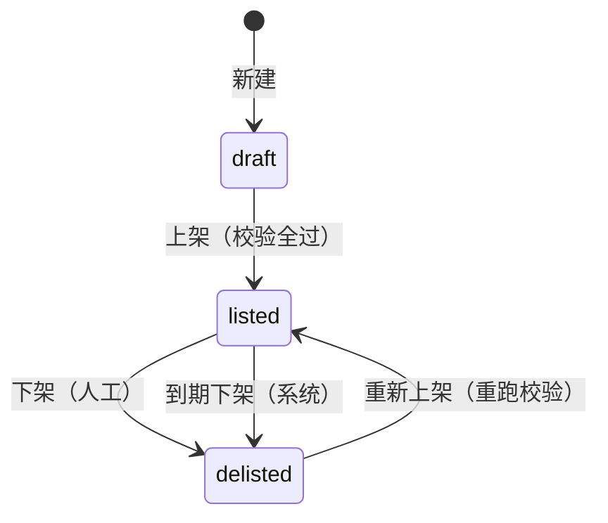

# D8 短剧库 content · 子系统设计（草案 v1）

> 「狸有戏」V1.0 子系统设计。日期 2026-10-03。补 [03](../../03-key-designs.md) 第 9 节 R12 与 [05](../../05-risks-and-open-issues.md) 第 4 节点名的缺口：七份草案都只引用短剧库，没有一份展开（01-architecture.md:208；d7-platform.md:2363）。本稿已按两份复核意见修订（处理结果见第 11 节），尚未经评审会确认。
>
> **出处约定**：引用写“文件名:行号”。`PRD.md` 指 PRD 第 7 稿；`admin/X.dc.html`、`merchant/X.dc.html` 指 `design/prototype/{admin,merchant}/src/` 下的画板源码；`d1-ledger.md` … `d7-platform.md` 指同目录的七份草案；`01-`…`05-` 指 `docs/` 主文档；`proto-*.md`、`prd-tech.md` 指 `docs/appendix/research/`。【默认】= PRD 与原型都没写、本稿给出的默认处理，汇总在第 8、10 节。
>
> **建模约定**（01-architecture.md:254-262；03-key-designs.md:601-615）：主键 `uuid`（UUID v7，应用生成）；表名单数蛇形；枚举 `text + CHECK`；积分整数；时间 `timestamptz`，按日的规则用 `date`（Asia/Shanghai）；所有表有 `created_at`，可变表有 `updated_at`，下文字段表不再重复列出。短剧库是全局资源（d4-identity.md:1229 `scope = global`），本稿的表不带 `entity_id`、`store_id`。

## 0. 一页摘要

1. content 拥有 5 张表：`drama`、`drama_episode`、`drama_permit`、`drama_copyright`、`drama_copyright_revision`，外加 1 张派生读模型 `drama_stat`。积分价表（`price_tier_revision`、`drama_price_revision`）归 billing（d1-ledger.md:243-268），原片版本、预告片、可播放资产与文件表归 media（d5-media.md:451），本稿只写关联，不重复建表。
2. 状态只有 PRD 的三种：草稿、已上架、已下架（PRD.md:756）。“停止订购”“授权已结束”是由授权期止日派生的，不落库（prd-tech.md:271；proto-admin-c.md:67）。
3. 一个谓词定可见与可订：`已上架 且 今天 < 授权期止日 − 最短可订月数`（PRD.md:178、523、759）。它是纯函数，放 `packages/shared`；商城、搜索、选剧单、确认订购都调用同一份。确认订购在它之上只多“所选平台”的两项校验（5.1）；选剧单行不带平台，只用这一个谓词。
4. 许可信息按“剧 × 播出平台”建模（05-risks-and-open-issues.md:124；01-architecture.md:461），下单时按所选平台校验（d3-flow.md:422）。校验强度做成参数，等法务结论（05-risks-and-open-issues.md:131-132）。
5. 授权期止日 `drama_copyright.license_end_date` 是全系统“成片使用期止日”的唯一来源（PRD.md:183；d3-flow.md:342）。它的每次变更写只增的修订行并发事件：续期由 D3 订阅后重排订单项止日（d3-flow.md:1798）；缩短不自动传导到订单，这一点与 D3 现行文本冲突，见 5.3 第 6 条。
6. content 在 L1（01-architecture.md:170），不能同步调用 billing（L2）与 order（L3）。积分价、最短可订授权期、订购统计都经端口反转取得（01-architecture.md:184）。
7. V1.0 小程序不播放预告片（05-risks-and-open-issues.md:16）。预告片字段、接口位与上架校验项都保留，行为由开关与校验项的严重度控制，不写死。

## 1. 目标、边界与不做什么

### 1.1 负责什么

| 事项 | 出处 |
| --- | --- |
| 剧目资料：基础信息、许可信息、版权信息、商业信息、剧集 | PRD.md:749-756 |
| 上架校验、上架、下架、重新上架 | PRD.md:758、760；admin/Dramas.dc.html:66 |
| 授权期：到期前提醒的数据来源、不足时自动停止订购、到期自动下架、续期 | PRD.md:759；admin/Dramas.dc.html:165 |
| 商家端目录读侧：商城列表、搜索、详情、首页的推荐与热门新剧取数 | PRD.md:405-406、512-526、530-547 |
| 对订购的校验与快照：`content.assertOrderable` | d3-flow.md:142 |
| 对授权书的事实：`content.getLicenseScope` | d6-notify-docs-data.md:110 |

### 1.2 硬约束

| 约束 | 来源 | 对设计的含义 |
| --- | --- | --- |
| 短剧须持有效许可或节目编号，并具备转授权和剪辑植入的权利，才可上线 | PRD.md:1020、1045、1049 | 上架校验是服务端硬闸门；上架、重新上架都重跑 |
| 三类剧的节目编号各平台不通用 | 05-risks-and-open-issues.md:117；d3-flow.md:52 | 许可信息不能是剧目上的一组字段，须按平台分行 |
| 规模：原型 28 部（admin/Dramas.dc.html:131），容量估算按 200 部（d5-media.md:409） | 示例与估算 | 搜索用数据库模糊匹配（01-architecture.md:273）；排序与价格筛选可在内存完成 |
| 调价、改参数只影响之后的单据 | PRD.md:172；01-architecture.md:258 | 剧目资料不做版本表；订单项自带快照（d3-flow.md:324） |
| 同步调用只能向下 | 01-architecture.md:161 | 第 6.6 节的端口 |

### 1.3 不做什么

- 不存积分价。价格是 billing 按时间取值的函数 `P(drama, t)`（d1-ledger.md:268），剧目上没有“当前价”字段。
- 不存文件，不做转码、体检、播放签名。全部归 media（d5-media.md:88）。
- 不建选剧单。`cart_item` 归 order（d3-flow.md:251-262）；本稿只提供它读取时要用的判定。
- 不做试看、收藏、相似推荐、中插点位配置（PRD.md:311、328 标 V1.1、V2.0）。只留字段位。
- 不做短剧销售排行报表（PRD.md:835，V1.1）。
- 不预留剧目的物理删除【默认】。废弃的草稿保留为草稿。
- 不为“怎么做出成片差异”预设字段语义（05-risks-and-open-issues.md:101）。

### 1.4 与其他模块的分工

| 模块 | 它负责 | content 负责 | 接点 |
| --- | --- | --- | --- |
| billing（L2） | 等级模板价、单剧调价记录、最短可订授权期参数 `minLicenseMonths`（d1-ledger.md:243-268、300）；计价与折后实扣 | 热度等级 `heat_tier` 的维护 | billing 读 `drama.heat_tier`；content 发 `drama.tier_changed`（d1-ledger.md:268）；content 经端口取 P 与参数（6.6） |
| media（L1 同层） | 原片版本 `drama_episode_master`、预告片 `drama_trailer`、`playable_asset`、文件与引用（d5-media.md:715-770） | 剧集行、海报与许可文件的引用列、上架校验规则 | `media.dramaMediaReadiness()`、`media.retireDramaMedia()`（d5-media.md:2133）；订阅 `drama.masters_changed`、`drama.trailer_ready`（d5-media.md:2139）。同层同步调用只有 content → media 一个方向，须登记白名单；media 需要的剧目事实经端口取（6.6） |
| order（L3） | 选剧单、订购单、订单项快照、使用期止日的重排 | 可订性判定、下单快照的内容 | `content.assertOrderable`（d3-flow.md:142）；`drama.license_extended`（d3-flow.md:2734） |
| config（L0） | 字典 `genre`、`selling_tag`、`industry`（d6-notify-docs-data.md:1458-1461）；商城配置与首页推荐位（d6-notify-docs-data.md:1446）；特性开关；时限与提醒参数 | 引用字典编码；按已发布的商城配置出列表 | content 读配置；config 发布前的“置顶短剧在架”校验（d6-notify-docs-data.md:1648）经端口回查 content |
| docs（L1 同层） | 授权书的生成与换版 | 授权平台、地域、止日；许可号取订单项快照（3.5 规则 6） | `content.getLicenseScope`（d6-notify-docs-data.md:1247），按端口注册（6.6） |
| notify（L1 同层） | 版权到期提醒 R7 的派发 | 查询端口 | `content.listDramasLicenseEndingOn`（d6-notify-docs-data.md:697），按端口注册（6.6） |

## 2. 总体方案

剧目是一行可原地修改的资料（审计日志记前后值）；会影响已售订单的两类事实单独处理：授权期用只增修订表，许可号“换号即换行”。状态迁移经 `flow.transition()`（01-architecture.md:260）。读侧把“在架剧目 + 当前积分价 + 订购统计”取到内存后筛选、排序、分页，结果按配置版本号短缓存。

| # | 决策 | 备选 | 取舍 |
| --- | --- | --- | --- |
| K1 | “停止订购”“授权已结束”不落库，由止日现算 | 加状态或 `orderable` 列 | 止日会被续期改动；派生不需要任何任务去翻转，定时器晚到也不会多卖（同 d1-ledger.md:113 的 K4 思路） |
| K2 | 许可信息独立成表，带 `platform` 维度 | 剧目上放两个编号字段（原型做法，admin/DramaEdit.dc.html:96-97） | 三类剧各平台编号不同；订单项与授权书要快照“与本账号平台对应的那一条”（d6-notify-docs-data.md:1244） |
| K3 | 版权信息 1:1 当前值 + 只增修订表 | 只留当前值，靠审计日志追溯 | 止日变更会触发订单项、下架任务、授权书三处联动，需要一条可对账的事实链 |
| K4 | 题材、标签、适配行业用 `text[]` 存字典编码 | 三张关联表 | 只有筛选与计数两种用法，GIN 索引够用；少三张表 |
| K5 | 角色介绍用 `jsonb` | `drama_role` 表 | 最多 8 个、整表替换保存（admin/DramaEdit.dc.html:286-291） |
| K6 | 订购统计做派生表，按小时刷新 | 列表查询时跨模块实时聚合 | L1 不能调 L3；综合排序只需要小时级新鲜度 |
| K7 | 上架校验项是代码里的清单，每项带严重度（阻断、提示） | 全部写死为阻断 | 预告片一项在 V1.0 的地位未定（8-C3）；改严重度不改表 |

## 3. 数据模型

### 3.1 表清单与归属

| 表 | 归属 | 说明 |
| --- | --- | --- |
| `drama` | content | 剧目：基础、商业、状态、运营字段 |
| `drama_episode` | content | 剧集：集号、标题、时长、预留点位 |
| `drama_permit` | content | 许可信息：剧 × 播出平台 × 编号种类 |
| `drama_copyright` | content | 版权信息当前值（含授权期） |
| `drama_copyright_revision` | content | 版权信息修订，只增 |
| `drama_stat` | content | 订购统计，派生、可重算 |
| `drama_episode_master`、`drama_trailer`、`playable_asset`、`file_object`、`file_ref` | media | 定义见 d5-media.md:715-770、342；主键须按 R1 从 `bigint` 改为 `uuid`（d4-identity.md:156） |
| `price_tier_revision`、`drama_price_revision` | billing | 定义见 d1-ledger.md:243-266 |
| `cart_item`、`order_item.drama_snapshot` | order | 定义见 d3-flow.md:251-262、324 |
| `status_transition`、`audit_log`、`timer`、`outbox_event` | flow、audit、timers、events | 横切，见 03-key-designs.md:234-236 |

### 3.2 `drama` 剧目

| 字段 | 类型 | 约束 | 说明与出处 |
| --- | --- | --- | --- |
| id | uuid | PK | |
| title | text | NOT NULL；≤20 字 | 剧名（PRD.md:751；admin/DramaEdit.dc.html:77 `maxlength=20`） |
| status | text | NOT NULL；CHECK in (`draft`,`listed`,`delisted`) | 草稿、已上架、已下架（PRD.md:756） |
| status_changed_at | timestamptz | NOT NULL | |
| first_listed_at | timestamptz | 可空 | 首次上架时间；“最新上架”排序与“新剧”判定用（PRD.md:519；admin/OpsHome.dc.html:77）。重新上架不重置【默认】 |
| listed_at | timestamptz | 可空 | 最近一次上架时间 |
| delisted_at | timestamptz | 可空 | |
| delist_reason_code | text | 可空；CHECK in (`ops_strategy`,`rights_issue`,`content_revision`,`other`,`license_expired`) | 运营策略调整、版权或许可问题、内容需要修改、其他（admin/Dramas.dc.html:84）；`license_expired` 为系统到期下架【默认】 |
| delist_note | text | 可空；≤200 字 | 说明，选填（admin/Dramas.dc.html:84） |
| archived_at | timestamptz | 可空 | 归档标记，不是第四种状态；触发原片引用释放（d5-media.md:365）。条件见 5.4【默认】。归档是终态：一旦写入不再清除，归档的剧不能重新上架（5.4） |
| poster_file_id | uuid | 可空；指向 `file_object` | 竖版封面（PRD.md:751）；文件类别 `poster`（d5-media.md:289） |
| total_episodes | int | 可空；≥1 | 总集数（PRD.md:751） |
| episode_duration_sec | int | 可空；>0 | 单集时长（PRD.md:751）。原型是自由文本“约 1 分 30 秒”（admin/DramaEdit.dc.html:222），这里存秒、展示时格式化【默认】 |
| genre_codes | text[] | NOT NULL 默认 `{}`；GIN | 题材，多选（PRD.md:751）；字典 `genre`（d6-notify-docs-data.md:1460） |
| selling_tag_codes | text[] | NOT NULL 默认 `{}`；至多 3 个 | 标签（PRD.md:751）；字典 `selling_tag`，每部至多 3 个（admin/SysDict.dc.html:125-126） |
| producer_name | text | 可空 | 出品方（PRD.md:751） |
| cast_names | text | 可空 | 主演（PRD.md:751）；搜索字段（PRD.md:516） |
| synopsis | text | 可空；≤300 字 | 剧情简介（PRD.md:751；admin/DramaEdit.dc.html:85 `maxlength=300`） |
| roles | jsonb | NOT NULL 默认 `[]` | 角色介绍（PRD.md:751）：`[{name, actor, desc}]`，至多 8 个，`name`、`desc` 必填，数组顺序即商家端展示顺序（admin/DramaEdit.dc.html:182、286-290） |
| drama_class | text | 可空；CHECK in (`class_1`,`class_2`,`class_3`) | 微短剧类别：一类、二类、三类（PRD.md:752；admin/DramaEdit.dc.html:361-365） |
| heat_tier | text | 可空；CHECK in (`S`,`A`,`B`,`C`) | 热度等级（PRD.md:754）；决定模板积分价（PRD.md:172；d1-ledger.md:268） |
| industry_codes | text[] | NOT NULL 默认 `{}`；GIN | 适配行业（PRD.md:754）；只存字典 `industry` 的一级编码【默认，8-C22】。原型只举了一级行业作例子（admin/OpsMall.dc.html:121），没有写明层级 |
| target_audience | text | 可空 | 目标观众（PRD.md:754） |
| allowed_placements | text[] | NOT NULL 默认 `{}`；元素 in (`opening`,`ending`,`corner`,`mid_roll`) | 允许的植入形式（PRD.md:754）：片头贴片、片尾贴片、角标字幕条、片中插播（PRD.md:48）。前两个取值与 D3 的广告位一致（d3-flow.md:1101）；后两个 V1.1 才开放（admin/DramaEdit.dc.html:131-132）。CHECK 的四个取值是为 V1.1 预留；V1.0 服务端在保存与上架时只接受前两个，对所有类别生效（4.3 L11、5.6 第 4 条） |
| trial_episode_count | smallint | 可空；0..10 | 试看集数，V1.1（PRD.md:754）；空 = 取参数默认值（admin/DramaEdit.dc.html:236、276） |
| manual_boost | smallint | NOT NULL 默认 0；0..100 | 综合排序的人工加权分。原型权重表有这一项（admin/OpsMall.dc.html:129），编辑页没有对应字段（proto-admin-e.md:118）；D6 要求短剧库补上（d6-notify-docs-data.md:2445） |
| is_ai_generated | boolean | NOT NULL 默认 false | 原片本身是否 AI 制作。PRD 字段表没有，D5 建议补并已依赖它（d5-media.md:775、1022） |
| body_modifiable | boolean | 可空 | 是否允许改动正片，D5 建议补（d5-media.md:775）。空 = 未定；口径待法务（05-risks-and-open-issues.md:103），V1.0 不参与任何校验 |
| permit_recheck_required | boolean | NOT NULL 默认 false | 原片内容有实质变更后须重新核验许可信息（admin/DramaEdit.dc.html:199）；由 `drama.masters_changed` 置位（d5-media.md:1190） |
| created_by / updated_by | uuid | 指向 `staff` | |
| lock_version | int | NOT NULL 默认 0 | 乐观锁，防多人覆盖 |

索引：`(status)`；`(first_listed_at DESC) WHERE status = 'listed'`；`genre_codes`、`industry_codes` 各一个 GIN。

预告片不在本表：每部剧当前生效的预告片在 media 的 `drama_trailer`（主键即 `drama_id`，d5-media.md:735-742）。

平台变体不在本表：D3 在成片剧集表上预留了 `variant`，并写“是否启用按剧配置（内容库的字段）”，质检通过条件是“订购集数 × 变体数”（d3-flow.md:1556-1557）。本稿 V1.0 不建这个字段，变体数恒为 1（只用 `common`）；是否按平台出两套成片待法务结论（10-Q2；d3-flow.md:3456），结论出来后再加字段，并经 `getProductionFacts` 与 `DramaSnapshot` 带出。已在第 9 节告知 D3。

### 3.3 `drama_episode` 剧集

| 字段 | 类型 | 约束 | 说明与出处 |
| --- | --- | --- | --- |
| id | uuid | PK | D5 的表以它为外键目标（d5-media.md:449） |
| drama_id | uuid | FK → `drama` | |
| episode_no | int | ≥1；UNIQUE(drama_id, episode_no) | 集号 |
| title | text | 可空 | 单集标题。PRD 字段表没有，原型剧集表有（admin/DramaEdit.dc.html:142、399） |
| duration_ms | int | 可空 | 时长（PRD.md:755），取当前原片的时长。D5 写的是批次提交事务里直接“更新剧集时长”（d5-media.md:1190）；本稿改为 content 收到 `drama.masters_changed` 后自己回填，media 不写 content 的表【默认，见第 9 节】 |
| insert_points | jsonb | 可空 | 中插点位，V1.1（PRD.md:755；d5-media.md:775） |
| custom_slots | jsonb | 可空 | 可定制镜头位，V2.0（d5-media.md:775） |

规则：

1. 保存 `total_episodes` 时同事务补齐或删除剧集行，使集号恰为 `1..N`。
2. 已有当前原片的集不能被删除；已上架的剧不能改总集数，须先下架【默认】。订单项已快照集数（d3-flow.md:325），这条只防止在架期间口径漂移。

### 3.4 原片版本、预告片、海报（media 的表，只写关联）

| 对象 | 存放 | 关联方式 | 出处 |
| --- | --- | --- | --- |
| 每集原片及其版本 | media 的 `drama_episode_master(drama_id, episode_no, rev, file_id, is_current, content_changed, …)`，每个（剧, 集号）至多一个当前版本 | 按 `(drama_id, episode_no)` 对到 `drama_episode`；成片的制作留痕记所用原片版本 | d5-media.md:752-770、681 |
| 预告片 | `drama_trailer(drama_id, target_playable_id, current_playable_id)` + `playable_asset(kind='trailer')`；源文件 ≤180 秒 | 设置接口 `PUT /admin/dramas/{id}/trailer` 归 media | d5-media.md:735-742、1246、1293 |
| 竖版海报 | `file_object`（类别 `poster`，`pub` 桶） | `drama.poster_file_id` + `files.link()` | d5-media.md:289、342 |
| 许可文件扫描件、权属证明 | `file_object`（类别 `drama_license_doc`，`secure` 桶） | `drama_permit.scan_file_ids`、`drama_copyright.proof_file_ids` + `files.link()` | d5-media.md:270 |

01-architecture.md:170 把“原片版本”列在 content 名下，而 D5 已把表与写入事务都放在 media（d5-media.md:451、1190）。本稿按 D5 执行，归属口径见 8-C12。

### 3.5 `drama_permit` 许可信息

| 字段 | 类型 | 约束 | 说明与出处 |
| --- | --- | --- | --- |
| id | uuid | PK | |
| drama_id | uuid | FK → `drama` | |
| platform | text | NOT NULL；CHECK in (`all`,`douyin`,`wechat_channels`) | 播出平台。`all` = 不区分平台；后两个取值同 D3（d3-flow.md:359）。按平台建模的依据见 05-risks-and-open-issues.md:124 |
| permit_kind | text | NOT NULL；CHECK in (`license_no`,`approval_no`,`program_no`) | 许可证号、批准文件编号、节目编号（PRD.md:752） |
| permit_no | text | NOT NULL | 编号 |
| scan_file_ids | uuid[] | NOT NULL 默认 `{}` | 许可文件扫描件，PDF 或图片（PRD.md:752；admin/DramaEdit.dc.html:100） |
| status | text | NOT NULL；CHECK in (`active`,`retired`) | |
| retired_at / retire_reason | timestamptz / text | 可空 | |
| note | text | 可空 | |
| created_by | uuid | 指向 `staff` | |

约束：`UNIQUE (drama_id, platform, permit_kind) WHERE status = 'active'`。

规则：

1. 微短剧类别在 `drama.drama_class` 上，只有一份；编号按平台分行。原型的两个输入框（许可证号、批准文件编号或节目编号，admin/DramaEdit.dc.html:96-97）落成两行 `platform = 'all'`：第一个输入框记 `license_no`；第二个输入框把“批准文件编号或节目编号”合在一起，按类别判定种类，一类、二类记 `approval_no`，三类记 `program_no`【默认，8-C21】。后台页面改为按行编辑后（第 9 节 D7），每行显式选择种类，不再靠类别推断。
2. 三类剧的节目编号建议按平台各录一行，但数据库不禁止 `all`。是否强制，随法务对“三类剧双平台发布”的结论再定（05-risks-and-open-issues.md:131）。
3. 剧目上架过之后，编号不原地修改：换号 = 旧行置 `retired` + 新建一行，并发 `drama.permit_changed`。订单项与授权书里的许可号是快照（d3-flow.md:324；d6-notify-docs-data.md:1243-1244），不随之改变；快照取自哪里见规则 6。
4. 草稿期可原地改，审计日志记前后值。
5. 扫描件的归属粒度。PRD 与原型里“许可文件扫描件”是剧目级的一个上传项（PRD.md:752；admin/DramaEdit.dc.html:99-101）；本表按行存 `scan_file_ids`，因为各平台的节目编号可能出自不同文件。按行编辑的页面每行各自上传；一份文件覆盖多行时，多行引用同一个文件（同一文件可被多处引用，d5-media.md:352）。沿用原型的单一上传项录入时，文件挂到“按类别必备”的那一行上（4.3 L1）。上架校验只要求必备行带扫描件，不要求每条活动行都有【默认，8-C21】。
6. 选取规则与快照来源。选取是纯函数 `selectPermits(rows, platform)`，放 `packages/shared`：只看活动行；对某个平台，按编号种类逐一选取，有该平台的具体行取具体行，否则取 `all` 行。部分唯一索引保证每个（平台, 种类）至多一条活动行，所以每个平台至多选出三条。下单快照 `DramaSnapshot.permits` 是所选各平台选取结果的并集，元素统一为 `{ platform, kind, number }`：`platform` 是该行自身的取值（`all` 或具体平台），`kind` 是本表的编码，中文名在渲染时换。授权书按账号所在平台，从订单项快照里再选一次。D6 的现行文本是每次生成修订都调用 `content.getLicenseScope` 组装（d6-notify-docs-data.md:1294），取到的是当前活动行：换号后下一次修订（上线生效、止日变更）会带出新号，与订单项快照不一致，也与 10-Q5“现不换版”矛盾。本稿定为授权书的许可号取订单项快照【默认】；D3 的 `delivery.getLicenseFacts` 现在不带这一项（d6-notify-docs-data.md:1263-1270），需补上（第 9 节）。

### 3.6 `drama_copyright` 与 `drama_copyright_revision` 版权信息

`drama_copyright`（每部剧一行，当前值）：

| 字段 | 类型 | 约束 | 说明与出处 |
| --- | --- | --- | --- |
| drama_id | uuid | PK；FK → `drama` | |
| source | text | 可空；CHECK in (`own`,`licensed`) | 版权来源：自有或授权（PRD.md:753） |
| platforms | text[] | NOT NULL 默认 `{}`；元素 in (`douyin`,`wechat_channels`) | 授权平台（PRD.md:753；原型示例“抖音、视频号”，admin/DramaEdit.dc.html:110）。即可发布平台的上限 |
| territory | text | 可空 | 授权地域（PRD.md:753；原型示例“中国大陆”，admin/DramaEdit.dc.html:110）；授权书地域取这里（d6-notify-docs-data.md:1247） |
| has_network_right | boolean | 可空 | 信息网络传播权（PRD.md:1049） |
| can_sublicense | boolean | 可空 | 是否可转授权（PRD.md:753） |
| can_edit_embed | boolean | 可空 | 是否可剪辑植入（PRD.md:753） |
| can_adapt | boolean | 可空 | 是否可改编。PRD 的上架规则与合规表都要求（PRD.md:758、1049），原型缺这一项（proto-admin-c.md:115） |
| license_start_date | date | 可空 | 版权有效期起（admin/DramaEdit.dc.html:113） |
| license_end_date | date | 可空；INDEX | 版权有效期止 = 剧目授权期结束日 = 成片使用期止日（PRD.md:753、183） |
| proof_file_ids | uuid[] | NOT NULL 默认 `{}` | 权属证明文件（PRD.md:753） |
| current_revision_id | uuid | 可空；FK → 修订表 | 最近一条修订 |
| lock_version | int | NOT NULL 默认 0 | |

CHECK：`license_end_date >= license_start_date`（两者都非空时）。

`drama_copyright_revision`（只增；应用账号只有 INSERT、SELECT 权限，同 01-architecture.md:259）：

| 字段 | 类型 | 约束 | 说明 |
| --- | --- | --- | --- |
| id | uuid | PK | |
| seq | bigint | identity | 只增表另带自增序号（01-architecture.md:254） |
| drama_id | uuid | FK；INDEX(drama_id, seq) | |
| change_kind | text | CHECK in (`initial`,`extend`,`shorten`,`scope_change`,`correction`) | 首次录入、续期、缩短、权利范围或平台地域变更、更正 |
| snapshot | jsonb | NOT NULL | 变更后的全部版权字段（完整值，不是增量） |
| prev_end_date / new_end_date | date | 可空 | 止日前后值 |
| reason | text | NOT NULL | |
| proof_file_ids | uuid[] | NOT NULL 默认 `{}` | 本次变更的依据文件（续期合同等） |
| created_by | uuid | 指向 `staff` | |

规则：

1. 草稿期保存版权页签不写修订行；首次上架时写一行 `initial`。上架之后，版权字段的任何变更都必须经“版权变更”用例：同事务写修订行、更新当前值、写审计、发事件。
2. 修订类型、事件与载荷的对应：

   | `change_kind` | 适用 | 事件 | 载荷 |
   | --- | --- | --- | --- |
   | `initial` | 首次上架时落第一行 | 不单独发，随 `drama.listed` | — |
   | `extend` | 新止日晚于旧止日 | `drama.license_extended` | `{ dramaId, newEndDate }`，与 D3 的订阅一致（d3-flow.md:1798） |
   | `shorten` | 新止日早于旧止日 | `drama.license_shortened` | `{ dramaId, prevEndDate, newEndDate }` |
   | `scope_change` | 授权平台或地域变更，止日不变。权利项（转授权、剪辑植入、改编、信息网络传播权）的变更也记这一类，但不发事件：已上架的剧把权利项由真改假会使 L3、L4 不过，被 4.2 的保存校验拒绝，须先下架 | `drama.license_scope_changed` | `{ dramaId, platformsRemoved, platformsAdded, territoryChanged }` |
   | `correction` | 更正录入错误 | 按前后值的实际差异发上面三种之一或多种；只改版权来源、起日、权属证明这类不影响下游的字段时不发事件 | 同上 |

   发什么事件由前后值的差异决定，不由 `change_kind` 决定：`change_kind` 是操作人填的归类，服务端只校验它与差异不矛盾（填 `extend` 而新止日不晚于旧止日则拒绝）。一次变更同时改了止日与范围的，写一条修订行，事件各发一条。
3. `shorten` 与 `scope_change` 之后在途订单怎么办，PRD 没有任何规则，见 5.3 第 6 条与 10-Q3。D6 的授权书对齐只比较状态、起始日、止日三项（d6-notify-docs-data.md:1288），地域或平台变了不会换版；是否换版由 D6 明确（第 9 节）。

### 3.7 `drama_stat` 订购统计（派生）

| 字段 | 类型 | 约束 | 说明与出处 |
| --- | --- | --- | --- |
| drama_id | uuid | PK；FK → `drama` | |
| orders_30d | int | NOT NULL 默认 0 | 近 30 天订购部数；综合排序与“热门”用（admin/OpsMall.dc.html:129；admin/OpsHome.dc.html:73） |
| orders_mtd | int | NOT NULL 默认 0 | 当月订购部数；后台列表“9 月订购”列（admin/Dramas.dc.html:55） |
| live_items | int | NOT NULL 默认 0 | 上线中成片部数；后台列表列与下架弹窗提示（admin/Dramas.dc.html:55、183） |
| refreshed_at | timestamptz | NOT NULL | |

由周期任务经端口向 order 取数后整表覆盖（6.5、6.6）。丢了可重算，不参与任何校验。

### 3.8 分类与标签

| 概念 | 存放 | 出处 |
| --- | --- | --- |
| 题材 | 字典 `genre`（平铺，可停用，停用不影响已标注的短剧）；剧目存编号数组 | d6-notify-docs-data.md:1460；admin/SysDict.dc.html:121-124 |
| 卖点标签 | 字典 `selling_tag`；展示在详情“适配推荐”里 | d6-notify-docs-data.md:1461；admin/SysDict.dc.html:125 |
| 适配行业 | 字典 `industry` 一级 | PRD.md:853；admin/OpsMall.dc.html:121 |
| 商城分类标签 | 商城配置 `mall.categories[].genreCodes`，一个分类可含多个题材，“全部”固定 | d6-notify-docs-data.md:1628-1629；admin/OpsMall.dc.html:99-108 |
| 角标（新剧、热播） | 不落库，派生，见 5.2 | PRD.md:521 |

content 不建分类表。分类到剧目的映射是“分类的题材集合与 `genre_codes` 有交集”。

### 3.9 变更留痕

| 变更 | 留痕位置 |
| --- | --- |
| 任何字段的保存（含角色、剧集标题） | `audit_log`，记前后值，与业务写同事务（01-architecture.md:441）。编辑页右栏“操作日志”（admin/DramaEdit.dc.html:167-170）按 `target_type = 'drama'` 读取 |
| 上架、下架、重新上架、到期下架 | `status_transition`（machine = `drama`）；上架时把校验结果摘要写进 `payload` |
| 授权期与权利范围 | `drama_copyright_revision` |
| 许可号 | `drama_permit` 的停用行 |
| 原片替换 | media 的 `drama_episode_master.rev` 与 `replace_reason`（d5-media.md:752-764） |
| 积分价 | billing 的 `drama_price_revision`（d1-ledger.md:254-266） |
| 热度等级 | `audit_log` + 事件 `drama.tier_changed` |

操作日志保留不少于 3 年（PRD.md:855）。

### 3.10 数据库级约束清单（手写 SQL，CI 比对；01-architecture.md:262）

字段表里声明过的约束都列在这里；没列进 1–5 的，只在应用层校验（第 6 条）。

1. `drama`：`status`、`delist_reason_code`、`drama_class`、`heat_tier` 的 CHECK；`allowed_placements <@ ARRAY['opening','ending','corner','mid_roll']`；`cardinality(selling_tag_codes) <= 3`；`total_episodes >= 1`；`episode_duration_sec > 0`；`trial_episode_count BETWEEN 0 AND 10`；`manual_boost BETWEEN 0 AND 100`。
2. `drama_episode`：`UNIQUE(drama_id, episode_no)`；`episode_no >= 1`。
3. `drama_permit`：`platform`、`permit_kind`、`status` 三个 CHECK；活动行上的部分唯一索引 `UNIQUE (drama_id, platform, permit_kind) WHERE status = 'active'`。
4. `drama_copyright`：`source` 的 CHECK；`platforms <@ ARRAY['douyin','wechat_channels']`；止日不早于起日。
5. `drama_copyright_revision`：`change_kind` 的 CHECK；防改触发器与只增权限。
6. 只在应用层校验、不进数据库约束：剧名 ≤20 字、剧情简介 ≤300 字、下架说明 ≤200 字；`roles` 的结构与至多 8 个；字典编码存在且启用；V1.0 的 `allowed_placements` 只接受 `opening`、`ending`（随参数变化，4.3 L11）；许可种类与微短剧类别的对应（4.3 L1）。

## 4. 状态机

### 4.1 状态与派生状态

| 落库状态 | 后台取色（admin/Dramas.dc.html:135） | 含义 |
| --- | --- | --- |
| `draft` 草稿 | 灰（`#EFEBE4` / `#5E564C`） | 可反复保存；可先定积分价，“上架后生效”（admin/Pricing.dc.html:152） |
| `listed` 已上架 | 绿（`#E5F1E9` / `#256A42`） | 进入可见性判定 |
| `delisted` 已下架 | 浅灰（`#F3EFE9` / `#6F665B`） | 商城不再展示，已订购的订单继续履约（PRD.md:760） |

| 派生状态（不落库） | 条件 | 表现与出处 |
| --- | --- | --- |
| 停止订购 | `listed` 且 今天 ≥ 停止订购日（5.1） | 后台列表在止日下标“MM-DD 起停止订购”，状态仍显示已上架（admin/Dramas.dc.html:159-160）；单剧积分价页显示为“停止订购”且不能调价（admin/Pricing.dc.html:153、188-189）。调价接口归 billing，这条守卫由 billing 调用 `content.getOrderability` 后执行（第 9 节 D1） |
| 授权已结束 | 今天 > `license_end_date` | 标“授权已结束”，不能重新上架（admin/Dramas.dc.html:149、165） |
| 90 天内到期 | 止日在今天起 N 天内，N = `remind.copyright.days`（d6-notify-docs-data.md:1549；范围 30–180，admin/SysParams.dc.html:117） | 后台筛选“仅看 90 天内授权到期”（admin/Dramas.dc.html:54、121）；工作台预警（PRD.md:745；admin/Main.dc.html:178-179） |

热度等级取色（admin/Dramas.dc.html:134）：S 橙、A 蓝、B 绿、C 灰。

### 4.2 迁移



| # | 从 | 事件 | 操作人 | 守卫 | 到 | 副作用 |
| --- | --- | --- | --- | --- | --- | --- |
| 1 | — | `drama.create` | 员工 | — | `draft` | 建 `drama_copyright` 空行 |
| 2 | `draft` | `drama.list` | 员工（`drama.shelf`） | 4.3 阻断项全过 | `listed` | 写 `first_listed_at`、`listed_at`；写版权 `initial` 修订；登记到期定时器（6.5）；发 `drama.listed` |
| 3 | `listed` | `drama.delist` | 员工（`drama.shelf`） | 必选原因；说明 ≤200 字（admin/Dramas.dc.html:84） | `delisted` | 写原因；取消到期定时器；原因为 `rights_issue` 时调用 `media.retireDramaMedia(tx, id, { scope: 'trailer', immediate: true })`，只停用预告片的公开分发（d5-media.md:1309），不动原片；`scope` 是对 D5 的要求（5.4、第 9 节）；发 `drama.delisted` |
| 4 | `listed` | `drama.license_expire` | 系统 | 今天 > `license_end_date`（处理器执行前重读） | `delisted` | 原因 `license_expired`；发 `drama.delisted` |
| 5 | `delisted` | `drama.relist` | 员工（`drama.shelf`） | 未归档（`archived_at IS NULL`，5.4）；授权未结束（admin/Dramas.dc.html:165、169）；4.3 阻断项全过（admin/Dramas.dc.html:165“重新上架前将再次执行上架校验”） | `listed` | 同第 2 行，但不重置 `first_listed_at` |

已上架的剧保存修改即时生效，“商城展示同步更新”（admin/DramaEdit.dc.html:316）。保存时重跑 4.3：出现阻断项不通过时拒绝保存并指出原因，不自动下架【默认】（PRD 与原型都没写，proto-admin-c.md:117）。L12 不参与这次保存校验：它由原片变更置位，只能经“确认重新核验”清除，不是本次保存造成的；把它算进去，待重新核验期间连许可行都改不了。

### 4.3 上架校验清单

校验是服务端的纯判定函数 `listingChecks(dramaId)`，返回逐项结果；后台右栏展示“N / M 项通过”与“去补充”（admin/DramaEdit.dc.html:153-159）。严重度：阻断 = 不过不能上架；提示 = 展示但不拦。

| # | 校验项 | 判定 | 严重度 | 出处 |
| --- | --- | --- | --- | --- |
| L1 | 许可信息齐全（含许可文件） | `drama_class` 已选；存在按类别必备的活动许可行：一类、二类至少一条 `license_no` 或 `approval_no`，三类至少一条 `program_no`；必备行里至少一行带扫描件（3.5 规则 5） | 阻断 | PRD.md:758；类别与编号种类的对应取自 PRD.md:1045（一类、二类须许可证或批准文件，三类须经播出单位审核并标注节目编号）与原型的类别说明（admin/DramaEdit.dc.html:362-364）；admin/DramaEdit.dc.html:249。这个对应关系须法务确认（10-Q13），确认前按此拦截，不默认放行 |
| L2 | 版权信息齐全（含权属证明） | `source`、`platforms`（至少 1 个）、`territory`、起止日期、权属证明文件都有值 | 阻断 | PRD.md:758；admin/DramaEdit.dc.html:250 |
| L3 | 版权允许转授权、剪辑植入与改编 | `can_sublicense`、`can_edit_embed`、`can_adapt` 均为真 | 阻断 | PRD.md:758；原型只查前两项（admin/DramaEdit.dc.html:251） |
| L4 | 具备信息网络传播权 | `has_network_right` 为真 | 阻断 | PRD.md:1049；01-architecture.md:463 |
| L5 | 已设置积分价 | `heat_tier` 非空，且价格端口能解析出 P | 阻断 | PRD.md:758；admin/DramaEdit.dc.html:252 |
| L6 | 预告片已上传（不超过 3 分钟） | `media.dramaMediaReadiness()` 报告预告片就绪 | 提示（开关 `weapp.video.trailer.enabled` 关闭时）；阻断（开关打开时）。按开关的 `default_value` 求值，不看规则命中（5.7 第 2 条） | PRD.md:758；admin/DramaEdit.dc.html:253；降级理由见 8-C3 |
| L7 | 授权未结束 | 今天 ≤ `license_end_date` | 阻断 | admin/Dramas.dc.html:165 |
| L8 | 剩余授权期达到最短可订期 | 今天 < 停止订购日 | 提示 | PRD.md:759【默认】：上架了也不可见 |
| L9 | 基础信息齐全 | 剧名、竖版封面、总集数、题材（至少 1 个）、剧情简介有值；海报未被内容安全拦截（d5-media.md:1922） | 阻断 | 商城卡片与详情要用（PRD.md:521、535-537）；原型 5 项里没有封面（proto-admin-c.md:116）【默认】 |
| L10 | 剧集与原片齐全 | 剧集行数 = 总集数；每集有当前原片（由 `media.dramaMediaReadiness()` 报告） | 阻断 | 原型没有这一项（proto-admin-c.md:116）；缺了订购后无法开工【默认】 |
| L11 | 植入形式合规 | `allowed_placements` 非空；所有类别都只含参数 `content.placement.open_slots` 里的取值（V1.0 默认 `opening`、`ending`；保存时同样校验）；一类、二类在参数放开后仍只含 `opening`、`ending` | 阻断 | PRD.md:761、1046；原型把角标字幕条、片中插播对所有类别禁用并标“V1.1 开放，须经法务确认合规”（admin/DramaEdit.dc.html:131-134）；D3 要求每个订单项至少 1 个广告位且在允许范围内（d3-flow.md:1152），广告位只有 `opening`、`ending`（d3-flow.md:1101） |
| L12 | 许可信息无待重新核验 | `permit_recheck_required = false` | 阻断 | admin/DramaEdit.dc.html:199【默认】 |
| L13 | 适配行业已选 | `industry_codes` 至少 1 个 | 提示 | 首页“为你推荐”与行业筛选依赖它（PRD.md:405、518）【默认】 |
| L14 | 每个授权平台都有许可覆盖 | `permitCovers(d, platforms)` 为真（5.6 第 1 条） | 提示 | 下单时按所选平台另行校验（5.6） |

原型的 5 项对应 L1、L2、L3、L5、L6。L4、L7–L14 是本稿补的。其中新增的阻断、会改变“能否上架”的有：L1 的类别与编号种类对应、L3 的改编权、L4、L7、L9、L10、L11（原型的校验清单不查植入形式，片头、片尾都不勾选也能上架，admin/DramaEdit.dc.html:129-130、248-254）、L12。全部须产品与法务确认（8-C4、10-Q6）。

## 5. 规则

### 5.1 可见性与可订性

```
stopDate(d)            = license_end_date 往前数 minLicenseMonths 个自然月（当月无此日取月末）
visible(d, today)      = status = 'listed' 且 today < stopDate(d)
orderable(d, P, today) = visible(d, today)
                         且 P ⊆ drama_copyright.platforms
                         且 permitCovers(d, P)        -- 受 5.6 的参数控制
```

1. `visible` 对应 PRD 的展示范围“已上架且剩余授权期不少于 3 个月”（PRD.md:523）与可订范围（PRD.md:178），两者是同一个条件。`orderable` 只比它多“所选平台”的两项，这两项要到确认订购、选了发布账号之后才有输入；选剧单行不带平台（d3-flow.md:251-262），所以选剧单的“已失效”只按 `visible` 判定（d3-flow.md:267）。`minLicenseMonths` 是 billing 的参数，默认 3、范围 1–12（d1-ledger.md:300；proto-admin-c.md:224）。
2. 按自然月回推取自原型示例：授权至 2026-12-25 的剧“09-25 起停止订购”（admin/Dramas.dc.html:117、120）。边界日与 PRD 的“不少于”差 1–2 天，见 8-C1。
3. `today` 取 Asia/Shanghai 的日期（01-architecture.md:257）。三个函数放 `packages/shared`，无任务参与：止日一改，结果立即跟着变。
4. 游客与店员能看目录（PRD.md:390；d4-identity.md:374）。可见性不区分身份，只区分返回字段（6.2）。
5. `permit_recheck_required` 不进这两个谓词【默认，8-C23】。原型只写“内容有实质变更的，须重新核验许可信息”（admin/DramaEdit.dc.html:199），没有说停止订购，PRD 也没有这一条。待重新核验期间：已上架的剧照常展示、可订，选剧单不标“已失效”；内容运营收到待办（6.4）；上架与重新上架被 L12 拦住；不变量 I1 告警。若法务要求核验完成前停止订购，做法是让 `visible` 同时为假并给出原因码，使商城、选剧单、确认订购三处表现一致，见 10-Q14。

### 5.2 搜索、筛选、排序

| 能力 | 规则 | 出处 |
| --- | --- | --- |
| 搜索字段 | 剧名、题材、主演 | PRD.md:516。原型逻辑只匹配剧名与题材，主演是占位（proto-merchant-a.md:168）；按 PRD 做 |
| 匹配方式 | 关键词先去掉空格与“·”。剧名、主演：字段包含关键词。题材：任一题材名包含关键词，或关键词包含任一题材名；按题材名拆词，命中一个就算，不要求全部命中。题材名取字典 `genre` 的显示名。例：热搜词“家庭喜剧”命中题材含“家庭”或“喜剧”的剧。剧名命中的排在题材、主演命中之前 | merchant/Search.dc.html:63、69-75、78。原型的题材匹配是双向的；“家庭喜剧”是原型与商城配置里的热门搜索词（merchant/Search.dc.html:94；admin/OpsMall.dc.html:115），题材存成编码数组后只做“题材名包含关键词”会搜不到 |
| 兜底推荐 | 关键词未命中，但等于某个品类名时，按该品类所属的一级行业返回 `industry_codes` 含它的剧，并标记为推荐结果 | merchant/Search.dc.html:62、80-82；PRD.md:1162 仍待确认，做成开关，默认开【默认】 |
| 热门搜索词 | 商城配置 `mall.hotWords`，至多 8 个；名次按数组顺序。原型的“热 / 新”标记 V1.0 不展示【默认，8-C24】：D6 的配置结构是纯字符串数组，后台商城配置页也没有标记的输入项 | d6-notify-docs-data.md:1630；admin/OpsMall.dc.html:73、159；merchant/Search.dc.html:94-97；proto-merchant-a.md:167 |
| 搜索历史 | 存客户端本地：去重、新词置顶、至多 10 条，可清空。不建表，不上传 | merchant/Search.dc.html:37、92；proto-merchant-a.md:166 |
| 分类标签 | 商城配置的分类 → 题材集合 → 与 `genre_codes` 求交 | PRD.md:517；d6-notify-docs-data.md:1628 |
| 筛选 | 题材；适配行业；集数（30 集及以下、31～60 集、60 集以上）；积分价区间（档位取商城配置） | PRD.md:518；admin/OpsMall.dc.html:120-123 |
| 排序 | 综合、热度、价格从低到高、价格从高到低、最新上架；可用项与默认项取商城配置 | PRD.md:519；d6-notify-docs-data.md:1633。原型只有 4 项，没有最新上架（merchant/Mall.dc.html:116） |
| 综合排序 | 四项加权：热度等级、近 30 天订购、上架时间、人工加权；权重取商城配置，合计 100 | admin/OpsMall.dc.html:127-131、173 |
| 分页 | 每页 20 条 | PRD.md:526 |
| 角标“新剧” | `first_listed_at` 在 N 天内，N 取首页推荐位配置的“新剧范围”（默认 30，7–90） | admin/OpsHome.dc.html:77、164、183 |
| 角标“热播” | PRD 与原型都没有规则。示例数据里带“热播”的两部都是 S 级（merchant/Mall.dc.html:96、99）。默认 = 热度等级 S【默认】 | PRD.md:521 |

实现：

1. 一次查询取全部 `visible` 的剧（含 `drama_stat`），经价格端口批量取 P，在内存里筛选、打分、排序，再分页。结果按“商城配置版本号 + 筛选条件”缓存 60 秒；剧目、价格、配置变更时版本号加 1。
2. 综合排序各项的归一化方式 PRD 与原型都没有。默认：热度 S、A、B、C 记 100、75、50、25；近 30 天订购取“本剧 ÷ 在架最大值 × 100”；上架时间取“max(0, 1 − 上架天数 ÷ 90) × 100”；人工加权取 `manual_boost`【默认】。同分按 `first_listed_at` 倒序、再按 `id`。“热度”排序按热度等级从高到低（admin/OpsMall.dc.html:126）；同级的先后原型没有规则，默认按近 30 天订购倒序，再按 `first_listed_at` 倒序、`id`【默认，8-C11】。
3. 价格筛选与价格排序用标价 P，不用折后实扣（admin/OpsMall.dc.html:123“按剧目积分价”）。
4. 目录接口不返回播放量、更新进度一类字段，避免商城呈现为观看型产品（05-risks-and-open-issues.md:84）。

首页（由 D6 的 `GET /m/home` 组装，d6-notify-docs-data.md:1685-1686）向 content 取三类列表：

| 列表 | 规则 | 出处 |
| --- | --- | --- |
| 为你推荐 | `industry_codes` 含门店品类所属行业；行业置顶项排最前，每个行业至多置顶 1 部；数量取配置（默认 6，3–12）；未建档给热门 | PRD.md:405、1160；admin/OpsHome.dc.html:73、163、182、221 |
| 热门 | 按热度与近 30 天订购量；原型没有给两者的组合方式，默认与商城“热度”排序同一口径【默认，8-C11】 | admin/OpsHome.dc.html:73 |
| 新剧 | 按上架时间，范围取“新剧范围” | admin/OpsHome.dc.html:73、77 |

### 5.3 授权期、订购、使用期、到期

1. 下单：`content.assertOrderable` 通过后，订单项的 `usage_end_date` 取返回快照里的 `licenseEndDate`（d3-flow.md:342）。商家端在卡片、选剧单、详情展示“可使用至”（PRD.md:183、542；merchant/Cart.dc.html:33）。
2. 使用期：自上线首日起，至授权期结束日止；延迟上线不顺延止日（PRD.md:183、185）。起点与顺延的执行在 D3（d3-flow.md:1797）。
3. 到期前提醒：授权期结束前 90 天提醒内容运营（PRD.md:759）。按 R6 属于纯提醒，由 notify 规则 R7 派生（03-key-designs.md:606；d6-notify-docs-data.md:697），content 只提供查询端口，不登记定时器。D3 的 T20 把它写成定时器（d3-flow.md:2950），以 R6 为准。
4. 停止订购：派生，无任务（d3-flow.md:2951）。
5. 续期：内容运营在版权页签录入新止日与依据文件 → `extend` 修订 → `drama.license_extended` → D3 为受影响订单项重排止日与下架任务（d3-flow.md:1798-1806），docs 重出授权书（03-key-designs.md:576）。停止订购日随之后移。已因到期被系统下架的剧不自动恢复上架，须人工重新上架并重跑校验【默认】。进入到期下架步骤的订单项不再顺延，是 D3 的默认（d3-flow.md:3418）。
6. 缩短止日、缩小授权平台或地域：PRD 没有规则。默认只允许持专门权限点的员工操作，须填原因与依据文件；按 3.6 的对照表写修订，发 `drama.license_shortened` 或 `drama.license_scope_changed`；content 不自动改任何订单。在途订单按“平台原因无法继续上线”处理（PRD.md:213；03-key-designs.md:311），由运营逐单发起【默认，10-Q3】。
   - 这条默认与 D3 的现行文本冲突。`usage.resync` 的守卫只判断“`usage_end_date` ≠ 剧目当前授权止日”，不分方向（d3-flow.md:1802）；每小时的对账扫描（d3-flow.md:1810、3220）与不变量 I6（d3-flow.md:3250）都要求 `usage_end_source = license` 的订单项止日恒等于剧目当前止日，不等就补登记重排并自愈。按 D3 的字面实现，止日一被改早，一小时内所有在途与已上线订单项的使用期止日、下架任务、授权书都会被自动缩短，而且不经退回流程。
   - 本稿要求 D3 改为单向（第 9 节）：只在“剧目止日晚于订单项止日”时顺延；剧目止日早于订单项止日时不改订单项，写告警并给交付主管生成逐单待办。对账扫描与 I6 的条件相应改为：剧目止日更晚的，补登记 `usage.resync` 并自愈；剧目止日更早的，只告警，不自愈。
   - 如果业务最终决定“缩短自动传导”，须同时补上退回与通知规则，在 10-Q3 一并拍板。D3 改完之前，不开放 `shorten` 与改早止日的 `correction`【默认】。
   - `correction` 改动止日时不另走路径：新止日更晚的按第 5 条处理，更早的按本条处理。
7. 到期当日：成片使用到当日为止，商家须下架（PRD.md:186）。剧目在止日次日 00:00 由系统置为已下架（4.2 第 4 行）。原型示例里授权已结束的剧处于已下架（admin/Dramas.dc.html:117 的《旧时光照相馆》），PRD 没写这一步（proto-admin-c.md:68）【默认】。

### 5.4 下架或授权到期的影响

| 对象 | 影响 | 出处 |
| --- | --- | --- |
| 商城、搜索、首页 | 立即不再展示 | PRD.md:760 |
| 详情页（旧链接、分享进入） | 仍可打开，返回“不可订购”与原因，底部按钮置灰【默认】 | — |
| 选剧单 | 读取时算出“已失效”，订购前须处理；不批量回写 | PRD.md:552；d3-flow.md:267；merchant/Cart.dc.html:35 |
| 待开工、制作中、待上线、上线中的订单项 | 继续履约；使用期不受影响 | PRD.md:760；admin/Dramas.dc.html:183 |
| 开工事务 | 不再调用 `assertOrderable`（下架只影响之后的订购，admin/Dramas.dc.html:74）。需 D3 确认（第 9 节） | — |
| 原片 | 下架不释放，任何下架原因都一样：已订购的订单继续履约（PRD.md:760），剪辑师还要取原片。归档时才调用 `media.retireDramaMedia(tx, id, { scope: 'masters' })`（d5-media.md:365） | — |
| 预告片与海报 | 原因为“版权或许可问题”时立即停用预告片的公开分发并刷新 CDN（d5-media.md:1309），调用时限定 `scope: 'trailer'`；其余原因保留 | — |
| 置顶与 Banner 引用 | 读路径跳过无效项，后台标红（d6-notify-docs-data.md:1656） | — |

归档条件【默认】：已下架、授权已结束、名下没有未结束的订单项（经端口向 order 查询）。满足后由周期任务写 `archived_at` 并调用 `media.retireDramaMedia(tx, id, { scope: 'masters' })`。

`media.retireDramaMedia` 的作用范围。本稿对它有两种用法：版权或许可问题下架时带 `immediate: true`，只为停用预告片；归档时用来释放原片。D5 的签名是 `retireDramaMedia(tx, dramaId, opts)`（d5-media.md:2133），没有范围参数；带 `immediate` 时的描述是“立即释放引用、把清除时间置为当前”（d5-media.md:1309）。照字面实现，版权问题下架会连原片一起立即清除，在途订单就取不到原片。所以本稿的两处调用都显式带 `scope`，并要求 D5 提供这个参数或拆成两个函数（第 9 节）。

归档是终态【默认，10-Q12】：

1. 重新上架的守卫含 `archived_at IS NULL`（4.2 第 5 行）；归档后不再受理版权变更。
2. 理由：归档时原片引用已释放，D5 在 90 天后清除文件（d5-media.md:365），只有保留期内按文件的 `files.restore`（d5-media.md:401），没有按剧恢复原片引用的接口；原片版本行的 `is_current` 不随释放改变，L10 发现不了文件已被清除，剧会在没有原片的状态下重新上架。
3. 续期合同晚到、剧已归档的：新建剧目并重新上传原片。
4. 授权已结束但尚未归档的剧（名下还有未结束的订单项）不受影响，仍可续期后重新上架。

下架原因为“版权或许可问题”时，在途订单是否要停，PRD 与原型的口径是“继续履约”，没有区分原因。content 只发事件、不动订单；事件载荷带原因，供 D3 与通知决定是否给交付主管生成待办（10-Q4）。

### 5.5 调价与快照

1. 调价只影响调价后提交的订购（PRD.md:172、767）；已冻结或已扣减的订购按原积分价履约（admin/Pricing.dc.html:101）。订单项保存 P、R、T、S 与规则版本（03-key-designs.md:171），与 content 无关。
2. 选剧单里的剧显示“积分价已变动”，商家确认后才能订购（admin/Pricing.dc.html:90）。判定在读取时做（d1-ledger.md:715）。
3. content 唯一会引起变价的写操作是改热度等级：按模板定价的剧，等级一改，P 立即变（d1-ledger.md:268）。此时发 `drama.tier_changed { dramaId, from, to }`，需要 billing 订阅并在 P 实际变化时发变价通知。D1 现在只写了“由短剧库发 `drama.tier_changed` 事件”（d1-ledger.md:268），没有订阅处理；它的变价通知只来自定时生效调价的 `pricing.drama_price_changed`（d1-ledger.md:717）。不补的话，选剧单里有这部剧的老板收不到通知，读取时的“积分价已变动”状态仍然正确。已列入第 9 节。这条路径没有“生效时间”，也不产生调价记录，与 PRD“设置生效时间，保留调价记录”（PRD.md:767）有缝隙，见 8-C7。
4. 剧目资料（剧名、集数、类别、题材、许可号、允许的植入形式）在下单时进 `order_item.drama_snapshot`；之后改资料不影响已下的单。D3 的快照现列前五项（d3-flow.md:324），没有植入形式，需补（第 9 节）。D3 在下单与推送方案两处都校验“广告位在该剧允许的植入形式内”（d3-flow.md:425、1152），没写用快照还是当前值。本稿定为：下单按当前值，推送方案按订单项快照【默认】；下单后剧目收窄 `allowed_placements` 不影响在途订单的方案。`getProductionFacts` 的实时值只用于展示与新单。

### 5.6 许可与植入形式

1. `permitCovers(d, P)`：对所选的每个平台，`selectPermits`（3.5 规则 6）选出的行里至少有一条属于该类别的必备种类（一类、二类：`license_no` 或 `approval_no`；三类：`program_no`，同 4.3 L1）。D3 的下单校验第 5 项已假定“所选平台的许可信息齐全”（d3-flow.md:422）。
2. 强度由参数 `content.permit.platform_check` 控制，取值 `block`、`warn`、`off`，默认 `block`（与 D3 一致）。三类剧双平台发布、商家账号发布整部剧的合规路径都待法务（05-risks-and-open-issues.md:131-132），参数是为了结论出来后不改代码。
3. 所选平台必须在版权的授权平台之内。PRD 没有明文；依据是授权书须写明授权平台（PRD.md:1067）、转授权范围不能大于上游授权（d6-notify-docs-data.md:1254）【默认】。
4. 植入形式按剧配置；一类、二类默认只开放片头、片尾贴片（PRD.md:761）。V1.0 的可选值只有 `opening`、`ending`：原型把另两种对所有类别禁用，并标“V1.1 开放，须经法务确认合规”（admin/DramaEdit.dc.html:131-134）。只靠编辑页禁用不够，服务端在保存与上架时按参数 `content.placement.open_slots`（默认 `opening`、`ending`）拒绝其余取值，对所有类别生效（4.3 L11）；否则三类剧可以保存并上架 `corner`、`mid_roll`，详情页“本剧开放”会把它们展示出来，而 D3 的广告位只有 `opening`、`ending`（d3-flow.md:1101）。订购与方案配置时由 D3 对照 `allowed_placements` 校验（d3-flow.md:425、1152；取快照还是当前值见 5.5 第 4 条）。
5. 详情页“本剧开放：片头贴片（3～5 秒）、片尾贴片（5～10 秒）”里的时长（merchant/Detail.dc.html:40）在后台编辑页没有对应字段。本稿不建字段，时长范围待确认由谁定义（10-Q8）。

### 5.7 预告片与海报（V1.0）

1. V1.0 小程序内不播放预告片，商城与详情用海报加文字（05-risks-and-open-issues.md:16；04-adr.md:194-196）。目录接口在开关 `weapp.video.trailer.enabled` 关闭时不返回预告片地址（d5-media.md:1489）。本节与 L6 都以“V1.0 该开关为关”为前提，但 D5 与 D7 登记的默认值是“开”（d5-media.md:1489；d7-platform.md:512），与 ADR-028“V1.0 预告片开关默认关闭”（04-adr.md:195）不一致；按那两份草案的默认值，L6 是阻断项，预告片转码回到上架关键路径，目录接口也会返回预告片地址。须把默认值改为关（第 9 节）。
2. 后台仍可上传预告片；转码与分发不在 V1.0 关键路径上（05-risks-and-open-issues.md:78）。上架校验 L6 相应降为提示。该开关在 D6 是可带端、版本、主体规则的特性开关（d6-notify-docs-data.md:1743-1744），后台上架校验没有客户端上下文：L6 的严重度按开关的 `default_value` 求值，不看规则命中。对部分主体灰度打开预告片时，L6 仍是提示。
3. 日后启用：点击播放，两档 MP4（05-risks-and-open-issues.md:20-21）。启用只需打开开关，L6 随开关恢复为阻断；届时已上架但没有预告片的剧不会被自动下架，后台列表给出标记【默认】。
4. 剧目 `is_ai_generated` 为真时，预告片转码追加“AI 生成”水印（d5-media.md:1301）；样片与成片的 AI 声明被强制为“已使用”（d5-media.md:1022）。

## 6. 接口、事件与定时器

### 6.1 服务层接口（`packages/services/content`，改库的函数首参为 `tx`）

```ts
// 供 order
content.assertOrderable(tx, dramaId, platforms, today): DramaSnapshot      // d3-flow.md:142；不可订时抛 DRAMA_NOT_ORDERABLE 并带原因
// 供 order（选剧单）与 billing（单剧积分价页、调价守卫）
content.getOrderability(tx, dramaIds, today): Map<id, { visible, reason?, stopDate, licenseEndDate }>   // 只判 visible，不含平台相关判定（d3-flow.md:267）
content.getDramaCards(tx, dramaIds): Map<id, DramaCard>                    // 不过滤状态：草稿、已下架、已归档的剧同样返回
// 供 billing
content.getHeatTier(tx, dramaId): 'S' | 'A' | 'B' | 'C' | null             // d1-ledger.md:268
// 供 docs、notify（按端口注册，6.6）
content.getLicenseScope(tx, dramaId): LicenseScope                         // d6-notify-docs-data.md:110、1247
content.listDramasLicenseEndingOn(tx, { date }): { dramaId, title, licenseEndDate }[]     // d6-notify-docs-data.md:697
// 供 workbench（L4）
content.listDramasLicenseEndingWithin(tx, { days, today }): { dramaId, title, licenseEndDate, stopDate }[]   // 工作台“版权即将到期”预警（d3-flow.md:3091）
// 供 order、delivery（L3 向下调用）；media 不调用它，经端口取（6.6）
content.getProductionFacts(tx, dramaId): { dramaClass, allowedPlacements, isAiGenerated, totalEpisodes }
// 目录读侧
content.listCatalog(q) / content.search(q) / content.getDetail(dramaId)
content.listRecommended({ industryCode, limit, pins }) / content.listHot(limit) / content.listNew({ days, limit })
// 后台写
content.createDraft / saveBasic / saveCommercial / saveRoles / savePermits / saveCopyrightDraft / saveEpisodeMeta
content.reviseCopyright(tx, { dramaId, changeKind, patch, reason, proofFileIds })
content.listingChecks(tx, dramaId) / list / delist / relist / confirmPermitRecheck
```

`DramaSnapshot` = `{ dramaId, title, totalEpisodes, dramaClass, genreCodes, permits: [{ platform, kind, number }], licenseEndDate, posterFileId, allowedPlacements, isAiGenerated }`。前五项是 D3 订单项快照已列的内容（d3-flow.md:324）；`licenseEndDate` 供使用期止日（d3-flow.md:342）；`posterFileId` 供发布清单默认封面（d3-flow.md:1611）；`allowedPlacements` 供推送方案时按快照校验（5.5 第 4 条）。`permits` 按 3.5 规则 6 选取，元素字段名与 D6 授权书快照的 `{ kind, number, platform }` 一致（d6-notify-docs-data.md:1244）；原稿这里写的是 `no`，已改。

`LicenseScope` = `{ platforms, territory, licenseStartDate, licenseEndDate, permits: [{ platform, kind, number }] }`。`permits` 只含活动许可行，是当前值，供后台对照；授权书的许可号不从这里取，取订单项快照（3.5 规则 6）。

`DramaCard` = `{ dramaId, title, posterFileId, genreCodes, totalEpisodes, status, licenseEndDate }`。选剧单每部剧要展示海报、剧名、集数（PRD.md:551），原型另有题材与“可使用至”（merchant/Cart.dc.html:33）；已下架的剧也要展示：原型里已失效的那一行仍显示剧名、题材和集数（PRD.md:552；merchant/Cart.dc.html:35）。所以这个接口不按状态过滤，已下架的剧返回同样的字段，是否失效由 `getOrderability` 给出。billing 的单剧积分价列表也用它取剧名与状态。

`getOrderability` 的 `reason`：`not_listed`（草稿或已下架）、`stopped`（已上架但已到停止订购日）。平台是否在授权范围内、许可是否覆盖，只有 `assertOrderable` 判定，因为选剧单行没有平台。

`listDramasLicenseEndingWithin` 只返回已上架的剧【默认】，条件是止日在 `today` 起 `days` 天内，与 4.1 的“90 天内到期”派生状态同一口径；`listDramasLicenseEndingOn` 是按单日精确匹配，只给 R7 用。

`assertOrderable` 不锁剧目行：下架与下单并发时，以各自提交先后为准，“下架只影响之后的订购”允许这几毫秒的窗口。止日与续期的并发由 D3 每小时的对账扫描兜底（d3-flow.md:1810）。

### 6.2 HTTP 接口（路径示意，契约在 `packages/contract`）

商家端（前缀 `/api/v1/m`；鉴权口径取 d4-identity.md:374-375）：

| 方法与路径 | 用途 | 权限 |
| --- | --- | --- |
| `GET /catalog/dramas` | 商城列表：分类、筛选、排序、分页 | 可匿名。游客与店员只有标价；老板另有按当前套餐折扣算的实扣（PRD.md:524；d4-identity.md:902） |
| `GET /catalog/search` | 搜索，返回 `mode: match \| industry_fallback` | 同上 |
| `GET /catalog/dramas/{id}` | 详情（PRD.md:534-545 各模块的数据） | 同上；可用积分与即将清零数量只给老板（PRD.md:536） |
| `GET /catalog/dramas/{id}/trailer-url` | 预告片播放地址；归 media，开关关闭时不可用 | 公开，按 IP 限流（d4-identity.md:375） |
| `GET /mall/config`、`GET /home` | 归 D6（d6-notify-docs-data.md:1768）；`/home` 内的三类列表由 content 提供 | 可匿名 |

折后实扣不由 content 计算：路由层的用例函数取 content 的列表与 billing 的权益，调用 `packages/shared` 的同一个计价函数（03-key-designs.md:169）。

详情各模块的数据来源：基础信息、剧情简介与角色、适配行业与目标观众、植入形式取 `drama`；推荐理由默认取卖点标签的说明（admin/SysDict.dc.html:125）；许可号取活动许可行；“可使用至”取止日；定制说明、授权范围、订购须知在原型里是不随剧变化的文案（merchant/Detail.dc.html:39、41、42），不建字段。PRD 的“植入效果示例”（PRD.md:541）在原型里是一条静态示意条（片头广告、正片、片尾广告，merchant/Detail.dc.html:40），同样不建字段。

后台（前缀 `/api/v1/admin`）：

| 方法与路径 | 用途 | 权限 |
| --- | --- | --- |
| `GET /dramas`、`GET /dramas/summary` | 列表（剧名、状态、题材、热度、类别、“仅看 N 天内授权到期”，每页 12；admin/Dramas.dc.html:54、71）；页首计数（admin/Dramas.dc.html:51）。积分价列在已调整时同时显示模板价（admin/Dramas.dc.html:155），取 `DramaPricePort.priceAt` 的返回 | 短剧库“查看”（PRD.md:273） |
| `POST /dramas` | 新建草稿（带幂等键） | 短剧库“编辑” |
| `GET /dramas/{id}` | 详情 | 查看 |
| `PATCH /dramas/{id}/basic`、`/commercial`；`PUT /dramas/{id}/roles` | 分页签保存，每个页签一个接口（d7-platform.md:1167）；带 `lock_version` | 编辑 |
| `GET /dramas/{id}/permits`；`POST`、`PATCH`、`POST …/{permitId}/retire` | 许可行 | 编辑 |
| `PUT /dramas/{id}/copyright` | 草稿期保存版权信息 | 编辑 |
| `POST /dramas/{id}/copyright/revisions` | 上架后的版权变更（续期、缩短、范围变更、更正）；须二次确认 | `drama.copyright.revise`（新增权限点） |
| `GET /dramas/{id}/episodes`、`PATCH /dramas/{id}/episodes/{no}` | 剧集列表与标题 | 查看、编辑 |
| `GET /dramas/{id}/listing-checks` | 上架校验结果 | 查看 |
| `POST /dramas/{id}/list`、`/delist`、`/relist` | 上架、下架、重新上架；服务端重跑校验 | `drama.shelf`（d4-identity.md:1193） |
| `POST /dramas/{id}/permit-recheck/confirm` | 确认许可信息仍适用于新原片 | 编辑 |
| `GET /dramas/{id}/logs` | 操作日志（读 `audit_log` 与 `status_transition`） | 查看 |
| `PUT /dramas/{id}/trailer`、`GET /dramas/{id}/media-readiness`、`/upload-batches…` | 归 media（d5-media.md:2107-2109） | `drama.media.manage`（d5-media.md:2143） |
| `GET/POST /billing/drama-prices…` | 归 billing（d1-ledger.md:1708） | `billing.price.edit` |

列表支持导出（PRD.md:737），走统一的异步导出任务（03-key-designs.md:591）。

### 6.3 发出的领域事件

| 事件 | 载荷 | 时机 | 已知订阅者 |
| --- | --- | --- | --- |
| `drama.listed` | `{ dramaId, relist }` | 上架、重新上架 | 目录缓存版本号；埋点 |
| `drama.delisted` | `{ dramaId, reasonCode }` | 人工下架、到期下架 | 目录缓存；通知（选剧单里有这部剧的老板是否推送，待定） |
| `drama.tier_changed` | `{ dramaId, from, to }` | 改热度等级 | billing：D1 只写了由短剧库发这个事件（d1-ledger.md:268），订阅处理需 D1 补（第 9 节） |
| `drama.license_extended` | `{ dramaId, newEndDate }` | 止日变晚（`extend`，或改晚止日的 `correction`） | publish（d3-flow.md:2734） |
| `drama.license_shortened` | `{ dramaId, prevEndDate, newEndDate }` | 止日变早（`shorten`，或改早止日的 `correction`） | D3：只告警并生成人工待办，不自动改订单（5.3 第 6 条；10-Q3） |
| `drama.license_scope_changed` | `{ dramaId, platformsRemoved, platformsAdded, territoryChanged }` | 授权平台或地域变更（3.6 规则 2） | docs 是否换版、D3 在途订单的处理入口，待定（第 9 节；10-Q3） |
| `drama.permit_changed` | `{ dramaId, platform }` | 许可行新增、停用 | docs 是否重出授权书，待定（10-Q5） |

负载只带 id 与关键数字，订阅者回库读取（同 d1-ledger.md:1720 的约定）。

### 6.4 订阅的事件

| 事件 | 来源 | 处理 |
| --- | --- | --- |
| `drama.masters_changed` | media（d5-media.md:1190） | 回填受影响剧集的 `duration_ms`；批次带 `content_changed` 时置 `permit_recheck_required = true`；已上架的剧不自动下架，仍可见、可订（5.1 第 5 条），给内容运营生成待办【默认】；刷新上架校验结果 |
| `drama.trailer_ready` | media（d5-media.md:1304） | 刷新上架校验结果与目录缓存 |

### 6.5 定时器与周期任务

| 键 | 类别 | 到期时间 | 处理 | 重排 |
| --- | --- | --- | --- | --- |
| `content.license_end:{dramaId}` | 定时器，会改状态 | `license_end_date` 次日 00:00（Asia/Shanghai） | 重读止日，仍已过期且状态为已上架 → 4.2 第 4 行 | 上架时登记；止日变更时改期；下架时取消 |
| `content.stat_refresh` | 周期任务（数据库定时器行，03-key-designs.md:607） | 每小时 | 经端口取统计，覆盖 `drama_stat` | — |
| `content.archive_sweep` | 周期任务 | 每日 | 按 5.4 的条件归档 | — |
| 版权到期提醒 | 不是定时器 | — | notify 规则 R7 派生 | — |
| 停止订购 | 不是定时器 | — | 5.1 的谓词 | — |

到期定时器没跑也不会多卖：`visible` 在止日前 `minLicenseMonths` 个月就已为假。

### 6.6 端口与同层调用（端口由下层定义、上层装配时注册；01-architecture.md:184）

| 端口 | 定义方 | 实现方 | 用途 |
| --- | --- | --- | --- |
| `DramaPricePort.priceAt(tx, dramaIds, t)` → 每部剧的 P、定价方式与模板价 | content | billing | 列表标价、价格筛选与排序、上架校验 L5；后台列表在已调整时同时显示模板价（admin/Dramas.dc.html:155） |
| `DramaPricePort.minLicenseMonths(tx, t)` | content | billing | 5.1 的谓词。参数仍存 `billing_param`（d1-ledger.md:300），不搬表 |
| `DramaUsagePort.stats(tx)`、`.hasOpenItems(tx, dramaId)` | content | order | `drama_stat`；归档条件 |
| `CatalogRefPort.areListed(tx, dramaIds)` | config | content | 商城配置、首页置顶、Banner 发布前的“短剧在架”引用校验（d6-notify-docs-data.md:1648） |
| `content.getLicenseScope` | docs | content | 授权书的授权平台、地域、止日（d6-notify-docs-data.md:110、1247） |
| `content.listDramasLicenseEndingOn` | notify | content | 提醒规则 R7 的查询端口（d6-notify-docs-data.md:110、697） |
| `DramaFactsPort.get(tx, dramaId)` → `{ isAiGenerated, totalEpisodes }` | media | content | AI 声明的强制（d5-media.md:1022）；批次登记时的总集数快照（d5-media.md:578） |

同层调用。content 与 media、docs、notify 同在 L1（01-architecture.md:170-171）。同层调用按白名单并禁止循环依赖（04-adr.md:40；d7-platform.md:153）；现有白名单的 L1 部分只有 `identity → tenant`、`staff → approval`、`portal → identity`（d7-platform.md:204）。本稿的口径：

1. content → media 是同步调用（`media.dramaMediaReadiness`、`media.retireDramaMedia`），须在 `infra/ci/layers.json` 增加 `content → media` 一条（第 9 节 D7）。
2. media → content 不做同步调用，否则成环。media 需要的两项剧目事实（`is_ai_generated`、总集数）由 media 定义端口 `DramaFactsPort`、content 注册实现。`content.getProductionFacts` 只给 L3 的 order、delivery 向下调用。
3. docs → content、notify → content 按 D6 的口径是“由上层模块在装配时注册的端口”（d6-notify-docs-data.md:110），所以列进上表，不进白名单。6.1 里这两个函数是端口的实现，docs 与 notify 不直接 import content。

## 7. 并发、幂等与不变量

1. 后台写操作锁剧目行（`FOR UPDATE`）并比对 `lock_version`；剧目行不在全局锁序表里（01-architecture.md:304），content 的写事务不再锁其他业务行，不会与订购事务成环。
2. 上架、下架、重新上架按状态幂等；新建草稿、版权变更带幂等键。
3. 每日不变量：

| # | 不变量 | 处理 |
| --- | --- | --- |
| I1 | 已上架 ⇒ 4.3 的阻断项全过 | 告警，不自动下架 |
| I2 | 已上架 ⇒ 今天 ≤ `license_end_date` | 自愈（执行到期下架）并告警 |
| I3 | 已上架 ⇒ 存在未取消的 `content.license_end` 定时器，且到期时间与止日一致 | 自愈（重排）并告警 |
| I4 | `drama_copyright` 当前值 = 最近一条修订的 `snapshot`（上架过的剧） | 告警 |
| I5 | 剧集行集号恰为 `1..total_episodes` | 告警 |
| I6 | 所有剧的 `allowed_placements` ⊆ 参数 `content.placement.open_slots`；一类、二类剧另须 ⊆ {`opening`,`ending`} | 告警 |

## 8. PRD 与原型的冲突或空白 → 默认处理

| # | 冲突或空白 | 出处 | 默认处理 | 确认人 |
| --- | --- | --- | --- | --- |
| C1 | “剩余授权期不少于 3 个月”的边界日：PRD 字面在恰好 3 个月时仍可订；原型示例止日 12-25、“09-25 起停止订购” | PRD.md:178；admin/Dramas.dc.html:120 | 按原型：今天 ≥ 止日回推 N 个自然月即停止。实现是 `packages/shared` 里的一个函数 | 业务 |
| C2 | 两个阈值口径不同：停止订购按自然月，到期提醒按天 | proto-admin-c.md:66 | 保持两个独立参数 | 业务 |
| C3 | PRD 把预告片列为上架必备；业务已决定 V1.0 不播放预告片，转码流水线不在关键路径 | PRD.md:758；05-risks-and-open-issues.md:16、78 | L6 在开关关闭时降为提示 | 产品 |
| C4 | 原型的上架校验只有 5 项，不含封面、原片完整性、改编权、信息网络传播权、植入形式，也不按类别查编号种类 | admin/DramaEdit.dc.html:129-130、248-254；proto-admin-c.md:115-116 | 新增的阻断项全列在这里：L1（类别与编号种类的对应）、L3（改编权）、L4、L7、L9、L10、L11、L12 | 产品、法务 |
| C5 | 授权到期是否自动下架，PRD 没写；原型示例里到期的剧是已下架且不能重新上架 | PRD.md:759；admin/Dramas.dc.html:165 | 止日次日系统下架，原因 `license_expired` | 业务 |
| C6 | 已上架的剧修改即时生效，改了许可或版权字段是否重跑校验，两边都没写 | admin/DramaEdit.dc.html:316；proto-admin-c.md:117 | 保存时重跑；阻断项不过则拒绝保存，不自动下架 | 产品 |
| C7 | 改热度等级等于对按模板定价的剧即时调价，没有生效时间与调价记录 | PRD.md:767；d1-ledger.md:268 | 写审计并发 `drama.tier_changed`；不加生效时间 | 业务 |
| C8 | 标签：编辑页示例是 4 个自由标签，字典页规定“每部至多 3 个卖点标签” | admin/DramaEdit.dc.html:82；admin/SysDict.dc.html:126 | 按字典：编码数组，至多 3 个 | 运营 |
| C9 | 题材：字典里“都市”与“都市温情”是两项，示例数据把组合词当一个值 | admin/SysDict.dc.html:123；admin/Dramas.dc.html:117 | 一律存字典编码数组，展示时拼接 | 运营 |
| C10 | 排序项：PRD 5 项，原型 4 项；综合排序的“人工加权”在编辑页没有字段 | PRD.md:519；merchant/Mall.dc.html:116；proto-admin-e.md:118 | 按 PRD 5 项；补 `manual_boost`，编辑页须补输入框 | 产品、运营 |
| C11 | 综合排序的归一化、角标“热播”的规则、“热度”排序的同级先后、首页“热门”里热度与订购量的组合方式都没有定义 | admin/OpsMall.dc.html:126-129；admin/OpsHome.dc.html:73；PRD.md:521 | 5.2 的默认值 | 运营 |
| C12 | 原片版本归属：主文档列在 content，D5 已在 media 建表并负责写入 | 01-architecture.md:170；d5-media.md:451、1190 | 表与写入归 media，content 只读 | 架构 |
| C13 | 自有版权没有“授权期”，但使用期止日取授权期结束日 | PRD.md:753、183 | 自有版权也必须填对外授权截止日，否则不能上架 | 业务、法务 |
| C14 | 单集时长在原型里是自由文本 | admin/DramaEdit.dc.html:222 | 存秒 | 产品 |
| C15 | 原片单集上限、ZIP 上传、“转码中”状态 | admin/DramaEdit.dc.html:196、405 | 以 D5 为准（d5-media.md:2235-2237） | — |
| C16 | 详情页“推荐理由”是自由文本，后台没有对应字段 | merchant/Detail.dc.html:38；admin/SysDict.dc.html:125 | 取卖点标签的说明；不建字段 | 产品 |
| C17 | 下架原因 4 项、下架说明 ≤200 字 PRD 未定义 | admin/Dramas.dc.html:84 | 按原型，另加系统原因 | — |
| C18 | 剧集标题、角色的饰演者、版权有效期起日，PRD 字段表没有 | proto-admin-c.md:120 | 按原型建字段 | — |
| C19 | 搜索：原型只匹配剧名与题材，PRD 含主演；兜底推荐待确认 | proto-merchant-a.md:168；PRD.md:1162 | 按 PRD 做三项；兜底做成开关 | 产品 |
| C20 | 停止订购的剧在商城是否展示：PRD 写不展示，后台仍显示“已上架” | PRD.md:523；admin/Dramas.dc.html:160 | 商家端不展示，后台用派生标记区分 | 产品 |
| C21 | 许可文件扫描件：PRD 与原型是剧目级的一个上传项，本稿按许可行存；原型第二个输入框把“批准文件编号或节目编号”合在一起，落到哪个编号种类没有依据 | PRD.md:752；admin/DramaEdit.dc.html:96-101 | 扫描件按行存，页面每行各自上传，上架只要求按类别必备的那一行带扫描件；第二个输入框按类别判定种类（一类、二类记批准文件编号，三类记节目编号），页面改为按行编辑后由操作人显式选择 | 产品、内容 |
| C22 | 适配行业只到一级行业，还是允许二级品类：后台商城配置只举了一级行业为例，没写层级；商家端详情原型的适配行业是“餐饮、茶饮、零售”，其中茶饮在字典里是餐饮下的二级品类 | admin/OpsMall.dc.html:121；merchant/Detail.dc.html:38；admin/SysDict.dc.html:101；proto-merchant-a.md:284 | 只到一级；详情原型的“茶饮”按示例偏差处理。若改为允许二级，“为你推荐”、行业筛选与搜索兜底的匹配要改成“二级命中优先，否则回退到所属一级” | 产品、运营 |
| C23 | 原片内容有实质变更、许可信息待重新核验期间，已上架的剧是否停止订购：原型只写“须重新核验许可信息”，PRD 没有这一条 | admin/DramaEdit.dc.html:199；PRD.md:178、523 | 不停止订购：只生成待办，并拦截上架与重新上架（L12）；剧仍可见、可订 | 产品、法务 |
| C24 | 搜索页热门搜索词带名次与“热 / 新”标记，另有搜索历史；D6 的配置是纯字符串数组，后台商城配置页没有标记的输入项，PRD 只写“展示热门搜索词” | merchant/Search.dc.html:37、92-97；d6-notify-docs-data.md:1630；admin/OpsMall.dc.html:73；proto-merchant-a.md:166-167 | V1.0 不展示标记，名次按配置顺序；搜索历史存客户端本地，不建表 | 产品、运营 |

## 9. 需要其他草案配合的改动

| 对方 | 需要做的 | 本稿位置 |
| --- | --- | --- |
| D1 billing | ① 实现 `DramaPricePort`（批量取 P、定价方式与模板价，取 `minLicenseMonths`）；`drama_price_revision.drama_id` 外键指向本稿的 `drama`。② 订阅 `drama.tier_changed`：对按模板定价的剧，在 P 实际变化时发 `pricing.drama_price_changed`（d1-ledger.md:717）；D1 现在没有这个订阅处理（d1-ledger.md:268）。③ 调价接口（d1-ledger.md:1708）在调价前调用 `content.getOrderability`，停止订购的剧拒绝调价（admin/Pricing.dc.html:188-189；proto-admin-c.md:272、286）；D1 现在没有这条规则。④ 单剧积分价列表的剧名、状态、停止订购日取 `content.getDramaCards` 与 `content.getOrderability` | 4.1、5.5、6.1、6.6 |
| D3 order、flow | ① `status_transition.machine` 增加 `drama`，且 `entity_id` 允许为空（现为 NOT NULL，d3-flow.md:2555-2558）；实现 `DramaUsagePort`；确认开工事务不再调用 `assertOrderable`；T20 改为 R7 派生。② **止日变早不自动传导**：`usage.resync` 的守卫（d3-flow.md:1802）、每小时对账扫描（d3-flow.md:1810、3220）、不变量 I6（d3-flow.md:3250）都改为单向，只在剧目止日晚于订单项止日时顺延；剧目止日更早时只告警并生成人工待办。`drama.license_shortened` 的订阅按此实现；改动止日的 `correction` 同样按方向分流。③ `drama.license_scope_changed`（授权平台或地域变更）之后在途订单的处理入口。④ `order_item.drama_snapshot` 增加 `allowedPlacements`，推送方案时按快照校验（d3-flow.md:324、1152）。⑤ `delivery.getLicenseFacts` 带出订单项快照里的许可号，供授权书使用（d6-notify-docs-data.md:1263-1270）。⑥ 选剧单读取用 `content.getOrderability`（只判可见）与 `content.getDramaCards`（含已下架的剧）。⑦ V1.0 变体数恒为 1：本稿不提供“是否启用平台变体”的字段（d3-flow.md:1556-1557），待法务结论后再加 | 3.2、3.5、3.9、5.1、5.3、5.4、5.5、6.1、6.6 |
| D4 authz | 登记权限点 `drama.copyright.revise`；`drama.shelf` 沿用（d4-identity.md:1193） | 6.2 |
| D5 media | ① `drama_episode_master`、`drama_trailer`、`playable_asset` 的主键与外键改 `uuid`。② `media.dramaMediaReadiness()` 的返回须含“预告片是否就绪、海报是否被拦截、每集是否有当前原片”。③ **`media.retireDramaMedia` 明确作用范围**：`opts` 增加 `scope: 'trailer' \| 'masters'`，或拆成两个函数（d5-media.md:365、1309、2133）。版权或许可问题下架只停预告片的公开分发，原片只在归档时释放。④ 文件引用登记四处，不是三处（d5-media.md:354）：`drama_permit.scan_file_ids`、`drama_copyright.proof_file_ids`、`drama_copyright_revision.proof_file_ids`、`drama.poster_file_id`。修订行是只增的，它的引用不随当前值被替换而释放，保留期按 `drama_license_doc` 的“剧目授权期结束后 3 年”（d5-media.md:270）；否则权属证明被替换后旧文件被清除，修订行里的依据文件就指向已删除的对象。⑤ 原片批次提交不再直接更新剧集时长，`drama.masters_changed` 的载荷带上受影响的集号与是否 `content_changed`。⑥ 需要的剧目事实（`is_ai_generated`、总集数，d5-media.md:1022、578）经 media 自己定义的端口 `DramaFactsPort` 取，不同步调用 content。⑦ `weapp.video.trailer.enabled` 的 V1.0 默认值由“开”改为“关”（d5-media.md:1489；04-adr.md:195） | 3.3、3.4、3.6、4.2、4.3、5.4、5.7、6.4、6.6 |
| D6 config、docs、notify | ① 参数增加 `content.permit.platform_check`、`content.placement.open_slots`。② 商城配置与首页置顶的引用校验改走 `CatalogRefPort`。③ `getLicenseScope` 与 `listDramasLicenseEndingOn` 的签名按 6.1 确认（d6-notify-docs-data.md:2580），两者按端口注册。④ 授权书的许可号取订单项快照，不取 `getLicenseScope` 的当前值（d6-notify-docs-data.md:1294）。⑤ 明确授权范围变更（`drama.license_scope_changed`）是否触发授权书换版：现在的对齐只比较状态、起始日、止日（d6-notify-docs-data.md:1288）。⑥ `drama.permit_changed` 是否触发授权书换版。⑦ 热门搜索词若要保留“热 / 新”标记，`mall.hotWords` 须由字符串数组改为带标记的对象数组（d6-notify-docs-data.md:1630），后台补输入项；本稿默认不保留（8-C24） | 3.5、3.6、5.2、5.6、6.1、6.6 |
| D7 平台 | ① 后台短剧编辑页补“人工加权”“是否 AI 制作”“可改编”“信息网络传播权”输入项。② 许可信息改为按行编辑：每行有平台、编号种类、编号与各自的扫描件上传（8-C21）。③ `infra/ci/layers.json` 的白名单增加 `content → media`（d7-platform.md:204）。④ `weapp.video.trailer.enabled` 的默认值由“开”改为“关”（d7-platform.md:512） | 3.2、3.5、3.6、5.7、6.6 |

## 10. 待拍板问题

| # | 问题 | 负责 | 不定的后果 |
| --- | --- | --- | --- |
| Q1 | 三类剧的许可号是否必须按平台分别录入；下单时按平台缺号是拦截还是提示 | 法务、内容 | 决定 `content.permit.platform_check` 的默认值；现默认拦截，三类剧没录平台编号就订不了 |
| Q2 | 商家账号直接发布整部短剧的合规路径；三类剧双平台是否要两套成片 | 法务 | 影响许可行与成片的平台维度是否真正启用（05-risks-and-open-issues.md:131-132）。本稿没有建“是否启用平台变体”的字段，V1.0 变体数恒为 1；结论为“要两套”时再加字段 |
| Q3 | 授权期被缩短、授权平台或地域被缩小时，在途与已上线订单怎么处理：人工逐单，还是自动传导并配退回规则 | 业务、法务、财务 | 现默认不自动处理，靠人工逐单发起。D3 的现行文本会在一小时内自动缩短所有订单项的使用期（5.3 第 6 条），两边须先对齐；对齐之前不开放缩短操作 |
| Q4 | 因“版权或许可问题”下架时，在途订单是否仍一律继续履约 | 业务、法务 | 现按 PRD 字面继续履约 |
| Q5 | 许可号变更后，已生成的授权书是否换版 | 法务 | 现不换版：授权书的许可号取订单项快照（3.5 规则 6）。D6 现行文本取当前值，须改 |
| Q6 | 上架校验新增的阻断项（C4 列全：L1 的类别与编号种类对应、L3 的改编权、L4、L7、L9、L10、L11、L12）与预告片降级（C3）是否接受 | 产品、法务 | 影响内容运营的上架流程 |
| Q7 | 一类、二类剧能否改动正片；`body_modifiable` 是否启用为校验 | 法务、内容 | 现只留字段（05-risks-and-open-issues.md:109） |
| Q8 | 详情页贴片时长范围由谁定义（按剧、按广告类型或全局文案） | 产品 | 现不建字段 |
| Q9 | 自有版权的止日口径（C13） | 业务、法务 | 现要求必填 |
| Q10 | 原片版本表的归属（C12）；`minLicenseMonths` 是否迁到通用参数服务 | 架构 | 现按 D5 与 D1 的现状，经端口取用 |
| Q11 | 改热度等级是否也要“定时生效 + 调价记录”（C7） | 业务 | 现即时生效 |
| Q12 | 归档条件与归档后原片的保留期（5.4；05-risks-and-open-issues.md:227）；归档是否为终态 | 业务、财务、法务 | 现用 D5 的默认保留期；归档为终态，续期合同晚到的须新建剧目并重新上传原片。要支持“解除归档”，须 D5 提供按剧恢复原片引用或强制重新上传，且 L10 须核对文件引用有效 |
| Q13 | 微短剧类别与必备编号种类的对应：一类、二类须许可证号或批准文件编号，三类须节目编号，是否准确 | 法务、内容 | 现按此对应拦截上架（L1）与下单（5.6 第 1 条）；对应有误会错拦或错放 |
| Q14 | 原片内容实质变更后、许可信息重新核验完成前，已上架的剧是否要停止订购（C23） | 法务、产品 | 现不停止订购，只生成待办并拦截上架与重新上架 |

## 11. 评审意见处理表

两份复核意见共 24 条发现，另有第一份附注里的 4 点。A = 第一份（对 PRD 与原型的覆盖），B = 第二份（与 D1–D7 的衔接）。24 条都成立，没有不采纳的；意见给了备选方案的，本稿各取其一，取舍写在“处理结果”里。

| # | 意见摘要 | 处理结果 | 改动位置 |
| --- | --- | --- | --- |
| A1 | `orderable` 比 `visible` 多了 `permit_recheck_required = false`，PRD 与原型都没有依据；`getOrderability` 没有平台参数，算不出 `orderable` | 采纳，取方案 (a)：待重新核验只生成待办并拦截上架与重新上架，不进谓词。`getOrderability` 改为只返回 `visible` 与原因，平台相关判定留给 `assertOrderable`。已上架的剧保存时 L12 不参与校验 | 0 第 3 条；4.2；5.1；6.1；6.4；8-C23；10-Q14 |
| A2 | L1 没有按微短剧类别校验编号种类，一类、二类剧只录节目编号也能上架 | 采纳：L1 按类别细化，`permitCovers` 用同一口径；对应关系列入待法务确认，确认前按此拦截 | 4.3 L1；5.6 第 1 条；8-C4；10-Q13 |
| A3 | 扫描件是剧目级的一个上传项，按行存后一次上传归哪一行没有规则；第二个输入框落到哪个编号种类没有依据 | 采纳：扫描件仍按行存，页面每行各自上传；L1 不再要求“每条活动行有扫描件”，改为按类别必备的行带扫描件。第二个输入框按类别判定种类，页面改按行编辑后显式选择 | 3.5 规则 1、5；4.3 L1；8-C21；9（D7） |
| A4 | 适配行业限定为一级编码没有出处，详情原型出现二级品类“茶饮”，未列入冲突 | 采纳：列为冲突 C22，默认只到一级，注明“茶饮”属示例偏差，并写了改为允许二级时的匹配规则 | 3.2；8-C22 |
| A5 | 题材匹配原型是双向的，只做“题材名包含关键词”会让热搜词“家庭喜剧”搜不到 | 采纳：写明题材命中规则与拆词方式 | 5.2 |
| A6 | 热搜词的名次与“热 / 新”标记、搜索历史没有落点 | 采纳：默认不保留标记，名次按配置顺序；搜索历史存客户端本地、不建表；保留标记时对 D6 的要求写进第 9 节 | 5.2；8-C24；9（D6） |
| A7 | 选剧单要展示已下架剧的卡片信息，没有对应的批量读接口 | 采纳：增加 `content.getDramaCards`，不按状态过滤 | 6.1 |
| A8 | 服务端没有规则阻止三类剧在 V1.0 保存并上架 `corner`、`mid_roll` | 采纳：L11 增加对所有类别生效的参数化判定，保存时同样校验；I6 同步；CHECK 的四个取值保留为 V1.1 预留 | 3.2；3.10；4.3 L11；5.6 第 4 条；7-I6；9（D6） |
| A9 | 新增阻断项的清单在 4.3 末段、C4、Q6 三处不一致，漏了 L7、L11、L12 | 采纳：三处统一列全 | 4.3 末段；8-C4；10-Q6 |
| A10 | 3.10 的约束清单漏了字段表里声明过的若干约束 | 采纳：补全，并单列“只在应用层校验”的项 | 3.10 |
| A11 | `media.retireDramaMedia` 两种用法的作用范围不分，版权问题下架可能连原片一起清除 | 采纳（与 B2 同一问题）：两处调用都带 `scope`，并要求 D5 提供 | 4.2 第 3 行；5.4；9（D5） |
| B1 | 缩短止日“不自动改订单”与 D3 的 `usage.resync`、对账扫描、I6 相反，按 D3 字面实现会在一小时内自动缩短所有订单项的使用期 | 采纳，取方案 (a)：要求 D3 改为单向顺延，止日变早只告警并生成人工待办；`correction` 按方向分流；D3 改完之前不开放缩短操作。是否改为自动传导留给 Q3 | 0 第 5 条；5.3 第 6 条；6.3；9（D3）；10-Q3 |
| B2 | 同 A11，并指出 D5 的签名没有范围参数 | 采纳，同 A11 | 4.2 第 3 行；5.4；9（D5） |
| B3 | content 与 media 互相同步调用成环，L1 同层调用未登记白名单；docs、notify 调 content 在 D6 是端口，本稿列成了普通接口 | 采纳：定为 content → media 单向并登记白名单；media 需要的剧目事实经 media 定义的端口取；`getLicenseScope`、`listDramasLicenseEndingOn` 列入端口表 | 1.4；6.1；6.6；9（D5、D7） |
| B4 | 修订类型与事件的对应不全：范围变更借用了止日缩短的事件，`correction` 发什么没有定义 | 采纳：补对照表，新增 `drama.license_scope_changed`；事件由前后值差异决定。D6 是否换版、D3 的处理入口列为对方待办 | 3.6 规则 2、3；6.3；9（D3、D6） |
| B5 | 授权书的许可号是取订单项快照还是当前值没有定；同一平台多条活动行的选取规则没有定；`permits` 的字段名与 D6 不一致 | 采纳：定为取订单项快照；给出选取规则 `selectPermits`；字段统一为 `{ platform, kind, number }`，给出 `getLicenseScope` 的完整返回结构 | 3.5 规则 6；6.1；9（D3、D6）；10-Q5 |
| B6 | “归档后不能重新上架，除非先做续期”没有定义如何解除归档，原片已释放后剧可能在没有文件的状态下重新上架 | 采纳，取方案 (a)：归档为终态，重新上架守卫加 `archived_at IS NULL`，续期晚到的新建剧目。方案 (b) 解除归档的前提写进 Q12 | 3.2；4.2 第 5 行；5.4；10-Q12 |
| B7 | L6 的严重度依赖预告片开关，D5 与 D7 登记的默认值是“开”；后台校验没有客户端上下文，按哪个值求值没有说明 | 采纳：要求 D5、D7 把默认值改为关；L6 按开关的 `default_value` 求值 | 4.3 L6；5.7；9（D5、D7） |
| B8 | D3 预留的平台变体“是否启用”指向内容库的字段，本稿没有这个字段也没有说明 | 采纳，取后一种做法：不加字段，明确告知 D3 V1.0 变体数恒为 1。理由：是否出两套成片待法务结论，现在加字段是为未定的规则预设语义 | 3.2；9（D3）；10-Q2 |
| B9 | 改热度等级后的变价通知，D1 没有订阅处理，第 9 节也没有交给 D1 | 采纳 | 5.5 第 3 条；6.3；9（D1） |
| B10 | “停止订购的剧不能调价”只能由 billing 执行，没有交给 D1；积分价列表需要的剧名与状态没有标明由哪个接口提供 | 采纳 | 4.1；6.1；9（D1） |
| B11 | 允许的植入形式是否入快照前后不一致，推送方案时用快照还是当前值没有定 | 采纳：入快照，下单按当前值，推送方案按快照 | 5.5 第 4 条；6.1；9（D3） |
| B12 | 工作台“版权即将到期”预警没有可调用的服务层查询 | 采纳：增加 `content.listDramasLicenseEndingWithin`，只含已上架的剧 | 6.1 |
| B13 | 修订表上的 `proof_file_ids` 没有登记为文件引用，旧文件被清除后修订行会指向已删除的对象 | 采纳：登记改为四处，修订行的引用不释放 | 9（D5） |
| 附注 1 | PRD 的“植入效果示例”在详情数据来源里没提 | 采纳：注明原型里是静态示意条，不建字段 | 6.2 |
| 附注 2 | 后台列表积分价列在已调整时要同时显示模板价，`priceAt` 没带 | 采纳：`priceAt` 的返回加模板价 | 6.2；6.6；9（D1） |
| 附注 3 | “热度”排序与首页“热门”没有同分规则和组合口径 | 采纳：给出默认，并入 C11 | 5.2；8-C11 |
| 附注 4 | D5 把预告片开关默认值写成“开”，与 ADR-028 不一致 | 采纳，同 B7 | 5.7；9（D5、D7） |
