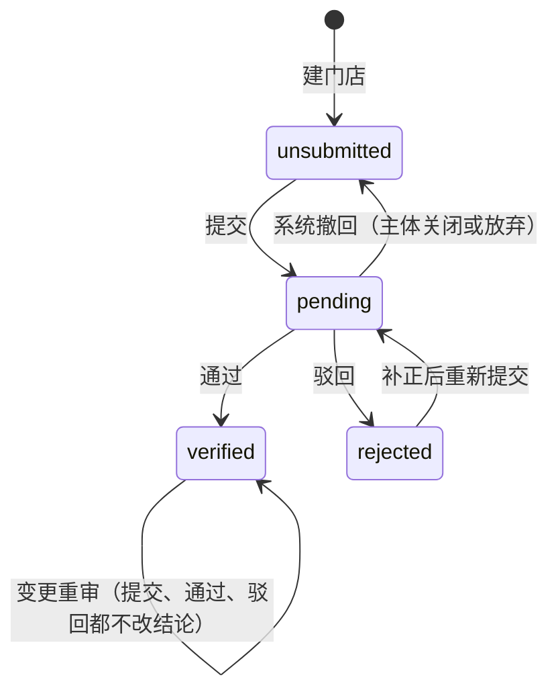

# D9 门店档案与资质审核 profile · 子系统设计（草案 v1）

> 「狸有戏」V1.0 子系统设计。日期 2026-10-03。补 01-architecture.md:169、192 列出的 `profile` 模块。七份草案都没有设计它：d4 把门店档案与证照明细交给“商家建档设计”（d4-identity.md:538、557），d5 说证照业务表“属 D3 的审核模型”（d5-media.md:943），d3 只以“资质记录 ID”引用它（d3-flow.md:2292）。统一表清单为它暂定了五张表（decisions.md:136-140），裁决 M11 规定字段级定义以本稿为准（rulings.md:19）。本稿已按两份复核意见修订，逐条处理见文末“评审意见处理表”。
>
> **出处约定**：引用写“文件名:行号”。`PRD.md` 指 PRD 第 7 稿；`merchant/X.dc.html`、`admin/X.dc.html` 指 `design/prototype/{merchant,admin}/src/` 下的画板源码；`d1-ledger.md` … `d8-content.md` 指同目录的八份草案；`01-`…`05-` 指 `docs/` 主文档；`prd-tech.md`、`proto-*.md` 指 `docs/appendix/research/`；`catalogue.json`、`decisions.md`、`rulings.md`、`wf1-findings.md` 指数据模型工作目录下的统一表清单、分歧处理、主负责人裁决（M1–M32）与复核意见。【默认】= PRD 与原型都没写、本稿给出的默认处理，汇总在第 9、11 节。
>
> **建模约定**（01-architecture.md:254-262；03-key-designs.md:601-615；catalogue.json 的 conventions）：主键 `uuid`（UUID v7，应用生成）；表名单数蛇形；枚举 `text + CHECK`；金额整数分、列名以 `_fen` 结尾；时间 `timestamptz`，按日的规则用 `date`（Asia/Shanghai）；门店维度的表带 `entity_id` 与 `store_id`；多人会改的行带 `lock_version`；敏感字段用 `_enc`（密文）、`_bidx`（盲索引，只在需要等值查找时建）、`_mask`（脱敏串）；外键列名用被引用表全名加 `_id`（rulings.md:30）；文件引用列沿用全仓约定的 `file_id`，需要标明角色时写 `<角色>_file_id`（catalogue.json:75 的命名规则；`store_service_item.image_file_id` 与统一表清单一致，`logo_file_id` 同此写法）。d5 的静态检查按“列名含 `file_id`”找文件列（d5-media.md:354），所以文件列名都必须含这个子串。所有表有 `created_at`，可变表有 `updated_at`，下文字段表不再重复列出。

## 0. 一页摘要

1. profile 拥有 5 张表，表名与统一表清单一致，不增不减：`store_profile`、`store_profile_media`、`store_service_item`、`qualification_submission`、`qualification_doc`。主体与门店的骨架、名称、资质结论列留在 tenant 的 `entity`、`store` 上（d4-identity.md:544-548、563），profile 只经 tenant 的函数写它们，不重复建列。
2. 复核意见要求先定的三点（wf1-findings.md:214-217）：
   - **第 4 步草稿**：联系人姓名与手机号存 `store_profile`（它不是审核对象，与前三步一样原地保存）；主体类型、信息确认、已上传未提交的证照存“未关闭的那一轮” `qualification_submission`（草稿态：`submitted_at` 为空、尚无审批单）及其下的 `qualification_doc`。
   - **待审值**：已通过门店改门店名称、地址、行业与品类时，新值只写进变更轮次的 `proposed_*` 列，`store.name` 与 `store_profile` 的生效值不动；审核通过的事务里由 profile 写回。首次提交与新增门店的轮次在提交时把同一组值快照进 `proposed_*`，所以每轮审核的对象都在提交行上。
   - **证照与轮次**：`qualification_doc` 挂在轮次下（N:1）。每轮的证照行是本轮要审的全集：新上传的记 `uploaded`，上一轮没被驳回、原样带入的记 `carried`（同一个文件、同一份识别结果，另起一行）。驳回按行标记；补正时新一轮只缺被驳回的那一张。通过时本轮各行成为“生效证照”，旧的生效行标记被取代。
3. PRD 的四种审核状态（PRD.md:460）落在 `store.qualification_status`；主体的结论在 `entity.verification_status`（d4-identity.md:544；本稿对它的语义有调整，见 3.7 与 9-C22）。轮次自身没有状态列：是否草稿、在审、已关闭由 `submitted_at`、`closed_at` 与一对一的审批单表达（rulings.md:25）。
4. 已通过门店的变更重审不改门店结论：重审期间门店仍是“已通过”，旧值继续有效，订购、开工、绑定账号都不受影响（d3-flow.md:3411）。变更被驳回只是这次变更不生效。
5. 每轮提交对应一张 `approval_request`（`kind = qualification`，d3-flow.md:2351），审批单只记批没批、原因、时限；内容与比对结论在本模块的两张表里（03-key-designs.md:603）。
6. profile 在 L1（01-architecture.md:169），不调用 billing、order、delivery。审核通过只发 `store.qualification.approved`，开工由 order 的订阅者登记定时器（d3-flow.md:584）；交付经理的分配与转移归 delivery（01-architecture.md:192）。
7. 完整度是 `packages/shared` 里的一个纯函数，按 PRD 的必填项清单逐项计数（PRD.md:458）；库里只存缓存值。
8. 证照到期只做提醒，不改任何状态（PRD 没有这条规则，原型只写“到期前 30 天会提醒您更新”，merchant/ProfileCert.dc.html:61）。

## 1. 目标、边界与不做什么

### 1.1 负责什么

| 事项 | 出处 |
| --- | --- |
| 建档四步：基础信息、门店形象、服务与价格、资质认证；每步草稿；完整度 | PRD.md:410-458 |
| 资质提交、审核、驳回与补正、历次记录 | PRD.md:459-460、775；merchant/ProfileReview.dc.html:44-60 |
| 审核通过后的档案修改：哪些要重审、待审值、写回 | PRD.md:461、774 |
| 新增门店（含从已有门店复制档案）与新增门店的资质 | PRD.md:463、700-704；d4-identity.md:2265 把接口交给本稿 |
| 后台：档案页签、代改档案、资质页签、资质审核详情的数据 | PRD.md:774-775；admin/MerchantDetail.dc.html:84-125、160-198；admin/Review.dc.html:77-120 |
| 门店闸门 `storeGate`、建档是否齐全、门店城市与品类等事实，供上层与同层取用 | d3-flow.md:156、419-420、431-437 |

### 1.2 硬约束

| 约束 | 来源 | 对设计的含义 |
| --- | --- | --- |
| 每家门店的资质单独审核；套餐、积分、合同、授权书与发票抬头以主体为准 | PRD.md:34-35、462、702 | 证照分“属主体”（营业执照）与“属门店”（分支机构执照、行业许可证）两类；结论分主体、门店两级 |
| 首家门店的资质审核可与订购并行；新增门店通过前不能订购、绑定账号，店员不能上传本店素材 | PRD.md:173、349、704 | 闸门是三值函数，输入只有门店结论与“是否首店”（d3-flow.md:431-437） |
| 修改资质、门店名称、门店地址或行业与品类须重新审核；这些变更须由商家提交 | PRD.md:461、774、1134 | 这四类字段在已通过门店上不能原地改；后台代改接口不接受它们 |
| 医疗、医疗美容、药品等行业 V1.0 不开放，由字典控制 | PRD.md:96、1048；d6-notify-docs-data.md:1458 | 保存行业与品类时调用 `dicts.assertEnabled`（d6-notify-docs-data.md:1506） |
| 手机号、证照等敏感信息加密存储、脱敏展示；证照图片对店员不可见 | d4-identity.md:1691、1702、1723 | 证照号、法定代表人姓名、联系人手机号用敏感字段约定；店员视图只有状态（d4-identity.md:887-891） |
| 识别值只存 `ocr_result`；业务表存引用、提交值、修正值与比对结论 | d5-media.md:943 | `qualification_doc` 的列按这个口径 |
| 同步调用只能向下；同层调用按白名单 | 01-architecture.md:161；04-adr.md:40；rulings.md:47 | 第 7.6 节 |

### 1.3 不做什么

- 不建主体、门店、成员、邀请的表，不做名额判定。这些归 tenant（d4-identity.md:538-618、638-682）。
- 不存文件，不做上传、识别、内容安全。归 media（d5-media.md:263-275、1813-1904）。
- 不存审批的结论、原因、时限。归 approval（decisions.md:17）。
- 不分配、不转移交付经理，不建轮询表。归 delivery 与 staff（01-architecture.md:192；d3-flow.md:625-655；decisions.md 第 21 项）。
- 不扣减积分、不生成工单、不取消订购。审核结果只发事件（d3-flow.md:584、685）。
- 不采集法定代表人身份证件。隐私政策节选里写了，表单与 PRD 都不采集（merchant/Contracts.dc.html:111；d4-identity.md:1881）。
- 不做广告风格偏好与禁用内容（PRD.md:443-444 标 V1.1；merchant/ProfileService.dc.html:74-76），只留字段位。
- 不把档案媒体与门店素材库合成一张业务表（d5-media.md:295）。
- V1.0 后台不代商家上传证照、不代改重审字段（PRD.md:774）。d5 接口表里的“证照代传”（d5-media.md:2106）与此不一致，见第 10 节。

### 1.4 与其他模块的分工

| 模块 | 它负责 | profile 负责 | 接点 |
| --- | --- | --- | --- |
| tenant（L1 同层） | `entity`、`store` 的行与生命周期；门店名称 `store.name`；两个结论列的存放；信用代码唯一索引；门店名额 | 结论何时变、变成什么；待审的门店名称 | profile → tenant：`createStore`、`renameStore`、`setStoreQualification`、`applyEntityVerification`（7.6）；白名单已有（rulings.md:47） |
| media（L1 同层） | 文件登记与引用、证照识别 `ocr.recognize`、比对函数 `ocr.runFieldChecks`、内容安全 | 档案媒体行、证照行、提交值与修正值、比对结论的保存 | profile → media：`files.link` / `files.release`、`ocr.*`（d5-media.md:336-350、2134）；白名单已有 |
| approval（L1 同层） | 审批单的状态、原因、时限、读权限、发起人与审批人分离 | `qualification` 这个 kind 的处理器（校验、通过、驳回的领域动作）与详情组装 | profile → approval：`approval.submit`；approval 经注册的处理器回调 profile（d3-flow.md:2327-2344） |
| identity（L1 同层） | 登录手机号、短信验证码 `sms_verification`（rulings.md:13） | 联系人手机号的来源与验证标记 | 需要 `profile → identity` 一条白名单，现行白名单没有（第 10 节） |
| delivery、staff | 交付经理的分配、转移、在办工单移交 | 提供门店城市 | `profile.getStoreFacts`；分配时点见 d3-flow.md:627-630 |
| order、ad、publish（L3） | 订购校验、开工、整店取消、广告指派、账号绑定 | 闸门与建档是否齐全的判定；审核结果事件 | `profile.storeGate`、`profile.assertProfileComplete`；`store.qualification.approved` / `.rejected` |
| billing（L2） | 冻结、扣减、退回；资质终审不通过的套餐退款规则 | “主体资质已无法补正”的判定 | `profile.isQualificationDead`（d2-payment.md:179） |
| notify、config | 审核结果通知、代改通知；行业、区划、驳回原因字典；时限参数 | 事件与查询端口 | `m.review_result`（d6-notify-docs-data.md:246）；字典 `industry`、`region`、`reject_reason`（d6-notify-docs-data.md:1458-1462） |

## 2. 总体方案

档案是“一行当前值 + 两张子表”，商家与代改的员工原地修改，审计日志记前后值。需要审核的内容走轮次：每轮一行 `qualification_submission`，先是草稿，提交时建审批单，决定后关闭。门店的审核结论是 tenant 表上的一列，由审批处理器在同一事务里改。

| # | 决策 | 备选 | 取舍 |
| --- | --- | --- | --- |
| K1 | 门店结论放 `store.qualification_status`，主体结论放 `entity.verification_status`，由 profile 经 tenant 的函数写 | 放在 `store_profile` 上 | 开工事务对门店行加共享锁读交付经理与资质结论，审核对门店行加排他锁（d3-flow.md:602、932），结论在门店行上才有这层串行化；信用代码的部分唯一索引依赖主体结论列（d4-identity.md:555）；catalogue.json 的 `store`、`entity` 条目也是这个口径 |
| K2 | 轮次表不设状态列，用 `submitted_at`、`closed_at`、`outcome` | 轮次表自带 `draft / pending / approved / rejected` | 审批状态只在审批单上（decisions.md:17 的“两处真相”）；`closed_at` 是 M12 要求的在途标记（rulings.md:25）；`outcome` 只在关闭时写一次，供索引与草稿丢弃（没有审批单）使用 |
| K3 | 第 4 步草稿就是未提交的轮次行 | 另建草稿表，提交时复制 | 少一张表、少一次复制；证照文件从上传起就有业务行可以登记引用（3.8） |
| K4 | 变更重审不改门店结论 | 已通过 → 审核中（prd-tech.md:230 的写法） | PRD 只写“须重新审核”（PRD.md:461），没有说结论回退。回退会让改一个地址错字的门店在一个工作日内不能订购、不能开工；D3 的默认也是“以最近一次通过的资质为准”（d3-flow.md:3411）。见 9-C1 |
| K5 | 证照行每轮全量，未变的带入并另起一行 | 证照独立成行，另建“轮次 × 证照”关联表 | 每轮可直接还原；比对结论、审核修正值、驳回标记本来就是“某一轮对某张证照”的事实，放在行上不需要第六张表；每轮至多几行 |
| K6 | 联系人不进审核 | 联系人随轮次提交、修改要重审 | 它是联系方式，不是证照内容；改手机号要等一个工作日没有依据【默认，9-C6】 |
| K7 | 营业时间、核心卖点按 PRD 结构化存 | 按原型存单行文本 | PRD 写“支持多个时段”“1～5 个标签＋文本”（PRD.md:421、442）；原型两处是文本框（merchant/ProfileBasic.dc.html:66；admin/MerchantDetail.dc.html:106、110）。以 PRD 为准（proto-admin-b.md:110） |
| K8 | 完整度现算，库里只放缓存 | 每步存“已完成”标记 | 必填项会随品类的许可证要求变化（PRD.md:452），存标记会漂移 |

## 3. 数据模型

### 3.1 表清单与归属

| 表 | 归属 | 主键 | 说明 |
| --- | --- | --- | --- |
| `store_profile` | profile | `store_id` | 门店档案当前值：前三步的标量字段、联系人、完整度缓存、复制来源、资质相关的时间点 |
| `store_profile_media` | profile | `id` | 档案媒体行：门头、店内环境、实拍、宣传素材 |
| `store_service_item` | profile | `id` | 主推服务 1～10 项 |
| `qualification_submission` | profile | `id` | 资质轮次：草稿、提交、关闭；主体类型、信息确认、待审值、比对汇总；与审批单一对一 |
| `qualification_doc` | profile | `id` | 证照行：挂在轮次下；文件、识别结果引用、提交值、修正值、比对结论、驳回标记、生效标记 |
| `entity`、`store` | tenant | — | 定义见 d4-identity.md:540-567；本稿要求增补的列见 3.7 |
| `approval_request` | approval | — | 定义见 d3-flow.md:2247-2290 与 catalogue.json 的收窄说明 |
| `file_object`、`file_ref`、`ocr_result` | media | — | 定义见 d5-media.md:456-522、926-940 |
| `sms_verification` | identity | — | rulings.md:13 |
| `status_transition`、`audit_log`、`timer`、`outbox_event` | flow、audit、timers、events | — | 横切 |

### 3.2 `store_profile` 门店档案

与 `store` 一对一，主键即外键（catalogue.json 的主键约定②）。首家门店由 d4 的 `POST /api/v1/m/entities` 创建（d4-identity.md:622），那个事务不建档案行；profile 在第一次读写时补建（`INSERT … ON CONFLICT DO NOTHING`）。新增门店的档案行在创建门店的同一事务里建（4.4）。

| 字段 | 类型 | 约束 | 说明与出处 |
| --- | --- | --- | --- |
| store_id | uuid | PK；与 `entity_id` 组成复合外键 → `store(id, entity_id)` | d4-identity.md:562 的复合唯一键 |
| entity_id | uuid | NOT NULL | 归属列（01-architecture.md:255） |
| brand_name | text | 可空；2～30 字 | 品牌名称（PRD.md:416）。挂在门店档案上，新增门店时可复制（proto-merchant-b.md:56） |
| logo_file_id | uuid | 可空；指向 `file_object` | 品牌 Logo，JPG 或 PNG，≤5MB，建议 1:1（PRD.md:417；merchant/ProfileBasic.dc.html:42-44）；分类 `profile_image`（d5-media.md:273） |
| industry_code | text | 可空 | 一级行业，字典 `industry` 的编码（PRD.md:419；d6-notify-docs-data.md:1458）。**重审字段** |
| category_code | text | 可空 | 二级品类，同一字典的二级编码。**重审字段** |
| province_code / city_code / district_code | text | 可空 | 省、市、区，字典 `region` 的编码（PRD.md:420；d6-notify-docs-data.md:1459）。只存行政区划（国标码），不存功能区。**重审字段** |
| zone_code | text | 可空 | 功能区编码：字典 `region` 里 `functionalZone = true` 的项（`F` 前缀自编码，d6-notify-docs-data.md:1459）。门店地址位于功能区时填写，行政区仍记在 `district_code`；对应字典页“按门店地址归入并单独标注”（admin/SysDict.dc.html:113、118）与后台商家列表的区域筛选、区域列（admin/Merchants.dc.html:56、122）。它是标注，不单独触发重审；由谁、按什么规则归入待确认【默认，9-C17】 |
| address_detail | text | 可空 | 详细地址（PRD.md:420）。会出现在定制内容与广告里（merchant/ProfileBasic.dc.html:62），后台档案页签明文展示（admin/MerchantDetail.dc.html:92），不加密。**重审字段** |
| poi_name / latitude / longitude | text / numeric(9,6) / numeric(9,6) | 可空 | 地图选点的名称与坐标（PRD.md:420；merchant/ProfileBasic.dc.html:60）。坐标系待确认 |
| business_hours | jsonb | NOT NULL 默认 `[]` | 营业时间，多个时段：`[{ start: "HH:mm", end: "HH:mm" }]`（PRD.md:421）。时段数上限、是否按星期区分待确认（9-C7） |
| store_tel | text | 可空；≤20 字 | 联系电话，手机或座机，将出现在广告中（PRD.md:422；merchant/ProfileBasic.dc.html:70）。长度上限取后台代改表单的 20 字（admin/MerchantDetail.dc.html:108）；商家端原型没有设上限，按同一上限【默认，9-C9】。公开信息，不加密；后台示例为 `028-****6688`（admin/MerchantDetail.dc.html:472）。列名不用 `phone`，避开店员视图的禁用键扫描（d4-identity.md:909） |
| avg_spend_fen | integer | 可空；≥0 | 人均消费，单位元（PRD.md:423），存分 |
| brand_intro | text | 可空；≤300 字 | 品牌简介（PRD.md:424；merchant/ProfileBasic.dc.html:79） |
| promo_text | text | 可空 | 优惠活动，用于片尾引导（PRD.md:440）。代改表单上限 40 字（admin/MerchantDetail.dc.html:112）；商家端上限待确认 |
| group_buy_text | text | 可空 | 团购信息（PRD.md:441）；代改表单上限 40 字（admin/MerchantDetail.dc.html:113） |
| selling_point_codes | text[] | NOT NULL 默认 `{}`；至多 5 个 | 核心卖点标签，1～5 个（PRD.md:442；merchant/ProfileService.dc.html:62-63、159）。字典类型待 D6 增补（第 10 节） |
| selling_note | text | 可空；≤100 字 | 卖点补充说明（merchant/ProfileService.dc.html:71） |
| ad_style_code / banned_terms | text / text | 可空 | 广告风格偏好、禁用内容，V1.1（PRD.md:443-444）。V1.0 不写入 |
| contact_name | text | 可空 | 资质联系人姓名（PRD.md:453；merchant/ProfileCert.dc.html:68） |
| contact_phone_enc / contact_phone_mask | text / text | 可空；明文须是 11 位手机号（`^1\d{10}$`） | 联系人手机号（PRD.md:453），敏感字段（d4-identity.md:1691、1702）。格式校验取原型的规则与提示“请输入正确的 11 位手机号”（merchant/ProfileCert.dc.html:69、101），保存时在应用层校验。脱敏为前 3 后 4（d4-identity.md:1715；示例 `138****5678`，merchant/ProfileCert.dc.html:69）。没有按联系人手机号等值查找的场景（后台商家列表的搜索框只按“商家、主体名称”，admin/Merchants.dc.html:56；“是否登录手机号”在保存时用输入值比对），不建盲索引列。用途见 9-C6 |
| contact_phone_source | text | 可空；CHECK in (`login`,`sms_verified`,`unverified`) | 默认取登录手机号（PRD.md:453）；改成其他号码须短信验证，短信未配置时记“未验证”并提示审核人（d4-identity.md:2094） |
| contact_phone_verified_at | timestamptz | 可空 | |
| completeness_pct | smallint | NOT NULL 默认 0；0..100 | 完整度缓存（4.3）。展示在建档首页、“我的”页、后台档案页签（PRD.md:458、647；admin/MerchantDetail.dc.html:136-137） |
| required_filled / required_total | smallint | NOT NULL 默认 0 | 已填必填项数、全部必填项数（PRD.md:458） |
| copied_from_store_id | uuid | 可空；FK → `store` | 复制来源门店（PRD.md:700；prd-tech.md:38） |
| copy_options | text[] | NOT NULL 默认 `{}`；元素 in (`basic`,`service`,`media`,`brand_assets`) | 创建时勾选的复制项（merchant/StoreAdd.dc.html:52）；埋点 `store_add_submit` 要用（PRD.md:995） |
| effective_qualification_submission_id | uuid | 可空；FK → `qualification_submission` | 最近一次通过的轮次 |
| first_submitted_at / first_verified_at / last_decided_at | timestamptz | 可空 | 首次提交、首次通过、最近一次决定的时间。门店行的“06-13 认证通过”“06-13 通过”取 `first_verified_at`（merchant/Stores.dc.html:42；admin/MerchantDetail.dc.html:155）。主体卡片的“06-13 认证通过”（admin/MerchantDetail.dc.html:154）是主体级的时间，取 `entity.verified_at`（3.7） |
| final_rejected_at | timestamptz | 可空 | 终局驳回（“无法补正”）的时间（d3-flow.md:2375-2377） |
| last_edited_at / last_edit_actor_type / last_edit_actor_id | timestamptz / text / uuid | 可空 | 后台“最近修改：09-28 14:52 · 商家”与代改后的“周航（代改）”（admin/MerchantDetail.dc.html:86、766、796）。操作人类型取 R15 的四类（03-key-designs.md:615） |
| lock_version | int | NOT NULL 默认 0 | 商家与代改的员工可能同时改（proto-admin-b.md:90） |

索引：`(entity_id)`；`(city_code, district_code)`（后台按市、区县筛选；只按市筛选走前缀）；`(zone_code) WHERE zone_code IS NOT NULL`（按功能区筛选）；`(industry_code, category_code)`。

门店名称不在本表：生效值是 `store.name`（d4-identity.md:563），2～30 字（PRD.md:418），是重审字段。

### 3.3 `store_profile_media` 档案媒体行

| 字段 | 类型 | 约束 | 说明与出处 |
| --- | --- | --- | --- |
| id | uuid | PK | |
| entity_id / store_id | uuid | NOT NULL；复合 FK → `store(id, entity_id)` | |
| media_group | text | NOT NULL；CHECK in (`door`,`interior`,`product`,`promo`) | 门头照片、店内环境、服务或产品实拍、已有宣传素材（PRD.md:430-433） |
| position | smallint | NOT NULL；≥1 | 组内顺序；子表里的顺序号用 `position`（rulings.md:29） |
| file_id | uuid | NOT NULL；FK → `file_object` | 列名同统一表清单（catalogue.json:1236）。分类 `profile_image`、`profile_video`、`profile_promo`（d5-media.md:273-275） |
| media_kind | text | NOT NULL；CHECK in (`image`,`video`) | 实拍与宣传素材可以是视频（PRD.md:432-433；merchant/ProfileStore.dc.html:91） |
| caption | text | 可空 | 原型每张图有文字标签，如“门头正面”“大厅”（merchant/ProfileStore.dc.html:133-138）；PRD 没有这个字段，来源待确认（proto-merchant-b.md:69）。V1.0 留列，是否开放填写见 9-C8 |
| copied_from_store_id | uuid | 可空 | 由复制档案带入时填 |
| created_by_user_id | uuid | 指向 `merchant_user` | |
| removed_at | timestamptz | 可空 | 被删除或被替换的时间。行不物理删除（catalogue.json 的软删除约定） |

约束：`UNIQUE (store_id, media_group, file_id) WHERE removed_at IS NULL`；`INDEX (store_id, media_group, position) WHERE removed_at IS NULL`。

数量与规格（保存时在应用层校验，锁 `store_profile` 行后现数）：

| 组 | 数量 | 规格 | 出处 |
| --- | --- | --- | --- |
| 门头照片 | 1～3，只收图片 | 正面清晰，宽度不低于 1080 像素 | PRD.md:430；merchant/ProfileStore.dc.html:43-44、141、154 |
| 店内环境 | 3～9，只收图片 | — | PRD.md:431；merchant/ProfileStore.dc.html:61-62、155 |
| 服务或产品实拍 | 图片 ≤9、视频 ≤3 | 视频每条 ≤60 秒、≤200MB | PRD.md:432；merchant/ProfileStore.dc.html:79-80、162 |
| 已有宣传素材 | ≤9【原型数值，PRD 未写上限】 | 图片、视频 | PRD.md:433；merchant/ProfileStore.dc.html:141 |

门头照宽度由服务端按 media 的规格记录校验，不足 1080 时拒绝正式保存【默认】；端上先提示重拍（d5-media.md:1120）。被内容安全拦截的文件不能登记引用（d5-media.md:341），已登记后被拦截的不计入数量。

### 3.4 `store_service_item` 主推服务

| 字段 | 类型 | 约束 | 说明与出处 |
| --- | --- | --- | --- |
| id | uuid | PK | |
| entity_id / store_id | uuid | NOT NULL；复合 FK | |
| position | smallint | NOT NULL；≥1 | 排序 |
| name | text | NOT NULL | 名称，必填（PRD.md:439；merchant/ProfileService.dc.html:94、185）。长度上限待确认 |
| price_fen | integer | NOT NULL；>0 | 现价，必填且大于 0（merchant/ProfileService.dc.html:97、185） |
| original_price_fen | integer | 可空；≥ `price_fen` | 原价，选填，不能低于现价（merchant/ProfileService.dc.html:98、186） |
| image_file_id | uuid | 可空；指向 `file_object` | 图片，建议 1:1（PRD.md:439；merchant/ProfileService.dc.html:89、93）。原型不传图也能保存，按选填【默认】 |
| intro | text | 可空；≤20 字 | 简介（merchant/ProfileService.dc.html:100、187） |
| removed_at | timestamptz | 可空 | |

每家门店未移除的行 1～10 项（PRD.md:439；merchant/ProfileService.dc.html:149）。首页摘要里“主推菜品 5 项”的叫法随行业变化（merchant/Profile.dc.html:44），是展示文案，不建字段。

### 3.5 `qualification_submission` 资质轮次

一行 = 门店的一轮资质材料：先是草稿，提交后与一张审批单一对一，决定后关闭。

| 字段 | 类型 | 约束 | 说明与出处 |
| --- | --- | --- | --- |
| id | uuid | PK | 审批单以它为“资质记录 ID”（d3-flow.md:2292） |
| entity_id / store_id | uuid | NOT NULL；复合 FK | 资质逐店提交（PRD.md:463） |
| kind | text | NOT NULL；CHECK in (`initial`,`new_store`,`change`) | `initial` = 主体未认证时的提交，含主体营业执照；`new_store` = 主体已认证、门店尚未通过；`change` = 门店已通过后的变更重审。对应“首次提交 / 新增门店 / 重新审核”（prd-tech.md:39；admin/Review.dc.html:162、192） |
| resubmit_of_qualification_submission_id | uuid | 可空；FK 自引用 | 指向被驳回的上一轮；非空时队列里显示“重新提交”（proto-admin-b.md:331） |
| round_no | int | 可空；`UNIQUE (store_id, round_no)` | 提交时写入，门店内从 1 递增；同步写到审批单的 `round_no`（d3-flow.md:2258） |
| claimed_entity_type | text | 可空；CHECK in (`enterprise`,`individual`) | 商家所选主体类型：企业或个体工商户（PRD.md:450；merchant/ProfileCert.dc.html:107）。只有含营业执照的轮次要填；取值同 `entity.entity_type`（d4-identity.md:546）。驳回后新开的一轮（`resubmit_of_…` 非空）从上一轮带入这个值，商家可在第 4 步改 |
| proposed_store_name | text | 可空（草稿）；提交后非空 | 本轮送审的门店名称。草稿阶段 `change` 轮次只存改了的待审值；**提交时三组 `proposed_*` 一律填全**：`change` 轮次里改了的取待审值、没改的取提交时的生效值，其余轮次快照当前值。所以已提交的轮次上这三组值没有空值 |
| proposed_industry_code / proposed_category_code | text | 同上 | 本轮送审的行业与品类 |
| proposed_address_snapshot | jsonb | 同上 | 本轮送审的地址：`{ provinceCode, cityCode, districtCode, detail, poiName, latitude, longitude }`。送审与写回的对象只有省市区与详细地址四项；选点名称与坐标按 6.1 原地保存，快照里的这三项只供审核页参考，不写回、不参与不变量 I8 的比较 |
| changed_fields | text[] | NOT NULL 默认 `{}`；元素 in (`store_name`,`address`,`industry`,`docs`,`entity_license`) | `change` 轮次相对生效值改了哪几类，提交时计算；审核页与商家端据此提示 |
| contact_snapshot | jsonb | 可空 | 提交时的联系人：`{ name, phoneMask, phoneSource }`，不含明文（merchant/ProfileReview.dc.html:64；admin/Review.dc.html:161） |
| declaration_confirmed_at | timestamptz | 可空 | 信息确认勾选时间（PRD.md:454；merchant/ProfileCert.dc.html:73）。每轮提交都要勾选，补正重提的新一轮不沿用上一轮的勾选：确认的对象含本轮新传的证照【默认，9-C21】。原型的审核结果页没有这个勾选（merchant/ProfileReview.dc.html:43-52），须补（第 10 节 D7） |
| declaration_version | text | 可空 | 确认文案的版本号。是否改记到 `agreement_consent`、与 R13 的关系见 9-C23、11-Q9 |
| check_summary | jsonb | 可空 | 系统比对汇总：`{ fail, warn, manual, suggestedReasonCode, suggestedNote }`，不含识别原值（d5-media.md:943）。后台的结论条与预填的驳回原因取这里（admin/Review.dc.html:235、291） |
| checks_ran_at | timestamptz | 可空 | 最近一次比对时间 |
| approval_request_id | uuid | 可空；UNIQUE；FK → `approval_request` | 提交时写入，一对一（03-key-designs.md:603） |
| submitted_at | timestamptz | 可空 | 空 = 草稿 |
| submitted_by_user_id | uuid | 可空；指向 `merchant_user` | 只有老板能提交（PRD.md:717） |
| closed_at | timestamptz | 可空 | 审批被决定或撤回、草稿被丢弃时写入（rulings.md:25） |
| outcome | text | 可空；CHECK in (`approved`,`rejected`,`withdrawn`,`discarded`) | 关闭时写一次。前三个与审批单结论一致（不变量 I2）；`discarded` = 草稿未提交即作废 |
| approve_mode | text | 可空；CHECK in (`normal`,`corrected`,`override`) | 通过的方式：无异常直接通过、修正字段后通过、持权限放行（d5-media.md:1893-1898） |
| system_reject_code | text | 可空；CHECK in (`duplicate_entity`) | 系统自动驳回的原因（d4-identity.md:633） |
| final_rejected_at | timestamptz | 可空 | 审核人勾选“无法补正”（d3-flow.md:2375）。只允许出现在 `initial`、`new_store` 轮次 |
| created_by_user_id | uuid | 指向 `merchant_user` | |
| lock_version | int | NOT NULL 默认 0 | 草稿编辑、审核员修正字段都递增它；证照行的改动以轮次为聚合根 |

约束与索引：

- `uq_qualification_submission_open`：`UNIQUE (store_id) WHERE closed_at IS NULL`。一家门店同时只有一轮未关闭（草稿或在审）。这是 M12 要求的“在途唯一由领域表表达”（rulings.md:25）。审批单的 `dedupe_key`（`qualification:{storeId}`）同时填写，作第二道。
- `uq_qualification_submission_entity_open`：`UNIQUE (entity_id) WHERE closed_at IS NULL AND kind = 'initial'`。主体未认证时，同一主体同时只有一轮带主体营业执照；应用层另限定只有首家门店能建这类轮次（4.2 第 3 条），索引是兜底。
- CHECK：`(submitted_at IS NULL) = (approval_request_id IS NULL)`；`(closed_at IS NULL) = (outcome IS NULL)`；`outcome <> 'discarded' OR submitted_at IS NULL`；`final_rejected_at IS NULL OR (outcome = 'rejected' AND kind <> 'change')`。
- `INDEX (store_id, submitted_at DESC)`；`INDEX (entity_id, kind)`。

提交之后，商家侧的列不再变（应用层守卫）；审核期间只有 `check_summary`、`checks_ran_at`、`lock_version` 会变，关闭时写 `closed_at`、`outcome`、`approve_mode`、`final_rejected_at`。

“信用代码与其他在审主体相同”的重复标记（d4-identity.md:632）不落库：读审核队列与详情时，按本轮营业执照行的 `cert_no_bidx` 查其他主体“已提交、未关闭”的轮次派生，双方的审核单都能看到。这样一方的提交事务不必去改另一主体在审的行，既不破坏上面的“在审行不变”，也不会出现两个主体同时提交时互相等待对方轮次行的锁。

### 3.6 `qualification_doc` 证照行

| 字段 | 类型 | 约束 | 说明与出处 |
| --- | --- | --- | --- |
| id | uuid | PK | |
| entity_id / store_id | uuid | NOT NULL；复合 FK | `store_id` 是提交这一轮的门店 |
| qualification_submission_id | uuid | NOT NULL；FK | 所属轮次 |
| doc_type | text | NOT NULL；CHECK in (`business_license`,`branch_license`,`industry_permit`) | 营业执照、分支机构营业执照、行业许可证（PRD.md:451-452、703；prd-tech.md:40；admin/Review.dc.html:165-166、195） |
| permit_type | text | 可空 | 行业许可证的类型编码，如 `food_business`（d5-media.md:930）；`doc_type = industry_permit` 时必填 |
| scope | text | NOT NULL；CHECK in (`entity`,`store`) | 营业执照属主体，其余属门店（prd-tech.md:39） |
| file_id | uuid | NOT NULL；FK → `file_object` | 列名同统一表清单（catalogue.json:1351）。证照图片，分类 `kyc_license` 或 `kyc_permit`，图片 ≤5MB（d5-media.md:263-264）。每张证照一张图【默认】 |
| ocr_result_id | uuid | 可空；FK → `ocr_result` | 识别结果只存在 media（d5-media.md:943）。识别不可用时为空，商家手填（d5-media.md:1904） |
| origin | text | NOT NULL；CHECK in (`uploaded`,`carried`) | 本轮新上传，或由上一轮（或生效集合）原样带入 |
| carried_from_qualification_doc_id | uuid | 可空；FK 自引用 | `carried` 时必填 |
| submitted_fields_enc | text | 可空 | 商家核对后的提交值，JSON 密文（d5-media.md:943、1836-1837）。字段清单按证照类型：营业执照 = 名称、信用代码、法定代表人（或经营者、负责人）、营业期限、住所（admin/Review.dc.html:165、177、195）；食品经营许可证 = 经营者名称、许可证编号、经营场所、经营项目、有效期至（admin/Review.dc.html:166） |
| reviewed_fields_enc | text | 可空 | 审核员修正值（d5-media.md:943、1896）。对外取“修正值，否则提交值”（d5-media.md:1843） |
| field_checks | jsonb | NOT NULL 默认 `[]` | 逐项比对结论 `[{ code, field, result }]`，只有“通过 / 不通过 / 提醒 / 需人工”与字段名，不含原值（d5-media.md:943、1875-1887） |
| holder_name | text | 可空 | 证照上的主体名称或经营者名称，取“修正值，否则提交值”。`entity.name` 本身是明文（d4-identity.md:545） |
| cert_no_enc / cert_no_bidx / cert_no_mask | text / bytea / text | 可空 | 证件号：营业执照是统一社会信用代码，许可证是许可证编号（d4-identity.md:1702）。盲索引用于信用代码查重（d4-identity.md:632）；脱敏示例 `91510104MA6B****2R`、`JY25101040******`（merchant/ProfileCert.dc.html:114、116） |
| principal_name_enc / principal_name_mask | text / text | 可空 | 法定代表人、经营者或负责人姓名（d4-identity.md:548）；脱敏只留姓（`王**`，d4-identity.md:1718）。没有等值查找，不建盲索引 |
| principal_role | text | 可空；CHECK in (`legal_rep`,`operator`,`branch_head`) | 企业为法定代表人，个体工商户为经营者，分支机构为负责人（merchant/ProfileCert.dc.html:105；admin/Review.dc.html:195；d5-media.md:1856） |
| subject_type | text | 可空；CHECK in (`enterprise`,`individual`,`branch`,`unknown`) | 识别出的证照主体类型（d5-media.md:1857） |
| valid_from / valid_to | date | 可空 | 营业期限或许可证有效期（admin/Review.dc.html:165-166；d5-media.md:1858） |
| is_long_term | boolean | NOT NULL 默认 false | 营业期限为“长期”（merchant/ProfileCert.dc.html:114） |
| verdict | text | 可空；CHECK in (`accepted`,`rejected`) | 本轮对这张证照的结论；决定前为空 |
| effective_from | timestamptz | 可空 | 所在轮次通过时写入，这一行成为生效证照 |
| superseded_at | timestamptz | 可空 | 被后一轮的生效行取代的时间 |
| uploaded_by_user_id | uuid | 指向 `merchant_user` | 只有老板能上传证照（d5-media.md:1017） |

约束与索引：

- `UNIQUE (qualification_submission_id, doc_type, COALESCE(permit_type, ''))`：一轮里每种证照一行。
- 生效唯一：`UNIQUE (entity_id) WHERE scope = 'entity' AND effective_from IS NOT NULL AND superseded_at IS NULL`；`UNIQUE (store_id, doc_type, COALESCE(permit_type, '')) WHERE scope = 'store' AND effective_from IS NOT NULL AND superseded_at IS NULL`。
- CHECK：`(doc_type = 'business_license') = (scope = 'entity')`；`(doc_type = 'industry_permit') = (permit_type IS NOT NULL)`；`(origin = 'carried') = (carried_from_qualification_doc_id IS NOT NULL)`；`superseded_at IS NULL OR effective_from IS NOT NULL`。
- `INDEX (cert_no_bidx) WHERE doc_type = 'business_license'`（查重）；`INDEX (valid_to) WHERE effective_from IS NOT NULL AND superseded_at IS NULL AND valid_to IS NOT NULL`（到期提醒）。

每轮包含哪些行：

| 轮次 | 必须有 | 可以有 | 不能有 | 出处 |
| --- | --- | --- | --- | --- |
| `initial` | 营业执照；所选品类要求的行业许可证 | 分支机构执照；品类未要求的行业许可证 | — | PRD.md:451-452 |
| `new_store` | 所选品类要求的行业许可证 | 分支机构执照（如有须上传，须隶属本主体）；品类未要求的行业许可证 | 营业执照（沿用主体执照） | PRD.md:703、775；merchant/StoreAdd.dc.html:56 |
| `change` | 变更后的品类要求的行业许可证（带入或新传） | 分支机构执照；更换主体执照时的营业执照；品类未要求的行业许可证 | — | PRD.md:461 |

“品类要求的行业许可证”取字典 `industry` 扩展属性 `requiredCerts`（d6-notify-docs-data.md:1458；PRD.md:452“按品类由后台配置”）。原型示例：餐饮须上传食品经营许可证，便利店、洗衣“按后台配置无须上传行业许可证”（merchant/ProfileCert.dc.html:61；admin/Review.dc.html:175、184）。分支机构执照是否必须仍待确认（PRD.md:1168）。

“品类未要求的行业许可证”：商家可以自愿多传，也用于按驳回意见补传【默认】。驳回原因里有“缺少行业许可证”（admin/SysDict.dc.html:132；admin/Review.dc.html:244），而字典要求的许可证不齐时提交本身过不了 5.3 第 4 项，所以这条原因只会出现在审核人认为需要、品类却没有配置的情形，必须给商家一个补传入口。这类行的 `permit_type` 仍须是许可证类型字典里的编码，不计入完整度的分母；审核时与必传的许可证同样比对、同样可被点名驳回。

带入规则：驳回后新开的一轮，带入上一轮 `verdict` 不是 `rejected` 的全部行，并带入上一轮的 `claimed_entity_type`（3.5）；`change` 轮次带入该门店全部生效的门店级证照。被驳回的行不带入，新一轮里这一类缺失，由必填校验拦住提交。信息确认不带入，每轮重新勾选（3.5）。

### 3.7 需要 tenant 增补的列（表仍归 tenant，由 profile 经 tenant 的函数写）

| 表 | 列 | 说明 |
| --- | --- | --- |
| `store` | `qualification_status text NOT NULL DEFAULT 'unsubmitted'`，CHECK in (`unsubmitted`,`pending`,`verified`,`rejected`) | 门店资质结论；取值同共享枚举 `qualification_status`（catalogue.json 的 enums_shared）。d4 的 `store` 字段表没有这一列（d4-identity.md:557-567），catalogue.json 的 `store` 条目已注明放在本表 |
| `store` | `name` 允许为空 | 首家门店在第一次点“开始建档”时创建（d4-identity.md:622），此时还没有门店名称 |
| `entity` | `legal_rep_name_mask text` | d4 只有密文列（d4-identity.md:548），按敏感字段约定补脱敏列 |
| `entity` | `verified_at timestamptz`，可空 | 主体认证通过的时间：`tenant.applyEntityVerification` 第一次把结论置 `verified` 时写入，之后经 `change` 轮次更换营业执照不改它。后台主体卡片“06-13 认证通过”与审核详情“主体营业执照已于 06-13 审核通过”取这一列（admin/MerchantDetail.dc.html:154；admin/Review.dc.html:193）。d4 的 `entity` 字段表没有认证时间（d4-identity.md:540-553）；生效证照行的 `effective_from` 会随换执照变化，不能当作它 |
| `entity` | `verification_status`、`name`、`entity_type`、`uscc_*`、`legal_rep_name_enc` | 已有（d4-identity.md:544-548），由 `tenant.applyEntityVerification` 在审核通过时写入 |

`entity.verification_status` 的语义调整：d4 写的是“主体营业执照的审核结论”（d4-identity.md:544），本稿按“含主体营业执照的那一轮（`initial`）的结论”维护——`initial` 轮次被驳回时主体结论置 `rejected`，即使被点名驳回的只是行业许可证、营业执照那一行的 `verdict` 是 `accepted`。不让主体结论只跟营业执照行走的原因：驳回原因与具体证照无关时（如“主体与档案不一致”），`rejectedDocIds` 为空、各行都记 `accepted`（5.5 第 1、3 条），行上的 `accepted` 只表示“这张没被点名”，不等于审核人认可了营业执照；按它把主体置为已认证会放过有问题的主体。由此带来的后果在 5.1、7.1（`isQualificationDead`）写明，冲突登记在 9-C22，需 D4 改列说明（第 10 节）。

### 3.8 文件引用登记

`file_ref.ref_type` 用最终表名（rulings.md:32）。四处引用都须登记到 `FILE_REF_TYPES`（d5-media.md:354）：

| 引用方（`ref_type`） | 角色 | 建立 | 释放 → 保留 |
| --- | --- | --- | --- |
| `store_profile` | `logo` | 保存基础信息 | Logo 被替换 → 30 天；门店注销 → 180 天（d5-media.md:273、366） |
| `store_profile_media` | `main` | 保存门店形象 | 行被移除 → 30 天；门店注销 → 180 天（d5-media.md:366） |
| `store_service_item` | `image` | 保存服务与价格 | 同上 |
| `qualification_doc` | `main` | **证照挂到草稿行时** | 草稿行被替换、草稿被丢弃 → 7 天（最短缓冲，d5-media.md:346）；已提交过的行不释放，直到主体终止合作后 3 年（d5-media.md:263） |

1. 证照的引用不能等到提交才建。d5 现行写法是“证照……业务提交”时建立（d5-media.md:368），而从未被引用的文件入库 24 小时后即可清除（d5-media.md:353）。草稿可以放几天，所以本稿在挂到草稿行的事务里就登记（第 10 节）。
2. 复制档案只复制引用（d5-media.md:352）。被复制的 Logo、服务图片、媒体文件归属来源门店，登记时的归属断言用同一主体，不用同一门店（d5-media.md:341 的 `expect`）。需 D5 确认 `profile_*` 分类允许同主体跨门店引用。
3. 订购与广告的参考素材来自档案媒体时，只经 `file_ref` 登记（rulings.md:33）。档案媒体行被移除后，只要订购单或广告的引用还在，文件不会被清除。

### 3.9 变更留痕

| 变更 | 留痕位置 |
| --- | --- |
| 商家保存前三步、改联系人 | `audit_log` 的 activity 流，记改了哪些字段（d4-identity.md:1622；示例“修改档案：团购信息”，admin/MerchantDetail.dc.html:575） |
| 员工代改 | `audit_log` 的 ops 流：原因、备注、前后值、通知结果，填 `on_behalf_of_entity_id`（d4-identity.md:1532、1622；PRD.md:774、855） |
| 门店结论、主体结论的迁移 | `status_transition`（经 tenant 的函数调用 `flow.transition()`），并补一条 activity 审计行（rulings.md:49） |
| 每轮提交、决定 | `qualification_submission` 的行与审批单的状态历史 |
| 证照的替换 | `qualification_doc` 的历轮行与 `superseded_at` |
| 审核员修正字段 | `reviewed_fields_enc` + `audit_log`（前后值脱敏，d5-media.md:1896） |
| 证照原图与明文字段的读取 | `audit_log` 的 access 流（decisions.md 第 18 项；d5-media.md:1839） |

操作日志保留不少于 3 年（PRD.md:855）。

### 3.10 数据库级约束清单（手写 SQL，CI 比对；01-architecture.md:262）

1. `store_profile`：`contact_phone_source` 的 CHECK；`completeness_pct BETWEEN 0 AND 100`；`cardinality(selling_point_codes) <= 5`；`copy_options <@ ARRAY['basic','service','media','brand_assets']`；`avg_spend_fen >= 0`。
2. `store_profile_media`：`media_group`、`media_kind` 的 CHECK；3.3 的部分唯一索引。
3. `store_service_item`：`price_fen > 0`；`original_price_fen IS NULL OR original_price_fen >= price_fen`。
4. `qualification_submission`：3.5 列出的四个 CHECK、两个部分唯一索引、`UNIQUE (store_id, round_no)`、`UNIQUE (approval_request_id)`。
5. `qualification_doc`：3.6 列出的四个 CHECK、一个唯一索引、两个生效唯一索引。
6. `approval_request`：`kind = 'qualification'` 时 `entity_id`、`store_id` 必填（rulings.md:26 的按 kind 的 CHECK）。
7. 只在应用层校验：文本长度；联系人手机号的 11 位格式（加密前校验）；已提交轮次的 `proposed_*` 填全；各组媒体数量；主推服务 1～10 项；字典编码存在且启用；营业时间的结构；每轮必须有哪些证照；提交后商家侧的列不可变。

## 4. 建档四步与草稿

### 4.1 数据落点

| 步骤 | 字段 | 落点 |
| --- | --- | --- |
| 1 基础信息 | 品牌名称、Logo、行业与品类、地址、营业时间、联系电话、人均消费、品牌简介 | `store_profile` |
| 1 基础信息 | 门店名称 | `store.name`（经 `tenant.renameStore`） |
| 2 门店形象 | 四组媒体 | `store_profile_media` |
| 3 服务与价格 | 主推服务 | `store_service_item` |
| 3 服务与价格 | 优惠活动、团购信息、核心卖点、补充说明 | `store_profile` |
| 4 资质认证 | 联系人姓名与手机号 | `store_profile` |
| 4 资质认证 | 主体类型、信息确认 | 未关闭的 `qualification_submission`（草稿） |
| 4 资质认证 | 营业执照、行业许可证、分支机构执照 | 草稿轮次下的 `qualification_doc` |

### 4.2 草稿保存

PRD 要求每步可保存草稿（PRD.md:410）；原型每步有“保存草稿”与“保存并下一步”，后者先校验必填（merchant/ProfileBasic.dc.html:85-91、108；merchant/ProfileStore.dc.html:115-117；merchant/ProfileService.dc.html:81-83）。

1. 前三步的保存接口带 `draft` 标记。`draft = true` 只做格式校验（长度、字典、文件归属），不校验必填；`draft = false` 再校验本步必填。两者都原地写入，没有另一份草稿副本。
2. 门店结论不是 `unsubmitted` 之后，任何保存都不得把已填的必填项改空（返回 `PROFILE_REQUIRED_MISSING`）【默认，9-C4】。理由：提交之后档案已被审核人与剪辑师引用（admin/MerchantDetail.dc.html:138），订购校验要求必填项齐全（d3-flow.md:419）。
3. 第 4 步里写轮次或证照的接口（保存主体类型与信息确认、挂证照、改证照提交值、移除证照）开头调用 `ensureDraft(tx, storeId)`；保存联系人（`saveContact`，`PUT /profile/contact`）不调用它——联系人存 `store_profile`、不进审核（K6），已通过的门店、审核期间、终局驳回之后都可以原地改，不会因此建出草稿或被 `QUALIFICATION_IN_REVIEW` 挡住。`ensureDraft` 的规则：该门店有未关闭且未提交的轮次就用它；有在审的轮次返回 `QUALIFICATION_IN_REVIEW`；否则新建草稿。门店结论为 `unsubmitted` 或 `rejected` 时：主体已认证取 `new_store`；主体未认证且本店是首家门店（`store.is_primary`，d4-identity.md:564）取 `initial`；主体未认证且不是首家门店返回 `ENTITY_NOT_VERIFIED`【默认，9-C10】。新建时按 3.6 带入上一轮没被驳回的证照与上一轮的主体类型（`claimed_entity_type`）；信息确认不带入。门店结论为 `verified` 时类型取 `change`，带入生效的门店级证照。终局驳回的门店不能再建草稿（`QUALIFICATION_CLOSED`）。
4. 上传证照：端上先走 media 的上传登记与确认，再调用本模块的证照接口（d5-media.md:1826-1836）。识别在事务外执行（d5-media.md:1832），随后一个事务里写或替换草稿下的证照行并登记文件引用。同一类证照重新上传 = 替换草稿行（原型“重新上传”，merchant/ProfileCert.dc.html:53、117）。
5. 文本字段在提交时过内容安全检测，命中则拒绝保存（d5-media.md:1914）。
6. 审核期间：重审字段、主体类型与证照锁定，不能改；其余档案字段可以改。V1.0 不提供商家撤回【默认，11-Q5】。
7. 埋点 `profile_step_save` 由端上在保存成功后上报（PRD.md:993；d6-notify-docs-data.md:1835）。

### 4.3 完整度

完整度 ＝ 已填必填项 ÷ 全部必填项（PRD.md:458）。纯函数 `profileCompleteness(input)` 放 `packages/shared`，返回分子、分母、每步的状态与缺项清单；百分数用全仓唯一的取整函数（01-architecture.md:256）。

| 步骤 | 必填项 | “已填”的判定 | 出处 |
| --- | --- | --- | --- |
| 1 | 品牌名称、门店名称、行业与品类、门店地址、营业时间、联系电话、人均消费（7 项） | 非空；行业与品类两级都选；地址有省市区与详细地址；营业时间至少一个时段 | PRD.md:416-423；merchant/ProfileBasic.dc.html:108 |
| 2 | 门头照片、店内环境（2 项） | 门头 ≥1 张、店内环境 ≥3 张 | PRD.md:430-431；merchant/ProfileStore.dc.html:154-155 |
| 3 | 主推服务、核心卖点（2 项） | 服务 ≥1 项、卖点标签 ≥1 个 | PRD.md:439、442；merchant/ProfileService.dc.html:141-142 |
| 4 | 主体类型、营业执照、联系人、信息确认（4 项），外加品类要求的每种行业许可证各 1 项 | 见下 | PRD.md:450-454 |

第 4 步的判定取“当前资质视图”：有未关闭的 `initial` 或 `new_store` 轮次取它；否则取生效轮次；都没有则取最近一轮。`change` 草稿不影响完整度（生效值仍齐全）。主体已认证的门店，主体类型与营业执照两项视为已填（沿用主体执照，PRD.md:703）【默认】。联系人须姓名与手机号都有。餐饮门店的分母是 16，不要求许可证的品类是 15。

每步状态（未开始、进行中、已完成）由同一个函数给出；第 4 步在提交后显示审核状态（merchant/Profile.dc.html:44）。`completeness_pct`、`required_filled`、`required_total` 在每次档案写事务末尾重算并写回。字典里某品类的许可证要求变了，缓存会过期：单店读取时现算，每日不变量任务回填（I6）。

“建档必填项齐全”（PRD.md:173、570）在订购校验里指前三步的 11 项齐全；第 4 步由闸门覆盖（d3-flow.md:419）。提交资质要求四步必填项全部齐全（PRD.md:459）。

### 4.4 新增门店与复制档案

接口 `POST /api/v1/m/stores` 归本稿（d4-identity.md:2265），一个事务：

1. `tenant.createStore(tx, { entityId, name, … })`：锁主体行、校验老板身份与门店名额、建门店行、写审计（d4-identity.md:664、671、789）。门店创建即占额度（d4-identity.md:665）。
2. 建 `store_profile`，写入地址、行业与品类。原型的三个必填项是门店名称、地址、行业与品类（merchant/StoreAdd.dc.html:44-46、83-85），门店名称已在上一步写进 `store.name`；本页地址只有文本框，没有地图选点（proto-merchant-b.md:269），省市区留到第 1 步补全。
3. 按勾选项从来源门店复制（来源须是同一主体的门店）：

| 复选项（默认） | 复制什么 | 出处 |
| --- | --- | --- |
| 基础信息（勾选） | 品牌名称、品牌简介、营业时间；Logo 一并复制【默认】。联系电话、人均消费不复制【默认】 | merchant/StoreAdd.dc.html:52、74；proto-merchant-b.md:273 |
| 服务与价格（勾选） | 主推服务（含图片引用）、优惠活动、团购信息；核心卖点与补充说明一并复制【默认】 | 同上 |
| 门店形象（不勾选） | 勾选后复制四组媒体的引用；门头与店内环境须本店实拍，默认不复制 | PRD.md:700；merchant/StoreAdd.dc.html:52 |
| 品牌故事素材（勾选） | 调用 media 把来源门店的品牌故事素材复制到本店素材库（只复制引用，d5-media.md:861） | PRD.md:733；merchant/StoreAdd.dc.html:52 |

4. 资质不能复制（PRD.md:700；merchant/StoreAdd.dc.html:57）。门店结论为 `unsubmitted`，商家在第 4 步单独提交。
5. 接口带幂等键。埋点 `store_add_submit`（是否复制档案、复制项、主体门店数，PRD.md:995）在该门店第一次提交资质的事务里直记（d6-notify-docs-data.md:1837），属性取 `copied_from_store_id`、`copy_options`。

主体未认证时新增的门店可以建档，但提交资质要等主体认证通过【默认，9-C10】。

### 4.5 店员可见范围

PRD：店员看到只读的商家档案、素材上传入口、素材需求与“我上传的”、门店成员；看不到积分、订单金额、合同与发票（PRD.md:715）。建档信息仅老板可编辑（merchant/StaffProfile.dc.html:43；PRD.md:717）。

| 内容 | 老板 | 店员 | 出处 |
| --- | --- | --- | --- |
| 前三步的全部字段（含联系电话、媒体） | 读写 | 只读 | PRD.md:715；d4-identity.md:855-856 |
| 完整度、各步状态 | 可见 | 可见 | merchant/StaffProfile.dc.html:43 |
| 资质：审核状态 | 可见 | 可见 | d4-identity.md:890 |
| 资质：主体名称、脱敏信用代码、证照类型、证照图片、驳回原因、历次记录 | 可见 | 不可见 | d4-identity.md:884-890、1723；05-risks-and-open-issues.md:224 |
| 联系人姓名与手机号 | 可见（手机号脱敏） | 不可见【默认】 | d4-identity.md:909 |
| 素材需求卡片 | 可见 | 可见 | PRD.md:731；原型只在店员视角画了（proto-merchant-b.md:38） |

实现沿用 d4 的做法：契约里按角色定义两份响应 schema，运行时用角色对应的 schema 剥离字段（d4-identity.md:877-899）。原型的店员视角里第 4 步也有“查看”入口（merchant/StaffProfile.dc.html:43），按 d4 的默认只显示状态（9-C12）。

## 5. 资质审核

### 5.1 状态与取色

| 门店结论（`store.qualification_status`） | 商家端文案 | 后台取色（admin/Merchants.dc.html:150） | 含义 |
| --- | --- | --- | --- |
| `unsubmitted` 未提交 | — | `#EFEBE4` / `#5E564C` | 从未提交，或提交后被系统撤回 |
| `pending` 审核中 | “审核中”“资质审核中” | `#FBEDE5` / `#A63F12` | 有一轮 `initial` 或 `new_store` 在审 |
| `verified` 已通过 | “审核通过”“已认证” | `#E5F1E9` / `#256A42` | 最近一次首次审核或补正审核通过 |
| `rejected` 已驳回 | “审核未通过” | `#FBE9E7` / `#B42318` | 驳回待补正，或终局驳回（另看 `final_rejected_at`） |

商家端取色：“我的”页已认证 `#E6F2EA` / `#256A42`、审核中 `#FBEDE5` / `#A63F12`（merchant/Mine.dc.html:91-93）；审核结果页审核中 `#E8EEF9` / `#2E5AAC`、未通过 `#FCEBEA` / `#B42318`、已通过 `#E6F2EA` / `#256A42`（merchant/ProfileReview.dc.html:101）。同一状态在原型里有“审核通过”“已认证”“资质已通过”三种叫法（merchant/Profile.dc.html:34；merchant/Stores.dc.html:37；admin/MerchantDetail.dc.html:56），库里只有一个枚举值，文案在展示层映射（proto-merchant-b.md:39）。

派生状态（不落库）：

| 派生状态 | 条件 | 表现 |
| --- | --- | --- |
| 变更审核中 | 结论 `verified` 且有在审的 `change` 轮次 | 档案页提示“变更审核中”，生效值不变 |
| 终局驳回 | 结论 `rejected` 且 `store_profile.final_rejected_at` 非空 | 商家端不再出现“重新提交”；后台标“无法补正” |
| 证照即将到期 / 已到期 | 生效证照的 `valid_to` 在今天起 30 天内 / 早于今天 | 只提示，不改结论（5.8） |

主体结论 `entity.verification_status` 用同一组四个值（d4-identity.md:544）：`initial` 轮次提交时置 `pending`，通过时置 `verified`，驳回时置 `rejected`，被系统撤回时回到这一轮提交前的值（`unsubmitted` 或 `rejected`）。主体认证之后更换营业执照走 `change` 轮次，主体结论不变。它表达的是“`initial` 轮次的结论”，不只是营业执照一张证照的结论（3.7、9-C22）：首家门店因门店级证照被驳回时主体也是 `rejected`；主体未认证期间其他门店本来就不能提交（9-C10），所以 `pending`、`rejected`、`unsubmitted` 三个值对其他门店的效果相同，差别只在 `isQualificationDead`（7.1）。

### 5.2 迁移



| # | 从 | 事件 | 操作人 | 守卫 | 到 | 副作用 |
| --- | --- | --- | --- | --- | --- | --- |
| 1 | `unsubmitted` | `qualification.submit` | 老板 | 5.3 的提交校验 | `pending` | 建审批单；写轮次号与快照；`initial` 轮次同时把主体结论置 `pending`；发 `store.qualification.submitted` |
| 2 | `pending` | `qualification.approve` | 员工（`merchant.qualification.review`） | 5.4 的通过守卫 | `verified` | 5.6 的通过事务；发 `store.qualification.approved` |
| 3 | `pending` | `qualification.reject` | 员工（同上） | 原因至少 1 项、说明必填 | `rejected` | 5.5；`initial` 轮次同时把主体结论置 `rejected`；发 `store.qualification.rejected { final }` |
| 4 | `rejected` | `qualification.submit` | 老板 | 非终局；被驳回的证照已补齐；其余同第 1 行 | `pending` | 同第 1 行，`resubmit_of_…` 指向上一轮 |
| 5 | `pending` | `qualification.withdraw` | 系统 | 主体被关闭或放弃（d4-identity.md:800-801）。老板停用单家门店走不到这里：在审的资质轮次是停用守卫的阻断项（7.6；d4-identity.md:790） | 提交前的结论（`unsubmitted` 或 `rejected`） | 审批单撤回（d3-flow.md:2319）；轮次 `outcome = withdrawn`；`initial` 轮次同时把主体结论退回这一轮提交前的值（有过被驳回的 `initial` 轮次 → `rejected`，否则 `unsubmitted`）；发 `store.qualification.withdrawn` |
| 6 | `verified` | `qualification.change_submit` | 老板 | 6.2 | `verified` | 建审批单；发 `store.qualification_change.submitted` |
| 7 | `verified` | `qualification.change_approve` | 员工 | 5.4 的通过守卫 | `verified` | 5.6 的通过事务（写回待审值、切换生效证照）；发 `store.qualification_change.approved` |
| 8 | `verified` | `qualification.change_reject` | 员工 | 原因、说明必填；不能勾选“无法补正” | `verified` | 轮次关闭；待审值不生效；发 `store.qualification_change.rejected` |

迁移经 tenant 的 `setStoreQualification` 调用 `flow.transition()`（01-architecture.md:260）。状态历史的 `machine` 用最终表名 `store`（rulings.md:32）；`store.lifecycle` 的迁移（d4-identity.md:785-792）也用这个值，两组状态取值不相交，事件名带 `qualification.` 前缀区分。同一张表两个状态字段共用一个 `machine` 的问题在 `entity`（`lifecycle` 与 `verification_status`）上同样存在，需 flow 的定义方确认是否在状态历史上加一列区分（第 10 节）。第 6～8 行 `from = to`，照常写一行状态历史（d3-flow.md:2562 允许不改状态的动作）。

### 5.3 提交

提交是一个事务，带幂等键；加锁顺序：轮次行 → 主体行（仅 `initial`）→ 门店行。

| # | 校验 | 失败码 | 出处 |
| --- | --- | --- | --- |
| 1 | 操作人是老板；门店启用中 | `FORBIDDEN` / `STORE_ARCHIVED` | PRD.md:717；d4-identity.md:794、856 |
| 2 | 四步必填项齐全（4.3） | `PROFILE_INCOMPLETE` | PRD.md:459 |
| 3 | 行业与品类已开放、区划已开通 | `INDUSTRY_NOT_OPEN` / `VALIDATION` | PRD.md:1048；d6-notify-docs-data.md:1506 |
| 4 | 本轮证照符合 3.6 的清单；每张证照都有提交值 | `QUALIFICATION_DOCS_INCOMPLETE` | PRD.md:451-452 |
| 5 | 所选主体类型与营业执照识别出的类型不矛盾；识别不可用或类型为 `unknown` 时不拦 | `ENTITY_TYPE_MISMATCH` | merchant/ProfileCert.dc.html:49、100、131；d5-media.md:1880 |
| 6 | 已勾选信息确认 | `DECLARATION_REQUIRED` | PRD.md:454；merchant/ProfileCert.dc.html:74 |
| 7 | 联系人手机号是登录手机号或已通过短信验证；短信未配置时放行并记 `unverified` | `CONTACT_PHONE_UNVERIFIED` | d4-identity.md:2094 |
| 8 | 信用代码查重：命中已认证的其他主体（经 `tenant.findVerifiedEntityByUsccBidx`，7.6）→ 拒绝；命中其他在审主体 → 允许，提交事务不改对方的行，重复标记读时派生（3.5） | `USCC_TAKEN` | d4-identity.md:632 |
| 9 | 主体未认证时，只有首家门店能提交（`initial`）；其他门店须等主体认证通过（`new_store`） | `ENTITY_NOT_VERIFIED` | 【默认，9-C10】 |
| 10 | 门店没有其他未关闭的轮次（部分唯一索引兜底） | `QUALIFICATION_IN_REVIEW` | rulings.md:25 |

通过校验后：

1. 在内存里算好本轮要写的值：`round_no`、填全的 `proposed_*`（3.5）、`changed_fields`、`contact_snapshot`。此时还不写提交标记。
2. 调用 `ocr.runFieldChecks`（d5-media.md:1873）在“修正值，否则提交值”上逐张比对，写各行 `field_checks` 与轮次的 `check_summary`、`checks_ran_at`（这几列草稿态可写）。地址取第 1 步算好的送审地址；比对基准见下面的“比对基准”。
3. `approval.submit(tx, { kind: 'qualification', subject: { type: 'store', id }, entityId, storeId, roundNo, dedupeKey })`：审批单按 `sla.review.qualification` 算截止时间并登记 `sla.breach`（d3-flow.md:2314、3030）。
4. 用**一条** `UPDATE` 同时写 `round_no`、`submitted_at`、`submitted_by_user_id`、`proposed_*`、`changed_fields`、`contact_snapshot` 与 `approval_request_id`。CHECK `(submitted_at IS NULL) = (approval_request_id IS NULL)`（3.5）按语句即时检查，先写 `submitted_at`、后回填审批单 id 会在第一句就违例，所以先建审批单、再一次写齐。
5. 门店结论迁移（5.2 第 1、4、6 行）；`store_profile.first_submitted_at`。
6. 出站事件。埋点 `store_add_submit` 只在 `kind = new_store` 且 `round_no = 1`（该门店第一次提交资质）时直记；被驳回后的补正重提仍是 `new_store` 轮次，不再记，否则“新增门店并提交资质”（PRD.md:995）会被重复计数。埋点 `profile_submit` 在 d6 里由审批提交事件派生（d6-notify-docs-data.md:1836，“kind = 资质，首店”）；审批事件上分不出轮次类型，`new_store` 与 `change` 轮次建的是同一个 kind 的审批单，需 D6 改为由本模块的 `store.qualification.submitted` 派生并只计 `kind = initial`（载荷已带 `kind`，7.3；第 10 节）。

比对基准（传给 `ocr.runFieldChecks` 的输入，需 D5 确认输入结构，第 10 节）：

| 比对项 | 基准 | 说明 |
| --- | --- | --- |
| C1 执照主体名称与档案主体名称（d5-media.md:1877） | 主体已认证且本轮含营业执照（`change` 轮次更换主体执照）：`entity.name`。`initial` 轮次：不适用，不传基准、不产出 C1。`new_store` 轮次没有营业执照行，不涉及 C1 | `initial` 轮次没有先于这张执照的“档案主体名称”——主体名称正是由这张执照确定的；拿本轮执照的提交值当基准是自己比自己，恒为通过。审核页这一行的比对列显示“—”，结论条不写“主体名称与档案一致”。商家改过识别值仍由 C6 提示（d5-media.md:1882）【默认，9-C24】 |
| C8 许可证经营者名称（d5-media.md:1884） | 该门店本轮有分支机构执照（或 `change` 轮次带入了生效的分支机构执照）：以分支机构执照的名称为基准；否则以主体名称为基准（`initial` 轮次取本轮营业执照的“修正值，否则提交值”，其余取 `entity.name`） | 原型里新增门店的许可证经营者名称是“XX 餐饮管理有限公司春熙分店”，结论“与分支机构执照一致”（admin/Review.dc.html:196）；首次提交是“与执照一致”（admin/Review.dc.html:166）。d5 的 C8 只写“与执照主体名称一致”，照它算，以分店名义办证的门店必然“不通过”，只能走放行【默认，9-C24】 |
| C10 分支机构执照名称（d5-media.md:1886） | 主体名称（取法同上） | 对应原型的“隶属本主体”（admin/Review.dc.html:195） |
| 许可证编号格式、许可证经营场所与门店地址 | d5 的 C1–C11 里没有这两项（d5-media.md:1875-1887） | 原型两类轮次都有：许可证编号“格式有效”、经营场所“与门店地址一致”（admin/Review.dc.html:166、196）。需 D5 新增这两项比对（第 10 节）；D5 补上之前，审核页这两行的比对列显示“—”，由审核人对照原图核对 |

提交按钮上顺带请求“审核结果”订阅消息的授权，由前端处理（merchant/ProfileCert.dc.html:76；proto-merchant-b.md:102-103）。

### 5.4 系统比对与审核动作

后台审核页并排展示证照原图与识别结果（PRD.md:775），逐字段给出系统比对（admin/Review.dc.html:101-105）。比对项是 media 的纯函数（d5-media.md:1875-1887），原型出现过的结论文案有：与档案一致、格式有效、在有效期内、与门店地址一致、与执照一致、隶属本主体、与分支机构执照一致、已过期（admin/Review.dc.html:165-166、195-196）。这些文案各自对应哪一项比对、以什么为基准，见 5.3 的“比对基准”表；其中许可证编号“格式有效”、许可证经营场所“与门店地址一致”两项 d5 还没有对应的比对项。

| 动作 | 守卫 | 权限点 | 出处 |
| --- | --- | --- | --- |
| 通过 | 没有“不通过”项 | `merchant.qualification.review` | admin/Review.dc.html:112-114；d5-media.md:1895 |
| 修正字段后通过 | 审核员按原图修正字段，比对在修正值上重跑后没有“不通过”项；修正前后值记审计 | 同上 | d5-media.md:1896；03-key-designs.md:499 |
| 持权限放行 | 仍有“不通过”项；填写不少于 10 个字的理由 | `merchant.qualification.override`（仅超级管理员） | d3-flow.md:2380；d4-identity.md:1175；d5-media.md:1897 |
| 驳回 | 选择驳回原因（字典 `reject_reason`，场景 `store_review`）并填写说明（≤200 字）；可指明被驳回的证照 | `merchant.qualification.review` | admin/Review.dc.html:132-140、306；d6-notify-docs-data.md:1462；d5-media.md:1898 |

规则：

1. 原型在比对有异常时禁用“审核通过”（admin/Review.dc.html:114、284）。本稿按 d3、d5 的默认保留拦截，另开“修正后通过”与“持权限放行”两个出口，否则识别出错会卡住合规商家（d5-media.md:1900；9-C13）。
2. 通过与驳回都要重新校验：轮次仍在审；`initial` 轮次的信用代码没有被别的主体认证（d4-identity.md:633）。不满足返回 `409 PRECONDITION_CHANGED`（d3-flow.md:2321）。
3. 新增门店的审核只核对本店的分支机构执照（如有）与行业许可证，主体营业执照已通过的不再重复审核（PRD.md:775）。详情里把主体的生效营业执照作为只读参考给出。
4. 审核详情由本模块按审批单引用组装并脱敏（d3-flow.md:2292、2403）。原型的识别结果列是脱敏值（admin/Review.dc.html:165）。脱敏值没法与原图逐字核对，本稿对持审核权限、且审批单仍待审的员工返回本轮证照字段的明文，每张审批单每人每次打开记一条 access 审计【默认，9-C14】。证照原图走 5 分钟地址并留痕（d5-media.md:1839；d4-identity.md:1735）。
5. 驳回原因字典的资质审核场景现有 4 项：证照模糊、主体与档案不一致、证照过期、缺少行业许可证（admin/SysDict.dc.html:131-132），审核页另有“其他”（admin/Review.dc.html:244）。驳回必须选字典里的编码，“其他”在字典该场景没有编码，需 D6 播种（第 10 节）；播种之前审核页不提供这一项。“缺少行业许可证”对应的补传入口见 3.6。系统按比对结果预填建议原因与说明（admin/Review.dc.html:169-170、291），预填规则【默认】：有效期不通过 → 证照过期；名称或主体类型不通过 → 主体与档案不一致；无法识别 → 证照模糊。其中“名称不通过”在 `initial` 轮次只可能来自 C8（许可证经营者名称），C1 在该轮次不适用（5.3 的“比对基准”）；`new_store` 轮次没有营业执照行，同样只来自 C8；`change` 轮次更换主体执照时 C1 也会触发。
6. 岗位：PRD 没写由谁审核，默认授予客服（d4-identity.md:1174、2083）。

### 5.5 驳回与补正

1. 驳回请求带 `reasonCodes`、`note`、`rejectedDocIds`（可空）、`final`。审批单记原因与说明；本模块把被点名的证照行置 `verdict = rejected`，其余行置 `accepted`；轮次关闭，`outcome = rejected`。
2. 商家端审核结果页展示驳回原因分类与说明、被驳回的那张证照，就地重新上传后才能点“重新提交审核”（merchant/ProfileReview.dc.html:45-50、110-111）；也可“修改其他资质信息”（merchant/ProfileReview.dc.html:51）。对应到数据：第一次补传时 `ensureDraft` 新建一轮，带入没被驳回的证照与上一轮的主体类型；补传的那张是新行；提交时走 5.3 的全部校验。原型这一页没有主体类型选择，也没有信息确认勾选，“重新提交审核”是否可点只看是否已补传（merchant/ProfileReview.dc.html:43-52、110-111）：主体类型靠带入满足 5.3 第 2 项；信息确认每轮重新勾选（3.5），这一页须补上勾选，否则提交会被 5.3 第 6 项（`DECLARATION_REQUIRED`）拦住（9-C21；第 10 节 D7）。
3. 驳回原因与哪张证照无关时（如主体与档案不一致），`rejectedDocIds` 为空，商家改档案或换证照后重新提交。
4. 驳回未标“无法补正”的，待开工的订购一直等着；满 7 天未重新提交由 D3 的定时器生成客服待办（d3-flow.md:698、2972）。
5. **终局驳回**：驳回时勾选“无法补正”（d3-flow.md:2375）。弹窗先取影响预览（待开工订购单数、待指派广告数、冻结积分），提交时带回这三个数做回显校验（d3-flow.md:2376）。预览数据在 L3，经端口取（7.6）。本模块只写 `final_rejected_at`（轮次与 `store_profile` 各一份）并发 `store.qualification.rejected { final: true }`；取消与退回由 order 的订阅者生成 `qualification_cancel` 申请（d3-flow.md:685、2377）。`change` 轮次不能终局驳回。
6. 终局驳回后商家端不能再提交【默认，11-Q4】。
7. 系统自动驳回：某主体认证通过后，信用代码相同的其他在审轮次由系统驳回，`system_reject_code = duplicate_entity`（d4-identity.md:633），不标终局【默认】。
8. 历次记录：商家端时间线“提交 → 未通过 → 重新提交 → 通过”（merchant/ProfileReview.dc.html:84-87）与后台资质页签的审核记录（admin/MerchantDetail.dc.html:191-196）都按轮次读：每轮的提交时间、提交了哪些证照（`uploaded` 的行即“重新上传了哪张”）、审批单的决定时间、决定人、原因与说明。

### 5.6 通过事务

审批单的通过动作回调本模块注册的处理器（d3-flow.md:2315、2341），与审批单的状态变更在同一事务：

```
approval.approve(tx)：SELECT approval_request FOR UPDATE；权限、职责分离、二次确认
onApproved（profile）：
 1  SELECT qualification_submission FOR UPDATE；守卫：已提交、未关闭
 2  本轮含营业执照 → tenant 锁主体行；tenant 锁门店行                      -- 顺序：审批单 → 轮次 → 主体 → 门店
 3  重新校验（5.4 规则 2）；非放行时比对无“不通过”项
 4  证照，分两句、顺序不能反：
          a 先把该门店原生效的门店级行置 superseded_at = now；本轮含营业执照时，主体原生效行同样处理
          b 再把本轮各行置 verdict = accepted、effective_from = now
          -- 生效唯一是部分唯一索引（3.6），不能延迟检查；先置新行会在第一句撞唯一
 5  本轮含营业执照 → tenant.applyEntityVerification(tx, { name, entityType, uscc 三列, legalRep 两列, status: 'verified' })
          第一次置 verified 时一并写 entity.verified_at（3.7）
          唯一索引冲突（另一主体已抢先认证）→ 整个事务回滚，返回 409 USCC_TAKEN
 6  写回待审值：只在 change 轮次做，且只处理 changed_fields 里列出的类别——
          store_name → tenant.renameStore；industry → store_profile 的行业、品类；
          address → store_profile 的省、市、区与详细地址四列（选点名称、坐标不写回，3.5）
 7  tenant.setStoreQualification(tx, storeId, 'verified' | 不变)            -- flow.transition，写状态历史
 8  轮次：closed_at、outcome = approved、approve_mode；
    store_profile：effective_qualification_submission_id、first_verified_at（首次）、last_decided_at；重算完整度
 9  outbox：store.qualification.approved 或 store.qualification_change.approved；
           第 6 步有实际变化 → store.profile.changed
```

1. 抬头：营业执照主体名称作为合同、授权书和发票的抬头（PRD.md:462），取 `entity.name`，第 5 步写入的是“修正值，否则提交值”（d5-media.md:1843）。
2. 第 5 步撞唯一索引后，这一轮仍在审；审核员重新打开时会看到重复标记，按驳回处理。
3. 首次通过后的不同后果由订阅者决定，本模块不区分：首家门店冻结中的订购开始制作并扣减积分；新增门店可以订购、绑定发布账号，店员可上传本店素材（admin/Review.dc.html:199、241）。
4. 被取代的证照行与文件不删除，引用不释放（3.8）。
5. 第 6 步只针对 `change` 轮次：`initial`、`new_store` 轮次的重审字段在提交前原地保存、审核期间锁定（4.2 第 6 条），生效值与 `proposed_*` 本来相同，不需要写回。`change` 轮次提交时 `proposed_*` 已填全（3.5），再加“只写回 `changed_fields` 列出的类别”，没改的字段不会被空值或旧值覆盖。地址写回后 `zone_code` 是否随之重新归入，随 9-C17 的归入规则一起定。

### 5.7 审核时限

| 项 | 规则 | 出处 |
| --- | --- | --- |
| 时限 | 提交后 1 个工作日；参数 `sla.review.qualification`，可调范围 1～5 个工作日 | PRD.md:459、775；d3-flow.md:3030；admin/SysParams.dc.html:110 |
| 计算 | 审批单提交时按工作日历算 `due_at`，并把策略快照进 `sla_snapshot`；之后改参数不影响已提交的单 | d3-flow.md:3048-3052 |
| 超时 | 定时器 `sla.breach`（主体为审批单）：仍待审 → 通知处理人与主管，生成超时待办 | d3-flow.md:2370、2941 |
| 队列 | 按提交时间排序；每项标“今天 11:40 截止”；页签“待审核 / 今日已审核” | PRD.md:775；admin/Review.dc.html:58-69、238 |
| 商家端 | “预计今天 18:20 前完成”取审批单的 `due_at` | merchant/Mine.dc.html:36；merchant/Stores.dc.html:42 |
| 重新提交 | 新的一轮是新的审批单，重新计时 | d3-flow.md:2321 |

原型示例里截止时间 = 提交时刻加 24 小时（09-29 18:20 提交 → 今天 18:20），与“工作时间 09:00～18:00 的 1 个工作日”算出来的不一定相同（proto-merchant-b.md:259）。以工作日历函数的结果为准（05-risks-and-open-issues.md:229）。

### 5.8 证照有效期

1. 提交与通过时，过期的证照比对为“不通过”（admin/Review.dc.html:166、168）。
2. 通过之后证照到期：PRD 没有规则；原型只有“到期前 30 天会提醒您更新”（merchant/ProfileCert.dc.html:61；admin/MerchantDetail.dc.html:184）。本稿只做提醒：通知模块按规则派生（03-key-designs.md:606），本模块提供查询端口；到期后门店结论不变，后台资质页签与工作台给出标记【默认，11-Q2】。
3. 商家更新证照走 `change` 轮次。

## 6. 档案修改

### 6.1 字段分类（审核通过之后）

| 类别 | 字段 | 谁能改 | 是否重审 | 出处 |
| --- | --- | --- | --- | --- |
| 重审字段 | 门店名称、门店地址（省市区或详细地址任一变化）、行业与品类 | 只有老板 | 是 | PRD.md:461、774；merchant/ProfileBasic.dc.html:49、54、62 |
| 资质 | 主体类型、营业执照、分支机构执照、行业许可证 | 只有老板 | 是 | PRD.md:461、717 |
| 免审字段 | 品牌名称、Logo、营业时间、联系电话、人均消费、品牌简介；门店形象；服务与价格 | 老板；客服或交付经理可代改 | 否 | PRD.md:461、774；merchant/ProfileStore.dc.html:112；merchant/ProfileService.dc.html:78 |
| 联系人 | 联系人姓名与手机号 | 只有老板 | 否【默认】 | 9-C6 |

只改选点坐标或选点名称、省市区与详细地址都没变的，不算修改地址【默认】。未通过过的门店（`unsubmitted`、`rejected`）没有生效值，四类字段都原地改。

### 6.2 变更重审流程

1. 已通过门店保存基础信息时，如果重审字段有变化，接口返回 `409 REVIEW_REQUIRED` 并列出字段，要求带 `confirmReview = true` 再次提交（proto-merchant-b.md:51 的二次确认）。确认后：免审字段原地生效；重审字段的新值写入 `change` 草稿的 `proposed_*`，生效值不动。
2. 行业与品类变了，许可证要求可能跟着变。草稿按新品类检查证照：缺的要补传，不再要求的在草稿里移除。所以“保存即提交”不总是成立——草稿齐全时接口可带 `submitNow = true` 在同一事务里提交，否则引导到第 4 步补证照后提交。
3. 只换证照（如许可证续期）：在第 4 步替换草稿里的那一行后提交。
4. 提交走 5.3（第 2 项只查前三步与变更后的证照），建审批单；审核动作与 5.4 相同。
5. 通过：5.6 的事务写回。驳回：轮次关闭，生效值不变；商家可再开一轮（带入上次的待审值与没被驳回的证照）或放弃。草稿可随时丢弃（`outcome = discarded`）。
6. 变更重审用独立的事件名（`store.qualification_change.*`）。原因：D3 订阅 `store.qualification.rejected` 后会做待开工超期待办与整店取消（d3-flow.md:685、698），这些只应针对从未通过的门店。

### 6.3 重审期间旧值是否有效、对在途订单的影响

1. 旧值继续有效。门店结论保持 `verified`，闸门保持 `full`：订购、开工、广告指派、绑定账号照常（d3-flow.md:435、3411）。这回答了 prd-tech.md:806 的 Q-12。
2. 首页城市、“为你推荐”的行业匹配、埋点里的城市与品类都读生效值（PRD.md:400、405、987；d6-notify-docs-data.md:1872），待审值不参与。
3. 在途订单不因档案变更自动改动。PRD 明确档案变更不会自动更新已确认的广告视频，需要更新的由商家在“我的广告”里提出修改或提交新需求（PRD.md:464；merchant/ProfileStore.dc.html:112；merchant/ProfileService.dc.html:78）。
4. 成片质检要求字幕、品牌名、地址、电话、价格与商家档案一致（PRD.md:372）。质检读的是当时的生效档案；写回之后才制作或质检的集数按新值。已交付的成片不回头处理【默认】。本模块发 `store.profile.changed`，是否给交付经理生成待办由 D3 定（第 10 节）。
5. 授权书写明被授权方（以营业执照主体为准）及下单门店（PRD.md:1065）。主体名称或门店名称变更后，已生成的授权书是否换版由 D6 定（第 10 节）。
6. 渠道账号的认证主体须与营业执照一致（admin/MerchantDetail.dc.html:161、208）。主体名称经 `change` 轮次变更后，已核验账号是否要重新核验，待定（11-Q7）。
7. 交付经理按城市轮询分配（PRD.md:776）。门店换城市不触发重新分配【默认】；需要时由主管转移。

### 6.4 员工代改

1. 客服或交付经理可代商家修改无须重新审核的字段：须选择修改原因，保存后通知商家，修改前后内容记入操作日志（PRD.md:774）。权限点 `merchant.profile.proxy_edit`（d4-identity.md:1171）。
2. 修改原因 4 项：商家电话委托、商家企业微信委托、资料有误经商家确认后更正、其他；备注选填，≤60 字（admin/MerchantDetail.dc.html:116-117）。原因是契约里的枚举，写进审计，不建字典【默认】。
3. 校验：必选原因、必须有变化（admin/MerchantDetail.dc.html:784-786）；带 `lock_version`。
4. 可改范围按 PRD 是全部免审字段。原型只开放 6 个文本字段（营业时间、人均消费、联系电话、核心卖点、优惠活动、团购信息，admin/MerchantDetail.dc.html:106-113），并要求“各项内容均不能为空”（admin/MerchantDetail.dc.html:783）；优惠活动、团购信息在 PRD 里是选填（PRD.md:440-441）。接口按 PRD 的范围与必填规则做，后台表单开放哪些字段由前端定（9-C15）。
5. 请求里出现重审字段、联系人或证照，一律拒绝（`FIELD_NOT_PROXY_EDITABLE`）。后台页面在这些字段旁标“变更须由商家提交并重新审核”（admin/MerchantDetail.dc.html:91、104）。
6. 保存后发 `store.profile.changed { source: 'staff_proxy' }`，通知模块给老板发“代改档案通知”（d6-notify-docs-data.md:253；prd-tech.md:502）。

## 7. 接口、事件与定时器

### 7.1 服务层接口（`packages/services/profile`，改库的函数首参为 `tx`）

```ts
// 供 order、ad、publish（L3）与 billing（L2）向下调用
profile.storeGate(tx, storeId): 'full' | 'parallel' | 'blocked'          // d3-flow.md:156（D3 文中写作 merchant.storeGate）
profile.assertProfileComplete(tx, storeId): void                          // 前三步必填齐全；否则 STORE_PROFILE_INCOMPLETE（d3-flow.md:419）
profile.getStoreFacts(tx, storeIds): Map<id, StoreFacts>                  // 生效值：门店名、品牌名、省市区、行业、品类、行业是否开放；firstVerifiedAt、finalRejectedAt
profile.getProductionProfile(tx, storeId): ProductionProfile              // 剪辑师与发布专员取用的档案文字、媒体文件、主推服务（d5-media.md:1964）
profile.isQualificationDead(tx, entityId): boolean                        // d2-payment.md:179
// 供 notify、media（按端口注册，7.6）
profile.listDocsExpiringOn(tx, { date }): { storeId, entityId, docType, permitType, validTo }[]
// 建档
profile.getOverview / getBasic / saveBasic / getMedia / saveMedia / getService / saveService / saveContact
profile.createStore(tx, { entityId, name, address, industry, copyFrom?, copyOptions })
profile.proxyEdit(tx, { storeId, patch, reason, note, lockVersion }, staff)
// 资质
profile.getQualification / saveQualificationDraft / attachDoc / updateDocFields / removeDoc / discardDraft
profile.submitQualification(tx, { storeId }, owner)
profile.listRounds(tx, storeId)                                           // 历次记录
profile.saveReviewedFields(tx, { approvalRequestId, docId, fields, lockVersion }, staff)   // 审核员修正并重跑比对
```

`storeGate` 的判定是 `packages/shared` 里的纯函数，输入 `{ qualificationStatus, isPrimary }`：`verified` → `full`；首家门店且 `pending` → `parallel`；其余 → `blocked`（d3-flow.md:433-437）。`change` 轮次不影响它。

`isQualificationDead`：主体结论为 `rejected`，且该主体最近一轮 `initial` 提交的 `final_rejected_at` 非空。按 3.7 的语义，首家门店的 `initial` 轮次被终局驳回即成立，不论被点名的是营业执照还是门店级证照：主体未认证时只有首家门店能提交（9-C10），这一轮终局之后主体已没有途径完成认证。d2 的套餐退款规则 `qualification_failed` 依赖它（d2-payment.md:179、957），口径需 D2 确认（第 10 节）。

`StoreFacts` 里行业是否开放取字典当前值，供订购校验第 3 项（d3-flow.md:420）。`firstVerifiedAt`、`finalRejectedAt` 取 `store_profile` 的同名列，给 d3 的两条补偿路径用：`order.pending_start_sweep` 按“资质通过时间”算补登记时点（d3-flow.md:585）；`flow.reconcile_sweep` 第 ② 项与不变量 I17 要判断“终局驳回的门店”（d3-flow.md:2378、3220、3261）。`storeGate` 把终局驳回与待补正都归为 `blocked`，分不出这两种；L3 不直接查本模块的表，所以由这个函数给出。扫描从订购单、广告一侧取门店集合，再批量调用它。

### 7.2 HTTP 接口（路径示意，契约在 `packages/contract`）

商家端（前缀 `/api/v1/m`；门店取请求头 `X-Store-Id`，d4-identity.md:811、846）：

| 方法与路径 | 用途 | 能力点（d4-identity.md:855-857） |
| --- | --- | --- |
| `GET /profile/overview` | 建档首页：完整度、四步摘要与状态、审核状态、主体名称；按角色裁剪 | `store.profile.read` |
| `GET /profile/basic`、`PUT /profile/basic` | 第 1 步；`PUT` 带 `draft`、`lockVersion`、`confirmReview?`、`submitNow?` | 读 / `store.profile.edit` |
| `GET /profile/media`、`PUT /profile/media` | 第 2 步，整步保存 | 同上 |
| `GET /profile/service`、`PUT /profile/service` | 第 3 步，整步保存（含主推服务数组） | 同上 |
| `GET /profile/qualification` | 当前资质视图：草稿或在审轮次、生效证照、驳回信息（老板）；状态（店员） | `store.profile.read` |
| `PUT /profile/qualification` | 保存第 4 步草稿：主体类型、信息确认 | `store.qualification.edit` |
| `PUT /profile/contact` | 联系人姓名、手机号（改号带短信验证码） | `store.qualification.edit` |
| `POST /profile/qualification/docs` | 证照挂到草稿并回显识别结果（d5-media.md:1831、2094 写作 `/m/stores/{id}/qualification/docs`） | `store.qualification.edit` |
| `PUT /profile/qualification/docs/{docId}`、`DELETE …/{docId}` | 保存核对后的提交值；从草稿移除 | 同上 |
| `POST /profile/qualification/submit` | 提交审核（幂等键） | 同上 |
| `DELETE /profile/qualification/draft` | 丢弃草稿（放弃变更） | 同上 |
| `GET /profile/qualification/rounds` | 历次审核记录 | 同上（仅老板） |
| `POST /stores` | 新增门店并复制档案（幂等键） | `store.create` |
| `GET /dicts?types=industry,region` | 归 D6（d6-notify-docs-data.md:1512） | 可匿名 |

“我的门店”“切换门店”“我的”页的门店卡（merchant/Stores.dc.html:42；merchant/Mine.dc.html:35、75）由读侧组装，本模块提供审核状态、完整度、提交时间与预计完成时间。

后台（前缀 `/api/v1/admin`）：

| 方法与路径 | 用途 | 权限 |
| --- | --- | --- |
| `GET /stores`、`/stores/summary`、导出 | 商家列表（审核状态、区域、行业等筛选，PRD.md:773；admin/Merchants.dc.html:56-57）；归读侧，本模块提供档案与资质字段的查询 | 商家管理“查看” |
| `GET /stores/{id}/profile` | 档案页签 | 查看 |
| `PATCH /stores/{id}/profile` | 代改档案（原因、备注、`lockVersion`） | `merchant.profile.proxy_edit` |
| `GET /stores/{id}/qualification` | 资质页签：结论摘要、生效证照、审核记录 | `merchant.qualification.view`（d3-flow.md:2351） |
| `GET /approvals?kind=qualification&view=todo\|done_today`、`GET /approvals/{id}` | 队列与详情；详情由本模块的处理器组装 | 同上 |
| `PUT /approvals/{id}/qualification/docs/{docId}/reviewed-fields` | 审核员修正字段，重跑比对 | `merchant.qualification.review` |
| `POST /approvals/{id}/approve`、`/reject` | 通过、驳回（d3-flow.md:2391-2392）；驳回体增加 `rejectedDocIds` | `merchant.qualification.review`；放行另需 `.override` |
| `GET /approvals/{id}/final-reject-preview` | 终局驳回的影响预览（d3-flow.md:2390） | `merchant.qualification.review` |
| `GET /files/{id}/url` | 证照原图地址，归 media（d5-media.md:2112） | `merchant.qualification.review` 或 `pii.license.view`（d4-identity.md:1723） |
| `POST /pii/reveal` | 查看明文，归 D4（d4-identity.md:1722） | `pii.*` |

审核详情里的关联单据说明（关联付款单待确认收款、关联订购单已冻结积分，admin/Review.dc.html:163、184）来自 billing 与 order，由后台路由层的用例函数拼装，不进本模块。

### 7.3 发出的领域事件

| 事件 | 载荷 | 时机 | 已知订阅者 |
| --- | --- | --- | --- |
| `store.qualification.submitted` | `{ storeId, entityId, submissionId, kind, roundNo }` | `initial`、`new_store` 轮次提交 | 通知：站内“新增门店已提交审核”（d6-notify-docs-data.md:253；merchant/Messages.dc.html:53） |
| `store.qualification.approved` | `{ storeId, entityId, submissionId, kind }` | 5.2 第 2 行 | order：为待开工订购单登记 `order.start`（d3-flow.md:584、2713）；通知 `m.review_result`（d6-notify-docs-data.md:246）；本模块：驳回信用代码相同的其他在审轮次 |
| `store.qualification.rejected` | `{ storeId, entityId, submissionId, final, reasonCodes }` | 5.2 第 3 行 | order：`final = true` 时生成 `qualification_cancel`（d3-flow.md:685）；通知 |
| `store.qualification.withdrawn` | `{ storeId, submissionId }` | 5.2 第 5 行 | — |
| `store.qualification_change.submitted` / `.approved` / `.rejected` | `{ storeId, entityId, submissionId, changedFields, reasonCodes? }` | 5.2 第 6～8 行 | 通知（需 D6 把这三个事件接到 `m.review_result`） |
| `store.profile.changed` | `{ storeId, entityId, fields, source }`；`source` ∈ `merchant`、`staff_proxy`、`review_writeback` | 档案生效值变化 | 通知（代改）；首页与推荐缓存；D3、D6 是否处理见第 10 节 |

负载只带 id 与字段名，订阅者回库读取。通知模块不能直接读本模块的表（`notify → profile` 不在同层白名单），它的文案变量经本模块注册的只读解析函数取（7.6；d6-notify-docs-data.md:110、281）。

### 7.4 订阅的事件

| 事件 | 来源 | 处理 |
| --- | --- | --- |
| `store.qualification.approved`（`kind = initial`，或本轮含营业执照） | 本模块 | 找出信用代码相同、属于其他主体的在审轮次，逐个在各自事务里由系统驳回（5.5 第 7 条）。扇出只登记、逐个处理（d3-flow.md:2701） |
| 门店停用（老板停用，d4-identity.md:790） | tenant（事件名由 D4 定） | 丢弃未提交的草稿轮次（在审轮次已被停用守卫挡住，不会出现）；释放该门店三类档案引用（`store_profile` 的 Logo、`store_profile_media`、`store_service_item` 的图片），`keepUntil = now + 180 天`（3.8；d5-media.md:273、366）。证照引用不在这里释放 |
| 门店恢复（d4-identity.md:792） | tenant | 对未移除的档案行重新 `files.link`（同一引用键再次登记即恢复为在用，d5-media.md:342）。停用超过保留期、文件已被清除的，登记时的状态断言会失败（d5-media.md:341）：对应的行标记移除并重算完整度，由商家补传【默认】 |
| 草稿门店删除（d4-identity.md:791） | tenant | 丢弃草稿轮次；释放档案文件引用与草稿证照行的引用 |
| 主体关闭或放弃（d4-identity.md:800-801） | tenant | 撤回在审轮次（5.2 第 5 行）、丢弃草稿；主体关闭时释放该主体全部 `qualification_doc` 的引用，`keepUntil = now + 3 年`（3.8；d5-media.md:263）；名下门店随主体关闭被停用，档案引用按“门店停用”一行处理 |
| `file.moderated` | media（d5-media.md:2139） | 档案媒体被拦截时重算完整度 |

### 7.5 定时器与周期任务

| 项 | 类别 | 说明 |
| --- | --- | --- |
| 资质审核时限 | 定时器 `sla.breach`，主体为审批单 | 由 approval 在提交时登记，不归本模块（d3-flow.md:2941） |
| 驳回后待开工超期 | 定时器 `order.rejected_stale` | 归 D3（d3-flow.md:2972） |
| 证照到期提醒 | 不是定时器 | 通知模块规则派生（03-key-designs.md:606）；本模块提供 `listDocsExpiringOn`；节点默认到期前 30 天；需 D6 增加规则、场景与参数（第 10 节） |
| `profile.invariants` | 周期任务（数据库定时器行，03-key-designs.md:607） | 每日，第 8 节的不变量；由 ops 调度（decisions.md 第 14 项） |

本模块没有自己登记的、会改状态的定时器。

### 7.6 端口与同层调用

| 端口 | 定义方 | 实现方 | 用途 |
| --- | --- | --- | --- |
| `approval` 的 kind 处理器（`validate`、`revalidate`、`onApproved`、`onRejected`、详情组装） | approval | profile | 5.3～5.6（d3-flow.md:2327-2344） |
| `QualificationImpactPort.previewFinalReject(tx, storeId)` → 待开工订购单数、待指派广告数、冻结积分 | profile | order | 终局驳回的影响预览（d3-flow.md:2376） |
| `StoreCloseGuard.countBlocking(tx, storeId)` | tenant | profile（在审的资质轮次；主体结论不是 `verified` 时的首家门店） | 门店停用守卫（d4-identity.md:790 写“由 D3 注册”，资质这一项应由本模块注册）。第二项是 9-C10 的默认处理：主体未认证时只有首家门店能提交 `initial` 轮次，首家门店一旦停用或被当作草稿门店删除，主体就再也无法认证；主体整体关闭不受这一项限制 |
| 通知的只读解析函数（`ctx.read.*`） | notify | profile | 通知场景的文案变量不取事件负载、由拥有数据的领域注册解析函数回库读（d6-notify-docs-data.md:110、281）。本模块注册：① 按 `submissionId` 取门店名、轮次类型、结果、驳回原因文本与说明（原因与说明在审批单上，经 `profile → approval` 读）、是否终局——供 `m.review_result`（d6-notify-docs-data.md:246、802）与“新增门店已提交审核”；② 按 `storeId` 与事件里的字段名取代改的字段摘要——供“代改档案通知”（d6-notify-docs-data.md:253） |
| `StoreGatePort.gate(tx, storeId)` | media | profile | 素材上传鉴权要判断“新增门店通过前店员不能上传”（d5-media.md:1017）。media 不同步调用 profile，否则与 `profile → media` 成环；做法同 d8 的 `DramaFactsPort`（d8-content.md:590） |
| `authorizeUpload`（`kyc_*`、`profile_*` 分类） | media | profile | 上传登记时的业务鉴权：证照仅老板（d5-media.md:1017） |
| `profile.listDocsExpiringOn` | notify | profile | 证照到期提醒的查询端口（同 d6-notify-docs-data.md:697 的形态） |
| 行业、区划的引用计数 | config | profile | 字典停用校验“有门店使用则不可停用”（d6-notify-docs-data.md:1507） |

同层同步调用：`profile → tenant`、`profile → approval`、`profile → media` 已在白名单（rulings.md:47）。另需 `profile → identity`（读登录手机号的三列、核销短信验证码），identity 不调用 profile，不成环；若不增补，改为 profile 定义端口、identity 注册（第 10 节）。

tenant 需要提供的函数（第 10 节）：`createStore`、`renameStore`、`setStoreQualification`、`applyEntityVerification`、`getStoreGateFacts`、`findVerifiedEntityByUsccBidx`（提交时查“信用代码是否已被其他已认证主体占用”，读 `entity.uscc_bidx`，5.3 第 8 项；d4-identity.md:555、632）。

## 8. 并发、幂等与不变量

1. 加锁顺序：审批单 → 资质轮次 → 主体 → 门店 → 档案行 → 子表行。前两级符合“领域申请单紧跟审批单之后”（rulings.md:50）；主体在门店之前与 d4 的名额操作一致（d4-identity.md:664）。需写进全局加锁顺序表（第 10 节）。
2. 商家保存前三步只锁 `store_profile` 行并比对 `lock_version`，不锁门店行（改门店名称时除外）。通过事务在持有门店行锁之后锁档案行，两条路径不成环。
3. 幂等：提交资质、新增门店带幂等键；通过与驳回按审批单状态幂等，后到者收到 `409`（d3-flow.md:2407）。
4. 两个主体同时用同一张营业执照：提交时允许并存并打标记，通过时由信用代码的部分唯一索引裁决（d4-identity.md:555、633-636）。
5. 每日不变量：

| # | 不变量 | 处理 |
| --- | --- | --- |
| I1 | 每家门店至多一轮未关闭的提交 | 索引保证；违例告警 |
| I2 | `kind = qualification` 的审批单与已提交的轮次一一对应；审批单待审 ⇔ 轮次未关闭；`outcome` 与审批单结论一致 | 告警 |
| I3 | 门店结论 `pending` ⇔ 有在审的 `initial` 或 `new_store` 轮次；`verified` ⇒ `effective_qualification_submission_id` 指向 `outcome = approved` 的轮次 | 告警 |
| I4 | 主体结论 `verified` ⇒ 有一行生效的营业执照，且 `entity.uscc_bidx` 等于该行 `cert_no_bidx` | 告警 |
| I5 | 已通过门店的生效证照覆盖当前品类要求的许可证 | 告警（字典改了要求之后会出现） |
| I6 | `completeness_pct` 等于现算值 | 自愈并告警 |
| I7 | 在审轮次的信用代码没有被其他主体认证 | 自愈（系统驳回）并告警 |
| I8 | 已通过门店的 `store.name` 与档案的行业、品类、地址等于最近一次通过轮次的 `proposed_*`。地址只比省、市、区与详细地址四项，选点名称与坐标不比（它们可以原地改，6.1）；已提交轮次的 `proposed_*` 是填全的（3.5），不会拿空值去比 | 告警（发现绕过审核的修改） |
| I9 | 证照行引用的文件在 `file_ref` 里有未释放的引用（主体已关闭的除外，7.4） | 告警 |
| I10 | 主体结论 `pending` ⇔ 该主体有在审的 `initial` 轮次 | 告警 |

## 9. PRD 与原型的冲突或空白 → 默认处理

| # | 冲突或空白 | 出处 | 默认处理 | 确认人 |
| --- | --- | --- | --- | --- |
| C1 | 已通过门店改重审字段后，结论是否回到“审核中”：PRD 只写“须重新审核”；调研记录写“重新进入审核中”；D3 默认以最近一次通过为准 | PRD.md:461；prd-tech.md:230、806；d3-flow.md:3411 | 结论不变，用派生状态“变更审核中”；旧值继续有效 | 业务 |
| C2 | 重审期间用新值还是旧值 | proto-merchant-b.md:51、525 | 旧值；新值存轮次的 `proposed_*`，通过后写回 | 业务 |
| C3 | 原型按证照粒度驳回并只补传那一张；PRD 只写“驳回时展示原因，商家修改后可重新提交”；后台驳回弹窗没有选择证照的控件 | merchant/ProfileReview.dc.html:45-50；PRD.md:460；admin/Review.dc.html:129-144 | 驳回请求可带被驳回的证照，后台弹窗须补这个选择 | 产品 |
| C4 | “每步可保存草稿”在提交之后的含义 | PRD.md:410；merchant/ProfileBasic.dc.html:85 | 未提交过的门店草稿不校验必填；提交过之后不得把已填的必填项改空 | 产品 |
| C5 | 审核状态文案三种叫法 | merchant/Profile.dc.html:34；merchant/Stores.dc.html:37；admin/MerchantDetail.dc.html:56 | 一个枚举，展示层映射 | 产品 |
| C6 | 联系人在“资质认证”一步里，改它算不算“修改资质”；改成任意号码没有验证；原型写联系人手机号“用于接收审核结果与交付通知”，而 d6 的审核结果通知接收人是老板 | PRD.md:453、461；merchant/ProfileCert.dc.html:69、101；d4-identity.md:2094；d6-notify-docs-data.md:246 | 不重审；非登录手机号须短信验证，短信未配置时标“未验证”。V1.0 联系人手机号**不作为**通知或交付通知的接收号码：通知按 d6 的场景发给老板，本稿不为它开读取端口（`getStoreFacts`、`getProductionProfile` 都不含联系人）；它随轮次快照脱敏展示在商家端审核结果页与后台审核页（merchant/ProfileReview.dc.html:64；admin/Review.dc.html:161）。原型那句文案列为待改；若产品确认要用它接收通知，再为它开读取端口并补脱敏与留痕 | 产品 |
| C7 | 营业时间：PRD 多时段，原型单个文本框，后台代改 ≤30 字文本 | PRD.md:421；merchant/ProfileBasic.dc.html:66；admin/MerchantDetail.dc.html:106 | 结构化时段数组；两端表单须升级 | 产品 |
| C8 | 核心卖点：PRD 标签＋文本，后台代改是 ≤100 字文本；标签候选是原型写死的 8 个，明显随品类变化；每张图的文字标签 PRD 没有 | PRD.md:442；merchant/ProfileService.dc.html:133；admin/MerchantDetail.dc.html:110；proto-merchant-b.md:69、83 | 标签存字典编码，补充说明另存；图注留列不开放 | 产品、运营 |
| C9 | 长度与校验：品牌名称、门店名称 2～30 字原型没校验；电话只校验非空；主推服务名称、优惠活动没有上限；简介 ≤20 字、原价不低于现价是原型新增；联系电话的上限只出现在后台代改表单（20 字）；联系人手机号原型按 11 位校验 | PRD.md:416-418；proto-merchant-b.md:55、85；admin/MerchantDetail.dc.html:108；merchant/ProfileCert.dc.html:69、101 | 按 PRD 校验；原型新增的规则照收（含联系人手机号 11 位）；联系电话两端统一 ≤20 字；其余缺的上限待确认 | 产品 |
| C10 | 主体未认证时，第二家门店能否提交资质；首家门店停用后主体如何认证 | PRD.md:703-704；d4-identity.md:564、790-791 | 不能：主体未认证时只有首家门店能提交（含营业执照），其他门店等主体认证通过。`is_primary` 不随停用转移（d4-identity.md:564），所以主体结论不是 `verified` 时首家门店不能停用、也不能当作草稿门店删除（本模块在停用守卫里对它计 1，7.6）；主体整体关闭不受限 | 业务 |
| C11 | 复制档案的范围：原型四个复选项没有覆盖核心卖点、联系电话、人均消费、Logo；“门店形象”可勾选但 PRD 写默认不复制 | merchant/StoreAdd.dc.html:52；PRD.md:700；proto-merchant-b.md:271-273 | 4.4 的表 | 产品 |
| C12 | 店员能否看资质：原型第 4 步有“查看”，PRD 只写只读档案 | merchant/StaffProfile.dc.html:43；PRD.md:715；proto-merchant-b.md:393 | 只见状态（同 d4-identity.md:2085） | 产品 |
| C13 | 比对有异常时原型禁用“审核通过” | admin/Review.dc.html:114 | 保留拦截，另有“修正后通过”与“持权限放行” | 业务 |
| C14 | 识别结果的展示：原型两端都是脱敏值，却要求商家“核对识别结果”、审核员“并排比对”；d5 允许商家修改识别值，原型只有“重新上传” | merchant/ProfileCert.dc.html:113-116；admin/Review.dc.html:165；d5-media.md:1835-1836 | 上传后的那一次回显给老板明文并可修改；审核详情给审核员明文并留痕；其余读取一律脱敏 | 产品、安全 |
| C15 | 代改档案的范围：PRD 是全部免审字段，原型 6 个文本字段且都不能为空 | PRD.md:774；admin/MerchantDetail.dc.html:106-113、783 | 接口按 PRD；表单范围由前端定 | 产品 |
| C16 | 行业许可证：PRD 只对营业执照写了识别，原型对食品经营许可证也识别并比对；“分支机构”出现在审核页的主体类型里 | PRD.md:451-452；admin/Review.dc.html:166、191；proto-admin-b.md:155-156 | 许可证识别按 d5 的开关（d5-media.md:1869）；主体类型仍只有企业与个体工商户，“分支机构”是证照的主体类型 | 业务 |
| C17 | 省市区的来源：PRD 写“自动解析”，没有说由谁解析；功能区（如高新区）不属于行政区划，后台却把它与行政区并列筛选、示例门店的区域就是高新区 | PRD.md:420；admin/SysDict.dc.html:113、118；admin/Merchants.dc.html:56、122；d6-notify-docs-data.md:1459 | 端上把选点结果带回，服务端按 `region` 字典校验；不引入逆地理编码服务。功能区另存一列 `zone_code`（可空，3.2），`district_code` 只存行政区划；后台“区域”筛选选中功能区时按 `zone_code` 查，其余按 `district_code` 查。不把功能区编码塞进 `district_code`：那样门店会丢掉所属行政区，省市区三级也不再都是国标码。由谁、按什么规则把门店归入功能区仍待确认 | 产品、运营 |
| C18 | 截止时间的算法：原型是提交加 24 小时，PRD 是 1 个工作日 | merchant/Stores.dc.html:42；PRD.md:459；proto-merchant-b.md:259 | 工作日历函数 | 业务 |
| C19 | 证照到期后的处理 PRD 没有 | merchant/ProfileCert.dc.html:61；proto-admin-b.md:116 | 只提醒，不改结论 | 业务、法务 |
| C20 | 草稿门店、审核中门店可被切换为当前门店 | proto-merchant-b.md:249；d4-identity.md:2099 | 成员关系与门店上下文不看审核状态，业务闸门由 `storeGate` 判定 | 产品 |
| C21 | 补正重提：原型在审核结果页就地补传被驳回的那张后直接“重新提交审核”，页面没有主体类型选择，也没有信息确认勾选；PRD 把信息确认列为必填 | merchant/ProfileReview.dc.html:43-52、110-111；PRD.md:454 | 新一轮带入上一轮的主体类型与没被驳回的证照；信息确认每轮重新勾选，不沿用上一轮（确认的对象含本轮新传的证照），审核结果页须补勾选 | 产品 |
| C22 | 主体结论列的语义：d4 定义为“主体营业执照的审核结论”；本稿在 `initial` 轮次被驳回时一律把主体结论置 `rejected`，哪怕被点名的只是门店级证照。后果：首家门店的 `initial` 轮次被终局驳回时 `isQualificationDead` 为真，d2 的 `qualification_failed` 套餐退款规则随之可用 | d4-identity.md:544；d2-payment.md:179、957；本稿 3.7、5.1、7.1 | 主体结论按“`initial` 轮次的结论”维护；不改成只跟营业执照行的 `verdict` 走（未被点名的行记 `accepted` 不等于审核人认可了营业执照，3.7）。D4 改列说明，D2 确认退款口径 | 业务、D4、D2 |
| C23 | 信息确认与 03 第 9 节 R13 的关系：PRD 的信息确认含“授权平台用于制作广告”，是一条同意证据；R13 裁决同意记录合并为一张、证据只存一处；V1.0 只播种 6 份协议 | PRD.md:454；03-key-designs.md:613；rulings.md:17 | 现记在轮次行上（`declaration_confirmed_at`、`declaration_version`），不进统一的同意记录，等法务对 11-Q9 的结论。若认定它属于同意记录：这两列删除，轮次行改存同意记录的 id；`profile → docs` 不在同层白名单（rulings.md:47），提交接口由路由层的用例函数先调 docs 记录同意、再调 `profile.submitQualification` 并把同意记录 id 传入，不增补白名单 | 法务、D6 |
| C24 | 系统比对的基准：原型首次提交显示“名称…与档案一致”，但首次提交时没有先于执照的档案主体名称；新增门店的许可证经营者名称是与分支机构执照比；许可证编号“格式有效”、经营场所“与门店地址一致”两项在 d5 的比对项里没有 | admin/Review.dc.html:165-166、177、186、195-196、235；d5-media.md:1875-1887 | 5.3 的“比对基准”表：`initial` 轮次 C1 不适用、显示“—”；C8 有分支机构执照时以它为基准；另两项请 D5 新增，补上之前显示“—” | 业务、D5 |

## 10. 需要其他草案配合的改动

| 对方 | 需要做的 | 本稿位置 |
| --- | --- | --- |
| D4 tenant、identity、authz | ① `store` 增加 `qualification_status`，`name` 允许为空；`entity` 增加 `legal_rep_name_mask`、`verified_at`；`entity.verification_status` 的列说明由“主体营业执照的审核结论”改为“含主体营业执照的那一轮（`initial`）的结论”（3.7、9-C22）。② 提供 `createStore`、`renameStore`、`setStoreQualification`、`applyEntityVerification`、`getStoreGateFacts`、`findVerifiedEntityByUsccBidx`；后两个写函数内部调用 `flow.transition()`。③ 门店停用、门店恢复、草稿门店删除、主体关闭或放弃的出站事件名定稿。④ `StoreCloseGuard` 里“审核中的资质”由本模块注册；本模块另注册“主体未认证时的首家门店”一项，删除草稿门店（d4-identity.md:791）也须经过同一守卫。⑤ 登记权限点 `merchant.qualification.view`（d3 已用，d4 的表里没有，d4-identity.md:1171-1175）；D5 的 `merchant.review.override` 作废后改用 `merchant.qualification.override`。⑥ 提供登录手机号的三列读取与短信验证码核销（用途“资质联系人手机号验证”，rulings.md:13）。⑦ 店员视图 `StoreProfileForClerk` 的字段按 4.5 更新黄金文件；店员回放测试的禁用键扫描命中 `price` 即失败、只有目录标价在白名单（d4-identity.md:909），而店员只读的“服务与价格”含主推服务的现价、原价（3.4 的 `price_fen`、`original_price_fen`），须把这两个键加进白名单 | 3.4、3.7、4.5、5.2、7.4、7.6 |
| D2 payment | `merchant.isQualificationDead` 改为 `profile.isQualificationDead`（d2-payment.md:179、957）；确认判定口径：首家门店的 `initial` 轮次被终局驳回即成立，不区分被点名的是营业执照还是门店级证照（7.1、9-C22） | 7.1 |
| D3 flow、approval、order | ① `status_transition.machine` 取 `store`、`entity` 时，同一张表有两个状态字段，确认是否加一列区分。② `approval.reject` 的请求体增加 `rejectedDocIds`，透传给处理器。③ `merchant.storeGate` 改为 `profile.storeGate`；`STORE_PROFILE_INCOMPLETE` 的判定调用 `profile.assertProfileComplete`。④ 实现 `QualificationImpactPort`。⑤ 确认变更重审用独立事件、不触发 `order.rejected_stale` 与整店取消。⑥ `store.profile.changed`（名称、地址、品类生效变更）之后是否给交付经理生成待办。⑦ 全局加锁顺序表加入“审批单 → 资质轮次 → 主体 → 门店 → 档案行”。⑧ `order.pending_start_sweep` 的“资质通过时间”与 `flow.reconcile_sweep` 第 ② 项、不变量 I17 的“终局驳回的门店”（d3-flow.md:585、2378、3220、3261）改从 `profile.getStoreFacts` 的 `firstVerifiedAt`、`finalRejectedAt` 取，不直接查本模块的表 | 5.2、5.5、6.2、6.3、7.1、7.6、8 |
| D5 media | ① `ocr_result`、`file_object`、`file_ref` 主键改 `uuid`。② 证照的文件引用在挂到草稿行时建立，不等提交（d5-media.md:368）；登记 3.8 的四个引用类型。③ `profile_*` 分类允许同主体跨门店引用（复制档案）。④ `ocr.runFieldChecks` 的输入结构确认：档案主体名称、送审地址、所选主体类型由本模块传入；分支机构执照用 `business_license` 的识别驱动。比对规则按 5.3 的“比对基准”表补三处：C1 的基准可以不传（`initial` 轮次），不传时不产出 C1；C8 的基准由调用方指定（有分支机构执照时取它的名称，d5-media.md:1884 现只写“执照主体名称”）；新增两项比对——许可证编号格式（规则随许可证类型配置）、许可证经营场所与门店地址（口径同 C5）。⑤ 接口 `POST /m/stores/{id}/qualification/docs` 改为门店取请求头的路径，归本模块（d5-media.md:2094）。⑥ 接口表里的“证照代传”删除或注明 V1.0 不开放（d5-media.md:2106）。⑦ 素材上传鉴权经 `StoreGatePort` 取闸门。⑧ 提供把品牌故事素材复制到新门店的函数 | 3.8、4.2、4.4、5.3、7.2、7.6 |
| D6 config、notify | ① 字典增加两个类型：门店核心卖点标签（暂名 `store_selling_point`，可按品类过滤）、行业许可证类型（暂名 `permit_type`，`industry.ext.requiredCerts` 引用它，带识别字段清单，d5-media.md:1866）。② 增加证照到期提醒：规则、场景、参数（暂名 `remind.cert_expiry.days` = 30）。③ `m.review_result` 接上 `store.qualification_change.*`；代改通知接 `store.profile.changed`；这几个场景的文案变量用本模块注册的只读解析函数取（7.6）。④ 明确门店名称或主体名称变更后授权书是否换版。⑤ 埋点 `profile_submit` 改由 `store.qualification.submitted` 派生，只计 `kind = initial`（d6-notify-docs-data.md:1836 现由 `approval.submitted` 派生，审批事件分不出轮次类型，变更重审会被计成建档提交）。⑥ 字典 `reject_reason` 的 `store_review` 场景播种“其他”（审核页有这一项，admin/Review.dc.html:244；字典页该场景只有 R01–R04，admin/SysDict.dc.html:131-132）。⑦ 许可证类型字典带上许可证编号的格式规则，供 D5 新增的比对项使用 | 3.2、3.6、5.3、5.4、5.8、6.3、7.3、7.6 |
| D7 平台 | ① `infra/ci/layers.json` 增加 `profile → identity`（或确认改用端口）。② 后台驳回弹窗补“被驳回的证照”选择与“无法补正”勾选；审核页补“修正字段”。③ 后台档案页签的营业时间、核心卖点按结构化字段展示与代改。④ 商家端审核结果页在“重新提交审核”前补信息确认勾选（merchant/ProfileReview.dc.html:43-52 没有；9-C21）；联系人手机号下“用于接收审核结果与交付通知”的文案待改（merchant/ProfileCert.dc.html:69；9-C6）。⑤ 后台审核页：`initial` 轮次的名称比对、D5 补上之前的许可证编号与经营场所两行，比对列显示“—”（9-C24）；商家列表的“区域”筛选选中功能区时按 `zone_code` 查（9-C17） | 3.2、5.3、5.4、5.5、6.4、7.6 |
| 数据模型（catalogue.json） | ① `store_profile` 的职责由“前三步”改为“前三步与联系人”。② `qualification_doc.store_id` 不可空，新增 `scope` 列区分属主体还是属门店（catalogue.json 的 `qualification_doc` 条目写“store_id 可空”）。③ `qualification_submission` 增加部分唯一索引（在途唯一）。④ 同层白名单补 `profile → identity`。⑤ `entity` 条目补 `verified_at`。文件列名本稿与清单一致（`store_profile_media.file_id`、`qualification_doc.file_id`、`store_service_item.image_file_id`），不需要改清单 | 3.3、3.5、3.6、3.7、7.6 |

## 11. 待拍板问题

| # | 问题 | 负责 | 不定的后果 |
| --- | --- | --- | --- |
| Q1 | 变更重审期间门店结论保持“已通过”（C1）是否接受 | 业务 | 若要回到“审核中”，闸门会挡住该门店的订购、开工与广告指派，须同时定义在途订单的处理 |
| Q2 | 证照到期后门店结论是否变化；是否限制新订购 | 业务、法务 | 现只提醒 |
| Q3 | 新增门店的资质口径：分支机构执照是否必须，行业许可证是否逐店提交 | 法务、业务（PRD.md:1168） | 现按原型：营业执照沿用主体、分支机构执照如有须上传、许可证按品类逐店提交 |
| Q4 | 终局驳回之后能否重新提交；误判如何纠正 | 业务 | 现不能自助重新提交；纠正只能走人工纠偏入口（d3-flow.md:1024-1030），该入口是否覆盖本模块的附带字段待 D3 确认 |
| Q5 | 审核中是否允许商家撤回 | 产品 | 现不允许；首家门店撤回后已下的待开工订购如何处理没有规则 |
| Q6 | 资质审核由哪个岗位执行；比对异常时谁能放行 | 业务（prd-tech.md:808） | 现默认客服审核、超级管理员放行 |
| Q7 | 主体名称变更后，已核验的渠道账号是否重新核验，已生成的授权书是否换版 | 业务、法务 | 现不联动 |
| Q8 | 同一营业执照被多个账号建档时，被系统驳回的一方能否换执照重新提交 | 法务（05-risks-and-open-issues.md:221） | 现可以（不标终局） |
| Q9 | 第 4 步的“信息确认”是否算一份协议，记入统一的同意记录 | 法务、D6 | 现记在轮次行上（时间与文案版本）；V1.0 只播种 6 份协议（rulings.md:17）。与 R13 的关系、改记时的调用路径见 9-C23 |
| Q10 | 识别回显与审核详情返回明文（C14）是否接受 | 安全、产品 | 若一律脱敏，商家无法核对，审核员须逐字段申请查看明文 |
| Q11 | 品牌是否应上移到主体（一个主体多个品牌） | 产品（proto-merchant-b.md:56） | 现品牌字段在门店档案上，靠复制保持一致 |
| Q12 | 草稿门店占门店额度、从未提交资质的可删除（d4-identity.md:665、2088）是否接受 | 产品 | 影响“还可新增 N 家”的计算 |

## 12. 评审意见处理表

两份复核意见共 24 条（第一份 10 条，记作 A1–A10；第二份 14 条，记作 B1–B14），其中 A4 与 B13、A10 与 B4 是同一问题。逐条对照原文核实后，24 条都成立，没有不采纳的；有备选方案的，下表写明取了哪一个、另一个为什么不取。表名清单不变，仍是 5 张；列的增减见表后。

| # | 意见（摘要） | 结论 | 处理 | 改动位置 |
| --- | --- | --- | --- | --- |
| A1 | 补正重提的新一轮没有规定带入主体类型；信息确认“每轮勾选”，而原型审核结果页没有这两项，提交会被拦住 | 成立，采纳 | 新一轮带入上一轮的 `claimed_entity_type`。信息确认二选一取“每轮重新勾选”，审核结果页补勾选；不取“沿用上一轮的勾选”——确认的对象含本轮新传的证照，沿用等于拿旧的确认覆盖没确认过的材料，而且它是否算同意证据还在等法务（9-C23） | 3.5、3.6、4.2 第 3 条、5.5 第 2 条、9-C21、第 10 节 D7 ④ |
| A2 | 新增门店的许可证经营者名称应与分支机构执照比；许可证编号格式、经营场所与门店地址两项在 d5 没有比对项 | 成立，采纳 | 增加“比对基准”表：C8 有分支机构执照时以它为基准；另两项请 D5 新增，补上之前审核页显示“—” | 5.3、5.4、9-C24、第 10 节 D5 ④、D6 ⑦ |
| A3 | “缺少行业许可证”没有补传入口；“其他”没有字典编码 | 成立，采纳 | 每轮“可以有”补“品类未要求的行业许可证”；请 D6 在 `store_review` 场景播种“其他”，播种前审核页不提供这一项 | 3.6、5.4 规则 5、第 10 节 D6 ⑥ |
| A4、B13 | `initial` 轮次的名称比对（C1）是自己比自己，恒为通过 | 成立，采纳 | 取“不适用”：`initial` 轮次不传基准、不产出 C1，审核页显示“—”；预填规则注明适用范围。不取“识别值对提交值”——那是 C6 已有的提示项，再让它产出“不通过”会把商家改正识别错误的情形挡在正常通过之外 | 5.3、5.4 规则 5、9-C24、第 10 节 D5 ④ |
| A5 | 联系人手机号的用途、11 位格式校验、联系电话 20 字上限没有落点；`contact_phone_bidx` 没有查找场景 | 成立，采纳 | C6 写明 V1.0 不作为通知接收号码、原型文案待改；补 11 位格式校验与联系电话 ≤20 字；删掉 `contact_phone_bidx` 列与索引 | 3.2、3.10、9-C6、9-C9、第 10 节 D7 ④ |
| A6 | 功能区（高新区）在表结构里没有落点；区域筛选走不到索引 | 成立，采纳 | 增加可空的 `zone_code`，`district_code` 只存行政区划；索引改为 `(city_code, district_code)` 并加 `(zone_code)`。不取“`district_code` 存功能区编码”——会丢掉所属行政区 | 3.2、5.6、9-C17、第 10 节 D7 ⑤ |
| A7 | 埋点 `store_add_submit` 在补正重提时会重复记 | 成立，采纳 | 改为 `kind = new_store` 且 `round_no = 1` 时直记 | 5.3 |
| A8 | 主体的“认证通过时间”没有落点 | 成立，采纳 | 请 D4 增加 `entity.verified_at`，首次置 `verified` 时写入。不取“读侧取主体证照行 `effective_from` 的最小值”——要扫历轮证照行，且依赖被取代的行永不清理 | 3.2、3.7、5.6、第 10 节 D4 ①、数据模型 ⑤ |
| A9 | 引言里 decisions.md 的行号不对 | 成立，采纳 | 改为 decisions.md:136-140 | 引言 |
| A10、B4 | 文件列名 `file_object_id` 与统一表清单、d5 的静态检查对不上；对 M17 的引用不成立 | 成立，采纳 | 两处改回 `file_id`；约定段改为引 catalogue.json:75 的命名规则，不再以 M17 为据；`logo_file_id`、`image_file_id` 保留 | 建模约定、3.3、3.6、第 10 节数据模型 |
| B1 | d3 的两条补偿扫描需要门店级的“终局驳回”“资质通过时间”，对外接口没有 | 成立，采纳 | `StoreFacts` 增加 `firstVerifiedAt`、`finalRejectedAt`；D3 一行写明两条扫描与 I17 改用它 | 7.1、第 10 节 D3 ⑧ |
| B2 | `entity.verification_status` 的语义被改了却没有声明；首店停用后主体无法认证 | 成立，采纳 | 取方案二：保留现写法并声明语义为“`initial` 轮次的结论”，登记冲突 C22，D4、D2 各补一项；C10 给出默认（主体未认证时首家门店不能停用或删除）。不取方案一（主体结论只跟营业执照行的 `verdict` 走）——未被点名的行记 `accepted` 不等于审核人认可了营业执照 | 0、3.7、5.1、7.1、7.6、9-C10、9-C22、第 10 节 D4 ①④、D2 |
| B3 | 待审值写回会把没改的字段写成空；会用旧快照覆盖商家原地改的坐标，I8 误报 | 成立，采纳 | 提交时 `proposed_*` 填全；写回只在 `change` 轮次、只处理 `changed_fields` 的类别；地址的写回与 I8 比较只取省市区与详细地址 | 3.5、3.10、5.3、5.6、I8 |
| B5 | notify 取文案变量的解析函数没有登记；`profile_submit` 会把变更重审计进去 | 成立，采纳 | 7.6 增加本模块向 notify 注册的只读解析函数；`profile_submit` 请 D6 改由 `store.qualification.submitted` 派生并只计 `initial`。取数路径没有照意见写“经 `approval_request_id` 反查”——本模块的提交事件载荷已带 `kind`，换事件源就不必反查 | 5.3、7.3、7.6、第 10 节 D6 ③⑤ |
| B6 | “双方都打重复标记”要改对方在审的行，与“在审行不变”和加锁顺序冲突；tenant 缺查重读函数 | 成立，采纳 | 重复标记改为读时派生，删掉 `has_duplicate_claim` 列；tenant 的函数清单补 `findVerifiedEntityByUsccBidx`。不取“独立事务异步回填”——多一条要保证送达的写路径，只为存一个可以现查的布尔值 | 3.5、5.3 第 8 项、7.6、第 10 节 D4 ② |
| B7 | `ensureDraft` 把联系人接口也包了进去 | 成立，采纳 | 改为“写轮次或证照的接口调用 `ensureDraft`”，写明 `saveContact` 不调用 | 4.2 第 3 条 |
| B8 | 提交与通过两段事务的步骤顺序与数据库约束冲突 | 成立，采纳 | 提交：先建审批单，再用一条 `UPDATE` 同时写提交标记与审批单 id；通过：先置旧行 `superseded_at`，再置新行 `effective_from` | 5.3、5.6 |
| B9 | 门店停用、主体关闭时没有释放文件引用 | 成立，采纳 | 7.4 拆成四行：门店停用释放三类档案引用（180 天）、门店恢复重新登记、草稿门店删除、主体关闭释放证照引用（3 年） | 7.4、I9 |
| B10 | 系统撤回与停用守卫矛盾；撤回后主体结论去向没写；缺主体 `pending` 的不变量 | 成立，采纳 | 撤回的触发只留主体关闭或放弃；写明 `initial` 轮次撤回时主体结论退回提交前的值；增加 I10 | 5.1、5.2、I10 |
| B11 | 店员回放测试会因主推服务的 `price` 键失败 | 成立，采纳 | 请 D4 把主推服务的现价、原价键加进禁用键扫描的白名单。不改键名：价格本来就是店员只读档案的内容（PRD.md:715），改名只是躲开扫描 | 第 10 节 D4 ⑦ |
| B12 | 配合改动表缺 D2 一行 | 成立，采纳 | 增加 D2 一行：改名并确认判定口径 | 第 10 节 D2 |
| B14 | 信息确认与 R13 的关系没有定 | 成立，采纳 | 第 9 节加 C23：现记在轮次行；若法务认定属于同意记录，由路由层的用例函数先调 docs，不增补白名单 | 3.5、9-C23、11-Q9 |

本轮修订对列的增减（表仍是 5 张）：

| 表 | 变化 |
| --- | --- |
| `store_profile` | 增加 `zone_code`；删除 `contact_phone_bidx`；`store_tel` 加 ≤20 字；索引 `(city_code)` 改为 `(city_code, district_code)`，增加 `(zone_code)`，删除 `(contact_phone_bidx)` |
| `store_profile_media` | `file_object_id` 改名 `file_id` |
| `qualification_submission` | 删除 `has_duplicate_claim`（改为读时派生） |
| `qualification_doc` | `file_object_id` 改名 `file_id` |
| `entity`（归 tenant） | 请 D4 增加 `verified_at`；`verification_status` 的列说明调整 |

修订后仍然开着、需要别人定的事项：D5 是否接受三处比对规则的改动（9-C24）；D4、D2 是否接受主体结论的语义与退款口径（9-C22）；法务对信息确认的定性（9-C23、11-Q9）；功能区的归入规则（9-C17）；主体未认证时首家门店不能停用这条默认是否接受（9-C10）。本轮修订没有运行任何程序验证，依据全部来自文件比对。
