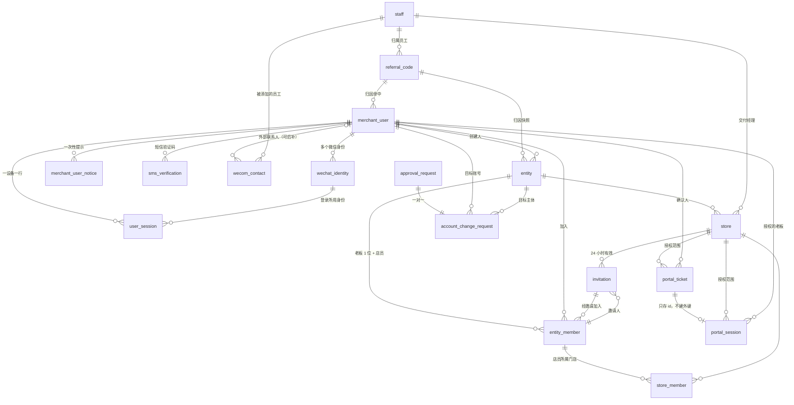
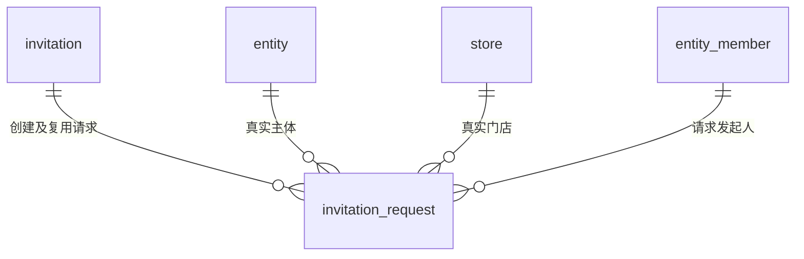

# 02 身份与租户

| 项 | 内容 |
| --- | --- |
| 模块 | identity（8 张）、tenant（7 张）、portal（1 张），都在 L1 |
| 表 | 16 张：`merchant_user`、`wechat_identity`、`user_session`、`portal_session`、`merchant_user_notice`、`sms_verification`、`wecom_contact`、`account_change_request`、`entity`、`store`、`entity_member`、`store_member`、`invitation`、`invitation_request`、`referral_code`、`portal_ticket` |
| 依据 | rulings M1、M5、M6、M7、M12、M13、M29、M32、M33、M36、M37、M40、M44；第二轮另按 M46、M47、M48、M49、M50、M51、M52、M53、M63、M78、M79、M91、M92；第三轮另按 M93、M94、M110；catalogue 的约定与本分组 15 张表的条目；decisions 第 1 节 #5、#9、#10、#11，第 3、6、10、12 节；草案 d4-identity 第 2.3、3、4、7.6、9、10 节，d7-platform 第 6 节（下载页票据），d9-profile 第 3.7、5.1、5.2 节，d6 第 3.4 节（`consent_stamp`） |
| Prisma 片段 | 工作目录 `dm/prisma/frag/02-identity-tenant.prisma`（合并后进 `packages/db`） |
| 手写约束 | 工作目录 `dm/sql/02-identity-tenant.sql`（合并后进迁移） |

## 1. 概览

这组表回答三个问题：谁在操作（商家账号、微信身份、三类会话里的两类、短信验证码），他属于哪个经营主体、能进哪些门店（主体、门店、成员、邀请），以及电脑端下载页怎样借老板的一次扫码拿到只读身份（票据与下载页会话）。账号以手机号唯一，一个账号可挂多个微信身份；主体是套餐、积分、合同的承载者；门店是订购与交付的单位。会话都存 PostgreSQL，吊销与状态变更同事务。

本分组通用的写法（下文各表不再重复）：

| 事项 | 写法 | 依据 |
| --- | --- | --- |
| 主键 | `id uuid`，UUID v7，应用生成；只有 `store_member` 用复合主键。主键约束一律叫 `pk_<表>` | 约定·主键；M48 |
| 时间 | 每张表有 `created_at`；可变表有 `updated_at`；都由应用时钟写入，不设数据库默认值 | 约定·时间 |
| 哈希与盲索引 | `bytea`，固定 32 字节，各带一条长度 CHECK | d4:183、212、492、606；约定·敏感字段三件套 |
| 密文 | `text`，格式 `v1:<kid>:<base64url>` | d4:1697-1698 |
| IP | `text`，存规范化后的文本地址（草案写 `inet`） | M51 |
| 多种操作人 | 三列：`<动作>_actor_type`、`<动作>_actor_id`、`<动作>_client` | 约定·操作人列；M44 |
| 外键列名 | 被引用表全名加 `_id`（`merchant_user_id`、`wechat_identity_id`、`portal_ticket_id`）；按角色命名的保留（`approved_by_user_id`、`inviter_member_id`、`delivery_manager_id`、`owner_staff_id`） | M33 |
| 外键删除行为 | 一律 `RESTRICT`；唯一例外是 `user_session.wechat_identity_id`（`SET NULL`） | — |
| 门店归属 | 门店维度的表用复合外键 `(store_id, entity_id) → store(id, entity_id)`，约束名 `fk_<表>_store_entity`，另对 `entity_id` 建单列外键。`entity_member.last_store_id` 同样写成复合外键（`fk_entity_member_last_store_entity`） | d4:562、595；约定·归属列；M47 |
| 成员归属 | 指向成员关系的列（邀请人、接受人、加入门店的操作人、店员本人）一律用复合外键 `(<列>, entity_id) → entity_member(id, entity_id)`，约束名 `fk_<表>_<角色>_entity`，保证与本行同一主体 | 补：同 M47 的思路；d4 I4 |
| 不可变列 | 触发器 `trg_<表>_immutable`，公共函数 `lyx_forbid_column_change(列…)`：列出的列在 UPDATE 时值有变化即报错。`account_change_request.new_phone_enc` 另用本分组函数 `lyx_02_clear_only(列…)`：只允许把值清为 NULL | 约定·归属列（创建时复制，不可变）；d4:187、1468；M50 |

物理删除的范围（M63 已把下面这些对象列入允许物理删除的范围）：

| 表 | 何时删行 | 依据 |
| --- | --- | --- |
| `wechat_identity` | 用户移除某个微信、注销、空账号清理；改绑到别的账号时删旧行、插新行（见 2.2） | d4:397、415、431；d4:1875（openid 注销即删除）；M63 |
| `user_session`、`portal_session` | 注销时立即删；其余在过期满 30 天后由维护任务删 | d4:431、1878；M63 |
| `portal_ticket` | 创建满 7 天 | d7:1235；M63 |
| `sms_verification` | 过期满 7 天；注销时立即删；`sendDirect` 发送失败时立即删（见 2.6） | 补：只存哈希的一次性凭据，没有留存价值【默认】；M63 |
| `merchant_user_notice`、`wecom_contact` | 注销时删该账号的行 | 补：与“注销即清空个人信息”一致【默认】（d4:431、1874-1876）；M63 |
| `store_member` | 移除成员、调整所属门店、门店停用 | d4:749、758、790；M63 |

不物理删除的：`merchant_user`（注销只改状态并清空个人信息）；`entity`、`store`（13 张以上的表以 RESTRICT 外键引用它们）。草稿门店同样不物理删除（M93，M63 的清单已去掉它）：删除草稿门店按 d4:791 记为停用（`archive_reason = 'draft_deleted'`），之后一律 403（d4:825）。所有引用 `store` 的外键统一 `ON DELETE RESTRICT`（M93）。

## 2. 表定义

### 2.1 `merchant_user` 商家用户账号

小程序商家用户；一个手机号一个账号，可挂多个微信身份。归属：全局。主键 `uuid`。不是只增表。有状态机（`status`）。lock_rank = 80（需要账号行与主体行的事务先取账号行）。

| 列 | 类型 | 空 | 默认 | 说明 | 出处 |
| --- | --- | --- | --- | --- | --- |
| id | uuid | 否 | — | 主键 | d4:181 |
| phone_enc | text | 可 | — | 手机号密文；注销后为空 | d4:182 |
| phone_bidx | bytea | 可 | — | 手机号盲索引，32 字节；唯一，空值不参与；注销后为空 | d4:183 |
| phone_mask | text | 可 | — | 手机号脱敏串，前 3 后 4（`138****6021`）；注销后为空 | 补：约定·敏感字段三件套；d4:1715 |
| phone_last4 | text | 可 | — | 手机号后四位，后台按后四位检索；注销后为空 | d4:184；admin/SysStaff |
| display_name | text | 可 | — | 称呼，不超过 20 字，写入前过文本内容安全检测；登录后可填，加入门店时必填；注销后为空 | d4:185 |
| status | text | 否 | — | 账号状态：`active` 正常 / `disabled` 后台禁用 / `deleted` 已注销或空账号已清理 | d4:186 |
| source_type | text | 否 | — | 注册来源类型：`organic` 自然流量 / `sales` 销售 / `campaign` 活动 / `partner` 服务商（V1.0 只声明）；首触写入，不可改 | d4:187；M6、M40；PRD.md:392 |
| source_channel_code | text | 可 | — | 首触时启动参数里的渠道码原值（不论是否命中登记） | d4:188 |
| source_invite_code | text | 可 | — | 首触时启动参数里的邀请码原值 | d4:188 |
| source_scene | integer | 可 | — | 首触时的小程序场景值 | d4:188 |
| source_referral_code_id | uuid | 可 | — | 判定来源时命中的 `referral_code` 行；没有命中为空 | 补：M6 由服务端按登记表判定来源，留下命中行供业绩归属到员工（PRD.md:392） |
| consent_stamp | text | 可 | — | 用户级协议（用户服务协议、隐私政策）当前版本集合的指纹；与配置缓存里的 `requiredStamp` 相等即放行。由 identity 写入 | d6:1131、1160-1171；M29 |
| last_active_at | timestamptz | 否 | — | 最近活跃时间：登录与会话续期时更新，同一天只写一次；休眠保护用 | d4:189 |
| dormant_bypass_until | timestamptz | 可 | — | 休眠保护的人工放行窗口截止时间（复核通过后 72 小时）；过期即失效 | d4:190、465 |
| created_at | timestamptz | 否 | — | 创建时间（注册时间） | d4:191 |
| updated_at | timestamptz | 否 | — | 更新时间 | d4:191 |
| deleted_at | timestamptz | 可 | — | 置为 `deleted` 的时间 | d4:191 |

**键与索引**

- 主键：`pk_merchant_user (id)`。
- 外键：`source_referral_code_id → referral_code.id`（`fk_merchant_user_source_referral_code_id`，RESTRICT）。
- 唯一：`uq_merchant_user_phone_bidx (phone_bidx)`。登录建号用 `INSERT … ON CONFLICT (phone_bidx) DO NOTHING`（d4:276），所以是普通唯一索引，不是部分索引。
- 普通索引：`ix_merchant_user_phone_last4 (phone_last4)`（后台按后四位检索）；`ix_merchant_user_source_referral_code_id (source_referral_code_id)`（按登记码统计注册数）。

**手写约束**

- `ck_merchant_user_status`：`status IN ('active','disabled','deleted')`。
- `ck_merchant_user_source_type`：`source_type IN ('organic','sales','campaign','partner')`。
- `ck_merchant_user_source_referral`：来源不是 `organic` 当且仅当命中了登记码（`source_referral_code_id` 非空）。
- `ck_merchant_user_phone_bidx_len`：盲索引非空时为 32 字节。
- `ck_merchant_user_phone_last4`：非空时为 4 位数字。
- `ck_merchant_user_deleted`：`status = 'deleted'` 当且仅当 `deleted_at` 非空。
- `ck_merchant_user_pii_by_status`：`deleted` 时手机号四列与称呼全空；其余状态手机号四列全非空。
- `trg_merchant_user_immutable`：`source_type`、`source_channel_code`、`source_invite_code`、`source_scene`、`source_referral_code_id` 不可改。

**状态机**（`status`；经 `flow.transition()`，写 `status_transition`，`machine = merchant_user`，`state_field = status`；事件码见第 5 节“事件目录”）

| 当前状态 | 事件 | 新状态 | 守卫 | 触发者 |
| --- | --- | --- | --- | --- |
| — | 首次手机号登录（`merchant_user.register`）；老板更换时新老板号码没有账号，按号码建号（沿用同一迁移码，2.8） | `active` | 首次登录：协议已同意。老板更换建号：审批通过，不检查协议同意（`consent_stamp` 为空，`source_type = 'organic'`，`last_active_at` 取建号时刻，免得新老板首次登录被判为休眠），首次登录时按接口约定 C73 补同意（A143）；同样发出 `merchant_user.registered`，载荷带 `via: 'owner_transfer'`（事件目录 x01 与 a03 老板更换审批的副作用同步登记） | 商家用户；老板更换建号为员工（后台老板更换，a03） |
| `active` | 后台禁用（`merchant_user.disable`） | `disabled` | 权限点 `merchant.user.disable`；原因必填；二次确认；再验证 | 员工 |
| `disabled` | 后台启用（`merchant_user.enable`） | `active` | 同上 | 员工 |
| `active` | 注销（`merchant_user.delete`） | `deleted` | 无成员关系或店员可直接注销；老板须主体无生效套餐、在办订购、上线中成片、未完结资金单据（d4:425-431） | 商家用户 |
| `active` | 换绑手机号时被判定为空账号（`merchant_user.purge_empty`） | `deleted` | 从未有过成员关系 | 系统 |
| `deleted` | 任何 | 不变 | — | — |

置为 `deleted` 的事务（同一事务，d4:431、第 9.7 节）：

1. 吊销并删除会话与下载页会话；删除微信身份（13 的 `wx_subscribe_quota` 随之级联删除）。
2. 删除该账号的短信验证码、一次性提示、企业微信关系行。
3. 该账号的全部成员关系行：有效的置 `removed`（`account_deleted`），并且所有行的 `display_name` 置空（d4 第 9.7 节“称呼注销即清空”）。
4. 以该账号为目标、仍在审的账号变更申请由系统代为撤回，申请行的 `new_phone_enc` 随之置空【默认】。
5. 清空手机号四列与称呼，写 `deleted_at`。
6. 发出站事件 `merchant_user.deleted`：通知模块订阅后删除该账号的站内消息，并清空其投递行的 `target_ref`、`target_masked`（13 的请求；M94 增补的 identity → notify 只用于 `notify.sendDirect`，注销清理仍用事件，不做同步调用）。

同一手机号再次登录会新建账号。

**不变量**（每日校验；编号与登记口径见第 5 节“不变量登记”）

- `identity.I8`：手机号在本表内唯一（d4 I8；由唯一索引保证，校验只查索引是否存在）。
- `identity.I22`：`status <> 'active'` 的账号没有未吊销的 `user_session` 与 `portal_session`（`disabled` 靠每请求校验拦截，校验只对 `deleted` 告警）。
- `identity.I23`：`source_referral_code_id` 非空时，`source_type` 等于该登记码的 `source_type`。
- `identity.I24`：`deleted` 账号名下没有微信身份、会话、短信验证码、一次性提示、企业微信关系行，其成员关系行的 `display_name` 全为空。

**相对草案的改动**

- 增加 `phone_mask`（约定·敏感字段三件套；catalogue 的 notes）。d4 只有密文、盲索引、后四位。
- 增加 `consent_stamp`（d6:1131；M29 由 identity 自己写）。
- 增加 `source_referral_code_id`（补，见上表）。
- `source_type` 取值由 d4 的 `organic / sales / partner` 改为四个（M40）。
- `phone_last4` 类型由 `char(4)` 改为 `text` 加 CHECK；`phone_bidx` 由 `bytea(32)` 改为 `bytea` 加长度 CHECK（PostgreSQL 的 `bytea` 没有长度修饰）。
- d4 的 `user_consent` 不建，同意记录只在 docs 的 `agreement_consent`（decisions 第 1 节 #9）。

### 2.2 `wechat_identity` 微信身份

`(appid, openid)` 到账号的映射，多对一。归属：全局。主键 `uuid`。不是只增表。没有状态机。lock_rank = 90。

| 列 | 类型 | 空 | 默认 | 说明 | 出处 |
| --- | --- | --- | --- | --- | --- |
| id | uuid | 否 | — | 主键 | d4:197 |
| merchant_user_id | uuid | 否 | — | 所属账号；创建后不可改（改绑按删旧行、插新行实现，见下） | d4:198 |
| appid | text | 否 | — | 小程序 appid | d4:199 |
| openid | text | 否 | — | 该 appid 下的 openid；不加密（发订阅消息要用） | d4:200、1702 |
| unionid | text | 可 | — | 小程序绑定开放平台后才有 | d4:201 |
| silent_login_enabled | boolean | 否 | true | 是否允许静默登录；退出登录、被强制下线后置 false，重新手机号验证后恢复 | d4:202 |
| last_login_at | timestamptz | 否 | — | 最近一次登录时间 | d4:203 |
| last_active_at | timestamptz | 否 | — | 最近活跃时间：登录时写入；每请求校验时距上次写入超过 30 分钟才再写【默认】。通知服务据此挑选发订阅消息的 openid；`WechatOpenIdPort` 据此取近两小时活跃的 openid（见第 5 节“本分组实现的端口”），所以粒度不能像 `user_session.last_seen_at` 那样一天一次 | d4:203；d5:1927；06 的请求 |
| created_at | timestamptz | 否 | — | 创建时间，即绑定到当前账号的时间（草案的 `first_bound_at`）。用于“新绑定 7 天内不能移除其他微信” | d4:203、286、290、399 |
| updated_at | timestamptz | 否 | — | 更新时间 | 补：约定·时间 |

**键与索引**

- 主键：`pk_wechat_identity (id)`。
- 外键：`merchant_user_id → merchant_user.id`（`fk_wechat_identity_merchant_user_id`，RESTRICT）。
- 唯一：`uq_wechat_identity_appid_openid (appid, openid)`：一个 openid 同一时刻只指向一个账号。
- 普通索引：`ix_wechat_identity_merchant_user_id (merchant_user_id)`（“已登录的微信”列表、强制下线时批量关静默登录）；`ix_wechat_identity_unionid (unionid)`（与企业微信外部联系人对号）。

**手写约束**

- `trg_wechat_identity_immutable`：`merchant_user_id`、`appid`、`openid` 不可改。

**改绑**（d4:288-292）：一个 openid 从账号 A 改绑到账号 B 时，同一事务里依次做：吊销该身份在 A 下的会话（`identity_rebound`）→ 删除旧身份行 → 插入绑定到 B 的新行（新 `id`）→ 写 `auth_event(identity_rebound)`。不原地改 `merchant_user_id`，理由：别的分组按身份 `id` 存着属于 A 的东西——13 的 `wx_subscribe_quota`（冗余存 A 的 `merchant_user_id`，按“用户 + 槽位”取额度）与待发的订阅消息投递（`notification_delivery.target_ref` 存身份 `id`）。删旧行时额度行经 CASCADE 一并删除，待发投递解析不到身份即不再发出，A 的订单、积分等订阅消息不会再发到已改绑给 B 的微信。会话行上的 `wechat_identity_id` 经 SET NULL 置空（此前已吊销）。

**不变量**：`identity.I9`：`(appid, openid)` 唯一（d4 I9，由唯一索引保证）。`deleted` 账号名下没有微信身份行，见 `identity.I24`。

**相对草案的改动**

- `user_id` 改名 `merchant_user_id`（M33）。
- `first_bound_at` 并入 `created_at`：改绑改为删旧行、插新行后，两者恒等。
- 改绑由 d4:290 的原地 `UPDATE … SET user_id` 改为删旧行、插新行（理由见上）；`merchant_user_id` 加不可改触发器。
- 增加 `updated_at`（约定·时间）。
- 行会被物理删除（移除微信、改绑、注销、空账号清理；M63）。删除前必须先吊销它名下的会话，否则撞 `ck_user_session_identity_live`。其他分组引用本表的外键须自定删除行为（`wx_subscribe_quota` 用 CASCADE，d6:465）。

### 2.3 `user_session` 商家端会话

一次登录（一台设备）一行；不透明令牌 `lyxm_<sid>.<随机数>`，每请求按主键点查。归属：全局。主键 `uuid`（即令牌里的 `sid`）。不是只增表。没有状态机（吊销是技术状态）。不参与加锁排序。

| 列 | 类型 | 空 | 默认 | 说明 | 出处 |
| --- | --- | --- | --- | --- | --- |
| id | uuid | 否 | — | 主键，即令牌里的 `sid` | d4:209 |
| merchant_user_id | uuid | 否 | — | 会话所属账号 | d4:210 |
| wechat_identity_id | uuid | 可 | — | 登录所用的微信身份；身份行被删除（移除、改绑、注销）后置空，此时会话必已吊销 | d4:211 |
| token_hash | bytea | 否 | — | 令牌随机数部分的 sha256，32 字节；库里不存令牌本身 | d4:212、314 |
| created_at | timestamptz | 否 | — | 创建时间 | d4:213 |
| updated_at | timestamptz | 否 | — | 更新时间 | 补：约定·时间 |
| last_seen_at | timestamptz | 否 | — | 最近一次请求时间，同一天只写一次 | d4:213 |
| idle_expires_at | timestamptz | 否 | — | 空闲过期，滑动 30 天，随 `last_seen_at` 一起更新 | d4:214 |
| absolute_expires_at | timestamptz | 否 | — | 绝对过期，创建后 90 天 | d4:215 |
| last_ip | text | 否 | — | 最近一次请求的客户端 IP | d4:216 |
| device_info | text | 可 | — | 设备信息，服务端截断到 512 字符 | d4:216 |
| revoked_at | timestamptz | 可 | — | 吊销时间 | d4:217 |
| revoke_reason | text | 可 | — | 吊销原因：`logout` 退出登录 / `identity_rebound` 微信改绑到别的账号 / `identity_removed` 微信被移除 / `phone_change` 换手机号 / `admin` 后台强制下线 / `evicted` 同一身份超过 5 条时挤掉最旧的 / `account_deleted` 注销 | d4:217 |

**键与索引**

- 主键：`pk_user_session (id)`。
- 外键：`merchant_user_id → merchant_user.id`（`fk_user_session_merchant_user_id`，RESTRICT）；`wechat_identity_id → wechat_identity.id`（`fk_user_session_wechat_identity_id`，SET NULL）。
- 普通索引：`ix_user_session_wechat_identity_id (wechat_identity_id)`（同一身份的会话数上限、移除微信时吊销）；`ix_user_session_absolute_expires_at (absolute_expires_at)`（过期清理）。

**手写约束**

- `ck_user_session_revoke_reason`：非空时取上面七个值。
- `ck_user_session_revoked`：`revoked_at` 与 `revoke_reason` 同空同有。
- `ck_user_session_token_hash_len`：32 字节。
- `ck_user_session_identity_live`：未吊销的会话必有 `wechat_identity_id`。
- `ck_user_session_expiry`：两个过期时间都晚于 `created_at`。
- `ix_user_session_merchant_user_id_live`：部分索引 `(merchant_user_id) WHERE revoked_at IS NULL`（吊销一个账号的全部会话，d4:210、341）。

**状态机**：无业务状态机，不写 `status_transition`。有效条件在每请求校验里判断（d4:322-327）：`revoked_at IS NULL`、未过两个过期时间、账号 `active`。吊销用带条件的 UPDATE，与触发它的业务写同事务。

**不变量**：`identity.I25`：每个微信身份未吊销的会话不超过 5 条（d4:264；应用层保证，每日校验告警）。

**相对草案的改动**

- `user_id`、`identity_id` 改名 `merchant_user_id`、`wechat_identity_id`（M33）。
- `wechat_identity_id` 改为可空并 `ON DELETE SET NULL`：身份行会被物理删除，而已吊销的会话要留到过期后 30 天。
- `last_ip` 由 `inet` 改为 `text`。
- 增加 `updated_at`。
- 不采用 d5:94 的 `user_sessions.client = 'portal'`，下载页会话是独立的 `portal_session`（decisions 第 1 节 #10）。

### 2.4 `portal_session` 下载页会话

老板在小程序里对某台电脑的一次授权：范围是该老板当前门店的成片下载与预览，2 小时绝对过期。归属：门店维度。主键 `uuid`。不是只增表。没有状态机。不参与加锁排序。模块 identity（M1）。

| 列 | 类型 | 空 | 默认 | 说明 | 出处 |
| --- | --- | --- | --- | --- | --- |
| id | uuid | 否 | — | 主键 | d4:491 |
| token_hash | bytea | 否 | — | Cookie `__Host-lyx_portal` 里 32 字节随机数的 sha256；唯一 | d4:492、507 |
| portal_ticket_id | uuid | 否 | — | 换出本会话的扫码票据；唯一：一张票据只换一次会话。只存 id，不建外键 | d4:493；M17、M37 |
| approved_by_user_id | uuid | 否 | — | 授权的老板；每请求校验其仍是该主体的有效老板 | d4:494、501 |
| entity_id | uuid | 否 | — | 授权范围：主体 | d4:495 |
| store_id | uuid | 否 | — | 授权范围：门店 | d4:495 |
| grant_scope | text | 否 | — | 授权范围类型：`store` 整店（V1.0 只有这一个值） | d4:496；R5 |
| created_at | timestamptz | 否 | — | 创建时间 | d4:497 |
| updated_at | timestamptz | 否 | — | 更新时间 | 补：约定·时间 |
| expires_at | timestamptz | 否 | — | 过期时间 = `created_at` + 2 小时，不滑动 | d4:497 |
| ip | text | 否 | — | 换取会话的电脑的 IP | d4:498 |
| user_agent | text | 否 | — | 换取会话的浏览器 User-Agent；服务端截断到 512 字符，请求头缺失时写空串 | d4:498 |
| revoked_at | timestamptz | 可 | — | 吊销时间 | d4:499 |
| revoke_reason | text | 可 | — | 吊销原因：`owner_revoked` 老板在“已授权的电脑”里撤销 / `membership_changed` 老板更换、主体关闭或放弃，授权人不再是有效老板 / `account_action` 账号被禁用、强制下线、退出登录 / `portal_logout` 电脑端主动结束（`DELETE /portal/sessions/current`，`portal.session.current.delete`，A82） / `expired` 清理任务对已过期会话的标记 | d4:499、510、2280 |

**键与索引**

- 主键：`pk_portal_session (id)`。
- 外键：`approved_by_user_id → merchant_user.id`（`fk_portal_session_approved_by_user_id`）；`entity_id → entity.id`（`fk_portal_session_entity_id`）；`(store_id, entity_id) → store(id, entity_id)`（`fk_portal_session_store_entity`）。都是 RESTRICT。
- 唯一：`uq_portal_session_token_hash (token_hash)`（每请求按它查会话）；`uq_portal_session_portal_ticket_id (portal_ticket_id)`。
- 普通索引：`ix_portal_session_expires_at (expires_at)`（过期清理）。

**手写约束**

- `ck_portal_session_grant_scope`：`grant_scope IN ('store')`。
- `ck_portal_session_revoke_reason`：非空时取上面五个值。
- `ck_portal_session_revoked`：`revoked_at` 与 `revoke_reason` 同空同有。
- `ck_portal_session_token_hash_len`：32 字节。
- `ck_portal_session_expiry`：`expires_at > created_at`。
- `ix_portal_session_approved_by_user_id_live`：部分索引 `(approved_by_user_id) WHERE revoked_at IS NULL`（“已授权的电脑”列表；老板被禁用、更换、注销时吊销）。
- `ix_portal_session_entity_id_live`：部分索引 `(entity_id) WHERE revoked_at IS NULL`（主体关闭时吊销）。
- `trg_portal_session_immutable`：`token_hash`、`portal_ticket_id`、`approved_by_user_id`、`entity_id`、`store_id`、`grant_scope` 不可改。

**状态机**：无，不写 `status_transition`。每请求校验（d4:501）：未吊销、未过期；授权人账号 `active` 且仍是 `entity_id` 的有效老板；门店属于该主体（已停用门店仍可下载）。

**登录与安全事件**（03 的 `auth_event`，`space = portal`，`method = ticket`）：换取会话（`login_success`）、电脑端主动结束（`logout`）各写一行。`subject_id` 记授权老板的商家用户 id（本行的 `approved_by_user_id`），会话 id 写在 `detail.sessionId`（03 的请求）。

**不变量**：`identity.I20`：每个未吊销、未过期的下载页会话，其授权人此刻仍是该主体的有效老板（d4 I20；每请求校验加每日巡检）。

**相对草案的改动**

- `revoke_reason` 增加 `portal_logout`：d4 附录 A 有电脑端主动结束的接口（d4:2280），原四个取值都对不上。
- `source` / `source_ref` 收敛为 `portal_ticket_id`：只认扫码票据，去掉提取码入口（R5；M17）。
- `portal_ticket_id` 不建外键（M37）。
- `grant jsonb` 改为 `grant_scope text`：去掉 `orderItemIds` 之后只剩 `{scope:'store'}` 一个键（R5）；`grant` 是 SQL 保留字；约定里 jsonb 只用于快照。
- `ip` 由 `inet` 改为 `text`；增加 `updated_at`。
- 下载页请求的操作人是商家用户，客户端来源记 `portal`；不设 `portal` 操作人类型（R15，d4:158、512 需改）。

### 2.5 `merchant_user_notice` 账号一次性提示

账号上的一次性提示（V1.0 只有“账号在新的微信上登录”）。下次打开首页时置顶展示，点“知道了”后关闭。归属：全局。主键 `uuid`。不是只增表。没有状态机。不参与加锁排序。

| 列 | 类型 | 空 | 默认 | 说明 | 出处 |
| --- | --- | --- | --- | --- | --- |
| id | uuid | 否 | — | 主键；关闭接口 `POST /m/me/notices/{id}/ack` 用它 | d4:2256 |
| merchant_user_id | uuid | 否 | — | 提示所属账号 | d4:389 |
| kind | text | 否 | — | 提示类型：`new_wechat_bound` 账号在新的微信上登录 | d4:265、386-389 |
| occurred_at | timestamptz | 否 | — | 文案里的事件发生时间（“您的账号于 {时间} 在一个新的微信上登录”） | d4:388 |
| acked_at | timestamptz | 可 | — | 用户点“知道了”的时间；为空表示仍需展示 | d4:389、2256 |
| created_at | timestamptz | 否 | — | 创建时间 | 补：约定·时间 |
| updated_at | timestamptz | 否 | — | 更新时间 | 补：约定·时间 |

**键与索引**

- 主键：`pk_merchant_user_notice (id)`。
- 外键：`merchant_user_id → merchant_user.id`（`fk_merchant_user_notice_merchant_user_id`，RESTRICT）。
- 普通索引：`ix_merchant_user_notice_merchant_user_id (merchant_user_id)`（`GET /m/me` 取未关闭的提示）。

**手写约束**：`ck_merchant_user_notice_kind`：`kind IN ('new_wechat_bound')`。

**相对草案的改动**：新增的表。d4 有 `me.notices` 与关闭接口，没有存放处（decisions 第 3 节）。文案由 `kind` 与 `occurred_at` 在服务端拼出，不存文案。由 `merchant_user.wechat_bound` 事件（原名 `account.new_wechat_bound`，A95）的消费者写入（d4:386-389）。

### 2.6 `sms_verification` 商家侧短信验证码

每次发送一行，只存哈希。用途：换绑手机号（向原手机号发码）、资质联系人手机号验证、自建短信登录（默认不启用）。归属：全局。主键 `uuid`。不是只增表。没有状态机。不参与加锁排序。

| 列 | 类型 | 空 | 默认 | 说明 | 出处 |
| --- | --- | --- | --- | --- | --- |
| id | uuid | 否 | — | 主键 | M5；d4:949 |
| purpose | text | 否 | — | 用途：`phone_change` 换绑手机号时验证原手机号 / `contact_phone` 资质联系人手机号验证 / `login` 自建短信登录（只声明，默认不启用） | M5；d4:405、2094；05:19 |
| merchant_user_id | uuid | 可 | — | 发起验证的账号；`login` 用途在账号还不存在时为空 | 补：核销时要确认验证码是发给当前账号的 |
| phone_bidx | bytea | 否 | — | 目标手机号的盲索引，32 字节；用手机号的盲索引密钥 | M5 |
| code_hash | bytea | 否 | — | 验证码的哈希，32 字节；库里没有明文 | M5；d4:952 |
| expires_at | timestamptz | 否 | — | 过期时间【默认 5 分钟】 | M5；d4:953 |
| attempts | integer | 否 | 0 | 已尝试的校验次数；错 5 次作废【默认】 | M5；d4:953 |
| used_at | timestamptz | 可 | — | 校验通过并被使用的时间；非空即不可再用 | M5；d4:953 |
| created_at | timestamptz | 否 | — | 创建时间，即发送时间 | d4:955 |
| updated_at | timestamptz | 否 | — | 更新时间 | 补：约定·时间 |

**键与索引**

- 主键：`pk_sms_verification (id)`。
- 外键：`merchant_user_id → merchant_user.id`（`fk_sms_verification_merchant_user_id`，RESTRICT）。
- 普通索引：`ix_sms_verification_phone_bidx_created_at (phone_bidx, created_at)`（`login` 用途没有账号，核销时按号码取最新一条）；`ix_sms_verification_merchant_user_id_purpose (merchant_user_id, purpose, created_at)`（核销时取该账号该用途最新一条）；`ix_sms_verification_expires_at (expires_at)`（清理）。

**手写约束**

- `ck_sms_verification_purpose`：`purpose IN ('phone_change','contact_phone','login')`。
- `ck_sms_verification_user_required`：`login` 以外的用途 `merchant_user_id` 必填。
- `ck_sms_verification_phone_bidx_len`、`ck_sms_verification_code_hash_len`：32 字节。
- `ck_sms_verification_attempts`：`attempts >= 0`。
- `ck_sms_verification_expiry`：`expires_at > created_at`。

**状态机**：无。一条验证码可用的条件：是该账号、该用途、该手机号最新的一条，`used_at IS NULL`，未过期，`attempts` 未到上限。核销是带条件的 UPDATE。

**发送与限频**（与 13 分组同一口径，d6:920-935）：本表只管验证码的生成、有效期与核销。发送走通知模块的直发 `notify.sendDirect`（`purpose = verify_code`，`direct_key = sms_verification:{id}`）：identity 先在事务里插入本行（只存哈希），提交后带着内存里的验证码明文调用；明文不进出站事件、不落任何表。每号码 60 秒 1 次、每小时 5 次、每天 10 次的限频由 `sendDirect` 按 `notification_delivery` 计数（d6:672；d4:1776 的接口层限流在它之前），本表不再承担限频。`sendDirect` 抛错（限频、通道失败）时删除本行，免得它成为“最新一条”挡住上一条仍有效的验证码。

**相对草案的改动**：新增的表（M5），结构参照 d4 的 `staff_activation`（d4:945-955）。没有 `delivery`、`created_by` 两列：商家侧只走短信，发起人就是 `merchant_user_id`。发送路径见上；identity → notify 的同步调用已由 M94 增补进同层白名单，只用于 `notify.sendDirect`。

### 2.7 `wecom_contact` 企业微信外部联系人关系

商家用户与员工在企业微信里的好友关系。由企业微信回调（收件箱模式）写入；后台商家详情页头与工单侧栏的“企业微信已添加”读它。归属：全局。主键 `uuid`。不是只增表。没有状态机。不参与加锁排序。

| 列 | 类型 | 空 | 默认 | 说明 | 出处 |
| --- | --- | --- | --- | --- | --- |
| id | uuid | 否 | — | 主键 | M7 |
| merchant_user_id | uuid | 可 | — | 商家用户；按外部联系人的 unionid 与 `wechat_identity.unionid` 对号。回调到达时对不上号为空，之后回填（见下） | M7；ext-wechat.md:259-260 |
| staff_id | uuid | 否 | — | 被添加的员工（按回调里的成员 `userid` 对到 `staff.wecom_userid`）。员工解绑企业微信后 `wecom_userid` 保留，删除好友的回调照样对得上；同一 `userid` 改绑给另一名员工时，03 在同一事务里先清空旧员工的值 | M7；d4:934；03 的说明 |
| external_userid_enc | text | 否 | — | 企业微信外部联系人标识的密文 | M7 |
| external_userid_bidx | bytea | 否 | — | 外部联系人标识的盲索引，32 字节；删除好友的回调按它找行 | M7；catalogue 的 notes |
| unionid | text | 可 | — | 外部联系人的 unionid，处理回调时用外部联系人详情接口取得；企业微信与开放平台主体打通前为空。与 `wechat_identity.unionid` 同为明文（d4:1702 的 L2 口径） | 补：对号依据（ext-wechat.md:260；d4:2207） |
| added_at | timestamptz | 否 | — | 添加时间：取回调的 `CreateTime`（`webhook_event` 载荷的 `createTime`），不取处理时间（收件箱可能退避几个小时才处理） | M7；15 的请求 |
| removed_at | timestamptz | 可 | — | 关系解除时间：员工删除客户（`del_external_contact`）与客户删除员工（`del_follow_user`）都写，同样取回调的 `CreateTime`；不删行，再次添加另建一行 | M7；15 的请求 |
| created_at | timestamptz | 否 | — | 创建时间 | 补：约定·时间 |
| updated_at | timestamptz | 否 | — | 更新时间 | 补：约定·时间 |

**键与索引**

- 主键：`pk_wecom_contact (id)`。
- 外键：`merchant_user_id → merchant_user.id`（`fk_wecom_contact_merchant_user_id`）；`staff_id → staff.id`（`fk_wecom_contact_staff_id`）。都是 RESTRICT。
- 普通索引：`ix_wecom_contact_merchant_user_id_staff_id (merchant_user_id, staff_id)`（“该门店的老板是否已加交付经理”）。

**手写约束**

- `ck_wecom_contact_external_userid_bidx_len`：32 字节。
- `ck_wecom_contact_removed_after_added`：`removed_at` 非空时不早于 `added_at`。
- `uq_wecom_contact_staff_external_active`：部分唯一索引 `(staff_id, external_userid_bidx) WHERE removed_at IS NULL`：同一员工与同一外部联系人只有一条有效关系；回调重放不会写出两行。
- `ix_wecom_contact_unmatched`：部分索引 `(unionid) WHERE merchant_user_id IS NULL AND removed_at IS NULL`：找“还没对上号”的有效关系，供回填。

**对号与回填**：企业微信的加好友事件只有推送、没有查询接口（d4:1793），对不上号也要落行，否则事件就丢了。V1.0 的服务经理二维码按员工一张（03 的 `staff.wecom_qr_file_id`，降级时人工上传，01-architecture.md:418），二维码里的 `state` 区分不了商家，所以 V1.0 只按 unionid 对号，不存“联系我”的 `config_id`；以后若按商家生成“联系我”二维码，再加存放 `state` 与 `config_id` 的表。回填有两条路：① 商家登录或新绑定微信、`wechat_identity.unionid` 有值时，按它查 `ix_wecom_contact_unmatched` 并写入 `merchant_user_id`；② 开放平台打通之前落的行 `unionid` 为空，打通后由维护任务用 `external_userid_enc` 解密后重取详情补上 `unionid`，再走 ①。加删的先后按 `CreateTime` 判断（与 15 的口径一致）：删除事件的 `CreateTime` 早于有效行的 `added_at` 时，它属于更早的一段关系，不处理。

**相对草案的改动**：新增的表（M7）。没有脱敏列：外部联系人标识不展示。`merchant_user_id` 可空、另存 `unionid`：对不上商家用户的外部联系人也落行，之后回填（第二轮按复核意见改，原默认“不落行”会丢事件）。不记录是哪一方解除的关系。`add_external_contact` 与 `add_half_external_contact` 都按“已添加”处理（d4:1862）。

### 2.8 `account_change_request` 账号类变更申请

换绑手机号、老板更换、老板复核三类申请的内容与执行结果，与审批单一对一。审批状态、单号（前缀 ZH）、发起人、审批人都在 `approval_request`；三类都由客服在后台发起（d4:1479），审批单 `category = approval`、`submit_client = admin`，没有执行步，`dedupe_key` 必填（写法见第 5 节）。归属：主体维度，`entity_id` 可空（M13）。主键 `uuid`。不是只增表。本表没有状态列。lock_rank = 40（紧跟审批单之后）。

| 列 | 类型 | 空 | 默认 | 说明 | 出处 |
| --- | --- | --- | --- | --- | --- |
| id | uuid | 否 | — | 主键 | d4:1462 |
| approval_request_id | uuid | 否 | — | 对应的审批单，一对一 | R3；decisions 第 1 节 #5 |
| kind | text | 否 | — | 变更类型：`phone_rebind` 换绑手机号 / `owner_transfer` 老板更换 / `owner_reverify` 休眠老板的人工复核 | d4:1464 |
| merchant_user_id | uuid | 可 | — | 目标账号（换绑、复核）；老板更换为空 | d4:1466 |
| entity_id | uuid | 可 | — | 目标主体（老板更换必填）；换绑、复核填账号所属主体，没有主体则为空 | d4:1467；M13 |
| new_phone_enc | text | 可 | — | 新手机号密文：换绑的新号码、老板更换的新老板号码；复核为空。申请执行（同一事务）或被驳回、撤回后置空，只能清不能改 | d4:1468、1702；d4 第 9.7 节 |
| new_phone_mask | text | 可 | — | 新手机号脱敏串，审批页展示用；执行后留作证据（审计只存脱敏值，d4:1691） | d4:1468；约定·敏感字段三件套 |
| proof_file_ids | uuid[] | 否 | — | 证明材料文件，有序；换绑、老板更换至少 1 个（加盖公章的变更说明或新营业执照，d4:769），复核可为空数组。不建外键，每个文件经 `file_ref` 登记（`ref_type = account_change_request`，`role = proof`），文件分类 `account_proof` | d4:1468；约定·命名规则（数组引用列） |
| verify_method | text | 可 | — | 核实方式（回拨营业执照上的电话、核对近期付款或合同信息等，口径由客服 SOP 定）；只有复核填，必填 | d4:465、1468 |
| verify_record | text | 可 | — | 核实记录；只有复核填，必填 | d4:465、1468 |
| reason_code | text | 否 | — | 发起原因编码：字典编码（暂名 `account_change_reason`），不建外键 | d4:1469 |
| reason_text | text | 否 | — | 发起原因说明，必填 | d4:1469 |
| applied_at | timestamptz | 可 | — | 生效时间：审批通过的同一事务里写入 | 补：catalogue 的 purpose“内容与执行结果”；d4:1480 |
| result_snapshot | jsonb | 可 | — | 执行结果快照（按 `kind`），结构见第 4 节 | 补：同上 |
| created_at | timestamptz | 否 | — | 创建时间 | d4:1473 |
| updated_at | timestamptz | 否 | — | 更新时间 | 补：约定·时间 |

**键与索引**

- 主键：`pk_account_change_request (id)`。
- 外键：`approval_request_id → approval_request.id`（`fk_account_change_request_approval_request_id`）；`merchant_user_id → merchant_user.id`（`fk_account_change_request_merchant_user_id`）；`entity_id → entity.id`（`fk_account_change_request_entity_id`）。都是 RESTRICT。
- 唯一：`uq_account_change_request_approval_request_id (approval_request_id)`。
- 普通索引：`ix_account_change_request_merchant_user_id (merchant_user_id)`、`ix_account_change_request_entity_id (entity_id)`（商家详情里查该账号、该主体的变更记录）。

**手写约束**

- `proof_file_ids` 的 `NOT NULL` 在 SQL 里用 `ALTER COLUMN … SET NOT NULL` 补（M49、M80）。
- `ck_account_change_request_kind`：三个取值。
- `ck_account_change_request_target`：老板更换必填 `entity_id` 且 `merchant_user_id` 为空；换绑、复核必填 `merchant_user_id`。
- `ck_account_change_request_new_phone`：复核时两列为空；换绑、老板更换时 `new_phone_mask` 非空（`new_phone_enc` 会在执行或关闭后清空）。
- `ck_account_change_request_new_phone_cleared`：`applied_at` 非空时 `new_phone_enc` 为空。
- `ck_account_change_request_proof`：数组里没有 NULL；换绑、老板更换至少 1 个文件。
- `ck_account_change_request_verify`：复核时 `verify_method`、`verify_record` 都非空，其余两类都为空。
- `ck_account_change_request_applied`：`applied_at` 与 `result_snapshot` 同空同有。
- `ck_account_change_request_result_object`：`result_snapshot` 非空时是 JSON 对象。
- `trg_account_change_request_immutable`：`approval_request_id`、`kind`、`merchant_user_id`、`entity_id`、`new_phone_mask`、`proof_file_ids`、`verify_method`、`verify_record`、`reason_code`、`reason_text` 不可改。
- `trg_account_change_request_clear_only`：`new_phone_enc` 只允许从原值改为 NULL（函数 `lyx_02_clear_only`）。

**状态机**：状态在 `approval_request.status`（`pending → approved / rejected / withdrawn`，d4:1477-1494）。通过即同事务生效，没有执行步（d4:1480）：

| 类型 | 通过时同事务执行 | 写入本表 |
| --- | --- | --- |
| `phone_rebind` | d4:412-418 的换绑事务：清理占用新号码的空账号，更新手机号四列，吊销其他会话；发 `merchant_user.phone_changed` | `applied_at`、`result_snapshot`，`new_phone_enc` 置空 |
| `owner_transfer` | d4:771-777：取号或建号 → 原老板成员关系置 `removed` 并吊销其下载页会话 → 新老板成为 `owner`（本主体店员就地升为老板；否则新建老板成员行。次序见 2.11） | 同上 |
| `owner_reverify` | `merchant_user.dormant_bypass_until = now + 72 小时` | `applied_at`、`result_snapshot` |

被驳回、撤回（含注销时的系统代撤）时，由 identity 注册给审批模块的处理器在同一事务里把 `new_phone_enc` 置空。

审批事务先锁审批单行，再锁本行，再按账号 → 主体的次序加锁（decisions 第 6 节）。前置条件在审批事务里重算，已变化则回滚并返回 `PRECONDITION_CHANGED`，申请保持 `pending`。

**给原号码的通知**（d4:418 第 4 步）：换绑生效后要给原号码发一条账号安全短信。原号码不存档：换绑事务在覆盖手机号四列前把原号码解密留在内存，事务提交后调 `notify.sendDirect`（`purpose = account_notice`）发出，与验证码同一条直发路径（d6:922）。自助换绑与审批换绑共用这一步。`result_snapshot` 只留原号码的脱敏串作证据。站内消息经出站事件 `merchant_user.phone_changed` 由通知模块生成，事件载荷里没有手机号。

**证明材料文件的保留**【默认】：审批结束后不释放；与审批单、审计记录一样长期保留，账号注销或主体关闭满 3 年后可释放（与 `qualification_doc` 证照“主体终止合作后 3 年”同口径，见 06 文档的引用释放表）。

W2-09 实装：释放资格按 media 实例注入业务时钟计算日历三年，账号注销或主体关闭任一达到截止即满足；缺少归属终止事实仍不可释放。引用角色额外 `retentionDays = 0`，不在三年等待后再叠加三年；释放后仍遵守 `account_proof` 分类既有 7 天最小清理期。无主体证明的 secure/platform 上传例外及关联/签发范围见 a01 3.57。

**不变量**：`identity.I26`：审批单 `approved` 当且仅当本行 `applied_at` 非空；审批单的 `kind = account_change`；审批单不在 `pending` 时 `new_phone_enc` 为空。

**相对草案的改动**

- 模块由 staff 改为 identity（decisions 2.4）。
- 按 R3 拆出审批列：`no`、`status`、`requested_by`、`requester_group_id`、`requested_at`、`decided_by`、`decided_at`、`decision_note`、`idempotency_key`、`version` 与“发起人 ≠ 审批人”的 CHECK 都移到 `approval_request`。
- d4:1475 的两条部分唯一索引不建：同一对象只允许一张在审，由 `approval_request` 上只覆盖 `status = 'pending'` 的去重索引表达（M12），去重键的写法见第 5 节。
- `user_id` 改名 `merchant_user_id`（M33）。
- d4 的 `payload jsonb` 拆成列：新手机号提成 `new_phone_enc`、`new_phone_mask`（约定·敏感字段三件套；不存盲索引，没有按它等值查找的场景，执行时解密后现算）；证明材料改为数组列 `proof_file_ids`（约定·命名规则：文件数组列 `<名>_ids`，06 的引用一致性校验按列扫描）；复核的核实方式与记录改为 `verify_method`、`verify_record` 两列。约定里 jsonb 只用于以 `_snapshot` 结尾的快照列（M79 同理）。
- `new_phone_enc` 在执行或关闭后置空（d4 第 9.7 节“手机号注销即删除”；执行后密文没有用途）。
- 给原号码的通知短信由 d4:418 的“经出站事件发送”改为提交后直发：出站事件行在 V1.0 不清理（M65），原号码密文进了载荷就会长期留存。
- 增加 `applied_at`、`result_snapshot`、`updated_at`。

### 2.9 `entity` 经营主体

营业执照对应的主体：租户骨架、主体名称与统一社会信用代码（唯一性）、认证结论。套餐、积分、合同、发票抬头都挂在它上面。归属：全局（自己就是归属）。主键 `uuid`。不是只增表。有状态机（`lifecycle` 与 `verification_status` 两个状态列）。lock_rank = 100：改变用量的操作开头先锁主体行。

| 列 | 类型 | 空 | 默认 | 说明 | 出处 |
| --- | --- | --- | --- | --- | --- |
| id | uuid | 否 | — | 主键 | d4:542 |
| lifecycle | text | 否 | — | 生命周期：`active` 正常 / `abandoned` 空草稿被放弃 / `closed` 已关闭 | d4:543 |
| verification_status | text | 否 | — | 认证结论，即含主体营业执照的那一轮（`initial`）的结论：`unsubmitted` / `pending` / `verified` / `rejected`。由 profile 经 `tenant.applyEntityVerification` 等函数写 | d4:544；d9:295、436 |
| name | text | 可 | — | 营业执照主体名称；合同、授权书、发票抬头。认证通过时写入 | d4:545；d9:293 |
| entity_type | text | 可 | — | 主体类型：`enterprise` 企业 / `individual` 个体工商户 | d4:546 |
| uscc_enc | text | 可 | — | 统一社会信用代码密文 | d4:547 |
| uscc_bidx | bytea | 可 | — | 统一社会信用代码盲索引，32 字节；用信用代码的盲索引密钥 | d4:547 |
| uscc_mask | text | 可 | — | 脱敏串，前 12 后 2（`91510104MA6B****2R`） | d4:547 |
| legal_rep_name_enc | text | 可 | — | 法定代表人或经营者姓名密文 | d4:548 |
| legal_rep_name_mask | text | 可 | — | 姓名脱敏串，仅姓（`王**`） | d9:291 |
| verified_at | timestamptz | 可 | — | 首次认证通过的时间；之后经 `change` 轮次更换营业执照不改它 | d9:292；admin/MerchantDetail |
| store_limit_override | integer | 可 | — | 门店数上限覆盖值；为空按套餐 | d4:549；PRD.md 12.3 第 14 项 |
| member_limit_override | integer | 可 | — | 成员数上限覆盖值；为空按套餐 | d4:549 |
| source_type | text | 否 | — | 来源类型，创建时从创建人账号复制；取值同 `merchant_user.source_type` | d4:550；M6、M40 |
| source_channel_code | text | 可 | — | 渠道码原值，创建时复制 | d4:550 |
| source_invite_code | text | 可 | — | 邀请码原值，创建时复制 | d4:550 |
| source_referral_code_id | uuid | 可 | — | 命中的登记码，创建时复制 | 补：同 `merchant_user.source_referral_code_id` |
| created_by_user_id | uuid | 否 | — | 创建主体的商家用户；老板更换后不变 | d4:551 |
| lock_version | integer | 否 | 0 | 乐观锁 | d4:552 |
| created_at | timestamptz | 否 | — | 创建时间 | d4:553 |
| updated_at | timestamptz | 否 | — | 更新时间 | d4:553 |
| closed_at | timestamptz | 可 | — | 置为 `abandoned` 或 `closed` 的时间 | d4:553 |

**键与索引**

- 主键：`pk_entity (id)`。
- 外键：`created_by_user_id → merchant_user.id`（`fk_entity_created_by_user_id`）；`source_referral_code_id → referral_code.id`（`fk_entity_source_referral_code_id`）。都是 RESTRICT。
- 普通索引：`ix_entity_uscc_bidx (uscc_bidx)`（查重）；`ix_entity_created_by_user_id (created_by_user_id)`；`ix_entity_source_referral_code_id (source_referral_code_id)`（按登记码统计）。

**手写约束**

- `ck_entity_lifecycle`、`ck_entity_verification_status`、`ck_entity_entity_type`、`ck_entity_source_type`：枚举。
- `ck_entity_source_referral`：来源不是 `organic` 当且仅当命中了登记码。
- `ck_entity_uscc_bidx_len`：非空时 32 字节。
- `ck_entity_uscc_triple`：信用代码三列同空同有。
- `ck_entity_legal_rep_pair`：姓名两列同空同有。
- `ck_entity_verified_fields`：`verified` 时 `name`、`entity_type`、信用代码、`verified_at` 都非空。
- `ck_entity_closed`：`lifecycle = 'active'` 当且仅当 `closed_at` 为空。
- `ck_entity_limit_override`：门店覆盖值 ≥ 1，成员覆盖值 ≥ 0。
- `ck_entity_lock_version`：`lock_version >= 0`。
- `uq_entity_uscc_bidx_verified`：部分唯一索引 `(uscc_bidx) WHERE verification_status = 'verified' AND lifecycle = 'active'`：已认证主体的信用代码全局唯一。
- `trg_entity_immutable`：来源四列与 `created_by_user_id` 不可改。

**状态机**（经 `flow.transition()`，写 `status_transition`，`machine = entity`；两个状态列各是一条链，用 `state_field` 区分：`lifecycle`、`verification_status`，M53）

生命周期 `lifecycle`（`state_field = lifecycle`）：

| 当前状态 | 事件 | 新状态 | 守卫 | 触发者 |
| --- | --- | --- | --- | --- |
| — | 创建主体（`entity.create`；`POST /m/entities`） | `active` | 账号没有有效成员关系 | 商家用户 |
| `active` | 空草稿让位（`entity.abandon`；接受他人邀请、休眠保护） | `abandoned` | 空草稿：`unsubmitted`、从未有过订阅和付款单、除老板外没有有效成员、没有待接受的邀请（d4:625） | 系统 |
| `active` | 老板注销、后台关闭（`entity.close`） | `closed` | 注销的前置条件（d4:429） | 商家用户、员工 |
| `abandoned`、`closed` | 任何 | 不变 | — | — |

联动（同一事务）：

- `abandoned`：老板成员关系置 `removed`（`draft_abandoned`）；名下门店全部置 `archived`（`entity_abandoned`，操作人 `system`）。d4:800 只移除老板，本稿补上停用门店：否则被放弃的主体名下留着没有成员的 `active` 门店，后台按门店列商家时出现“幽灵门店”，profile 也收不到“门店停用”事件去释放档案文件引用。空草稿的定义已排除待接受邀请，没有邀请要撤回。
- `closed`：待接受邀请全部撤回、有效成员关系全部移除、门店全部停用（`entity_closed`）、下载页会话吊销（d4:796-801）。
- 门店随主体停用时逐家写状态历史（`store.archive_by_entity`），并各发一条 `store.archived`；主体本身发 `entity.abandoned` / `entity.closed`。事件与订阅方见第 5 节。

创建时同事务建 `store`（首店）、`entity_member`（老板）、`billing_account`（经端口，decisions 第 1 节 #35）。

认证结论 `verification_status`（`state_field = verification_status`；d9:436）。它随首家门店 `initial` 轮次的资质迁移一起变，事件码沿用触发它的门店迁移的事件码（d9 5.2）：

| 当前状态 | 事件 | 新状态 | 守卫 | 触发者 |
| --- | --- | --- | --- | --- |
| `unsubmitted`、`rejected` | `initial` 轮次提交（`qualification.submit`） | `pending` | profile 的提交校验 | 商家用户（老板） |
| `pending` | `initial` 轮次通过（`qualification.approve`） | `verified` | 信用代码唯一索引不冲突；写入名称、类型、信用代码、姓名、`verified_at` | 员工 |
| `pending` | `initial` 轮次驳回（`qualification.reject`） | `rejected` | — | 员工、系统（同信用代码的另一主体先通过） |
| `pending` | 系统撤回（`qualification.withdraw`；主体关闭或放弃） | 提交前的值（`unsubmitted` 或 `rejected`） | — | 系统 |

`change` 轮次（更换营业执照）的提交、通过、驳回、撤回都不改主体结论，主体一侧也不写状态历史（与 04 文档的迁移表一致：主体一侧只有 `initial` 轮次写）；通过时只更新名称、信用代码等字段。

**不变量**（每日校验）

- `tenant.I1`：每个 `active` 主体恰有 1 位有效老板（d4 I1；“至多 1”由 `uq_entity_member_one_owner` 保证，“至少 1”靠校验）。
- `tenant.I7`：已认证主体的信用代码唯一（d4 I7；唯一索引保证）。
- `tenant.I17`：非 `active` 的主体没有有效成员关系、没有待接受的邀请（d4 I17），也没有 `active` 门店（本稿随“放弃时停用门店”补的一项）。
- 用量不超上限，除非上限被调低：`storesUsed ≤ storeLimit`、`seatsUsed ≤ memberLimit`（d4 I6）。超限是允许的状态，巡检只把超限主体列给运营，不登记为违规。
- `tenant.I27`：每个主体恰有一家 `is_primary` 门店。

**相对草案的改动**

- 增加 `legal_rep_name_mask`、`verified_at`（d9:291-292）。
- `verification_status` 的语义由“主体营业执照的审核结论”改为“`initial` 轮次的结论”（d9:295、436）。初稿把它列为待确认，rulings 第七节没有提出异议，按默认采用。
- `version` 改名 `lock_version`（约定·乐观锁）。
- 增加 `source_referral_code_id`（补）。`source_type` 取值按 M40。
- `closed_at` 同时用于 `abandoned` 与 `closed`（d4 没有写明）。
- 主体放弃时同事务停用名下门店（d4:800 没有这一项，理由见上）。
- 两个状态列不再靠事件名前缀 `qualification.` 分链，改由 `status_transition.state_field` 区分（M53；d9:462 的前缀写法作废，事件名本身保留）。

### 2.10 `store` 门店

门店的租户骨架：归属、名称、生命周期、交付经理、资质结论。档案内容在 `store_profile`（04 分组）。归属：主体维度。主键 `uuid`。不是只增表。有状态机（`lifecycle` 与 `qualification_status`）。lock_rank = 130。

| 列 | 类型 | 空 | 默认 | 说明 | 出处 |
| --- | --- | --- | --- | --- | --- |
| id | uuid | 否 | — | 主键 | d4:561 |
| entity_id | uuid | 否 | — | 所属主体 | d4:562 |
| name | text | 可 | — | 门店名称，2 至 30 字；首家门店创建时还没有名称。已通过门店改名走变更重审，通过后由 profile 经 `tenant.renameStore` 写回 | d4:563；d9:290、146 |
| is_primary | boolean | 否 | false | 是否首家门店；历史标记，不随停用转移 | d4:564 |
| lifecycle | text | 否 | — | 生命周期：`active` 启用 / `archived` 已停用 | d4:565 |
| qualification_status | text | 否 | 'unsubmitted' | 资质结论：`unsubmitted` 未提交 / `pending` 审核中 / `verified` 已通过 / `rejected` 已驳回。由 profile 经 `tenant.setStoreQualification` 写 | d9:289、419-424 |
| delivery_manager_id | uuid | 可 | — | 交付经理；后台数据范围的依据；为空表示待分配 | d4:567 |
| archived_at | timestamptz | 可 | — | 停用时间；恢复时清空 | d4:566 |
| archive_actor_type | text | 可 | — | 停用操作人类型：`merchant` / `staff` / `system` / `partner`（V1.0 只声明） | d4:566；约定·操作人列 |
| archive_actor_id | uuid | 可 | — | 停用操作人 id（商家用户或员工）；`system` 时为空。多态，不建外键 | d4:566；约定·操作人列 |
| archive_client | text | 可 | — | 停用操作的客户端来源：`weapp` / `portal` / `admin`；系统动作为空 | M44 |
| archive_reason | text | 可 | — | 停用原因：`by_owner` 老板停用 / `draft_deleted` 老板删除草稿门店 / `entity_closed` 主体关闭联动 / `entity_abandoned` 主体被放弃联动 | d4:566；`entity_abandoned` 补：见 2.9 的联动 |
| created_at | timestamptz | 否 | — | 创建时间 | 补：约定·时间 |
| updated_at | timestamptz | 否 | — | 更新时间 | 补：约定·时间 |

**键与索引**

- 主键：`pk_store (id)`。
- 外键：`entity_id → entity.id`（`fk_store_entity_id`）；`delivery_manager_id → staff.id`（`fk_store_delivery_manager_id`）。都是 RESTRICT。
- 唯一：`uq_store_id_entity_id (id, entity_id)`：供其他表的复合外键 `fk_<表>_store_entity` 引用，保证“门店属于该主体”（M47）。约束名与列顺序不变（04、06、13 等分组依赖它）。
- 普通索引：`ix_store_entity_id_lifecycle (entity_id, lifecycle)`（名下门店列表、锁主体后现数 `storesUsed`）；`ix_store_delivery_manager_id (delivery_manager_id)`（按交付经理的数据范围、待分配池）。

**手写约束**

- `ck_store_lifecycle`、`ck_store_qualification_status`、`ck_store_archive_reason`、`ck_store_archive_actor_type`、`ck_store_archive_client`：枚举。
- `ck_store_archived`：`active` 时停用五列全空；`archived` 时停用时间、原因、操作人类型必填，`system` 当且仅当操作人 id 为空，`system` 时客户端来源为空。
- `ck_store_name_required`：资质结论不是 `unsubmitted` 时名称非空。
- `uq_store_entity_primary`：部分唯一索引 `(entity_id) WHERE is_primary`：每个主体至多一家首店。
- `trg_store_immutable`：`entity_id`、`is_primary` 不可改。

**状态机**（经 `flow.transition()`，写 `status_transition`，`machine = store`；两个状态列各是一条链，用 `state_field` 区分：`lifecycle`、`qualification_status`，M53）

生命周期 `lifecycle`（`state_field = lifecycle`；d4:785-794；同一事务先锁主体行）：

| 当前状态 | 事件 | 新状态 | 守卫 | 触发者 |
| --- | --- | --- | --- | --- |
| — | 新增门店（`store.create`） | `active` | 老板；主体 `active`；`storesUsed + 1 ≤ storeLimit` | 商家用户 |
| `active` | 老板停用（`store.archive`） | `archived`（`by_owner`） | 至少还剩 1 家 `active` 门店；各模块注册的 `StoreCloseGuard` 之和为 0 | 商家用户 |
| `active` | 老板删除草稿门店（`store.draft_delete`） | `archived`（`draft_deleted`） | 从未提交资质且没有业务数据；不是最后一家；过同一守卫 | 商家用户 |
| `active` | 主体关闭联动（`store.archive_by_entity`） | `archived`（`entity_closed`） | — | 商家用户、员工 |
| `active` | 主体被放弃联动（`store.archive_by_entity`） | `archived`（`entity_abandoned`） | — | 系统 |
| `archived` | 老板恢复（`store.restore`） | `active` | `archive_reason = 'by_owner'`；`storesUsed + 1 ≤ storeLimit` | 商家用户 |

停用的联动（同一事务）：该门店待接受邀请撤回；删该门店的 `store_member`；只属于该门店的店员移除；清空其他成员指向它的 `last_store_id`。四种停用都发 `store.archived`（载荷带 `archiveReason`），`draft_deleted` 另发 `store.draft_deleted`，恢复发 `store.restored`（第 5 节）。

删除草稿门店只做停用、不物理删除（M93）。档案、证照、成员、邀请、票据、文件等行都以 RESTRICT 外键引用门店，停用后它一律 403（d4:825），留着没有害处。所以 04 设想的 `StorePurgeHook` 端口与 06 列的删除前检查都不需要（M93）。

资质结论 `qualification_status`（`state_field = qualification_status`；d9:440-460；事件码由 d9 与 04 定）：

| 当前状态 | 事件 | 新状态 | 守卫 | 触发者 |
| --- | --- | --- | --- | --- |
| `unsubmitted` | `qualification.submit` | `pending` | profile 的提交校验 | 商家用户（老板） |
| `pending` | `qualification.approve` | `verified` | 通过守卫 | 员工 |
| `pending` | `qualification.reject` | `rejected` | 原因至少 1 项、说明必填 | 员工 |
| `rejected` | `qualification.submit` | `pending` | 非终局；被驳回的证照已补齐 | 商家用户（老板） |
| `pending` | `qualification.withdraw` | 提交前的值（`unsubmitted` 或 `rejected`） | 主体被关闭或放弃 | 系统 |
| `verified` | `qualification.change_submit` / `qualification.change_approve` / `qualification.change_reject` | `verified` | 变更重审不改结论；照常写一行状态历史 | 商家用户、员工 |
| `verified` | `qualification.change_withdraw` | `verified` | 主体被关闭或放弃时撤回在审的 `change` 轮次；from = to，照常写一行状态历史 | 系统 |

**不变量**（每日校验）

- `tenant.I5`：有效店员至少属于 1 家启用中的门店（d4 I5）。
- `tenant.I17`：已停用的门店上没有待接受的邀请、没有 `store_member` 行（d4 I17）。
- `tenant.I28`：`archive_reason = 'entity_closed'` 的门店其主体 `closed`，`entity_abandoned` 的门店其主体 `abandoned`。

**相对草案的改动**

- 增加 `qualification_status`（d9:289）；`name` 改为可空（d9:290）。
- `archived_by`（文本标识 `merchant:<id>` / `staff:<id>`）改为三列 `archive_actor_type`、`archive_actor_id`、`archive_client`（约定·操作人列；M44）。
- 增加 `created_at`、`updated_at`。
- 增加 `uq_store_entity_primary`、`ck_store_name_required` 两条约束（补：d9 的闸门函数与“主体未认证时只有首家门店能提交”都依赖“首店唯一”，d9:478、649）。
- `archive_reason` 增加 `entity_abandoned`（主体放弃时同事务停用门店，见 2.9）。
- 两个状态列改由 `status_transition.state_field` 分链（M53）。
- 资质结论补 `change` 轮次被系统撤回一行（`qualification.change_withdraw`，from = to = `verified`；d9 第 5.2 节没有列，04 的请求）。

### 2.11 `entity_member` 成员关系

用户在主体中的角色与成员关系。`removed` 是终态，重新加入会新建一行。归属：主体维度。主键 `uuid`。不是只增表。有状态机（`status`）。lock_rank = 120。

| 列 | 类型 | 空 | 默认 | 说明 | 出处 |
| --- | --- | --- | --- | --- | --- |
| id | uuid | 否 | — | 主键 | d4:573 |
| entity_id | uuid | 否 | — | 所属主体 | d4:574 |
| merchant_user_id | uuid | 否 | — | 商家用户 | d4:574 |
| role | text | 否 | — | 角色：`owner` 老板 / `clerk` 店员（V1.1 加管理员） | d4:575 |
| status | text | 否 | — | 成员关系状态：`active` 有效 / `removed` 已移除 | d4:576 |
| display_name | text | 可 | — | 成员称呼：加入时自填，老板可改为备注名；不超过 20 字，过文本内容安全检测。账号注销时该账号全部成员关系行的称呼置空；休眠保护移除店员时同样清空 | d4:577；d4:456；d4 第 9.7 节 |
| last_store_id | uuid | 可 | — | 上次选择的门店；只用于恢复界面，不参与授权。须是本主体的门店（复合外键） | d4:578 |
| invitation_id | uuid | 可 | — | 加入时所用的邀请；老板为空 | d4:579 |
| invited_by_member_id | uuid | 可 | — | 邀请人的成员关系，须是本主体的成员（复合外键）；老板为空 | d4:579 |
| removed_at | timestamptz | 可 | — | 移除时间 | d4:580 |
| remove_actor_type | text | 可 | — | 移除操作人类型：`merchant` / `staff` / `system` / `partner`（V1.0 只声明） | d4:580；约定·操作人列 |
| remove_actor_id | uuid | 可 | — | 移除操作人 id；`system` 时为空。多态，不建外键 | d4:580 |
| remove_client | text | 可 | — | 移除操作的客户端来源：`weapp` / `portal` / `admin`；系统动作为空 | M44 |
| remove_reason | text | 可 | — | 移除原因：`by_owner` 老板移除 / `self` 本人退出 / `dormant` 休眠保护 / `owner_transfer` 老板更换 / `account_deleted` 注销 / `draft_abandoned` 空草稿让位 / `store_archived` 所属门店全部停用 / `entity_closed` 主体关闭 | d4:580 |
| created_at | timestamptz | 否 | — | 创建时间，即加入时间 | d4:579 |
| updated_at | timestamptz | 否 | — | 更新时间 | 补：约定·时间 |

**键与索引**

- 主键：`pk_entity_member (id)`。
- 外键：`entity_id → entity.id`（`fk_entity_member_entity_id`）；`merchant_user_id → merchant_user.id`（`fk_entity_member_merchant_user_id`）；`(last_store_id, entity_id) → store(id, entity_id)`（`fk_entity_member_last_store_entity`）；`invitation_id → invitation.id`（`fk_entity_member_invitation_id`）；`(invited_by_member_id, entity_id) → entity_member(id, entity_id)`（`fk_entity_member_invited_by_member_entity`）。都是 RESTRICT。可空列为空时复合外键不检查。
- 唯一：`uq_entity_member_id_entity_id (id, entity_id)`：供本组指向成员关系的复合外键引用（`store_member` 两条、`invitation` 两条、本表自引用一条）。
- 普通索引：`ix_entity_member_entity_id (entity_id)`（成员列表）；`ix_entity_member_merchant_user_id (merchant_user_id)`（“从未有过成员关系”的判断、登录后取成员关系）。

**手写约束**

- `ck_entity_member_role`、`ck_entity_member_status`、`ck_entity_member_remove_reason`、`ck_entity_member_remove_actor_type`、`ck_entity_member_remove_client`：枚举。
- `ck_entity_member_removed`：`active` 时移除五列全空；`removed` 时移除时间、原因、操作人类型必填，`system` 当且仅当操作人 id 为空，`system` 时客户端来源为空。
- `uq_entity_member_entity_user_active`：部分唯一索引 `(entity_id, merchant_user_id) WHERE status = 'active'`：同主体同用户至多一条有效关系。
- `uq_entity_member_one_owner`：部分唯一索引 `(entity_id) WHERE status = 'active' AND role = 'owner'`：每主体至多一位老板。
- `uq_entity_member_one_entity`：部分唯一索引 `(merchant_user_id) WHERE status = 'active'`：V1.0 一个账号只属于一个主体；V1.1 删除。
- `ck_entity_member_name_cleared`：`remove_reason` 为 `dormant` 或 `account_deleted` 时 `display_name` 为空。
- `trg_entity_member_immutable`：`entity_id`、`merchant_user_id` 不可改。

**状态机**（经 `flow.transition()`，写 `status_transition`，`machine = entity_member`，`state_field = status`；d4:752-761）

| 当前状态 | 事件 | 新状态 | 守卫 | 触发者 |
| --- | --- | --- | --- | --- |
| — | 创建主体；老板更换时新老板不是本主体店员（`entity_member.create_owner`） | `active`（owner） | 该账号没有有效成员关系。老板更换时另要求：审批通过；原老板已在同事务内移除；`invitation_id`、`invited_by_member_id` 为空（A143） | 商家用户；老板更换为员工（后台老板更换，a03） |
| — | 接受邀请（`entity_member.join`） | `active`（clerk） | d4:730-735 的归属判定 | 商家用户 |
| `active`（clerk） | 老板移除（`entity_member.remove`）、本人退出（`entity_member.leave`）；休眠保护、注销、所属门店全部停用、主体关闭（`entity_member.cascade_remove`） | `removed` | 操作人合法或系统联动 | 商家用户、系统、员工 |
| `active`（clerk） | 老板更换时被指定为新老板（`entity_member.promote_owner`） | `active`（owner） | 审批通过；原老板已在同事务内移除 | 员工 |
| `active`（owner） | 老板更换（`entity_member.cascade_remove`） | `removed` | 审批通过 | 员工 |
| `active`（owner） | 空草稿让位、主体关闭（`entity_member.cascade_remove`） | `removed` | 主体满足空草稿条件，或注销、后台关闭 | 系统、商家用户、员工 |

置为 `removed` 时同事务删除它的 `store_member` 行；老板被移除时吊销其授权出的下载页会话。角色由 `clerk` 改为 `owner` 是不改状态的动作，照常写一行状态历史（`state_field = status`，`from_state = to_state`）。移除原因记在 `remove_reason`，`cascade_remove` 的守卫由触发它的上游事务保证。老板更换的次序（A143）：同一事务里先把原老板置 `removed`，再升店员或新建老板行。`uq_entity_member_one_owner` 是部分唯一索引，不能延迟到提交时检查，次序反了会撞索引。新老板已在其他主体有有效成员关系的，审批事务重算前置条件时返回 `PRECONDITION_CHANGED`（2.8），不会撞 `uq_entity_member_one_entity`。新老板账号若是本次新建，不经首次登录的协议同意守卫，见 2.1。

**不变量**：d4 I2、I3 由两条部分唯一索引保证，不另登记；I1 见 2.9 的 `tenant.I1`；I5 见 2.10 的 `tenant.I5`。`tenant.I29`：`role = 'owner'` 的有效成员没有 `store_member` 行。称呼清空见 2.1 的 `identity.I24`。

**相对草案的改动**

- `user_id` 改名 `merchant_user_id`（M33）。
- `joined_at` 并入 `created_at`：行在加入时创建，两者恒等。
- `removed_by` 改为三列 `remove_actor_type`、`remove_actor_id`、`remove_client`（约定·操作人列；M44）。
- 三条部分唯一索引改名：`uq_member_entity_user` → `uq_entity_member_entity_user_active`，`uq_member_one_owner` → `uq_entity_member_one_owner`，`uq_member_one_entity` → `uq_entity_member_one_entity`（约定·命名规则）。
- 增加 `updated_at`。
- `last_store_id`、`invited_by_member_id` 改为复合外键，保证与本行同一主体（补：d4 I4 的同一思路；初稿是单列外键，可以指到别的主体）。
- 注销、休眠保护移除时清空 `display_name`，加 `ck_entity_member_name_cleared`（d4:456、第 9.7 节）。

### 2.12 `store_member` 店员所属门店

店员能进哪些门店。老板隐含拥有全部门店，不建行。纯关联表，只增删、不更新。归属：门店维度。复合主键 `(entity_member_id, store_id)`。不参与加锁排序（只在持有主体行锁的事务里增删）。

| 列 | 类型 | 空 | 默认 | 说明 | 出处 |
| --- | --- | --- | --- | --- | --- |
| entity_member_id | uuid | 否 | — | 店员的成员关系 | d4:594 |
| store_id | uuid | 否 | — | 门店 | d4:594 |
| entity_id | uuid | 否 | — | 所属主体；供三条复合外键使用 | d4:595 |
| added_by_member_id | uuid | 否 | — | 把店员加入该门店的成员：接受邀请时是邀请人，调整所属门店时是老板 | d4:596 |
| created_at | timestamptz | 否 | — | 创建时间，即加入该门店的时间 | d4:596 |

**键与索引**

- 主键：`pk_store_member (entity_member_id, store_id)`。
- 外键：`(entity_member_id, entity_id) → entity_member(id, entity_id)`（`fk_store_member_entity_member_entity`）；`(store_id, entity_id) → store(id, entity_id)`（`fk_store_member_store_entity`）；`entity_id → entity.id`（`fk_store_member_entity_id`）；`(added_by_member_id, entity_id) → entity_member(id, entity_id)`（`fk_store_member_added_by_member_entity`）。都是 RESTRICT。前两条复合外键保证店员不可能挂到别的主体的门店上（d4 I4）。
- 普通索引：`ix_store_member_store_id (store_id)`（门店成员列表、门店停用时删行）。

**手写约束**：无。

**相对草案的改动**：`added_at` 改名 `created_at`（约定·时间）；增加对 `entity` 的单列外键（约定·归属列）；`added_by_member_id` 改为复合外键（同 2.11）；外键按 M47 改名。

### 2.13 `invitation` 店员邀请

老板发给微信好友的一次性邀请卡片。24 小时有效，待接受的占成员名额。归属：门店维度。主键 `uuid`。不是只增表。有状态机（`status`）。lock_rank = 110。

| 列 | 类型 | 空 | 默认 | 说明 | 出处 |
| --- | --- | --- | --- | --- | --- |
| id | uuid | 否 | — | 主键 | d4:602 |
| entity_id | uuid | 否 | — | 所属主体 | d4:603 |
| store_id | uuid | 否 | — | 邀请加入的门店 | d4:603 |
| role | text | 否 | — | 邀请的角色：V1.0 固定 `clerk` | d4:604 |
| inviter_member_id | uuid | 否 | — | 邀请人的成员关系，须是本主体的成员（复合外键） | d4:605 |
| token_hash | bytea | 否 | — | token（32 字节随机数）的 sha256；唯一；接受时按它查找 | d4:606 |
| token_enc | text | 可 | — | token 的密文；只用于把同一张未分享的卡片再次返回给邀请人；离开 `pending` 后清空 | d4:607 |
| remark_name | text | 可 | — | 老板填写的备注名，不超过 10 字，过文本内容安全检测 | d4:608；merchant/Members |
| target_phone_bidx | bytea | 可 | — | 定向手机号的盲索引，32 字节；填了则只有该号码能接受 | d4:609 |
| status | text | 否 | — | 状态：`pending` 待接受 / `accepted` 已接受 / `revoked` 已撤回 / `expired` 已过期 | d4:610 |
| shared_at | timestamptz | 可 | — | 用户点“发送给微信好友”时端上尽力上报的时间；判断卡片能否复用 | d4:611 |
| expires_at | timestamptz | 否 | — | 过期时间 = 创建 + 24 小时；未分享的卡片复用时重置 | d4:612、711 |
| accepted_at | timestamptz | 可 | — | 接受时间 | d4:613 |
| accepted_by_user_id | uuid | 可 | — | 接受邀请的商家用户 | d4:613；约定·操作人列 |
| accepted_member_id | uuid | 可 | — | 接受后建立或复用的成员关系，须是本主体的成员（复合外键） | d4:613 |
| revoked_at | timestamptz | 可 | — | 撤回时间 | d4:614 |
| revoke_actor_type | text | 可 | — | 撤回操作人类型：`merchant` / `staff` / `system` / `partner`（V1.0 只声明） | d4:614；约定·操作人列 |
| revoke_actor_id | uuid | 可 | — | 撤回操作人 id；`system` 时为空。多态，不建外键 | d4:614 |
| revoke_client | text | 可 | — | 撤回操作的客户端来源：`weapp` / `portal` / `admin`；系统动作为空 | M44 |
| revoke_reason | text | 可 | — | 撤回原因：`by_owner` 老板撤回 / `unshared_leave` 没分享就离开页面 / `store_archived` 门店停用 / `entity_closed` 主体关闭 | d4:614 |
| client_request_id | uuid | 否 | — | 客户端请求号，创建幂等 | d4:615 |
| created_at | timestamptz | 否 | — | 创建时间 | d4:616 |
| updated_at | timestamptz | 否 | — | 更新时间 | 补：约定·时间 |

**键与索引**

- 主键：`pk_invitation (id)`。
- 外键：`entity_id → entity.id`（`fk_invitation_entity_id`）；`(store_id, entity_id) → store(id, entity_id)`（`fk_invitation_store_entity`）；`(inviter_member_id, entity_id) → entity_member(id, entity_id)`（`fk_invitation_inviter_member_entity`）；`accepted_by_user_id → merchant_user.id`（`fk_invitation_accepted_by_user_id`）；`(accepted_member_id, entity_id) → entity_member(id, entity_id)`（`fk_invitation_accepted_member_entity`）。都是 RESTRICT。
- 唯一：`uq_invitation_token_hash (token_hash)`；`uq_invitation_inviter_member_id_client_request_id (inviter_member_id, client_request_id)`。
- 普通索引：`ix_invitation_entity_id_created_at (entity_id, created_at)`（每主体每天未撤回的创建数 ≤ 20，事务内计数）；`ix_invitation_store_id (store_id)`（门店停用时撤回、门店成员页的待接受列表）。

**手写约束**

- `ck_invitation_role`：`role IN ('clerk')`。
- `ck_invitation_status`、`ck_invitation_revoke_reason`、`ck_invitation_revoke_actor_type`、`ck_invitation_revoke_client`：枚举。
- `ck_invitation_token_hash_len`、`ck_invitation_target_phone_bidx_len`：32 字节。
- `ck_invitation_accepted`：`accepted` 当且仅当接受三列全非空（d4 I10）。
- `ck_invitation_revoked`：`revoked` 当且仅当撤回时间、原因、操作人类型非空；`system` 当且仅当操作人 id 为空，`system` 时客户端来源为空。
- `ck_invitation_token_enc_pending`：只有 `pending` 才能留着 `token_enc`。
- `ck_invitation_expiry`：`expires_at > created_at`。
- `ix_invitation_entity_id_pending`：部分索引 `(entity_id) WHERE status = 'pending'`（锁主体后现数 `seatsUsed`）。
- `trg_invitation_immutable`：`entity_id`、`store_id`、`role`、`inviter_member_id`、`token_hash`、`client_request_id` 不可改。

**状态机**（经 `flow.transition()`，写 `status_transition`，`machine = invitation`，`state_field = status`；d4:688-707）

| 当前状态 | 事件 | 新状态 | 守卫 | 触发者 |
| --- | --- | --- | --- | --- |
| — | 创建（`invitation.create`） | `pending` | 老板；主体与门店 `active`；锁主体后 `seatsUsed + 1 ≤ memberLimit`；当天未撤回的创建数 ≤ 20；备注名过文本检测 | 商家用户 |
| `pending` | 接受（`invitation.accept`） | `accepted` | 未过期；主体与门店 `active`；受邀人已登录并通过归属判定；有定向手机号则须相等 | 商家用户 |
| `pending` | 撤回（`invitation.revoke`） | `revoked` | 老板，或系统联动（门店停用、主体关闭） | 商家用户、系统、员工 |
| `pending` | 到期（`invitation.expire`） | `expired` | `expires_at ≤ now`；由定时器 `invitation.expire` 触发 | 系统 |
| `accepted`、`revoked`、`expired` | 任何 | 不变 | 终态不可逆 | — |

是否占名额由 `status = 'pending' AND expires_at > now()` 决定，不依赖定时器翻状态（d4:663）。未分享的卡片复用：同一邀请人、同一门店、`pending`、未过期、`shared_at IS NULL`、定向手机号相同时返回同一行并重置 `expires_at`（d4:711），同时给定时器改期。

定时器（01 的 `timer`）：`kind = 'invitation.expire'`，`subject_type = 'invitation'`，`subject_id` 为邀请 id，`fire_at = expires_at`，`dedupe_key = 'invitation.expire:invitation:{invitationId}'`（与 01 文档 `order.start:drama_order:{id}` 同一格式）。创建邀请时同事务登记；卡片复用重置 `expires_at` 时按同一 `dedupe_key` 把 `fire_at` 改到新的 `expires_at`；接受、撤回时取消。定时器只负责把状态翻成 `expired`，占名额不看它。

**不变量**：终态不可逆、`accepted` 当且仅当 `accepted_member_id` 非空（d4 I10；由状态机与 `ck_invitation_accepted` 保证，状态链由 01 的 `flow.I12` 核对，不另登记）；非 `active` 的主体、已停用的门店上没有 `pending` 邀请（`tenant.I17`）；`tenant.I30`：`pending` 且已过期超过 1 小时的行（定时器漏翻）。

**相对草案的改动**

- `revoked_by` 改为三列 `revoke_actor_type`、`revoke_actor_id`、`revoke_client`（约定·操作人列；M44）。
- `token_enc` 的清空时点由“接受后”扩大为“离开 `pending`”（补：token 属于凭证级数据，撤回与过期后同样没有保留理由，d4:1690）。
- 定向手机号只存盲索引：只做相等比较，不回显、不解密。
- d4:618 的索引 `(entity_id) WHERE status = 'pending'` 定名 `ix_invitation_entity_id_pending`。
- 增加 `updated_at`。
- `accepted_user_id` 改名 `accepted_by_user_id`（约定·操作人列：操作人固定为商家用户时用 `<动作>_by_user_id`）。
- `inviter_member_id`、`accepted_member_id` 改为复合外键，保证与邀请同一主体（同 2.11）；门店复合外键按 M47 改名。

### 2.14 `referral_code` 渠道码与邀请码登记

销售与活动的推广码。注册时服务端拿启动参数里的渠道码、邀请码到本表查，命中即定来源类型并留下命中行；端上不自报来源类型。归属：全局。主键 `uuid`。不是只增表。状态列 `status` 不走 `flow.transition()`。不参与加锁排序。模块 tenant（M6）。

| 列 | 类型 | 空 | 默认 | 说明 | 出处 |
| --- | --- | --- | --- | --- | --- |
| id | uuid | 否 | — | 主键 | M6 |
| code | text | 否 | — | 码值；统一存大写，4 至 16 位数字与大写字母；唯一。渠道码与邀请码共用一个命名空间 | M6；格式为【默认】 |
| source_type | text | 否 | — | 来源类型：`sales` 销售 / `campaign` 活动 / `partner` 服务商（V1.1 启用，V1.0 只声明） | M6、M40 |
| owner_staff_id | uuid | 可 | — | 归属员工；`sales` 必填，创建后不可改 | M6 |
| label | text | 可 | — | 渠道或活动名称，后台与报表展示用 | 补：活动码没有归属员工时，只有码值无法辨认是哪次活动 |
| status | text | 否 | — | 状态：`active` 启用 / `disabled` 停用。停用的码不再用于归因【默认】 | M6 |
| disabled_at | timestamptz | 可 | — | 停用时间；重新启用时清空 | 补：约定·软删除（停用用状态列加时间戳） |
| lock_version | integer | 否 | 0 | 乐观锁 | 约定·乐观锁 |
| created_at | timestamptz | 否 | — | 创建时间 | 约定·时间 |
| updated_at | timestamptz | 否 | — | 更新时间 | 约定·时间 |

**键与索引**

- 主键：`pk_referral_code (id)`。
- 外键：`owner_staff_id → staff.id`（`fk_referral_code_owner_staff_id`，RESTRICT）。
- 唯一：`uq_referral_code_code (code)`。
- 普通索引：`ix_referral_code_owner_staff_id (owner_staff_id)`（按员工看名下的码与业绩）。

**手写约束**

- `ck_referral_code_source_type`：`source_type IN ('sales','campaign','partner')`。
- `ck_referral_code_status`：`status IN ('active','disabled')`。
- `ck_referral_code_disabled`：`disabled` 当且仅当 `disabled_at` 非空。
- `ck_referral_code_owner`：`sales` 必有归属员工。
- `ck_referral_code_code_format`：`code` 匹配 `^[0-9A-Z]{4,16}$`。
- `ck_referral_code_lock_version`：`lock_version >= 0`。
- `trg_referral_code_immutable`：`code`、`source_type`、`owner_staff_id` 不可改。

**状态机**（不写 `status_transition`，写 `audit_log`）

| 当前状态 | 事件 | 新状态 | 守卫 | 触发者 |
| --- | --- | --- | --- | --- |
| — | 登记 | `active` | 码值未被占用 | 员工 |
| `active` | 停用 | `disabled` | — | 员工 |
| `disabled` | 启用 | `active` | — | 员工 |

判定规则（注册事务内，d7:678）：把 `attribution.inviteCode`、`attribution.channelCode` 依次转大写后查本表，取第一个命中且 `active` 的行【默认邀请码优先】；命中则 `merchant_user.source_type` 取该行的 `source_type`、`source_referral_code_id` 取该行 id；都没命中记 `organic`（`ck_merchant_user_source_referral` 保证“非 organic ⇔ 命中登记码”）。两个码的原值无论是否命中都留在快照列里。渠道码与邀请码共用一个命名空间、码的格式、邀请码优先、停用后不再归因，都是初稿的默认做法，rulings 第七节未提异议，按此执行。

**相对草案的改动**：新增的表（M6）。归属员工不可改：员工离职时停用旧码、另发新码，历史注册的业绩归属不随之变化。

### 2.15 `portal_ticket` 下载页扫码票据

电脑端下载页的登录票据：电脑创建 → 老板在小程序扫码并点选配对数字确认 → 电脑凭 `pollSecret` 换取下载页会话。归属：门店维度，确认前归属列为空。主键 `uuid`。不是只增表。状态列是技术状态，不走 `flow.transition()`。不参与加锁排序。模块 portal。

| 列 | 类型 | 空 | 默认 | 说明 | 出处 |
| --- | --- | --- | --- | --- | --- |
| id | uuid | 否 | — | 内部主键；`portal_session.portal_ticket_id` 指向它 | d7:1223；R1 |
| public_id | text | 否 | — | 对外标识：16 字节随机数的 base64url（22 个字符）；只写在二维码里（小程序扫码后按它查出票据 id；轮询与换会话用 `id`，接口裁决 A3）；唯一 | d7:1224 |
| short_code | text | 否 | — | 8 位 Crockford Base32 短码，扫不出码时手动输入；`pending` 期间唯一 | d7:1225 |
| poll_secret_hash | bytea | 否 | — | `pollSecret`（32 字节随机数）的 sha256，32 字节；明文只在发起的那个浏览器的内存里 | d7:1226 |
| pair_digits | text | 否 | — | 两位配对数字，显示在电脑屏幕上，老板在小程序里三选一 | d7:1227 |
| status | text | 否 | — | 状态：`pending` 待确认 / `approved` 已确认 / `rejected` 已作废 / `consumed` 已换取会话。“已过期”不落状态，判定时比较 `expires_at` | d7:1228 |
| created_at | timestamptz | 否 | — | 创建时间 | d7:1229 |
| updated_at | timestamptz | 否 | — | 更新时间 | 补：约定·时间 |
| expires_at | timestamptz | 否 | — | 过期时间 = `created_at` + `PORTAL_TICKET_TTL`（部署配置，默认 120 秒） | d7:1229；d4:2350、2364 |
| ip | text | 否 | — | 发起票据的浏览器 IP；确认页的“大致地区”由它推出 | d7:1230 |
| user_agent | text | 否 | — | 发起票据的浏览器 User-Agent；服务端截断到 512 字符，请求头缺失时写空串 | d7:1230 |
| approved_by_user_id | uuid | 可 | — | 确认授权的老板 | d7:1231 |
| entity_id | uuid | 可 | — | 授权范围：主体；确认前为空 | d7:1231 |
| store_id | uuid | 可 | — | 授权范围：门店（确认时的 `X-Store-Id`）；确认前为空 | d7:1231 |
| approved_at | timestamptz | 可 | — | 确认时间；换取会话须在其后 60 秒内 | d7:1232 |
| consumed_at | timestamptz | 可 | — | 换取会话的时间 | d7:1232 |
| exchange_attempts | smallint | 否 | 0 | 换取会话的尝试次数；超过 5 次作废 | d7:1233 |

**键与索引**

- 主键：`pk_portal_ticket (id)`。
- 外键：`approved_by_user_id → merchant_user.id`（`fk_portal_ticket_approved_by_user_id`）；`entity_id → entity.id`（`fk_portal_ticket_entity_id`）；`(store_id, entity_id) → store(id, entity_id)`（`fk_portal_ticket_store_entity`）。都是 RESTRICT。
- 唯一：`uq_portal_ticket_public_id (public_id)`。
- 普通索引：`ix_portal_ticket_created_at (created_at)`（7 天后清理）。

**手写约束**

- `ck_portal_ticket_status`：四个取值。
- `ck_portal_ticket_public_id`：22 个 base64url 字符。
- `ck_portal_ticket_short_code`：8 位 Crockford Base32（不含 I、L、O、U）。
- `ck_portal_ticket_pair_digits`：两位数字。
- `ck_portal_ticket_poll_secret_hash_len`：32 字节。
- `ck_portal_ticket_exchange_attempts`：`>= 0`。
- `ck_portal_ticket_expiry`：`expires_at > created_at`。
- `ck_portal_ticket_approval`：确认人、主体、门店、确认时间四列同空同有；`pending` 时全空；`approved`、`consumed` 时全非空。
- `ck_portal_ticket_consumed`：`consumed` 当且仅当 `consumed_at` 非空。
- `uq_portal_ticket_short_code_pending`：部分唯一索引 `(short_code) WHERE status = 'pending'`。

**状态机**（技术状态，带原状态条件的 UPDATE，不写 `status_transition`；d7:1237-1247）

| 当前状态 | 事件 | 新状态 | 守卫 | 触发者 |
| --- | --- | --- | --- | --- |
| — | 电脑端创建 | `pending` | 每 IP 每分钟 ≤ 10 张 | 匿名（电脑浏览器） |
| `pending` | 老板确认 | `approved` | 未过期；操作人是该门店所属主体的老板（能力点 `portal.authorize`）；`pairDigits` 一致 | 商家用户（老板） |
| `pending` | 配对数字不一致、老板点“拒绝” | `rejected` | — | 商家用户 |
| `pending` | 超过 `expires_at` | 不改状态（视为已过期） | — | — |
| `approved` | 电脑端换取会话 | `consumed` | `approved_at` 距今 ≤ 60 秒；`sha256(pollSecret)` 相符 | 匿名（电脑浏览器） |
| `approved` | 密钥不符、尝试超过 5 次、超过 60 秒 | `rejected` | — | 系统 |

换取会话与 `identity.createPortalSession` 同事务（portal → identity 在同层白名单内）。确认时写 `audit_log`（操作人是老板，附电脑的 IP 与浏览器）。

**不变量**：`portal.I31`：`consumed` 的票据恰有一行 `portal_session`（票据清理前校验；票据 7 天后删除，会话上的 id 不受影响）。

**相对草案的改动**

- 主键由 `bigint identity` 改为 `uuid`（R1）；`approved_by_user_id`、`entity_id`、`store_id` 由 `bigint` 改为 `uuid`。
- `poll_secret_hash` 由 `text` 改为 `bytea`（本分组的哈希列统一用 `bytea`）。
- `ip` 由 `inet` 改为 `text`；增加 `updated_at`。
- 增加按状态必填的 CHECK 与格式 CHECK（d7 只写了 `pair_digits` 的长度与 `status` 的取值）。
- 票据有效期：两稿不一致，d4 附录 C 是部署配置 `PORTAL_TICKET_TTL` 默认 5 分钟（d4:2350），d7 是业务参数 `portal.ticket_ttl_sec` 默认 120 秒（d7:1229）。按 d4 的原则放部署配置（d4:2364：安全阈值不进后台参数页，避免后台账号被接管后先调松），默认值取票据设计方 d7 的 120 秒（过期后页面自动换新票据，d7:1244）。不登记参数 `portal.ticket_ttl_sec`。

### 2.16 `invitation_request` 邀请请求映射

tenant L1 内部的成功请求绑定，见 [W2-10 结构前置](../plan/changes/W2-10-invitation-request-schema.md)。
归属：主体 + 门店；主键 uuid；只增，无状态机、seq、lockVersion 或新锁级。
一张邀请可对应原创建请求 A 和多个复用请求 B；原 `invitation.client_request_id` 仍为 A，不改写。
本表不存令牌、手机号、盲索引、备注名、请求正文、哈希或响应快照，不增加外部资源。

| 列 | 类型 | 空 | 默认 | 说明 | 出处 |
| --- | --- | --- | --- | --- | --- |
| id | uuid | 否 | — | UUID v7，应用生成；旧创建请求回填复制原 invitation.id | W2-10 结构前置 |
| inviter_member_id | uuid | 否 | — | 请求发起成员，必须与绑定邀请相同 | 同上 |
| client_request_id | uuid | 否 | — | 成功创建或复用请求号，与 inviter 一起构成规范键空间 | m02 §3.12 |
| invitation_id | uuid | 否 | — | 永久绑定的原邀请 | W2-10 结构前置 |
| entity_id | uuid | 否 | — | 绑定邀请的真实主体 | 同上 |
| store_id | uuid | 否 | — | 绑定邀请的真实门店 | 同上 |
| created_at | timestamptz | 否 | — | 首次绑定时间，由业务时钟注入；旧行沿 invitation.created_at | 同上 |

**键与索引**

- 主键：`pk_invitation_request (id)`。
- 原邀请引用候选唯一：`uq_invitation_id_inviter_entity_store (id, inviter_member_id, entity_id, store_id)`，供请求映射精确核对同一邀请的完整归属；不替代原创建键。
- 全量唯一：`uq_invitation_request_inviter_client (inviter_member_id, client_request_id)`，不包含门店或状态，不按时间过期。
- 普通索引：`ix_invitation_request_invitation_id (invitation_id)`，用于父引用检查和本域查询。
- `fk_invitation_request_entity_id`：`entity_id → entity.id`。
- `fk_invitation_request_store_entity`：`(store_id, entity_id) → store(id, entity_id)`。
- `fk_invitation_request_inviter_entity`：`(inviter_member_id, entity_id) → entity_member(id, entity_id)`。
- `fk_invitation_request_invitation_scope`：`(invitation_id, inviter_member_id, entity_id, store_id) → invitation(id, inviter_member_id, entity_id, store_id)`。

四 FK 的删除与更新行为均为 RESTRICT。最后一条保证同一邀请的完整归属，不能只凭相同主体、门店绑定到另一邀请人的卡。
没有反向循环 FK 强迫每次插入 invitation 自动生成请求；生产必须同事务写入绑定，结构测试不能替代入口原子性证明。

**只增守卫与权限**

- `trg_invitation_request_append_only`：BEFORE UPDATE OR DELETE，逐行调用原 `lyx_forbid_mutation()`。
- `trg_invitation_request_no_truncate`：BEFORE TRUNCATE，逐语句调用同一函数。
- `lyx_app` 仅 INSERT、SELECT；readonly 沿原属主默认 SELECT。无新函数、角色、序列、CHECK 或部分索引。

**回填与保留**

单条新迁移在显式事务中以 SHARE ROW EXCLUSIVE 锁 invitation，阻止写入与扫描交错。
所有旧状态逐行回填 A→原卡，id 复制 invitation.id，归属及 created_at 原样；严格核对完整 1:1，不用 ON CONFLICT 掩盖差异。
历史未持久化的复用键 B 无从恢复，不推断、不编造。空库自然回填零行，不代表线上没有数据。
映射与原邀请长期保留，无 TTL 或清理任务；分享、接受、撤回、过期、成员移除、门店归档、主体关闭和账号注销均不删除或改绑。
原邀请离开 pending 仍按原规则清 token_enc；映射没有敏感内容，不延长密文寿命。父物理删除被 RESTRICT 拒绝。

**后续 owner 协议（本结构片不实现业务入口）**

完整业务锁后先查规范请求绑定；已绑定则读取原邀请，不再选卡、续期、改正文或新增副作用。
B 复用 IA 后，即使 IA 已分享，B 重试仍读取 IA；新的 C 可按当时状态另建卡。终态返回 STATE_NOT_ALLOWED，不改绑。
pending 但已到期的绑定不续期、不另建；当前门店与已绑定邀请不符按原 NOT_FOUND 隐藏资源，鉴权及失权门槛不豁免。
主体100→邀请110→成员120→门店130 原锁序保留；本表只增，不额外取行锁或高锁后补低锁。
创建/复用及绑定同事务失败全部回滚，不能让失败请求占号；唯一冲突不能偷换候选绑定。
数据库 FK/唯一只证明真实结构能力；HTTP 强重试、权限、timer 和 cancel→arm 竞争由后续公开入口独立验收。

## 3. 枚举汇总

| 枚举（表.列） | 取值 | 含义 |
| --- | --- | --- |
| `merchant_user.status` | `active` / `disabled` / `deleted` | 正常 / 后台禁用 / 已注销或空账号已清理 |
| `merchant_user.source_type`、`entity.source_type` | `organic` / `sales` / `campaign` / `partner` | 见 catalogue enums_shared 的 `source_type`；`partner` 在 V1.0 只声明 |
| `referral_code.source_type` | `sales` / `campaign` / `partner` | `source_type` 去掉 `organic`；`partner` 在 V1.0 只声明 |
| `referral_code.status` | `active` / `disabled` | 启用 / 停用 |
| `user_session.revoke_reason` | `logout` / `identity_rebound` / `identity_removed` / `phone_change` / `admin` / `evicted` / `account_deleted` | 见 2.3 |
| `portal_session.grant_scope` | `store` | 整店 |
| `portal_session.revoke_reason` | `owner_revoked` / `membership_changed` / `account_action` / `portal_logout` / `expired` | 见 2.4 |
| `merchant_user_notice.kind` | `new_wechat_bound` | 账号在新的微信上登录 |
| `sms_verification.purpose` | `phone_change` / `contact_phone` / `login` | 换绑手机号 / 资质联系人手机号验证 / 自建短信登录（只声明） |
| `account_change_request.kind` | `phone_rebind` / `owner_transfer` / `owner_reverify` | 换绑手机号 / 老板更换 / 休眠老板复核 |
| `entity.lifecycle` | `active` / `abandoned` / `closed` | 正常 / 空草稿被放弃 / 已关闭 |
| `entity.verification_status`、`store.qualification_status` | `unsubmitted` / `pending` / `verified` / `rejected` | 见 catalogue enums_shared 的 `qualification_status` |
| `entity.entity_type` | `enterprise` / `individual` | 见 catalogue enums_shared 的 `entity_type` |
| `store.lifecycle` | `active` / `archived` | 启用 / 已停用 |
| `store.archive_reason` | `by_owner` / `draft_deleted` / `entity_closed` / `entity_abandoned` | 老板停用 / 删除草稿门店 / 主体关闭联动 / 主体被放弃联动 |
| `entity_member.role`、`invitation.role` | `owner` / `clerk`（邀请只有 `clerk`） | 见 catalogue enums_shared 的 `merchant_role` |
| `entity_member.status` | `active` / `removed` | 有效 / 已移除 |
| `entity_member.remove_reason` | `by_owner` / `self` / `dormant` / `owner_transfer` / `account_deleted` / `draft_abandoned` / `store_archived` / `entity_closed` | 见 2.11 |
| `invitation.status` | `pending` / `accepted` / `revoked` / `expired` | 待接受 / 已接受 / 已撤回 / 已过期 |
| `invitation.revoke_reason` | `by_owner` / `unshared_leave` / `store_archived` / `entity_closed` | 见 2.13 |
| `portal_ticket.status` | `pending` / `approved` / `rejected` / `consumed` | 待确认 / 已确认 / 已作废 / 已换取会话 |
| `store.archive_actor_type`、`entity_member.remove_actor_type`、`invitation.revoke_actor_type` | `merchant` / `staff` / `system` / `partner` | 见 catalogue enums_shared 的 `actor_type`；`partner` 在 V1.0 只声明 |
| `store.archive_client`、`entity_member.remove_client`、`invitation.revoke_client` | `weapp` / `portal` / `admin` | 见 catalogue enums_shared 的 `client` |

本分组的表名作为别处的多态取值（M19）：

| 用在哪里 | 取值 |
| --- | --- |
| `status_transition.machine` | `merchant_user`、`entity`、`store`、`entity_member`、`invitation`（`state_field` 见第 5 节事件目录） |
| `outbox_event.aggregate_type` | `merchant_user`、`entity`、`store`、`entity_member`、`invitation`（都在 01 文档 3.4 的清单里） |
| `invariant_violation.subject_type` | `merchant_user`、`wechat_identity`、`portal_session`、`account_change_request`、`entity`、`store`、`entity_member`、`invitation`、`portal_ticket` |
| `approval_request.subject_type`（`kind = account_change`） | `merchant_user`（换绑、复核）、`entity`（老板更换） |
| `approval_request.subject_type`（`kind = qualification`） | `store` |
| `timer.subject_type`（`invitation.expire`） | `invitation` |
| `file_ref.ref_type`（证明材料，角色 `proof`） | `account_change_request` |

## 4. jsonb 快照结构

本分组只有一个 jsonb 列：`account_change_request.result_snapshot`，对应 `packages/contract` 里按 `kind` 区分的联合 schema `AccountChangeResult`，生效时写一次。申请内容（证明材料、核实方式与记录、新手机号）都是普通列，见 2.8。

| kind | 键 | 类型 | 含义 |
| --- | --- | --- | --- |
| `phone_rebind` | `purgedUserId` | uuid 或 null | 被清理的空账号（占用新号码、从未有过成员关系，d4:415）；没有则为 null |
| `phone_rebind` | `prevPhoneMask` | string | 原手机号的脱敏串（前 3 后 4），留作证据；原号码明文与密文都不留（通知短信在提交后直发，见 2.8） |
| `owner_transfer` | `newOwnerUserId` | uuid | 新老板账号 |
| `owner_transfer` | `newOwnerAccountCreated` | boolean | 新老板账号是否为本次新建 |
| `owner_transfer` | `newOwnerMemberId` | uuid | 新老板的成员关系（原店员行改为 `owner`，或新建） |
| `owner_transfer` | `prevOwnerMemberId` | uuid | 原老板被移除的成员关系 |
| `owner_reverify` | `bypassUntil` | 时间戳（ISO 8601） | 写入 `merchant_user.dormant_bypass_until` 的值 |

## 5. 与其他分组的关系

**本分组引用的外部表**

| 外部表（分组） | 本分组的列 | 方式 | 说明 |
| --- | --- | --- | --- |
| `staff`（03） | `store.delivery_manager_id`、`wecom_contact.staff_id`、`referral_code.owner_staff_id` | 建外键 | 同层，只是外键，不产生同步调用（decisions 第 10 节） |
| `approval_request`（03） | `account_change_request.approval_request_id` | 建外键，一对一 | identity → approval 在同层白名单内（M29） |
| `staff`、`merchant_user` | `store.archive_actor_id`、`entity_member.remove_actor_id`、`invitation.revoke_actor_id` | 只存 id | 多态操作人 |
| `file_object`（06） | `account_change_request.proof_file_ids` | 只存 id（数组列，不建外键） | 每个文件经 `file_ref` 登记（`ref_type = account_change_request`，`role = proof`，分类 `account_proof`），在创建申请的事务里调 `files.link()`；保留规则见 2.8 |
| `dict_item`（14） | `account_change_request.reason_code` | 只存编码 | 字典编码不建外键，由不变量校验引用存在 |

本分组内部只存 id、不建外键的一处：`portal_session.portal_ticket_id → portal_ticket`（M37）。

**需要对方配合的口径**

| 对方 | 事项 |
| --- | --- |
| 03 `approval_request` | `kind = account_change` 时：`subject_type` 取 `merchant_user`（换绑、复核）或 `entity`（老板更换）；`entity_id` 可空、`store_id` 为空（M13、M39）。去重键 `dedupe_key`：`account_change:phone_rebind:{merchantUserId}`、`account_change:owner_reverify:{merchantUserId}`、`account_change:owner_transfer:{entityId}`，由只覆盖 `pending` 的去重索引保证同一对象只有一张在审（M12；替代 d4:1475 的两条索引）。单号前缀 ZH 存 `request_no`。`category = approval`，由客服在后台发起：`submit_actor_type = staff`、`submit_client = admin`、`requester_staff_id` 必填。没有执行步，`dedupe_key` 必填（取法同上）。`summary_snapshot` 由 identity 注册的处理器在 `approval.submit` 里生成（调用方不传，之后不可改）：`title` 必有（“换绑手机号”“老板更换”“老板复核”）；`lines` 只放脱敏值（目标账号与新号码的脱敏串、主体名称）；`domain = { type: 'account_change_request', id }`；不放手机号密文、证明材料文件 id。驳回、撤回（含注销时的系统代撤）时调用 identity 注册的处理器，在同一事务里清空 `new_phone_enc` |
| 01 `status_transition` | `machine` 与 `state_field`：`merchant_user`、`entity_member`、`invitation` 为 `status`；`entity` 为 `lifecycle`、`verification_status`；`store` 为 `lifecycle`、`qualification_status`（M53；与 01 文档 3.2 一致）。同一张表的两条链只靠 `state_field` 区分。事件码见下面的事件目录 |
| 01 `timer` | `kind = invitation.expire`，`subject_type = invitation`，`fire_at = invitation.expires_at`，`dedupe_key = invitation.expire:invitation:{invitationId}`；未分享的卡片复用时按同一 `dedupe_key` 改 `fire_at`，接受、撤回时取消 |
| 01 `outbox_event` | `aggregate_type` 取本组五张状态机表的表名（都在 01 文档 3.4 的清单里，不需增补）；事件名见事件目录 |
| 04 profile | 订阅事件目录里的 `store.archived`（载荷带 `archiveReason`，含新增的 `entity_abandoned`）、`store.draft_deleted`、`store.restored`、`entity.abandoned`、`entity.closed`（回应 d9:801 ③ 的定名要求）。主体被放弃时名下门店也会停用，档案引用按“门店停用”处理。`tenant.setStoreQualification` 支持 `change` 轮次被系统撤回：`state_field = qualification_status`，`event = qualification.change_withdraw`，from = to = `verified`（2.10）；主体一侧只有 `initial` 轮次写状态历史（2.9）。草稿门店不物理删除（M93），04 文档 5.5 的 `StorePurgeHook` 不需要，草稿门店删除只走软停用 |
| 06 `file_ref`、端口 | `FILE_REF_TYPES` 登记 `account_change_request` / `proof`，文件 id 在数组列 `proof_file_ids`；释放与保留期见 2.8。`WechatOpenIdPort`、`StoreFactsPort` 由本组实现（见下面“本分组实现的端口”）。草稿门店不物理删除（M93），media 指向门店的外键保持 RESTRICT，不需要删除前检查；`uq_store_id_entity_id` 的约束名与列顺序 `(id, entity_id)` 不变 |
| 07 账本（订阅） | tenant 注册订阅者 `tenant.onEntitlementChanged`，消费 07 的 `billing.subscription.rolled_over`、`billing.subscription.expired`：按新套餐的门店、成员上限现算是否超限，超限时经通知中心提醒老板移除（d4:164、662）。不落库、不改成员与门店状态，也不设每日“名额超限清单”任务（x01 第 3 节订阅表、第 8 节待确认 9；m02-tenant.md 第 1 节） |
| 08 `billing_order` | 门店（含草稿门店）不物理删除，`billing_order.store_id` 用 RESTRICT（M93） |
| 13 通知 | ① 微信身份行会被物理删除，包括改绑（删旧行、插新行，见 2.2）：`wx_subscribe_quota` 的 CASCADE 随之清掉旧账号的额度；`notification_delivery.target_ref` 指向已删除身份的待发投递，解析不到目标时按未发处理。② 注销不做同步调用：订阅 `merchant_user.deleted`，删除该账号的 `merchant_message`，清空其投递行的 `target_ref`、`target_masked`。③ 直发：验证码 `purpose = verify_code`、`direct_key = sms_verification:{id}`；换绑后给原号码的通知 `purpose = account_notice`，都由 identity 在事务提交后调 `notify.sendDirect`，号码限频以投递表为准。④ 订阅 `merchant_user.phone_changed` 生成站内消息；`merchant_user.wechat_bound`（接口阶段由 `account.new_wechat_bound` 改名，A95，x01 3.17）照 d4:386-389，载荷带新绑定的 `wechatIdentityId`，通知侧据此排除该身份（`vars.excludeWechatIdentityId`），新微信登录提醒的订阅消息不发到刚绑定的微信上（d4:388） |
| 14 字典、参数 | 账号变更原因的字典类型（暂名 `account_change_reason`）；参数 `auth.dormant_days`、`auth.identity_remove_min_age_days`、`tenant.default_store_limit`、`tenant.default_member_limit`、`invitation.ttl_hours`、`invitation.require_phone`、`invitation.daily_cap`（d4:2342-2361）。`portal.ticket_ttl_sec` 不登记：票据有效期改为部署配置 `PORTAL_TICKET_TTL`（见 2.15） |
| 15 `webhook_event`、`invariant_violation` | 企业微信 Provider 的收件箱处理器写 `wecom_contact`（添加、删除外部联系人事件，含 `del_follow_user`），对不上商家用户的也落行（见 2.7）；`added_at`、`removed_at` 取载荷的 `createTime`，不取处理时间；处理器用外部联系人详情接口取 unionid，回调载荷保持 15 定的最小结构。不变量按下面的“不变量登记”登记（含 `every`、`heal`；对象属于主体的传 `entityId`） |

**事件目录**（状态迁移事件码写 `status_transition.event`，同时是 `packages/shared` 迁移表的规则名；出站事件按 d3:913 每次迁移都发，下表只列有订阅方的）

| `machine` | `state_field` | 迁移与事件码 |
| --- | --- | --- |
| `merchant_user` | `status` | `merchant_user.register`（— → active）、`merchant_user.disable`、`merchant_user.enable`、`merchant_user.delete`（注销）、`merchant_user.purge_empty`（空账号清理） |
| `entity` | `lifecycle` | `entity.create`、`entity.abandon`、`entity.close` |
| `entity` | `verification_status` | 只有 `initial` 轮次写，沿用门店一侧的事件码：`qualification.submit`、`qualification.approve`、`qualification.reject`、`qualification.withdraw` |
| `store` | `lifecycle` | `store.create`、`store.archive`（老板停用）、`store.draft_delete`、`store.archive_by_entity`（主体关闭或放弃的联动）、`store.restore` |
| `store` | `qualification_status` | 04 定义的八个：`qualification.submit`、`qualification.approve`、`qualification.reject`、`qualification.withdraw`、`qualification.change_submit`、`qualification.change_approve`、`qualification.change_reject`、`qualification.change_withdraw`（后四个 from = to = `verified`） |
| `entity_member` | `status` | `entity_member.create_owner`（创建主体；老板更换时新老板不是本主体店员）、`entity_member.join`、`entity_member.remove`（老板移除）、`entity_member.leave`（本人退出）、`entity_member.cascade_remove`（休眠、注销、所属门店全部停用、老板更换、空草稿让位、主体关闭）、`entity_member.promote_owner`（from = to） |
| `invitation` | `status` | `invitation.create`、`invitation.accept`、`invitation.revoke`、`invitation.expire` |

| 出站事件 `event_type` | `aggregate_type` | 产生时机 | 订阅方 |
| --- | --- | --- | --- |
| `merchant_user.wechat_bound` | `merchant_user` | 新微信绑定到有成员关系的账号（d4:293-295）；载荷带新绑定的 `wechatIdentityId`（13 的请求）。原名 `account.new_wechat_bound`，A95 改名（`account.` 前缀归渠道账号，x01 3.17） | identity 自己（`identity.onWechatBound`，写 `merchant_user_notice`）；notify（通知原有微信，排除载荷里的这个身份，d4:386-389） |
| `merchant_user.phone_changed` | `merchant_user` | 换绑手机号生效（自助或审批） | notify：站内消息。载荷不带手机号；给原号码的短信不经本事件（见 2.8） |
| `merchant_user.deleted` | `merchant_user` | 注销 | notify：删站内消息、清空投递目标（13） |
| `entity.abandoned` | `entity` | 空草稿让位 | profile：撤回在审轮次、丢弃草稿（d9:716） |
| `entity.closed` | `entity` | 老板注销、后台关闭 | profile：撤回在审轮次、丢弃草稿、释放证照引用（d9:716） |
| `store.archived` | `store` | 门店停用，四种原因都发，载荷带 `archiveReason` | profile：丢弃草稿轮次、释放档案引用（d9:713）；notify：`by_owner` 时通知交付经理（d4:790 ⑤） |
| `store.draft_deleted` | `store` | 删除草稿门店 | profile：丢弃草稿轮次、释放档案与草稿证照引用（d9:715） |
| `store.restored` | `store` | 门店恢复 | profile：重新登记档案引用（d9:714） |
| `entity_member.removed` | `entity_member` | 成员关系置 `removed` | notify：通知被移出的店员、老板（d4:790 ③、760） |
| `entity_member.promoted` | `entity_member` | 老板更换生效，一张申请发一条：原店员升为老板（迁移码 `entity_member.promote_owner`，from = to），也覆盖新老板不是本主体成员、新建老板行（`entity_member.create_owner`，`fromState` 为空；A143，x01 3.2）。创建主体时的 `create_owner` 不发本事件 | notify：通知新旧老板与服务经理（d4:775） |
| `store.qualification.*`、`store.qualification_change.*` | `store` | 资质迁移（含 `change` 轮次撤回的 `store.qualification_change.withdrawn`） | 由 04 定义（d9 5.2） |

**不变量登记**（15 的 `invariant_violation`，经 kernel 的 `invariants.report` 端口写入，M30）。编号沿用 d4 第 10.5 节的 I 号；d4 没有的从 I22 起顺编，三个命名空间不重号。都是 P2（本组没有资金类）。都是每日巡检：`InvariantCheck` 登记 `modes: ['full']`，不写 `every`。自愈策略 `heal` 除 `tenant.I30` 外都是 `none`【默认】。对象属于某个主体的，`invariants.report` 传 `entityId`（15 的请求）。

| `code` | `module` | `subject_type` | `entityId` | `heal` | 内容 | 位置 |
| --- | --- | --- | --- | --- | --- | --- |
| `identity.I8` | identity | 空（全局） | 不传 | `none` | 手机号唯一索引存在 | 2.1 |
| `identity.I9` | identity | 空（全局） | 不传 | `none` | `(appid, openid)` 唯一索引存在 | 2.2 |
| `identity.I20` | identity | `portal_session` | 会话的 `entity_id` | `none` | 未吊销未过期的下载页会话，授权人仍是有效老板 | 2.4 |
| `identity.I22` | identity | `merchant_user` | 不传（账号不属于主体） | `none` | `deleted` 账号没有未吊销的会话 | 2.1 |
| `identity.I23` | identity | `merchant_user` | 不传 | `none` | 来源类型与命中的登记码一致 | 2.1 |
| `identity.I24` | identity | `merchant_user` | 不传 | `none` | `deleted` 账号的个人信息与附属行已清理 | 2.1 |
| `identity.I25` | identity | `wechat_identity` | 不传 | `none` | 每个身份未吊销会话 ≤ 5 | 2.3 |
| `identity.I26` | identity | `account_change_request` | 申请行的 `entity_id`（为空不传） | `none` | 与审批单状态一致；关闭后无新号码密文 | 2.8 |
| `tenant.I1` | tenant | `entity` | 主体 id | `none` | `active` 主体恰有 1 位有效老板 | 2.9 |
| `tenant.I5` | tenant | `entity_member` | 成员行的 `entity_id` | `none` | 有效店员至少属于 1 家启用中的门店 | 2.10 |
| `tenant.I7` | tenant | 空（全局） | 不传 | `none` | 已认证主体信用代码唯一索引存在 | 2.9 |
| `tenant.I17` | tenant | `entity` 或 `store` | 主体 id 或门店的 `entity_id` | `none` | 非 `active` 主体、已停用门店上没有残留的邀请、成员、门店、`store_member` | 2.9、2.10、2.13 |
| `tenant.I27` | tenant | `entity` | 主体 id | `none` | 每个主体恰有一家首店 | 2.9 |
| `tenant.I28` | tenant | `store` | 门店的 `entity_id` | `none` | 随主体停用的门店与主体生命周期一致 | 2.10 |
| `tenant.I29` | tenant | `entity_member` | 成员行的 `entity_id` | `none` | 老板没有 `store_member` 行 | 2.11 |
| `tenant.I30` | tenant | `invitation` | 邀请的 `entity_id` | `heal_and_alert`【默认】 | 过期超过 1 小时仍是 `pending`。自愈：按 `invitation.expire` 的同一迁移翻成 `expired` 并取消定时器；仍告警，由人查定时器为何漏翻 | 2.13 |
| `portal.I31` | portal | `portal_ticket` | 票据的 `entity_id` | `none` | `consumed` 票据恰有一行下载页会话 | 2.15 |

本组没有复合主键或自然键的违规对象（`store_member` 的违规按 `entity_member` 报），不用 `subject_key`。

**引用本分组的外部表**

| 被引用的表 | 引用方（分组） |
| --- | --- |
| `entity`、`store` | 所有主体维度、门店维度的业务表（L1 及以上建外键；L0 只存 id）。同时带两列的表用复合外键 `fk_<表>_store_entity` 指向 `store(id, entity_id)`（`uq_store_id_entity_id`，M47）。门店不物理删除，引用方一律可用 RESTRICT |
| `merchant_user` | `qualification_submission.submitted_by_user_id` / `created_by_user_id`、`qualification_doc.uploaded_by_user_id`（04）；`billing_order.placed_by_user_id`、`transfer_proof.uploaded_by_user_id`、`invoice_request.applied_by_user_id`（08）；`cart_item.added_by_user_id`、`drama_order.placed_by_user_id`、`ad.requested_by_user_id`（09）；`sample.decided_by_user_id`、`sample.viewed_ack_by_user_id`、`delivery_plan_change_request.created_by_user_id`（10）；`channel_account_submission.submitted_by_user_id`、`takedown_task.merchant_confirmed_by_user_id`（11）；`service_ticket.submitter_user_id`（12）；`notification`、`merchant_message`、`wx_subscribe_quota`、`agreement_consent` 的 `merchant_user_id`（13）。账号行不删，都是 RESTRICT |
| `wechat_identity` | `wx_subscribe_quota.wechat_identity_id`（13，CASCADE） |
| `entity_member` | 可用 `uq_entity_member_id_entity_id` 做复合外键；目前没有外部引用 |
| `portal_session`、`user_session` | 下载日志等只存会话 id，不建外键（会话行会被清理） |

**同层同步调用**（decisions 第 10 节；M29、M36、M94）：identity → tenant（读成员关系、读 `referral_code`、老板更换的执行、注销时关闭主体）、identity → approval、identity → docs、identity → notify（只用 `notify.sendDirect`：验证码与换绑后的原号码通知，2.6、2.8）、identity → media（创建账号变更申请时 `files.link()` 登记证明材料，2.8）、tenant → docs、portal → identity（`createPortalSession`）、profile → tenant、profile → identity（读登录手机号的三列、核销 `contact_phone` 用途的验证码）。

tenant 的事务里要吊销下载页会话（老板被移除、主体关闭或放弃）时，不新增 tenant → identity（会与 identity → tenant 成环）：tenant 定义端口，identity 注册实现，同一事务调用（01-architecture 第 5 节调用规则第 5 条）。

**本分组实现的端口**（端口由对方定义，本组在组合根注册实现；不落库）

| 端口 | 定义方 | 实现方 | 做什么 |
| --- | --- | --- | --- |
| `WechatOpenIdPort` | 06 media | identity | 按 `merchant_user_id` 取该账号近两小时活跃的小程序 openid：`wechat_identity` 中 `appid` 为小程序、`last_active_at ≥ now - 2 小时` 的行里取 `last_active_at` 最近的一个；没有则返回空，media 改走数据万象审核（06 文档 `audit_image_wx`）。`last_active_at` 的写入粒度见 2.2 |
| `StoreFactsPort` | 06 media | tenant | 按 `store_id` 返回门店名称 `store.name`，供样片水印文字的“门店简称”；去特殊字符、截到 10 个字由 media 做（d5:1315）。门店资质提交后名称必有（`ck_store_name_required`） |

## 6. 待确认

只留需要业务或法务决定、且会改表结构的问题（M92）。其余初稿列出的问题已由 rulings 裁决或视为接受默认，改写为正文里的结论，见第 7 节。

| # | 问题 | 默认做法 | 若结论相反，改哪里 |
| --- | --- | --- | --- |
| 1 | 下载页会话的时长：d4 是确认起 2 小时绝对过期；d7 倾向取 D5 的口径（闲置 2 小时或确认起 12 小时）（M78 列为待确认、不加列） | 2 小时绝对过期 | `portal_session` 加 `last_seen_at`、`idle_expires_at` 两列 |
| 2 | 统一社会信用代码是否可以明文存储（d4 第 15 节，法务） | 加密加盲索引 | 一次迁移：三列并成一列明文 |
| 3 | 持有生效套餐的老板账号，新微信是否须经已有微信确认（d4 第 15 节，业务） | 不做 | `wechat_identity` 加待确认状态列，或另建确认请求表 |

## 7. 修订记录

第二轮（2026-10-03），依据 rulings 第六、七节、其他分组发来的配合请求与两位复核员的意见。

**按裁决**

| 改动 | 依据 |
| --- | --- |
| 四条门店复合外键改名 `fk_<表>_store_entity`（`portal_session`、`store_member`、`invitation`、`portal_ticket`） | M47 |
| 14 个单列主键写 `@id(map: "pk_<表>")`，文档“键与索引”写出主键名 | M48 |
| 删除本组函数 `lyx_02_forbid_column_change`，七个不可变触发器改用公共函数 `lyx_forbid_column_change`；新增 `lyx_02_clear_only`（公共文件没有“只许清空”的逻辑） | M50 |
| 状态历史按 `state_field` 分链：五张状态机表逐一写出 `state_field`，删去“靠事件名前缀 `qualification.` 区分”的写法与原待确认第 3 项 | M53 |
| 物理删除范围改写为结论（原待确认第 6 项）；草稿门店允许物理删除但本组不采用，写明理由 | M63 |
| IP 列 `text` 改写为结论（原待确认第 8 项） | M51 |
| 下载页会话时长保留为待确认、不加列 | M78 |
| `account_change_request` 的 `payload` 列拆成 `proof_file_ids`、`verify_method`、`verify_record`；数组列在 SQL 里 `SET NOT NULL` | 约定·命名规则（jsonb 只用于快照、文件数组列）；M49、M79 同理；复核 B |
| 第 6 节只留 3 项：原第 2、4、5、9、13 项按第七节导语视为接受默认，改写进正文；原第 11 项按复核意见改了做法（见下）；原第 12 项（V1.1 多主体）不是 V1.0 待决事项，留在 `uq_entity_member_one_entity` 的说明里 | M92；第七节导语 |
| 检查 M46：本组 SQL 里没有外键与 `DO` 块，片段里没有注释掉的关系字段；初稿手写的 6 个反向字段按 M46 ③ 保留 | M46 |

**按其他分组的请求**

| 来源 | 处理 |
| --- | --- |
| 01：资质类事件名以 `qualification.` 开头、靠前缀分链 | 由 M53 取代；事件名保留前缀，分链靠 `state_field` |
| 01：定时器主体、聚合类型取表名，门店与主体生命周期的事件定名 | 已落实；事件定名见第 5 节事件目录；聚合类型都在 01 的清单里，无需增补 |
| 03：三条指向 `staff` 的外键、`account_change` 的口径 | 与本稿一致，未改 |
| 04：`uq_store_id_entity_id`、`qualification_status`、`name` 可空、`legal_rep_name_mask`、`verified_at` | 初稿已有，保留约束名与列顺序 |
| 04、10：手写带关系名的反向字段 | 不写：M46 由工具自动补；在本片段里手写会引用桩上不存在的关系 |
| 06：`account_proof` 分类与 `file_ref` 登记 | 已落实；文件 id 改为数组列 `proof_file_ids` |
| 07：主体创建经端口建 `billing_account`；主体、门店不物理删除 | 与本稿一致 |
| 08：`billing_order.store_id` 能否改回 RESTRICT | 能：门店（含草稿门店）不物理删除 |
| 13：注销时调用通知模块清理 | 改为出站事件 `merchant_user.deleted`，由 notify 订阅（identity → notify 不在白名单） |
| 14：字典类型与参数键登记 | 已列出；去掉 `portal.ticket_ttl_sec`（改部署配置） |
| 15：企业微信回调载荷 | 一致；处理器另取 unionid |
| 15：不变量编号与登记口径 | 已落实，见第 5 节“不变量登记” |
| 05、06（`pg_trgm`）、08、09 中与本组无关的条目 | 不涉及本组 |

**按复核意见**

| 意见 | 处理 |
| --- | --- |
| A：改绑后旧账号的订阅额度与待发投递仍挂在该微信上 | 改绑改为删旧身份行、插新行（新 `id`），额度经 CASCADE 清掉，待发投递解析不到目标；`merchant_user_id` 加不可改触发器；`first_bound_at` 并入 `created_at`（2.2） |
| A、B：主体被放弃时门店仍 `active`，与不变量矛盾 | 放弃时同事务停用名下门店，`archive_reason` 增加 `entity_abandoned`，状态表、枚举、`tenant.I17`、`tenant.I28` 同步（2.9、2.10） |
| A：换绑后给原号码的通知取不到原号码 | `result_snapshot` 增加 `prevPhoneMask`；原号码不入库，提交后经 `notify.sendDirect` 直发（2.8）。未采用“原号码密文进出站事件”的修法：出站事件行 V1.0 不清理（M65），密文会长期留存 |
| A：企业微信对不上号的事件被丢弃 | `merchant_user_id` 改可空，加 `unionid` 与部分索引 `ix_wecom_contact_unmatched`，写明回填路径；V1.0 只按 unionid 对号，不存 `config_id`（2.7）。unionid 存明文，与 `wechat_identity.unionid` 一致，未按复核意见加密 |
| A、B：未落实 M53 | 已落实（见上） |
| A：短信发送与限频和 13 冲突 | 发送走 `notify.sendDirect`，限频以投递表为准，本表只管核销；需增补 identity → notify（2.6、第 5 节） |
| A、B：`new_phone_enc` 清不掉 | CHECK 只要求脱敏串；`new_phone_enc` 在执行或关闭后置空，触发器只许清空；加 `ck_account_change_request_new_phone_cleared`（2.8） |
| A、B：草稿门店的删除方式 | 只做停用、不物理删除；请 08 改回 RESTRICT（2.10、第 1 节） |
| A、B：注销没清 `entity_member.display_name` | 注销事务写明清空；加 `ck_entity_member_name_cleared`；巡检 `identity.I24`（2.1、2.11） |
| A：下载页主动结束没有吊销原因 | `portal_session.revoke_reason` 增加 `portal_logout`（2.4） |
| A：票据有效期来源冲突 | 放部署配置 `PORTAL_TICKET_TTL`，默认 120 秒；不登记参数（2.15） |
| A、B：M47、M48、M50、第 6 节、修订记录 | 已落实（见上） |
| B：事件码与出站事件名没有定 | 第 5 节加事件目录 |
| B：注销后站内消息与投递目标残留 | 出站事件 `merchant_user.deleted` 由 notify 订阅清理 |
| B：证明材料 `files.link()` 需要 identity → media；保留规则未定 | 写进跨组请求；保留规则写在 2.8（默认：审批结束后不释放，注销或主体关闭满 3 年可释放） |
| B：`payload` 不符合 jsonb 约定 | 拆列（见上）；核实方式与记录用两列 `text`，没有再设 jsonb |
| B：指向成员、门店的单列外键可以跨主体 | 五条改为复合外键：`entity_member` 的 `last_store_id`、`invited_by_member_id`，`invitation` 的 `inviter_member_id`、`accepted_member_id`，`store_member.added_by_member_id`；`store_member` 原有的成员复合外键随之改名 `fk_store_member_entity_member_entity` |
| B：`ck_*_source_referral` 只约束了一个方向 | 两张表都改为 `(source_referral_code_id IS NULL) = (source_type = 'organic')` |
| B：不变量没有编号、模块、级别 | 第 5 节加“不变量登记” |
| B：定时器口径写成 `due_at` | 改为 `kind`、`fire_at`，写明 `dedupe_key` 与改期方式（2.13、第 5 节） |
| B：`invitation` 的 `accepted_user_id` 不合操作人列命名 | 改名 `accepted_by_user_id`，外键与 CHECK 同步 |

另：tenant 事务里吊销下载页会话改为“tenant 定义端口、identity 注册”，不新增 tenant → identity（第 5 节）；第 5 节引用本组的外部表按校验库补全。

第三轮（2026-10-03，收尾），依据 rulings 第八节（M93–M110）与其他分组在第二轮发来的请求（M109）。没有改表结构：Prisma 片段只改了三个字段的注释，SQL 未改。

**按裁决**

| 改动 | 依据 |
| --- | --- |
| 草稿门店不物理删除改写为裁决结论（第 1 节、2.10）；引用 `store` 的外键统一 RESTRICT；08 一行改为“用 RESTRICT” | M93 |
| identity → notify（只用 `sendDirect`）、identity → media（`files.link()`）已增补：第 5 节“同层同步调用”并入，删去“另需主负责人增补两条白名单”一段；2.1、2.6 的相应说法同步 | M94 |
| 核对文档里提到的其他分组的列：`store_profile_media` 不再引用 `merchant_user`，从“引用本分组的外部表”里删去；其余引用与改名后的库一致 | M110 |

**按其他分组的请求**

| 来源 | 处理 |
| --- | --- |
| 01：`entity`、`store` 两条链靠 `state_field` 区分，删去前缀分链的表述与“状态历史是否加列”一项 | 第二轮已落实；本轮删去第 5 节 01 一行里残留的旧请求说明，2.10 资质链的说明不再提前缀 |
| 01：`sla_snapshot.calendarVersion` | 不涉及：本组没有时限快照列 |
| 03：`approval_request` 的 `summary_snapshot`、`dedupe_key`、`submit_client` | 第 5 节 03 一行写明：客服发起（`submit_client = admin`）、`dedupe_key` 必填、`summary_snapshot` 由 identity 的处理器生成（必有 `title`，只放脱敏值，`domain` 指向申请行）；2.8 开头同步 |
| 03：`staff.wecom_userid` 解绑后保留；下载页的 `auth_event` 记商家用户 id | 2.7 `staff_id` 说明补对号口径；2.4 补“登录与安全事件”：`subject_id = approved_by_user_id`，会话 id 在 `detail.sessionId` |
| 04：草稿门店物理删除时的 `StorePurgeHook` 端口 | 不采纳：M93 定为不物理删除，端口不需要（2.10、第 5 节 04 一行） |
| 04：`setStoreQualification` 支持 `change` 轮次系统撤回 | 2.10 资质结论补 `qualification.change_withdraw` 一行（from = to = `verified`）；事件目录列出八个事件码。同时按 04 的迁移表把主体一侧改为只有 `initial` 轮次写状态历史，删去 2.9 里 `change_approve` 的 from = to 一行 |
| 04：`store_profile_media` 的创建人改为多态三列 | 已从“引用 `merchant_user` 的外部表”删去 |
| 06：`WechatOpenIdPort`（identity 实现）、`StoreFactsPort`（tenant 实现） | 第 5 节加“本分组实现的端口”。为让“近两小时活跃”可判断，`wechat_identity.last_active_at` 改为登录时写、之后距上次超过 30 分钟再写【默认】（2.2，只改写入规则，不改列） |
| 06：草稿门店物理删除前检查 media 的行；保持 `uq_store_id_entity_id` | 前者不采纳（M93，不物理删除）；后者保持约束名与列顺序 `(id, entity_id)` |
| 13：`merchant_user.wechat_bound`（原名 `account.new_wechat_bound`，A95）载荷带 `wechatIdentityId` | 事件目录与第 5 节 13 一行写明，通知侧据此排除该身份 |
| 15：`wecom_contact.added_at`、`removed_at` 取回调的 `CreateTime`；`del_follow_user` 同样写 `removed_at` | 2.7 两列说明改写，补“加删先后按 `CreateTime` 判断”；Prisma 注释同步 |
| 15：`InvariantCheck` 的 `every`、`heal`；对象属于主体时传 `entityId` | 不变量登记表加 `entityId`、`heal` 两列：都是每日 full、不写 `every`；`tenant.I30` 为 `heal_and_alert`（翻成 `expired` 并告警），其余 `none`。本组不直接调告警端口 |

**脚本扫出的引用**：`merchant_user.register` 等状态迁移事件码、`invitation.expire` 定时器名、`invitation.ttl_hours` 等参数键、`store.qualification.*` 出站事件名是误报，不动；修订记录里两处旧列名改写成“表的某列”的写法。

**接口阶段回写（2026-10-03）**：按接口契约阶段的裁决（[../api/working/api-rulings.md](../api/working/api-rulings.md) 的 A3、A15、A32、A37、A41、A46、A143）改了本文少量说明；表结构未变。A143：2.1 账号状态机的建号一行补“老板更换建号”，2.11 成员状态机的 `create_owner` 一行补“老板更换新建老板行”并写明事务次序，2.8、事件目录同步；SQL 在 `uq_entity_member_one_owner` 前补一行注释。为不打乱其他文档引用的行号，都并入原有行。 第二批（接口第三轮之后）：2.4 `portal_session.revoke_reason` 的 `portal_logout` 说明改为 `DELETE /portal/sessions/current`（A82，p01 的请求）；第 5 节登记 07 事件的订阅者 `tenant.onEntitlementChanged`，事件目录补 `entity_member.promoted`（覆盖老板更换时的 `create_owner`，A143，x01 3.2）；`account.new_wechat_bound` 改为 `merchant_user.wechat_bound`（2.5 说明、第 5 节 13 一行、事件目录、第 7 节，A95；`merchant_user_notice.kind` 的取值 `new_wechat_bound` 不是事件名，不改）。表结构与 CHECK 未变。 第二批在第 5 节与事件目录各新增 1 行，其他文档对本文的行号引用已随之统一重排。
