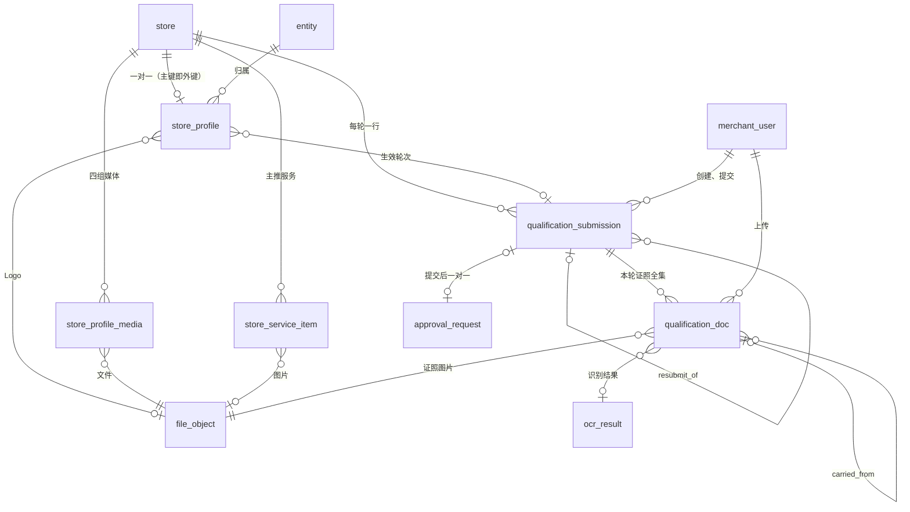

# 04 门店档案与资质审核

| 项 | 内容 |
| --- | --- |
| 模块 | profile（L1） |
| 表 | 5 张：`store_profile`、`store_profile_media`、`store_service_item`、`qualification_submission`、`qualification_doc` |
| 依据 | `docs/appendix/design/d9-profile.md`（下文写作 d9）第 3 节（字段表 3.2–3.6、约束清单 3.10、文件引用 3.8）与第 4–8 节；裁决 M11、M12、M16、M19、M33、M34、M36、M44、M46–M50、M53、M63、M92、M93、M108、M110；统一表清单的建模约定 |

出处写法：`d9:113` 指 d9 第 113 行；`PRD:416` 指 PRD 第 7 稿；`d4`、`d5`、`d6` 指同目录的其他草案；“补”指 d9 没有写、字段级阶段按约定补上的内容，后面跟理由。

## 1. 概览

这组表存两类东西。

一类是门店档案的当前值：`store_profile` 一行存建档前三步的标量字段与资质联系人，两张子表存四组档案媒体和主推服务。商家与代改的员工原地修改，前后值记审计日志，没有另一份草稿副本。

另一类是需要审核的内容：每轮资质材料一行 `qualification_submission`，先是草稿，提交时建审批单，决定后关闭；本轮要审的证照全集挂在它下面，一张一行 `qualification_doc`。已通过门店改门店名称、地址、行业与品类时，新值只写进轮次的 `proposed_*` 列，通过后才写回生效值。

门店名称、门店资质结论、主体结论不在这组表里：它们是 tenant 的 `store.name`、`store.qualification_status`、`entity.verification_status`，profile 只经 tenant 的函数写（d9:11、79）。审批的结论、原因、时限在 `approval_request`；文件与识别值在 media。

五张表的共同点：

- 都是门店维度，带 `entity_id` 与 `store_id`，创建时从门店行复制，不可变（`trg_<表>_immutable`，M50）。指向门店的外键都是复合外键 `(store_id, entity_id) → store (id, entity_id)`（M47）。
- 都不是只增表，都没有状态列，都不写 `status_transition`。
- 都有 `created_at`、`updated_at`，由应用时钟写入，没有数据库默认值（d9:7）。
- 行不物理删除：子表行的移除写 `removed_at`，轮次的作废写 `closed_at` 与 `outcome`。没有例外：草稿门店也不物理删除，删除草稿门店只做停用（`archive_reason = 'draft_deleted'`，M93），本分组按订阅的事件处理，见 5.5。

## 2. 表定义

### 2.1 `store_profile` 门店档案

门店档案当前值，与 `store` 一对一。归属：门店维度。主键是 `store_id`（主键即外键，不另设代理主键）。不是只增表。锁顺序 135（在 `store` 之后；商家保存前三步只锁本行并比对 `lock_version`）。

首家门店的档案行在 profile 第一次读写时补建（`INSERT … ON CONFLICT DO NOTHING`），新增门店的档案行在创建门店的同一事务里建（d9:107）。标“重审字段”的列在已通过门店上不原地改，待审值存 `qualification_submission.proposed_*`，通过事务里写回（d9:14、549-551）。

| 列 | 类型 | 空 | 默认 | 说明 | 出处 |
| --- | --- | --- | --- | --- | --- |
| store_id | uuid | 否 | | 主键，即门店 id | d9:111 |
| entity_id | uuid | 否 | | 归属主体 | d9:112 |
| brand_name | text | 可 | | 品牌名称，2～30 字 | d9:113；PRD:416 |
| logo_file_id | uuid | 可 | | 品牌 Logo 文件（分类 `profile_image`） | d9:114；PRD:417 |
| industry_code | text | 可 | | 一级行业，字典 `industry` 的编码。重审字段 | d9:115；PRD:419 |
| category_code | text | 可 | | 二级品类，同一字典的二级编码。重审字段 | d9:116 |
| province_code | text | 可 | | 省，字典 `region` 的编码。重审字段 | d9:117；PRD:420 |
| city_code | text | 可 | | 市。重审字段 | d9:117 |
| district_code | text | 可 | | 区县，只存行政区划（国标码），不存功能区。重审字段 | d9:117 |
| zone_code | text | 可 | | 功能区编码（字典 `region` 里 `functionalZone = true` 的项，`F` 前缀）。只是标注，不触发重审 | d9:118 |
| address_detail | text | 可 | | 详细地址，明文（会出现在广告里）。重审字段 | d9:119 |
| poi_name | text | 可 | | 地图选点名称 | d9:120 |
| latitude | numeric(9,6) | 可 | | 选点纬度。存端上选点返回的值，不换算坐标系 | d9:120 |
| longitude | numeric(9,6) | 可 | | 选点经度 | d9:120 |
| business_hours | jsonb | 否 | `[]` | 营业时间，时段数组，结构见 4.1 | d9:121；PRD:421 |
| store_tel | text | 可 | | 联系电话，手机或座机，≤20 字。公开信息，不加密；列名不用 `phone`，避开店员视图的禁用键扫描 | d9:122；PRD:422 |
| avg_spend_fen | integer | 可 | | 人均消费（分） | d9:123；PRD:423 |
| brand_intro | text | 可 | | 品牌简介，≤300 字 | d9:124；PRD:424 |
| promo_text | text | 可 | | 优惠活动，用于片尾引导 | d9:125；PRD:440 |
| group_buy_text | text | 可 | | 团购信息 | d9:126；PRD:441 |
| selling_point_codes | text[] | 否 | `{}` | 核心卖点标签的字典编码，至多 5 个 | d9:127；PRD:442 |
| selling_note | text | 可 | | 卖点补充说明，≤100 字 | d9:128 |
| ad_style_code | text | 可 | | 广告风格偏好。V1.1 的字段位，V1.0 不写入 | d9:129；PRD:443 |
| banned_terms | text | 可 | | 禁用内容。V1.1 的字段位，V1.0 不写入 | d9:129；PRD:444 |
| contact_name | text | 可 | | 资质联系人姓名 | d9:130；PRD:453 |
| contact_phone_enc | text | 可 | | 联系人手机号密文（AES-256-GCM）。明文须是 11 位手机号，加密前在应用层校验 | d9:131 |
| contact_phone_mask | text | 可 | | 联系人手机号脱敏串，前 3 后 4 | d9:131 |
| contact_phone_source | text | 可 | | 手机号来源。`login` = 取登录手机号；`sms_verified` = 其他号码，已通过短信验证；`unverified` = 其他号码，短信未配置、未验证 | d9:132 |
| contact_phone_verified_at | timestamptz | 可 | | 短信验证通过的时间；只在来源为 `sms_verified` 时有 | d9:133 |
| completeness_pct | smallint | 否 | 0 | 完整度缓存，0～100 的整数百分数。口径是 `packages/shared` 的纯函数。约定“比例”的例外，见改动 6 | d9:134 |
| required_filled | smallint | 否 | 0 | 已填必填项数（缓存） | d9:135 |
| required_total | smallint | 否 | 0 | 全部必填项数（缓存） | d9:135 |
| copied_from_store_id | uuid | 可 | | 复制来源门店，与本门店属同一主体（复合外键保证）。创建时写入，不可改 | d9:136；PRD:700 |
| copy_options | text[] | 否 | `{}` | 创建时勾选的复制项，元素不重复。`basic` 基础信息；`service` 服务与价格；`media` 门店形象；`brand_assets` 品牌故事素材。不可改 | d9:137 |
| effective_qualification_submission_id | uuid | 可 | | 最近一次通过的资质轮次 | d9:138 |
| first_submitted_at | timestamptz | 可 | | 首次提交资质的时间 | d9:139 |
| first_verified_at | timestamptz | 可 | | 首次审核通过的时间（门店行上的“06-13 通过”） | d9:139 |
| last_decided_at | timestamptz | 可 | | 最近一次审核决定的时间 | d9:139 |
| final_rejected_at | timestamptz | 可 | | 终局驳回（“无法补正”）的时间；轮次行上另有一份 | d9:140 |
| last_edited_at | timestamptz | 可 | | 最近一次档案修改时间，后台“最近修改”展示用 | d9:141 |
| last_edit_actor_type | text | 可 | | 最近修改人类型：`merchant`、`staff`、`system`、`partner`（V1.0 不写入 `partner`） | d9:141 |
| last_edit_actor_id | uuid | 可 | | 最近修改人 id；`system` 时为空。多态，不建外键 | d9:141 |
| last_edit_client | text | 可 | | 客户端来源：`weapp`、`portal`、`admin`；系统动作为空，其余类型必有 | 补：M44，操作人三列齐全 |
| lock_version | integer | 否 | 0 | 乐观锁；商家与代改的员工可能同时改 | d9:142 |
| created_at | timestamptz | 否 | | 创建时间 | 补：约定“时间”（d9:7） |
| updated_at | timestamptz | 否 | | 更新时间（含缓存重算） | 补：同上 |

**键与索引**

- 主键：`pk_store_profile (store_id)`。
- 外键（都在 Prisma 片段里，删除行为都是 RESTRICT）：
  - `fk_store_profile_store_entity (store_id, entity_id)` → `store (id, entity_id)`：门店外键即归属复合外键，保证归属主体与门店一致（d9:111；M47）。依赖 02 分组的 `uq_store_id_entity_id`。
  - `fk_store_profile_entity_id (entity_id)` → `entity.id`。
  - `fk_store_profile_logo_file_id (logo_file_id)` → `file_object.id`。
  - `fk_store_profile_copied_from_store_entity (copied_from_store_id, entity_id)` → `store (id, entity_id)`：复制来源与本门店属同一主体。来源为空时不校验。
  - `fk_store_profile_effective_qualification_submission_id (effective_qualification_submission_id, store_id, entity_id)` → `qualification_submission (id, store_id, entity_id)`：生效轮次必是本门店的轮次。
- 唯一约束：`uq_store_profile_store_id_entity_id (store_id, entity_id)`。主键已保证唯一，这条只为让 Prisma 把复合外键识别为与 `store` 一对一。
- 普通索引：`ix_store_profile_entity_id (entity_id)`，按主体取名下门店的档案；`ix_store_profile_city_code_district_code (city_code, district_code)`，后台按市、区县筛选；`ix_store_profile_industry_code_category_code (industry_code, category_code)`，按行业与品类筛选、字典停用前的引用计数。

**手写约束**

| 约束 | 规则 | 出处 |
| --- | --- | --- |
| `ck_store_profile_contact_phone_source` | `contact_phone_source IN ('login','sms_verified','unverified')` | d9:328 |
| `ck_store_profile_completeness_pct` | `completeness_pct BETWEEN 0 AND 100` | d9:328 |
| `ck_store_profile_selling_point_codes` | `cardinality(selling_point_codes) <= 5`；元素不重复、不含 NULL（`lyx_04_text_array_is_set`） | d9:328；去重为补 |
| `ck_store_profile_copy_options` | `copy_options` 的元素只能是四个复制项，且不重复 | d9:328；去重为补 |
| `ck_store_profile_avg_spend_fen` | `avg_spend_fen >= 0` | d9:328 |
| `ck_store_profile_last_edit_actor_type` | 取值为操作人类型四类 | 补：枚举列一律写 CHECK |
| `ck_store_profile_last_edit_client` | 取值为客户端来源三类 | 补：同上 |
| `ck_store_profile_required_counts` | `0 <= required_filled <= required_total` | 补：分子不超过分母 |
| `ck_store_profile_last_edit` | 最近修改的四列同有同无；`system` 没有操作人 id 与客户端来源，其余类型两者都必有 | 补：约定“操作人列” |
| `ck_store_profile_contact_phone` | 手机号的密文、脱敏串、来源同有同无 | 补：敏感字段成对出现 |
| `ck_store_profile_contact_phone_verified_at` | 验证时间非空 ⇔ 来源为 `sms_verified` | 补：见第 6 节第 2 项 |
| `ck_store_profile_geo` | 经纬度成对出现；纬度在 ±90、经度在 ±180 之内 | 补：数值范围 |
| `ck_store_profile_copy_source` | 复制项非空时必有复制来源；复制来源不能是自己 | 补：列间关系 |
| `ck_store_profile_business_hours` | `business_hours` 的顶层是数组 | 补：防止写入 JSON null |
| `ix_store_profile_zone_code` | 部分索引 `(zone_code) WHERE zone_code IS NOT NULL`，后台按功能区筛选 | d9:144 |
| `selling_point_codes`、`copy_options` 的 NOT NULL | `ALTER COLUMN … SET NOT NULL`。Prisma 的标量数组列建表时不带 NOT NULL，由 SQL 文件补 | d9:127、137；M49 |
| `trg_store_profile_immutable` | `BEFORE UPDATE`，`lyx_forbid_column_change('store_id','entity_id','copied_from_store_id','copy_options')`：归属列与复制来源、复制项创建后不可改 | 补：约定“归属列”；M50 |

函数 `lyx_04_text_array_is_set(text[])`（本分组定义，IMMUTABLE）：数组元素不重复且不含 NULL。三个数组列的 CHECK 共用。

只在应用层校验的：文本长度、联系人手机号的 11 位格式、字典编码存在且启用、营业时间的内部结构（d9:334）。

**不变量**（每日；登记写法见 5.6）

- `profile.I6`：`completeness_pct` 等于现算值。违例时自愈并告警（d9:762）。
- `profile.I3` 后半：门店结论为 `verified` ⇒ `effective_qualification_submission_id` 指向 `outcome = 'approved'` 的轮次（d9:759）。是不是本门店的轮次已由复合外键保证。
- `profile.I8`：已通过门店的 `store.name` 与本表的行业、品类、省、市、区、详细地址等于最近一次通过轮次的 `proposed_*`；选点名称与坐标不比（d9:764）。

**相对草案的改动**

1. 补 `last_edit_client`（M44）。d9:141 只有类型与 id 两列。
2. 补 `created_at`、`updated_at`。d9:7 说明字段表里省略了这两列。
3. 门店外键写成归属复合外键 `fk_store_profile_store_entity`（M47）；复制来源、生效轮次也写成复合外键，分别保证“同一主体”“本门店的轮次”。都在 Prisma 片段里（M46）。
4. 补 9 条 CHECK（上表标“补”的），卖点、复制项另加去重；补防改触发器。d9 的约束清单（d9:328）只有前 5 条。两个数组列的 NOT NULL 改由 SQL 文件补。
5. 主键约束名写作 `pk_store_profile`（M48）。
6. `completeness_pct` 不按约定“比例”改成 `_bp` 万分比：它是展示用的整数百分数缓存（d9:134），只与 `required_filled`、`required_total` 一起由纯函数算出，不参与任何计价或结算；改成万分比只会让每次读取多一次换算。登记为约定例外。

### 2.2 `store_profile_media` 档案媒体行

门头、店内环境、服务或产品实拍、已有宣传素材四组媒体，一个文件一行。归属：门店维度。主键 `id`（uuid）。不是只增表。不单独排锁序：只在持有 `store_profile` 行锁的事务里修改（d9:165）。

各组的数量与规格在应用层校验（锁档案行后现数）：门头 1～3 张、店内环境 3～9 张、实拍图片 ≤9 张且视频 ≤3 条、宣传素材 ≤9（d9:167-172）。

| 列 | 类型 | 空 | 默认 | 说明 | 出处 |
| --- | --- | --- | --- | --- | --- |
| id | uuid | 否 | | 主键 | d9:152 |
| entity_id | uuid | 否 | | 归属主体 | d9:153 |
| store_id | uuid | 否 | | 归属门店 | d9:153 |
| media_group | text | 否 | | 分组。`door` 门头照片；`interior` 店内环境；`product` 服务或产品实拍；`promo` 已有宣传素材 | d9:154；PRD:430-433 |
| position | smallint | 否 | | 组内顺序，从 1 起 | d9:155；M16 |
| file_id | uuid | 否 | | 文件（分类 `profile_image`、`profile_video`、`profile_promo`） | d9:156 |
| media_kind | text | 否 | | 类型。`image` 图片；`video` 视频（只有实拍与宣传素材两组可以是视频） | d9:157 |
| caption | text | 可 | | 图注。V1.0 留列，不开放填写 | d9:158 |
| copied_from_store_id | uuid | 可 | | 由复制档案带入时填来源门店，与本门店属同一主体（复合外键保证） | d9:159 |
| create_actor_type | text | 否 | | 创建人类型：`merchant`、`staff`、`system`、`partner`（V1.0 不写入 `partner`）。员工代改新增的行为 `staff` | d9:160；M44 |
| create_actor_id | uuid | 可 | | 创建人 id；`system` 时为空。多态（商家用户或员工），不建外键 | d9:160；M44 |
| create_client | text | 可 | | 创建时的客户端来源：`weapp`、`portal`、`admin`；系统动作为空，其余类型必有 | 补：M44 |
| removed_at | timestamptz | 可 | | 被删除或被替换的时间；空 = 在用 | d9:161 |
| created_at | timestamptz | 否 | | 创建时间 | 补：约定“时间” |
| updated_at | timestamptz | 否 | | 更新时间（调整顺序、移除） | 补：同上 |

**键与索引**

- 主键：`pk_store_profile_media (id)`。
- 外键（删除行为都是 RESTRICT）：`fk_store_profile_media_store_entity (store_id, entity_id)` → `store (id, entity_id)`（d9:153；M47）；`fk_store_profile_media_entity_id (entity_id)` → `entity.id`；`fk_store_profile_media_file_id (file_id)` → `file_object.id`；`fk_store_profile_media_copied_from_store_entity (copied_from_store_id, entity_id)` → `store (id, entity_id)`（来源与本门店属同一主体，来源为空时不校验）。`create_actor_id` 是多态操作人，不建外键。
- 普通索引：`ix_store_profile_media_file_id (file_id)`，订阅 `file.moderated` 时按文件找到档案媒体行并重算完整度（d9:717）。

**手写约束**

| 约束 | 规则 | 出处 |
| --- | --- | --- |
| `ck_store_profile_media_media_group` | `media_group IN ('door','interior','product','promo')` | d9:154、329 |
| `ck_store_profile_media_media_kind` | `media_kind IN ('image','video')` | d9:157、329 |
| `ck_store_profile_media_position` | `position >= 1` | d9:155 |
| `ck_store_profile_media_group_kind` | 门头、店内环境两组只收图片 | 补：PRD:430-431；d9:169-170 |
| `ck_store_profile_media_create_actor_type` | 取值为操作人类型四类 | 补：枚举列一律写 CHECK |
| `ck_store_profile_media_create_client` | 取值为客户端来源三类 | 补：同上 |
| `ck_store_profile_media_create_actor` | `system` 没有创建人 id 与客户端来源，其余类型两者都必有 | 补：约定“操作人列”；M44 |
| `ck_store_profile_media_copy_source` | 复制来源不能是本门店 | 补：列间关系 |
| `uq_store_profile_media_active_file` | 部分唯一索引 `(store_id, media_group, file_id) WHERE removed_at IS NULL`：同一组里同一个文件只出现一次 | d9:163 |
| `ix_store_profile_media_active_position` | 部分索引 `(store_id, media_group, position) WHERE removed_at IS NULL`：按组、按顺序读在用的行。不做成唯一，调整顺序时允许中间态 | d9:163 |
| `trg_store_profile_media_immutable` | `BEFORE UPDATE`，`lyx_forbid_column_change('entity_id','store_id','file_id','copied_from_store_id','create_actor_type','create_actor_id','create_client')`：替换文件是移除旧行、另起新行，不改 `file_id` | 补：d9:161；M50 |

**相对草案的改动**

1. `copied_from_store_id` 建复合外键 → `store (id, entity_id)`，保证来源属同一主体。d9:159 没有写是否建，统一表清单留给字段级阶段定；做法与 `store_profile.copied_from_store_id` 相同。
2. d9:160 的 `created_by_user_id` 改为三列 `create_actor_type`、`create_actor_id`、`create_client`（M44）。代改接口按 PRD 的范围覆盖门店形象（d9:621），创建人可能是商家用户，也可能是员工；单列可空无法区分员工代改与系统写入。`create_actor_id` 多态，不再对 `merchant_user` 建外键。
3. 门店外键写成归属复合外键 `fk_store_profile_media_store_entity`（M47），在 Prisma 片段里（M46）。
4. 补 `ck_store_profile_media_group_kind`、`…_copy_source`、创建人三条 CHECK、`ix_store_profile_media_file_id` 与防改触发器。
5. 补 `created_at`、`updated_at`。

### 2.3 `store_service_item` 主推服务

门店主推服务，每家门店未移除的行 1～10 项（应用层校验，d9:190）。归属：门店维度。主键 `id`（uuid）。不是只增表。不单独排锁序：只在持有 `store_profile` 行锁的事务里修改。

| 列 | 类型 | 空 | 默认 | 说明 | 出处 |
| --- | --- | --- | --- | --- | --- |
| id | uuid | 否 | | 主键 | d9:180 |
| entity_id | uuid | 否 | | 归属主体 | d9:181 |
| store_id | uuid | 否 | | 归属门店 | d9:181 |
| position | smallint | 否 | | 排序，从 1 起 | d9:182 |
| name | text | 否 | | 名称。长度上限在应用层校验（d9:780） | d9:183；PRD:439 |
| price_fen | integer | 否 | | 现价（分），大于 0 | d9:184 |
| original_price_fen | integer | 可 | | 原价（分），选填，不低于现价 | d9:185 |
| image_file_id | uuid | 可 | | 图片，选填（分类 `profile_image`） | d9:186 |
| intro | text | 可 | | 简介，≤20 字 | d9:187 |
| removed_at | timestamptz | 可 | | 被移除的时间；空 = 在用 | d9:188 |
| created_at | timestamptz | 否 | | 创建时间 | 补：约定“时间” |
| updated_at | timestamptz | 否 | | 更新时间 | 补：同上 |

**键与索引**

- 主键：`pk_store_service_item (id)`。
- 外键（删除行为都是 RESTRICT）：`fk_store_service_item_store_entity (store_id, entity_id)` → `store (id, entity_id)`（d9:181；M47）；`fk_store_service_item_entity_id (entity_id)` → `entity.id`；`fk_store_service_item_image_file_id (image_file_id)` → `file_object.id`。
- 普通索引：见下面的部分索引。

**手写约束**

| 约束 | 规则 | 出处 |
| --- | --- | --- |
| `ck_store_service_item_position` | `position >= 1` | d9:182 |
| `ck_store_service_item_price_fen` | `price_fen > 0` | d9:330 |
| `ck_store_service_item_original_price_fen` | `original_price_fen IS NULL OR original_price_fen >= price_fen` | d9:330 |
| `ix_store_service_item_active_position` | 部分索引 `(store_id, position) WHERE removed_at IS NULL`：按门店、按顺序读在用的主推服务 | 补：d9 没有给这张表列索引 |
| `trg_store_service_item_immutable` | `BEFORE UPDATE`，`lyx_forbid_column_change('entity_id','store_id')` | 补：约定“归属列”；M50 |

**相对草案的改动**

1. 补部分索引 `ix_store_service_item_active_position` 与防改触发器。
2. 补 `created_at`、`updated_at`。
3. 门店外键写成归属复合外键 `fk_store_service_item_store_entity`（M47）。

店员只读的“服务与价格”含现价、原价。D4 的店员回放测试扫描到 `price` 即失败，这两个键须加进白名单（d9:801 ⑦），列名不为躲开扫描而改。

### 2.4 `qualification_submission` 资质轮次

门店的一轮资质材料一行：先是草稿（`submitted_at` 为空、没有审批单），提交后与一张 `approval_request`（`kind = 'qualification'`）一对一，决定、撤回或草稿丢弃后关闭。归属：门店维度。主键 `id`（uuid）。不是只增表。锁顺序 65（领域申请单，紧跟审批单之后）。它是证照行的聚合根：证照行的改动都要锁本行并递增 `lock_version`。

表上没有状态列（d9:80）。草稿、在审、已关闭由 `submitted_at`、`closed_at` 表达；`outcome` 只在关闭时写一次。

| 列 | 类型 | 空 | 默认 | 说明 | 出处 |
| --- | --- | --- | --- | --- | --- |
| id | uuid | 否 | | 主键；审批单以它为“资质记录 ID” | d9:198 |
| entity_id | uuid | 否 | | 归属主体 | d9:199 |
| store_id | uuid | 否 | | 归属门店（资质逐店提交） | d9:199 |
| kind | text | 否 | | 轮次类型。`initial` 主体未认证时的提交，含主体营业执照；`new_store` 主体已认证、门店尚未通过；`change` 门店已通过后的变更重审 | d9:200 |
| resubmit_of_qualification_submission_id | uuid | 可 | | 被驳回的上一轮；非空时队列里显示“重新提交” | d9:201 |
| round_no | integer | 可 | | 门店内的轮次号，提交时写入，从 1 递增，同步写到审批单（`approval_request.round_no` 同为 integer） | d9:202 |
| claimed_entity_type | text | 可 | | 商家所选主体类型：`enterprise` 企业、`individual` 个体工商户。只有含营业执照的轮次要填；已提交的 `initial` 轮次必有（通过时写入 `entity.entity_type`） | d9:203；PRD:450 |
| proposed_store_name | text | 可 | | 本轮送审的门店名称。草稿可空，提交时填全 | d9:204 |
| proposed_industry_code | text | 可 | | 本轮送审的一级行业。同上 | d9:205 |
| proposed_category_code | text | 可 | | 本轮送审的二级品类。同上 | d9:205 |
| proposed_address_snapshot | jsonb | 可 | | 本轮送审的地址，结构见 4.2。同上 | d9:206 |
| changed_fields | text[] | 否 | `{}` | `change` 轮次相对生效值改了哪几类，提交时计算。`store_name` 门店名称；`address` 地址；`industry` 行业与品类；`docs` 门店级证照；`entity_license` 主体营业执照 | d9:207 |
| contact_snapshot | jsonb | 可 | | 提交时的联系人快照，不含明文，结构见 4.3 | d9:208 |
| declaration_confirmed_at | timestamptz | 可 | | 信息确认勾选时间。每轮重新勾选，不沿用上一轮 | d9:209；PRD:454 |
| declaration_version | text | 可 | | 信息确认文案的版本号 | d9:210 |
| check_summary | jsonb | 可 | | 系统比对汇总，不含识别原值，结构见 4.4 | d9:211 |
| checks_ran_at | timestamptz | 可 | | 最近一次比对时间 | d9:212 |
| approval_request_id | uuid | 可 | | 审批单，提交时写入，一对一 | d9:213 |
| submitted_at | timestamptz | 可 | | 提交时间；空 = 草稿 | d9:214 |
| submitted_by_user_id | uuid | 可 | | 提交人（只有老板能提交） | d9:215 |
| closed_at | timestamptz | 可 | | 关闭时间：审批被决定或撤回、草稿被丢弃时写入；空 = 在途（M12） | d9:216 |
| outcome | text | 可 | | 结论，关闭时写一次。`approved` 通过；`rejected` 驳回；`withdrawn` 系统撤回；`discarded` 草稿未提交即作废。前三个与审批单结论一致 | d9:217 |
| approve_mode | text | 可 | | 通过方式。`normal` 无异常直接通过；`corrected` 修正字段后通过；`override` 持权限放行 | d9:218 |
| system_reject_code | text | 可 | | 系统自动驳回的原因。`duplicate_entity` = 信用代码已被其他主体认证 | d9:219 |
| final_rejected_at | timestamptz | 可 | | 终局驳回（“无法补正”）的时间；只出现在 `initial`、`new_store` 轮次 | d9:220 |
| created_by_user_id | uuid | 否 | | 草稿创建人（老板） | d9:221 |
| lock_version | integer | 否 | 0 | 乐观锁；草稿编辑、审核员修正字段、证照行改动都递增 | d9:222 |
| created_at | timestamptz | 否 | | 创建时间 | 补：约定“时间” |
| updated_at | timestamptz | 否 | | 更新时间 | 补：同上 |

**键与索引**

- 主键：`pk_qualification_submission (id)`。
- 外键（都在 Prisma 片段里，删除行为都是 RESTRICT）：`fk_qualification_submission_store_entity (store_id, entity_id)` → `store (id, entity_id)`（d9:199；M47）；`fk_qualification_submission_entity_id (entity_id)` → `entity.id`；`fk_qualification_submission_resubmit_of (resubmit_of_qualification_submission_id)` → 本表 `id`；`fk_qualification_submission_approval_request_id (approval_request_id)` → `approval_request.id`；`fk_qualification_submission_submitted_by_user_id (submitted_by_user_id)`、`fk_qualification_submission_created_by_user_id (created_by_user_id)` → `merchant_user.id`（同一对模型的两个关系，关系名 `QualificationSubmissionSubmittedBy`、`QualificationSubmissionCreatedBy`，M46）。
- 唯一约束：`uq_qualification_submission_approval_request_id (approval_request_id)`；`uq_qualification_submission_store_id_round_no (store_id, round_no)`（草稿的 `round_no` 为空，不参与）；`uq_qualification_submission_id_store_id_entity_id (id, store_id, entity_id)`，供证照行与档案行的复合外键引用。
- 普通索引：`ix_qualification_submission_store_id_submitted_at (store_id, submitted_at DESC)`，历次记录与“最近一轮”；`ix_qualification_submission_entity_id_kind (entity_id, kind)`，取主体最近一轮 `initial`（`isQualificationDead`、不变量 `profile.I10`）。

**手写约束**

| 约束 | 规则 | 出处 |
| --- | --- | --- |
| `ck_qualification_submission_kind` | `kind IN ('initial','new_store','change')` | d9:200 |
| `ck_qualification_submission_claimed_entity_type` | `claimed_entity_type IN ('enterprise','individual')` | d9:203 |
| `ck_qualification_submission_outcome` | `outcome IN ('approved','rejected','withdrawn','discarded')` | d9:217 |
| `ck_qualification_submission_approve_mode` | `approve_mode IN ('normal','corrected','override')` | d9:218 |
| `ck_qualification_submission_system_reject_code` | `system_reject_code IN ('duplicate_entity')` | d9:219 |
| `ck_qualification_submission_changed_fields` | `changed_fields` 的元素只能是五个类别，且不重复 | d9:207；去重为补 |
| `ck_qualification_submission_submitted` | `(submitted_at IS NULL) = (approval_request_id IS NULL)` | d9:228 |
| `ck_qualification_submission_closed` | `(closed_at IS NULL) = (outcome IS NULL)` | d9:228 |
| `ck_qualification_submission_discarded` | `outcome <> 'discarded' OR submitted_at IS NULL` | d9:228 |
| `ck_qualification_submission_final_rejected` | `final_rejected_at IS NULL OR (outcome = 'rejected' AND kind <> 'change')`；`outcome` 为空时同样拦住 | d9:228 |
| `ck_qualification_submission_round_no` | `round_no >= 1` | 补：d9:202“从 1 递增” |
| `ck_qualification_submission_submit_fields` | `round_no`、`submitted_by_user_id` 与 `submitted_at` 同有同无 | 补：d9:486 一条 UPDATE 写齐 |
| `ck_qualification_submission_submitted_proposed` | 已提交的轮次，`proposed_store_name`、`proposed_industry_code`、`proposed_category_code`、`proposed_address_snapshot` 都非空 | 补：d9:204-206“提交时填全” |
| `ck_qualification_submission_initial_entity_type` | `kind <> 'initial' OR submitted_at IS NULL OR claimed_entity_type IS NOT NULL` | 补：通过时写 `entity.entity_type`，02 的 `ck_entity_verified_fields` 要求非空 |
| `ck_qualification_submission_decided_submitted` | 结论为通过、驳回、撤回时必已提交 | 补：d9:217 前三个结论来自审批单 |
| `ck_qualification_submission_approve_mode_outcome` | `approve_mode` 非空 ⇔ `outcome = 'approved'` | 补：d9:218、553 |
| `ck_qualification_submission_system_reject_outcome` | `system_reject_code` 非空 ⇒ `outcome = 'rejected'` | 补：d9:529 |
| `ck_qualification_submission_declaration` | 信息确认的时间与版本同有同无；已提交的轮次必有信息确认 | 补：d9:475 提交校验第 6 项 |
| `ck_qualification_submission_changed_fields_kind` | 只有 `change` 轮次的 `changed_fields` 可以非空 | 补：d9:207 |
| `ck_qualification_submission_resubmit_of` | 上一轮不能是自己 | 补：自引用 |
| `ck_qualification_submission_proposed_address_snapshot`、`ck_qualification_submission_contact_snapshot`、`ck_qualification_submission_check_summary` | 三个 jsonb 列非空时顶层是对象 | 补：防止写入 JSON null |
| `uq_qualification_submission_open` | 部分唯一索引 `(store_id) WHERE closed_at IS NULL`：一家门店同时只有一轮未关闭（草稿或在审）。M12 的在途唯一 | d9:226 |
| `uq_qualification_submission_entity_open` | 部分唯一索引 `(entity_id) WHERE closed_at IS NULL AND kind = 'initial'`：同一主体同时只有一轮带主体营业执照 | d9:227 |
| `changed_fields` 的 NOT NULL | `ALTER COLUMN … SET NOT NULL`。原因同 `store_profile` 的两个数组列 | d9:207；M49 |
| `trg_qualification_submission_immutable` | `BEFORE UPDATE`，`lyx_forbid_column_change('entity_id','store_id','kind','resubmit_of_qualification_submission_id','created_by_user_id')` | 补：约定“归属列”；M50 |

审批单的 `dedupe_key`（`qualification:{storeId}`）同时填写，作在途唯一的第二道（d9:226）。

只在应用层校验的：`change` 轮次更换主体营业执照时也填 `claimed_entity_type`（库里分不出轮次里有没有营业执照行）；同一主体同时至多一个更换主体营业执照的 `change` 轮次（`changed_fields` 含 `entity_license`），不加库约束，在接口层校验（M108；`uq_qualification_submission_entity_open` 只管 `initial`）；提交之后商家侧的列不再变，审核期间只有 `check_summary`、`checks_ran_at`、`lock_version` 会变（审核员修正识别字段时三者同事务重写、`lock_version` 加 1；同一事务按 5.4 的次序先锁审批单，给 `approval_request.lock_version` 也加 1，让基于修正前比对结果的通过返回 `VERSION_CONFLICT`，a03 3.24、A143），关闭时写 `closed_at`、`outcome`、`approve_mode`、`final_rejected_at`（d9:231、334）。

提交时的写入顺序受约束限制：先建审批单，再用一条 `UPDATE` 同时写 `round_no`、`submitted_at`、`submitted_by_user_id`、`proposed_*`、`changed_fields`、`contact_snapshot`、`approval_request_id`（d9:486）。信息确认（两列）必须在这条 `UPDATE` 之前或之中写入，否则撞 `ck_qualification_submission_declaration`。变更重审的提交只经 `POST /m/store-profile/qualification/submit` 一个入口（接口裁决 A32、A41）：保存基础信息只存 `change` 草稿，提交时同一请求必须带 `declarationConfirmed` 与 `declarationVersion`（d9:475、9-C21），缺了按提交校验第 6 项返回信息确认缺失的错误码。d9:600 的“`PUT /profile/basic` 带 `submitNow` 即提交”作废。接口契约跟进。

**状态机**

本表没有状态列，不写 `status_transition`。行的三个阶段由时间戳派生：

| 阶段 | 判定 | 事件 | 之后 | 守卫 | 触发者 |
| --- | --- | --- | --- | --- | --- |
| 草稿 | `submitted_at IS NULL AND closed_at IS NULL` | 提交 | 在审 | d9 第 5.3 节的十项提交校验；四步必填齐全；已勾选信息确认 | 老板 |
| 草稿 | 同上 | 丢弃 | 已关闭（`discarded`） | 无 | 老板；门店停用（含删除草稿门店，M93）、主体关闭或放弃时由系统丢弃（订阅的事件见 5.5）。同一事务里给本轮未移除的证照行写 `removed_at`（2.5） |
| 在审 | `submitted_at IS NOT NULL AND closed_at IS NULL` | 通过 | 已关闭（`approved`） | 比对没有“不通过”项，或修正后没有，或持权限放行；信用代码没有被别的主体认证 | 员工（`merchant.qualification.review`；放行另需 `.override`） |
| 在审 | 同上 | 驳回 | 已关闭（`rejected`） | 原因至少 1 项、说明必填；`change` 轮次不能勾选“无法补正” | 员工；信用代码重复时由系统驳回（`system_reject_code = 'duplicate_entity'`） |
| 在审 | 同上 | 撤回 | 已关闭（`withdrawn`） | 主体被关闭或放弃（三种轮次类型都适用，含 `change`） | 系统 |

审批单一侧的写法（列的定义在 03 分组）：员工驳回时 `decision_note` 必填（`ck_approval_request_decision`）；系统驳回时审批单 `status = 'rejected'`、`is_decided_by_system = true`、`decided_by_staff_id` 为空，`decision_note` 填固定说明（信用代码已被其他主体认证，文案由契约定），否则同一条 CHECK 拦下；撤回时审批单 `status = 'withdrawn'`、`decided_by_staff_id` 为空。

每个事件同时驱动 tenant 的两个结论列（列的定义在 02 分组，迁移经 `tenant.setStoreQualification`、`tenant.applyEntityVerification` 调用 `flow.transition()`）。状态历史按 M53 分链：门店一侧 `machine = 'store'`、`state_field = 'qualification_status'`；主体一侧 `machine = 'entity'`、`state_field = 'verification_status'`。事件名沿用 d9 第 5.2 节，都以 `qualification.` 开头（01 分组的请求；分链靠 `state_field`，不再靠前缀）：

| 轮次类型 | 事件 | 状态历史的 `event` | `store.qualification_status` | `entity.verification_status` |
| --- | --- | --- | --- | --- |
| `initial`、`new_store` | 提交 | `qualification.submit` | `unsubmitted` 或 `rejected` → `pending` | `initial` 轮次：→ `pending` |
| 同上 | 通过 | `qualification.approve` | `pending` → `verified` | `initial` 轮次：→ `verified` |
| 同上 | 驳回 | `qualification.reject` | `pending` → `rejected` | `initial` 轮次：→ `rejected` |
| 同上 | 撤回 | `qualification.withdraw` | `pending` → 提交前的值 | `initial` 轮次：→ 提交前的值 |
| `change` | 提交、通过、驳回 | `qualification.change_submit` / `.change_approve` / `.change_reject` | 保持 `verified`（照常写一行状态历史） | 不变 |
| `change` | 撤回 | `qualification.change_withdraw` | 保持 `verified`（照常写一行状态历史） | 不变 |

主体一侧只有 `initial` 轮次写状态历史，事件名与门店一侧相同。`change` 轮次撤回是 d9 第 5.2 节没有列的一行（d9:716 的“撤回在审轮次”包括它），出站事件用 `store.qualification_change.withdrawn`，理由同 d9 第 6.2 节第 6 条：订阅 `store.qualification.*` 的 D3 逻辑只针对从未通过的门店。

**不变量**（每日；登记写法见 5.6）

- `profile.I1`：每家门店至多一轮未关闭的提交。索引保证，违例告警（d9:757）。
- `profile.I2`：`kind = 'qualification'` 的审批单与已提交的轮次一一对应；审批单待审 ⇔ 轮次未关闭；`outcome` 与审批单结论一致（d9:758）。
- `profile.I3` 前半：门店结论为 `pending` ⇔ 有在审的 `initial` 或 `new_store` 轮次（d9:759）。
- `profile.I7`：在审轮次的信用代码没有被其他主体认证（只看未移除的营业执照行）。违例时由系统驳回并告警（d9:763）。
- `profile.I10`：主体结论为 `pending` ⇔ 该主体有在审的 `initial` 轮次（d9:766）。

**相对草案的改动**

1. `ck_qualification_submission_final_rejected` 用 `IS NOT DISTINCT FROM` 写。d9:228 的写法在 `outcome` 为空时结果是未知，CHECK 会放行。
2. `created_by_user_id` 定为 NOT NULL。d9:221 只写“指向 merchant_user”；草稿只由老板经商家端接口建立（d9:357）。
3. 自引用外键的约束名缩短为 `fk_qualification_submission_resubmit_of`（按列名全拼超过 63 个字符）。
4. 补 10 条列间关系 CHECK、3 条 jsonb 顶层类型 CHECK（上表标“补”的），`changed_fields` 另加去重；补防改触发器。d9 只把 `proposed_*` 填全列为应用层校验（d9:334），这里改由 CHECK 保证；提交的那一条 `UPDATE` 本来就同时写这四列。
5. 门店外键写成归属复合外键 `fk_qualification_submission_store_entity`（M47）；`submitted_by_user_id` 的外键与 `created_by_user_id` 的外键都写关系名，在 Prisma 片段里（M46）。
6. 补 `created_at`、`updated_at`。
7. 补 `uq_qualification_submission_id_store_id_entity_id`，供证照行、档案行的复合外键引用。
8. 状态机补 `change` 轮次撤回一行（`qualification.change_withdraw`，出站事件 `store.qualification_change.withdrawn`）。

“信用代码与其他在审主体相同”的重复标记不落库，读审核队列与详情时按本轮营业执照行的 `cert_no_bidx` 派生（d9:233）。取数只看未移除的营业执照行（`removed_at IS NULL`，走 `ix_qualification_doc_license_bidx`）；被替换掉的旧执照行不参与，否则会误打标记，甚至在 d9:712 的扇出里把另一主体的在审轮次系统驳回。

### 2.5 `qualification_doc` 证照行

挂在资质轮次下，每轮的行是本轮要审的全集：新上传的记 `uploaded`，上一轮没被驳回、原样带入的记 `carried`（同一个文件、同一份识别结果，另起一行）。归属：门店维度，`store_id` 是提交这一轮的门店；`scope` 另记这张证照属主体还是属门店。主键 `id`（uuid）。不是只增表。不单独排锁序：以所属轮次为聚合根，改动前先锁轮次行。

**口径**：d9 里凡说“本轮的行”“本轮各行”的地方——提交校验第 4 项、带入规则、完整度、比对、通过与驳回、历次记录——一律指本轮 `removed_at IS NULL` 的行。已移除的行只留作草稿期的痕迹。

| 列 | 类型 | 空 | 默认 | 说明 | 出处 |
| --- | --- | --- | --- | --- | --- |
| id | uuid | 否 | | 主键 | d9:239 |
| entity_id | uuid | 否 | | 归属主体 | d9:240 |
| store_id | uuid | 否 | | 提交这一轮的门店 | d9:240 |
| qualification_submission_id | uuid | 否 | | 所属轮次 | d9:241 |
| doc_type | text | 否 | | 证照类型。`business_license` 营业执照；`branch_license` 分支机构营业执照；`industry_permit` 行业许可证 | d9:242；PRD:451-452、703 |
| permit_type | text | 可 | | 行业许可证的类型编码（许可证类型字典，如 `food_business`）；`industry_permit` 时必填，其余为空 | d9:243 |
| scope | text | 否 | | 归属。`entity` 属主体（营业执照）；`store` 属门店（其余） | d9:244 |
| file_id | uuid | 否 | | 证照图片（分类 `kyc_license`、`kyc_permit`）。每张证照一张图 | d9:245 |
| ocr_result_id | uuid | 可 | | 识别结果；识别不可用时为空，商家手填。证照走同步识别，引用的识别结果不会是 `pending`（06 的说明）。类型映射：`business_license`、`branch_license` 的行引用 `ocr_result.doc_type = 'business_license'` 的结果（分支机构执照用营业执照的识别驱动，d9:804 ④）；`industry_permit` 的行引用 `doc_type = 'industry_permit'` 且 `permit_type` 相同的结果。比对或校验类型一致时按这个映射 | d9:246；d5:943 |
| origin | text | 否 | | 来源。`uploaded` 本轮新上传；`carried` 由上一轮或生效集合原样带入 | d9:247 |
| carried_from_qualification_doc_id | uuid | 可 | | 带入的来源证照行；`carried` 时必填 | d9:248 |
| submitted_fields_enc | text | 可 | | 商家核对后的提交值，JSON 密文，明文结构见 4.6 | d9:249；d5:943 |
| reviewed_fields_enc | text | 可 | | 审核员修正值，JSON 密文。对外取“修正值，否则提交值” | d9:250；d5:943 |
| field_checks | jsonb | 否 | `[]` | 逐项比对结论，不含原值，结构见 4.5 | d9:251；d5:943 |
| holder_name | text | 可 | | 证照上的主体名称或经营者名称（明文），取“修正值，否则提交值” | d9:252 |
| cert_no_enc | text | 可 | | 证件号密文：营业执照是统一社会信用代码，许可证是许可证编号 | d9:253 |
| cert_no_bidx | bytea | 可 | | 证件号盲索引（HMAC-SHA256，32 字节），用于信用代码查重；算法与密钥同 `entity.uscc_bidx` | d9:253；d4:1701 |
| cert_no_mask | text | 可 | | 证件号脱敏串，如 `91510104MA6B****2R` | d9:253 |
| principal_name_enc | text | 可 | | 法定代表人、经营者或负责人姓名密文 | d9:254 |
| principal_name_mask | text | 可 | | 姓名脱敏串，只留姓（`王**`）。没有等值查找，不建盲索引 | d9:254 |
| principal_role | text | 可 | | 负责人角色。`legal_rep` 法定代表人（企业）；`operator` 经营者（个体工商户）；`branch_head` 负责人（分支机构） | d9:255 |
| subject_type | text | 可 | | 识别出的证照主体类型：`enterprise`、`individual`、`branch`、`unknown` | d9:256 |
| valid_start_date | date | 可 | | 营业期限或许可证有效期的起始日 | d9:257（`valid_from`，改名见改动 5） |
| valid_end_date | date | 可 | | 有效期截止日；到期只提醒，不改状态 | d9:257（`valid_to`） |
| is_long_term | boolean | 否 | false | 营业期限为“长期” | d9:258 |
| verdict | text | 可 | | 本轮对这张证照的结论，决定前为空。`accepted` 没被点名驳回；`rejected` 被点名驳回 | d9:259 |
| effective_at | timestamptz | 可 | | 所在轮次通过时写入，这一行成为生效证照 | d9:260（`effective_from`） |
| superseded_at | timestamptz | 可 | | 被后一轮的生效行取代的时间 | d9:261 |
| removed_at | timestamptz | 可 | | 从草稿移除、被重新上传替换、或所属草稿被丢弃的时间；空 = 本轮的有效行 | 补：约定“软删除”，见改动 1 |
| uploaded_by_user_id | uuid | 否 | | 上传人（只有老板能上传）；`carried` 行复制来源行的值 | d9:262 |
| created_at | timestamptz | 否 | | 创建时间 | 补：约定“时间” |
| updated_at | timestamptz | 否 | | 更新时间 | 补：同上 |

**键与索引**

- 主键：`pk_qualification_doc (id)`。
- 外键（都在 Prisma 片段里，删除行为都是 RESTRICT）：
  - `fk_qualification_doc_store_entity (store_id, entity_id)` → `store (id, entity_id)`（d9:240；M47）。
  - `fk_qualification_doc_qualification_submission_id (qualification_submission_id, store_id, entity_id)` → `qualification_submission (id, store_id, entity_id)`：证照行与所属轮次属同一门店、同一主体。
  - `fk_qualification_doc_entity_id (entity_id)` → `entity.id`；`fk_qualification_doc_file_id (file_id)` → `file_object.id`；`fk_qualification_doc_ocr_result_id (ocr_result_id)` → `ocr_result.id`；`fk_qualification_doc_carried_from_qualification_doc_id (carried_from_qualification_doc_id)` → 本表 `id`；`fk_qualification_doc_uploaded_by_user_id (uploaded_by_user_id)` → `merchant_user.id`。
- 普通索引：没有 Prisma 生成的普通索引。按轮次取证照走 `uq_qualification_doc_round_type` 的前缀。

**手写约束**

| 约束 | 规则 | 出处 |
| --- | --- | --- |
| `ck_qualification_doc_doc_type` | `doc_type IN ('business_license','branch_license','industry_permit')` | d9:242 |
| `ck_qualification_doc_scope` | `scope IN ('entity','store')` | d9:244 |
| `ck_qualification_doc_origin` | `origin IN ('uploaded','carried')` | d9:247 |
| `ck_qualification_doc_principal_role` | `principal_role IN ('legal_rep','operator','branch_head')` | d9:255 |
| `ck_qualification_doc_subject_type` | `subject_type IN ('enterprise','individual','branch','unknown')` | d9:256 |
| `ck_qualification_doc_verdict` | `verdict IN ('accepted','rejected')` | d9:259 |
| `ck_qualification_doc_scope_doc_type` | `(doc_type = 'business_license') = (scope = 'entity')` | d9:268 |
| `ck_qualification_doc_permit_type` | `(doc_type = 'industry_permit') = (permit_type IS NOT NULL)` | d9:268 |
| `ck_qualification_doc_carried` | `(origin = 'carried') = (carried_from_qualification_doc_id IS NOT NULL)` | d9:268 |
| `ck_qualification_doc_superseded` | `superseded_at IS NULL OR effective_at IS NOT NULL` | d9:268 |
| `ck_qualification_doc_effective_accepted` | 生效的行 `verdict` 必为 `accepted` | 补：d9:544 |
| `ck_qualification_doc_removed` | 已移除的行没有结论，也不会生效 | 补：移除只发生在草稿里 |
| `ck_qualification_doc_cert_no` | 证件号的密文与脱敏串同有同无；盲索引不单独存在 | 补：敏感字段成对出现 |
| `ck_qualification_doc_license_bidx` | `doc_type <> 'business_license' OR (cert_no_enc IS NULL) = (cert_no_bidx IS NULL)`：营业执照行的信用代码三件套同有同无 | 补：查重与 `profile.I7` 靠盲索引；通过时写 `entity.uscc_*`，02 的 `ck_entity_uscc_triple` 要求三列同有同无 |
| `ck_qualification_doc_cert_no_bidx_len` | `cert_no_bidx IS NULL OR octet_length(cert_no_bidx) = 32` | 补：同 02 的 `ck_entity_uscc_bidx_len` |
| `ck_qualification_doc_principal_name` | 姓名的密文与脱敏串同有同无 | 补：敏感字段成对出现 |
| `ck_qualification_doc_valid_range` | 截止日不早于起始日；`is_long_term` 为真时没有截止日 | 补：列间关系 |
| `ck_qualification_doc_field_checks` | `field_checks` 的顶层是数组 | 补：防止写入 JSON null |
| `uq_qualification_doc_round_type` | 部分唯一索引 `(qualification_submission_id, doc_type, COALESCE(permit_type, '')) WHERE removed_at IS NULL`：一轮里每种证照一行 | d9:266；条件为补 |
| `uq_qualification_doc_effective_entity` | 部分唯一索引 `(entity_id) WHERE scope = 'entity' AND effective_at IS NOT NULL AND superseded_at IS NULL`：每个主体至多一张生效的营业执照 | d9:267 |
| `uq_qualification_doc_effective_store` | 部分唯一索引 `(store_id, doc_type, COALESCE(permit_type, '')) WHERE scope = 'store' AND effective_at IS NOT NULL AND superseded_at IS NULL`：每家门店每种门店级证照至多一张生效 | d9:267 |
| `ix_qualification_doc_license_bidx` | 部分索引 `(cert_no_bidx) WHERE doc_type = 'business_license' AND removed_at IS NULL`：信用代码查重、重复标记的派生、通过后系统驳回同代码的在审轮次。已移除的行不参与 | d9:269；`removed_at` 条件为补 |
| `ix_qualification_doc_expiring` | 部分索引 `(valid_end_date) WHERE effective_at IS NOT NULL AND superseded_at IS NULL AND valid_end_date IS NOT NULL`：证照到期提醒 | d9:269 |
| `trg_qualification_doc_immutable` | `BEFORE UPDATE`，`lyx_forbid_column_change('entity_id','store_id','qualification_submission_id','doc_type','permit_type','scope','file_id','origin','carried_from_qualification_doc_id','uploaded_by_user_id')`：重新上传是移除旧行、另起新行，不改这些列 | 补：约定“归属列”；M50 |

生效唯一是部分唯一索引，不能延迟检查。通过事务必须分两句、顺序不能反：先把原生效行置 `superseded_at`，再把本轮**未移除的**行置 `verdict = 'accepted'`、`effective_at`（d9:542-545 的第 4 步 b 句）。照 d9 原文对整轮执行，会把已移除的行也带上，撞 `ck_qualification_doc_removed`，整个通过事务失败。

驳回时同理：被点名的行置 `rejected`，本轮其余**未移除的**行置 `accepted`（d9:523）。

`carried` 行的复制清单（d9:283 只写“原样带入”）：从来源行复制 `doc_type`、`permit_type`、`scope`、`file_id`、`ocr_result_id`、`submitted_fields_enc`、`reviewed_fields_enc`、全部派生列（`holder_name`、`cert_no_*`、`principal_name_*`、`principal_role`、`subject_type`、`valid_start_date`、`valid_end_date`、`is_long_term`）与 `uploaded_by_user_id`；`origin = 'carried'`，`carried_from_qualification_doc_id` 指向来源行；`verdict`、`effective_at`、`superseded_at`、`removed_at` 为空；`field_checks` 置 `[]`，提交时重算。修正值与派生列一起复制，派生列才与“修正值，否则提交值”一致，生效执照的 `cert_no_bidx` 才与 `entity.uscc_bidx` 一致（`profile.I4`）。

每轮必须有哪些证照（按轮次类型与品类要求的许可证）只在应用层校验（d9:271-281、334）。

**状态机**

没有状态列，不写 `status_transition`。一行的经历由五个可空列表达：

| 阶段 | 判定 | 事件 | 之后 | 触发者 |
| --- | --- | --- | --- | --- |
| 草稿中 | 所属轮次未提交，`removed_at` 为空 | 重新上传同类证照、从草稿移除 | 已移除（写 `removed_at`，释放文件引用，保留 7 天） | 老板 |
| 草稿中 | 同上 | 所属草稿被丢弃 | 已移除：丢弃轮次的同一事务里写 `removed_at`，释放文件引用，保留 7 天 | 老板或系统（2.4） |
| 在审 | 所属轮次已提交、未关闭，`removed_at` 为空，`verdict` 为空 | 所属轮次被驳回 | 被点名的行 `verdict = 'rejected'`，本轮其余未移除的行 `accepted` | 员工；信用代码重复时由系统驳回 |
| 在审 | 同上 | 所属轮次通过 | `verdict = 'accepted'`，写 `effective_at`，成为生效证照 | 员工 |
| 在审 | 同上 | 所属轮次被撤回 | 不变（`verdict` 仍为空）；主体关闭时文件引用随主体释放 | 系统 |
| 生效 | `effective_at` 非空、`superseded_at` 为空 | 后一轮同类证照生效 | 写 `superseded_at` | 员工（后一轮的通过事务） |

已提交轮次里的已移除行（草稿期被替换的旧行）不参与审核，`verdict` 一直为空。被驳回的行不带入下一轮；被取代的行与文件不删除，文件引用不释放（d9:283、562）。

**不变量**（每日；登记写法见 5.6）

- `profile.I4`：主体结论为 `verified` ⇒ 有一行生效的营业执照，且 `entity.uscc_bidx` 等于该行的 `cert_no_bidx`（d9:760）。
- `profile.I5`：已通过门店的生效证照覆盖当前品类要求的许可证。字典改了要求之后会出现，告警（d9:761）。
- `profile.I9`：未移除的证照行引用的文件在 `file_ref` 里有未释放的引用（主体已关闭的除外）（d9:765）。丢弃草稿时证照行已写 `removed_at`，不会误报。

初稿另补的一条“证照行的 `entity_id`、`store_id` 与所属轮次相同”已由复合外键 `fk_qualification_doc_qualification_submission_id` 保证，删去。

**相对草案的改动**

1. 补 `removed_at`，并给 `uq_qualification_doc_round_type` 加上 `WHERE removed_at IS NULL`。d9 有“从草稿移除”“替换草稿行”两个动作（d9:358、669），没有写这两个动作怎样落库；约定“软删除”不允许物理删除这类行。被替换或移除的草稿行、被丢弃草稿下的行写 `removed_at`，新行另起。主负责人未提异议，按第七节开头的规则视为接受。
2. `uploaded_by_user_id` 定为 NOT NULL。d9:262 只写“指向 merchant_user”；`carried` 行复制来源行的上传人。
3. 补 8 条 CHECK（上表标“补”的）与防改触发器；`ix_qualification_doc_license_bidx` 加 `removed_at IS NULL` 条件。
4. 补 `created_at`、`updated_at`。
5. 按约定“命名规则”改名：`effective_from` → `effective_at`（时刻列以 `_at` 结尾，与 `plan_revision`、`billing_param` 等 7 张表的 `effective_at` 一致）；`valid_from`、`valid_to` → `valid_start_date`、`valid_end_date`（日期列以 `_date` 结尾，与 `license_start_date`、`usage_end_date` 同一写法）。两个生效唯一索引与到期提醒索引的条件同步改。
6. 门店外键写成归属复合外键 `fk_qualification_doc_store_entity`（M47）；轮次外键改为复合外键，保证与轮次同店同主体。

## 3. 枚举汇总

枚举列一律 `text + CHECK`，取值的唯一来源是 `packages/contract` 的 Zod enum。

| 枚举（表.列） | 取值 | 含义 |
| --- | --- | --- |
| `store_profile.contact_phone_source` | `login`、`sms_verified`、`unverified` | 联系人手机号取登录手机号；其他号码已短信验证；其他号码未验证（短信未配置） |
| `store_profile.copy_options`（数组元素） | `basic`、`service`、`media`、`brand_assets` | 新增门店时勾选的复制项：基础信息、服务与价格、门店形象、品牌故事素材 |
| `store_profile.last_edit_actor_type` | `merchant`、`staff`、`system`、`partner` | 操作人类型。见 catalogue enums_shared 的 `actor_type` |
| `store_profile.last_edit_client` | `weapp`、`portal`、`admin` | 客户端来源。见 catalogue enums_shared 的 `client` |
| `store_profile_media.media_group` | `door`、`interior`、`product`、`promo` | 门头照片、店内环境、服务或产品实拍、已有宣传素材 |
| `store_profile_media.media_kind` | `image`、`video` | 图片、视频 |
| `store_profile_media.create_actor_type` | `merchant`、`staff`、`system`、`partner` | 操作人类型。见 catalogue enums_shared 的 `actor_type` |
| `store_profile_media.create_client` | `weapp`、`portal`、`admin` | 客户端来源。见 catalogue enums_shared 的 `client` |
| `qualification_submission.kind` | `initial`、`new_store`、`change` | 首次提交（含主体营业执照）、新增门店、变更重审 |
| `qualification_submission.claimed_entity_type` | `enterprise`、`individual` | 企业、个体工商户。见 catalogue enums_shared 的 `entity_type` |
| `qualification_submission.changed_fields`（数组元素） | `store_name`、`address`、`industry`、`docs`、`entity_license` | 变更重审改了哪几类：门店名称、地址、行业与品类、门店级证照、主体营业执照 |
| `qualification_submission.outcome` | `approved`、`rejected`、`withdrawn`、`discarded` | 通过、驳回、系统撤回、草稿丢弃 |
| `qualification_submission.approve_mode` | `normal`、`corrected`、`override` | 直接通过、修正字段后通过、持权限放行 |
| `qualification_submission.system_reject_code` | `duplicate_entity` | 信用代码已被其他主体认证，由系统驳回 |
| `qualification_doc.doc_type` | `business_license`、`branch_license`、`industry_permit` | 营业执照、分支机构营业执照、行业许可证 |
| `qualification_doc.scope` | `entity`、`store` | 属主体、属门店 |
| `qualification_doc.origin` | `uploaded`、`carried` | 本轮新上传、原样带入 |
| `qualification_doc.principal_role` | `legal_rep`、`operator`、`branch_head` | 法定代表人、经营者、分支机构负责人 |
| `qualification_doc.subject_type` | `enterprise`、`individual`、`branch`、`unknown` | 识别出的证照主体类型。比 `entity_type` 多 `branch`、`unknown`，不属于共享枚举 |
| `qualification_doc.verdict` | `accepted`、`rejected` | 本轮没被点名驳回、被点名驳回 |

不是枚举、存字典编码的列（不建外键，由不变量校验引用存在）：`industry_code`、`category_code`、`proposed_industry_code`、`proposed_category_code`（字典 `industry`）；`province_code`、`city_code`、`district_code`、`zone_code`（字典 `region`）；`selling_point_codes`（门店核心卖点标签，暂名 `store_selling_point`）；`permit_type`（行业许可证类型，暂名 `permit_type`）；`ad_style_code`（V1.1）。两个暂名的字典类型已由 14 分组列入类型清单，类型键在契约阶段一起定名（d9:805 ①），不影响本分组的列。

本分组使用的共享枚举 `qualification_status` 不在这五张表上，它是 `store.qualification_status`、`entity.verification_status` 的取值。

多态取值：本分组的表没有 `*_type + *_id` 形式的多态表引用。外部表里指向本分组的取值都是最终表名（M19）：`file_ref.ref_type` 取 `store_profile`、`store_profile_media`、`store_service_item`、`qualification_doc`。没有需要按 M45 登记的例外。

## 4. jsonb 快照结构

每个结构对应 `packages/contract` 里的一个 Zod schema。键名取自 d9；d9 没有写明的值类型标“待契约定稿”。

### 4.1 `store_profile.business_hours`

数组，每个元素一个时段（d9:121）。

| 键 | 类型 | 含义 |
| --- | --- | --- |
| `start` | string，`HH:mm` | 开始时刻 |
| `end` | string，`HH:mm` | 结束时刻 |

时段数上限、是否按星期区分待确认（d9:778）。

### 4.2 `qualification_submission.proposed_address_snapshot`

对象（d9:206）。送审与写回的只有前四项；后三项只供审核页参考，不写回，不参与不变量 `profile.I8`。

| 键 | 类型 | 含义 |
| --- | --- | --- |
| `provinceCode` | string | 省，字典 `region` 的编码 |
| `cityCode` | string | 市 |
| `districtCode` | string | 区县 |
| `detail` | string | 详细地址 |
| `poiName` | string，可空 | 选点名称 |
| `latitude` | number，可空 | 纬度 |
| `longitude` | number，可空 | 经度 |

### 4.3 `qualification_submission.contact_snapshot`

对象，不含明文手机号（d9:208）。

| 键 | 类型 | 含义 |
| --- | --- | --- |
| `name` | string | 联系人姓名 |
| `phoneMask` | string | 手机号脱敏串 |
| `phoneSource` | string | 同 `contact_phone_source` 的三个取值 |

### 4.4 `qualification_submission.check_summary`

对象，不含识别原值（d9:211）。

| 键 | 类型 | 含义 |
| --- | --- | --- |
| `fail` | integer（待契约定稿） | “不通过”的项数 |
| `warn` | integer（待契约定稿） | “提醒”的项数 |
| `manual` | integer（待契约定稿） | “需人工”的项数 |
| `suggestedReasonCode` | string，可空 | 系统预填的驳回原因编码（字典 `reject_reason`，场景 `store_review`） |
| `suggestedNote` | string，可空 | 系统预填的驳回说明 |

### 4.5 `qualification_doc.field_checks`

数组，每个元素一项比对结论（d9:251；d5:1875-1887）。只有结论与字段名，不含原值。

| 键 | 类型 | 含义 |
| --- | --- | --- |
| `code` | string | 比对项编码，d5 的 C1–C11 |
| `field` | string | 涉及的字段名 |
| `result` | string | 结论：通过、不通过、提醒、需人工、提示。取值编码待契约定稿 |

### 4.6 `submitted_fields_enc`、`reviewed_fields_enc` 的明文

两列是 text 密文，不是 jsonb；明文是 JSON 对象，字段清单按证照类型（d9:249）。

| 证照 | 字段 | 出处 |
| --- | --- | --- |
| 营业执照、分支机构营业执照 | 名称、统一社会信用代码、法定代表人（或经营者、负责人）及其角色、主体类型、营业期限、住所；结构同 d5 的 `BusinessLicenseFields`（`name`、`uscc`、`principal`、`principalRole`、`subjectType`、`validFrom`、`validTo`、`address`、`businessScope`） | d5:1853-1861 |
| 行业许可证 | 由许可证类型字典配置。食品经营许可证：经营者名称、许可证编号、经营场所、经营项目、有效期至 | d9:249；d5:1866 |

`holder_name`、`cert_no_*`、`principal_name_*`、`principal_role`、`subject_type`、`valid_start_date`、`valid_end_date`、`is_long_term` 是从“修正值，否则提交值”里抽出来的列，供查重、到期提醒与脱敏展示直接读取；保存提交值或修正值时同步重写。明文 JSON 里的键名（`validFrom`、`validTo`）沿用 d5 的 `BusinessLicenseFields`，与列名不同。

## 5. 与其他分组的关系

### 5.1 本分组引用的外部表

| 外部表（分组） | 本分组的列 | 是否建外键 |
| --- | --- | --- |
| `store`（02） | 五张表的 `(store_id, entity_id)`（归属复合外键，M47）；`store_profile`、`store_profile_media` 的 `(copied_from_store_id, entity_id)` | 建，复合外键，引用 `uq_store_id_entity_id` |
| `entity`（02） | 五张表的 `entity_id` | 建 |
| `merchant_user`（02） | `qualification_submission.submitted_by_user_id`、`created_by_user_id`；`qualification_doc.uploaded_by_user_id` | 建 |
| `approval_request`（03） | `qualification_submission.approval_request_id` | 建，唯一 |
| `file_object`（06） | `store_profile.logo_file_id`；`store_profile_media.file_id`；`store_service_item.image_file_id`；`qualification_doc.file_id` | 建 |
| `ocr_result`（06） | `qualification_doc.ocr_result_id` | 建 |
| `staff`（03）、`merchant_user`（02） | `store_profile.last_edit_actor_id`；`store_profile_media.create_actor_id` | 只存 id（操作人多态） |
| `dict_item`（14） | 各字典编码列 | 只存编码 |

外键都是同层引用（profile → tenant、identity 的表、approval、media），同层调用白名单已含这四条（M29、M36）。全部外键都写在 Prisma 片段里（M46），手写 SQL 不再建外键。同一个模型指向同一个外部模型的关系都写了关系名：`StoreProfileStore` / `StoreProfileCopiedFromStore`、`StoreProfileMediaStore` / `StoreProfileMediaCopiedFromStore`、`QualificationSubmissionCreatedBy` / `QualificationSubmissionSubmittedBy`；反向字段由校验工具补，其他分组不必手写。

与 media 的两处调用约定（06 的请求，不改表）：

- 证照上传：profile 为 `kyc_*` 分类注册的 `authorizeUpload` 返回登记范围，与 `qualification_doc.scope` 一致——营业执照 `kyc_license` / `entity`，分支机构营业执照 `kyc_license` / `store`，行业许可证 `kyc_permit` / `store`。
- 证照识别：调 `ocr.recognize` 时传入资质轮次的门店（`qualification_doc.store_id`），media 写进 `ocr_result.store_id`，按门店计每日 20 次的识别上限（d5:1871）。营业执照是主体级文件，文件上没有门店，所以门店只能由调用方传。

### 5.2 引用本分组的外部表

没有外部表对本分组建外键。只存 id 的引用：

| 外部表（分组） | 怎样引用 |
| --- | --- |
| `approval_request`（03） | `kind = 'qualification'`，`category = 'review'`，`subject_type = 'store'`、`subject_id` = 门店 id；`entity_id`、`store_id` 必填（`ck_approval_request_tenant`、`ck_approval_request_subject_tenant`）；`dedupe_key = 'qualification:{storeId}'`；`round_no` 与轮次的 `round_no` 相同（同为 integer）；`request_no`、`delivery_ticket_id` 为空。提交人是老板：`submit_actor_type = 'merchant'`、`submit_actor_id` 为提交人、`submit_client` 为 `weapp` 或 `portal`（`ck_approval_request_submitter`），不填 `requester_staff_id`。`summary_snapshot` 由 profile 登记的 `qualification` 处理器在 `approval.submit` 里生成（调用方不传，之后不可改）：必有 `title`（CHECK），`domain = { type: 'qualification_submission', id }`，不放证照号等明文；比对异常、终局驳回两个角标不进快照，队列按 `domain` 读本表的 `check_summary`、`final_rejected_at` 派生（03 的请求；03 文档 3.2、第 4 节）。轮次经 `qualification_submission.approval_request_id` 反查。驳回、系统驳回、撤回的写法见 2.4 |
| `file_ref`（06） | `ref_type` 取本分组的四个表名，角色见下表 |
| `audit_log`（03） | 档案修改记 activity 流，代改记 ops 流，证照原图与明文字段的读取记 access 流（d9:316-322） |
| `outbox_event`（01） | 本分组发出 9 个事件，`aggregate_type` 都是 `store`：`store.qualification.submitted` / `.approved` / `.rejected` / `.withdrawn`、`store.qualification_change.submitted` / `.approved` / `.rejected` / `.withdrawn`、`store.profile.changed`（d9:697-704；`store.qualification_change.withdrawn` 为补，见 2.4） |
| `status_transition`（01） | 经 tenant 写，`machine` 为 `store`、`entity`，`state_field` 为 `qualification_status`、`verification_status`（M53；2.4） |
| `timer`（01） | 本分组不登记定时器。资质审核时限的 `sla.breach` 以审批单为主体，由 approval 登记。不变量检查项由 ops 的 `invariant.full` 调度，不是周期任务，不建定时器行（d9:726 的 `profile.invariants` 不设；15 的请求，见 5.6） |

`file_ref` 的登记（d9:299-306）：

| `ref_type` | 角色 | 建立 | 释放 → 保留 |
| --- | --- | --- | --- |
| `store_profile` | `logo` | 保存基础信息 | Logo 被替换 → 30 天；门店停用 → 180 天 |
| `store_profile_media` | `main` | 保存门店形象 | 行被移除 → 30 天；门店停用 → 180 天 |
| `store_service_item` | `image` | 保存服务与价格 | 同上 |
| `qualification_doc` | `main` | 证照挂到草稿行时 | 草稿行被替换或移除、草稿被丢弃（行写 `removed_at`）→ 7 天；已提交过的行不释放，直到主体终止合作后 3 年 |

复制档案只复制引用，被复制的文件归属来源门店；登记时的归属断言用同一主体（d9:309；06 的说明）。来源门店与本门店属同一主体，另由 `copied_from_store_id` 的复合外键保证。

### 5.3 写在外部表上的列

profile 经 tenant 的函数写三处，列的定义归 02 分组：`store.qualification_status`、`store.name`（变更重审写回）、`entity.verification_status` 及审核通过时写入的 `name`、`entity_type`、`uscc_*`、`legal_rep_name_*`、`verified_at`（d9:285-295）。

02 分组的两条 CHECK 对调用有要求：

- `ck_store_name_required`：门店结论离开 `unsubmitted` 之前 `store.name` 必须已写入。未通过过的门店，名称在第 1 步原地写进 `store.name`；提交校验第 2 项（四步必填）保证提交时已有名称，提交事务在调用 `setStoreQualification` 之前不再改名称。
- `ck_entity_verified_fields`：`tenant.applyEntityVerification` 把主体结论置 `verified` 时，同一条 `UPDATE` 写齐 `name`、`entity_type`、`uscc_enc` / `uscc_bidx` / `uscc_mask` 与 `verified_at`（第一次）。`name`、信用代码取营业执照行的“修正值，否则提交值”及其派生列，`entity_type` 取轮次的 `claimed_entity_type`。本分组的 `ck_qualification_submission_initial_entity_type` 与 `ck_qualification_doc_license_bidx` 保证这几项在提交时就齐全，不会拖到通过事务里才被 02 的 CHECK 拦下。

### 5.4 加锁顺序

审批单（30）→ 资质轮次（65）→ 主体（100）→ 门店（130）→ 档案行（135）→ 子表行（d9:749）。提交事务：轮次 → 主体（initial认证字段、change执照互斥与new_store认证事实）→ 门店。通过事务：审批单 → 轮次 → 主体 → 门店 → 档案行。

已通过门店保存基础信息并确认重审时，同一请求既写档案行又写 `change` 草稿轮次（d9:599）。按上面的次序应先锁轮次行、再锁档案行；d9 第 8 节没有写这条路径，接口契约里要补。

### 5.5 门店停用与主体终止：订阅的事件

草稿门店不物理删除（M93）：删除草稿门店只做停用（`store.archive_reason = 'draft_deleted'`），之后一律拒绝访问。五张表指向门店的外键（含两处复制来源）都是 `ON DELETE RESTRICT`；第二轮设想的 `StorePurgeHook` 端口不需要，本分组也没有物理删除的例外。

门店与主体的生命周期由 tenant 迁移，profile 只订阅出站事件、在自己的事务里收尾。事件名按 02 文档第 5 节定稿（d9:801 ③ 的定名要求已回应）：

| 出站事件 | 载荷要点 | profile 的处理 | 出处 |
| --- | --- | --- | --- |
| `store.archived` | `archiveReason`：`by_owner`、`draft_deleted`、`entity_closed`、`entity_abandoned`，四种原因都发 | 丢弃该门店未提交的草稿轮次（`outcome = 'discarded'`，证照行写 `removed_at`，引用保留 7 天）；释放三类档案引用（Logo、档案媒体、主推服务图片），保留 180 天。证照引用不在这里释放。老板停用时在审轮次已被 `StoreCloseGuard` 挡住，不会出现；主体关闭或放弃时在审轮次由下面两行撤回 | d9:713；02 第 5 节 |
| `store.draft_deleted` | — | 与 `store.archived`（`draft_deleted`）同一处理：丢弃草稿轮次，释放档案引用与草稿证照行的引用。删除草稿门店两个事件都会到达，处理是幂等的：只丢弃仍未关闭的草稿，已释放的引用不重复释放 | d9:715；M93 |
| `store.restored` | — | 对未移除的档案行重新 `files.link`；文件已被清除的行写 `removed_at` 并重算完整度，由商家补传 | d9:714 |
| `entity.abandoned` | — | 撤回该主体名下的在审轮次（`outcome = 'withdrawn'`，三种轮次类型都适用）、丢弃草稿。名下门店随之停用，档案引用按 `store.archived`（`entity_abandoned`）处理 | d9:716；02 第 5 节 |
| `entity.closed` | — | 同上；另释放该主体全部 `qualification_doc` 的引用，保留 3 年。名下门店的档案引用按 `store.archived`（`entity_closed`）处理 | d9:716 |

另两条订阅不变：本模块的 `store.qualification.approved`（系统驳回信用代码相同的其他在审轮次，d9:712）与 media 的 `file.moderated`（档案媒体被拦截时重算完整度，d9:717）。

### 5.6 不变量的登记与端口

不变量按 15 分组的写法登记：`code` 为 `profile.I1` … `profile.I10`（2.1、2.4、2.5 各表下所列），`module = 'profile'`，`severity` 都是 `P2`（没有资金类）；`subject_type` 用最终表名。检查项登记在 profile 自己的 `InvariantCheck` 清单里，由 ops 的 `invariant.full` 调度：d9 写的“每日”登记为 `modes: ['full']`、不写 `every`（不是周期任务，不建定时器行，见 5.2）。

| `code` | `subject_type` | `heal` | 自愈动作 |
| --- | --- | --- | --- |
| `profile.I1` | `store` | `none` | — |
| `profile.I2` | `qualification_submission` | `none` | — |
| `profile.I3` | `store` | `none` | — |
| `profile.I4` | `entity` | `none` | — |
| `profile.I5` | `store` | `none` | — |
| `profile.I6` | `store_profile`（id 即门店 id） | `heal_and_alert` | 按纯函数重算完整度三列 |
| `profile.I7` | `qualification_submission` | `heal_and_alert` | 由系统驳回该在审轮次（`system_reject_code = 'duplicate_entity'`） |
| `profile.I8` | `store` | `none` | — |
| `profile.I9` | `qualification_doc` | `none` | — |
| `profile.I10` | `entity` | `none` | — |

没有 `heal_only` 的项：两条可自愈的都要有人看原因（d9 第 8 节写“自愈并告警”）。十条的对象都属于某个主体，`invariants.report` 一律传 `entityId`（对象就是主体时传它自己）。告警走 `alerts.raise({ rule, dimension?, severity, detail })`，指纹由 ops 拼，profile 不自拼。两个端口都由 ops 在独立的短事务里写，失败不抛给调用方：I7 的系统驳回在 profile 自己的事务里完成，上报失败不会让驳回回滚（M30；15 的请求）。

profile 向 config 注册字典引用计数（14 分组的请求；d9:741），供 `disable_policy = block_if_referenced` 的停用校验：`industry` → 档案行与未关闭轮次的 `proposed_industry_code` / `proposed_category_code` 引用的门店数；`region` → 档案行省、市、区、功能区引用的门店数；`permit_type` → 未移除、未被取代的证照行引用数。只是代码层的端口，不改表。

## 6. 待确认

只列需要业务、法务决定且会影响表结构的问题（M92）。

| # | 问题 | 默认做法 | 影响的表结构 | 确认人 |
| --- | --- | --- | --- | --- |
| 1 | 信息确认是否算一份协议，记入统一的同意记录（d9:794、821） | 记在轮次行上 | 若算：`qualification_submission` 删 `declaration_confirmed_at`、`declaration_version` 与 `ck_qualification_submission_declaration`，改存同意记录的 id | 法务、D6 |
| 2 | 联系人手机号取登录手机号时是否记验证时间。d9:133 没有写 | 不记：`contact_phone_verified_at` 只在来源为 `sms_verified` 时有 | `ck_store_profile_contact_phone_verified_at` | 产品 |
| 3 | 草稿保存时没有填齐名称与现价的主推服务怎样暂存。d9:183-184 规定两列 NOT NULL | 不落库，由端上保留 | 若要落库：`store_service_item.name`、`price_fen` 改为可空，必填移到应用层 | 产品 |
| 4 | 营业时间的时段数上限、是否按星期区分（d9:778） | 时段数组，不分星期 | `business_hours` 的结构（4.1） | 产品 |

初稿第 6 节的其余各项已移出：`qualification_doc.removed_at` 视为接受（第七节开头的规则，见 2.5 改动 1）；员工代改门店形象按 M44 改为创建人三列，开放与否都不再影响表结构；变更重审期间门店结论、证照到期后门店结论、功能区的归入规则、两个字典的类型名、图注是否开放、选点坐标系、文本长度上限，都不改本分组的表，由接口契约与产品在各自环节确认（d9 第 9、10 节已登记）。

## 7. 修订记录

### 第二轮（2026-10-03）

| # | 改动 | 依据 |
| --- | --- | --- |
| 1 | 三条“同一对模型的第二个关系”（两处 `copied_from_store_id`、`submitted_by_user_id`）从 SQL 的 `DO` 块移回 Prisma 片段，写关系名；删掉片段里的注释行与 SQL 的第一个 `DO` 块 | M46；复核 A、B |
| 2 | 五张表的门店外键改为 Prisma 里的复合外键 `fk_<表>_store_entity`，删掉单列的 `fk_<表>_store_id` 与 SQL 的第二个 `DO` 块；`store_profile` 另加 `uq_store_profile_store_id_entity_id` 保持一对一 | M47；复核 A、B；02 的请求 |
| 3 | 两处 `copied_from_store_id` 改为复合外键 `(copied_from_store_id, entity_id) → store (id, entity_id)`，约束名 `fk_<表>_copied_from_store_entity` | 复核 B |
| 4 | 证照行的轮次外键、档案行的生效轮次外键改为复合外键，引用新增的 `uq_qualification_submission_id_store_id_entity_id`；删去证照行归属一致的补充不变量 | 复核 B |
| 5 | `store_profile_media.created_by_user_id` 改为 `create_actor_type`、`create_actor_id`、`create_client` 三列，加三条 CHECK；不再对 `merchant_user` 建外键 | M44；复核 A、B |
| 6 | 草稿门店物理删除：外键保持 RESTRICT，经 tenant 定义、profile 实现的端口先删本分组的行；被用作复制来源时阻断；登记为“软删除”的例外（5.5） | M63；复核 A、B |
| 7 | 状态历史写明 `state_field`（`qualification_status`、`verification_status`）与事件名；补 `change` 轮次撤回一行与出站事件 `store.qualification_change.withdrawn` | M53；01 的请求；复核 A、B |
| 8 | 写明 d9 的“本轮各行”一律指未移除的行；通过、驳回只作用于未移除的行；`ix_qualification_doc_license_bidx` 加 `removed_at IS NULL`，重复标记与系统驳回只看未移除的执照行 | 复核 A |
| 9 | 草稿被丢弃时给其未移除的证照行写 `removed_at`；`profile.I9` 只看未移除的行 | 复核 A、B |
| 10 | 写明 `carried` 行的复制清单；写明 `ocr_result_id` 的证照类型映射（分支机构执照 → `business_license`） | 复核 A；06 的请求 |
| 11 | 写明 `submitNow` 必须同时带信息确认 | 复核 A |
| 12 | 补 CHECK：`ck_qualification_doc_license_bidx`、`ck_qualification_doc_cert_no_bidx_len`、`ck_qualification_submission_submitted_proposed`、`ck_qualification_submission_initial_entity_type`、`ck_store_profile_media_copy_source`；`ck_store_profile_last_edit` 改为非 system 必有客户端来源；三个数组列加去重（函数 `lyx_04_text_array_is_set`） | 复核 B；02 的请求 |
| 13 | 五张表加防改触发器 `trg_<表>_immutable`（`lyx_forbid_column_change`） | M50；复核 B |
| 14 | `qualification_submission.round_no` 由 integer 改为 smallint | 复核 B（与 `approval_request.round_no` 同型） |
| 15 | 改名：`qualification_doc.effective_from` → `effective_at`，`valid_from` → `valid_start_date`，`valid_to` → `valid_end_date`；`completeness_pct` 登记为约定“比例”的例外 | 约定“命名规则”“比例”；复核 B |
| 16 | 写明 02 的 `ck_store_name_required`、`ck_entity_verified_fields` 与 03 的 `ck_approval_request_decision` 对调用的要求（系统驳回 `is_decided_by_system = true` 且 `decision_note` 必填） | 02、03 的请求；复核 B |
| 17 | 不变量编码改为 `profile.I1`–`profile.I10`，写明 module、severity 与端口；写明字典引用计数端口（含 `permit_type`） | 15、14 的请求；复核 A、B |
| 18 | 第 6 节按 M92 清理：由 13 项减为 4 项 | M92；复核 B |

### 第三轮（2026-10-03）

| # | 改动 | 依据 |
| --- | --- | --- |
| 1 | 草稿门店不物理删除：第 1 节“没有例外”；5.5 改写为订阅事件一节，删去 `StorePurgeHook` 端口、物理删除的“软删除”例外与对 06 的跨分组请求；2.4 丢弃一行改写触发条件；Prisma 两处 `removed_at` 注释去掉“草稿门店物理删除时除外”。第二轮第 6 条作废 | M93 |
| 2 | 5.5 列出订阅的出站事件及处理：`store.archived`（载荷 `archiveReason`，含 `entity_abandoned`）、`store.draft_deleted`、`store.restored`、`entity.abandoned`、`entity.closed` | 02 的请求 |
| 3 | `qualification_submission.round_no` 由 smallint 改回 integer（d9:202 原值）。第二轮本分组改 smallint、03 分组把 `approval_request.round_no` 改 integer，两边交叉；现与 `approval_request`、`channel_account_submission`、`launch_submission` 的 `round_no` 同为 integer。删去 2.4 改动 7（原第 8、9 条顺移）。第二轮第 14 条作废 | M110；03 文档修订记录第 18 条 |
| 4 | 5.2 审批单一行补 `qualification` 处理器的约定：`summary_snapshot` 由处理器生成、必有 `title`、`domain` 指向轮次，角标不进快照；`submit_client` 为 `weapp` 或 `portal`；`request_no`、`delivery_ticket_id` 为空 | 03 的请求 |
| 5 | 5.1 补与 media 的两处调用约定：`authorizeUpload` 返回的证照登记范围；`ocr.recognize` 传入轮次门店，写 `ocr_result.store_id` 供每门店每日限额 | 06 的请求 |
| 6 | 5.2 定时器一行：不变量检查项由 `invariant.full` 调度，不建定时器行；5.6 补 `InvariantCheck` 的 `modes`、`heal`（I6、I7 为 `heal_and_alert`，其余 `none`）、`entityId` 与 `alerts.raise` 的新签名 | 15 的两条请求 |
| 7 | 2.4 “只在应用层校验的”补：同一主体至多一个更换主体营业执照的 `change` 轮次，接口层校验 | M108 |
| 8 | 核对：其他分组第二轮的列改名在本文档没有旧名引用；状态历史的 `state_field` 第二轮已写明（01 的请求）；本分组没有 `sla_snapshot` 列（01 关于 `calendarVersion` 的请求不适用）；脚本扫出的 7 处“不存在的列”都是事件名、`uscc_*` / `proposed_*` 通配或修订记录里的旧名，不改 | M109、M110 |

**接口阶段回写（2026-10-03）**：按接口契约阶段的裁决（[../api/working/api-rulings.md](../api/working/api-rulings.md) 的 A3、A15、A32、A37、A41、A46、A143）改了本文少量说明；表结构未变。A143：2.4 “审核期间会变的列”登记修正识别字段时轮次与审批单的 `lock_version` 同事务加 1。
