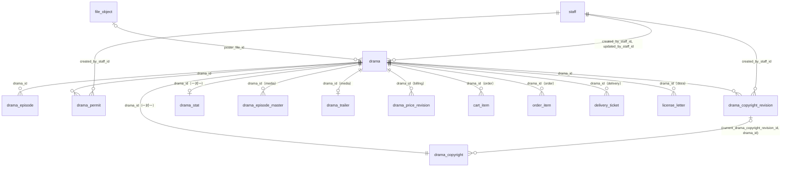
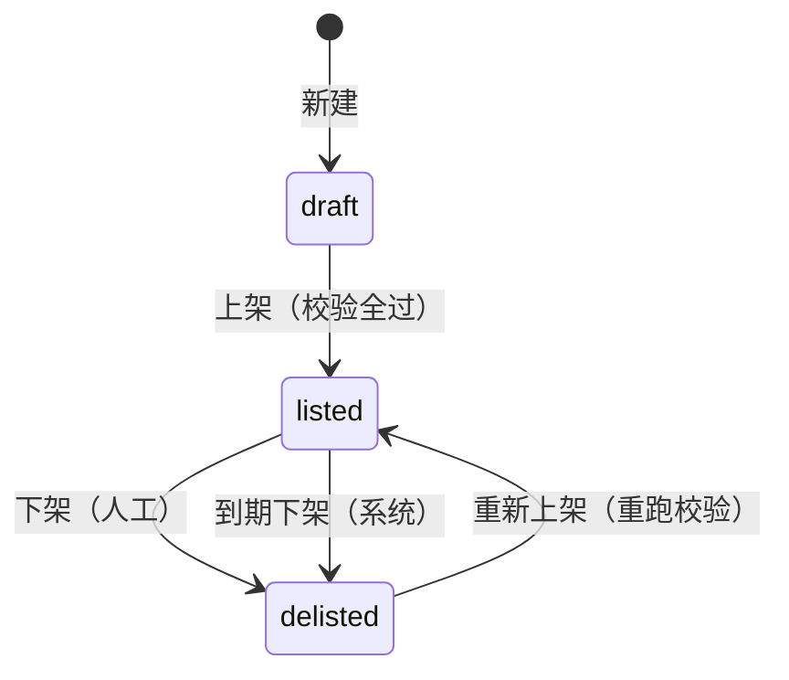

# 05 短剧库（content）

| 项 | 内容 |
| --- | --- |
| 模块 | `content`（L1，全局资源） |
| 表 | 6 张：`drama`、`drama_episode`、`drama_permit`、`drama_copyright`、`drama_copyright_revision`、`drama_stat` |
| 依据 | 草案 `docs/appendix/design/d8-content.md` 第 3、4、6、7 节（下文写作 d8:行号）；裁决 M19、M33、M34、M38、M43、M45、M46、M48、M49、M50、M52、M53、M59、M63、M74、M92、M95、M110；`catalogue.json` 的 conventions 与本分组 6 张表的 notes；PRD 第 7.2 节（PRD:749-761）；画板 `admin/DramaEdit`、`admin/Dramas` |

## 1. 概览

这组表存短剧库的全部事实：剧目资料与上下架状态、剧集、按“剧 × 播出平台 × 编号种类”分行的许可信息、版权信息的当前值与只增修订、派生的订购统计。

- 短剧库是全局资源，6 张表都不带 `entity_id`、`store_id`（d8:7）。
- 不存积分价（归 billing 的 `drama_price_revision`）；不存原片与预告片（归 media 的 `drama_episode_master`、`drama_trailer`）。本分组只持有海报、许可扫描件、权属证明的文件引用。
- “停止订购”“授权已结束”是由授权期止日现算的派生状态，不落库（d8:12）。
- `drama_copyright.license_end_date` 是全系统“成片使用期止日”的唯一来源（d8:15）。

## 2. 表定义

通用说明：

- 主键 `id` 为 UUID v7，由应用生成，不设数据库默认值。
- `created_at`、`updated_at` 由应用时钟写入，不设数据库默认值（conventions“时间”）。
- 所有外键的删除行为都是 Restrict。物理删除：`drama`、`drama_copyright` 由触发器禁止删除（d8:49），`drama_copyright_revision` 只增，`drama_permit` 只有从未上架的剧的活动行可删（2.3）；剧集行允许物理删除（M95），条件见 2.2；`drama_stat` 按剧 upsert，不删行。员工与文件行也不物理删除。
- 数组列（`text[]`、`uuid[]`）的“非空”由手写 SQL 的 `ALTER COLUMN … SET NOT NULL` 保证：Prisma 给标量数组列建的是只带默认值的可空列（M49）。每个数组列另有一条 `ck_<表>_<列>_elements`：元素非空且不重复，调用本组函数 `lyx_05_array_is_set(anyarray)`。
- 出处里的“约定”指 `catalogue.json` 的 conventions。

### 2.1 `drama` 剧目

剧目的基础信息、商业信息、上下架状态与运营字段。一行可原地修改，前后值记审计日志。归属：全局。主键：`id uuid`。不是只增表。业务状态机（machine = `drama`）。锁顺序：`lock_rank = 140`（门店之后、广告之前，M43 已确认）。

| 列 | 类型 | 空 | 默认 | 说明 | 出处 |
| --- | --- | --- | --- | --- | --- |
| `id` | uuid | 否 | — | 主键 | d8:98 |
| `title` | text | 否 | — | 剧名。不超过 20 字，应用层校验 | d8:99；PRD:751；画板 DramaEdit |
| `status` | text | 否 | — | 状态：`draft` 草稿、`listed` 已上架、`delisted` 已下架。只经 `flow.transition()` 迁移 | d8:100；PRD:756 |
| `status_changed_at` | timestamptz | 否 | — | 最近一次状态迁移的时间；新建时等于创建时间 | d8:101 |
| `first_listed_at` | timestamptz | 可 | — | 首次上架时间。“最新上架”排序与“新剧”判定用。重新上架不重置，写入后不可改 | d8:102 |
| `listed_at` | timestamptz | 可 | — | 最近一次上架时间 | d8:103 |
| `delisted_at` | timestamptz | 可 | — | 最近一次下架时间。每次下架（人工或到期）都重写为当前时钟，不早于 `listed_at`；重新上架后保留上一次的值，只在 `status = delisted` 时有业务含义 | d8:104；补：重写与保留规则，草案未写 |
| `delist_reason_code` | text | 可 | — | 最近一次下架的原因（枚举，不是字典编码），每次下架重写：`ops_strategy` 运营策略调整、`rights_issue` 版权或许可问题、`content_revision` 内容需要修改、`other` 其他、`license_expired` 授权到期（系统下架） | d8:105；画板 Dramas 下架弹窗 |
| `delist_note` | text | 可 | — | 下架说明，选填。不超过 200 字，应用层校验。每次下架重写：人工下架写员工填的说明（未填则置空），到期下架置空 | d8:106；补：重写规则 |
| `archived_at` | timestamptz | 可 | — | 归档时间。不是第四种状态；归档是终态，写入后不可改，归档的剧不能重新上架。写入时释放原片引用 | d8:107、430-439 |
| `poster_file_id` | uuid | 可 | — | 竖版封面，指向 `file_object`（类别 `poster`）。经 `file_ref` 登记 | d8:108；PRD:751 |
| `total_episodes` | integer | 可 | — | 总集数，≥ 1。保存时同事务把剧集行补齐或删到 `1..N` | d8:109、150 |
| `episode_duration_sec` | integer | 可 | — | 单集时长（秒），> 0。展示时格式化 | d8:110 |
| `genre_codes` | text[] | 否 | `{}` | 题材，字典 `genre` 的编码，多选。不建外键 | d8:111；PRD:751 |
| `selling_tag_codes` | text[] | 否 | `{}` | 卖点标签，字典 `selling_tag` 的编码，至多 3 个 | d8:112 |
| `producer_name` | text | 可 | — | 出品方 | d8:113 |
| `cast_names` | text | 可 | — | 主演，自由文本；参与搜索 | d8:114；PRD:516 |
| `synopsis` | text | 可 | — | 剧情简介。不超过 300 字，应用层校验 | d8:115 |
| `roles` | jsonb | 否 | `[]` | 角色介绍，结构见第 4 节。至多 8 个，整表替换保存，数组顺序即商家端展示顺序 | d8:116；画板 DramaEdit 角色弹窗 |
| `drama_class` | text | 可 | — | 微短剧类别：`class_1` 一类、`class_2` 二类、`class_3` 三类 | d8:117；PRD:752 |
| `heat_tier` | text | 可 | — | 热度等级：`S`、`A`、`B`、`C`。决定模板积分价，billing 读取 | d8:118；PRD:754 |
| `industry_codes` | text[] | 否 | `{}` | 适配行业，字典 `industry` 的一级编码 | d8:119；PRD:754 |
| `target_audience` | text | 可 | — | 目标观众，自由文本 | d8:120 |
| `allowed_placements` | text[] | 否 | `{}` | 允许的植入形式：`opening` 片头贴片、`ending` 片尾贴片、`corner` 角标字幕条、`mid_roll` 片中插播。后两个为 V1.1 预留，V1.0 服务端只接受前两个（按参数 `content.placement.open_slots`） | d8:121；PRD:754、761 |
| `trial_episode_count` | integer | 可 | — | 试看集数（V1.1），0 到 10。空表示取参数默认值 | d8:122；M59 |
| `manual_boost` | smallint | 否 | 0 | 综合排序的人工加权分，0 到 100 | d8:123 |
| `is_ai_generated` | boolean | 否 | false | 原片本身是否 AI 制作。media 经 `DramaFactsPort` 读取 | d8:124 |
| `body_edit_policy` | text | 否 | `'undecided'` | 是否允许改动正片：`undecided` 未定（口径待法务）、`allowed` 允许、`forbidden` 不允许。V1.0 不参与任何校验 | d8:125；M74 |
| `is_permit_recheck_required` | boolean | 否 | false | 原片内容有实质变更后，许可信息是否待重新核验。由 `drama.masters_changed` 的处理置位（批次带 `is_content_changed` 时，06 的列名），只能经“确认重新核验”清除 | d8:126、560 |
| `created_by_staff_id` | uuid | 否 | — | 创建人，指向 `staff` | d8:127；约定“操作人列” |
| `updated_by_staff_id` | uuid | 否 | — | 最近一次保存资料的员工，指向 `staff`。新建时等于创建人；系统动作（到期下架、归档、置待核验标记）不改写 | d8:127；约定“操作人列” |
| `lock_version` | integer | 否 | 0 | 乐观锁版本号 | d8:128 |
| `created_at` | timestamptz | 否 | — | 创建时间 | d8:7 |
| `updated_at` | timestamptz | 否 | — | 最近更新时间 | d8:7 |

**键与索引**

- 主键：`pk_drama (id)`。
- 外键：`poster_file_id` → `file_object.id`（Restrict，`fk_drama_poster_file_id`）；`created_by_staff_id` → `staff.id`（Restrict，`fk_drama_created_by_staff_id`，关系名 `DramaCreatedByStaff`）；`updated_by_staff_id` → `staff.id`（Restrict，`fk_drama_updated_by_staff_id`，关系名 `DramaUpdatedByStaff`）。对 `staff` 的两条关系各写关系名，反向字段由工具补（M46）。
- 普通索引：`ix_drama_status (status)`，后台列表按状态筛选、页首计数、商城取在架剧；`ix_drama_genre_codes`（GIN，`genre_codes`），题材筛选与商城分类求交；`ix_drama_industry_codes`（GIN，`industry_codes`），行业筛选、“为你推荐”、搜索兜底。两个 GIN 索引写在 Prisma 片段里（`type: Gin`）。

**手写约束**

| 名称 | 规则 |
| --- | --- |
| `ck_drama_status` | `status` ∈ {`draft`,`listed`,`delisted`} |
| `ck_drama_delist_reason_code` | `delist_reason_code` ∈ {`ops_strategy`,`rights_issue`,`content_revision`,`other`,`license_expired`} |
| `ck_drama_drama_class` | `drama_class` ∈ {`class_1`,`class_2`,`class_3`} |
| `ck_drama_heat_tier` | `heat_tier` ∈ {`S`,`A`,`B`,`C`} |
| `ck_drama_body_edit_policy` | `body_edit_policy` ∈ {`undecided`,`allowed`,`forbidden`} |
| `ck_drama_allowed_placements` | `allowed_placements` 的元素都在 {`opening`,`ending`,`corner`,`mid_roll`} 内 |
| `ck_drama_selling_tag_codes_max` | `selling_tag_codes` 至多 3 个元素 |
| `ck_drama_genre_codes_elements`、`ck_drama_selling_tag_codes_elements`、`ck_drama_industry_codes_elements`、`ck_drama_allowed_placements_elements` | 四个数组列的元素非空且不重复：`lyx_05_array_is_set(<列>)`。函数 `lyx_05_array_is_set(anyarray)` 定义在本组 SQL 开头（IMMUTABLE） |
| `ck_drama_total_episodes` | `total_episodes >= 1` |
| `ck_drama_episode_duration_sec` | `episode_duration_sec > 0` |
| `ck_drama_trial_episode_count` | `trial_episode_count` 在 0 到 10 之间 |
| `ck_drama_manual_boost` | `manual_boost` 在 0 到 100 之间 |
| `ck_drama_roles_array` | `roles` 是 JSON 数组（元素结构与个数在应用层校验） |
| `ck_drama_draft_clean` | 草稿从未上架：`status = draft` 时 `first_listed_at`、`listed_at`、`delisted_at`、`delist_reason_code`、`archived_at` 都为空 |
| `ck_drama_listed_times` | 非草稿的剧 `first_listed_at`、`listed_at` 都非空，且前者不晚于后者 |
| `ck_drama_delisted_fields` | `status = delisted` 时 `delisted_at`、`delist_reason_code` 非空，且 `delisted_at >= listed_at`（每次下架都要重写下架时间，重新上架后残留的上一次下架时间过不了） |
| `ck_drama_delist_note_expired` | 系统到期下架没有人工说明：`delist_reason_code = license_expired` 时 `delist_note` 为空 |
| `ck_drama_archived_delisted` | 只有已下架的剧可以归档：`archived_at` 非空时 `status = delisted` |
| `ix_drama_listed_first_listed_at` | 部分索引 `(first_listed_at DESC) WHERE status = 'listed'`；“最新上架”排序与“新剧”列表用 |
| `trg_drama_write_once` | 行级 BEFORE UPDATE 触发器，函数 `lyx_05_drama_write_once()`：`first_listed_at`、`archived_at` 写入后不可改。公共的 `lyx_write_once` 会锁住其余所有列、`lyx_forbid_column_change` 不允许从空写一次，所以本组自定义 |
| `trg_drama_no_delete` | 行级 BEFORE DELETE 触发器，函数 `lyx_forbid_delete()`：剧目不做物理删除 |
| `trg_drama_no_truncate` | 语句级 BEFORE TRUNCATE 触发器，函数 `lyx_forbid_delete()` |
| 数组列非空 | `genre_codes`、`selling_tag_codes`、`industry_codes`、`allowed_placements` 四列 `SET NOT NULL` |

说明：

- `ck_drama_draft_clean`、`ck_drama_listed_times`、`ck_drama_delisted_fields`、`ck_drama_delist_note_expired`、`ck_drama_archived_delisted` 是列间关系，按语句求值。状态迁移的那一条 UPDATE 必须同时写入 `status_changed_at` 与伴随列（上架写 `first_listed_at`、`listed_at`；下架写 `delisted_at`、`delist_reason_code`、`delist_note`），不能分两条语句。
- `ck_drama_archived_delisted` 加上 `archived_at` 不可改，等价于“归档后不能重新上架”（d8:436）。
- 只在应用层校验、不进数据库的：剧名、简介、下架说明的字数；`roles` 的元素结构与至多 8 个；字典编码存在且启用；V1.0 的 `allowed_placements` 只接受 `opening`、`ending`；许可种类与微短剧类别的对应（d8:289）。上架校验清单（d8:330-349）是代码里的清单，严重度可调，不写成数据库约束（d8:75 的 K7）。

**状态机**（每次迁移写 `status_transition`，machine = `drama`，`state_field = status`（M53），`entity_id`、`store_id` 为空；同事务补写一条活动流的审计行）

| 当前状态 | 事件 | 新状态 | 守卫 | 触发者 | 同事务的写入 |
| --- | --- | --- | --- | --- | --- |
| — | `drama.create` | `draft` | — | 员工 | 建 `drama_copyright` 空行 |
| `draft` | `drama.list` | `listed` | 上架校验的阻断项全过（d8:330-349） | 员工（权限点 `drama.shelf`） | 写 `first_listed_at`、`listed_at`；写一条 `initial` 修订并回填 `current_drama_copyright_revision_id`；登记到期定时器；`status_transition.payload` 写当次上架校验摘要（`DramaListingCheckSummary`，第 4 节）；发 `drama.listed` |
| `listed` | `drama.delist` | `delisted` | 必选原因；说明不超过 200 字 | 员工（`drama.shelf`） | 重写三列：`delisted_at` = 当前时钟、`delist_reason_code` = 所选原因、`delist_note` = 所填说明（未填置空）；取消到期定时器；原因为 `rights_issue` 时停用预告片的公开分发；发 `drama.delisted` |
| `listed` | `drama.license_expire` | `delisted` | 今天 > `license_end_date`（处理器执行前重读） | 系统（定时器 `content.license_end`） | 重写三列：`delisted_at` = 当前时钟、`delist_reason_code = license_expired`、`delist_note = NULL`；不改 `updated_by_staff_id`；发 `drama.delisted` |
| `delisted` | `drama.relist` | `listed` | `archived_at` 为空；授权未结束；阻断项全过 | 员工（`drama.shelf`） | 写 `listed_at`，不动 `first_listed_at`，下架三列保留；登记到期定时器；`status_transition.payload` 写当次上架校验摘要；发 `drama.listed` |

每一行都在同一条 UPDATE 里写 `status_changed_at`（当前时钟）。

上架校验结果按需计算（服务端纯函数 `listingChecks`，d8:332），不落库；只有上架、重新上架把当次摘要写进 `status_transition.payload`（d8:271）。d8:560-561 的“刷新上架校验结果”在本模型里只是让目录缓存版本号加 1，不写表。

归档不是状态迁移：周期任务 `content.archive_sweep` 在“已下架、授权已结束、名下没有未结束的订单项”时写 `archived_at`（d8:430），同事务按第 3 节的规则释放本剧的文件引用并调用 `media.retireDramaMedia(…, { scope: 'masters' })`；不写 `status_transition`，写审计。

本表相关的定时器与周期任务（d8:567-569；登记取值见第 3 节）：`content.license_end:drama:{dramaId}:{licenseEndDate}`（定时器；止日变更按前缀 `content.license_end:drama:{dramaId}:` 取消后重新登记，接口裁决 A96，`subject_type = drama`）、`content.stat_refresh`（每小时）、`content.archive_sweep`（每日）；后两个是周期任务，主体为空（M45）。

**不变量**（每日校验，d8:599-606）。检查项登记在 `content/invariants.ts`（15 分组 2.4 的 `InvariantCheck`），编号 `content.<编号>`：module `content`，severity `P2`（都不涉及资金），`modes: ['full']`、不写 `every`（随每日的 full 运行），`heal` 见下表；`subject_type = drama`、`subject_id` 为剧目 id。剧目是全局资源，不传 `entityId`。违规由 ops 落库（M30），本组不直接写 `invariant_violation`，也不直接调告警端口。

| 编号 | 不变量 | 处理 | `heal` |
| --- | --- | --- | --- |
| `content.I1` | 已上架 ⇒ 上架校验的阻断项全过 | 告警，不自动下架 | `none` |
| `content.I2` | 已上架 ⇒ 今天 ≤ `drama_copyright.license_end_date` | 自愈（执行到期下架）并告警 | `heal_and_alert` |
| `content.I3` | 已上架 ⇒ 存在未取消的 `content.license_end` 定时器，且到期时间与止日一致 | 自愈（重排）并告警 | `heal_and_alert` |
| `content.I6` | 所有剧的 `allowed_placements` ⊆ 参数 `content.placement.open_slots`；一类、二类另须 ⊆ {`opening`,`ending`} | 告警 | `none` |
| `content.I7` | `genre_codes`、`selling_tag_codes`、`industry_codes` 里的编码在对应字典里存在（补：约定“枚举”第 3 条，字典引用不建外键、由不变量校验） | 告警 | `none` |

**相对草案的改动**

| 改动 | 依据 |
| --- | --- |
| `created_by`、`updated_by` 改名 `created_by_staff_id`、`updated_by_staff_id`，定为非空并建外键 | 约定“操作人列”：操作人固定为员工时用单列并带类型后缀；L1 的表建外键 |
| `body_modifiable`（可空布尔）改为枚举列 `body_edit_policy text NOT NULL DEFAULT 'undecided'`，取值 `undecided`、`allowed`、`forbidden` | M74 |
| `trial_episode_count` 由 smallint 改为 integer（CHECK 0 到 10 不变） | M59：集数一律 integer |
| `permit_recheck_required` 改名 `is_permit_recheck_required` | 约定“命名规则”：布尔列用 `is_` 前缀 |
| 补 `created_at`、`updated_at` | d8:7 声明“下文字段表不再重复列出” |
| 补五条状态一致性 CHECK（含 `delisted_at >= listed_at` 与到期下架无说明）、`roles` 的类型 CHECK、写入后不可改的触发器 | WRITER-GUIDE 第 4 节（列间关系写成 CHECK）；d8:102、107、436 的规则原本只在应用层 |
| 数组列的非空改由手写 SQL 保证；补数组元素非空且不重复的 CHECK | M49；Prisma 的标量数组列不带 NOT NULL；`cardinality` 计数会把重复值算进“至多 3 个” |
| 两个 GIN 索引写在 Prisma 片段，不放手写 SQL | M49 |
| `delisted_at`、`delist_reason_code`、`delist_note` 明确为“最近一次下架”的值：每次下架都重写三列，重新上架后保留 | 草案未写清除规则；复核意见（到期下架须重写三列） |
| 补防删触发器 `trg_drama_no_delete`、`trg_drama_no_truncate` | d8:49“不预留剧目的物理删除”；M50 |

### 2.2 `drama_episode` 剧集

每集一行：集号、标题、时长，另留 V1.1、V2.0 的点位列。media 的原片版本按 `(drama_id, episode_no)` 对到本表。归属：全局。主键：`id uuid`。不是只增表。无状态列。锁顺序：不参与（`lock_rank = null`，只在持有剧目行锁的事务里修改）。

| 列 | 类型 | 空 | 默认 | 说明 | 出处 |
| --- | --- | --- | --- | --- | --- |
| `id` | uuid | 否 | — | 主键 | d8:140 |
| `drama_id` | uuid | 否 | — | 所属剧目 | d8:141 |
| `episode_no` | integer | 否 | — | 集号，从 1 起；同一部剧内唯一 | d8:142 |
| `title` | text | 可 | — | 单集标题 | d8:143；画板 DramaEdit 剧集表 |
| `duration_ms` | integer | 可 | — | 时长（毫秒），取当前原片的时长。content 收到 `drama.masters_changed` 后回填，media 不写本表 | d8:144；PRD:755 |
| `insert_points` | jsonb | 可 | — | 中插点位，V1.1 预留；V1.0 不写 | d8:145；PRD:755 |
| `custom_slots` | jsonb | 可 | — | 可定制镜头位，V2.0 预留；V1.0 不写 | d8:146 |
| `created_at` | timestamptz | 否 | — | 创建时间 | d8:7 |
| `updated_at` | timestamptz | 否 | — | 最近更新时间 | d8:7 |

**键与索引**

- 主键：`pk_drama_episode (id)`。
- 外键：`drama_id` → `drama.id`（Restrict，`fk_drama_episode_drama_id`）。
- 唯一约束：`uq_drama_episode_drama_id_episode_no (drama_id, episode_no)`；按剧取剧集列表也用它。

**手写约束**

| 名称 | 规则 |
| --- | --- |
| `ck_drama_episode_episode_no` | `episode_no >= 1` |
| `ck_drama_episode_duration_ms` | `duration_ms > 0` |

应用层规则（d8:150-151）：保存 `drama.total_episodes` 时同事务把剧集行补齐或删到集号恰为 `1..N`；已上架的剧不能改总集数；已有当前原片的集不能删。

物理删除：剧集行在允许物理删除的名单里（M95）。条件：剧目不在已上架状态（草稿或已下架且未归档），且该集没有当前原片；只在改总集数的同一事务里删。删除前经 `media.dramaMediaReadiness` 确认（content → media 同步调用，M29）。media 的 `drama_episode_master` 不对本表建外键（06 分组的决定：建了之后有过原片版本的集都删不掉），按 `(drama_id, episode_no)` 对应：删除前的确认在应用层保证没有悬空的当前原片，已上架的剧另由 `content.I1`（含上架校验 L10“每集有当前原片”）核对。

**不变量**（登记方式同 2.1）

| 编号 | 不变量 | 处理 | `heal` |
| --- | --- | --- | --- |
| `content.I5` | 每部剧的剧集行集号恰为 `1..total_episodes` | 告警 | `none` |

**相对草案的改动**

| 改动 | 依据 |
| --- | --- |
| 补 `created_at`、`updated_at` | d8:7 |
| 补 `ck_drama_episode_duration_ms` | WRITER-GUIDE 第 4 节（数值范围写成 CHECK） |
| 登记为可物理删除的对象，写明删除条件 | d8:150-151；约定“软删除”；M63、M95 |

### 2.3 `drama_permit` 许可信息

按“剧 × 播出平台 × 编号种类”分行。上架过的剧不原地改号：换号 = 旧行置 `retired` + 新建一行。归属：全局。主键：`id uuid`。不是只增表。`status` 是行状态，不写状态历史。锁顺序：不参与（只在持有剧目行锁的事务里修改）。

| 列 | 类型 | 空 | 默认 | 说明 | 出处 |
| --- | --- | --- | --- | --- | --- |
| `id` | uuid | 否 | — | 主键 | d8:168 |
| `drama_id` | uuid | 否 | — | 所属剧目 | d8:169 |
| `platform` | text | 否 | — | 播出平台：`all` 不区分平台、`douyin` 抖音、`wechat_channels` 视频号 | d8:170 |
| `permit_kind` | text | 否 | — | 编号种类：`license_no` 许可证号、`approval_no` 批准文件编号、`program_no` 节目编号 | d8:171；PRD:752 |
| `permit_no` | text | 否 | — | 编号 | d8:172 |
| `scan_file_ids` | uuid[] | 否 | `{}` | 许可文件扫描件（`file_object` 的 id，类别 `drama_license_doc`）。不建外键，经 `file_ref` 登记 | d8:173；PRD:752 |
| `status` | text | 否 | — | 行状态：`active` 活动、`retired` 已停用 | d8:174 |
| `retired_at` | timestamptz | 可 | — | 停用时间；停用行必填 | d8:175 |
| `retire_reason` | text | 可 | — | 停用原因 | d8:175 |
| `note` | text | 可 | — | 备注 | d8:176 |
| `created_by_staff_id` | uuid | 否 | — | 创建人，指向 `staff` | d8:177；约定“操作人列” |
| `created_at` | timestamptz | 否 | — | 创建时间 | d8:7 |
| `updated_at` | timestamptz | 否 | — | 最近更新时间 | d8:7 |

**键与索引**

- 主键：`pk_drama_permit (id)`。
- 外键：`drama_id` → `drama.id`（Restrict，`fk_drama_permit_drama_id`）；`created_by_staff_id` → `staff.id`（Restrict，`fk_drama_permit_created_by_staff_id`）。
- 普通索引：`ix_drama_permit_drama_id (drama_id)`，按剧列出全部许可行（含停用行）。

**手写约束**

| 名称 | 规则 |
| --- | --- |
| `ck_drama_permit_platform` | `platform` ∈ {`all`,`douyin`,`wechat_channels`} |
| `ck_drama_permit_permit_kind` | `permit_kind` ∈ {`license_no`,`approval_no`,`program_no`} |
| `ck_drama_permit_status` | `status` ∈ {`active`,`retired`} |
| `ck_drama_permit_retired_fields` | 停用行必有 `retired_at`；活动行的 `retired_at`、`retire_reason` 都为空 |
| `ck_drama_permit_scan_file_ids_elements` | `scan_file_ids` 的元素非空且不重复：`lyx_05_array_is_set(scan_file_ids)` |
| `uq_drama_permit_active` | 部分唯一索引 `(drama_id, platform, permit_kind) WHERE status = 'active'`：每个（剧, 平台, 编号种类）至多一条活动行 |
| `trg_drama_permit_guard` | 行级 BEFORE UPDATE OR DELETE 触发器，函数 `lyx_05_drama_permit_guard()`：① `status = retired` 的行不可改、不可删（停用行是换号留痕）；② `drama_id` 创建后不可改；③ 剧目上架过（`drama.first_listed_at` 非空）时，活动行的 `platform`、`permit_kind`、`permit_no` 不可原地改，活动行也不可删，只能停用 |
| `trg_drama_permit_no_truncate` | 语句级 BEFORE TRUNCATE 触发器，函数 `lyx_forbid_delete()` |
| 数组列非空 | `scan_file_ids` `SET NOT NULL` |

行状态：`active` → `retired`，单向，由 `trg_drama_permit_guard` 保证。停用由员工在“换号”或“停用”操作里完成，同事务发 `drama.permit_changed`。草稿期（剧目从未上架）可原地改号、可删行（d8:186）。上架过的剧的活动行仍可改 `scan_file_ids`、`note`。不写 `status_transition`，前后值在审计日志。

**相对草案的改动**

| 改动 | 依据 |
| --- | --- |
| `created_by` 改名 `created_by_staff_id`，非空并建外键 | 约定“操作人列” |
| 补 `created_at`、`updated_at` | d8:7 |
| 补 `ck_drama_permit_retired_fields`、`ix_drama_permit_drama_id` | WRITER-GUIDE 第 4 节；按剧读取全部行的查询 |
| 补 `trg_drama_permit_guard`、`trg_drama_permit_no_truncate`、元素 CHECK | d8:185-186（上架过的剧换号即换行，停用行是留痕）原本只在应用层；复核意见 |

### 2.4 `drama_copyright` 版权信息当前值

每部剧一行，新建剧目时同事务建空行。上架之后的任何变更都必须经“版权变更”用例，同事务写修订行。归属：全局。主键：`drama_id`（与 `drama` 一对一）。不是只增表。无状态列。锁顺序：不参与（只在持有剧目行锁的事务里修改）。

| 列 | 类型 | 空 | 默认 | 说明 | 出处 |
| --- | --- | --- | --- | --- | --- |
| `drama_id` | uuid | 否 | — | 主键，即剧目 id | d8:196 |
| `source` | text | 可 | — | 版权来源：`own` 自有、`licensed` 授权 | d8:197；PRD:753 |
| `platforms` | text[] | 否 | `{}` | 授权平台：`douyin`、`wechat_channels`。即可发布平台的上限 | d8:198；PRD:753 |
| `territory` | text | 可 | — | 授权地域，自由文本；授权书的地域取这里 | d8:199 |
| `has_network_right` | boolean | 否 | false | 是否具备信息网络传播权 | d8:200；PRD:1049 |
| `can_sublicense` | boolean | 否 | false | 是否可转授权 | d8:201；PRD:753 |
| `can_edit_embed` | boolean | 否 | false | 是否可剪辑植入 | d8:202；PRD:753 |
| `can_adapt` | boolean | 否 | false | 是否可改编 | d8:203；PRD:758、1049 |
| `license_start_date` | date | 可 | — | 版权有效期起 | d8:204 |
| `license_end_date` | date | 可 | — | 版权有效期止 = 剧目授权期结束日 = 成片使用期止日 | d8:205；PRD:753、183 |
| `proof_file_ids` | uuid[] | 否 | `{}` | 权属证明文件（`file_object` 的 id，类别 `drama_license_doc`）。不建外键，经 `file_ref` 登记 | d8:206；PRD:753 |
| `current_drama_copyright_revision_id` | uuid | 可 | — | 最近一条修订，必须是本剧的修订（复合外键）；首次上架前为空 | d8:207；M33 |
| `lock_version` | integer | 否 | 0 | 乐观锁版本号 | d8:208 |
| `created_at` | timestamptz | 否 | — | 创建时间 | d8:7 |
| `updated_at` | timestamptz | 否 | — | 最近更新时间 | d8:7 |

**键与索引**

- 主键：`pk_drama_copyright (drama_id)`。
- 外键：`drama_id` → `drama.id`（Restrict，`fk_drama_copyright_drama_id`）；`(current_drama_copyright_revision_id, drama_id)` → `drama_copyright_revision (id, drama_id)`（Restrict，复合外键 `fk_drama_copyright_current_drama_copyright_revision_id`，指针为空时不校验；目标是修订表的 `uq_drama_copyright_revision_id_drama_id`）。复合的写法仿 M47，保证当前指针不会指到别的剧的修订。
- 普通索引：`ix_drama_copyright_license_end_date (license_end_date)`，到期提醒的按日查询、工作台“版权即将到期”、后台“仅看 N 天内授权到期”。

**手写约束**

| 名称 | 规则 |
| --- | --- |
| `ck_drama_copyright_source` | `source` ∈ {`own`,`licensed`} |
| `ck_drama_copyright_platforms` | `platforms` 的元素都在 {`douyin`,`wechat_channels`} 内 |
| `ck_drama_copyright_license_dates` | 起止日都非空时 `license_end_date >= license_start_date` |
| `ck_drama_copyright_platforms_elements`、`ck_drama_copyright_proof_file_ids_elements` | 两个数组列的元素非空且不重复：`lyx_05_array_is_set(<列>)` |
| `trg_drama_copyright_no_delete` | 行级 BEFORE DELETE 触发器，函数 `lyx_forbid_delete()`：与剧目一对一，不做物理删除 |
| `trg_drama_copyright_no_truncate` | 语句级 BEFORE TRUNCATE 触发器，函数 `lyx_forbid_delete()` |
| 数组列非空 | `platforms`、`proof_file_ids` `SET NOT NULL` |

**不变量**（登记方式同 2.1）

| 编号 | 不变量 | 处理 | `heal` |
| --- | --- | --- | --- |
| `content.I4` | 上架过的剧：本行当前值 = `current_drama_copyright_revision_id` 所指修订的 `copyright_snapshot`，且该修订是这部剧 `seq` 最大的一条 | 告警 | `none` |

**相对草案的改动**

| 改动 | 依据 |
| --- | --- |
| `current_revision_id` 改名 `current_drama_copyright_revision_id` | M33：外键列用被引用表全名 + `_id`，前面保留角色词 `current` |
| `has_network_right`、`can_sublicense`、`can_edit_embed`、`can_adapt` 由可空改为非空、默认 false | 约定“命名规则”：布尔列 NOT NULL 带默认值。未填与“否”对上架校验等价（L3、L4 都要求为真，d8:338-339） |
| 补 `created_at`、`updated_at` | d8:7 |
| 当前修订指针改为复合外键 `(current_drama_copyright_revision_id, drama_id)` | 复核意见：单列外键可以指到别的剧的修订，只能靠每日不变量发现；写法仿 M47 |
| 补防删触发器、数组元素 CHECK | d8:49；M50；复核意见 |

### 2.5 `drama_copyright_revision` 版权信息修订

止日与权利范围的事实链：首次上架落第一行，之后每次版权变更一行。归属：全局。主键：`id uuid` + `seq bigint`（自增，唯一）。只增表：应用角色只有 INSERT、SELECT 权限，另有触发器拦截 UPDATE、DELETE、TRUNCATE。锁顺序：不参与。

| 列 | 类型 | 空 | 默认 | 说明 | 出处 |
| --- | --- | --- | --- | --- | --- |
| `id` | uuid | 否 | — | 主键 | d8:216 |
| `seq` | bigint | 否 | 自增 | 只用于排序与回放，不出接口 | d8:217；约定“主键” |
| `drama_id` | uuid | 否 | — | 所属剧目 | d8:218 |
| `change_kind` | text | 否 | — | 修订类型：`initial` 首次录入、`extend` 续期、`shorten` 缩短、`scope_change` 权利范围或平台地域变更、`correction` 更正。是操作人填的归类；发什么事件由前后值的差异决定 | d8:219、229-239 |
| `copyright_snapshot` | jsonb | 否 | — | 变更后的全部版权字段（完整值，不是增量），结构见第 4 节 | d8:220 |
| `prev_end_date` | date | 可 | — | 变更前的止日；`initial` 行为空，其余类型必有 | d8:221 |
| `new_end_date` | date | 否 | — | 变更后的止日。修订行只在上架之后产生，而上架要求止日非空（L2），所以任何修订都必有 | d8:221、337 |
| `reason` | text | 否 | — | 变更原因；`initial` 行由系统写“首次上架” | d8:222 |
| `proof_file_ids` | uuid[] | 否 | `{}` | 本次变更的依据文件（续期合同等）。不建外键，经 `file_ref` 登记；引用不随当前值被替换而释放，剧目归档时才释放（保留期见第 3 节） | d8:223、644 |
| `created_by_staff_id` | uuid | 否 | — | 操作人，指向 `staff` | d8:224；约定“操作人列” |
| `created_at` | timestamptz | 否 | — | 创建时间 | d8:7 |

**键与索引**

- 主键：`pk_drama_copyright_revision (id)`。
- 外键：`drama_id` → `drama.id`（Restrict，`fk_drama_copyright_revision_drama_id`）；`created_by_staff_id` → `staff.id`（Restrict，`fk_drama_copyright_revision_created_by_staff_id`）。
- 唯一约束：`uq_drama_copyright_revision_seq (seq)`；`uq_drama_copyright_revision_id_drama_id (id, drama_id)`，供 `drama_copyright` 的复合外键引用。
- 普通索引：`ix_drama_copyright_revision_drama_id_seq (drama_id, seq)`，按剧回放修订、取最新一条。

**手写约束**

| 名称 | 规则 |
| --- | --- |
| `ck_drama_copyright_revision_change_kind` | `change_kind` ∈ {`initial`,`extend`,`shorten`,`scope_change`,`correction`} |
| `ck_drama_copyright_revision_end_dates` | 修订类型与止日前后值不矛盾（`new_end_date` 列本身非空）：`initial` 时 `prev_end_date` 为空；其余类型 `prev_end_date` 非空，且 `extend` 新止日更晚、`shorten` 新止日更早、`scope_change` 新旧相等、`correction` 不限方向 |
| `ck_drama_copyright_revision_copyright_snapshot` | `copyright_snapshot` 是 JSON 对象 |
| `ck_drama_copyright_revision_proof_file_ids_elements` | `proof_file_ids` 的元素非空且不重复：`lyx_05_array_is_set(proof_file_ids)` |
| `uq_drama_copyright_revision_initial` | 部分唯一索引 `(drama_id) WHERE change_kind = 'initial'`：每部剧至多一条 `initial` |
| `trg_drama_copyright_revision_append_only` | 行级 BEFORE UPDATE OR DELETE，函数 `lyx_forbid_mutation()` |
| `trg_drama_copyright_revision_no_truncate` | 语句级 BEFORE TRUNCATE，函数 `lyx_forbid_mutation()` |
| 数组列非空 | `proof_file_ids` `SET NOT NULL` |

写入规则（d8:228-239）：草稿期保存版权页签不写修订行；首次上架写一行 `initial`；重新上架不再写。上架之后的版权变更同事务完成四件事：写修订行、更新 `drama_copyright` 当前值与 `current_drama_copyright_revision_id`、写审计、发事件。归档后不再受理版权变更。

**相对草案的改动**

| 改动 | 依据 |
| --- | --- |
| `snapshot` 改名 `copyright_snapshot` | 约定“命名规则”：快照列以 `_snapshot` 结尾 |
| `created_by` 改名 `created_by_staff_id`，非空并建外键 | 约定“操作人列” |
| 补 `created_at` | d8:7 |
| 补 `ck_drama_copyright_revision_end_dates`、`uq_drama_copyright_revision_initial`、快照的类型 CHECK | d8:228、239（服务端校验归类与差异不矛盾；`initial` 只在首次上架写）；WRITER-GUIDE 第 4 节 |
| `new_end_date` 由可空改为非空；非 `initial` 的行 `prev_end_date` 必有，`scope_change` 改用 `=` 比较 | 复核意见：原 CHECK 让 `correction` 可把止日置空、`scope_change` 前后都空也能通过；d8:15（止日是成片使用期止日的唯一来源）、d8:337（L2 要求起止日） |
| 补 `uq_drama_copyright_revision_id_drama_id`、元素 CHECK | 复合外键的目标；复核意见 |
| 防改触发器写明用公共函数，并补 TRUNCATE 拦截 | 约定“只增表”；d8:288 只写了“防改触发器与只增权限” |

### 2.6 `drama_stat` 订购统计

派生读模型，丢了可重算，不参与任何校验。周期任务 `content.stat_refresh` 每小时经 `DramaUsagePort` 向 order 取数后按剧 upsert 覆盖（统计归零的剧写 0，不删行）。归属：全局。主键：`drama_id`（与 `drama` 一对一，没有统计的剧可以没有行）。不是只增表。锁顺序：不参与。

| 列 | 类型 | 空 | 默认 | 说明 | 出处 |
| --- | --- | --- | --- | --- | --- |
| `drama_id` | uuid | 否 | — | 主键，即剧目 id | d8:246 |
| `orders_30d` | integer | 否 | 0 | 近 30 天订购部数；综合排序与“热门”用 | d8:247 |
| `orders_mtd` | integer | 否 | 0 | 当月订购部数；后台列表“当月订购”列 | d8:248；画板 Dramas |
| `live_items` | integer | 否 | 0 | 上线中成片部数；后台列表列与下架弹窗提示 | d8:249；画板 Dramas |
| `refreshed_at` | timestamptz | 否 | — | 本行统计的取数时刻 | d8:250 |
| `created_at` | timestamptz | 否 | — | 创建时间 | d8:7 |
| `updated_at` | timestamptz | 否 | — | 最近更新时间 | d8:7 |

**键与索引**

- 主键：`pk_drama_stat (drama_id)`。
- 外键：`drama_id` → `drama.id`（Restrict，`fk_drama_stat_drama_id`）。
- 无其他索引：目录读侧一次取全部在架剧并左连本表（d8:390）。

**手写约束**

| 名称 | 规则 |
| --- | --- |
| `ck_drama_stat_counts` | `orders_30d`、`orders_mtd`、`live_items` 都 ≥ 0 |

**相对草案的改动**

| 改动 | 依据 |
| --- | --- |
| 补 `created_at`、`updated_at` | d8:7；约定“时间” |
| 补 `ck_drama_stat_counts` | WRITER-GUIDE 第 4 节 |

## 3. 枚举汇总

| 枚举（表.列） | 取值 | 含义 | 备注 |
| --- | --- | --- | --- |
| `drama.status` | `draft`、`listed`、`delisted` | 草稿、已上架、已下架 | 业务状态机，machine = `drama`，`state_field = status` |
| `drama.delist_reason_code` | `ops_strategy`、`rights_issue`、`content_revision`、`other`、`license_expired` | 运营策略调整、版权或许可问题、内容需要修改、其他、授权到期 | 前四个由员工选，最后一个只由系统写 |
| `drama.drama_class` | `class_1`、`class_2`、`class_3` | 一类、二类、三类微短剧 | — |
| `drama.heat_tier` | `S`、`A`、`B`、`C` | 热度等级 | 见 catalogue enums_shared 的 `heat_tier` |
| `drama.body_edit_policy` | `undecided`、`allowed`、`forbidden` | 未定、允许改动正片、不允许改动正片 | M74；默认 `undecided`，V1.0 不参与校验 |
| `drama.allowed_placements[]` | `opening`、`ending`、`corner`、`mid_roll` | 片头贴片、片尾贴片、角标字幕条、片中插播 | 见 catalogue enums_shared 的 `placement_slot`；V1.0 只接受前两个 |
| `drama_permit.platform` | `all`、`douyin`、`wechat_channels` | 不区分平台、抖音、视频号 | 后两个见 catalogue enums_shared 的 `channel_platform`；`all` 为本表所加 |
| `drama_permit.permit_kind` | `license_no`、`approval_no`、`program_no` | 许可证号、批准文件编号、节目编号 | — |
| `drama_permit.status` | `active`、`retired` | 活动、已停用 | 行状态，不写状态历史 |
| `drama_copyright.source` | `own`、`licensed` | 自有、授权 | — |
| `drama_copyright.platforms[]` | `douyin`、`wechat_channels` | 抖音、视频号 | 见 catalogue enums_shared 的 `channel_platform` |
| `drama_copyright_revision.change_kind` | `initial`、`extend`、`shorten`、`scope_change`、`correction` | 首次录入、续期、缩短、范围变更、更正 | `shorten` 与改早止日的 `correction` 在 order 改为单向顺延之前不开放（d8:413） |

不是枚举的编码列：`genre_codes`、`selling_tag_codes`、`industry_codes` 存字典编码（字典类型 `genre`、`selling_tag`、`industry`），不写取值 CHECK，不建外键。

本分组登记的多态取值与键（M19、M52：都用最终表名；数据库只做格式校验，取值清单在 `packages/contract`）：

| 位置 | 取值 |
| --- | --- |
| `status_transition.machine` / `state_field` | `drama` / `status`（M53） |
| `timer.subject_type` 与 `kind` | 定时器 `content.license_end`（键 `content.license_end:drama:{dramaId}:{licenseEndDate}`，接口裁决 A96）：`subject_type = drama`、`subject_id` 为剧目 id。周期任务 `content.stat_refresh`（每小时）、`content.archive_sweep`（每日）：`subject_type`、`subject_id` 为空（M45）；两个 `kind` 已在 01 分组的周期任务清单里 |
| `audit_log.target_type` | `drama`（许可、版权、剧集的保存也记在剧目上，编辑页“操作日志”按它读取，d8:270） |
| `outbox_event.aggregate_type` | `drama`。本组发的 `drama.listed`、`drama.delisted`、`drama.tier_changed`、`drama.license_extended`、`drama.license_shortened`、`drama.license_scope_changed`、`drama.permit_changed`；media 发的 `drama.masters_changed`、`drama.trailer_ready` 聚合同样取 `drama`（d8:542-561；01 分组的请求） |
| `invariant_violation.code` | `content.I1` … `content.I7`（I1–I3、I6、I7 见 2.1，I5 见 2.2，I4 见 2.4）；module `content`，severity `P2`，`subject_type = drama`；检查项登记 `modes: ['full']`，`heal`：I2、I3 为 `heal_and_alert`，其余 `none` |
| `file_ref.ref_type` / 角色 | 见下表 |

文件引用（`ref_type` 用最终表名；都在业务事务里调 `files.link()` 登记，06 分组 `FILE_REF_TYPES` 的这一行以本表为准）：

| `ref_type` / 角色 | 本组的列 | 文件分类 | 建立 | 释放 → 保留 |
| --- | --- | --- | --- | --- |
| `drama` / `poster` | `drama.poster_file_id` | `poster` | 保存封面 | 被替换时不释放：订单项快照的 `posterFileId` 仍指向旧封面，发布清单默认封面要用（09 分组 4.1）。剧目归档时释放本剧全部封面引用 → 归档时刻 + 90 天（归档条件已保证授权期与名下成片使用期全部结束；口径同原片的归档规则，d5:365） |
| `drama_permit` / `scan` | `drama_permit.scan_file_ids` | `drama_license_doc` | 保存许可行 | 剧目从未上架时被移出或行被删除 → 30 天（补：草稿期的文件没有进过任何快照）。剧目上架过之后，被移出、行停用都不释放；剧目归档时释放 → `license_end_date` 次日 + 3 年（`drama_license_doc` 的保留口径，d5:270） |
| `drama_copyright` / `proof` | `drama_copyright.proof_file_ids` | `drama_license_doc` | 保存版权页签 | 同 `drama_permit` / `scan` |
| `drama_copyright_revision` / `proof` | `drama_copyright_revision.proof_file_ids` | `drama_license_doc` | 写修订行 | 修订行只增，引用不随当前值被替换而释放；剧目归档时释放 → `license_end_date` 次日 + 3 年（d8:644 第 ④ 项；d5:270） |

由此，修订快照 `copyright_snapshot.proofFileIds` 里的历史 id 不另登记也能回看：首次上架之后当前值的权属证明被替换不释放，与修订行的依据文件保留到同一时刻。

## 4. jsonb 快照结构

| 列 | 契约 schema | 结构 |
| --- | --- | --- |
| `drama.roles` | `DramaRoles` | 数组，至多 8 个元素，顺序即展示顺序。元素：`name` string，角色名，必填；`actor` string，饰演者，可空；`desc` string，角色简介，必填 |
| `drama_copyright_revision.copyright_snapshot` | `DramaCopyrightSnapshot` | 对象，键与 `drama_copyright` 的业务列一一对应：`source` `'own'｜'licensed'`；`platforms` string[]；`territory` string；`hasNetworkRight`、`canSublicense`、`canEditEmbed`、`canAdapt` boolean；`licenseStartDate`、`licenseEndDate` string（`YYYY-MM-DD`）；`proofFileIds` string[]（uuid，保留口径见第 3 节）。记的是变更后的完整值 |
| `status_transition.payload`（machine = `drama`，事件 `drama.list`、`drama.relist`） | `DramaListingCheckSummary`（即 `TransitionPayload.drama['drama.list']`、`['drama.relist']`） | 对象：`passed` boolean，阻断项是否全过（迁移发生时恒为真）；`total` number，校验项数；`items` 数组，元素 `{ code: 'L1'…'L14', severity: 'block'｜'hint', ok: boolean }`，`severity` 是当次求值的严重度（L6 随开关变化，d8:341）。`drama.delist`、`drama.license_expire` 不写 payload（d8:271） |
| `drama_episode.insert_points` | 未定（V1.1） | V1.0 不写，恒为空。结构随“片中插播”开放时定 |
| `drama_episode.custom_slots` | 未定（V2.0） | V1.0 不写，恒为空 |

`roles` 不是快照，是整表替换保存的小集合（d8:73 的 K5）。

## 5. 与其他分组的关系

本分组引用的外部表：

| 外部表 | 分组 | 方式 | 本分组的列 |
| --- | --- | --- | --- |
| `staff` | 03 | 建外键（同层） | `drama.created_by_staff_id`、`drama.updated_by_staff_id`（两条关系各带关系名）、`drama_permit.created_by_staff_id`、`drama_copyright_revision.created_by_staff_id` |
| `file_object` | 06 | 建外键（同层，content → media） | `drama.poster_file_id` |
| `file_object` | 06 | 只存 id，不建外键，经 `file_ref` 登记 | `drama_permit.scan_file_ids`、`drama_copyright.proof_file_ids`、`drama_copyright_revision.proof_file_ids` |
| `dict_item` | 14 | 只存编码，不建外键 | `drama.genre_codes`、`drama.selling_tag_codes`、`drama.industry_codes` |

引用本分组的外部表（都指向 `drama.id`；除注明的多态列外，列名都是 `drama_id`）：

| 外部表 | 分组 | 说明 |
| --- | --- | --- |
| `drama_episode_master` | 06 | 每集原片的版本行（版本号列 `rev_no`、内容变更标记 `is_content_changed`）；按 `(drama_id, episode_no)` 对到 `drama_episode`，不建复合外键（06 的决定，理由见 2.2） |
| `drama_trailer` | 06 | 主键即 `drama_id` |
| `upload_batch`、`playable_asset` | 06 | 多态，只存 id，不建外键：`upload_batch.purpose = drama_master` 时 `target_id` 为剧目 id；`playable_asset.owner_type = drama` 时 `owner_id` 为剧目 id |
| `drama_price_revision` | 07 | 单剧调价，Restrict 外键；billing 另读 `drama.heat_tier`（取值与 `price_tier_revision.tier` 一致） |
| `cart_item`、`order_item` | 09 | `order_item.drama_snapshot` 存下单时的剧目快照（含许可号、止日、允许的植入形式、封面） |
| `delivery_ticket` | 10 | — |
| `license_letter` | 13 | 授权范围经端口 `content.getLicenseScope` 取，许可号取订单项快照 |
| `status_transition`、`timer`、`audit_log`、`outbox_event`、`file_ref`、`invariant_violation` | 01、03、06、15 | L0 或多态，只存 id；取值见第 3 节 |

本分组参与的端口与同层调用（d8:575-591）：

| 端口或调用 | 定义方 | 实现方 | 用到本组的列 |
| --- | --- | --- | --- |
| `DramaPricePort` | content | billing | —（积分价、最短可订月数不落本组的表） |
| `DramaUsagePort` | content | order | `drama_stat` 的三个计数；归档条件 |
| `DramaFactsPort.get` | media | content | `is_ai_generated`、`total_episodes` |
| `CatalogRefPort.areListed` | config | content | `status` 及授权止日、停止订购相关列：按 `content.getOrderability` 的 `visible` 判“在架且可订”（接口阶段改口径，14 分组 5.3；a09-ops.md 2.6、2.7） |
| 字典引用计数（`industry`） | config | content | `industry_codes`：返回未归档的剧里引用该编码的部数，`industry` 的停用策略是 `block_if_referenced`（14 分组 2.1 的播种类型表、5.3 的端口表；d6:1507） |
| `content.getLicenseScope` | docs | content | `drama_copyright` 的 `platforms`、`territory`、`license_end_date` |
| `content.listDramasLicenseEndingOn` | notify | content | `drama_copyright.license_end_date` |
| 同步调用 `media.dramaMediaReadiness`、`media.retireDramaMedia`、`files.link()` / 释放 | — | media | 白名单 `content → media`（M29） |

不引用上层：积分价、最短可订月数、订购统计经端口取，本分组没有指向 billing、order 的列。

## 6. 待确认

只列需要业务、法务或主负责人决定且会影响表结构的问题（M92）。

| # | 问题 | 默认做法 | 由谁定 |
| --- | --- | --- | --- |
| 1 | 三类剧的节目编号是否必须按平台分别录入（d8 Q1） | 数据库不禁止 `platform = all`；下单时的强度由参数 `content.permit.platform_check` 控制。结论为“必须”时，加约束禁止三类剧的 `program_no` 行用 `all` | 法务、内容 |
| 2 | 详情页贴片时长范围由谁定义（d8 Q8） | 不建列。结论为“按剧定义”时在 `drama` 上加列 | 产品 |
| 3 | 自有版权的止日口径（d8 Q9） | `drama_copyright.license_end_date` 列可空，但不填不能上架；修订行的 `new_end_date` 非空。结论为“自有版权不设止日”时，这两处与订单项使用期止日的口径都要改 | 业务、法务 |
| 4 | 归档是否为终态（d8 Q12） | 是；`archived_at` 由触发器保证不可改。要支持“解除归档”须改触发器，并由 media 提供按剧恢复原片引用 | 业务、法务 |
| 5 | 改热度等级是否也要“定时生效 + 调价记录”（d8 Q11；07 分组同样待确认） | 即时生效，只写审计与事件。要定时生效须新增热度等级修订表 | 业务 |

## 7. 修订记录

第二轮（2026-10-03）。依据：`rulings.md` 第六、七节；其他分组发来的配合请求（`xreq-05-content.md`）；两位复核员（A 来源、B 约定与衔接）的意见。

| # | 改动 | 涉及 | 依据 |
| --- | --- | --- | --- |
| 1 | `drama.is_body_modifiable`（可空布尔）改为 `body_edit_policy text NOT NULL DEFAULT 'undecided'`，补 `ck_drama_body_edit_policy`；第 3 节补枚举；删原第 6 节第 3 项 | 文档、Prisma、SQL | M74；复核 A、B |
| 2 | 恢复外键 `fk_drama_updated_by_staff_id`；两条指向 `staff` 的关系各写关系名 `DramaCreatedByStaff`、`DramaUpdatedByStaff`；删除注释掉的关系字段与原第 6 节第 9 项 | 文档、Prisma | M46；复核 A、B |
| 3 | `drama.trial_episode_count` 由 smallint 改为 integer | 文档、Prisma | M59；复核 A、B |
| 4 | 状态机：每次迁移写 `status_changed_at`；人工下架、到期下架都重写 `delisted_at`、`delist_reason_code`、`delist_note`（到期下架置空说明）；`ck_drama_delisted_fields` 加 `delisted_at >= listed_at`；新增 `ck_drama_delist_note_expired` | 文档、SQL | 复核 A、B |
| 5 | 状态机写明 `state_field = status` | 文档 | M53；复核 A、B |
| 6 | 上架、重新上架把校验摘要写进 `status_transition.payload`，第 4 节定义 `DramaListingCheckSummary`；写明校验结果按需计算、不落库 | 文档 | d8:271、332、560-561；复核 A |
| 7 | `drama_copyright_revision.new_end_date` 改为非空；`ck_drama_copyright_revision_end_dates` 要求非 `initial` 行的 `prev_end_date` 非空，`scope_change` 改用 `=` | 文档、Prisma、SQL | 复核 A、B |
| 8 | `drama_copyright` 的当前修订指针改为复合外键 `(current_drama_copyright_revision_id, drama_id)`，修订表补 `uq_drama_copyright_revision_id_drama_id` | 文档、Prisma | 复核 B（仿 M47） |
| 9 | `drama_permit` 加 `trg_drama_permit_guard`（函数 `lyx_05_drama_permit_guard()`）与 `trg_drama_permit_no_truncate` | 文档、SQL | d8:185-186；复核 A、B |
| 10 | `drama`、`drama_copyright` 加防删触发器（`lyx_forbid_delete()`，行级 DELETE 与语句级 TRUNCATE） | 文档、SQL | d8:49；M50；07 分组的请求；复核 B |
| 11 | 8 个数组列补元素非空且不重复的 CHECK，新增函数 `lyx_05_array_is_set(anyarray)` | 文档、SQL | 复核 B |
| 12 | 剧集行登记为允许物理删除的例外并写明条件（新第 6 节第 6 项）；第 5 节改为 `drama_episode_master` 不建复合外键；`drama_stat` 写明按剧 upsert、不删行 | 文档、Prisma（注释） | 06 分组的请求；M63；复核 A、B |
| 13 | 第 3 节补 `state_field`、周期任务、不变量编号、事件聚合；`file_ref` 逐角色写出建立与释放规则，原第 6 节第 8 项改为结论 | 文档 | M45、M52、M53；01、06、15 分组的请求；复核 A、B |
| 14 | 不变量编号改为 `content.I1` … `content.I7`，写明 module、severity、subject_type | 文档 | 15 分组的请求；复核 A、B |
| 15 | 第 5 节补端口表；content 实现 `industry` 的字典引用计数 | 文档 | 复核 B |
| 16 | 第 6 节按 M92 清理：删原第 2 项（M38 已定变体列）、第 3 项（M74）、第 8 项（改为第 3 节结论）、第 9 项（M46）、第 10 项（M43 已确认锁次序 140）；原 Q7（一类、二类剧能否改动正片）仍待法务，但已不影响表结构 | 文档 | M38、M43、M46、M74、M92 |
| 17 | 引用 06 的列名改为 `rev_no`、`is_content_changed` | 文档 | 06 分组的请求 |

核对后无需改动：主键约束名已是 `pk_<表>`（M48）；`seq` 用 `@default(autoincrement())`、数组列 `SET NOT NULL`、GIN 索引写在片段（M49）；手写 SQL 里没有外键；本组是全局表，M47 不适用。

第三轮（2026-10-03，收尾）。依据：`rulings.md` 第八节；其他分组第二轮发来的请求（`xreq3-05-content.md`）；脚本扫出的失效列引用（`stale-05-content.md`）。只改文档，Prisma 片段与手写 SQL 无结构变化。

| # | 改动 | 涉及 | 依据 |
| --- | --- | --- | --- |
| 1 | 剧集行物理删除改记为 M95 的结论（只在改总集数的同一事务里删）；删第 6 节第 6 项；通用说明、2.2 的“相对草案的改动”同步 | 文档 | M95 |
| 2 | 不变量写明检查项的登记方式：`content/invariants.ts`，`modes: ['full']`、不写 `every`；各表加 `heal` 列（I2、I3 为 `heal_and_alert`，其余 `none`，按 d8:599-606 的“处理”对应）；全局资源不传 `entityId`；本组不直接调告警端口 | 文档 | 15 分组的请求 |
| 3 | 第 5 节写明 `upload_batch`、`playable_asset` 引用剧目的多态列（`purpose = drama_master` 时的 `target_id`；`owner_type = drama` 时的 `owner_id`） | 文档 | M110 |

核对后无需改动：本组没有 `sla_snapshot` 列，01 分组关于 `calendarVersion` 的请求不适用；文档引用的其他分组的列（`drama_episode_master.rev_no`、`is_content_changed`，`status_transition.state_field`、`payload`，`order_item.drama_snapshot`，`price_tier_revision.tier` 等）都不在第二轮改名清单里。`stale-05-content.md` 的 16 条都是误报：14 条是状态迁移事件与领域事件名（2.1 状态机表、第 3 节事件聚合、第 4 节），1 条是权限点，1 条在第二轮修订记录第 1 项，记的是改名前的旧名。

**接口阶段回写（2026-10-03）**：按接口契约阶段的裁决（[../api/working/api-rulings.md](../api/working/api-rulings.md) 的 A95、A96、A105）改了本文少量说明；表结构未变。 第二批：第 5 节 `CatalogRefPort.areListed` 的口径改为“在架且可订”（与 14 分组一致）。
