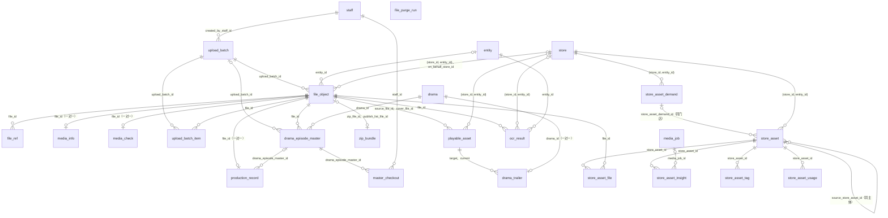

# 06 媒体：文件、媒体任务、素材、素材理解、证照识别、ZIP 缓存

| 项 | 内容 |
| --- | --- |
| 模块 | `media`（L1） |
| 表 | 21 张：`file_object`、`file_ref`、`file_purge_run`、`media_info`、`media_check`、`upload_batch`、`upload_batch_item`、`media_job`、`production_record`、`master_checkout`、`playable_asset`、`zip_bundle`、`drama_trailer`、`drama_episode_master`、`store_asset`、`store_asset_file`、`store_asset_insight`、`store_asset_tag`、`store_asset_usage`、`store_asset_demand`、`ocr_result` |
| 依据 | 草案 `docs/appendix/design/d5-media.md` 第 3–10、12、13 节（下文写作 d5:行号）；裁决 M8、M15、M16、M18、M19、M20、M22、M33、M34、M38、M44、M45，第二轮 M46–M50、M52、M58、M60、M63、M64、M92，第三轮 M93–M95、M101、M110；`catalogue.json` 的 conventions 与本分组 21 张表的 notes；`decisions.md` 第 6、8、10、12 节；PRD 第 6.16.3、7.4 节（PRD:行号）；画板 `admin/MerchantDetail`、`admin/DramaEdit`、`merchant/AssetUpload`、`merchant/AssetLib`、`merchant/AssetDetail`、`merchant/StaffProfile` |

出处写法：`d5:462` 指 d5 第 462 行；`d3`、`d8`、`d9` 指同目录其他草案；“约定”指 `catalogue.json` 的 conventions；“补”指草案没有写、字段级阶段按规则或画板补上的内容，后面跟理由。

## 1. 概览

这组表存“关于文件的事实”，分六块：

- **文件与引用**：四个私有桶里的每个对象在 `file_object` 登记一行，业务表只存 `file_id`。谁在用、释放后留多久记在 `file_ref`，清除任务（`file_purge_run`）只看引用。
- **媒体事实**：探测结果（`media_info`）、体检结论（`media_check`）、制作留痕与 AI 标识状态（`production_record`）、取料记录（`master_checkout`）。都以文件为键，交付侧的版本行只存 `file_id`。
- **上传与任务**：后台批量上传（`upload_batch`、`upload_batch_item`）；所有要等结果的外部或本机工作统一成 `media_job` 的一行，队列只做唤醒。
- **播放与原片**：可播放资产（`playable_asset`）、预告片指针（`drama_trailer`）、原片版本（`drama_episode_master`）、ZIP 缓存（`zip_bundle`）。
- **门店素材**：素材行、素材文件、理解结果、标签、使用记录、素材需求（`store_asset*` 六张）。
- **证照识别**：`ocr_result`，识别值只存这一处。

不在这组表里的：样片与成片的版本行、质检、成片包、下载授权与下载记录归 delivery（10 分组）；剧目与剧集归 content（05 分组）；敏感文件的读取留痕写 `audit_log` 的访问流。media 不写 L3 的表（M8）。

`media_job.subject_id` / `parent_id`、`file_ref.ref_id`、`playable_asset.owner_id`、`zip_bundle.owner_id`、`store_asset_usage.used_by_id`、`upload_batch.target_id` 是多态引用，只存 id，图里不画；取值见第 3.2 节。

## 2. 表定义

通用说明：

- `id` 为 UUID v7，由应用生成，不设数据库默认值。与文件一对一的三张表（`media_info`、`media_check`、`production_record`）以 `file_id` 为主键；`drama_trailer` 以 `drama_id` 为主键；`master_checkout`、`store_asset_file` 用复合主键。
- `created_at`、`updated_at` 由应用时钟写入，不设默认值。只插入、不更新的两张关联表（`store_asset_file`、`store_asset_usage`）只有 `created_at`。
- 草案的 `varchar(n)` 一律写成 `text`。面向用户的字数上限写成 CHECK；技术字符串（MIME、ETag、外部任务号、错误信息等）入库前由应用归一化并截断（d5:539），库里不设长度。
- 本分组没有 `state_machine = true` 的表。所有状态列都是技术状态或处理进度，用带原状态条件的 `UPDATE` 推进，不经 `flow.transition()`，不写 `status_transition`（约定“状态”第 2 条）。复核、清除放行、恢复这类人工动作写 `audit_log`。
- 外键的删除行为一律 RESTRICT，全部写在 Prisma 片段里（M46），手写 SQL 里没有外键。
- 带 `store_id` 的五张表（`file_object`、`playable_asset`、`store_asset`、`store_asset_demand`、`ocr_result`）对门店只建复合外键 `(store_id, entity_id)` → `store (id, entity_id)`，名为 `fk_<表>_store_entity`，保证归属主体就是该门店所属的主体；任一列为空时不检查。对主体另建单列外键 `fk_<表>_entity_id`（M47）。它依赖 02 分组的 `uq_store_id_entity_id`。
- 归属列创建时写定、之后不可改，由触发器 `trg_<表>_immutable`（公共函数 `lyx_forbid_column_change()`，M50）保证，五张表各一条，同时锁住各自的来源列（文件的桶、对象键、分类；资产的源文件与属主；识别结果的文件与证照类型）。
- 门店不物理删除（M93）：删除草稿门店只做停用（`archive_reason = draft_deleted`），之后一律拒绝访问。本分组指向 `store` 的 6 条外键都是 RESTRICT；`file_object` 的行不删、归属列不可改，与之相容。
- 布尔列按约定加 `is_` 前缀、`NOT NULL` 带默认值；`*_type` 多态列的取值用最终表名（M19），例外见 3.3。本模块自己写入、取值少的多态列（`media_job.subject_type`、`parent_type`，`playable_asset.owner_type`，`zip_bundle.owner_type`，`store_asset_usage.used_by_type`）逐值 CHECK；跨模块的 `file_ref.ref_type` 只做格式 CHECK（M52）。
- 素材的关键词检索用三元组 GIN 索引；`pg_trgm` 扩展在公共文件 `00-common.sql`（M49）。这条索引的操作符类依赖该扩展，而校验与合并都先执行 Prisma 的建表语句、后执行公共文件，所以索引仍写在 SQL 文件里（见 2.15）。
- 本分组没有只增表，没有金额列。`bigint` 列（字节数、`est_cost_micro`）出接口时转字符串（M15）。
- 不变量登记口径（15 分组 2.4、2.5）：编码写 `media.I<编号>`，`module = media`，`severity` 一律 P2（本分组没有资金类）；`subject_type` 用最终表名，`production_record`、`media_info`、`media_check` 的 `subject_id` 取 `file_id`；违规对象带归属主体的（`file_object`、`playable_asset`、`store_asset` 等有 `entity_id` 的行），上报时带 `entityId`。检查项登记在 `media/invariants.ts`，由 `invariant.quick` / `invariant.full` 调度；`media.invariants` 只是这组检查项的名字，不建定时器。各表“频率”一栏按 15 分组的表登记：每日 = `modes: ['full']`；每 10 分钟 = `modes: ['quick','full']`（框架最短 10 分钟）；每小时 = 再加 `every: 'hour'`；每周 = `modes: ['full']`、`every: 'week'`。自愈策略：`media.I8`、`media.I10`、`media.I11` 登记 `heal: 'heal_only'`（自愈成功即自动关闭，修不好的保持未解决并计入告警），其余为默认 `none`。

### 2.1 `file_object` 文件对象

四个桶内所有对象（含系统派生物）的唯一登记表；业务表只存 `file_id`，不存 URL。归属：门店维度，`entity_id`、`store_id` 随 `scope_type` 可空。主键：`id uuid`。不是只增表，但行不物理删除。锁顺序：410（媒体任务行之后、计费账户之前；多行按 id 升序）。

| 列 | 类型 | 空 | 默认 | 说明 | 出处 |
| --- | --- | --- | --- | --- | --- |
| `id` | uuid | 否 | — | 主键 | d5:457；约定“主键” |
| `bucket` | text | 否 | — | 正式区所在桶：`secure` / `asset` / `media` / `pub` | d5:458、242-247 |
| `object_key` | text | 否 | — | 正式区对象键，登记时即确定，全小写 ASCII；正式区对象只写一次 | d5:459、298-305 |
| `incoming_bucket` | text | 可 | — | 写入区所在桶：`secure` / `asset` / `media`。`pub` 类文件的写入区在 `asset`；系统生成的文件为空 | d5:460 |
| `incoming_key` | text | 可 | — | 写入区对象键；入库后置空；系统生成的文件为空 | d5:461 |
| `category` | text | 否 | — | 文件分类码，32 个取值见 3.1（草案 28 个，另有 3 个由 02、03、08 分组提出，1 个为肖像授权材料） | d5:462、259-290 |
| `scope_type` | text | 否 | — | 归属范围：`platform` 平台 / `entity` 主体 / `store` 门店 | d5:463 |
| `entity_id` | uuid | 可 | — | 归属主体；范围为 `entity`、`store` 时必填 | d5:464 |
| `store_id` | uuid | 可 | — | 归属门店；范围为 `store` 时必填 | d5:465 |
| `upload_actor_type` | text | 否 | — | 上传人类型：`merchant` 商家用户 / `staff` 员工 / `system` 系统派生物 | d5:466；约定“操作人列” |
| `upload_actor_id` | uuid | 可 | — | 上传人 id（`merchant_user.id` 或 `staff.id`）；`system` 时为空。多态，不建外键 | d5:467 |
| `upload_client` | text | 可 | — | 上传的客户端来源：`weapp` / `portal` / `admin`；`system` 时为空 | 补：M44 操作人三列齐全 |
| `on_behalf_store_id` | uuid | 可 | — | 员工代商家上传时的门店 | d5:468、1114 |
| `status` | text | 否 | — | 状态：`pending` 已登记待确认 / `promoting` 入库中 / `stored` 已入库 / `rejected` 被拒收 / `expired` 上传过期或取消 / `deleting` 清除中 / `deleted` 已清除 | d5:469-470、1209-1223 |
| `reject_reason` | text | 可 | — | 拒收原因：`size_mismatch` 大小不符 / `bad_magic` 文件头不符 / `changed_after_confirm` 确认后被改写 / `copy_verify_failed` 复制核对失败 / `stamp_failed` 写入 AI 标识失败 | d5:471 |
| `upload_mode` | text | 可 | — | 上传通道：`post` 表单直传 / `multipart` 分块 / `server` 服务端写入 | d5:472、966-967 |
| `client_token` | text | 可 | — | 端上生成的幂等与续传标识 | d5:473、1137 |
| `upload_batch_id` | uuid | 可 | — | 所属批量上传批次 | d5:474 |
| `declared_size` | bigint | 否 | — | 登记时声明的字节数 | d5:475；M15 |
| `declared_mime` | text | 否 | — | 登记时声明的 MIME（归一化后） | d5:476 |
| `ext` | text | 否 | — | 扩展名（小写，不带点）；规范类型由它推出 | d5:477、1018 |
| `original_name` | text | 可 | — | 原始文件名 | d5:478 |
| `size_bytes` | bigint | 可 | — | 正式区对象的字节数 | d5:479；M15 |
| `mime` | text | 可 | — | 入库时写入的规范类型 | d5:480 |
| `etag` | text | 可 | — | 正式区对象的 ETag | d5:481 |
| `crc64` | text | 可 | — | 正式区对象的 `x-cos-hash-crc64ecma` | d5:482 |
| `incoming_etag` | text | 可 | — | 确认时记录的写入区对象 ETag（条件复制用） | d5:483 |
| `incoming_crc64` | text | 可 | — | 确认时记录的写入区对象 CRC64 | d5:484 |
| `sha256` | text | 可 | — | SHA-256，64 位小写十六进制；仅在服务端完整读过该文件时填写 | d5:485 |
| `moderation_state` | text | 否 | `none` | 内容安全审核状态：`none` 不审或未开始 / `pending` 审核中 / `pass` 通过 / `review` 可疑待人工 / `block` 拦截 | d5:486-487、1929 |
| `moderation_detail` | jsonb | 可 | — | 审核明细，结构见 4.1 | d5:488 |
| `sts_issued` | integer | 否 | 0 | 已签发临时密钥的次数，上限 30 | d5:489、1028 |
| `upload_expires_at` | timestamptz | 可 | — | 上传凭证过期时间（登记后 24 小时；批次文件随批次） | d5:490、1020 |
| `confirming_until` | timestamptz | 可 | — | “确认中”标记的到期时间 | d5:491、1032 |
| `stored_at` | timestamptz | 可 | — | 入库时间 | d5:492 |
| `first_linked_at` | timestamptz | 可 | — | 首次被引用的时间；空表示从未被引用 | d5:493 |
| `purge_after` | timestamptz | 可 | — | 可清除时间，由 `file_ref` 推导的缓存；空表示不清除 | d5:494、333-350 |
| `deleted_at` | timestamptz | 可 | — | 清除完成时间；恢复时置空 | d5:495、401 |
| `erased_at` | timestamptz | 可 | — | 彻底删除标记：员工执行彻底删除的时刻；空表示未彻底删除。非空后不再恢复，也不再置空 | 补：d5:402；A141 |
| `created_at` | timestamptz | 否 | — | 创建时间 | d5:449 |
| `updated_at` | timestamptz | 否 | — | 更新时间 | d5:449 |

**键与索引**

- 主键：`pk_file_object (id)`。
- 外键：`entity_id` → `entity.id`（`fk_file_object_entity_id`）；`(store_id, entity_id)` → `store (id, entity_id)`（`fk_file_object_store_entity`，关系名 `FileObjectStore`，M47）；`on_behalf_store_id` → `store.id`（`fk_file_object_on_behalf_store_id`，关系名 `FileObjectOnBehalfStore`，M46）；`upload_batch_id` → `upload_batch.id`（`fk_file_object_upload_batch_id`）。
- 唯一约束：`uq_file_object_bucket_object_key (bucket, object_key)`。
- 普通索引：`ix_file_object_store_id_category_id (store_id, category, id DESC)`，门店名下某类文件的列表。
- 部分索引（SQL 文件）：
  - `ix_file_object_pending (upload_expires_at) WHERE status = 'pending'`：清扫过期上传。
  - `ix_file_object_orphan (stored_at) WHERE status = 'stored' AND first_linked_at IS NULL AND purge_after IS NULL`：清扫从未被引用的文件。
  - `ix_file_object_purge (purge_after) WHERE status = 'stored' AND purge_after IS NOT NULL`：清除任务取候选。
  - `ix_file_object_upload_batch_id (upload_batch_id) WHERE upload_batch_id IS NOT NULL`：批次名下的文件。
  - `ix_file_object_entity_crc64 (entity_id, crc64, size_bytes) WHERE status = 'stored' AND entity_id IS NOT NULL AND crc64 IS NOT NULL`：识别结果在同一主体内复用时找同内容文件（d5:1805）。
  - `ix_file_object_deleted (deleted_at DESC) WHERE status = 'deleted'`：后台“已清除文件”列表（d5:2117）。
  - `ix_file_object_rejected_incoming (updated_at) WHERE status = 'rejected' AND incoming_key IS NOT NULL`：每 10 分钟的清扫删除被拒收文件的写入区对象（d5:1067）。

**手写约束**

| 名称 | 规则 |
| --- | --- |
| `ck_file_object_bucket` | `bucket` 取四个桶之一 |
| `ck_file_object_incoming_bucket` | `incoming_bucket` 取 `secure`、`asset`、`media` 之一 |
| `ck_file_object_category` | `category` 取 3.1 的 32 个分类码之一。新增分类走迁移，按 `NOT VALID` + `VALIDATE` 执行；其他分组需要新分类时向本分组提出 |
| `ck_file_object_scope_type` | `scope_type` 取三个范围之一 |
| `ck_file_object_scope` | 平台级：`entity_id`、`store_id` 都为空；主体级：只有 `entity_id`；门店级：两列都非空 |
| `ck_file_object_upload_actor_type` | `upload_actor_type` 取 `merchant`、`staff`、`system` 之一 |
| `ck_file_object_upload_client` | `upload_client` 取 `weapp`、`portal`、`admin` 之一 |
| `ck_file_object_upload_actor_system` | `system` 时 `upload_actor_id`、`upload_client` 都为空；其余两列都非空 |
| `ck_file_object_on_behalf` | `on_behalf_store_id` 非空时上传人必须是员工 |
| `ck_file_object_status` | `status` 取七个状态之一 |
| `ck_file_object_reject_reason` | `reject_reason` 取五个原因之一 |
| `ck_file_object_reject_reason_status` | `status = 'rejected'` 当且仅当 `reject_reason` 非空 |
| `ck_file_object_upload_mode` | `upload_mode` 取三个通道之一 |
| `ck_file_object_moderation_state` | `moderation_state` 取五个取值之一 |
| `ck_file_object_declared_size` | `declared_size >= 0` |
| `ck_file_object_size_bytes` | `size_bytes >= 0` |
| `ck_file_object_sts_issued` | `sts_issued` 在 0 到 30 之间 |
| `ck_file_object_sha256` | `sha256` 是 64 位小写十六进制 |
| `ck_file_object_client_token_actor` | `client_token` 非空时上传人不是 `system` |
| `ck_file_object_stored_facts` | `stored`、`deleting`、`deleted` 的行必有 `stored_at` 与 `size_bytes` |
| `ck_file_object_incoming_key_status` | `incoming_key` 非空只出现在 `pending`、`promoting`、`rejected` |
| `ck_file_object_deleted_at` | `status = 'deleted'` 当且仅当 `deleted_at` 非空 |
| `ck_file_object_erased_at` | `erased_at` 非空只出现在 `deleted` |
| `uq_file_object_client_token_batch` | 部分唯一索引 `(upload_actor_type, upload_actor_id, category, upload_batch_id, client_token) WHERE status = 'pending' AND client_token IS NOT NULL AND upload_batch_id IS NOT NULL` |
| `uq_file_object_client_token_store` | 部分唯一索引 `(upload_actor_type, upload_actor_id, category, store_id, client_token) WHERE status = 'pending' AND client_token IS NOT NULL AND upload_batch_id IS NULL AND store_id IS NOT NULL` |
| `uq_file_object_client_token_noscope` | 部分唯一索引 `(upload_actor_type, upload_actor_id, category, client_token) WHERE status = 'pending' AND client_token IS NOT NULL AND upload_batch_id IS NULL AND store_id IS NULL` |
| `trg_file_object_no_delete` | 行级 BEFORE DELETE，调用 `lyx_forbid_delete()`：文件行不物理删除 |
| `trg_file_object_no_truncate` | 语句级 BEFORE TRUNCATE，调用 `lyx_forbid_delete()` |
| `trg_file_object_immutable` | 行级 BEFORE UPDATE，调用 `lyx_forbid_column_change('entity_id','store_id','scope_type','bucket','object_key','category')`：归属与落点创建后不可改 |

三条 `client_token` 索引合起来等价于草案的一条：同一上传人、分类、归属门店、批次下，待确认的续传标识唯一（d5:1019）。一个批次只对应一个目标，批次内的文件归属相同，所以批次那一条不再带 `store_id`。

归属范围由分类与上传上下文决定（3.1 的“范围”栏）：门店级文件两列都有；主体级文件只有 `entity_id`，在哪家门店的流程里上传不记在文件上（需要时记在业务行上，如 `qualification_doc.store_id`、`ocr_result.store_id`）。

**状态机**（技术状态，不写 `status_transition`；d5:1211-1223）

| 当前状态 | 事件 | 新状态 | 守卫 | 触发者 |
| --- | --- | --- | --- | --- |
| — | 登记 | `pending` | 权限、类型、大小、数量通过 | 上传人（API） |
| — | 系统写入：`files.putSystemFile()`（授权书、导出、对账单等）、派生物取回（`trailer_out`、`sample_wm`、`video_cover`）、打包产物登记（`package_zip`、`publish_list`） | `stored` | 对象已写到正式区并核对大小；`upload_actor_type = 'system'`、`upload_mode = 'server'`；`declared_size`、`declared_mime` 取实际值；写入区两列为空；`stored_at` 为登记时刻 | worker（d5:2128、1302、1315、1681） |
| `pending` | 续签临时密钥 | `pending` | 本人、未过期、`sts_issued < 30` | 上传人（API） |
| `pending` | 确认且对象相符 | `promoting` | 条件更新命中（`confirming_until` 相符）；大小等于登记值；文件头与扩展名相符。同事务建 `promote` 任务（`dedupe_key = promote:{fileId}`）并发 `file.uploaded`（d5:1038、1215；A141） | 上传人（API） |
| `pending` | 确认但不符 | `rejected` | 同上条件更新命中 | 上传人（API） |
| `pending` | 过期清扫、客户端取消 | `expired` | 过期或本人取消；同时清空 `incoming_key` | worker、上传人 |
| `promoting` | 入库成功 | `stored` | 条件复制成功；正式区对象核对一致 | worker（`promote` 任务） |
| `promoting` | 复制前提不成立、核对失败、加标失败 | `rejected` | 条件更新 `WHERE status = 'promoting'` 命中 | worker |
| `stored` | 引用、释放 | `stored` | `files.link()` 的断言 | 各业务模块 |
| `stored` | 审核判定 | `stored` | — | worker |
| `stored` | 清除任务 | `deleting` → `deleted` | 清除的四项复核全部通过（d5:386-391）。置 `deleted` 的事务只锁本文件行；分类的“清除后钩子”（`package_zip`、`publish_list` 改 `zip_bundle`，任意文件释放以它为源的 `derivative` 引用）在该事务提交后另起事务执行，先锁钩子要改的行，不在持有文件行锁时去锁 `zip_bundle`（lock_rank 390 < 410）或别的文件行；钩子没执行成的由 `media.I8` 每小时修复 | worker |
| `stored` | 员工彻底删除（事务一） | `deleting` | 权限点 `files.erase`（仅超级管理员，再验证）；填写原因；回显的文件与分类相符；没有 `live` 引用；`erased_at` 为空。只锁本文件行；此后 `files.link()` 与签发都不再接受它 | 员工（`admin.file.erase`） |
| `deleting` | 员工彻底删除（事务二；事务外已删除对象的全部历史版本） | `deleted` | 条件更新 `WHERE status = 'deleting'` 命中；同一时刻写 `deleted_at`、`erased_at`，`original_name` 置空，写 `ops` 审计（`files.file.erase`）；提交后执行分类的清除后钩子（同“清除任务”一行）。删对象失败时停在 `deleting`，同一幂等键重试或占用过期后接着做，不回退 | 员工（同一请求） |
| `deleted` | 员工彻底删除（已清除的文件） | `deleted` | 守卫同事务一，不改状态；事务外删除全部历史版本后，条件更新 `WHERE status = 'deleted' AND erased_at IS NULL` 只写 `erased_at`、`original_name` 置空与审计，`deleted_at` 不变 | 员工（`admin.file.erase`） |
| `deleted` | 恢复 | `stored` | 在历史版本保留期内；有权限；填写原因；`erased_at` 为空（彻底删除过的不能恢复，A141）；`deleted_at`、`purge_after` 置空 | 员工（`admin.file.restore`） |

`rejected` 的行由清扫删除写入区对象后清空 `incoming_key`（d5:1068）。

同一文件的恢复（`admin.file.restore`）与彻底删除（`admin.file.erase`）须串行：两者在整个用例期间（事务一之前到事务二提交或失败返回）持有同一把按 `fileId` 的互斥锁（PostgreSQL 会话级 advisory lock，`pg_try_advisory_lock`，键取 `fileId` 的哈希，连接断开自动释放），拿不到返回 `STATE_NOT_ALLOWED`；拿到后在事务一里锁文件行再检查 `status`、`erased_at`。否则恢复可能在彻底删除两段事务之间提交（已 `deleted` 的文件，事务一不改状态），得到一个 `stored` 却已没有对象版本的文件（a01-system.md 3.63、3.64，a01 的请求）。该锁不是行锁，不占 `lock_rank`。

**不变量**（d5:2049-2065；登记在 `media/invariants.ts`，调度与自愈策略见第 2 节通用说明）

| # | 不变量 | 频率 |
| --- | --- | --- |
| `media.I1` | `stored` 的文件在桶里存在，且大小、`crc64` 与库一致 | 每日（`full`），查近 24 小时入库的文件；关键文件的全量核对每周一次，由同一检查项在周一的 `full` 运行里扩大范围 |
| `media.I2` | `status` 不是 `stored` 的文件没有 `live` 引用 | 每日 |
| `media.I9` | `incoming_key` 非空只出现在 `pending`、`promoting`、`rejected`（已由 `ck_file_object_incoming_key_status` 保证） | — |
| `media.I13` | `stored` 文件的 `purge_after` 与引用一致：有 `live` 引用 ⇔ `purge_after` 为空（从未被引用且入库不足 24 小时的除外）；没有 `live` 引用时等于各引用 `keep_until` 的最大值 | 每日 |

**相对草案的改动**

| 改动 | 依据 |
| --- | --- |
| 表名 `files` → `file_object` | catalogue；d5:108 |
| 主键与各 id 列 `bigint` → `uuid` | R1；约定“主键” |
| `uploader_type`、`uploader_id` → `upload_actor_type`、`upload_actor_id`；取值 `user` → `merchant`；补 `upload_client` | 约定“操作人列”；M44；列名同 02、03、04 分组的 `<动作>_actor_type`、`<动作>_actor_id`、`<动作>_client` |
| `batch_id` → `upload_batch_id` | M33 |
| `uq_file_client_tok` 里的 `COALESCE(列, 0)` 哨兵改为三条部分唯一索引 | 约定“主键”第 5 条；catalogue notes |
| 两条归属 CHECK 合并并收紧为 `ck_file_object_scope`（三种范围各自的列组合） | 约定“归属列”：平台级的行归属列为空 |
| `category` 补 CHECK | WRITER-GUIDE 第 4 节（每个枚举列一条 CHECK）；作者默认，第二轮视为接受（rulings 第七节导语） |
| `category` 新增 `pay_bill`、`wecom_qr`、`account_proof` 三个分类 | 08 分组的 `wx_bill_file.file_id`、03 分组的 `staff.wecom_qr_file_id`、02 分组的 `account_change_request` 证明材料都要落在 `file_object`，草案的 28 个分类里没有对应项 |
| `category` 新增 `portrait_auth`（肖像授权材料） | PRD:732；prd-tech:45“肖像授权标记”；见 2.15 |
| `kyc_permit` 的范围由主体改为门店，`kyc_license` 按证照定（营业执照属主体，分支机构执照属门店） | 04 分组 `qualification_doc.scope`：营业执照属主体，其余属门店（d9:244）；草案把证照都放在 `kyc/{entityId}/` 前缀下，前缀不变 |
| `reject_reason` 由注释里的取值改为 CHECK，并补与状态的配对约束 | 同上 |
| 补 `ck_file_object_stored_facts`、`ck_file_object_incoming_key_status`、`ck_file_object_deleted_at`、`ck_file_object_on_behalf`、`ck_file_object_sha256` | d5:1056、2059、394、401、468、485 |
| 补索引 `ix_file_object_entity_crc64`、`ix_file_object_deleted`、`ix_file_object_rejected_incoming` | d5:1805、2117、1067 |
| 补禁止物理删除的触发器（`lyx_forbid_delete()`）与归属不可改的触发器 | d5:400；约定“软删除”“归属列”；M50 |
| `varchar`、`char(64)` → `text` | WRITER-GUIDE 第 2 节的类型清单 |
| 补 `created_at`、`updated_at` | d5:449 |
| 对门店的外键改为复合外键 `fk_file_object_store_entity`；`on_behalf_store_id` 的外键写在 Prisma，两条门店关系都带关系名 | M46；M47 |
| 清除后钩子改为在置 `deleted` 的事务提交后另起事务执行 | 全局加锁顺序（decisions 第 6 节：`zip_bundle` 390 在 `file_object` 410 之前）；d5:2043“清除任务只锁文件行” |
| 补 `erased_at` 与 `ck_file_object_erased_at`；状态机补“员工彻底删除”三行（草案只写了 `files.erase` 的效果），恢复的守卫按 `erased_at` 判断，不看 `original_name`（它本来就可空） | d5:402；A141；a01 3.63、3.64 |

### 2.2 `file_ref` 文件引用

谁在用这个文件、释放后保留到何时；清除只看这张表。所有 `file_id` 列与 `*_file_ids` 数组列都经它登记。归属：全局（经文件或引用方访问）。主键：`id uuid`。不是只增表。锁顺序：不参与（只在已锁文件行的事务里写）。

| 列 | 类型 | 空 | 默认 | 说明 | 出处 |
| --- | --- | --- | --- | --- | --- |
| `id` | uuid | 否 | — | 主键 | d5:511 |
| `file_id` | uuid | 否 | — | 被引用的文件 | d5:512 |
| `ref_type` | text | 否 | — | 引用方类型：代码登记表 `FILE_REF_TYPES` 的键，取最终表名；例外 `derivative`。已知取值见 3.2 | d5:513、354；M19；M45 |
| `ref_id` | uuid | 否 | — | 引用方行 id；`derivative` 时为源文件 id。多态，不建外键 | d5:514 |
| `role` | text | 否 | `main` | 引用角色，同一引用方引用多类文件时区分；已知取值见 3.2 | d5:515 |
| `state` | text | 否 | — | 引用状态：`live` 在用 / `released` 已释放 | d5:516 |
| `keep_until` | timestamptz | 可 | — | 释放后的保留截止时间，此前不得清除；`live` 时为空 | d5:517、345-349 |
| `released_at` | timestamptz | 可 | — | 释放时间；`live` 时为空 | d5:518 |
| `created_at` | timestamptz | 否 | — | 创建时间 | d5:449 |
| `updated_at` | timestamptz | 否 | — | 更新时间 | d5:449 |

**键与索引**

- 主键：`pk_file_ref (id)`。
- 外键：`file_id` → `file_object.id`（`fk_file_ref_file_id`）。
- 唯一约束：`uq_file_ref_file_id_ref_type_ref_id_role (file_id, ref_type, ref_id, role)`，`files.link()` 的幂等键。
- 普通索引：`ix_file_ref_ref_type_ref_id (ref_type, ref_id)`，`files.release()` 按引用方找引用。
- 部分索引（SQL 文件）：`ix_file_ref_live (file_id) WHERE state = 'live'`，清除复核“是否还有在用的引用”。

**手写约束**

| 名称 | 规则 |
| --- | --- |
| `ck_file_ref_state` | `state` 取 `live`、`released` 之一 |
| `ck_file_ref_ref_type` | `ref_type` 是小写蛇形、2 到 40 个字符（取值清单在代码登记表，不在库里枚举） |
| `ck_file_ref_role` | `role` 是小写蛇形、2 到 24 个字符 |
| `ck_file_ref_state_times` | `live`：`keep_until`、`released_at` 都为空；`released`：两列都非空 |

**状态机**（技术状态；d5:333-350）

| 当前状态 | 事件 | 新状态 | 守卫 | 触发者 |
| --- | --- | --- | --- | --- |
| — | `files.link()` | `live` | 文件 `stored`；分类在 `expect.categories` 内；归属相符；未被拦截（`moderation_state <> 'block'`，`allowBlocked` 除外）。归属断言：平台级文件不断言；主体级文件断言 `entity_id`；门店级文件断言 `store_id`，但 `profile_image`、`profile_video`、`profile_promo`、`store_asset`、`portrait_auth` 五个分类只断言同一主体（复制档案、复制品牌故事素材时新门店的行引用来源门店的文件，d9:309、804 ③；d5:1062） | 引用方模块 |
| — | 建立即释放（ZIP、发布清单文件、导出文件） | `released` | 同上；`keep_until` 由调用方给出（导出文件取 `export_job.expires_at`） | media、exports |
| `live` | `files.release()` | `released` | `keep_until = max(给定值, 当前 + 该分类最短缓冲)` | 引用方模块 |
| `released` | 再次 `files.link()`（如成片包重开） | `live` | 同第一行；清空 `keep_until`、`released_at` | 引用方模块 |
| `released` | 顺延保留期（如新建下载授权） | `released` | 只能延后 | 引用方模块 |

**不变量**

| # | 不变量 | 频率 |
| --- | --- | --- |
| `media.I2` | 非 `stored` 的文件没有 `live` 引用 | 每日 |
| `media.I14` | `FILE_REF_TYPES` 登记的每个业务列所指向的文件，在本表都有对应的引用行（防“忘了调用 `files.link()`”）。3.2 标为“非引用列”的列不查 | 每周（`every: 'week'`） |

**相对草案的改动**

| 改动 | 依据 |
| --- | --- |
| `ref_id` `bigint` → `uuid` | 约定“主键”第 5 条 |
| `ref_type` 的取值改用最终表名：`release`（成片）→ `delivery_release`，`release`（ZIP 与发布清单文件）→ `zip_bundle`，`playable` → `playable_asset`，`drama_master` → `drama_episode_master` | M19；M8；decisions 8.1 |
| 新增引用方 `drama_order`、`ad`（角色 `reference`） | M20 |
| 新增 profile 的四个引用方；证照的引用在挂到草稿行时建立 | d9:299-308；decisions 12.4 |
| 3.2 逐行登记各分组的引用方与角色，另列非引用列 | 02、03、05、08、09、10、11、12、13、14 分组的请求 |
| `link()` 的归属断言：五个分类允许同主体跨门店引用 | d9:309、804 ③；04 分组的请求 |
| `derivative` 登记为多态取值的例外 | M45 |
| 补 `ck_file_ref_state_times`、`ck_file_ref_ref_type`、`ck_file_ref_role` | d5:342、346、517 |
| 补 `created_at`、`updated_at` | d5:449 |

### 2.3 `file_purge_run` 清除运行

清除任务每次运行的记录；数量与字节熔断、人工放行与驳回的载体。归属：全局。主键：`id uuid`。不是只增表。锁顺序：不参与。放行与驳回是运维闸门，不进审批单。

| 列 | 类型 | 空 | 默认 | 说明 | 出处 |
| --- | --- | --- | --- | --- | --- |
| `id` | uuid | 否 | — | 主键 | d5:525 |
| `mode` | text | 否 | — | 运行模式：`list_only` 只出清单、人工放行后执行 / `auto` 未熔断即自动执行 | d5:526、384 |
| `state` | text | 否 | — | 运行状态：`proposed` 待放行 / `held` 熔断待确认 / `approved` 已放行 / `running` 执行中 / `done` 完成 / `aborted` 中止 / `rejected` 被驳回 | d5:527 |
| `candidate_count` | integer | 否 | — | 候选文件数，上限 5000 | d5:528、378 |
| `candidate_bytes` | bigint | 否 | — | 候选文件总字节数 | d5:529；M15 |
| `by_category` | jsonb | 否 | — | 分分类统计，结构见 4.2 | d5:530 |
| `candidate_ids` | uuid[] | 否 | — | 本次候选的文件 id。候选不是“使用”，不经 `file_ref` 登记，不建外键 | d5:531 |
| `held_reason` | text | 可 | — | 熔断原因 | d5:532、380-383 |
| `decided_by_staff_id` | uuid | 可 | — | 放行或驳回的员工 | d5:533 |
| `decided_at` | timestamptz | 可 | — | 放行或驳回的时间 | d5:533 |
| `deleted_count` | integer | 可 | — | 实际清除的文件数 | d5:534 |
| `guard_trips` | integer | 可 | — | 逐文件复核不通过的次数；累计 3 次中止整个运行 | d5:534、391 |
| `started_at` | timestamptz | 可 | — | 开始执行时间 | d5:535 |
| `finished_at` | timestamptz | 可 | — | 结束时间 | d5:535 |
| `created_at` | timestamptz | 否 | — | 创建时间 | d5:449 |
| `updated_at` | timestamptz | 否 | — | 更新时间 | d5:449 |

**键与索引**

- 主键：`pk_file_purge_run (id)`。
- 外键：`decided_by_staff_id` → `staff.id`（`fk_file_purge_run_decided_by_staff_id`）。
- 普通索引：`ix_file_purge_run_state_created_at (state, created_at DESC)`，后台待确认清单与历史列表（d5:2116）。

**手写约束**

| 名称 | 规则 |
| --- | --- |
| `ck_file_purge_run_mode` | `mode` 取两个取值之一 |
| `ck_file_purge_run_state` | `state` 取七个状态之一 |
| `ck_file_purge_run_candidate_count` | `candidate_count` 在 0 到 5000 之间，且等于 `candidate_ids` 的元素个数 |
| `ck_file_purge_run_candidate_bytes` | `candidate_bytes >= 0` |
| `ck_file_purge_run_counts` | `deleted_count >= 0`，`guard_trips >= 0` |
| `ck_file_purge_run_by_category` | `by_category` 是 JSON 对象 |
| `ck_file_purge_run_decided` | `decided_by_staff_id` 与 `decided_at` 同时为空或同时非空 |
| `ck_file_purge_run_decided_state` | `approved`、`rejected` 的行必有决定；`mode = list_only` 的行到了 `running`、`done`、`aborted` 也必有决定（`auto` 未熔断时直接建为 `running`，没有决定） |
| `uq_file_purge_run_running` | 部分唯一索引 `((true)) WHERE state = 'running'`：同一时刻只有一个运行在执行 |

另有一条不是约束的列修饰：`candidate_ids` 由 SQL 文件补 `NOT NULL`（Prisma 给数组列建的是可空列）。

**状态机**（技术状态；d5:377-397）

| 当前状态 | 事件 | 新状态 | 守卫 | 触发者 |
| --- | --- | --- | --- | --- |
| — | 每日扫描建行 | `proposed` | `mode = list_only`，无论数量多少 | worker |
| — | 每日扫描建行 | `held` | 候选数、字节数或分类阈值任一超限 | worker |
| — | 每日扫描建行 | `running` | `mode = auto` 且未熔断 | worker |
| `proposed` / `held` | 放行 | `approved` | 权限点 `files.purge.approve` | 员工 |
| `proposed` / `held` | 驳回 | `rejected` | 同上 | 员工 |
| `approved` | 开始执行 | `running` | 没有其他 `running` 的运行 | worker |
| `running` | 全部候选处理完 | `done` | — | worker |
| `running` | 守卫累计触发 3 次 | `aborted` | — | worker |

**相对草案的改动**

| 改动 | 依据 |
| --- | --- |
| 表名 `purge_run` → `file_purge_run` | catalogue（与 `invariant_run` 区分） |
| `candidate_ids` `bigint[]` → `uuid[]` | catalogue notes |
| `decided_by` → `decided_by_staff_id` | 约定“操作人列”第 3 条 |
| 补 `uq_file_purge_run_running` | d5:377“同一时刻只有一个运行” |
| 补数量、配对类 CHECK；放行、驳回与执行状态的配对为 `ck_file_purge_run_decided_state` | WRITER-GUIDE 第 4 节；复核意见 |
| 补 `created_at`、`updated_at` | d5:449 |

### 2.4 `media_info` 媒体探测事实

与 `file_object` 一对一，仅图片、音频、视频；纯事实，不含结论。归属：全局（经文件访问）。主键：`file_id`。不是只增表（探测实现升级后重探会覆盖）。锁顺序：不参与。

| 列 | 类型 | 空 | 默认 | 说明 | 出处 |
| --- | --- | --- | --- | --- | --- |
| `file_id` | uuid | 否 | — | 主键，即被探测的文件 | d5:543 |
| `kind` | text | 否 | — | 媒体类型：`video` / `audio` / `image` | d5:544 |
| `container` | text | 可 | — | 实际探测到的容器 | d5:545 |
| `duration_ms` | integer | 可 | — | 时长（毫秒） | d5:546 |
| `width` | integer | 可 | — | 编码宽度 | d5:547 |
| `height` | integer | 可 | — | 编码高度 | d5:547 |
| `rotation` | smallint | 否 | 0 | 旋转角度：0 / 90 / 180 / 270 | d5:548 |
| `display_width` | integer | 可 | — | 旋转后的显示宽度；判横竖只用显示尺寸 | d5:549、565 |
| `display_height` | integer | 可 | — | 旋转后的显示高度 | d5:549 |
| `fps_num` | integer | 可 | — | 帧率分子 | d5:550 |
| `fps_den` | integer | 可 | — | 帧率分母 | d5:550 |
| `vcodec` | text | 可 | — | 视频编码 | d5:551 |
| `vprofile` | text | 可 | — | 视频编码档次 | d5:551 |
| `pix_fmt` | text | 可 | — | 像素格式 | d5:551 |
| `acodec` | text | 可 | — | 音频编码 | d5:552 |
| `audio_sample_rate` | integer | 可 | — | 音频采样率 | d5:552 |
| `audio_channels` | smallint | 可 | — | 声道数 | d5:552 |
| `audio_stream_count` | smallint | 可 | — | 音轨条数 | d5:553 |
| `bitrate_kbps` | integer | 可 | — | 码率（kbps） | d5:554 |
| `is_faststart` | boolean | 否 | false | `moov` 是否在 `mdat` 之前；非 MP4、MOV 容器恒为 false | d5:555 |
| `av_drift_ms` | integer | 可 | — | 音视频流时长差（毫秒，取绝对值） | d5:556 |
| `aigc_meta` | jsonb | 可 | — | 回读到的 AIGC 隐式标识，没有为空；结构见 4.3 | d5:557、1994 |
| `cover_file_id` | uuid | 可 | — | 系统抽取的封面帧文件（分类 `video_cover`） | d5:558、1260 |
| `probe_version` | smallint | 否 | — | 探测实现的版本 | d5:559 |
| `raw` | jsonb | 否 | — | ffprobe 原始输出（裁剪后），结构见 4.4 | d5:560 |
| `probed_at` | timestamptz | 否 | — | 探测时间 | d5:561 |
| `created_at` | timestamptz | 否 | — | 创建时间 | d5:449 |
| `updated_at` | timestamptz | 否 | — | 更新时间 | d5:449 |

**键与索引**

- 主键：`pk_media_info (file_id)`。
- 外键：`file_id` → `file_object.id`（`fk_media_info_file_id`）；`cover_file_id` → `file_object.id`（`fk_media_info_cover_file_id`）。

**手写约束**

| 名称 | 规则 |
| --- | --- |
| `ck_media_info_kind` | `kind` 取三个取值之一 |
| `ck_media_info_rotation` | `rotation` 取 0、90、180、270 之一 |
| `ck_media_info_non_negative` | 时长、宽高、显示宽高、帧率分子、采样率、声道数、音轨数、码率、音画差都不为负；`fps_den > 0` |
| `ck_media_info_probe_version` | `probe_version >= 1` |

**相对草案的改动**

| 改动 | 依据 |
| --- | --- |
| `faststart`（可空）→ `is_faststart`（`NOT NULL DEFAULT false`） | 约定“命名规则”：布尔列带前缀、非空带默认值 |
| 补数值范围 CHECK | WRITER-GUIDE 第 4 节 |
| 补 `created_at`、`updated_at` | d5:449 |

### 2.5 `media_check` 体检结论

一个文件按其分类对应的规格做一次体检的结论（硬性项、预警项、门禁）。归属：全局（经文件访问）。主键：`file_id`。不是只增表（规则版本升级后重检会覆盖）。锁顺序：不参与。

| 列 | 类型 | 空 | 默认 | 说明 | 出处 |
| --- | --- | --- | --- | --- | --- |
| `file_id` | uuid | 否 | — | 主键，即被体检的文件 | d5:660 |
| `profile` | text | 否 | — | 体检规格：`master` 原片 / `trailer_src` 预告片源 / `ad` 广告 / `sample` 样片 / `final` 成片 / `asset` 素材与档案媒体（只记录、不拒收） | d5:661、1243-1250 |
| `rule_version` | smallint | 否 | — | 规则版本 | d5:662 |
| `gate` | text | 否 | — | 门禁结论：`pass` / `reject`（有硬性项不过） | d5:663 |
| `hard` | jsonb | 否 | — | 硬性项结果数组，结构见 4.5 | d5:664、1264-1274 |
| `soft` | jsonb | 否 | — | 预警项结果数组，结构见 4.5 | d5:665、1275-1284 |
| `context_snapshot` | jsonb | 可 | — | 体检时用到的上下文快照，结构见 4.5 | d5:666 |
| `checked_at` | timestamptz | 否 | — | 体检时间 | d5:667 |
| `created_at` | timestamptz | 否 | — | 创建时间 | d5:449 |
| `updated_at` | timestamptz | 否 | — | 更新时间 | d5:449 |

**键与索引**

- 主键：`pk_media_check (file_id)`。
- 外键：`file_id` → `file_object.id`（`fk_media_check_file_id`）。

**手写约束**

| 名称 | 规则 |
| --- | --- |
| `ck_media_check_profile` | `profile` 取六个规格之一 |
| `ck_media_check_gate` | `gate` 取 `pass`、`reject` 之一 |
| `ck_media_check_rule_version` | `rule_version >= 1` |
| `ck_media_check_items_array` | `hard`、`soft` 都是 JSON 数组 |

**相对草案的改动**

| 改动 | 依据 |
| --- | --- |
| `context` → `context_snapshot` | 约定“命名规则”：快照列以 `_snapshot` 结尾 |
| 补 `ck_media_check_rule_version`、`ck_media_check_items_array` | WRITER-GUIDE 第 4 节 |
| 补 `created_at`、`updated_at` | d5:449 |

### 2.6 `upload_batch` 批量上传批次

后台批量上传批次（整部原片或成片），整批提交或不提交。归属：全局（员工侧对象，数据范围经目标对象判断）。主键：`id uuid`。不是只增表。锁顺序：380（媒体聚合行）。

| 列 | 类型 | 空 | 默认 | 说明 | 出处 |
| --- | --- | --- | --- | --- | --- |
| `id` | uuid | 否 | — | 主键 | d5:571 |
| `purpose` | text | 否 | — | 批次用途：`drama_master` 整部原片 / `final_release` 成片；它决定 `target_id` 指向哪张表 | d5:572 |
| `target_id` | uuid | 否 | — | 目标对象 id：`drama_master` 时为 `drama.id`，`final_release` 时为 `order_item.id`。多态，不建外键 | d5:573 |
| `variant` | text | 否 | `common` | 平台版本：`common` / `douyin` / `wechat_channels`；V1.0 只写 `common` | d5:574；M38 |
| `created_by_staff_id` | uuid | 否 | — | 创建批次的员工，也是批次的持有人（续签凭证、续传只认本人） | d5:575 |
| `state` | text | 否 | — | 批次状态：`matching` 匹配中 / `uploading` 上传中 / `verifying` 体检中 / `ready` 可提交 / `committed` 已提交 / `canceled` 已取消 / `expired` 已过期 | d5:576-577、1149-1166 |
| `expected_count` | integer | 否 | — | 该剧总集数（登记时快照；原片批次经 `DramaFactsPort` 取，成片批次由交付侧的上传鉴权返回） | d5:578；d8:585 |
| `scope` | text | 否 | — | 覆盖范围：`full` 整部 / `partial` 部分集 | d5:579 |
| `replace_reason` | text | 可 | — | 替换原因，替换原片时必填：`quality_fix` 画质修复 / `license_info_fix` 片头许可信息更正 / `other` 其他（说明写 `note`）。成片批次为空 | d5:580；画板 admin/DramaEdit:199；M55 |
| `is_content_changed` | boolean | 否 | false | 原片内容是否有实质变更，须重新核验许可信息 | d5:581 |
| `ai_usage` | jsonb | 可 | — | 整批的 AI 使用声明，成片批次必填，可被条目覆盖；结构见 4.6 | d5:582 |
| `production_ctx` | jsonb | 可 | — | 成片批次的制作上下文，结构见 4.7 | d5:583 |
| `note` | text | 可 | — | 备注，不超过 200 字 | d5:584 |
| `idempotency_key` | text | 否 | — | 幂等键 | d5:585 |
| `expires_at` | timestamptz | 否 | — | 批次有效期：最近一次活动后 72 小时，且不超过创建后 7 天 | d5:586、1170 |
| `committed_at` | timestamptz | 可 | — | 提交时间 | d5:587 |
| `created_at` | timestamptz | 否 | — | 创建时间 | d5:449 |
| `updated_at` | timestamptz | 否 | — | 更新时间 | d5:449 |

**键与索引**

- 主键：`pk_upload_batch (id)`。
- 外键：`created_by_staff_id` → `staff.id`（`fk_upload_batch_created_by_staff_id`）。`target_id` 不建外键。
- 唯一约束：`uq_upload_batch_created_by_staff_id_idempotency_key (created_by_staff_id, idempotency_key)`。
- 普通索引：`ix_upload_batch_purpose_target_id (purpose, target_id)`，重新打开某部剧或某订购项的在途批次（d5:1192）。
- 部分索引（SQL 文件）：`ix_upload_batch_open (expires_at) WHERE state IN ('matching','uploading','verifying','ready')`，过期扫描。

**手写约束**

| 名称 | 规则 |
| --- | --- |
| `ck_upload_batch_purpose` | `purpose` 取两个取值之一 |
| `ck_upload_batch_variant` | `variant` 取三个取值之一 |
| `ck_upload_batch_state` | `state` 取七个状态之一 |
| `ck_upload_batch_scope` | `scope` 取 `full`、`partial` 之一 |
| `ck_upload_batch_expected_count` | `expected_count >= 1` |
| `ck_upload_batch_final_ai_usage` | 成片批次的 `ai_usage` 非空 |
| `ck_upload_batch_committed_at` | `state = 'committed'` 当且仅当 `committed_at` 非空 |
| `ck_upload_batch_note_len` | `note` 不超过 200 字 |
| `ck_upload_batch_replace_reason` | `replace_reason` 取三个取值之一 |
| `ck_upload_batch_replace_reason_purpose` | `replace_reason` 只出现在原片批次上 |

**状态机**（技术状态；d5:1149-1166）

| 当前状态 | 事件 | 新状态 | 守卫 | 触发者 |
| --- | --- | --- | --- | --- |
| — | 提交文件清单 | `matching` | 权限；幂等键 | 员工 |
| `matching` | 确认开始 | `uploading` | 匹配无冲突；`full` 时恰好覆盖全部集号 | 员工 |
| `matching` | 取消 | `canceled` | — | 员工 |
| `uploading` | 全部未跳过的条目已入库 | `verifying` | — | worker（收尾事务，先锁批次行）；员工（跳过或替换条目后同事务复判，见下文） |
| `verifying` | 全部未跳过的条目体检通过且覆盖范围满足 | `ready` | — | worker；员工（同上） |
| `verifying` | 有条目被拒，替换后重传或跳过 | `uploading` | 跳过仅 `partial` 允许；按复判，有效条目里有 `pending` 才回 `uploading`，只跳过的停在 `verifying` 或进 `ready` | 员工 |
| `ready` | 提交 | `committed` | 原片：media 的事务；成片：delivery 调 `media.consumeBatch()` | 员工 |
| `ready` | 提交前又替换了某一集 | `uploading` | — | 员工 |
| `ready` | 取消 | `canceled` | — | 员工 |
| `matching` / `uploading` / `verifying` / `ready` | 超过有效期 | `expired` | `expires_at <= 当前`；名下 `pending` 的文件一并置 `expired` | worker |

员工跳过或替换条目后的复判（A141）：批次在 `uploading`、`verifying`、`ready` 时，员工的同一事务（先锁批次行）调用与 worker 收尾相同的判定函数。有效条目（未跳过、未被取代）里仍有 `pending` → `uploading`；没有 `pending`、`rejected`，仍有 `uploaded` → `verifying`；全部 `checked` 且覆盖范围满足 → `ready`，必要时在本事务里连推 `uploading → verifying → ready`；仍有 `rejected` 时不前进。不复判的话，部分集批次的其余条目都已体检、名下没有在途任务，worker 不会再收尾，批次停在 `uploading` 直到过期。

整批直传凭证（一份覆盖 `incoming/b{uploadBatchId}/*`，d5:1091）不设签发次数列（单文件有 `sts_issued`），次数靠批次有效期与接口限流（约定 C68）约束（A141）。

批次未结束期间，名下已入库的文件被批次引用（`file_ref.ref_type = 'upload_batch'`，在文件入库的同一事务里建立）；提交时释放，取消或过期时释放并保留 3 天（d5:367、1170）。

条目改集号（提交前随时可改，d5:1186）：成片批次在同一事务里先锁该文件的 `production_record` 行（lock_rank 360）、再锁批次行（380），改 `upload_batch_item.episode_no` 与 `production_record.episode_no`，并按 2.9 的规则重新认定 `drama_episode_master_id`、`master_source`；条目若已体检（`checked`、`rejected`），回到 `uploaded` 重新体检（制作留痕回到 `checking`），批次回到 `verifying`。原片批次只改条目。

**不变量**

| # | 不变量 | 频率 |
| --- | --- | --- |
| `media.I11` | `verifying` 的批次名下有未结束的体检任务，或 15 分钟内有过更新 | 每 10 分钟（随 `invariant.quick`，即收敛扫描；`heal_only`） |

**相对草案的改动**

| 改动 | 依据 |
| --- | --- |
| `staff_id` → `created_by_staff_id` | 约定“操作人列”第 3 条 |
| `content_changed` → `is_content_changed` | 约定“命名规则”：布尔列前缀 |
| `variant` 保持 `NOT NULL DEFAULT 'common'` | M38 |
| `target_id` `bigint` → `uuid`，不建外键 | 约定“主键”第 5 条；catalogue cross_module_fks |
| 补 `ix_upload_batch_purpose_target_id` | d5:1192 |
| 补 `ck_upload_batch_final_ai_usage`、`ck_upload_batch_committed_at`、`ck_upload_batch_expected_count`、`ck_upload_batch_note_len` | d5:582、587、578、584 |
| `replace_reason` 由自由文本改为三值枚举加 CHECK，“其他”的说明写 `note` | d5:580 的三个选项；画板 admin/DramaEdit:199；M55（逻辑依赖的原因码用枚举） |
| 状态机补 `matching → expired` | d5 的状态图漏了这一条，而过期扫描索引覆盖 `matching`；不补则停在匹配中的批次永不结束 |
| 写明条目改集号时同步制作留痕 | d5:1186；复核意见 |
| 收尾迁移（`uploading → verifying`、`verifying → ready`）的触发者补“员工跳过或替换条目后同事务复判” | A141；a04 3.27 |
| 补 `created_at`、`updated_at` | d5:449 |

### 2.7 `upload_batch_item` 批次条目

文件与集号的匹配关系及条目状态；条目的体检结论不另存，按 `file_id` 读 `media_check`。归属：全局（经批次访问）。主键：`id uuid`。不是只增表。锁顺序：不参与（只在持有批次行锁的事务里修改）。

| 列 | 类型 | 空 | 默认 | 说明 | 出处 |
| --- | --- | --- | --- | --- | --- |
| `id` | uuid | 否 | — | 主键 | d5:593 |
| `upload_batch_id` | uuid | 否 | — | 所属批次 | d5:594 |
| `file_id` | uuid | 否 | — | 条目对应的文件 | d5:595 |
| `original_name` | text | 否 | — | 原始文件名，匹配集号的依据 | d5:596 |
| `episode_no` | integer | 可 | — | 匹配到的集号；空表示未匹配。提交前随时可改，改法见 2.6 | d5:597、1186 |
| `match_method` | text | 可 | — | 匹配方式：`pattern` 文件名模板 / `sequence` 顺序建议（须人工确认）/ `manual` 人工指定 | d5:598、1175-1185 |
| `state` | text | 否 | — | 条目状态：`pending` 待上传 / `uploaded` 已入库 / `checked` 体检通过 / `rejected` 被拒 / `skipped` 跳过 / `replaced` 被同一集的新条目取代 | d5:599、1168 |
| `ai_usage` | jsonb | 可 | — | 条目级 AI 使用声明；空表示用批次的。结构见 4.6 | d5:600 |
| `created_at` | timestamptz | 否 | — | 创建时间 | d5:449 |
| `updated_at` | timestamptz | 否 | — | 更新时间 | d5:449 |

**键与索引**

- 主键：`pk_upload_batch_item (id)`。
- 外键：`upload_batch_id` → `upload_batch.id`（`fk_upload_batch_item_upload_batch_id`）；`file_id` → `file_object.id`（`fk_upload_batch_item_file_id`）。
- 唯一约束：`uq_upload_batch_item_upload_batch_id_file_id (upload_batch_id, file_id)`。
- 普通索引：`ix_upload_batch_item_file_id (file_id)`，文件入库或被拒时回写条目状态。

**手写约束**

| 名称 | 规则 |
| --- | --- |
| `ck_upload_batch_item_match_method` | `match_method` 取三个取值之一 |
| `ck_upload_batch_item_state` | `state` 取六个状态之一 |
| `ck_upload_batch_item_episode_no` | `episode_no >= 1` |
| `uq_upload_batch_item_episode` | 部分唯一索引 `(upload_batch_id, episode_no) WHERE episode_no IS NOT NULL AND state NOT IN ('skipped','replaced')`：一个批次里一集只有一个有效条目 |

**状态机**（技术状态）

| 当前状态 | 事件 | 新状态 | 守卫 | 触发者 |
| --- | --- | --- | --- | --- |
| — | 批次登记 | `pending` | — | 员工 |
| `pending` | 文件入库 | `uploaded` | 与文件置 `stored` 同一事务 | worker |
| `pending` | 文件被拒收 | `rejected` | — | worker |
| `uploaded` | 体检通过 | `checked` | `media_check.gate = 'pass'` | worker |
| `uploaded` | 体检不过 | `rejected` | `media_check.gate = 'reject'` | worker |
| `pending` / `rejected` | 跳过 | `skipped` | 仅 `scope = partial` 的批次；同事务复判批次状态（2.6） | 员工 |
| 任意未提交状态 | 同一集换新文件 | `replaced` | 同时为该集新建条目；同事务复判批次状态（2.6） | 员工 |

**相对草案的改动**

| 改动 | 依据 |
| --- | --- |
| `batch_id` → `upload_batch_id` | M33 |
| 约束名 `uq_batch_item_ep` → `uq_upload_batch_item_episode` 等 | 约定“命名规则” |
| 补 `ix_upload_batch_item_file_id`、`ck_upload_batch_item_episode_no` | d5:1058、1219；d5:1182 |
| 补 `created_at`、`updated_at` | d5:449 |

### 2.8 `media_job` 媒体任务

所有需要等结果的外部或本机媒体工作（入库、体检、转码、打包、审核、转写、识图、OCR 等）的任务行；带租约、回查与父对象汇合，队列只做唤醒。归属：全局。主键：`id uuid`。不是只增表。锁顺序：400（父对象 → 任务行 → 文件行）。

| 列 | 类型 | 空 | 默认 | 说明 | 出处 |
| --- | --- | --- | --- | --- | --- |
| `id` | uuid | 否 | — | 主键 | d5:615 |
| `kind` | text | 否 | — | 任务种类，16 个取值见 3.1 | d5:616-620 |
| `provider` | text | 否 | — | 执行方标识，如 `ci`、`local`、`mediatool`、`wechat`、`asr:tencent`、`llm:ark`。取自配置，不是枚举 | d5:621 |
| `mode` | text | 否 | — | 执行方式：`local` 本机或同步调用 / `remote` 提交后回查 | d5:622 |
| `subject_type` | text | 否 | — | 任务处理的对象类型：`file_object` / `zip_bundle` / `store_asset` / `ocr_result` | d5:623；M19 |
| `subject_id` | uuid | 否 | — | 任务处理的对象 id。多态，不建外键 | d5:624 |
| `parent_type` | text | 可 | — | 收尾时要先锁的父对象类型：`store_asset` / `playable_asset` / `upload_batch` / `production_record` / `zip_bundle` | d5:625；M19；M8 |
| `parent_id` | uuid | 可 | — | 父对象 id；`production_record` 时为其主键 `file_id`。多态，不建外键 | d5:626 |
| `dedupe_key` | text | 否 | — | 去重键：`kind` + 输入指纹 + 参数版本（+ 代次），如 `promote:{fileId}`、`zip:{zipBundleId}:{zip_gen}` | d5:627、1038、1675 |
| `state` | text | 否 | — | 任务状态：`queued` 待执行 / `running` 本机执行中 / `submitting` 远程提交中 / `submitted` 已提交待回查 / `succeeded` 成功 / `failed` 失败 / `canceled` 已取消 | d5:628-629、1321-1335 |
| `attempt_no` | smallint | 否 | 0 | 已尝试次数（当前是第几次尝试） | d5:630；M34 |
| `max_attempts` | smallint | 否 | 3 | 最多尝试次数 | d5:631 |
| `lease_owner` | text | 可 | — | 领取它的 worker 实例标识 | d5:632 |
| `external_job_id` | text | 可 | — | 外部任务号；微信内容安全为 `trace_id` | d5:633、1927 |
| `input` | jsonb | 否 | — | 任务输入，含预先确定的输出键（重跑不产生第二个对象）；结构见 4.8 | d5:634 |
| `output` | jsonb | 可 | — | 任务结果，回查结果整份落库；结构见 4.8 | d5:635、1379 |
| `error_code` | text | 可 | — | 错误码 | d5:636 |
| `error_message` | text | 可 | — | 错误信息（应用截断到 500 字） | d5:637 |
| `is_retryable` | boolean | 否 | false | 最近一次错误是否可重试；只在 `error_code` 非空时有意义 | d5:638 |
| `next_run_at` | timestamptz | 否 | — | `queued`：下次执行时间；`running`、`submitting`：租约到期时间；`submitted`：下次回查时间 | d5:639、1347 |
| `deadline_at` | timestamptz | 否 | — | 超时判定时间 | d5:640、1349-1358 |
| `billable_qty` | numeric(12,3) | 可 | — | 计量值（分钟、次、千 tokens、GB）。成本估算用，不是账务金额 | d5:641；约定“金额与积分”第 4 条 |
| `billable_unit` | text | 可 | — | 计量单位 | d5:642 |
| `est_cost_micro` | bigint | 可 | — | 估算成本，单位 10^-6 元；出接口转字符串 | d5:643；M15 |
| `started_at` | timestamptz | 可 | — | 首次领取时间 | d5:644 |
| `finished_at` | timestamptz | 可 | — | 结束时间（成功、失败或取消） | d5:645 |
| `created_at` | timestamptz | 否 | — | 创建时间 | d5:449 |
| `updated_at` | timestamptz | 否 | — | 更新时间 | d5:449 |

**键与索引**

- 主键：`pk_media_job (id)`。
- 外键：无。`subject_id`、`parent_id` 多态，引用的都是 media 自己的表（M8 之后打包任务指向 `zip_bundle`）。
- 唯一约束：`uq_media_job_dedupe_key (dedupe_key)`。
- 普通索引：`ix_media_job_subject_type_subject_id_kind (subject_type, subject_id, kind)`，按对象查它的任务；`ix_media_job_kind_created_at (kind, created_at)`，用量按类按月汇总与任务监控列表（d5:2074、2114）。
- 部分索引（SQL 文件）：
  - `ix_media_job_due (next_run_at) WHERE state IN ('queued','running','submitting','submitted')`：执行循环（d5:1340-1344）。
  - `ix_media_job_parent (parent_type, parent_id) WHERE parent_id IS NOT NULL`：收尾与收敛扫描读父对象名下的任务。
  - `ix_media_job_failed (finished_at DESC) WHERE state = 'failed'`：后台失败列表。
  - `ix_media_job_external_job_id (external_job_id) WHERE external_job_id IS NOT NULL`：微信内容安全的异步结果按 `trace_id` 找任务（d5:1927）。

**手写约束**

| 名称 | 规则 |
| --- | --- |
| `ck_media_job_kind` | `kind` 取 16 个种类之一 |
| `ck_media_job_mode` | `mode` 取 `local`、`remote` 之一 |
| `ck_media_job_subject_type` | `subject_type` 取四个表名之一 |
| `ck_media_job_parent_type` | `parent_type` 取五个表名之一 |
| `ck_media_job_parent` | `parent_type` 与 `parent_id` 同时为空或同时非空 |
| `ck_media_job_state` | `state` 取七个状态之一 |
| `ck_media_job_attempts` | `attempt_no >= 0`，`max_attempts >= 1` |
| `ck_media_job_finished_at` | 状态为 `succeeded`、`failed`、`canceled` 当且仅当 `finished_at` 非空 |
| `ck_media_job_billable` | `billable_qty >= 0`，`est_cost_micro >= 0`，`billable_qty` 与 `billable_unit` 同时为空或同时非空 |

**状态机**（技术状态；d5:1321-1335）

| 当前状态 | 事件 | 新状态 | 守卫 | 触发者 |
| --- | --- | --- | --- | --- |
| — | 创建 | `queued` | `dedupe_key` 唯一 | 各流程（同事务） |
| `queued` | 领取（`mode = local`） | `running` | 扫描抢到行锁；`attempt_no + 1` | worker |
| `queued` | 领取（`mode = remote`） | `submitting` | 同上 | worker |
| `submitting` | Provider 返回任务号 | `submitted` | 条件更新 `WHERE state = 'submitting' AND attempt_no = ?` | worker |
| `submitting` | 租约到期 | `submitted` 或重新提交 | 能按 `userData` 找回任务号则不重提 | worker |
| `running` | 执行成功 | `succeeded` | 收尾事务内条件更新命中 | worker |
| `running` | 租约到期 | `running`（再次领取） | `attempt_no < max_attempts`，否则 `failed` | worker |
| `submitted` | 回查：进行中 | `submitted` | — | worker |
| `submitted` | 回查：成功 | `succeeded` | 条件更新 `WHERE state = 'submitted'` 命中 | worker |
| `running` / `submitted` | 失败且可重试且次数未尽 | `queued` | — | worker |
| 任意未结束状态 | 失败且不可重试、次数耗尽或超过 `deadline_at` | `failed` | — | worker |
| `failed` | 人工重试 | `queued` | 权限点 `media.job.retry`。同一行里：`attempt_no = 0`，清空 `finished_at`；`next_run_at` = 当前，`deadline_at` = 当前 + 该 `kind` 的时长（d5:1349-1358；不重设则旧值早已过去，会被立刻判回 `failed`）；清空 `error_code`、`error_message`，`is_retryable = false`；写 `ops` 审计（A141） | 员工（`admin.mediaJob.retry`） |
| 任意未结束状态 | 取消 | `canceled` | 业务对象已作废（如 2.11 剧目下架时停用预告片资产）；写 `finished_at`，已提交的远端任务尽力取消。`running`、`submitting` 的行被取消后，持有租约的 worker 的条件更新（带 `state`、`attempt_no`）落空，产物不进收尾（已取回的按“从未被引用”清扫） | 各流程 |

**回调**（d5:1379、2121；15 分组 2.1）：media 向回调框架注册 `ci`（数据万象）、`asr`（语音转写）两个来源，回调地址 `/api/v1/hooks/{ci|asr}/media-jobs/{mediaJobId}?sig=…`（签名放查询参数，接口裁决 A3），`sig` = `HMAC-SHA256(回调密钥, mediaJobId)` 的 base64url，`ci`、`asr` 各用一把密钥（h01-hooks.md 3.7、3.8）。验签只验 `sig`；`webhook_event.event_id` 取 `<media_job id>:<回调体里的云端任务号>`（数据万象 JobId、语音识别表单 requestId 对应的 TaskId），同一任务重试后重新提交的云端任务号不同，唤醒不会被去重吞掉。云端任务号只用于去重，不采信回调体里的状态；载荷不存。处理函数只对 `state = 'submitted'` 的任务把 `next_run_at` 置为当前并唤醒执行循环（条件更新 `WHERE state = 'submitted'`），收件行记 `processed`；任务不存在或不是 `submitted` 的不改任务行，收件行记 `ignored`——`running`、`submitting` 的 `next_run_at` 是租约到期时间，`queued` 的是执行时间，都不能改，已结束的不需要唤醒（h01 的请求）。结果以回查为准，本表不加列。微信内容安全的异步结果经 `wechat` 来源转入，按 `external_job_id`（`trace_id`）找任务。

**不变量**

| # | 不变量 | 频率 |
| --- | --- | --- |
| `media.I10` | 没有超过 `deadline_at` 仍未结束的任务；违例的置 `failed` 并按策略重试 | 每 10 分钟（随 `invariant.quick`；`heal_only`）。草案写每 5 分钟，框架最短 10 分钟；执行循环本身已按 `deadline_at` 判超时（状态机里“超过 `deadline_at` → `failed`”一行），这里只兜底 |

**相对草案的改动**

| 改动 | 依据 |
| --- | --- |
| `subject_type` 取值 `file` → `file_object`，`release` → `zip_bundle`，`ocr` → `ocr_result` | M19；M8；decisions 8.1 |
| `parent_type` 取值 `playable` → `playable_asset`，`production` → `production_record`，`release` → `zip_bundle` | 同上 |
| 两个多态类型列补 CHECK | WRITER-GUIDE 第 4 节 |
| `attempt` → `attempt_no` | M34 |
| `retryable`（可空）→ `is_retryable`（`NOT NULL DEFAULT false`） | 约定“命名规则”：布尔列 |
| `est_cost_micro` 用 `bigint` | M15 |
| 补 `ix_media_job_external_job_id`、`ix_media_job_kind_created_at` | d5:1927、2074 |
| 补 `ck_media_job_parent`、`ck_media_job_finished_at`、`ck_media_job_attempts`、`ck_media_job_billable` | d5:625-626、645、1334 |
| 取消由 `queued`、`submitted` 扩到任意未结束状态，供停用资产时取消名下全部未完成的任务 | A141；a04 3.19 |
| 补 `created_at`、`updated_at` | d5:449 |

### 2.9 `production_record` 制作留痕

每个样片、成片、广告文件一行：所用原片与广告版本、AI 使用声明与隐式标识状态、入库流水线进度。这些事实在上传登记时随文件声明，同一个文件无论被样片行还是成片行引用都不变（d5:708）。归属：全局（经文件访问；`order_item_id`、`ad_id` 只存 id）。主键：`file_id`。不是只增表。锁顺序：360（媒体聚合行）。

| 列 | 类型 | 空 | 默认 | 说明 | 出处 |
| --- | --- | --- | --- | --- | --- |
| `file_id` | uuid | 否 | — | 主键，即本行描述的文件 | d5:671 |
| `kind` | text | 否 | — | 文件种类：`sample` 样片 / `final` 成片 / `ad` 广告 | d5:672 |
| `order_item_id` | uuid | 可 | — | 订购项 id；样片、成片必填。不建外键（L1 不引用 L3） | d5:673 |
| `ad_id` | uuid | 可 | — | 广告 id；广告必填。不建外键 | d5:674 |
| `episode_no` | integer | 可 | — | 集号。成片必有（批次里未匹配的条目登记时可暂空，就绪前须有）；样片按整版登记，可空。批次条目改集号时同步改（见 2.6） | d5:675、1186 |
| `variant` | text | 否 | `common` | 平台版本：`common` / `douyin` / `wechat_channels`；V1.0 只写 `common` | d5:676；M38 |
| `source` | text | 否 | — | 产物来源：`manual_upload` 人工上传 / `normalized` 云端规格化 / `restamped` 补标 / `render` 渲染（V1.1）/ `ai_assisted`（V2.0）。V1.0 只出现前三个 | d5:677、951 |
| `derived_from_file_id` | uuid | 可 | — | 规格化、补标产物指向的来源文件 | d5:678 |
| `render_item_id` | uuid | 可 | — | 渲染条目 id，V1.1 预留；V1.0 恒为空。表未建，不建外键 | d5:679；M9 |
| `production_tier` | text | 可 | — | 订购项档位快照：`standard` / `advanced` / `top`；广告为空。由 delivery 的 `authorizeUpload` 返回；成片批次取批次的 `production_ctx.productionTier` | d5:680、1024 |
| `drama_episode_master_id` | uuid | 可 | — | 所用原片版本 | d5:681 |
| `master_source` | text | 可 | — | 原片版本的认定方式：`checkout` 取料记录 / `declared` 表单指定 / `current_fallback` 取当前原片（体检给预警 S9） | d5:682、1023 |
| `head_ad_version_id` | uuid | 可 | — | 所用片头广告版本（`ad_version.id`）。不建外键 | d5:683 |
| `tail_ad_version_id` | uuid | 可 | — | 所用片尾广告版本（`ad_version.id`）。不建外键 | d5:684 |
| `ai_usage` | jsonb | 否 | — | AI 使用声明，登记后不可改（填错走补标）；结构见 4.6 | d5:685、1022 |
| `aigc_state` | text | 否 | — | AI 隐式标识状态：`not_required` 未声明用 AI / `pending` 待回读 / `verified` 已回读到 / `failed` 回读失败 | d5:686、1977-1981 |
| `aigc_origin` | text | 可 | — | 标识来源：`upstream` 上游工具带来 / `stamped` 本系统写入 | d5:687 |
| `pipeline_state` | text | 否 | — | 入库流水线进度：`uploading` / `checking` / `ready` / `rejected`。它不是版本状态 | d5:688、1973-1982 |
| `similarity` | jsonb | 可 | — | 差异度指标，预留；V1.0 恒为空 | d5:689 |
| `uploaded_by_staff_id` | uuid | 可 | — | 上传的员工；系统产物（规格化、补标）为空 | d5:690 |
| `created_at` | timestamptz | 否 | — | 创建时间 | d5:449 |
| `updated_at` | timestamptz | 否 | — | 更新时间 | d5:449 |

**键与索引**

- 主键：`pk_production_record (file_id)`。
- 外键：`file_id` → `file_object.id`（`fk_production_record_file_id`）；`derived_from_file_id` → `file_object.id`（`fk_production_record_derived_from_file_id`）；`drama_episode_master_id` → `drama_episode_master.id`（`fk_production_record_drama_episode_master_id`）；`uploaded_by_staff_id` → `staff.id`（`fk_production_record_uploaded_by_staff_id`）。`order_item_id`、`ad_id`、`head_ad_version_id`、`tail_ad_version_id`、`render_item_id` 只存 id。
- 部分索引（SQL 文件）：`ix_production_record_order_item (order_item_id, kind, episode_no) WHERE order_item_id IS NOT NULL`，按订购项取制作文件；`ix_production_record_pipeline (pipeline_state) WHERE pipeline_state IN ('uploading','checking')`，收敛扫描。

**手写约束**

| 名称 | 规则 |
| --- | --- |
| `ck_production_record_kind` | `kind` 取三个取值之一 |
| `ck_production_record_variant` | `variant` 取三个取值之一 |
| `ck_production_record_source` | `source` 取五个取值之一 |
| `ck_production_record_production_tier` | `production_tier` 取三个档位之一 |
| `ck_production_record_master_source` | `master_source` 取三个取值之一 |
| `ck_production_record_aigc_state` | `aigc_state` 取四个取值之一 |
| `ck_production_record_aigc_origin` | `aigc_origin` 取两个取值之一 |
| `ck_production_record_pipeline_state` | `pipeline_state` 取四个取值之一 |
| `ck_production_record_order_item` | 样片、成片的 `order_item_id` 非空 |
| `ck_production_record_ad` | 广告的 `ad_id` 非空 |
| `ck_production_record_episode_no` | `episode_no >= 1` |
| `ck_production_record_master` | `drama_episode_master_id` 与 `master_source` 同时为空或同时非空 |
| `ck_production_record_ai_usage` | `ai_usage` 是 JSON 对象 |
| `ck_production_record_ready_aigc` | `pipeline_state = 'ready'` 时 `aigc_state` 只能是 `not_required` 或 `verified` |
| `ck_production_record_final_episode` | 就绪（`pipeline_state = 'ready'`）的成片必有 `episode_no` |

**状态机**（`pipeline_state`，技术状态；d5:1975-1982）

| 当前状态 | 事件 | 新状态 | 守卫 | 触发者 |
| --- | --- | --- | --- | --- |
| — | 上传登记（或规格化、补标产物登记） | `uploading` | 上传人有该工单任务；填写了 AI 使用声明 | 员工、worker |
| `uploading` | 文件入库 | `checking` | — | worker |
| `uploading` | 文件被拒收或上传过期 | `rejected` | — | worker |
| `checking` | 体检完成，硬性项全过 | `ready` | 收尾事务先锁本行 | worker |
| `checking` | 体检完成，有硬性项不过 | `rejected` | 同上 | worker |
| `ready` / `rejected` | 规则版本升级后人工触发重检 | `checking` | 权限 | 员工 |

**不变量**

| # | 不变量 | 频率 |
| --- | --- | --- |
| `media.I11` | `checking` 的制作文件名下有未结束的任务，或 15 分钟内有过更新 | 每 10 分钟（随 `invariant.quick`；`heal_only`） |
| `media.I15` | `pipeline_state = 'ready'` 且 `ai_usage.used = true` ⇒ `aigc_state = 'verified'`（`ck_production_record_ready_aigc` 保证了其中不看 `ai_usage` 的那一半） | 每日 |

**相对草案的改动**

| 改动 | 依据 |
| --- | --- |
| `master_id` → `drama_episode_master_id` | M33 |
| `master_source` 取值 `issue_log` → `checkout` | 取料表由 `material_issue` 改名 `master_checkout`（catalogue） |
| `uploaded_by` → `uploaded_by_staff_id` | 约定“操作人列”第 3 条 |
| `order_item_id`、`ad_id`、两个广告版本列只存 id；草案写的 `ad_video_version` 即 `ad_version` | 约定“跨模块外键”；decisions 第 2 节 |
| `variant` 保持 `NOT NULL DEFAULT 'common'` | M38 |
| 补 `ck_production_record_master`、`ck_production_record_ready_aigc`、`ck_production_record_episode_no`、`ck_production_record_ai_usage`、`ck_production_record_final_episode` | d5:1023、1980、2065；复核意见 |
| 补 `created_at`、`updated_at` | d5:449 |

### 2.10 `master_checkout` 取料记录

某剪辑师为某订购项某集最近一次取到的原片版本；上传成片时据此认定所用原片，原片中途被替换也不会记错。每次签发原片下载地址时同事务 upsert（d5:1194）。归属：全局。主键：`(order_item_id, episode_no, staff_id)`。不是只增表。锁顺序：不参与。

| 列 | 类型 | 空 | 默认 | 说明 | 出处 |
| --- | --- | --- | --- | --- | --- |
| `order_item_id` | uuid | 否 | — | 订购项 id。不建外键（L1 不引用 L3） | d5:698 |
| `episode_no` | integer | 否 | — | 集号 | d5:699 |
| `staff_id` | uuid | 否 | — | 取料的员工（剪辑师） | d5:700 |
| `drama_episode_master_id` | uuid | 否 | — | 最近一次取到的原片版本 | d5:701 |
| `checked_out_at` | timestamptz | 否 | — | 最近一次取料时间 | d5:702 |
| `checkout_count` | integer | 否 | 1 | 取料次数 | d5:703 |
| `created_at` | timestamptz | 否 | — | 创建时间（首次取料） | d5:449 |
| `updated_at` | timestamptz | 否 | — | 更新时间 | d5:449 |

**键与索引**

- 主键：`pk_master_checkout (order_item_id, episode_no, staff_id)`。
- 外键：`staff_id` → `staff.id`（`fk_master_checkout_staff_id`）；`drama_episode_master_id` → `drama_episode_master.id`（`fk_master_checkout_drama_episode_master_id`）。

**手写约束**

| 名称 | 规则 |
| --- | --- |
| `ck_master_checkout_episode_no` | `episode_no >= 1` |
| `ck_master_checkout_checkout_count` | `checkout_count >= 1` |

**相对草案的改动**

| 改动 | 依据 |
| --- | --- |
| 表名 `material_issue` → `master_checkout` | catalogue（原名容易读成“素材问题”） |
| `master_id` → `drama_episode_master_id` | M33 |
| `issued_at` → `checked_out_at`，`issue_count` → `checkout_count` | 随表名改 |
| `order_item_id` 只存 id | 约定“跨模块外键” |
| 补两条数值 CHECK、`created_at`、`updated_at` | WRITER-GUIDE 第 4 节；d5:449 |

### 2.11 `playable_asset` 可播放资产

预告片、样片、广告共用的可播放资产抽象，播放接口只认它（档位、封面、水印、转码规格版本）。业务侧通过 `source_file_id` 找到资产，不另存资产 id（d5:747）。归属：门店维度，预告片等平台级资产两列为空（M18）。主键：`id uuid`。不是只增表。锁顺序：350（媒体聚合行）。

| 列 | 类型 | 空 | 默认 | 说明 | 出处 |
| --- | --- | --- | --- | --- | --- |
| `id` | uuid | 否 | — | 主键 | d5:716 |
| `entity_id` | uuid | 可 | — | 归属主体，创建时从源文件（门店级的 `sample_video`、`ad_video`）复制，不可变；预告片为空。media 不读订购项、广告（L3） | 补：M18；M8 |
| `store_id` | uuid | 可 | — | 归属门店，同上 | 补：M18 |
| `kind` | text | 否 | — | 资产种类：`trailer` 预告片 / `sample` 样片 / `ad` 广告 | d5:717 |
| `source_file_id` | uuid | 否 | — | 源文件 | d5:718 |
| `owner_type` | text | 否 | — | 属主类型：`drama` / `order_item` / `ad` | d5:719；M19 |
| `owner_id` | uuid | 否 | — | 属主 id。多态，不建外键 | d5:720 |
| `state` | text | 否 | — | 资产状态：`processing` 处理中 / `ready` 可播放 / `failed` 失败 / `retired` 已停用 | d5:721 |
| `duration_ms` | integer | 可 | — | 时长（毫秒） | d5:722 |
| `width` | integer | 可 | — | 宽度 | d5:723 |
| `height` | integer | 可 | — | 高度 | d5:723 |
| `renditions` | jsonb | 可 | — | 播放档位数组，结构见 4.9 | d5:724、744-746 |
| `cover_file_id` | uuid | 可 | — | 封面文件 | d5:725 |
| `watermark` | jsonb | 可 | — | 实际使用的水印，结构见 4.9。样片水印里的门店简称在建水印任务时经 `StoreFactsPort` 取（5.1），写在这里 | d5:726、1315 |
| `spec_version` | smallint | 否 | — | 转码规格版本；规格变更后可批量重转 | d5:727、1311 |
| `error` | text | 可 | — | 失败原因（应用截断到 500 字） | d5:728 |
| `ready_at` | timestamptz | 可 | — | 就绪时间 | d5:729 |
| `retired_at` | timestamptz | 可 | — | 停用时间 | d5:730 |
| `created_at` | timestamptz | 否 | — | 创建时间 | d5:449 |
| `updated_at` | timestamptz | 否 | — | 更新时间 | d5:449 |

**键与索引**

- 主键：`pk_playable_asset (id)`。
- 外键：`entity_id` → `entity.id`（`fk_playable_asset_entity_id`）；`(store_id, entity_id)` → `store (id, entity_id)`（`fk_playable_asset_store_entity`，M47）；`source_file_id` → `file_object.id`（`fk_playable_asset_source_file_id`）；`cover_file_id` → `file_object.id`（`fk_playable_asset_cover_file_id`）。`owner_id` 不建外键。
- 唯一约束：`uq_playable_asset_kind_source_file_id_spec_version (kind, source_file_id, spec_version)`；按源文件找资产也用它。
- 普通索引：`ix_playable_asset_owner_type_owner_id_kind (owner_type, owner_id, kind)`。
- 部分索引（SQL 文件）：`ix_playable_asset_processing (updated_at) WHERE state = 'processing'`，收敛扫描（d5:1377）。

**手写约束**

| 名称 | 规则 |
| --- | --- |
| `ck_playable_asset_kind` | `kind` 取三个取值之一 |
| `ck_playable_asset_owner_type` | `owner_type` 取三个表名之一 |
| `ck_playable_asset_kind_owner` | `trailer` 的属主是 `drama`，`sample` 的属主是 `order_item`，`ad` 的属主是 `ad` |
| `ck_playable_asset_tenant` | `trailer`：`entity_id`、`store_id` 都为空；其余：两列都非空 |
| `ck_playable_asset_state` | `state` 取四个状态之一 |
| `ck_playable_asset_spec_version` | `spec_version >= 1` |
| `ck_playable_asset_ready_at` | `ready` 的行必有 `ready_at` |
| `ck_playable_asset_retired_at` | `state = 'retired'` 当且仅当 `retired_at` 非空 |
| `ck_playable_asset_renditions` | `renditions` 是 JSON 数组 |
| `trg_playable_asset_immutable` | 行级 BEFORE UPDATE，调用 `lyx_forbid_column_change('entity_id','store_id','kind','source_file_id','owner_type','owner_id')` |

**状态机**（技术状态；d5:1293-1306、1315、1980）

| 当前状态 | 事件 | 新状态 | 守卫 | 触发者 |
| --- | --- | --- | --- | --- |
| — | 设置预告片 / 样片体检通过 / 广告登记 | `processing` | 源文件体检通过（预告片、样片）。预告片同事务登记源文件引用（`playable_asset` / `source`，3.2；A141） | 员工、worker |
| `processing` | 名下转码或水印任务全部成功；广告体检通过 | `ready` | 收尾事务先锁本行；预告片另须 `drama_trailer.target_playable_asset_id` 指向本资产 | worker |
| `processing` | 任一任务重试耗尽 | `failed` | — | worker |
| `processing` | 就绪时已不是目标资产（运营又设置了更新的预告片） | `retired` | — | worker |
| `ready` | 被新资产取代、停用、剧目因版权或许可问题下架 | `retired` | — | worker、content |
| `processing` / `failed` | 剧目因版权或许可问题下架（`media.retireDramaMedia(tx, dramaId, { scope: 'trailer', immediate: true })`，目标资产与当前资产一并停用） | `retired` | 同事务把名下未结束的媒体任务置 `canceled`（2.8）；引用立即释放并刷新 CDN（3.2）。只停用 `ready` 的话，转码中的目标资产完成后会按第二行成为当前资产，下架后又在公开桶上分发 | content（剧目下架事务；A141） |
| `failed` | 人工重试任务后成功 | `ready` | 同第二行 | 员工、worker |

**不变量**

| # | 不变量 | 频率 |
| --- | --- | --- |
| `media.I7` | `ready` 的资产：预告片两档文件都 `stored`；样片有水印版；广告源文件 `stored` | 每日 |
| `media.I11` | `processing` 的资产名下有未结束的任务，或 15 分钟内有过更新 | 每 10 分钟（随 `invariant.quick`；`heal_only`） |

**相对草案的改动**

| 改动 | 依据 |
| --- | --- |
| 补 `entity_id`、`store_id` 与 `ck_playable_asset_tenant`；对门店用复合外键；补不可改触发器 | M18；M47；M50；约定“归属列” |
| `owner_id` `bigint` → `uuid`，不建外键 | 约定“主键”第 5 条；catalogue cross_module_fks |
| 补 `ck_playable_asset_kind_owner`、`ck_playable_asset_ready_at`、`ck_playable_asset_retired_at` | d5:744-747、729-730 |
| 补 `ix_playable_asset_processing` | d5:1377 |
| 状态机补 `processing`、`failed` → `retired`（剧目因版权或许可下架），并取消名下未完成的任务 | A141；a04 3.19 |
| 补 `created_at`、`updated_at` | d5:449 |

### 2.12 `zip_bundle` ZIP 缓存

某个属主（V1.0 只有成片包的一次发布批次 `delivery_release`）的打包状态、打包代次、ZIP 文件与随包生成的发布清单文件。ZIP 是可丢弃的缓存，可随时从清单重打，不是业务数据。归属：全局（不带归属列，经属主访问）。主键：`id uuid`。不是只增表。锁顺序：390（取代草案里“成片包”作为打包任务的父对象）。

M8 之后 media 不写、不读 `delivery_release`：打包所需的清单、发布清单文本、归属与保留期都由 delivery 调 `ensureZip` 时传入，写进打包任务的 `input`（4.8）；打包时生成的发布清单文件记在本表，不回写成片包。

| 列 | 类型 | 空 | 默认 | 说明 | 出处 |
| --- | --- | --- | --- | --- | --- |
| `id` | uuid | 否 | — | 主键 | M8；约定“主键” |
| `owner_type` | text | 否 | — | 属主类型：`delivery_release`（V1.0 唯一取值） | M8；M19 |
| `owner_id` | uuid | 否 | — | 属主 id。多态，不建外键（`delivery_release` 在 L3） | M8 |
| `zip_state` | text | 否 | `none` | 打包状态：`none` 没有 ZIP / `building` 打包中 / `ready` 可下载 / `failed` 打包失败 | d5:794 |
| `zip_gen` | integer | 否 | 0 | 打包代次；每次重新打包、每次作废都加 1，写进任务的 `dedupe_key` | d5:795、1674-1675、1681 |
| `zip_file_id` | uuid | 可 | — | 当前 ZIP 文件（分类 `package_zip`）；仅 `ready` 时非空 | d5:796 |
| `publish_list_file_id` | uuid | 可 | — | 与当前 ZIP 同代次生成的发布清单文件（分类 `publish_list`），也打进 ZIP；仅 `ready` 时可非空，清单文本为空时为空 | d5:792、1680；M8（原在 `delivery_release`，media 不能写那张表） |
| `created_at` | timestamptz | 否 | — | 创建时间 | 约定“时间” |
| `updated_at` | timestamptz | 否 | — | 更新时间 | 约定“时间” |

**键与索引**

- 主键：`pk_zip_bundle (id)`。
- 外键：`zip_file_id` → `file_object.id`（`fk_zip_bundle_zip_file_id`，关系名 `ZipBundleZipFile`）；`publish_list_file_id` → `file_object.id`（`fk_zip_bundle_publish_list_file_id`，关系名 `ZipBundlePublishListFile`）。`owner_id` 不建外键。
- 唯一约束：`uq_zip_bundle_owner_type_owner_id (owner_type, owner_id)`，一个属主一行。

**手写约束**

| 名称 | 规则 |
| --- | --- |
| `ck_zip_bundle_owner_type` | `owner_type` 取 `delivery_release` |
| `ck_zip_bundle_zip_state` | `zip_state` 取四个状态之一 |
| `ck_zip_bundle_zip_gen` | `zip_gen >= 0` |
| `ck_zip_bundle_file_state` | `zip_state = 'ready'` 当且仅当 `zip_file_id` 非空 |
| `ck_zip_bundle_publish_list_file` | `publish_list_file_id` 非空时 `zip_state = 'ready'` |
| `uq_zip_bundle_zip_file_id` | 部分唯一索引 `(zip_file_id) WHERE zip_file_id IS NOT NULL`：一个 ZIP 文件只属于一行；清除后钩子按它找到缓存行 |
| `uq_zip_bundle_publish_list_file_id` | 部分唯一索引 `(publish_list_file_id) WHERE publish_list_file_id IS NOT NULL`：同上，发布清单文件 |

**状态机**（技术状态；d5:1667-1683，`ensureZip` 改为锁本表的行）

| 当前状态 | 事件 | 新状态 | 守卫与动作 | 触发者 |
| --- | --- | --- | --- | --- |
| — | 首次 `ensureZip`（或推送时预打包），不带 `peek` | `building` | 建行；`zip_gen = 1`；建 `zip_package` 任务（`dedupe_key = zip:{id}:{zip_gen}`，父对象为本行，`input` 由调用方给出） | delivery 调 media |
| — | `ensureZip` 带 `peek` | — | 不建行、不建任务；返回 `zipState = none`、`zipBundleId` 与 `zipGen` 为空（A148） | delivery 调 media |
| `none` | `ensureZip`，不带 `peek` | `building` | 锁本行；`zip_gen + 1`；建新任务 | delivery 调 media |
| `failed` | `ensureZip` 带 `retry`，不带 `peek` | `building` | 锁本行；`zip_gen + 1`；建新任务（A99：下载页点“重试”、后台预打包） | delivery 调 media |
| `failed` | `ensureZip` 不带 `retry` | `failed` | 不建任务、不升代次；返回失败状态（A99：下载页轮询不会在失败后悄悄重打；推送时预打包也不带 `retry`） | delivery 调 media |
| `none` / `building` / `failed` | `ensureZip` 带 `peek` | 不变 | 只读本行返回当前状态；不升代次、不建任务（A148） | delivery 调 media |
| `building` | `ensureZip` | `building` | 返回“打包中” | delivery 调 media |
| `ready` | `ensureZip`（带不带 `peek` 都一样）且 ZIP 文件仍 `stored` | `ready` | 锁本行后锁文件行（390 → 410）；把 ZIP 与发布清单文件两条引用的 `keep_until` 顺延到调用方给出的值 | delivery 调 media |
| `ready` | `ensureZip` 不带 `peek`，但 ZIP 文件已不在 | `building` | `zip_gen + 1`；两个文件列置空；建新任务 | delivery 调 media |
| `ready` | `ensureZip` 带 `peek`，但 ZIP 文件已不在 | `ready` | 不重打、不升代次、不改本行；返回 `zipState = none`、两个文件 id 为空（本行由清除后钩子或 `media.I8` 改为 `none`） | delivery 调 media |
| `building` | 打包成功 | `ready` | 收尾事务先锁本行；守卫 `zip_state = 'building'` 且任务代次等于 `zip_gen`；登记 ZIP 文件，写 `zip_file_id` 与本代次的 `publish_list_file_id`；两个文件以 `zip_bundle` / `zip`、`list` 建立已释放的引用，`keep_until` 取 `input.keepUntil` | worker |
| `building` | 打包成功但守卫不成立（期间被作废或已重打） | 不变 | ZIP 文件登记后两条引用的保留期都置为当前，等清除 | worker |
| `building` | 打包失败 | `failed` | 守卫同上；不成立时只结束任务 | worker |
| `building` / `ready` / `failed` | 调用方作废缓存（清单被修订、成片包被取代或关闭） | `none` | 锁本行；`zip_gen + 1`；两个文件列置空；旧文件两条引用的保留期置为当前 | delivery 调 media |
| `ready` | ZIP 过了保留期被清除 | `none` | 清除事务提交后另起事务，按 `uq_zip_bundle_zip_file_id` 找到本行，先锁本行再改（`WHERE zip_file_id = ? AND zip_state = 'ready'`）；两个文件列置空 | worker |
| `ready` | 发布清单文件被清除（保留期与 ZIP 相同，正常不会先于 ZIP） | `ready` | 同上的另起事务；只把 `publish_list_file_id` 置空 | worker |

发布清单文件由打包任务在提交数据万象任务前生成：worker 把 `input.publishListText` 写成 `publish_list` 文件（系统写入，`stored`），文件 id 记在任务的 `output`，收尾时写进本表；任务没走到收尾的，文件从未被引用，入库 24 小时后按“从未被引用”清除。下载页的“复制发布清单”读成片包上的清单文本，不读这个文件。

`ensureZip` 的选项（A99、A148；p01-portal.md 3.8、a06-publish.md 3.12）：`retry`（boolean，缺省 false）——为 true 时 `failed` 才重打，下载页“重试”与后台预打包 `admin.deliveryRelease.pack` 传 true，推送时预打包与下载页轮询不传；`peek`（boolean，缺省 false）——只查不建：不建行、不升代次、不建任务，`ready` 且 ZIP 仍 `stored` 时照常顺延保留期，ZIP 已不在时返回 `none`、不重打；供下载页 `kind = publish_list` 使用。两者同时给出时以 `peek` 为准。

`ensureZip` 的返回值：`{ zipBundleId, zipState, zipGen, zipFileId, publishListFileId }`。`ready` 时两个文件 id 取本行当前值（清单文本为空时 `publishListFileId` 为空），其余状态两者都为空。delivery 签发 ZIP 或发布清单文件时，把本次返回的 `zipFileId`、`publishListFileId` 写进 `delivery_download_log.file_id`（`kind` 为 `zip`、`publish_list` 的行）；不另设读接口，delivery 不读本表（10 分组的请求）。

**不变量**

| # | 不变量 | 频率 |
| --- | --- | --- |
| `media.I8` | `zip_state = 'ready'` 时 ZIP 文件 `stored`；违例自动修复为 `none`（`zip_gen + 1`，两个文件列置空）并记录。也兜底清除后钩子没执行成的情形（“有文件”那一半已由 `ck_zip_bundle_file_state` 保证） | 每小时（`every: 'hour'`；`heal_only`） |

**相对草案的改动**

| 改动 | 依据 |
| --- | --- |
| 新表：从 `delivery_release` 拆出 `zip_state`、`zip_gen`、`zip_file_id` 三列 | M8；catalogue |
| 草案里成片包上的发布清单文件列 `publish_list_file_id` 改到本表：发布清单文件在打包时由 worker 生成，media 不能回写 L3 的成片包 | M8；d5:792、1680；复核意见。10 分组第二轮已删掉成片包上的这一列 |
| 以 `owner_type` + `owner_id` 关联属主，不建外键 | M8；约定“跨模块外键” |
| 打包任务的主体与父对象、ZIP 与发布清单文件的 `file_ref` 引用方、清除后钩子都改指本表 | M8；decisions 2.4、8.1 |
| 作废在任何状态都可发生，且推进 `zip_gen`；打包成功的守卫加 `zip_state = 'building'` | d5:1681 的“代次对不上（期间清单被修订或成片包被取代）”以作废推进代次为前提；复核意见 |
| 清除后钩子另起事务、先锁本行 | 全局加锁顺序 390 → 410；复核意见 |
| 补 `ck_zip_bundle_file_state`、`ck_zip_bundle_publish_list_file`、`uq_zip_bundle_zip_file_id`、`uq_zip_bundle_publish_list_file_id` | d5:1669、1674、1683、2058 |

### 2.13 `drama_trailer` 预告片指针

每部剧当前生效的预告片：`target` 是最近一次设置的资产（可能还在转码），`current` 是当前对外播放的资产；迟到的转码结果不会覆盖较新的设置。归属：全局。主键：`drama_id`。不是只增表。锁顺序：不参与（设置与就绪都只锁本行与资产行，d5:2035）。V1.0 小程序内不播放预告片，这条流水线不在关键路径上。

| 列 | 类型 | 空 | 默认 | 说明 | 出处 |
| --- | --- | --- | --- | --- | --- |
| `drama_id` | uuid | 否 | — | 主键，即所属剧目 | d5:736 |
| `target_playable_asset_id` | uuid | 否 | — | 最近一次设置的资产 | d5:737 |
| `current_playable_asset_id` | uuid | 可 | — | 当前对外播放的资产 | d5:738 |
| `set_by_staff_id` | uuid | 否 | — | 设置预告片的员工 | d5:739 |
| `set_at` | timestamptz | 否 | — | 设置时间 | d5:740 |
| `created_at` | timestamptz | 否 | — | 创建时间 | d5:449 |
| `updated_at` | timestamptz | 否 | — | 更新时间 | d5:449 |

**键与索引**

- 主键：`pk_drama_trailer (drama_id)`。
- 外键：`drama_id` → `drama.id`（`fk_drama_trailer_drama_id`）；`target_playable_asset_id` → `playable_asset.id`（`fk_drama_trailer_target_playable_asset_id`）；`current_playable_asset_id` → `playable_asset.id`（`fk_drama_trailer_current_playable_asset_id`）；`set_by_staff_id` → `staff.id`（`fk_drama_trailer_set_by_staff_id`）。

**手写约束**：无。

**相对草案的改动**

| 改动 | 依据 |
| --- | --- |
| `target_playable_id` → `target_playable_asset_id`，`current_playable_id` → `current_playable_asset_id` | M33 |
| `set_by` → `set_by_staff_id` | 约定“操作人列”第 3 条 |
| 归 media（主文档原列在 content） | rulings 第四节第 2 项 |
| 补 `created_at`、`updated_at` | d5:449 |

### 2.14 `drama_episode_master` 原片版本

每集原片的版本行：版本号递增，每集至多一个当前版本。只在批次提交时创建（那时已通过体检），所以没有“体检中、被拒”状态。归属：全局。主键：`id uuid`。不是只增表。锁顺序：不参与（只在持有批次行锁的提交事务里写）。

| 列 | 类型 | 空 | 默认 | 说明 | 出处 |
| --- | --- | --- | --- | --- | --- |
| `id` | uuid | 否 | — | 主键 | d5:753 |
| `drama_id` | uuid | 否 | — | 所属剧目 | d5:754 |
| `episode_no` | integer | 否 | — | 集号，从 1 起；按 `(drama_id, episode_no)` 对到 content 的 `drama_episode` | d5:755；d8:157 |
| `rev_no` | integer | 否 | — | 版本号，同一集内从 1 递增 | d5:756；M34 |
| `file_id` | uuid | 否 | — | 原片文件（分类 `drama_master`） | d5:757 |
| `state` | text | 否 | — | 版本状态：`ready` / `superseded` 已被新版本取代 | d5:758 |
| `is_current` | boolean | 否 | false | 是否当前版本；每集至多一个 | d5:759 |
| `duration_ms` | integer | 可 | — | 时长（毫秒） | d5:760 |
| `upload_batch_id` | uuid | 可 | — | 产生该版本的批次 | d5:761 |
| `replace_reason` | text | 可 | — | 替换原因（从批次复制）：`quality_fix` / `license_info_fix` / `other`；首个版本为空 | d5:762；M55 |
| `is_content_changed` | boolean | 否 | false | 内容是否有实质变更，须重新核验许可信息 | d5:763 |
| `created_by_staff_id` | uuid | 否 | — | 提交批次的员工 | d5:764 |
| `activated_at` | timestamptz | 可 | — | 成为当前版本的时间 | d5:765 |
| `mezzanine_file_id` | uuid | 可 | — | 中间规格产物文件，V1.1 预留；V1.0 恒为空 | d5:767、2001 |
| `created_at` | timestamptz | 否 | — | 创建时间 | d5:449 |
| `updated_at` | timestamptz | 否 | — | 更新时间 | d5:449 |

**键与索引**

- 主键：`pk_drama_episode_master (id)`。
- 外键：`drama_id` → `drama.id`（`fk_drama_episode_master_drama_id`）；`file_id` → `file_object.id`（`fk_drama_episode_master_file_id`）；`mezzanine_file_id` → `file_object.id`（`fk_drama_episode_master_mezzanine_file_id`）；`upload_batch_id` → `upload_batch.id`（`fk_drama_episode_master_upload_batch_id`）；`created_by_staff_id` → `staff.id`（`fk_drama_episode_master_created_by_staff_id`）。
- 唯一约束：`uq_drama_episode_master_drama_id_episode_no_rev_no (drama_id, episode_no, rev_no)`；按剧取各集版本也用它。
- 普通索引：`ix_drama_episode_master_file_id (file_id)`，清除复核的“在用判定”按文件反查当前原片（d5:354、390）。
- 不对 content 的 `drama_episode (drama_id, episode_no)` 建复合外键（05 分组提出可建）：M95 允许在剧目不在已上架状态、且该集没有当前原片时物理删除剧集行（改总集数的同一事务），该集被取代的旧版本行与制作留痕、取料记录对它的引用都要保留，建了外键就删不掉；media 也不写剧集行。content 删剧集前经 media 的读接口确认该集没有当前原片（`is_current` 的行）。当前版本与剧集的对应由 `media.I3` 校验。

**手写约束**

| 名称 | 规则 |
| --- | --- |
| `ck_drama_episode_master_episode_no` | `episode_no >= 1` |
| `ck_drama_episode_master_rev_no` | `rev_no >= 1` |
| `ck_drama_episode_master_state` | `state` 取 `ready`、`superseded` 之一 |
| `ck_drama_episode_master_current_ready` | 当前版本的 `state` 必须是 `ready` |
| `ck_drama_episode_master_replace_reason` | `replace_reason` 取三个取值之一 |
| `uq_drama_episode_master_current` | 部分唯一索引 `(drama_id, episode_no) WHERE is_current`：每集至多一个当前版本 |

**状态机**（技术状态；d5:1190）

| 当前状态 | 事件 | 新状态 | 守卫 | 触发者 |
| --- | --- | --- | --- | --- |
| — | 原片批次提交 | `ready`（`is_current = true`） | 批次 `ready`；锁批次行；`rev_no = 当前最大 + 1` | 员工 |
| `ready` | 同一集提交了新版本 | `superseded`（`is_current = false`） | 与上一行同一事务；释放原片引用，保留 180 天 | 员工 |

剧目归档时原片引用被释放，但版本行的 `is_current` 不变（d8:437）。

**不变量**

| # | 不变量 | 频率 |
| --- | --- | --- |
| `media.I3` | 每个（剧, 集号）至多一个当前原片（唯一索引已保证，这里防人工改库）；每个当前版本（`is_current`）的 `(drama_id, episode_no)` 在 content 的 `drama_episode` 里存在。被取代的版本不查：它所在的集可能已按 M95 删除 | 每日 |

**相对草案的改动**

| 改动 | 依据 |
| --- | --- |
| `rev` → `rev_no` | M34（版本号叫 `<含义>_no`） |
| `batch_id` → `upload_batch_id` | M33 |
| `content_changed` → `is_content_changed` | 约定“命名规则”：布尔列前缀 |
| `created_by` → `created_by_staff_id` | 约定“操作人列”第 3 条 |
| 补 `ck_drama_episode_master_current_ready`、`ix_drama_episode_master_file_id` | d5:1190、354 |
| `replace_reason` 改为三值枚举加 CHECK | 同 `upload_batch.replace_reason` |
| 归 media（主文档原列在 content）；批次提交时不直接改剧集时长，由 content 收事件回填 | rulings 第四节第 2 项；d8:144 |
| 补 `created_at`、`updated_at` | d5:449 |

### 2.15 `store_asset` 门店素材

门店素材业务行（图片、视频、录音、音频、文档、文字）。三个正交维度：处理进度（`processing_state`）、复核与可用性（`review_state`、`usability`）、被采用次数（`adopted_count`）；列表展示状态由纯函数 `assetDisplayStatus()` 计算。素材复核是处理队列，不进审批单（M22），结论直接写本表。归属：门店维度。主键：`id uuid`。不是只增表。锁顺序：370（媒体聚合行）。

| 列 | 类型 | 空 | 默认 | 说明 | 出处 |
| --- | --- | --- | --- | --- | --- |
| `id` | uuid | 否 | — | 主键 | d5:851 |
| `entity_id` | uuid | 否 | — | 归属主体；也用于识别结果在主体内复用 | d5:853 |
| `store_id` | uuid | 否 | — | 归属门店；素材归门店，成员离开后仍保留 | d5:852；PRD:733 |
| `type` | text | 否 | — | 素材类型：`image` 图片 / `video` 视频 / `recording` 录音 / `audio` 音频 / `document` 文档 / `text` 文字 | d5:854；PRD:724 |
| `title` | text | 可 | — | 标题，系统生成，可被复核人修改；不超过 60 字 | d5:855 |
| `text_body` | text | 可 | — | 文字类素材正文，不超过 500 字；其余类型为空 | d5:856；PRD:725 |
| `note` | text | 可 | — | 补充说明，不超过 200 字 | d5:857；画板 merchant/AssetUpload:53 |
| `upload_actor_type` | text | 否 | — | 上传人类型：`merchant` 商家用户 / `staff` 员工代传 | d5:858；约定“操作人列” |
| `upload_actor_id` | uuid | 否 | — | 上传人 id（`merchant_user.id` 或 `staff.id`）。多态，不建外键 | d5:859 |
| `upload_client` | text | 否 | — | 上传的客户端来源：`weapp` / `portal` / `admin` | 补：M44 操作人三列齐全 |
| `upload_actor_role` | text | 可 | — | 上传时的商家角色快照：`owner` 老板 / `clerk` 店员；员工代传为空 | 补：画板 merchant/AssetLib:52 列表显示“阿杰（店员）”，成员离开后仍要显示；约定“操作人列”第 4 条 |
| `store_asset_demand_id` | uuid | 可 | — | 响应的素材需求；必须是本门店的需求（复合外键） | d5:860 |
| `source_store_asset_id` | uuid | 可 | — | 复制来源：从同主体其他门店复制而来（只复制引用与洞察，不复制文件）；必须是同一主体的素材（复合外键），“其他门店”由应用校验 | d5:861；PRD:733 |
| `processing_state` | text | 否 | — | 处理进度：`pending` 待处理 / `processing` 处理中 / `processed` 已处理（各步骤都已结束，含失败与跳过） | d5:862、1734 |
| `is_insight_partial` | boolean | 否 | false | 是否有理解步骤失败或被跳过 | d5:863 |
| `review_state` | text | 否 | — | 复核状态：`unreviewed` 未复核 / `reviewed` 已复核 | d5:864 |
| `usability` | text | 可 | — | 可用性：`ready` 可直接使用 / `reference_only` 仅供参考 / `need_reshoot` 需补拍 / `need_portrait_auth` 需肖像授权。只有复核人能写 | d5:865、1778；PRD:728 |
| `portrait_auth_file_ids` | uuid[] | 否 | `{}` | 出镜人的肖像授权材料（分类 `portrait_auth`）。不建外键，经 `file_ref` 登记（`store_asset` / `portrait_auth`） | 补：PRD:730、732“含可识别顾客的素材须补充肖像授权后才能用于成片”；prd-tech:45 素材字段“肖像授权标记”；画板 admin/MerchantDetail:698 |
| `portrait_authorized_at` | timestamptz | 可 | — | 复核人确认肖像授权齐全的时间；空表示未确认。确认的员工记 `reviewed_by_staff_id` 与审计 | 补：同上 |
| `adopted_count` | integer | 否 | 0 | 被采用次数（`store_asset_usage` 里 `role = adopted` 的行数的缓存） | d5:866 |
| `moderation_state` | text | 否 | `none` | 内容安全审核状态，汇总各文件与文本：`none` / `pending` / `pass` / `review` / `block`。`block` 的不可被选用 | d5:867、1929 |
| `search_text` | text | 可 | — | 检索文本：标题 + 标签 + 转写摘录 + 上传人；复核保存时重建 | d5:868、1780 |
| `reviewed_by_staff_id` | uuid | 可 | — | 复核的员工（交付经理） | d5:869 |
| `reviewed_at` | timestamptz | 可 | — | 复核时间 | d5:869 |
| `due_at` | timestamptz | 可 | — | 复核截止时间（上传后 1 个工作日）；`sla.breach` 定时器以本行为主体。复制得到的已复核素材为空 | 补：M22；d3:2963 |
| `sla_snapshot` | jsonb | 可 | — | 复核时限参数快照，结构见 4.10（全仓共用的 `SlaSnapshot`） | 补：M22；M60；d3:773 |
| `deleted_at` | timestamptz | 可 | — | 删除时间（后台软删除，7 天后清除文件） | d5:870、2246 |
| `idempotency_key` | text | 否 | — | 幂等键；复制得到的素材为 `copy:{source_store_asset_id}` | d5:871 |
| `lock_version` | integer | 否 | 0 | 乐观锁版本号：复核保存（标题、标签、可用性、肖像授权确认）时校验并加 1，两名复核人同时编辑时后提交的被拒 | 补：约定“乐观锁”（内容编辑用 `lock_version`，优先于 d5:2040 的“后写覆盖”） |
| `created_at` | timestamptz | 否 | — | 创建时间（即上传时间） | d5:449 |
| `updated_at` | timestamptz | 否 | — | 更新时间 | d5:449 |

**键与索引**

- 主键：`pk_store_asset (id)`。
- 外键：`entity_id` → `entity.id`（`fk_store_asset_entity_id`）；`(store_id, entity_id)` → `store (id, entity_id)`（`fk_store_asset_store_entity`，M47）；`(store_asset_demand_id, store_id)` → `store_asset_demand (id, store_id)`（`fk_store_asset_store_asset_demand_id`）；`(source_store_asset_id, entity_id)` → `store_asset (id, entity_id)`（`fk_store_asset_source_store_asset_id`，关系名 `StoreAssetSource`）；`reviewed_by_staff_id` → `staff.id`（`fk_store_asset_reviewed_by_staff_id`）。`upload_actor_id` 不建外键。
- 唯一约束：`uq_store_asset_store_id_idempotency_key (store_id, idempotency_key)`。`uq_store_asset_id_entity_id (id, entity_id)`，供复制来源的复合外键引用。
- 部分索引与特殊索引（SQL 文件）：
  - `ix_store_asset_store (store_id, id DESC) WHERE deleted_at IS NULL`：门店素材列表。
  - `ix_store_asset_review (review_state, id) WHERE deleted_at IS NULL AND processing_state = 'processed'`：复核队列。
  - `ix_store_asset_review_due (due_at) WHERE deleted_at IS NULL AND review_state = 'unreviewed' AND due_at IS NOT NULL`：工作台待办的派生查询与“审核时效”指标（M22）。
  - `ix_store_asset_stuck (updated_at) WHERE processing_state IN ('pending','processing')`：收敛扫描。
  - `ix_store_asset_store_asset_demand_id (store_asset_demand_id) WHERE store_asset_demand_id IS NOT NULL`：某条需求已收到的素材。
  - `ix_store_asset_search`：`USING gin (search_text gin_trgm_ops)`，关键词模糊检索。`pg_trgm` 在公共文件；Prisma 能写这条索引，但它的建表语句先于公共文件执行，操作符类不存在，所以留在 SQL 文件（M49 的例外）。

**手写约束**

| 名称 | 规则 |
| --- | --- |
| `ck_store_asset_type` | `type` 取六个类型之一 |
| `ck_store_asset_upload_actor_type` | `upload_actor_type` 取 `merchant`、`staff` 之一 |
| `ck_store_asset_upload_client` | `upload_client` 取 `weapp`、`portal`、`admin` 之一 |
| `ck_store_asset_upload_actor_role` | `upload_actor_role` 取 `owner`、`clerk` 之一 |
| `ck_store_asset_upload_actor_role_merchant` | 商家上传必有角色快照；员工代传没有 |
| `ck_store_asset_processing_state` | `processing_state` 取三个取值之一 |
| `ck_store_asset_review_state` | `review_state` 取两个取值之一 |
| `ck_store_asset_usability` | `usability` 取四个取值之一 |
| `ck_store_asset_review` | 未复核：`usability`、`reviewed_by_staff_id`、`reviewed_at` 都为空；已复核：三列都非空 |
| `ck_store_asset_moderation_state` | `moderation_state` 取五个取值之一 |
| `ck_store_asset_adopted_count` | `adopted_count >= 0` |
| `ck_store_asset_text_body` | `type = 'text'` 当且仅当 `text_body` 非空 |
| `ck_store_asset_lengths` | `title` 不超过 60 字，`text_body` 不超过 500 字，`note` 不超过 200 字 |
| `ck_store_asset_due` | `due_at` 与 `sla_snapshot` 同时为空或同时非空 |
| `ck_store_asset_portrait_auth` | `portrait_authorized_at` 非空时至少有 1 份授权材料，且 `usability` 不是 `need_portrait_auth` |
| `ck_store_asset_lock_version` | `lock_version >= 0` |
| `trg_store_asset_immutable` | 行级 BEFORE UPDATE，调用 `lyx_forbid_column_change('entity_id','store_id','type','upload_actor_type','upload_actor_id','source_store_asset_id')` |

另有一条列修饰：`portrait_auth_file_ids` 由 SQL 文件补 `NOT NULL`（M49、M80）。

**状态机**（三个维度都是处理进度，不写 `status_transition`；d5:1728-1734、1780-1787）

| 维度 | 当前 | 事件 | 新值 | 守卫 | 触发者 |
| --- | --- | --- | --- | --- | --- |
| 处理进度 | — | 创建素材 | `pending` | 上传鉴权（含 `StoreGatePort` 闸门）；幂等键 | 商家、代传员工 |
| 处理进度 | `pending` | 第一个理解任务被创建 | `processing` | 先锁素材行 | 创建事务、worker |
| 处理进度 | `pending` / `processing` | 所有步骤都已结束（成功、失败或跳过），或被 `block` | `processed` | 先锁素材行；`nextAssetSteps()` 返回可收尾 | worker |
| 处理进度 | `processed` | 重新识别 | `processing` | 权限 | 员工 |
| 复核 | `unreviewed` | 复核保存 | `reviewed` | 锁素材行；`lock_version` 相符；必选可用性；写标签、重建 `search_text`；可用性为需补拍、需肖像授权时发 `asset.reviewed` 提醒上传人 | 交付经理 |
| 复核 | `reviewed` | 再次复核（改标签或可用性） | `reviewed` | 同上；`lock_version` 不符即拒绝，留审计 | 交付经理 |
| 肖像授权 | `need_portrait_auth` | 补交授权材料 | 不变 | 老板、该素材的上传人或代传员工；文件分类 `portrait_auth`，`files.link()` 后追加到 `portrait_auth_file_ids`；素材进入“待确认授权”的派生队列（`usability = 'need_portrait_auth'` 且有材料） | 商家、员工 |
| 肖像授权 | `need_portrait_auth` | 复核人确认授权齐全 | `ready` 或 `reference_only` | 同“再次复核”；写 `portrait_authorized_at` | 交付经理 |
| 采用 | — | 写入 `role = adopted` 的使用记录 | `adopted_count + 1`，发 `asset.adopted` | `usability` 为 `ready` 或 `reference_only`；`need_reshoot`、`need_portrait_auth` 与未复核的一律拒绝 | 上层模块 |
| 参考 | — | 订购单、广告需求选作参考素材 | — | `deleted_at` 为空；`moderation_state <> 'block'`；`usability` 不是 `need_reshoot`（画板：补拍前不出现在可选素材中）。不要求已复核；`need_portrait_auth` 可作参考（授权前仅供方案参考，不用于成片） | 上层模块 |

**复核时限的重算**（01 分组 2.6、2.7；d3:3054）：`store_asset` 不是状态机表。日历修正后，media 订阅 `calendar.imported`，取未删除、未复核、`due_at` 非空、`sla_snapshot.unit` 按工作日计、且计算窗口（`created_at` 到 `due_at`）覆盖负载 `changedDays` 的行，用快照里的策略与新日历重算 `due_at`，同时更新 `sla_snapshot` 的 `calendarVersion`（`computedAt` 是时限的起算时刻，重算时不改；策略、数值、单位也不变，M111），并重设 `sla.breach` 定时器。留痕只写 `audit_log`（带重算前后的截止时间与批次号），不写 `status_transition`。

**复制品牌故事素材**（新增门店时勾选，d9:393；d5 第 17 节第 19 项）：在新门店建一行，`entity_id` 相同，`source_store_asset_id` 指向来源；`type`、`title`、`text_body`、`note`、上传人三列与 `upload_actor_role` 照抄来源（保留原上传人）；复核结论（`review_state`、`usability`、`reviewed_by_staff_id`、`reviewed_at`）、肖像授权两列、`moderation_state`、`search_text`、`processing_state`、`is_insight_partial` 照抄；`adopted_count = 0`；`store_asset_demand_id` 为空；来源已复核时 `due_at`、`sla_snapshot` 为空，未复核时按新行的创建时间重新计算；`idempotency_key = copy:{来源 id}`。`store_asset_file`、`store_asset_tag` 逐行复制，洞察行以 `reused_from_store_asset_insight_id` 指回来源；文件不复制，只对同一批文件新增 `store_asset` / `main`（与 `portrait_auth`）引用，归属断言按同一主体（2.2）。

**不变量**

| # | 不变量 | 频率 |
| --- | --- | --- |
| `media.I11` | 处理中的素材名下有未结束的任务，或 15 分钟内有过更新；不存在“任务都结束了但素材永远整理中” | 每 10 分钟（随 `invariant.quick`；`heal_only`） |
| `media.I12` | `usability = 'need_portrait_auth'` 的素材没有 `role = 'adopted'` 的使用记录 | 每日 |
| `media.I16` | `adopted_count` 等于该素材 `role = 'adopted'` 的使用记录数 | 每日 |

**相对草案的改动**

| 改动 | 依据 |
| --- | --- |
| `uploader_type`、`uploader_id` → `upload_actor_type`、`upload_actor_id`；取值 `user` → `merchant`；补 `upload_client` | 约定“操作人列”；M44 |
| 补 `upload_actor_role` | 画板 merchant/AssetLib:52；约定“操作人列”第 4 条 |
| `demand_id` → `store_asset_demand_id`，`source_asset_id` → `source_store_asset_id` | M33 |
| 两列改为复合外键：需求必属本门店，复制来源必属同一主体；为此补 `uq_store_asset_id_entity_id`、`store_asset_demand` 补 `uq_store_asset_demand_id_store_id` | d5:860-861；PRD:733；复核意见 |
| 对门店改为复合外键 `fk_store_asset_store_entity`；补不可改触发器 | M47；M50 |
| `insight_partial` → `is_insight_partial` | 约定“命名规则”：布尔列前缀 |
| `reviewed_by` → `reviewed_by_staff_id` | 约定“操作人列”第 3 条 |
| 补 `due_at`、`sla_snapshot` 与 `ix_store_asset_review_due` | M22 |
| 补 `portrait_auth_file_ids`、`portrait_authorized_at`、`ck_store_asset_portrait_auth` 与“补交授权 → 确认”的迁移 | PRD:730、732；prd-tech:45；画板 admin/MerchantDetail:698；复核意见。草案只有 `need_portrait_auth` 这个可用性取值，没有授权材料的落点 |
| 补 `lock_version`；复核保存由“后写覆盖”改为乐观锁 | 约定“乐观锁”（优先于 d5:2040）；复核意见 |
| 写明参考素材的选用守卫排除 `need_reshoot` | 画板 admin/MerchantDetail:698“补拍前该素材不会出现在可选素材中”；d5:1784 只写了不为 `block` |
| 写明复制品牌故事素材时各列的取法 | d5 第 17 节第 19 项；d9:393 |
| 补 `ck_store_asset_review`、`ck_store_asset_text_body`、`ck_store_asset_lengths` | d5:1778、856、855-857 |
| 补 `ix_store_asset_store_asset_demand_id` | 画板 admin/MerchantDetail:635“已收到 N 条” |
| 补 `created_at`、`updated_at` | d5:449 |

### 2.16 `store_asset_file` 素材文件

素材与文件的有序关联，一条素材可含多个文件（如“图片 4 张”）。归属：全局（只经素材访问）。主键：`(store_asset_id, position)`。行只插入、不更新。锁顺序：不参与。

| 列 | 类型 | 空 | 默认 | 说明 | 出处 |
| --- | --- | --- | --- | --- | --- |
| `store_asset_id` | uuid | 否 | — | 所属素材 | d5:880 |
| `position` | smallint | 否 | — | 素材内的排列顺序，从 1 起 | d5:881；M16 |
| `file_id` | uuid | 否 | — | 文件（分类 `store_asset`） | d5:882 |
| `created_at` | timestamptz | 否 | — | 创建时间 | d5:449 |

**键与索引**

- 主键：`pk_store_asset_file (store_asset_id, position)`。
- 外键：`store_asset_id` → `store_asset.id`（`fk_store_asset_file_store_asset_id`）；`file_id` → `file_object.id`（`fk_store_asset_file_file_id`）。
- 唯一约束：`uq_store_asset_file_store_asset_id_file_id (store_asset_id, file_id)`，同一素材里一个文件只出现一次。
- 普通索引：`ix_store_asset_file_file_id (file_id)`，清除复核的“在用判定”与识别结果复用按文件反查。

**手写约束**

| 名称 | 规则 |
| --- | --- |
| `ck_store_asset_file_position` | `position >= 1` |

**相对草案的改动**

| 改动 | 依据 |
| --- | --- |
| `seq` → `position` | M16 |
| `asset_id` → `store_asset_id`（主键随之为 `(store_asset_id, position)`） | M33 |
| 补 `uq_store_asset_file_store_asset_id_file_id` | 与 `file_ref` 的唯一键 `(file, ref_type, ref_id, role)` 一致：同一素材对同一文件只有一条引用 |
| 只留 `created_at` | 行不更新 |

### 2.17 `store_asset_insight` 素材理解结果

素材理解的机器产出，一步一行，可重跑（转写、识图、文档文本、结构化条目、汇总、技术规格）。模型输出只是建议，可用性以交付经理复核为准。归属：全局（经素材访问）。主键：`id uuid`。不是只增表（同一提示词版本重跑会覆盖）。锁顺序：不参与（只在持有素材行锁的事务里写）。

| 列 | 类型 | 空 | 默认 | 说明 | 出处 |
| --- | --- | --- | --- | --- | --- |
| `id` | uuid | 否 | — | 主键 | d5:888 |
| `store_asset_id` | uuid | 否 | — | 所属素材 | d5:889 |
| `file_id` | uuid | 可 | — | 对应的文件；汇总步骤为空 | d5:890 |
| `kind` | text | 否 | — | 步骤种类：`transcript` 转写 / `vision` 识图 / `doc_text` 文档文本 / `structured_items` 结构化条目（菜名与价格）/ `digest` 汇总 / `tech_spec` 技术规格 | d5:891-892、1738-1745 |
| `prompt_version` | smallint | 否 | — | 提示词版本；递增后“重新识别”才重跑 | d5:893、1805 |
| `provider` | text | 可 | — | 执行方标识 | d5:894 |
| `model` | text | 可 | — | 模型名 | d5:894 |
| `status` | text | 否 | — | 步骤结果：`ok` / `skipped` 未配置或超预算而跳过 / `failed` | d5:895、1802-1804 |
| `content` | jsonb | 否 | — | 步骤产出，结构随 `kind` 而定，见 4.11 | d5:896、1753-1766 |
| `reused_from_store_asset_insight_id` | uuid | 可 | — | 同主体内复用时指向来源洞察行 | d5:897、1805 |
| `media_job_id` | uuid | 可 | — | 产生它的媒体任务 | d5:898 |
| `created_at` | timestamptz | 否 | — | 创建时间 | d5:449 |
| `updated_at` | timestamptz | 否 | — | 更新时间 | d5:449 |

**键与索引**

- 主键：`pk_store_asset_insight (id)`。
- 外键：`store_asset_id` → `store_asset.id`（`fk_store_asset_insight_store_asset_id`）；`file_id` → `file_object.id`（`fk_store_asset_insight_file_id`）；`reused_from_store_asset_insight_id` → `store_asset_insight.id`（`fk_store_asset_insight_reused_from_store_asset_insight_id`）；`media_job_id` → `media_job.id`（`fk_store_asset_insight_media_job_id`）。
- 普通索引：`ix_store_asset_insight_file_id_kind (file_id, kind)`，同主体内复用时按文件找已有结果。

**手写约束**

| 名称 | 规则 |
| --- | --- |
| `ck_store_asset_insight_kind` | `kind` 取六个种类之一 |
| `ck_store_asset_insight_status` | `status` 取三个取值之一 |
| `ck_store_asset_insight_prompt_version` | `prompt_version >= 1` |
| `ck_store_asset_insight_content` | `content` 是 JSON 对象 |
| `uq_store_asset_insight_file_step` | 部分唯一索引 `(store_asset_id, file_id, kind, prompt_version) WHERE file_id IS NOT NULL` |
| `uq_store_asset_insight_asset_step` | 部分唯一索引 `(store_asset_id, kind, prompt_version) WHERE file_id IS NULL` |

**相对草案的改动**

| 改动 | 依据 |
| --- | --- |
| 表名 `asset_insight` → `store_asset_insight` | catalogue（素材域统一前缀） |
| `asset_id` → `store_asset_id`，`reused_from_id` → `reused_from_store_asset_insight_id`，`job_id` → `media_job_id` | M33 |
| `uq_insight` 里的 `COALESCE(file_id, 0)` 哨兵改为两条部分唯一索引 | 约定“主键”第 5 条；catalogue notes |
| 补 `ix_store_asset_insight_file_id_kind` | d5:1805 |
| 补 `created_at`、`updated_at` | d5:449 |

### 2.18 `store_asset_tag` 素材标签

素材标签，分内容、用途、时效三个维度；来源区分机器、上传人、复核人。机器只自动写内容标签；用途与时效由复核人确定（机器的建议存在汇总洞察里，不落本表）。归属：全局（经素材访问）。主键：`id uuid`。不是只增表。锁顺序：不参与。

| 列 | 类型 | 空 | 默认 | 说明 | 出处 |
| --- | --- | --- | --- | --- | --- |
| `id` | uuid | 否 | — | 主键 | d5:903 |
| `store_asset_id` | uuid | 否 | — | 所属素材 | d5:904 |
| `dimension` | text | 否 | — | 标签维度：`content` 内容 / `usage` 用途 / `timeliness` 时效 | d5:905、1774-1777 |
| `tag_code` | text | 否 | — | 标签编码（字典类型 `asset_tag` 的 `dict_item.code`，封闭词表；三个维度共用这一个类型，编码所属维度记在 `dict_item.ext.dimension`）。不建外键。写入时应用按字典缓存校验：编码存在、属于 `asset_tag`、其 `ext.dimension` 等于本行 `dimension`；存在与类型另由 14 分组的 `config.N7` 按 `DICT_REFS` 校验，维度一致由 `media.I17` 校验 | d5:906；约定“枚举”第 3 条；14 分组 2.1、4.1 |
| `valid_start_date` | date | 可 | — | 时效起始日（时效为日期区间时使用，如“国庆 10-01～10-07”） | d5:907；画板 admin/MerchantDetail:601 |
| `valid_end_date` | date | 可 | — | 时效结束日 | d5:907 |
| `source` | text | 否 | — | 标签来源：`auto` 机器 / `uploader` 上传人 / `reviewer` 复核人 | d5:908 |
| `is_confirmed` | boolean | 否 | false | 是否经复核确认；复核后的标签展示时覆盖机器与上传人的 | d5:909、1776 |
| `created_at` | timestamptz | 否 | — | 创建时间 | d5:449 |
| `updated_at` | timestamptz | 否 | — | 更新时间 | d5:449 |

**键与索引**

- 主键：`pk_store_asset_tag (id)`。
- 外键：`store_asset_id` → `store_asset.id`（`fk_store_asset_tag_store_asset_id`）。
- 唯一约束：`uq_store_asset_tag_store_asset_id_dimension_tag_code_source (store_asset_id, dimension, tag_code, source)`。
- 普通索引：`ix_store_asset_tag_tag_code_dimension (tag_code, dimension)`，素材列表按标签筛选（PRD:724）。

**手写约束**

| 名称 | 规则 |
| --- | --- |
| `ck_store_asset_tag_dimension` | `dimension` 取三个维度之一 |
| `ck_store_asset_tag_source` | `source` 取三个来源之一 |
| `ck_store_asset_tag_valid_range` | 日期区间只用于时效维度；两端都有时 `valid_start_date <= valid_end_date` |

**不变量**

| # | 不变量 | 频率 |
| --- | --- | --- |
| `media.I17` | 每行的 `dimension` 等于字典 `asset_tag` 中编码 `tag_code` 的 `ext.dimension`（编码存在与类型由 `config.N7` 查，这里不重复） | 每日 |

**相对草案的改动**

| 改动 | 依据 |
| --- | --- |
| `asset_id` → `store_asset_id` | M33 |
| `confirmed` → `is_confirmed` | 约定“命名规则”：布尔列前缀 |
| 补 `ix_store_asset_tag_tag_code_dimension`、`ck_store_asset_tag_valid_range` | PRD:724；d5:907 |
| 三个维度共用字典类型 `asset_tag`，维度一致由写入校验与 `media.I17` 保证 | 14 分组的请求（`dict_item.ext.dimension`） |
| 补 `created_at`、`updated_at` | d5:449 |

### 2.19 `store_asset_usage` 素材使用记录

素材被引用为参考或被采用的记录；商家端“使用记录”与“已采用”由它生成。订购单与广告需求的参考素材里来自素材库的，除 `file_ref` 之外另写一行本表（M20）。归属：全局（经素材访问）。主键：`id uuid`。行只插入、不更新。锁顺序：不参与。

| 列 | 类型 | 空 | 默认 | 说明 | 出处 |
| --- | --- | --- | --- | --- | --- |
| `id` | uuid | 否 | — | 主键 | d5:914 |
| `store_asset_id` | uuid | 否 | — | 被使用的素材 | d5:915 |
| `used_by_type` | text | 否 | — | 使用方类型：`ad` / `drama_order` / `order_item` / `ad_version` / `episode_output` | d5:916；M19；M20 |
| `used_by_id` | uuid | 否 | — | 使用方 id。多态，不建外键（使用方都在 L3） | d5:917 |
| `role` | text | 否 | — | 使用方式：`reference` 作参考 / `adopted` 被采用 | d5:918、1784-1785 |
| `created_at` | timestamptz | 否 | — | 创建时间，即使用时间 | d5:449；画板 merchant/AssetDetail:53 |

**键与索引**

- 主键：`pk_store_asset_usage (id)`。
- 外键：`store_asset_id` → `store_asset.id`（`fk_store_asset_usage_store_asset_id`）。
- 唯一约束：`uq_store_asset_usage_store_asset_id_used_by_role (store_asset_id, used_by_type, used_by_id, role)`。
- 普通索引：`ix_store_asset_usage_used_by_type_used_by_id (used_by_type, used_by_id)`，按使用方列出它用到的素材。

**手写约束**

| 名称 | 规则 |
| --- | --- |
| `ck_store_asset_usage_used_by_type` | `used_by_type` 取五个表名之一 |
| `ck_store_asset_usage_role` | `role` 取 `reference`、`adopted` 之一 |

**相对草案的改动**

| 改动 | 依据 |
| --- | --- |
| 表名 `asset_usage` → `store_asset_usage` | catalogue |
| `asset_id` → `store_asset_id` | M33 |
| `used_by_type` 取值 `ad_request` → `ad`；新增 `drama_order` | M19；M20 |
| 补 `ix_store_asset_usage_used_by_type_used_by_id` | 广告与订购详情列出参考素材 |
| 唯一约束名缩短为 `uq_store_asset_usage_store_asset_id_used_by_role` | 按列全名拼出来是 64 个字符，超过 63 |
| 只留 `created_at` | 行不更新 |

### 2.20 `store_asset_demand` 素材需求

交付经理向门店征集素材：名称、拍摄说明、完成时间、通知对象、状态。老板和店员在商家档案中看到并上传，上传时素材行带上需求 id。归属：门店维度。主键：`id uuid`。不是只增表。锁顺序：不参与。没有任何草案给出字段，以下按 PRD 与画板补全。

| 列 | 类型 | 空 | 默认 | 说明 | 出处 |
| --- | --- | --- | --- | --- | --- |
| `id` | uuid | 否 | — | 主键 | 约定“主键” |
| `entity_id` | uuid | 否 | — | 归属主体 | 约定“归属列” |
| `store_id` | uuid | 否 | — | 归属门店 | PRD:731；proto-merchant-b:507 |
| `title` | text | 否 | — | 需求名称，1 到 20 字 | PRD:731；画板 admin/MerchantDetail:362 |
| `shooting_note` | text | 可 | — | 拍摄说明，选填，不超过 200 字 | PRD:731；画板 admin/MerchantDetail:363 |
| `due_date` | date | 否 | — | 完成日期（画板写“10-03 前”，按该日及之前完成处理），按 `Asia/Shanghai` 取日 | PRD:731；画板 admin/MerchantDetail:364 |
| `notify_scope` | text | 否 | — | 通知对象：`owner_and_clerks` 老板和店员 / `owner_only` 仅老板 | 画板 admin/MerchantDetail:364；proto-admin-b:91 |
| `status` | text | 否 | — | 需求状态：`open` 进行中 / `done` 已完成 / `canceled` 已撤销。“已逾期”不落库，由 `status = 'open'` 且 `due_date` 早于今天派生 | prd-tech:45；proto-merchant-b:589；画板 admin/MerchantDetail:635 |
| `created_by_staff_id` | uuid | 否 | — | 发起的员工（交付经理） | prd-tech:45；画板 admin/MerchantDetail:635 |
| `closed_at` | timestamptz | 可 | — | 结束时间（完成或撤销） | 补：结束状态要有时间；约定“软删除”（用时间戳表达生命周期） |
| `created_at` | timestamptz | 否 | — | 创建时间（即发起时间） | 约定“时间” |
| `updated_at` | timestamptz | 否 | — | 更新时间 | 约定“时间” |

“已收到 N 条”不存列，由 `store_asset.store_asset_demand_id` 计数（`ix_store_asset_store_asset_demand_id`）。

**键与索引**

- 主键：`pk_store_asset_demand (id)`。
- 外键：`entity_id` → `entity.id`（`fk_store_asset_demand_entity_id`）；`(store_id, entity_id)` → `store (id, entity_id)`（`fk_store_asset_demand_store_entity`，M47）；`created_by_staff_id` → `staff.id`（`fk_store_asset_demand_created_by_staff_id`）。
- 唯一约束：`uq_store_asset_demand_id_store_id (id, store_id)`，供 `store_asset` 的复合外键引用（素材只能响应本门店的需求）。
- 普通索引：`ix_store_asset_demand_store_id_status_due_date (store_id, status, due_date)`，商家档案里的进行中需求与后台门店素材页的需求列表。
- 部分索引（SQL 文件）：`ix_store_asset_demand_open_due (due_date) WHERE status = 'open'`，到期提醒的扫描（d3:2963 的 T33）。

**手写约束**

| 名称 | 规则 |
| --- | --- |
| `ck_store_asset_demand_status` | `status` 取三个取值之一 |
| `ck_store_asset_demand_notify_scope` | `notify_scope` 取两个取值之一 |
| `ck_store_asset_demand_lengths` | `title` 为 1 到 20 字；`shooting_note` 不超过 200 字 |
| `ck_store_asset_demand_closed_at` | `status = 'open'` 当且仅当 `closed_at` 为空 |
| `trg_store_asset_demand_immutable` | 行级 BEFORE UPDATE，调用 `lyx_forbid_column_change('entity_id','store_id')` |

**状态机**（处理进度，不写 `status_transition`）

| 当前状态 | 事件 | 新状态 | 守卫 | 触发者 |
| --- | --- | --- | --- | --- |
| — | 发起 | `open` | 权限点 `merchant.asset.demand.create`；门店在数据范围内；同事务发 `asset.demand_created`（通知场景“素材反馈”按 `notify_scope` 取接收人） | 交付经理 |
| `open` | 标记完成 | `done` | 同上；写 `closed_at` | 交付经理 |
| `open` | 撤销 | `canceled` | 同上；写 `closed_at` | 交付经理 |

**相对草案的改动**

| 改动 | 依据 |
| --- | --- |
| 新表。d5:91 把素材需求划到“规则在别处”，d3 只在 T33 提到到期定时器，没有草案建表 | catalogue；decisions 第 3 节 |
| 字段取自 PRD 6.16.3-3、7.4-7 与画板“发起素材需求”弹窗 | PRD:731、779；画板 admin/MerchantDetail:359-365 |
| `status` 的取值与“逾期派生”是本稿的默认做法 | 见第 6 节 |
| 对门店用复合外键；补 `uq_store_asset_demand_id_store_id` 与不可改触发器 | M47；M50；复核意见 |

### 2.21 `ocr_result` 证照识别结果

证照与回单的 OCR 识别结果（应用层加密）。识别值只存这一处；业务表（`qualification_doc`、`transfer_proof`）只存 `ocr_result_id` 与比对结论。OCR 只预填，不裁决。归属：主体维度，`store_id` 可空。主键：`id uuid`。不是只增表（异步识别回填结果；原始返回到期清空）。锁顺序：不参与。

| 列 | 类型 | 空 | 默认 | 说明 | 出处 |
| --- | --- | --- | --- | --- | --- |
| `id` | uuid | 否 | — | 主键 | d5:927 |
| `entity_id` | uuid | 否 | — | 归属主体，从被识别的文件复制 | 补：约定“归属列”；catalogue notes |
| `store_id` | uuid | 可 | — | 发起识别的门店：调用方传入的业务上下文（资质轮次所属门店），不从文件复制——营业执照是主体级文件，文件上没有门店。回单识别为空。每门店每日识别上限按它计数 | 补：同上；d5:1871；04 分组 `qualification_doc.store_id` |
| `file_id` | uuid | 否 | — | 被识别的文件 | d5:928 |
| `doc_type` | text | 否 | — | 证照类型：`business_license` 营业执照（分支机构执照也用它）/ `industry_permit` 行业许可证 / `bank_receipt` 转账回单。哪些类型做识别是配置开关（d5 Q13），三个取值都保留 | d5:929、2245；d9:804 |
| `permit_type` | text | 可 | — | 行业许可证类型（字典编码，如 `food_business`）。不建外键 | d5:930 |
| `provider` | text | 否 | — | 识别执行方：`tencent` / `aliyun` / `llm` / `none`。取自配置，不是枚举 | d5:931 |
| `status` | text | 否 | — | 识别结果：`pending` 识别中（仅异步识别）/ `ok` 成功 / `unavailable` 超时、未配置或额度耗尽 / `unreadable` 无法识别 | d5:932、1904；`pending` 为补 |
| `fields_enc` | text | 可 | — | 归一化字段 JSON 的密文（AES-256-GCM）；明文结构见 4.12。不按识别值检索，不设盲索引与脱敏列 | d5:933；约定“敏感字段三件套”第 2 条 |
| `warnings` | jsonb | 否 | `[]` | 识别告警数组，结构见 4.12 | d5:934 |
| `raw_enc` | text | 可 | — | 厂商原始返回的密文；30 天后清空 | d5:935 |
| `raw_purge_at` | timestamptz | 可 | — | 原始返回的清空时间 | d5:936 |
| `request_actor_type` | text | 否 | — | 发起识别的操作人类型：`merchant` / `staff` / `system` | d5:937；约定“操作人列” |
| `request_actor_id` | uuid | 可 | — | 发起识别的操作人 id；`system` 时为空。多态，不建外键 | d5:937 |
| `request_client` | text | 可 | — | 发起识别的客户端来源：`weapp` / `portal` / `admin`；`system` 时为空 | 补：M44 操作人三列齐全 |
| `latency_ms` | integer | 可 | — | 识别耗时（毫秒） | d5:938 |
| `created_at` | timestamptz | 否 | — | 创建时间 | d5:449 |
| `updated_at` | timestamptz | 否 | — | 更新时间 | d5:449 |

**键与索引**

- 主键：`pk_ocr_result (id)`。
- 外键：`entity_id` → `entity.id`（`fk_ocr_result_entity_id`）；`(store_id, entity_id)` → `store (id, entity_id)`（`fk_ocr_result_store_entity`，M47；`store_id` 为空时不检查）；`file_id` → `file_object.id`（`fk_ocr_result_file_id`）。`request_actor_id` 不建外键。
- 普通索引：`ix_ocr_result_file_id_id (file_id, id DESC)`，同一文件同一类型的识别结果复用（d5:1871）；`ix_ocr_result_store_id_created_at (store_id, created_at)`，每门店每日识别上限的计数（d5:1871）。
- 部分索引（SQL 文件）：`ix_ocr_result_raw_purge (raw_purge_at) WHERE raw_enc IS NOT NULL`，原始返回到期清空的扫描。

**手写约束**

| 名称 | 规则 |
| --- | --- |
| `ck_ocr_result_doc_type` | `doc_type` 取三个取值之一 |
| `ck_ocr_result_status` | `status` 取四个取值之一 |
| `ck_ocr_result_request_actor_type` | `request_actor_type` 取 `merchant`、`staff`、`system` 之一 |
| `ck_ocr_result_request_client` | `request_client` 取 `weapp`、`portal`、`admin` 之一 |
| `ck_ocr_result_request_actor_system` | `system` 时 `request_actor_id`、`request_client` 都为空；其余两列都非空 |
| `ck_ocr_result_permit_type` | `permit_type` 只出现在 `industry_permit` 上 |
| `ck_ocr_result_ok_fields` | `status = 'ok'` 时 `fields_enc` 非空 |
| `ck_ocr_result_raw_purge` | `raw_enc` 非空时必有 `raw_purge_at` |
| `ck_ocr_result_warnings` | `warnings` 是 JSON 数组 |
| `ck_ocr_result_latency_ms` | `latency_ms >= 0` |
| `trg_ocr_result_immutable` | 行级 BEFORE UPDATE，调用 `lyx_forbid_column_change('entity_id','store_id','file_id','doc_type')` |

**状态机**（`status` 是识别结果，不是状态机）

| 当前状态 | 事件 | 新状态 | 守卫 | 触发者 |
| --- | --- | --- | --- | --- |
| — | 同步识别（证照） | `ok` / `unavailable` / `unreadable` | 不在任何数据库事务内调用厂商；调用方传门店上下文 | API |
| — | 登记异步识别（回单） | `pending` | 同事务建 `media_job(kind = 'ocr')`，主体为本行 | 上层模块调 media |
| `pending` | 任务收尾 | `ok` / `unavailable` / `unreadable` | 同事务发 `media.ocr.completed`（聚合 `ocr_result`）；media 不写 08 的 `transfer_proof`，比对结论由 billing 订阅后写 | worker |

**相对草案的改动**

| 改动 | 依据 |
| --- | --- |
| 补 `entity_id`、`store_id`；`store_id` 取发起识别的门店，不从文件复制 | 约定“归属列”；catalogue notes；d5:1871（每门店每日上限）；复核意见 |
| 对门店用复合外键；补不可改触发器 | M47；M50 |
| `status` 增加 `pending` | 回单识别是异步任务（d5:1867），任务主体是本表的行（decisions 8.1），任务创建时行必须已存在。作者默认，第二轮视为接受 |
| 异步识别收尾发 `media.ocr.completed` | M8（L1 不写 L2）；复核意见 |
| `fields_enc`、`raw_enc` `bytea` → `text` | 约定“敏感字段三件套”：密文列统一为 `text` |
| `requested_by_type`、`requested_by_id` → `request_actor_type`、`request_actor_id`；取值按统一的操作人类型，`system` 时 id 为空；补 `request_client` | 约定“操作人列”；M44 |
| 补 `ix_ocr_result_store_id_created_at`、`ix_ocr_result_raw_purge` 与配对类 CHECK | d5:1871、935-936 |
| 补 `created_at`、`updated_at` | d5:449 |

## 3. 枚举汇总

取值的唯一来源是 `packages/contract` 的 Zod enum；库里用 `text + CHECK`。

### 3.1 枚举列

| 枚举（表.列） | 取值 | 含义 |
| --- | --- | --- |
| `file_object.bucket` | `secure`、`asset`、`media`、`pub` | 四个私有桶 |
| `file_object.incoming_bucket` | `secure`、`asset`、`media` | 写入区所在桶；`pub` 没有写入区 |
| `file_object.category` | 32 个，见下表 | 文件分类码 |
| `file_object.scope_type` | `platform`、`entity`、`store` | 归属范围 |
| `file_object.upload_actor_type` | `merchant`、`staff`、`system` | 见 catalogue enums_shared 的 `actor_type`；本列不出现 `partner` |
| `file_object.upload_client`、`store_asset.upload_client`、`ocr_result.request_client` | `weapp`、`portal`、`admin` | 见 catalogue enums_shared 的 `client` |
| `file_object.status` | `pending`、`promoting`、`stored`、`rejected`、`expired`、`deleting`、`deleted` | 见 2.1 状态机 |
| `file_object.reject_reason` | `size_mismatch`、`bad_magic`、`changed_after_confirm`、`copy_verify_failed`、`stamp_failed` | 拒收原因 |
| `file_object.upload_mode` | `post`、`multipart`、`server` | 上传通道 |
| `file_object.moderation_state`、`store_asset.moderation_state` | `none`、`pending`、`pass`、`review`、`block` | 内容安全审核状态 |
| `file_ref.state` | `live`、`released` | 引用状态 |
| `file_purge_run.mode` | `list_only`、`auto` | 清除运行模式 |
| `file_purge_run.state` | `proposed`、`held`、`approved`、`running`、`done`、`aborted`、`rejected` | 见 2.3 状态机 |
| `media_info.kind` | `video`、`audio`、`image` | 媒体类型 |
| `media_check.profile` | `master`、`trailer_src`、`ad`、`sample`、`final`、`asset` | 体检规格 |
| `media_check.gate` | `pass`、`reject` | 门禁结论 |
| `upload_batch.purpose` | `drama_master`、`final_release` | 批次用途 |
| `upload_batch.variant`、`production_record.variant` | `common`、`douyin`、`wechat_channels` | 平台版本；V1.0 只写 `common`（M38）。后两个取值同 enums_shared 的 `channel_platform` |
| `upload_batch.state` | `matching`、`uploading`、`verifying`、`ready`、`committed`、`canceled`、`expired` | 见 2.6 状态机 |
| `upload_batch.scope` | `full`、`partial` | 整部 / 部分集 |
| `upload_batch.replace_reason`、`drama_episode_master.replace_reason` | `quality_fix`、`license_info_fix`、`other` | 画质修复 / 片头许可信息更正 / 其他（说明写批次的 `note`） |
| `upload_batch_item.match_method` | `pattern`、`sequence`、`manual` | 集号匹配方式 |
| `upload_batch_item.state` | `pending`、`uploaded`、`checked`、`rejected`、`skipped`、`replaced` | 见 2.7 状态机 |
| `media_job.kind` | `promote` 入库、`probe` 体检、`restamp` 补标、`transcode_mp4` 预告片转码、`watermark_sample` 样片水印版、`normalize` 云端规格化、`zip_package` 打包、`audit_image` 图片审核（数据万象）、`audit_image_wx` 图片审核（微信）、`audit_video` 视频审核、`audit_text` 文本审核、`asr` 转写、`vision` 识图、`doc_extract` 文档抽文本、`digest` 汇总打标、`ocr` 证照识别 | 任务种类（16 个） |
| `media_job.mode` | `local`、`remote` | 本机或同步 / 提交后回查 |
| `media_job.state` | `queued`、`running`、`submitting`、`submitted`、`succeeded`、`failed`、`canceled` | 见 2.8 状态机 |
| `production_record.kind` | `sample`、`final`、`ad` | 制作文件种类 |
| `production_record.source` | `manual_upload`、`normalized`、`restamped`、`render`、`ai_assisted` | 产物来源；后两个为 V1.1、V2.0 预留 |
| `production_record.production_tier` | `standard`、`advanced`、`top` | 制作档位快照 |
| `production_record.master_source` | `checkout`、`declared`、`current_fallback` | 原片版本的认定方式 |
| `production_record.aigc_state` | `not_required`、`pending`、`verified`、`failed` | AI 隐式标识状态 |
| `production_record.aigc_origin` | `upstream`、`stamped` | 标识来源 |
| `production_record.pipeline_state` | `uploading`、`checking`、`ready`、`rejected` | 入库流水线进度 |
| `playable_asset.kind` | `trailer`、`sample`、`ad` | 资产种类 |
| `playable_asset.state` | `processing`、`ready`、`failed`、`retired` | 见 2.11 状态机 |
| `zip_bundle.zip_state` | `none`、`building`、`ready`、`failed` | 见 2.12 状态机 |
| `drama_episode_master.state` | `ready`、`superseded` | 原片版本状态 |
| `store_asset.type` | `image`、`video`、`recording`、`audio`、`document`、`text` | 素材类型 |
| `store_asset.upload_actor_type` | `merchant`、`staff` | `actor_type` 的子集 |
| `store_asset.upload_actor_role` | `owner`、`clerk` | 见 catalogue enums_shared 的 `merchant_role` |
| `store_asset.processing_state` | `pending`、`processing`、`processed` | 处理进度 |
| `store_asset.review_state` | `unreviewed`、`reviewed` | 复核状态 |
| `store_asset.usability` | `ready`、`reference_only`、`need_reshoot`、`need_portrait_auth` | 可用性 |
| `store_asset_insight.kind` | `transcript`、`vision`、`doc_text`、`structured_items`、`digest`、`tech_spec` | 理解步骤 |
| `store_asset_insight.status` | `ok`、`skipped`、`failed` | 步骤结果 |
| `store_asset_tag.dimension` | `content`、`usage`、`timeliness` | 标签维度 |
| `store_asset_tag.source` | `auto`、`uploader`、`reviewer` | 标签来源 |
| `store_asset_usage.role` | `reference`、`adopted` | 使用方式 |
| `store_asset_demand.status` | `open`、`done`、`canceled` | 需求状态 |
| `store_asset_demand.notify_scope` | `owner_and_clerks`、`owner_only` | 通知对象 |
| `ocr_result.doc_type` | `business_license`、`industry_permit`、`bank_receipt` | 证照类型 |
| `ocr_result.status` | `pending`、`ok`、`unavailable`、`unreadable` | 识别结果 |
| `ocr_result.request_actor_type` | `merchant`、`staff`、`system` | `actor_type` 的子集 |

不是枚举、不写 CHECK 的编码列：`media_job.provider`、`store_asset_insight.provider`、`store_asset_insight.model`、`ocr_result.provider`（取自 Provider 配置）；`media_job.billable_unit`（由 Provider 登记表给出）；`store_asset_tag.tag_code`、`ocr_result.permit_type`（字典编码）；`file_ref.ref_type`、`file_ref.role`（代码登记表的键，见 3.2）。

`file_object.category` 的 32 个分类码。前 28 个取自 d5:261-290；最后 4 个是其他分组提出或第二轮补的、草案没有的，分类码与桶为本稿所定。“范围”是 `scope_type` 的取值，由各分类登记的 `authorizeUpload` 在登记时给出：按草案前缀里的归属 id 推出，订购项名下的文件归该订购项的门店，证照按 04 分组 `qualification_doc.scope` 定。“跨门店”标“同主体”的分类，`files.link()` 只断言同一主体（2.2）：

| 分类码 | 内容 | 桶 | 范围 |
| --- | --- | --- | --- |
| `kyc_license` | 营业执照、分支机构执照 | secure | 营业执照 entity；分支机构执照 store |
| `kyc_permit` | 行业许可证 | secure | store |
| `pay_receipt` | 对公转账回单、退款与返佣打款回单 | secure | entity（主体未知的孤儿收款退款回单为 platform） |
| `invoice` | 电子发票 PDF / OFD / XML | secure | entity |
| `legal_doc` | 授权书 PDF、协议正文 | secure | entity 或 platform |
| `seal_image` | 平台印章图片（仅 worker 可读） | secure | platform |
| `consent_digest` | 同意记录日摘要 | secure | platform |
| `drama_license_doc` | 短剧许可文件扫描件、权属证明 | secure | platform |
| `evidence` | 下架核查、巡检、链接核验截图 | secure | store |
| `export` | 列表导出文件 | secure | platform |
| `profile_image` | Logo、门头、店内、服务或产品实拍图 | asset | store（跨门店：同主体） |
| `profile_video` | 建档实拍视频 | asset | store（跨门店：同主体） |
| `profile_promo` | 建档已有宣传素材 | asset | store（跨门店：同主体） |
| `store_asset` | 门店素材 | asset | store（跨门店：同主体） |
| `channel_screenshot` | 渠道账号主页截图 | asset | store |
| `ticket_attachment` | 客服工单图片、修改意见截图 | asset | store |
| `video_cover` | 系统抽取的封面帧 | 与源文件同桶 | 同源文件 |
| `drama_master` | 每集原片 | media | platform |
| `trailer_src` | 预告片源文件 | media | platform |
| `ad_video` | 广告视频各版本 | media | store |
| `sample_video` | 样片原版 | media | store |
| `sample_wm` | 样片水印版 | media | store |
| `final_episode` | 成片各集各版本 | media | store |
| `package_zip` | 成片包 ZIP（缓存） | media | store |
| `publish_list` | 发布清单文本文件 | media | store |
| `trailer_out` | 预告片两档 MP4 | pub | platform |
| `poster` | 竖版海报、预告片封面 | pub | platform |
| `banner` | 首页 Banner、发布指引图 | pub | platform |
| `pay_bill` | 支付渠道对账单原文件（微信支付交易账单）；系统写入，不释放（08 分组 5.3；d2:354、1053） | secure | platform |
| `wecom_qr` | 服务经理的企业微信“联系我”二维码图片；接口生成或人工上传（03 分组第 6 节第 8 项；PRD:636） | asset | platform |
| `account_proof` | 账号变更的证明材料：加盖公章的变更说明、新营业执照等（02 分组第 4 节；d4:769） | secure | entity 或 platform |
| `portrait_auth` | 素材出镜人的肖像授权材料（签字的授权书照片或扫描件）；上传方为老板、素材上传人或代传员工，读取留痕（L2）；保留期见 3.2（PRD:732；2.15） | secure | store（跨门店：同主体） |

### 3.2 多态类型列（取值用最终表名，M19）

| 列 | 取值 | 说明 |
| --- | --- | --- |
| `media_job.subject_type` | `file_object`、`zip_bundle`、`store_asset`、`ocr_result` | 有 CHECK |
| `media_job.parent_type` | `store_asset`、`playable_asset`、`upload_batch`、`production_record`、`zip_bundle` | 有 CHECK；`production_record` 的 id 即 `file_id` |
| `playable_asset.owner_type` | `drama`、`order_item`、`ad` | 有 CHECK |
| `zip_bundle.owner_type` | `delivery_release` | 有 CHECK；V1.0 唯一取值 |
| `store_asset_usage.used_by_type` | `ad`、`drama_order`、`order_item`、`ad_version`、`episode_output` | 有 CHECK。作参考：`ad`、`drama_order`（M20）；记采用：`ad_version`、`episode_output`、`order_item` |
| `file_ref.ref_type` | 见下表 | 只约束写法，取值清单在代码登记表 `FILE_REF_TYPES` |

`file_ref` 的引用方与角色，即代码登记表 `FILE_REF_TYPES` 的内容。释放规则的保留期都是可配参数（d5:358-370），标“默认”的是本稿定的默认值。其他分组新增 `file_id` 列或 `*_file_ids` 数组列时，在这里登记，`ref_type` 用自己的表名，并在业务事务里调 `files.link()`。

| `ref_type` | 角色 | 业务列 | 建立 | 释放 → 保留 | 出处 |
| --- | --- | --- | --- | --- | --- |
| `sample` | `main` | `sample.file_id` | 登记版本 | 被取代、质检不通过、体检拒收 → 30 天；订购项取消或退回 → 90 天；使用期结束并归档 → 结束日次日 + 180 天 | d5:360；10 分组 |
| `sample` | `feedback` | `sample.feedback_file_ids`（分类 `ticket_attachment`） | 提交修改意见 | 关联单据关闭后 3 年 | d5:278；10 分组的请求 |
| `episode_output` | `main` | `episode_output.file_id` | 登记版本 | 被取代、质检不通过、体检拒收 → 30 天；订购项取消或退回 → 90 天；使用期结束并归档 → 结束日次日 + 90 天 | d5:360 |
| `delivery_release` | `ep` | 成片包清单内的成片文件 | 推送成片包 | 被新包取代 → 30 天；成片包关闭 → 使用期结束日次日 + 90 天 | d5:361；M19 |
| `zip_bundle` | `zip`、`list` | `zip_bundle.zip_file_id`、`publish_list_file_id` | 打包成功，建立时即 `released` | `keep_until` = 有效授权最晚到期 + 1 天，由调用方给出并顺延；作废、代次不符 → 立即 | d5:362、792；M8 |
| `publish_list` | `cover` | `publish_list.cover_file_id`（默认取剧目海报，分类 `poster`） | 保存发布清单 | 封面被替换 → 30 天；订购项结束（使用期结束或取消）→ 90 天（默认） | 10 分组的请求 |
| `ad_version` | `main` | `ad_version.file_id` | 登记版本 | 已确认版本不释放；未确认且被取代（`decision` 为 `revision_requested` 或 `superseded`）→ 90 天 | d5:363；09 分组的请求 |
| `ad_revision` | `screenshot` | `ad_revision.screenshot_file_ids`（分类 `ticket_attachment`） | 提出修改 | 本轮被满足 → 180 天；广告取消 → 90 天（以 09 分组第 5 节为准） | 09 分组的请求 |
| `drama_order`、`ad` | `reference` | 无业务列，参考素材只经本表登记（M20）；分类为来源文件原有的分类 | 确认订购；提交广告需求或补充素材 | 订购单进入 `ended`、`cancelled`、`refunded` → 90 天；广告取消 → 90 天，其余不释放（以 09 分组第 5 节为准） | M20；09 分组 |
| `playable_asset` | `source`、`rendition`、`cover` | 资产的源文件、档位文件、封面 | 预告片的源文件：新建资产时（转码超过 24 小时也不会被当作“从未被引用”清扫）；其余：资产就绪 | 资产停用 → 30 天；因版权或许可问题下架 → 立即并刷新 CDN | d5:364、1293；M19；A141 |
| `drama_episode_master` | `main` | `drama_episode_master.file_id` | 批次提交 | 被新版本取代 → 180 天；剧目归档 → 授权期与名下成片使用期全部结束后 90 天 | d5:365；M19 |
| `store_asset` | `main` | `store_asset_file.file_id` | 创建素材（复制素材时只新增引用） | 素材删除 → 7 天；门店注销 → 180 天 | d5:366 |
| `store_asset` | `portrait_auth` | `store_asset.portrait_auth_file_ids` | 补交授权材料（复制素材时只新增引用） | 素材删除：从未被采用 → 7 天，被采用过 → 3 年（默认，待法务）；门店注销 → 3 年 | 2.15；第 6 节 |
| `upload_batch` | `main` | 批次名下已入库的文件 | 文件入库（与置 `stored` 同一事务） | 批次提交 → 立即；批次取消或过期 → 3 天 | d5:367 |
| `store_profile` | `logo` | `store_profile.logo_file_id` | 保存基础信息 | 被替换 → 30 天；门店注销 → 180 天 | d9:299-306 |
| `store_profile_media` | `main` | `store_profile_media.file_id` | 保存门店形象 | 行被移除 → 30 天；门店注销 → 180 天 | 同上 |
| `store_service_item` | `image` | `store_service_item.image_file_id` | 保存服务与价格 | 同上 | 同上 |
| `qualification_doc` | `main` | `qualification_doc.file_id` | 证照挂到草稿行时 | 草稿行被替换、草稿被丢弃 → 7 天；已提交过的行不释放，直到主体终止合作后 3 年 | d9:299-308 |
| `drama` | `poster` | `drama.poster_file_id`（分类 `poster`） | 保存封面 | 被替换时不释放（订单项快照仍指向旧封面）；剧目归档时释放 → 归档后 90 天 | d5:289；见 05-content.md 第 3 节的文件引用表 |
| `drama_permit` | `scan` | `drama_permit.scan_file_ids`（分类 `drama_license_doc`） | 保存许可行 | 剧目从未上架时被替换（移出或行被删除）→ 30 天；上架过之后被替换或行停用都不释放；剧目归档时释放 → `license_end_date` 次日起 3 年 | d5:270；见 05-content.md 第 3 节的文件引用表 |
| `drama_copyright` | `proof` | `drama_copyright.proof_file_ids`（分类 `drama_license_doc`） | 保存版权页签 | 同 `drama_permit` / `scan` | 同上 |
| `drama_copyright_revision` | `proof` | `drama_copyright_revision.proof_file_ids`（分类 `drama_license_doc`） | 写修订行 | 不随当前值被替换而释放；剧目归档时释放 → 止日（`license_end_date`）次日起 3 年 | d8:644；见 05-content.md 第 3 节的文件引用表 |
| `transfer_proof`、`invoice_doc`、`wx_bill_file` | `main` | 各表的 `file_id`（分类 `pay_receipt`、`invoice`、`pay_bill`） | 业务提交或系统归档 | 不释放（会计凭证口径） | 08-billing-payment 5.2；d5:265-266 |
| `refund_txn` | `receipt` | `refund_txn.receipt_file_id`（分类 `pay_receipt`） | 登记线下退款 | 不释放 | 同上 |
| `account_change_request` | `proof` | `account_change_request.proof_file_ids`（分类 `account_proof`） | 创建申请 | 审批结束后不释放；账号注销或主体关闭满 3 年后可释放（以 02 分组 2.8 为准） | 02 分组的请求 |
| `staff` | `wecom_qr` | `staff.wecom_qr_file_id`（分类 `wecom_qr`） | 生成或上传二维码 | 被替换 → 30 天（默认，同档案图片） | 03-staff-authz-audit 第 5 节；M64 |
| `channel_account_submission` | `screenshot` | `channel_account_submission.screenshot_file_ids`（分类 `channel_screenshot`） | 提交核验轮次 | 账号解绑后 1 年 | d5:277；11 分组的请求 |
| `launch_submission`、`patrol_task` | `evidence` | 各表的 `evidence_file_ids`（分类 `evidence`） | 提交回填、巡检记录 | 任务结束后 3 年 | d5:271；11 分组的请求 |
| `takedown_task` | `evidence` | `takedown_task.evidence_file_ids`（分类 `evidence`） | 提交核查 | 不释放（下架证据，保存不少于 3 年） | d5:271；11 分组的请求 |
| `service_ticket`、`service_ticket_entry` | `image` | 两表的 `image_file_ids`（分类 `ticket_attachment`） | 提交工单、追加记录 | 工单已解决或已关闭后 3 年 | d5:278；12 分组的请求 |
| `agreement_version` | `source`、`pdf` | `agreement_version.source_file_id`、`pdf_file_id`（分类 `legal_doc`） | 版本落库；编辑草稿时上传新文件 | 草稿编辑时被替换或清空的 Word、PDF 解除对该行的引用（`files.unlink()`）→ 7 天（与 `qualification_doc` 草稿被替换同口径）；草稿被删除 → 7 天；离开草稿后的版本不释放 | d6:1417；13 分组的请求；a09-ops.md 3.4（a09 的请求） |
| `license_letter_revision` | `pdf` | `license_letter_revision.file_id`（分类 `legal_doc`） | 修订落库 | 不释放 | 同上 |
| `home_banner` | `image` | `home_banner.image_file_id`（分类 `banner`） | 保存 Banner | 下线后 180 天 | d5:290；14 分组的请求 |
| `export_job` | `main` | `export_job.file_id`（分类 `export`） | 导出完成，建立时即 `released` | `keep_until` = `export_job.expires_at`（由调用方传入；保留时长是 14 分组的参数） | d5:370；14 分组的请求 |
| `derivative`（例外） | `cover` | 抽帧得到的封面（`media_info.cover_file_id`） | 抽帧成功 | 源文件被清除时一并释放 → 立即 | d5:369；M45 |

非引用列（只留痕、不登记引用，`media.I14` 不查）：`delivery_download_log.file_id`（10 分组，下载记录指向当时下载的文件）；`file_purge_run.candidate_ids`（清除候选不是使用）。

`media_info.cover_file_id` 与 `production_record.derived_from_file_id`、`drama_episode_master.mezzanine_file_id` 是本模块的事实列，不经 `FILE_REF_TYPES`：封面靠 `derivative` 引用保留；派生来源与中间规格产物分别由制作文件、原片版本自己的引用保留。

### 3.3 不是表名的多态取值（M45 登记的例外）

| 列 | 取值 | 含义 |
| --- | --- | --- |
| `file_ref.ref_type` | `derivative` | 派生封面对源文件的依附关系；`ref_id` 是源文件的 `file_object.id`，不是某张业务表的行 |
| `upload_batch.purpose` | `drama_master`、`final_release` | 它是用途，不是类型列，但决定 `target_id` 指向哪张表：`drama_master` → `drama`，`final_release` → `order_item`（catalogue：按 purpose 多态） |

## 4. jsonb 快照结构

每个 jsonb 列对应 `packages/contract` 里的一个 Zod schema。键用小驼峰。文件、单据的 id 一律是 uuid 字符串。

### 4.1 `file_object.moderation_detail`

草案没有给结构。下面是按 d5 第 11 节（d5:1912-1929）整理的最小键，接口契约阶段定稿。

| 键 | 类型 | 含义 |
| --- | --- | --- |
| `channel` | `'wechat'` / `'ci'` / `'manual'` | 判定来自微信内容安全、数据万象，还是复核人手工放行 |
| `verdict` | `'pass'` / `'review'` / `'block'` | 判定结论 |
| `labels` | string[] | 命中的标签或场景，可空 |
| `traceId` | string | 微信内容安全的 `trace_id`，可空 |
| `decidedAt` | ISO 时间 | 判定时间 |
| `decidedByStaffId` | uuid | 手工放行的员工，仅 `manual` |

### 4.2 `file_purge_run.by_category`

`{ [分类码]: { count: number, bytes: number } }`（d5:530）。`bytes` 是整数，出接口转字符串。

### 4.3 `media_info.aigc_meta`

回读到的 AIGC 隐式标识，按 GB 45438-2025 的七个字段原样保存（d5:1994）：`Label`、`ContentProducer`、`ProduceID`、`ReservedCode1`、`ContentPropagator`、`PropagateID`、`ReservedCode2`，值都是字符串。这是外部规范的字段名，不改成小驼峰。

### 4.4 `media_info.raw`

ffprobe 输出裁剪后的 `{ format: {...}, streams: [...] }`，另带顶层 box 顺序 `boxes: string[]`（d5:1259）。只供排查，不被业务逻辑读取；大小不超过 4MB（d5:1397）。

### 4.5 `media_check.hard`、`soft`、`context_snapshot`

| 列 | 结构 | 说明 |
| --- | --- | --- |
| `hard` | `[{ code, pass, actual, expected }]` | `code` 为 H1–H7（d5:1268-1274）；`pass` 布尔；`actual`、`expected` 为字符串或数字 |
| `soft` | `[{ code, level, actual, note }]` | `code` 为 S1–S10（d5:1275-1284）；`level` 恒为 `'warn'` |
| `context_snapshot` | `{ masterId, masterDurationMs, masterDisplayWidth, masterDisplayHeight, headAdMs, tailAdMs, aiUsed }` | 体检时用到的原片版本 id、时长与显示宽高（H3 的“不低于 min(1080, 原片显示宽度)”按它判，d5:1270）、片头片尾广告时长、是否声明用 AI。原片批次与非制作类文件为空 |

### 4.6 `upload_batch.ai_usage`、`upload_batch_item.ai_usage`、`production_record.ai_usage`

同一个 schema（d5:685、1022）：

| 键 | 类型 | 含义 |
| --- | --- | --- |
| `used` | boolean | 是否使用了 AI；等于“声明值 OR 剧目本身是 AI 制作” |
| `tools` | `[{ name, version, usedFor }]` | 工具、版本、用在哪 |
| `declaredBy` | uuid | 声明的员工 |
| `declaredAt` | ISO 时间 | 声明时间 |
| `forcedByDrama` | boolean | 是否因剧目 `is_ai_generated` 而被强制为已使用 |

### 4.7 `upload_batch.production_ctx`

`{ headAdVersionId?: uuid, tailAdVersionId?: uuid, productionTier: 'standard' | 'advanced' | 'top' }`（d5:583、1024）：成片批次整批所用的片头、片尾广告版本与订购项档位快照，由 delivery 的 `authorizeUpload` 在建批次时返回；登记条目文件时写进各自的 `production_record`。

### 4.8 `media_job.input`、`output`

按 `kind` 区分的判别联合。草案只规定了三条，逐 `kind` 的 schema 在接口契约阶段定：

| 规则 | 出处 |
| --- | --- |
| `input` 含预先确定的输出键，重跑不产生第二个对象 | d5:634 |
| 远程任务的结果以 `describeJob` 回查为准，整份落到 `output`（云端任务记录只留一个月） | d5:1379 |
| 远程任务提交时带 `userData = '{jobId}:{attemptNo}'`，用于提交后崩溃时找回任务号 | d5:1327 |

草案已经给出的键（来自 Provider 接口签名）：

| 任务 | `input` 的键 | 出处 |
| --- | --- | --- |
| `transcode_mp4`、`watermark_sample`、`normalize` | `src`、`dst`（暂存区键）、`template`、`watermarks` | d5:214 |
| `zip_package` | `items: [{ key, name }]`、`dstKey`；另由调用方（delivery）在 `ensureZip` 时传入：`entityId`、`storeId`（登记 ZIP 与清单文件的归属）、`orderItemId`（对象键 `pkg/{orderItemId}/{ownerId}-{zip_gen}.zip`）、`ownerType`、`ownerId`、`publishListText`（可空，≤200KB）、`publishListKey`、`keepUntil`（有效授权最晚到期 + 1 天）、`zipFileName`（`{安全剧名}_全{N}集.zip`）；`output` 带 `publishListFileId` | d5:215、1680-1684；M8 |
| `audit_image`、`audit_video`、`audit_text` | `src` 或文本、`scenes` | d5:216-218 |
| `ocr` | `fieldNames`（通用抽取） | d5:1851 |
| `audit_image_wx` | `src`、`scenes`；不存 openid。提交时经 `WechatOpenIdPort`（identity 实现）按 `file_object.upload_actor_id` 取近两小时活跃的小程序 openid，取不到则直接改建数据万象审核任务 | d5:1915、1927 |
| `watermark_sample` | 同转码一行；水印文字里的门店简称在建任务时经 `StoreFactsPort`（tenant 实现）按源文件的 `store_id` 取，同时写进 `playable_asset.watermark` | d5:1315 |

M8 之后 `zip_package` 需要的成片包事实都由调用方（delivery）传入并写进 `input`，media 不读 L3 的表。由 worker 在入库或体检收尾时创建的任务（`audit_image_wx`、`watermark_sample`）没有请求上下文，所需的用户与门店事实经端口在提交时取，不落库（5.1）。`input`、`output` 里不存预签名地址、识别出的敏感值与用户标识（含 openid）；素材理解的内容写 `store_asset_insight`，识别值写 `ocr_result`。

### 4.9 `playable_asset.renditions`、`watermark`

| 列 | 结构 | 说明 |
| --- | --- | --- |
| `renditions` | `[{ quality, fileId, width, height, bitrateKbps }]` | `quality` 取 `'sd'` / `'hd'` / `'source'`。预告片两项（`sd` 480P、`hd` 720P，在 `pub` 桶）；样片一项，指向水印版；广告一项，指向源文件本身（d5:724、744-746） |
| `watermark` | `{ template, text }` | 实际使用的水印模板与文字（d5:726、1315） |

### 4.10 `store_asset.sla_snapshot`

全仓共用的 `SlaSnapshot`（与 01、03、08、10 分组同一个 schema，M60）：`{ policy: string, amount: number, unit: 'work_minutes' | 'work_days' | 'natural_hours' | 'natural_days' | 'same_day_cutoff', calendarVersion: integer, computedAt: string }`。`policy` 为 `review.store_asset`（时限参数键去掉 `sla.` 前缀，默认 1 个 `work_days`）；`calendarVersion` 记计算时 `work_calendar_day` 全表最大的 `calendar_version`（批次号只在日历类型实际变化时升，M97）；`computedAt` 是 ISO 时间（d3:773、3052）。`unit = same_day_cutoff` 时 `amount` 是截止时刻距当日零点的分钟数（18:00 = 1080），与参数值 `sla_policy` 一致（M101）；素材复核不用这个单位。算 `due_at` 时取当时的参数存下，之后改参数不影响已有的行；日历修正后的重算见 2.15。

### 4.11 `store_asset_insight.content`

| `kind` | 结构 | 出处 |
| --- | --- | --- |
| `transcript` | `{ text, segments: [{ fromMs, toMs, text }] }`：全文与分句时间戳 | d5:1742 |
| `vision` | `{ description, quality, hasPeople, identifiableCustomerFace, textInImage, frames? }` | d5:1743 |
| `doc_text` | `{ text, truncated, pageCount?, charCount? }`：画板的“文档 3 页”取 `pageCount` | d5:228、1398、1744；画板 merchant/AssetLib:56 |
| `structured_items` | `{ items: [{ name, price? }] }`，至多 50 项 | d5:1763-1764 |
| `digest` | `{ title, keypoints[], contentTags[], suggestedUsage[], suggestedTimeliness?: { code, from?, to? }, faceHint, qualityNotes[], structuredItems? }`；`faceHint` 取 `'none'` / `'people_unclear'` / `'identifiable_customer'` | d5:1754-1765 |
| `tech_spec` | `{ label, width?, height?, durationMs?, orientation? }`，如“竖屏 1080P” | d5:1741 |

`status` 为 `skipped`、`failed` 时 `content` 为 `{ reason }`（如 `budget`、`not_configured`，d5:1802-1804）。

### 4.12 `ocr_result.warnings` 与 `fields_enc` 的明文

| 列 | 结构 | 说明 |
| --- | --- | --- |
| `warnings` | `[{ code }]` | 如 `photocopy`（复印件）、`reshoot`（翻拍）（d5:934） |
| `fields_enc`（解密后） | 营业执照：`{ name, uscc, principal, principalRole, subjectType, validFrom?, validTo?, address?, businessScope? }`；行业许可证与回单：`Record<字段名, string>` | d5:1853-1860、1866-1867。不是 jsonb 列，列在这里是因为它有契约 schema |

`production_record.similarity` 在 V1.0 恒为空，结构等差异度标准确定后再定。

## 5. 与其他分组的关系

### 5.1 本分组引用的外部表

| 外部表 | 分组 | 方式 | 列 |
| --- | --- | --- | --- |
| `entity` | 02 | 建外键（单列） | `file_object.entity_id`、`playable_asset.entity_id`、`store_asset.entity_id`、`store_asset_demand.entity_id`、`ocr_result.entity_id` |
| `store` | 02 | 建外键：五张表为复合外键 `(store_id, entity_id)` → `store (id, entity_id)`（`fk_<表>_store_entity`，依赖 `uq_store_id_entity_id`，M47）；代传门店为单列外键 | `file_object.store_id`、`playable_asset.store_id`、`store_asset.store_id`、`store_asset_demand.store_id`、`ocr_result.store_id`；`file_object.on_behalf_store_id` |
| `staff` | 03 | 建外键 | `file_purge_run.decided_by_staff_id`、`upload_batch.created_by_staff_id`、`production_record.uploaded_by_staff_id`、`master_checkout.staff_id`、`drama_trailer.set_by_staff_id`、`drama_episode_master.created_by_staff_id`、`store_asset.reviewed_by_staff_id`、`store_asset_demand.created_by_staff_id` |
| `drama` | 05 | 建外键（同层） | `drama_trailer.drama_id`、`drama_episode_master.drama_id` |
| `merchant_user`、`staff` | 02、03 | 只存 id（操作人多态） | `file_object.upload_actor_id`、`store_asset.upload_actor_id`、`ocr_result.request_actor_id` |
| `drama`、`order_item` | 05、09 | 只存 id（多态） | `upload_batch.target_id`、`playable_asset.owner_id` |
| `order_item`、`ad`、`ad_version` | 09 | 只存 id（L1 不引用 L3） | `production_record.order_item_id`、`ad_id`、`head_ad_version_id`、`tail_ad_version_id`；`master_checkout.order_item_id`；`playable_asset.owner_id` |
| `delivery_release` | 10 | 只存 id（多态） | `zip_bundle.owner_id` |
| `ad`、`drama_order`、`order_item`、`ad_version`、`episode_output` | 09、10 | 只存 id（多态） | `store_asset_usage.used_by_id` |
| `drama_episode` | 05 | 不建外键，按 `(drama_id, episode_no)` 对应，由 `media.I3` 校验 | `drama_episode_master` |
| `dict_item` | 14 | 只存编码；两列登记在 14 分组的引用登记表 `DICT_REFS`（字典类型 `asset_tag`、`permit_type`），由 `config.N7` 校验存在与类型 | `store_asset_tag.tag_code`、`ocr_result.permit_type` |
| 各模块的业务表 | — | 只存 id（多态） | `file_ref.ref_id` |

本分组的外键删除行为全部 RESTRICT。门店不物理删除（M93），指向门店的 6 条外键不会因删门店而受阻。

media 需要的上层或同层事实都经端口取，不同步调用对方模块（端口由 media 定义、对方在组合根注册实现）：

| 端口或登记 | 实现方 | 用途 | 出处 |
| --- | --- | --- | --- |
| `DramaFactsPort` | content | 剧目的 `is_ai_generated` 与总集数 | d8:585 |
| `StoreGatePort` | profile | “新增门店通过前店员不能上传素材”的闸门 | d9:738 |
| 各分类的 `authorizeUpload` | 拥有该业务的模块 | 上传鉴权；样片、成片、广告一并返回制作上下文（片头片尾广告版本、档位快照），证照返回归属范围 | d5:185、1017、1024 |
| `WechatOpenIdPort` | identity | 按 `merchant_user_id` 取近两小时活跃的小程序 openid，供 `audit_image_wx` 提交；不落库 | d5:1915、1927；本稿新增 |
| `StoreFactsPort` | tenant | 门店简称，供样片水印文字 | d5:1315；本稿新增 |

调用 media 的同层模块（白名单）：`content → media`、`profile → media`（M29）、`staff → media`（M64，服务经理二维码）、`identity → media`（M94，账号变更证明材料的 `files.link()`）。

### 5.2 引用本分组的外部表

| 本分组的表 | 外部引用 | 说明 |
| --- | --- | --- |
| `file_object` | 所有 `file_id`、`<角色>_file_id` 列（建外键）与 `<名>_file_ids` 数组列（不建外键），逐列见 3.2 的登记表。建外键的有：`staff.wecom_qr_file_id`（03）；`store_profile.logo_file_id`、`store_profile_media.file_id`、`store_service_item.image_file_id`、`qualification_doc.file_id`（04）；`drama.poster_file_id`（05）；`transfer_proof.file_id`、`refund_txn.receipt_file_id`、`wx_bill_file.file_id`、`invoice_doc.file_id`（08）；`ad_version.file_id`（09）；`sample.file_id`、`episode_output.file_id`、`delivery_download_log.file_id`、`publish_list.cover_file_id`（10）；`agreement_version.source_file_id`、`pdf_file_id`、`license_letter_revision.file_id`（13）；`export_job.file_id`（14） | 都须在业务事务里调 `files.link()` 登记到 `file_ref`（非引用列除外）；只能引用 `stored` 的文件 |
| `ocr_result` | `qualification_doc.ocr_result_id`（04）、`transfer_proof.ocr_result_id`（08） | 业务表只存 id 与比对结论，不存识别原值。回单识别先以 `pending` 建行，收尾发 `media.ocr.completed` |
| `store_asset` | `timer.subject_type = 'store_asset'`（01，`sla.breach`）；`outbox_event.aggregate_type`（01） | M22 |
| `store_asset_demand` | `outbox_event.aggregate_type`（01）；通知场景“素材反馈”（13） | 到期提醒默认由周期任务扫描，见第 6 节 |
| `zip_bundle` | delivery（10）经 `media.ensureZip()` 与作废函数使用；`outbox_event.aggregate_type`（01） | `delivery_release` 不带 ZIP 三列，也不再带发布清单文件列。`ensureZip` 返回 `zipFileId`、`publishListFileId`，供 `delivery_download_log.file_id`（`kind` 为 `zip`、`publish_list`），见 2.12 |
| `production_record`、`media_check`、`playable_asset` | delivery、ad（09、10）按 `file_id` 读 | 版本行只存 `file_id`，不复制这些事实 |
| `media_job` | `webhook_event.event_id` 的前段（15，来源 `ci`、`asr`） | 文本里的 id，不是引用列；回调只唤醒任务行，见 2.8 |
| `drama_episode_master`、`drama_trailer` | content（05）经 `media.dramaMediaReadiness()`、`media.retireDramaMedia()` 读写 | content 持有剧目事实，不持有这两张表 |

### 5.3 出站事件

| 事件 | 聚合（`aggregate_type`） | 时机 | 已知订阅者 | 出处 |
| --- | --- | --- | --- | --- |
| `file.uploaded`、`file.stored`、`file.rejected`、`file.moderated` | `file_object` | `file.uploaded`：确认且对象相符（`pending → promoting`，与 `promote` 任务同事务；登记时不发）；其余：入库、拒收、审核判定 | profile（档案媒体被拦截时重算完整度）等 | d5:2139、1038；A141 |
| `media.production.checked`、`media.production.derived` | `production_record` | 体检收尾、规格化或补标产物登记 | delivery、ad（改样片、成片、广告版本的状态） | d5:2139 |
| `media.playable.ready`、`media.playable.failed` | `playable_asset` | 资产就绪、失败 | delivery（“推送商家确认”可用） | d5:2139 |
| `media.release.zip_ready` | `zip_bundle` | 打包成功 | delivery | d5:2139；M8 |
| `media.ocr.completed` | `ocr_result` | 异步识别收尾（回单） | billing（08：写 `transfer_proof.check_result`） | 本稿新增；M8 |
| `asset.processed`、`asset.review_needed` | `store_asset` | 处理完成、进入复核队列 | 工作台待办 | d5:2139 |
| `asset.reviewed` | `store_asset` | 复核保存，负载带 `usability`；为 `need_reshoot`、`need_portrait_auth` 时提醒上传人 | notify（`m.asset_feedback`） | d5:1780；d6:248；本稿定名 |
| `asset.adopted` | `store_asset` | 写入 `role = adopted` 的使用记录 | notify（`m.asset_feedback`，通知上传人） | PRD:730；d6:248；本稿定名 |
| `asset.demand_created` | `store_asset_demand` | 发起素材需求 | notify（`m.asset_feedback`，按 `notify_scope`） | PRD:731；d6:248；本稿定名 |
| `drama.masters_changed`、`drama.trailer_ready` | `drama` | 原片批次提交、预告片就绪（由 media 发出） | content | d5:2139 |

负载只带 id 与必要快照（`asset.reviewed` 带 `usability`），订阅者回库读取。

### 5.4 数据库角色

应用角色对 `file_object` 没有 DELETE 权限（另有触发器拦截）。其余表按常规授权。API 进程与 worker 进程用同一个数据库角色；对象存储侧的三把密钥划分（d5:434）与数据库无关。

### 5.5 周期任务 `media.sweep`

本分组唯一的周期任务（无主体，不建定时器行；登记以 x01-events-jobs.md 4.2 为准：每 10 分钟一轮，清除运行只在每日首轮、03:00 之后；类型 `job`，P2；d5:329、1065-1070；01-kernel-flow.md 的周期任务登记）。每轮按下列顺序做，各步独立事务、各自用带原状态条件的 `UPDATE`，一步失败不挡后面：

1. 上传过期：`pending` 文件过了 `upload_expires_at` 置 `expired`（`ix_file_object_pending`，2.1）；`rejected` 且 `incoming_key` 非空的删除写入区对象后清空 `incoming_key`（`ix_file_object_rejected_incoming`，d5:1067）；制作文件上传过期的 `production_record` 置 `rejected`（2.9）。
2. 无引用文件：`stored` 且没有 `live` 引用的文件按各引用 `keep_until` 的最大值写 `purge_after`；入库超过 24 小时从未被引用的同样写入（2.1、2.2，`media.I13`）。
3. 上传批次过期：未结束的 `upload_batch` 过期置 `expired`（2.6）。
4. 清除运行（每日首轮）：建 `file_purge_run`（`proposed` / `held` / `running`），放行后执行清除，`stored → deleting → deleted`；清除事务提交后另起事务执行分类的清除后钩子，ZIP 与发布清单文件的钩子按 `uq_zip_bundle_zip_file_id`、`uq_zip_bundle_publish_list_file_id` 找到缓存行改 `zip_bundle`（2.3、2.12）。
5. 证照识别：`raw_purge_at` 已到的 `ocr_result` 清空原始返回 `raw_enc`（`ix_ocr_result_raw_purge`，2.21）。
6. 素材需求到期提醒：按 `store_asset_demand.due_date` 扫描，经通知派生，不建定时器行（第 6 节第 1 项；x01 4.7 `asset_request.due`）。

ZIP 缓存的保留期顺延只发生在 `ensureZip` 里（2.12），本任务不顺延、不重打；`media_job` 的超时与重试由执行循环与 `media.I10` 负责，也不在本任务里。

## 6. 待确认

只列需要业务、法务或主负责人决定、且会影响表结构的问题（M92）。第一稿的其余各项已由 rulings 定论或视为接受，结论写在正文：分类 CHECK（2.1）、`ocr_result.status` 的 `pending`（2.21）、归属复合外键（M47，第 2 节）、原片版本不对剧集建复合外键（2.14）、`variant`（M38）；OCR 开关与保留期是参数，不影响表结构。第二轮的“草稿门店物理删除与媒体行”已由 M93 定论（门店不物理删除，第 2 节通用说明），从本节移出。

| # | 问题 | 默认做法 | 若结论相反要改什么 | 谁定 |
| --- | --- | --- | --- | --- |
| 1 | 素材需求的状态与结束方式。PRD 只写了名称、拍摄说明、完成时间 | `open` / `done` / `canceled`，由交付经理手动结束；“已逾期”派生；到期提醒由周期任务 `media.sweep` 按 `due_date` 扫描，不建定时器行 | 用定时器时 `timer.subject_type` 写 `store_asset_demand`（格式 CHECK 已放行）；要自动完成时加“收到素材即完成”的迁移 | 产品 |
| 2 | 素材需求的“完成时间”是日期还是时刻 | 日期（画板是“10-03 前”），当日结束前都算按时 | `due_date date` 改为 `due_at timestamptz`，索引随之改 | 产品 |
| 3 | 商家素材能否由商家自助删除（d5 Q16） | 不提供自助删除；后台软删除写 `deleted_at`，删除人记 `audit_log`，不加列 | 自助删除要加删除人列（操作人三列） | 法务、产品 |
| 4 | “彻底删除”（个人信息删除请求）之后文件行是否保留 | 行保留、状态 `deleted`，写 `erased_at`（A141），对象的全部历史版本被删除；`original_name` 由应用置空。触发器不允许删行 | 要删行时去掉 `trg_file_object_no_delete`，并处理全部指向文件的外键 | 法务 |
| 5 | 肖像授权材料的收取方式与保留期（PRD:732 只说“补充肖像授权”） | 由老板、上传人或代传员工在素材上补交授权材料（新分类 `portrait_auth`，secure 桶），复核人确认后写 `portrait_authorized_at`；素材删除时，从未被采用的 7 天后释放，被采用过的保留 3 年 | 改为线下收取、只记确认时间时，去掉 `portrait_auth_file_ids` 与分类 `portrait_auth` | 法务、产品 |
| 6 | 存储分层：主文档 03 第 5.6 节按“归档分层”估算成本，并要求流程有“恢复中”状态；d5:405 只用低频存储（可直接读、不需恢复），“存储类型库里不记” | V1.0 只用标准与低频存储，不进归档层；`file_object` 不记存储类型，下载与签发守卫只认 `stored` | 采用归档层时给 `file_object` 加 `storage_class`、`restore_requested_at` 与 `restoring` 状态，签发与打包守卫识别恢复中；`zip_package` 遇到归档对象先恢复 | 主负责人、财务 |

## 7. 修订记录

第二轮（2026-10-03），依据 rulings 第六、七节（M33–M92）、其他分组发给本分组的配合请求（`review/xreq-06-media.md`）、两位复核员的意见（A：来源；B：约定与衔接）与整体校验：

| # | 改动 | 涉及 | 依据 |
| --- | --- | --- | --- |
| 1 | 手写 SQL 里的外键全部移回 Prisma：删掉 `fk_file_object_on_behalf_store_id` 的 SQL 语句与注释掉的关系行，`FileObject` 的两条门店关系加关系名 `FileObjectStore`、`FileObjectOnBehalfStore` | Prisma、SQL、2.1 | M46；复核 B；整体校验 |
| 2 | 五张带 `store_id` 的表对门店改为复合外键 `fk_<表>_store_entity`（写在 Prisma），去掉单列 `fk_<表>_store_id` 与 SQL 末尾的 `DO` 块；`entity` 的单列外键保留 | Prisma、SQL、第 2 节通用说明、2.1、2.11、2.15、2.20、2.21、5.1 | M47；复核 B；整体校验 |
| 3 | 主键约束名核对：21 张表都已是 `pk_<表>`，未改 | — | M48 |
| 4 | 删掉 SQL 开头的 `CREATE EXTENSION pg_trgm`（已在公共文件）。三元组 GIN 索引 `ix_store_asset_search` 仍留在 SQL：试过写进 Prisma，校验脚本先执行 Prisma 建表语句、后执行公共文件，`gin_trgm_ops` 不存在，建表失败 | SQL、Prisma 注释、2.15 | M49；复核 B（部分采纳） |
| 5 | 文件禁删触发器改用 `lyx_forbid_delete()`；五张带归属列的表各加 `trg_<表>_immutable`（`lyx_forbid_column_change()`），一并锁住来源列 | SQL、2.1、2.11、2.15、2.20、2.21 | M50；复核 B |
| 6 | `zip_bundle` 加 `publish_list_file_id`（发布清单文件随 ZIP 同代次生成），`file_ref` 以 `zip_bundle` / `list` 登记；加 `ck_zip_bundle_publish_list_file`、`uq_zip_bundle_publish_list_file_id`；状态机重写：任何状态都可作废且推进 `zip_gen`，打包成功的守卫加 `zip_state = 'building'`，清除后钩子另起事务、先锁本行 | Prisma、SQL、2.12、3.2 | M8；复核 A（两条）、B（加锁顺序）。已请 10 分组删掉成片包上的发布清单文件列（10 分组第二轮已删） |
| 7 | 4.8 补 `zip_package` 的 `input` 键（归属、订购项、属主、清单文本、保留期、下载文件名）；`audit_image_wx` 的 openid 与样片水印的门店简称改经端口 `WechatOpenIdPort`（identity）、`StoreFactsPort`（tenant）在提交时取，不落库 | 4.8、5.1、2.11 | 复核 A |
| 8 | `ocr_result.store_id` 改为发起识别的门店（调用方传入），不再从文件复制；`kyc_permit` 的范围改为门店，`kyc_license` 按证照定（营业执照主体、分支机构执照门店） | 2.21、3.1、Prisma 注释 | d5:1871；04 分组 `qualification_doc.scope`；复核 A、B |
| 9 | `store_asset` 加 `portrait_auth_file_ids`、`portrait_authorized_at` 与 `ck_store_asset_portrait_auth`，新分类 `portrait_auth`（共 32 个），`file_ref` 角色 `portrait_auth`；状态机补“补交授权 → 确认”；写明参考素材的选用守卫排除 `need_reshoot` | Prisma、SQL、2.15、3.1、3.2 | PRD:730、732；prd-tech:45；画板 admin/MerchantDetail:698；复核 A |
| 10 | `store_asset` 加 `lock_version`，复核保存改为乐观锁 | Prisma、SQL、2.15 | 约定“乐观锁”；复核 B |
| 11 | `store_asset` 的需求与复制来源改为复合外键（需求必属本门店、来源必属同一主体），补 `uq_store_asset_id_entity_id`、`uq_store_asset_demand_id_store_id`；写明复制品牌故事素材时各列的取法 | Prisma、2.15、2.20 | d5:861、第 17 节第 19 项；PRD:733；复核 A |
| 12 | `production_ctx` 补 `productionTier`；写明批次条目改集号时同事务改制作留痕的集号并重新认定原片；加 `ck_production_record_final_episode`（就绪的成片必有集号） | 2.6、2.7、2.9、4.7、SQL | d5:1024、1186；复核 A、B（部分采纳） |
| 13 | `media_check.context_snapshot` 补 `masterDisplayWidth`、`masterDisplayHeight` | 4.5 | d5:1270；复核 A |
| 14 | `store_asset_insight` 的 `doc_text` 补 `pageCount`、`charCount` | 4.11 | d5:1398；画板 merchant/AssetLib:56；复核 A |
| 15 | `file_object` 状态机补“系统写入直接 `stored`”一行；清除后钩子改为提交后另起事务 | 2.1 | d5:2128；全局加锁顺序；复核 A、B |
| 16 | `upload_batch` 状态机补 `matching → expired`；`replace_reason` 改为三值枚举（`upload_batch`、`drama_episode_master` 各一条 CHECK），另加“只出现在原片批次” | SQL、2.6、2.14、3.1 | d5:580；画板 admin/DramaEdit:199；M55；复核 A |
| 17 | `file_purge_run` 的决定约束改为 `ck_file_purge_run_decided_state`：放行、驳回必有决定，`list_only` 的执行态也必有 | SQL、2.3 | 复核 B（改写后采纳） |
| 18 | 补索引 `ix_file_object_rejected_incoming`、`ix_file_object_on_behalf_store_id`、`ix_playable_asset_store_id` | SQL、Prisma、2.1、2.11 | d5:1067；M63；复核 B |
| 19 | `file_ref` 的归属断言写明：`profile_*`、`store_asset`、`portrait_auth` 只断言同一主体；3.2 改为逐行登记全部引用方（含 02、05、08、09、10、11、12、13、14 分组的请求），以各分组已定的保留口径为准；`export_job` 的 `keep_until` 取 `export_job.expires_at`；列出非引用列 `delivery_download_log.file_id` | 2.2、3.2 | 各分组的请求；复核 B |
| 20 | 5.3 改为事件表，补 `media.ocr.completed`（聚合 `ocr_result`）、`asset.reviewed`、`asset.adopted`、`asset.demand_created` | 5.3、2.15、2.20、2.21 | d6:248；M8；复核 B |
| 21 | `store_asset.sla_snapshot` 对齐全仓 `SlaSnapshot`（补 `computedAt`，`calendarVersion` 为整数） | 4.10 | M60；复核 B |
| 22 | 不变量编号改为 `media.I<编号>`，原“补”的一条编为 `media.I16`；`media.I3` 补原片与剧集的对应校验；第 2 节写明登记口径 | 各表“不变量”、第 2 节 | 15 分组的请求；复核 B |
| 23 | 写明指向门店的外键与草稿门店物理删除的关系（RESTRICT），列入第 6 节 | 第 2 节、5.1、第 6 节 | M63；复核 B |
| 24 | 第 6 节按 M92 清理：删去已定论的分类 CHECK、`pending`、复合外键、原片对剧集不建复合外键、`variant`、OCR 开关与保留期，结论写回正文；新增肖像授权、草稿门店删除、存储分层三项 | 第 6 节、2.14、2.21 | M92；复核 A、B |
| 25 | 5.1 补端口与同层白名单（`staff → media`，M64）；5.2 列全引用 `file_object` 的外键列 | 5.1、5.2 | M64；复核 B |

第三轮（2026-10-03，收尾），依据 rulings 第八节（M93–M110）与其他分组在第二轮发给本分组的请求（`review/xreq3-06-media.md`）；按 M109 不做全面复核：

| # | 改动 | 涉及 | 依据 |
| --- | --- | --- | --- |
| 1 | 门店不物理删除：第 2 节通用说明、5.1 改写为“删除草稿门店只停用（`archive_reason = draft_deleted`），6 条指向门店的 RESTRICT 外键与之相容”；第 6 节删去“草稿门店物理删除与媒体行”一项（原第 7 项改为第 6 项）；各索引说明里的“也供门店删除时的外键检查”删去 | 第 2 节、2.1、2.15、2.20、2.21、5.1、第 6 节 | M93；04 分组的请求（`file_object.store_id`、`ocr_result.store_id`） |
| 2 | 删除只为门店删除时的外键检查而建的两条索引：`ix_file_object_on_behalf_store_id`（SQL）、`ix_playable_asset_store_id`（Prisma）。门店不删，这两条索引没有别的查询用 | SQL、Prisma、2.1、2.11 | M93 |
| 3 | `drama_episode_master` 不对剧集建复合外键的理由改为 M95（剧集可在没有当前原片时物理删除，被取代的旧版本保留）；`media.I3` 只查当前版本与剧集的对应 | 2.14 | M95 |
| 4 | 不变量按 ops 框架登记：`media.invariants` 只是检查项集合的名字、不建定时器；频率映射到 `modes` / `every`（`media.I8` 每小时、`media.I14` 每周）；`media.I10` 由每 5 分钟改为每 10 分钟随 `invariant.quick`；`media.I8`、`media.I10`、`media.I11` 登记 `heal_only`；上报带 `entityId`；`media.I1` 写明每日与每周两档的跑法 | 第 2 节、2.1、2.2、2.6、2.8、2.9、2.11、2.12、2.15 | 15 分组的请求（两条） |
| 5 | `media_job` 补“回调”一段：`ci`、`asr` 两个来源的验签、`webhook_event.event_id = <media_job id>:<云端任务号>`、只唤醒不采信状态；5.2 补 `media_job` 被 `webhook_event.event_id` 文本引用一行 | 2.8、5.2 | 15 分组的请求；d5:1379、2121 |
| 6 | `zip_bundle` 写明 `ensureZip` 的返回值带 `zipFileId`、`publishListFileId`，供 delivery 写 `delivery_download_log.file_id`；“相对草案的改动”与第二轮记录里对成片包旧列的写法改为不带表名的描述 | 2.12、5.2、第 7 节 | 10 分组的请求；stale 扫描（该列已由 10 分组删除，不是改名） |
| 7 | `store_asset` 补“复核时限的重算”：订阅 `calendar.imported`，按 `changedDays` 重算 `due_at`、更新快照批次号、重设 `sla.breach`；不是状态机表，只写 `audit_log` | 2.15 | 01 分组的请求（2.6） |
| 8 | `SlaSnapshot` 说明补：`calendarVersion` 记计算时 `work_calendar_day` 的最大批次号；`unit = same_day_cutoff` 时 `amount` 是距零点的分钟数（18:00 = 1080） | 4.10 | 01、14 分组的请求；M97；M101 |
| 9 | `store_asset_tag.tag_code` 写明字典类型 `asset_tag` 与 `ext.dimension`，写入时校验维度；新增不变量 `media.I17`（`dimension` 等于编码的 `ext.dimension`）；5.1 写明两列登记在 `DICT_REFS`、由 `config.N7` 校验存在与类型 | 2.18、5.1、Prisma 注释 | 14 分组的请求 |
| 10 | 3.2 的引用登记：`drama`、`drama_permit`、`drama_copyright`、`drama_copyright_revision` 四行的释放规则按 05 分组第 3 节的文件引用表改写并引用它；`ad_version` 的“未确认且被取代”写明是 `decision` 为 `revision_requested` 或 `superseded` | 3.2 | 05、09 分组的请求 |
| 11 | 5.1 同层白名单补 `identity → media`，删去“白名单里没有，由 02 分组提出” | 5.1 | M94 |
| 12 | 核对：02 分组请求的 `account_change_request.proof_file_ids` 与释放规则、09 分组请求的 `drama_order`、`ad`（`reference`）与 `ad_revision`（`screenshot`，分类 `ticket_attachment`）三类引用，第二轮已按此登记，未改；其他分组第二轮的列改名在本文档里没有旧名引用；stale 扫描里 5.3 那两项（原片批次提交、预告片就绪的事件名）是误报，未改 | 3.2、5.3 | 02、09 分组的请求；M110 |

**接口阶段回写（2026-10-03）**：按接口契约阶段的裁决（[../api/working/api-rulings.md](../api/working/api-rulings.md) 的 A3、A15、A32、A37、A41、A46、A98（制作档位取值 premium 改为 top）、A141（媒体分组回写））改了本文少量说明；`production_tier` 的 CHECK 取值随之改变；`file_object` 新增 `erased_at` 列（彻底删除标记）与 `ck_file_object_erased_at`，其余表结构未变。A141 涉及：2.1 补 `erased_at` 与“员工彻底删除”三行，恢复按 `erased_at` 判断，确认一行写明发 `file.uploaded`；2.6 收尾迁移补“员工跳过或替换后同事务复判”，整批凭证不设计数列（靠 C68 限流）；2.7 跳过、换文件写明同事务复判；2.8 人工重试写明重设 `deadline_at`、`next_run_at` 并清空错误列，取消扩到任意未结束状态；2.11 补 `processing`、`failed → retired`（`media.retireDramaMedia`）并取消名下任务；3.2 预告片源文件在新建资产时登记引用；5.3 `file.uploaded` 改为确认时发；第 6 节第 4 项写明 `erased_at`。 第二批（接口第三轮之后）：2.12 `ensureZip` 补选项 `retry`（`failed → building` 须带它，不带时 `failed → failed`）与 `peek`（只查不建，`ready` 时照常顺延，文件已不在返回 `none`），状态表拆行（A99、A148；p01、a06 的请求）；2.8 回调唤醒只对 `submitted` 生效、其余记 `ignored`，`sig` 写为 `HMAC-SHA256(回调密钥, mediaJobId)` 的 base64url（h01 的请求）；2.1 补恢复与彻底删除按 `fileId` 会话级 advisory lock 串行（a01 的请求）；3.2 `agreement_version` 一行补草稿被替换或清空的文件 7 天释放（a09 的请求）；新增 5.5 `media.sweep` 小节（x01 4.2）。表结构与 CHECK 未变。
