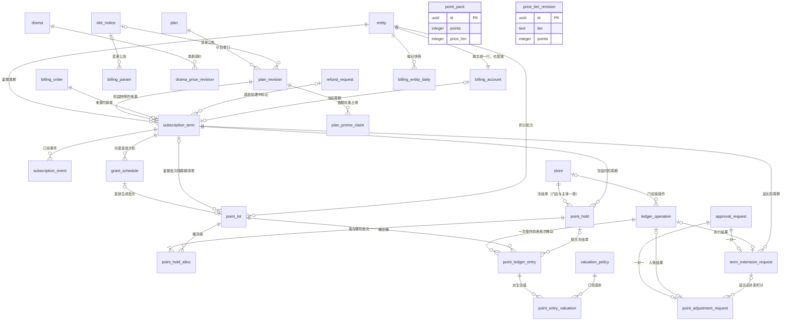

# 07 价目、订阅、积分账本

| 项 | 内容 |
| --- | --- |
| 模块 | `billing`（L2）的前半：价目、订阅、积分账本。付款单、退款、对账、发票在 08 分组 |
| 表 | 21 张：`plan`、`plan_revision`、`plan_promo_claim`、`point_pack`、`price_tier_revision`、`drama_price_revision`、`billing_param`、`billing_account`、`subscription_term`、`subscription_event`、`grant_schedule`、`point_lot`、`point_hold`、`point_hold_alloc`、`ledger_operation`、`point_ledger_entry`、`billing_entity_daily`、`valuation_policy`、`point_entry_valuation`、`point_adjustment_request`、`term_extension_request` |
| 依据 | 草案 `docs/appendix/design/d1-ledger.md` 第 4–9 节（数据模型、计价、订阅生命周期、账本操作、并发与幂等、每日不变量）；`d8-content.md` 对积分价的要求（d8:641）；`d3-flow.md`、`d4-identity.md` 对调整单与延长单的引用（d3:2361-2362、2420；d4:1435-1436）。裁决：rulings M12、M15、M16、M19、M24、M33、M34、M35、M44、M45；第二轮 M46、M47、M48、M52、M54、M55、M57、M66、M67、M75、M92；第三轮 M93、M98、M99、M100、M102、M110（改动见第 7 节）。清单：`catalogue.json` 的 conventions 与本分组各表的 notes；`decisions.md` 第 1 节 #2、#3、#5、#7、#29、#30 与第 6、7、8 节。主文档：`03-key-designs.md` 第 2 节，`04-adr.md` 的 ADR-007、ADR-013、ADR-014、ADR-015、ADR-019 |

出处的写法：`d1:205` 指草案 d1-ledger.md 第 205 行；`PRD:765` 指 PRD 第 765 行；`admin/Plans` 指原型画板；`M33` 是 rulings 的编号；`R3` 是 03 第 9 节的裁决；`decisions #2` 是 decisions.md 第 1 节的第 2 条。“补：…”表示草案没有、按规则或画板补的内容。

## 1. 概览

这组表回答三个问题：现在卖什么价、每个主体买了什么、每个主体还有多少积分。

1. **价目与参数**（7 张）：`plan`、`plan_revision`、`plan_promo_claim`、`point_pack`、`price_tier_revision`、`drama_price_revision`、`billing_param`。价目按时间取值：`effective_at ≤ t` 且未撤销的最新一行就是当前值，到点不需要任何任务去切换。单据在下单时保存快照，调价只影响之后的单据。
2. **订阅**（4 张）：`billing_account`、`subscription_term`、`subscription_event`、`grant_schedule`。一次套餐购买对应一个周期；周期与发放计划自带到期时间，由幂等的 `advance()` 在写操作开头与每分钟扫描时推进。
3. **账本**（5 张）：`point_lot`、`point_hold`、`point_hold_alloc`、`ledger_operation`、`point_ledger_entry`。积分按批次存放，余额是批次的汇总缓存；每次变动写只增流水（批次内桶到桶的数量移动）。
4. **派生与领域申请单**（5 张）：`billing_entity_daily`、`valuation_policy`、`point_entry_valuation` 由流水回放得出，可重算；`point_adjustment_request`、`term_extension_request` 是与审批单一对一的领域表。

全组通用的规则：

| 主题 | 规则 | 依据 |
| --- | --- | --- |
| 金额 | `integer`，单位分，列名以 `_fen` 结尾。本分组没有 `bigint` 金额列；汇总在 SQL 里临时转 `bigint` | M15；ADR-007 |
| 积分 | `integer`。账本表内部的数量列以 `_qty` 结尾；价目、订阅、快照、领域申请单这些业务表的积分列叫 `points` 或以 `_points` 结尾 | conventions 金额与积分 |
| 比例 | 万分比整数，列名以 `_bp` 结尾 | conventions 比例 |
| 时间 | 时刻列 `timestamptz`。账本操作的“现在”取拿到账户锁之后的真实时钟，并与该主体上一次操作的时刻取较大者；流水带业务生效时刻 `occurred_at`、归属业务日 `biz_date`（北京时间）与真实写入时刻 `created_at` | d1:126-133 |
| 加锁 | `billing_account` 是全局加锁顺序里最后一把锁（lock_rank = 420）。本分组其余的表不参与排序：计费内部行只在持有账户锁时修改，两张领域申请单只在持有审批单行锁时修改 | M32；d1:1189 |
| 状态 | 本分组没有走 `flow.transition()` 的业务状态机。`subscription_term`、`grant_schedule`、`point_hold` 的状态是账本内部状态，由计费函数在账户锁内推进，历史在 `subscription_event`、`ledger_operation` 与流水，不写 `status_transition` | conventions 状态 |
| 只增 | `subscription_event`、`ledger_operation`、`point_ledger_entry`、`price_tier_revision` 四张表：应用角色只有 INSERT、SELECT 权限，另有触发器拦截 UPDATE、DELETE、TRUNCATE。授权语句不在本分组的 SQL 文件里，由迁移统一写。`price_tier_revision` 在 catalogue 里 `append_only` 仍为 false，按 M75 当作只增表处理 | d1:480；conventions 只增表；M75 |
| 修订行 | `plan_revision`、`drama_price_revision`、`billing_param`：插入后只允许在生效前写一次 `cancelled_at`。三张表都不设撤销人列，撤销人看审计日志 | M14；M75；d1:223-227 |
| 写入顺序 | 外键都是立即检查的，只增表与修订行插入后不能回填，所以被引用的行先建：账本操作的插入顺序见 2.15；价目修订与参数变更先建公告再插行，见 2.2、2.7 | 复核意见；d1:1185；d6:1723 |
| 多态取值 | `ref_type` 一律用最终表名；账本幂等键里的类型段同样用最终表名。`point_hold.ref_type`、`ledger_operation.ref_type` 取值少且只由本模块写入，逐值写 CHECK。不是表名或不是主键的多态取值（M45 登记的例外）：`point_lot.source_type`（第 3.2 节）；`site_notice.ref_id` 在 `kind = billing_param` 时存的是 `billing_param.change_id` 而不是主键（列在 14 分组，按 14 的请求在此登记） | M19；M45；M52 |
| 不变量编号 | 登记到 ops 时写成 `billing.I1` … `billing.I18`，级别与对象见第 5.6 节；各表“不变量”一节用同样的编号 | 15 分组的请求；M30 |

本分组不建的表：`billing_month_close`（M10：上线时不建，首个月结前补；补建时主键用 uuid `id`，供 14 分组的 `report_month_close.billing_month_close_id` 只存 id 引用，并增加事件 `billing.month_closed`，d1:1720、d6:2114）；`billing_invariant_run`、`billing_invariant_violation`（并入 ops 的 `invariant_run`、`invariant_violation`，decisions #14；本分组只登记检查项，见各表的“不变量”）；`payment_allocation`（分摊台账只留 `grant_schedule` 与批次成本，d1:387）；`renewal_reminder_log`（提醒去重在通知模块，d1:1137）。

图里的 `entity`、`store`、`drama`、`site_notice`、`billing_order`、`refund_request`、`approval_request` 是其他分组的表。`point_pack`、`price_tier_revision` 与本分组的其他表没有外键关系。

## 2. 表定义

### 2.1 `plan` 套餐版本

套餐版本的目录行：版本码、名称、升降级比较用的 rank、上下架。价格与权益不在这里，在 `plan_revision`。归属：全局。主键：uuid。可原地修改（名称、上下架），写审计日志。不参与锁排序（lock_rank 空）；新建价目修订时对本行 `FOR UPDATE`，只用来串行化同一套餐的修订，不与其他业务行同时加锁。

| 列 | 类型 | 空 | 默认 | 说明 | 出处 |
| --- | --- | --- | --- | --- | --- |
| `id` | uuid | 否 | — | 主键，UUID v7，应用生成 | d1:191；R1 |
| `code` | text | 否 | — | 版本码：`basic` / `pro` / `flagship`，可新增；创建后不改，进入付款单快照与埋点 | d1:192 |
| `name` | text | 否 | — | 版本名称：基础版 / 专业版 / 旗舰版 | d1:193；PRD:765 |
| `rank` | integer | 否 | — | 升降级比较：目标 rank 高为升级，低为降级 | d1:194 |
| `scope` | text | 否 | `'public'` | 可见范围：`public` 公开；`entity` 大客户专属（V1.0 只声明，不写入） | d1:195；PRD §12.3-14 |
| `is_listed` | boolean | 否 | `false` | 是否上架。下架后不可新购与续费，已有周期不受影响 | d1:196；PRD:765 |
| `lock_version` | integer | 否 | `0` | 乐观锁版本号 | conventions 乐观锁（补：后台多人可改名称与上下架） |
| `created_at` | timestamptz | 否 | — | 创建时间，应用时钟写入 | conventions 时间 |
| `updated_at` | timestamptz | 否 | — | 最近更新时间，应用时钟写入 | conventions 时间 |

**键与索引**

- 主键：`pk_plan`（`id`）。
- 唯一约束：`uq_plan_code`（`code`）。
- 唯一约束：`uq_plan_rank`（`rank`）。

**手写约束**

- CHECK `ck_plan_scope`：`scope` 取值。

**相对草案的改动**

- `listed` 改名 `is_listed`（conventions 命名规则：布尔列带前缀）；默认 `false`：新增版本先建价目修订再上架（补）。
- 补 `lock_version`、`created_at`、`updated_at`（conventions 乐观锁、时间）。

### 2.2 `plan_revision` 套餐价目修订

一个套餐在某个生效时间起的完整价目与权益。当前价目 = 该套餐 `effective_at ≤ t` 且未撤销的最新一行；“调整待生效”“已生效”由时间推导，不存字段。归属：全局。主键：uuid。不可变修订行：插入后只允许在生效前写一次 `cancelled_at`，由触发器限制；不算严格只增表（catalogue）。不参与锁排序。

| 列 | 类型 | 空 | 默认 | 说明 | 出处 |
| --- | --- | --- | --- | --- | --- |
| `id` | uuid | 否 | — | 主键，UUID v7，应用生成 | d1:202；R1 |
| `plan_id` | uuid | 否 | — | 所属套餐 | d1:203 |
| `revision_no` | integer | 否 | — | 该套餐的第几次修订，从 1 起 | d1:204 |
| `monthly_fee_fen` | integer | 否 | — | 月费（分），大于 0 | d1:205 |
| `monthly_points` | integer | 否 | — | 每月套餐积分，大于 0 | d1:206 |
| `discount_bp` | integer | 否 | — | 订剧与广告折扣（万分比），5000 到 10000；9 折 = 9000，原价 = 10000 | d1:207；admin/Plans |
| `production_model` | text | 否 | — | 制作模型：`standard` 标准 / `advanced` 高级 / `top` 顶级；`top` 时订剧不加扣 | d1:208 |
| `max_stores` | integer | 否 | — | 可管理门店数，不小于 1 | d1:209 |
| `max_members` | integer | 可 | — | 成员数上限（不含老板）；空 = 不限（后台输入 0 表示不限） | d1:210；admin/Plans |
| `schedule_priority` | text | 否 | — | 制作排期：`standard` 标准 / `priority` 优先 / `rush` 加急 | d1:211 |
| `has_monthly_report` | boolean | 否 | `false` | 是否含月度效果报告 | d1:212 |
| `cycle_prices` | jsonb | 否 | — | 各购买周期的总价（分），键为月数；默认 = 月费 × 月数，季付年付优惠只改这里。结构见第 4 节 | d1:213；PRD §2.2-2 |
| `effective_at` | timestamptz | 否 | — | 生效时间 | d1:214 |
| `announced_at` | timestamptz | 可 | — | 公告时间；首个修订豁免公告，为空。服务层校验 `effective_at ≥ 保存时刻 + noticeDays` | d1:215 |
| `site_notice_id` | uuid | 可 | — | 公告记录；与 `announced_at` 同有同无。先建公告、再插本行，插入时写好（触发器不允许事后补写） | d1:216；catalogue cross_module_fks；d6:1696、1723；M33 |
| `legacy_promo` | jsonb | 可 | — | 首期优惠位；V1.0 只有 `{"type":"previous_revision"}` 一种。结构见第 4 节 | d1:217、1047-1055 |
| `cancelled_at` | timestamptz | 可 | — | 撤销时间；只能在生效前写一次 | d1:218、221；M14 |
| `created_by_staff_id` | uuid | 可 | — | 创建人（员工）；上线播种的初始行为空 | d1:219；conventions 操作人列（补：播种行无操作员工） |
| `created_at` | timestamptz | 否 | — | 创建时间，应用时钟写入 | conventions 时间 |

**键与索引**

- 主键：`pk_plan_revision`（`id`）。
- 外键：`plan_id` → `plan.id`，删除行为 RESTRICT（`fk_plan_revision_plan_id`）。
- 外键：`site_notice_id` → `site_notice.id`（14 分组），删除行为 RESTRICT（`fk_plan_revision_site_notice_id`）。
- 外键：`created_by_staff_id` → `staff.id`（03 分组），删除行为 RESTRICT（`fk_plan_revision_created_by_staff_id`）。
- 唯一约束：`uq_plan_revision_plan_id_revision_no`（`plan_id`、`revision_no`）。

**手写约束**

- CHECK `ck_plan_revision_revision_no`：`revision_no ≥ 1`。
- CHECK `ck_plan_revision_monthly_fee_fen`：月费大于 0。
- CHECK `ck_plan_revision_monthly_points`：每月积分大于 0。
- CHECK `ck_plan_revision_discount_bp`：折扣 5000 到 10000。
- CHECK `ck_plan_revision_production_model`：`production_model` 取值。
- CHECK `ck_plan_revision_max_stores`：门店数不小于 1。
- CHECK `ck_plan_revision_max_members`：成员数为空或不小于 1。
- CHECK `ck_plan_revision_schedule_priority`：`schedule_priority` 取值。
- CHECK `ck_plan_revision_cycle_prices`：`cycle_prices` 是对象。
- CHECK `ck_plan_revision_legacy_promo`：`legacy_promo` 为空或对象。
- CHECK `ck_plan_revision_announce_pair`：公告时间与公告记录同有同无。
- CHECK `ck_plan_revision_cancel_before_effective`：只能在生效前撤销。
- 部分唯一索引 `uq_plan_revision_plan_effective`：同一套餐同一生效时间至多一条未撤销的修订；也是“取当前价目”的索引（倒序扫描）。
- 触发器 `trg_plan_revision_write_once`：只允许把 `cancelled_at` 从空写一次，其余列不可改，不可删（`lyx_write_once`）。

**不变量**

billing.I15：每个套餐至多一条待生效（`effective_at > now`）且未撤销的修订；同一套餐同一 `effective_at` 至多一条未撤销的行（后者由部分唯一索引保证）。“待生效”取决于当前时间，写不成索引，由服务层（先锁 `plan` 行再检查，冲突返回 `REVISION_PENDING_EXISTS`）与每日校验保证。服务层另校验：rank 越高，各周期总价与每月积分越高（d1:970）。

**写入顺序与公告**

1. 应用先生成本行的 id，在同一事务里调 `notices.announce`（`kind = plan_revision`，`ref_id` = 本行 id，`effective_at` 同本行），拿到公告 id（d6:1723）。入参除标题与 `summary` 外必须带 `summaryNoPrice`（不含价格数字的摘要，1–200 字，由操作人与 `summary` 一起在保存时填写）；缺了会被 14 分组的 `ck_site_notice_summary_no_price` 拒绝。购买入口为 `offline_contract` 时站内消息与公告条用它作正文（14 分组 2.6）。
2. 再插本行，`site_notice_id` 与 `announced_at`（取公告的 `announced_at`）在插入时写好。触发器只放行 `cancelled_at`，事后不能补写公告列。
3. 生效前撤销（写 `cancelled_at`）时，同一事务调 `notices.withdraw` 撤回公告。
4. 套餐的第一条修订豁免公告，两列都为空。

**相对草案的改动**

- `announcement_ref text` 改为 `site_notice_id uuid` 外键 → `site_notice`（catalogue；conventions 命名规则：不用 text 存其他表的 id；M33：外键列用被引用表全名，初稿名 `announcement_id`）。
- `created_by` 改名 `created_by_staff_id`（conventions 操作人列），并允许为空（补：播种行）。
- 补 `created_at`；不设 `updated_at`：除 `cancelled_at` 外不可改。
- d1:221 的普通索引 `(plan_id, effective_at DESC) WHERE cancelled_at IS NULL` 并入部分唯一索引，不重复建。
- 补 CHECK：`announced_at` 与 `site_notice_id` 同有同无；`cancelled_at < effective_at`（d1:218“仅生效前可撤销”落成约束）。

### 2.3 `plan_promo_claim` 首期优惠使用记录

每个主体对每个带首期优惠的价目修订只能用一次优惠；履约时以 `ON CONFLICT DO NOTHING` 插入，冲突不让入账失败（d1:1054）。归属：主体维度。主键：uuid。插入后不改；不是只增表（catalogue）。不参与锁排序，只在持有 `billing_account` 行锁的履约事务里插入。

| 列 | 类型 | 空 | 默认 | 说明 | 出处 |
| --- | --- | --- | --- | --- | --- |
| `id` | uuid | 否 | — | 主键，UUID v7，应用生成 | 补：草案只有行内写法（d1:229），按 R1 加代理主键 |
| `entity_id` | uuid | 否 | — | 使用优惠的主体 | d1:229 |
| `plan_revision_id` | uuid | 否 | — | 被占用优惠的价目修订（快照里的 `claimRevisionId`，即带 `legacy_promo` 的那一版） | d1:229、525 |
| `billing_order_id` | uuid | 否 | — | 占用优惠的付款单 | d1:229；M17 |
| `used_at` | timestamptz | 否 | — | 占用时刻，取履约事务的账本时钟 | d1:229 |
| `created_at` | timestamptz | 否 | — | 创建时间，应用时钟写入 | conventions 时间 |

**键与索引**

- 主键：`pk_plan_promo_claim`（`id`）。
- 外键：`entity_id` → `entity.id`（02 分组），删除行为 RESTRICT（`fk_plan_promo_claim_entity_id`）。
- 外键：`plan_revision_id` → `plan_revision.id`，删除行为 RESTRICT（`fk_plan_promo_claim_plan_revision_id`）。
- 外键：`billing_order_id` → `billing_order.id`（08 分组），删除行为 RESTRICT（`fk_plan_promo_claim_billing_order_id`）。
- 唯一约束：`uq_plan_promo_claim_entity_id_plan_revision_id`（`entity_id`、`plan_revision_id`）。
- 普通索引：`ix_plan_promo_claim_billing_order_id`（`billing_order_id`）：付款单详情、套餐退款时找到被占用的优惠。

**手写约束**

- 无。

**相对草案的改动**

- 补 `id`、`created_at`（草案只列了四个业务列）。
- `payment_order_id` 改名 `billing_order_id`（M17）。

### 2.4 `point_pack` 加购积分包

加购积分包的档位。可原地修改并写审计日志；“已创建未支付的付款单按原价”靠付款单快照保证（d1:241）。归属：全局。主键：uuid。不参与锁排序。

| 列 | 类型 | 空 | 默认 | 说明 | 出处 |
| --- | --- | --- | --- | --- | --- |
| `id` | uuid | 否 | — | 主键，UUID v7，应用生成 | d1:235；R1 |
| `points` | integer | 否 | — | 积分数，不小于 100；上架中的积分包之间不重复 | d1:236；admin/PointPacks |
| `price_fen` | integer | 否 | — | 价格（分），大于 0；允许不等于积分数，商家端按配置渲染 | d1:237 |
| `is_listed` | boolean | 否 | `true` | 是否上架；新增即上架 | d1:238；proto-admin-c.md:189 |
| `position` | integer | 否 | `0` | 展示顺序，小的在前 | d1:239；M34 |
| `lock_version` | integer | 否 | `0` | 乐观锁版本号 | conventions 乐观锁（补：可原地修改） |
| `created_at` | timestamptz | 否 | — | 创建时间，应用时钟写入 | conventions 时间 |
| `updated_at` | timestamptz | 否 | — | 最近更新时间，应用时钟写入 | conventions 时间 |

**键与索引**

- 主键：`pk_point_pack`（`id`）。

**手写约束**

- CHECK `ck_point_pack_points`：积分数不小于 100。
- CHECK `ck_point_pack_price_fen`：价格大于 0。
- 部分唯一索引 `uq_point_pack_points_listed`：上架中的积分包积分数不重复。

**相对草案的改动**

- `listed` 改名 `is_listed`，默认 `true`（原型：新增即上架）。
- `sort` 改名 `position`（M34：排列顺序叫 `position`；与 14 分组 `home_banner`、`dict_item` 的展示顺序列同名。初稿名 `sort_no`）。
- 补 `lock_version`、`created_at`、`updated_at`。

### 2.5 `price_tier_revision` 等级模板价修订

热度等级 S / A / B / C 的模板积分价，带生效时间。某等级在时刻 t 的模板价 = 该等级 `effective_at ≤ t` 的最新一行。归属：全局。主键：uuid。按只增处理（M75）：没有撤销列，应用角色只有 INSERT、SELECT 权限，触发器拦截 UPDATE、DELETE、TRUNCATE。不参与锁排序。

| 列 | 类型 | 空 | 默认 | 说明 | 出处 |
| --- | --- | --- | --- | --- | --- |
| `id` | uuid | 否 | — | 主键，UUID v7，应用生成 | d1:247；R1 |
| `tier` | text | 否 | — | 热度等级：`S` / `A` / `B` / `C`（见 catalogue enums_shared 的 heat_tier） | d1:248 |
| `points` | integer | 否 | — | 模板积分价，100 到 20000 | d1:249；admin/Params |
| `effective_at` | timestamptz | 否 | — | 生效时间；“保存后立即生效”取账本时钟的当前时刻 | d1:250、227 |
| `batch_id` | uuid | 否 | — | 同一次保存的各档共用的批次标识（应用生成，不指向任何表）；服务层校验同一生效时刻 S ≥ A ≥ B ≥ C。只存 id，不建外键：批次标识，不是外键 | d1:251 |
| `created_by_staff_id` | uuid | 可 | — | 创建人（员工）；上线播种的初始行为空 | d1:252；conventions 操作人列（补：播种行） |
| `created_at` | timestamptz | 否 | — | 创建时间，应用时钟写入 | conventions 时间 |

**键与索引**

- 主键：`pk_price_tier_revision`（`id`）。
- 外键：`created_by_staff_id` → `staff.id`（03 分组），删除行为 RESTRICT（`fk_price_tier_revision_created_by_staff_id`）。
- 唯一约束：`uq_price_tier_revision_tier_effective_at`（`tier`、`effective_at`）。
- 普通索引：`ix_price_tier_revision_batch_id`（`batch_id`）：后台变更记录按一次保存聚合。
- 只存 id、不建外键：`batch_id`（批次标识，不是外键）。

**手写约束**

- CHECK `ck_price_tier_revision_tier`：`tier` 取值。
- CHECK `ck_price_tier_revision_points`：模板价 100 到 20000。
- 触发器 `trg_price_tier_revision_immutable`：不可改、不可删（`lyx_forbid_mutation`）。
- 触发器 `trg_price_tier_revision_no_truncate`：拦截 TRUNCATE。

**不变量**

服务层校验同一生效时刻 S ≥ A ≥ B ≥ C（d1:251）。改热度等级不产生本表的行：等级是 `drama.heat_tier`，改等级即时影响按模板定价的剧（d1:268；d8:447）。

**相对草案的改动**

- `created_by` 改名 `created_by_staff_id`，允许为空（补：播种行）。
- 补 `created_at`。
- 补防改触发器与 TRUNCATE 拦截：草案把本表列在“带生效时间，只增”一组（d1:185），且没有撤销列（catalogue notes）；M75 裁定按只增处理。

### 2.6 `drama_price_revision` 单剧定价修订

单剧调价记录。剧目积分价 `P(drama, t)`：取该剧 `effective_at ≤ t` 且未撤销的最新修订；`custom` 取 `custom_points`，`template`（或没有任何修订）取该剧当前热度等级在 t 的模板价（d1:268）。归属：全局。主键：uuid。不可变修订行：只允许在生效前写一次 `cancelled_at`。不参与锁排序。

| 列 | 类型 | 空 | 默认 | 说明 | 出处 |
| --- | --- | --- | --- | --- | --- |
| `id` | uuid | 否 | — | 主键，UUID v7，应用生成 | d1:258；R1 |
| `drama_id` | uuid | 否 | — | 剧目 | d1:259；d8:641 |
| `mode` | text | 否 | — | 定价方式：`template` 按模板 / `custom` 单剧调整 | d1:260 |
| `custom_points` | integer | 可 | — | 单剧积分价；`custom` 时必填且不小于 100，`template` 时为空 | d1:261 |
| `prev_points` | integer | 可 | — | 旧价：保存时刻该剧的积分价 `P(drama, 保存时刻)`；该剧当时没有可用价格（无热度等级、也没有生效的单剧调整）为空。调价记录“旧价 → 新价”用 | admin/Pricing（proto-admin-c.md:266“《剧名》旧价 → 新价”）；PRD:767（补：等级可原地改且无历史，事后无法还原） |
| `new_points` | integer | 否 | — | 新价：保存时按当时已知的价目算出的 `P(drama, effective_at)`。`custom` 等于 `custom_points`；`template` 取该剧当时热度等级在 `effective_at` 的模板价（剧目没有热度等级时不能选 `template`）。只供展示，生效后的实际价格仍按 P 现算 | admin/Pricing（调价弹窗“当前价、新积分价”）；PRD:767（补：同上） |
| `effective_at` | timestamptz | 否 | — | 生效时间：保存后立即，或某日 00:00（北京时间） | d1:262；admin/Pricing |
| `reason_code` | text | 否 | — | 调整原因：`quality` 制作质量 / `genre_fit` 题材适配 / `release_timing` 上新时间 / `license_remaining` 剩余授权期 / `restore_template` 恢复模板价 | d1:263；admin/Pricing |
| `note` | text | 可 | — | 备注，自由文本 | d1:264 |
| `cancelled_at` | timestamptz | 可 | — | 撤销时间；只能在生效前写一次 | d1:265；M14 |
| `created_by_staff_id` | uuid | 否 | — | 创建人（员工） | d1:266；conventions 操作人列 |
| `created_at` | timestamptz | 否 | — | 创建时间，应用时钟写入 | conventions 时间 |

**键与索引**

- 主键：`pk_drama_price_revision`（`id`）。
- 外键：`drama_id` → `drama.id`（05 分组），删除行为 RESTRICT（`fk_drama_price_revision_drama_id`）。
- 外键：`created_by_staff_id` → `staff.id`（03 分组），删除行为 RESTRICT（`fk_drama_price_revision_created_by_staff_id`）。
- 普通索引：`ix_drama_price_revision_drama_id_effective_at`（`drama_id`、`effective_at`）：调价记录列表（含已撤销），按剧、按生效时间。

**手写约束**

- CHECK `ck_drama_price_revision_mode`：`mode` 取值。
- CHECK `ck_drama_price_revision_custom_points`：`custom` 必填且不小于 100；`template` 为空。
- CHECK `ck_drama_price_revision_new_points`：新价不小于 100；`custom` 时新价 = `custom_points`。
- CHECK `ck_drama_price_revision_points_changed`：新价不得等于旧价（admin/Pricing 的校验）。
- CHECK `ck_drama_price_revision_reason_code`：`reason_code` 取值。
- CHECK `ck_drama_price_revision_cancel_before_effective`：只能在生效前撤销。
- 部分唯一索引 `uq_drama_price_revision_drama_effective`：同一部剧同一生效时间至多一条未撤销的修订；也是取 P 的索引。
- 触发器 `trg_drama_price_revision_write_once`：只允许把 `cancelled_at` 从空写一次，其余列不可改，不可删。

**不变量**

停止订购的剧不能调价：调价前由 billing 调用 `content.getOrderability` 判断（d8:641 ③），不落成约束。`restore_template` 与 `mode = template` 成对出现，由服务层校验（admin/Pricing）；新价不等于旧价已由 CHECK 保证。

**定时器**：`effective_at` 晚于保存时刻的行，同一事务登记一条定时器（`kind = pricing.drama_price_effective`，主体为本行，`fire_at = effective_at`），到点只发 `pricing.drama_price_changed`；立即生效的在保存事务里直接发事件。生效前撤销时同一事务取消该定时器。定时器没跑价格也不会错，只是通知晚到（d1:717）。见第 5.5 节。

**相对草案的改动**

- `reason_code` 的取值名为本稿所定，对应草案与画板的五个中文选项（d1:263）。
- 补 `prev_points`、`new_points`（第二轮，复核意见）：画板的调价记录标题是“《剧名》旧价 → 新价”，PRD 7.3-3 要求保留调价记录；`template` 方式的新价与任何一条的旧价都取决于当时的热度等级，而 `drama.heat_tier` 可原地修改且没有历史（d8:447），事后无法还原。
- `created_by` 改名 `created_by_staff_id`。
- 补 `created_at`；不设 `updated_at`。
- 补普通索引 `(drama_id, effective_at)`：调价记录要列出已撤销的行，部分唯一索引不覆盖。
- 补 CHECK：`cancelled_at < effective_at`。

### 2.7 `billing_param` 积分规则参数

会进入单据快照、影响计价与账务的参数，按键存储、逐键生效。`paramsAt(t)` = 对每个键取 `effective_at ≤ t` 且未撤销的最新一行。共 12 个键（M24、M35）。归属：全局。主键：uuid。不可变修订行：只允许在生效前写一次 `cancelled_at`。不参与锁排序；保存变更集的事务先取一把事务级咨询锁串行化（d1:288）。

| 列 | 类型 | 空 | 默认 | 说明 | 出处 |
| --- | --- | --- | --- | --- | --- |
| `id` | uuid | 否 | — | 主键，UUID v7，应用生成 | d1:274；R1 |
| `key` | text | 否 | — | 参数键，12 个取值：`adUnitPoints`、`adFreeRevisions`、`topModelSurchargeBp`、`cancelDeductionBp`、`expiredTermRefund`、`minLicenseMonths`、`renewalReminderDays`、`prorationBaseDays`、`planRefundWindowHours`、`enabledCycles`、`maxScheduledTerms`、`noticeDays`。含义与默认值见第 4.3 节 | d1:275、295-307；M24、M35 |
| `value` | jsonb | 否 | — | 该键的完整值（不是增量），每个键各有 Zod schema。结构见第 4 节 | d1:276 |
| `effective_at` | timestamptz | 否 | — | 生效时间；需提前公告的键不得早于保存时刻 + `noticeDays`（服务层校验） | d1:277、287 |
| `change_id` | uuid | 否 | — | 同一次保存的各键共用的变更集标识（应用生成，不指向任何表）；后台“变更记录”按它聚合。只存 id，不建外键：变更集标识，不是外键 | d1:278 |
| `note` | text | 可 | — | 变更说明 | d1:279 |
| `site_notice_id` | uuid | 可 | — | 公告记录；需提前公告的键必填（清单是代码常量 `NOTICE_REQUIRED_KEYS`，服务层校验）。同一变更集里需公告的各行共用一条公告 | d1:280、287；catalogue cross_module_fks；M33 |
| `cancelled_at` | timestamptz | 可 | — | 撤销时间；只能在生效前写一次 | d1:281；M14 |
| `created_by_staff_id` | uuid | 可 | — | 创建人（员工）；上线播种的初始行为空 | d1:282；conventions 操作人列（补：播种行） |
| `created_at` | timestamptz | 否 | — | 创建时间，应用时钟写入 | conventions 时间 |

**键与索引**

- 主键：`pk_billing_param`（`id`）。
- 外键：`site_notice_id` → `site_notice.id`（14 分组），删除行为 RESTRICT（`fk_billing_param_site_notice_id`）。
- 外键：`created_by_staff_id` → `staff.id`（03 分组），删除行为 RESTRICT（`fk_billing_param_created_by_staff_id`）。
- 普通索引：`ix_billing_param_change_id`（`change_id`）：后台“变更记录”按变更集聚合。
- 只存 id、不建外键：`change_id`（变更集标识，不是外键）。

**手写约束**

- CHECK `ck_billing_param_key`：`key` 只能是 12 个登记的键。
- CHECK `ck_billing_param_value_shape`：`value` 的 JSON 类型与键匹配：8 个数值键为 number，2 个列表键为 array，2 个映射键为 object。
- CHECK `ck_billing_param_cancel_before_effective`：只能在生效前撤销。
- 部分唯一索引 `uq_billing_param_key_effective`：同一个键同一生效时间至多一条未撤销的行；也是 `paramsAt` 的索引。
- 触发器 `trg_billing_param_write_once`：只允许把 `cancelled_at` 从空写一次，其余列不可改，不可删。

**不变量**

billing.I15：每个键至多一条待生效且未撤销的行（服务层 `PARAM_PENDING_EXISTS` + 每日校验）；同一个键同一 `effective_at` 至多一条未撤销的行（部分唯一索引）。每个键在任何时刻都应能取到值：12 个键的初始行由迁移播种。

**写入顺序与公告**

1. 一次保存是一个变更集（`change_id` 由应用先生成）。变更集里有需公告的键时，这些键必须共用同一个 `effective_at`（`site_notice.effective_at` 是单值，一个变更集至多一条已公告的记录，`uq_site_notice_kind_ref_id_announced`）；不需公告的键可以各有生效时间。
2. 同一事务里先调 `notices.announce`（`kind = billing_param`，`ref_id = change_id`，必须带 `summaryNoPrice`，要求同 2.2），再插各行；需公告的各行在插入时写好同一个 `site_notice_id`（触发器不允许事后补写）。
3. 逐键撤销（写 `cancelled_at`）后，若该变更集里需公告的键已全部撤销，同一事务调 `notices.withdraw` 撤回公告。只撤销其中一部分时公告保留；要改公告内容，整组撤销后重新保存（14 分组 `site_notice` 不可编辑）。

**相对草案的改动**

- 表名：d2:170 称 `billing_param_revision`，统一为 `billing_param`（catalogue renamed_from）。
- 键清单由 13 个减为 12 个：`upgradeQuoteValidHours` 移到 `param_value` 的 `billing.upgrade_quote_valid_hours`（M24、M35；decisions 7.1）。
- `cancelDeductionBp` 的值增加子键 `adInProduction`（广告制作中取消的扣除比例，d3:1406；第 4.3 节），键数仍是 12。
- `announcement_ref text` 改为 `site_notice_id uuid` 外键 → `site_notice`（M33；初稿名 `announcement_id`）。
- `created_by` 改名 `created_by_staff_id`，允许为空（补：播种行）。
- 补 `created_at`；不设 `updated_at`。
- 补 CHECK：`value` 的 JSON 类型与键匹配；`cancelled_at < effective_at`。

### 2.8 `billing_account` 主体计费账户

每个主体一行。它是所有改钱改积分事务的唯一行锁，同时缓存订阅状态与各类余额；余额的真相在 `point_lot`。主体创建时同事务建行（tenant 经 billing 注册的端口调用，d4:555）。归属：主体维度。主键：`entity_id`（与主体一对一，不设代理主键）。锁顺序：lock_rank = 420，全局最后一把锁；一个事务只锁一个主体的账户，取得之后不再去锁新的已有业务行。等锁上限 3 秒（d1:1169）。

| 列 | 类型 | 空 | 默认 | 说明 | 出处 |
| --- | --- | --- | --- | --- | --- |
| `entity_id` | uuid | 否 | — | 主体，主键兼外键 | d1:317 |
| `sub_status` | text | 否 | `'none'` | 订阅状态缓存：`none` 从未开通 / `active` 生效中 / `expired` 已过期。由 `advance` 等账本函数维护，只用于后台筛选与扫描；权益判断不读它 | d1:318、844 |
| `current_subscription_term_id` | uuid | 可 | — | 当前生效周期；`active` 时必填，否则为空 | d1:319；M33 |
| `plan_available_qty` | integer | 否 | `0` | 缓存：当前周期未过期套餐批次的可用合计 | d1:320 |
| `addon_available_qty` | integer | 否 | `0` | 缓存：加购批次的可用合计（不管是否停用） | d1:321 |
| `held_total_qty` | integer | 否 | `0` | 缓存：全部批次的冻结合计 | d1:322 |
| `next_due_at` | timestamptz | 可 | — | 下一个要处理的时刻 = min(当前周期 `ends_at`, 最早的待发放 `due_at`)；每分钟扫描查它 | d1:323、836 |
| `last_op_at` | timestamptz | 可 | — | 该主体最近一次账本操作的时刻，保证账本时钟单调；从未操作为空 | d1:324、129 |
| `last_expired_qty` | integer | 可 | — | 最近一次期末清零的数量，供“已清零 N”展示 | d1:325；merchant/WalletExpired |
| `last_expired_at` | timestamptz | 可 | — | 最近一次期末清零的时刻；与 `last_expired_qty` 同有同无 | d1:325 |
| `created_at` | timestamptz | 否 | — | 创建时间，应用时钟写入 | conventions 时间 |
| `updated_at` | timestamptz | 否 | — | 最近更新时间，应用时钟写入 | conventions 时间 |

**键与索引**

- 主键：`pk_billing_account`（`entity_id`）。
- 外键：`entity_id` → `entity.id`（02 分组），删除行为 RESTRICT（`fk_billing_account_entity_id`）。
- 外键：`current_subscription_term_id` → `subscription_term.id`，删除行为 RESTRICT（`fk_billing_account_current_subscription_term_id`）。
- 普通索引：`ix_billing_account_next_due_at`（`next_due_at`）：每分钟扫描：`next_due_at ≤ 当前时刻` 的主体（d1:842）。
- 普通索引：`ix_billing_account_sub_status`（`sub_status`）：后台积分账户列表按订阅状态筛选。

**手写约束**

- CHECK `ck_billing_account_sub_status`：`sub_status` 取值。
- CHECK `ck_billing_account_cache_nonneg`：三个缓存列非负（d1:616）。
- CHECK `ck_billing_account_current_term`：`active` ⇔ 有当前周期。
- CHECK `ck_billing_account_last_expired`：最近清零的数量与时刻同有同无，数量非负。

**状态机**

`sub_status` 是主体订阅状态的缓存（d1:766-791）。不写 `status_transition`：历史在 `subscription_event`。

| 当前状态 | 事件 | 新状态 | 守卫 | 触发者 |
| --- | --- | --- | --- | --- |
| `none` / `expired` | 付清套餐（`fulfill`，内容为套餐） | `active` | — | 入账事务（微信回调、财务确认到账、补单） |
| `active` | 续费预约、升级、到期续接、未到期的补偿延长 | `active` | 各自的守卫（d1 第 6 节） | 入账事务、`advance`、审批通过事务 |
| `active` | 当前周期 `ends_at ≤ now` 且没有预约周期 | `expired` | — | `advance`（写操作开头或每分钟扫描） |
| `expired` | 延长在到期后补批（周期复活） | `active` | 最近结束的周期为 `ended`，且延长单发起时刻早于它原来的 `ends_at` | 延长审批通过事务 |
| `active` | 套餐退款执行且没有后续周期 | `expired`；从未有过其他生效周期则 `none` | 周期已标记退款处理中，或补记渠道退款（见 2.9） | 退款执行事务（`revokeTerm`）、差异单处理事务（`revokeTermForExternalRefund`） |

可花积分 = 当前周期生效且不在退款处理中 ? `plan_available_qty + addon_available_qty` : 0（d1:328）。“停用”“退款处理中”都是闸门，不搬动任何批次数量；退款处理中是主体级闸门（M66）。

**不变量**

billing.I3：`plan_available_qty` = 当前周期未过期套餐批次可用之和；`addon_available_qty` = 加购批次可用之和；`held_total_qty` = 全部批次冻结之和。billing.I8：`next_due_at` 没有落后于当前时间 10 分钟以上的主体。billing.I9：`sub_status = active` ⇔ 存在生效周期且 `starts_at ≤ now < ends_at`。每个账本操作提交前另对当前主体做写入时自检（d1:1521）。

**相对草案的改动**

- `current_term_id` 改名 `current_subscription_term_id`（M33）。
- `plan_available`、`addon_available`、`held_total` 改名 `plan_available_qty`、`addon_available_qty`、`held_total_qty`（conventions 金额与积分：账本表内部用 qty）。
- `last_op_at` 明确为可空（从未操作）。
- 补 `created_at`。
- 补 CHECK：`active` ⇔ 有当前周期（d1:827、1030 的写法落成约束，两列须在同一条 UPDATE 里改）；最近清零两列同有同无。
- 补索引 `sub_status`（后台列表筛选，d1:318）。

### 2.9 `subscription_term` 订阅周期

一次套餐购买 = 一个周期，左闭右开 `[starts_at, ends_at)`。行上带权益快照：订购计价、名额校验都读这里，不读价目表。归属：主体维度。主键：uuid。可变（升级覆盖权益、延长改止日、退款作废）。不参与锁排序：只在持有 `billing_account` 行锁时修改；一个事务里改多个周期的起止时从链尾向前更新（d1:355）。`status` 是账本内部状态，不写 `status_transition`，历史在 `subscription_event`。

| 列 | 类型 | 空 | 默认 | 说明 | 出处 |
| --- | --- | --- | --- | --- | --- |
| `id` | uuid | 否 | — | 主键，UUID v7，应用生成 | d1:334；R1 |
| `entity_id` | uuid | 否 | — | 主体 | d1:335 |
| `term_no` | integer | 否 | — | 该主体的第几个周期，从 1 起 | d1:336；M34 |
| `origin` | text | 否 | — | 来源：`new` 首次开通 / `renew` 续接 / `resume` 过期后重新开通 | d1:337 |
| `plan_id` | uuid | 否 | — | 当前版本；升级后更新 | d1:338 |
| `plan_revision_id` | uuid | 否 | — | 当前价目修订；升级后更新 | d1:339 |
| `initial_plan_revision_id` | uuid | 否 | — | 购买时适用的价目修订；不随升级改变 | d1:340 |
| `months` | integer | 否 | — | 购买周期（月），不小于 1；可选值由参数 `enabledCycles` 决定 | d1:341 |
| `price_total_fen` | integer | 否 | — | 购买该周期的应付金额（分），不含之后的升级补差 | d1:342 |
| `monthly_equiv_fen` | integer | 否 | — | 月度分摊金额 = floor(周期总价 ÷ 月数)；升级后改为新版本的值；MRR 用 | d1:343 |
| `monthly_points` | integer | 否 | — | 权益快照：每月套餐积分 | d1:344 |
| `discount_bp` | integer | 否 | — | 权益快照：订剧与广告折扣（万分比） | d1:344 |
| `production_model` | text | 否 | — | 权益快照：制作模型，取值同 `plan_revision.production_model` | d1:344 |
| `max_stores` | integer | 否 | — | 权益快照：可管理门店数 | d1:344 |
| `max_members` | integer | 可 | — | 权益快照：成员数上限；空 = 不限 | d1:344 |
| `schedule_priority` | text | 否 | — | 权益快照：制作排期，取值同 `plan_revision.schedule_priority` | d1:344 |
| `has_monthly_report` | boolean | 否 | `false` | 权益快照：是否含月度效果报告 | d1:344 |
| `anchor_day` | smallint | 否 | — | 锚定日（1 到 31）：开通当天是几号；连续续费沿用，过期后重新开通时重置 | d1:345、139-144 |
| `start_date` | date | 否 | — | 起始日（含），北京时间 | d1:346 |
| `end_date` | date | 否 | — | 止日（含），含补偿延长 | d1:346 |
| `starts_at` | timestamptz | 否 | — | 起点时刻。首期与过期后续费 = 履约事务的账本时钟；预约周期 = 上一周期 `ends_at` | d1:347、905-908 |
| `ends_at` | timestamptz | 否 | — | 终点时刻（不含）= `end_date` 次日 00:00（北京时间） | d1:347、132 |
| `extended_days` | integer | 否 | `0` | 累计补偿延长天数 | d1:348 |
| `status` | text | 否 | — | 周期状态：`scheduled` 预约未生效 / `active` 生效中 / `ended` 已到期 / `refunded` 已退款 / `cancelled` 未生效即退款 | d1:349、793-808 |
| `refund_request_id` | uuid | 可 | — | 非空 = 退款处理中（主体级闸门，M66）：退款申请提交时写入；申请以 `not_executed` 关闭（驳回、撤回、作废）、开始执行时清空，见状态机；补记渠道退款遇此标记时不回收、不清空（A156） | d1:350、810；catalogue notes；M54；M100；A156 |
| `refund_rule` | text | 可 | — | 退款规则：`window` 窗口内 / `qualification_failed` 资质终审不通过 / `override` 规则外。与 `refund_request.rule_code` 同值（M67）。与 `refund_request_id` 同有同无 | d1:351、1104-1106；M67 |
| `source_billing_order_id` | uuid | 否 | — | 来源付款单；一张付款单至多建一个周期 | d1:352；catalogue notes |
| `activated_at` | timestamptz | 可 | — | 生效时刻；`scheduled`、`cancelled` 为空 | d1:353 |
| `ended_at` | timestamptz | 可 | — | 最近一次到期处理的逻辑时刻（= 当时的 `ends_at`）；延长补批复活时清空 | d1:353（补：复活时的取值） |
| `refunded_at` | timestamptz | 可 | — | 退款作废时刻；`refunded`、`cancelled` 时必填 | d1:353、1120 |
| `created_at` | timestamptz | 否 | — | 创建时间，应用时钟写入 | conventions 时间 |
| `updated_at` | timestamptz | 否 | — | 最近更新时间，应用时钟写入 | conventions 时间 |

**键与索引**

- 主键：`pk_subscription_term`（`id`）。
- 外键：`entity_id` → `entity.id`（02 分组），删除行为 RESTRICT（`fk_subscription_term_entity_id`）。
- 外键：`plan_id` → `plan.id`，删除行为 RESTRICT（`fk_subscription_term_plan_id`）。
- 外键：`plan_revision_id` → `plan_revision.id`，删除行为 RESTRICT（`fk_subscription_term_plan_revision_id`）。
- 外键：`initial_plan_revision_id` → `plan_revision.id`，删除行为 RESTRICT（`fk_subscription_term_initial_plan_revision_id`）。
- 外键：`refund_request_id` → `refund_request.id`（08 分组），删除行为 RESTRICT（`fk_subscription_term_refund_request_id`）。
- 外键：`source_billing_order_id` → `billing_order.id`（08 分组），删除行为 RESTRICT（`fk_subscription_term_source_billing_order_id`）。
- 唯一约束：`uq_subscription_term_entity_id_term_no`（`entity_id`、`term_no`）。
- 唯一约束：`uq_subscription_term_source_billing_order_id`（`source_billing_order_id`）。
- 普通索引：`ix_subscription_term_entity_id_status_starts_at`（`entity_id`、`status`、`starts_at`）：`advance` 取最早的预约周期、取链尾；权益现算。
- 普通索引：`ix_subscription_term_status_ends_at`（`status`、`ends_at`）：后台“套餐到期”页、续费提醒查询端口（d1:1140）。
- 普通索引：`ix_subscription_term_refund_request_id`（`refund_request_id`）：由退款申请找周期；billing.I17 的提醒项。

**手写约束**

- CHECK `ck_subscription_term_term_no`：`term_no ≥ 1`。
- CHECK `ck_subscription_term_origin`：`origin` 取值。
- CHECK `ck_subscription_term_months`：月数不小于 1。
- CHECK `ck_subscription_term_amounts`：金额非负。
- CHECK `ck_subscription_term_entitlement`：权益快照的范围同 `plan_revision`。
- CHECK `ck_subscription_term_production_model`：`production_model` 取值。
- CHECK `ck_subscription_term_schedule_priority`：`schedule_priority` 取值。
- CHECK `ck_subscription_term_anchor_day`：锚定日 1 到 31。
- CHECK `ck_subscription_term_period`：`ends_at > starts_at`，`end_date ≥ start_date`。
- CHECK `ck_subscription_term_start_date`：`start_date` = `starts_at` 的北京时间日期。
- CHECK `ck_subscription_term_ends_at`：`ends_at` = `end_date` 次日 00:00（北京时间）。
- CHECK `ck_subscription_term_extended_days`：延长天数非负。
- CHECK `ck_subscription_term_status`：`status` 取值。
- CHECK `ck_subscription_term_refund_rule`：`refund_rule` 取值。
- CHECK `ck_subscription_term_refund_mark`：退款处理中标记两列同有同无。
- CHECK `ck_subscription_term_activated_at`：`scheduled`、`cancelled` 没有生效时刻，其余必有。
- CHECK `ck_subscription_term_refunded_at`：`refunded`、`cancelled` ⇔ 有退款作废时刻。
- 部分唯一索引 `uq_subscription_term_entity_active`：一个主体至多一个生效周期（d1:355、612）。
- 排他约束 `ex_subscription_term_no_overlap`：同一主体的 `scheduled` / `active` / `ended` 周期两两不重叠；延迟到提交时检查（d1:355；依赖 btree_gist）。

**状态机**

周期状态（d1:793-808）。由 `fulfill`、`advance`、`applyExtension`、`revokeTerm`、`revokeTermForExternalRefund` 在账户锁内推进；不写 `status_transition`，每次变化写一条 `subscription_event`。

| 当前状态 | 事件 | 新状态 | 守卫 | 触发者 |
| --- | --- | --- | --- | --- |
| （新建） | 生效期间付清套餐 | `scheduled` | — | 入账事务（`fulfill`） |
| （新建） | 无生效订阅时付清套餐 | `active` | — | 入账事务（`fulfill`） |
| `scheduled` | 上一周期到期，或上一周期被退款而提前生效 | `active` | — | `advance`、`revokeTerm`、`revokeTermForExternalRefund` |
| `scheduled` | 套餐退款（尚未生效） | `cancelled` | `refund_request_id` 与入参一致 | 退款执行事务（`revokeTerm`） |
| `active` | `ends_at ≤ now` | `ended` | — | `advance` |
| `ended` | 延长在到期后补批 | `active` | 其后没有周期生效过；延长单发起时刻早于原 `ends_at` | 延长审批通过事务（`applyExtension` 情况 B） |
| `active` | 套餐退款 | `refunded` | 已标记退款处理中（入参的申请与标记一致）；规则不是 `override` 时复核“未使用” | 退款执行事务（`revokeTerm`） |
| `ended` | 套餐退款（处理期间到期） | `refunded` | 同上 | 退款执行事务（`revokeTerm`） |
| `scheduled` / `active` / `ended` | 补记渠道退款：在微信商户平台直接退了款，对账出 `refund_bill_only` 差异单，补记后收回权益 | `cancelled` / `refunded` | 入参是差异单（不是退款申请），不经闸门：规则按 `override`，不复核“未使用”，不看有无 `upgraded` 事件；周期须不在退款处理中（`refund_request_id` 为空）。正挂在某张退款申请的闸门上时不回收、不迁移、不清标记，返回 `heldByRefundRequestId`，由 08 另开 `entitlement_unrecovered`（A156；08-billing-payment.md:780） | 差异单处理事务（`revokeTermForExternalRefund`，M100；d2:1114） |

“退款处理中”不是状态值，是 `refund_request_id` 非空这个标记，与 `scheduled` / `active` / `ended` 正交（d1:810）。标记的开合与 08 分组 `refund_request` 的执行状态（M54）同事务：

| 标记 | 事件 | 新标记 | 守卫 | 触发者 |
| --- | --- | --- | --- | --- |
| 空 | 提交套餐退款申请（`refund_request` 建行，`pending_approval`；`suspendTermForRefund`） | 非空 | `status` 为 `scheduled` 或 `active`。按 `refund_rule`：`window` 校验窗口与“未使用”；`qualification_failed` 只校验“未使用”；这两条另要求周期没有 `upgraded` 事件（M98）；`override` 不校验。窗口按调用时刻判断，调用与申请建行同事务，即按申请创建时刻（M99），不接受外部时刻 | 退款提交事务 |
| 非空 | 申请未执行即关闭：`refund_request` 进入 `not_executed`，`close_reason` 为 `rejected`（驳回）、`withdrawn`（撤回）或 `voided`（审批通过后、执行前作废，审批单保持 `approved`）（`resumeTermFromRefund`） | 空 | 申请与标记一致 | 审批事务、作废事务 |
| 非空 | 开始执行：`refund_request` 离开 `pending_execution`（微信原路退进入 `executing`，线下登记直接进入 `done`）（`revokeTerm`） | 空，同时状态变 `refunded` / `cancelled` | 同上 | 退款执行事务 |
| 非空 | 补记渠道退款遇闸门（`revokeTermForExternalRefund`） | 非空（不变，周期状态也不变） | 不回收：返回 `heldByRefundRequestId`（即本标记的申请 id），由 08 另开 `entitlement_unrecovered`；那张在途申请不由本函数收口，之后执行时由 08 的可退余额守卫拦下（A156；08-billing-payment.md:780） | 差异单处理事务 |

权益在开始执行的那一刻收回；之后退款交易失败、申请回到 `pending_execution` 时周期保持 `refunded` / `cancelled`，不再开闸（08 分组：权益已回收的申请不可作废）。

**升级过的周期**（M98，采纳 d2:964）：不能按 `window`、`qualification_failed` 退，`suspendTermForRefund` 拒绝；`previewPlanRefund` 返回 `upgraded` 供发起前提示。确需退的只能走规则外退款（`override`）：一张申请仍只对一笔收款（来源付款单的收款），`revokeTerm` 作废该周期全部批次（含升级补发的批次），返回的 `billingOrderIds` 列出来源付款单与各升级补差付款单。周期作废之后不能再对它提交套餐退款申请（`suspendTermForRefund` 只接受 `scheduled`、`active`；同一张申请重复执行 `revokeTerm` 按幂等键返回原结果），同一周期升级补差付款单的现金退款不再经闸门（权益已收回）。 守卫只管 `window`、`qualification_failed`；`override` 不受限。来源款的 `override` 申请执行 `revokeTerm` 作废周期后，升级补差款的 `override` 申请由 08 分组直接退现金、不再调用闸门函数（M111）。

**不经闸门的回收入口**（M100；08 分组的请求）：`revokeTermForExternalRefund(tx, { termId, paymentExceptionId })`，只供差异单“补记渠道退款”（`refund_bill_only`）使用。入参只认周期，作废的总是整个周期（升级补差付款单的补记退款若调用它，同样作废整个周期；是否调用由 08 按付款单类型决定）。作废方式同 `revokeTerm`（批次的桶移动、`pending` 发放计划取消、周期状态与后续周期的处理都相同），幂等键同为 `revoke:subscription_term:{termId}`，`ledger_operation.ref_type = payment_exception`。周期已被任一路径作废时按幂等键返回第一次的结果。周期正挂在退款申请的闸门上（`refund_request_id` 非空）时**不回收**：不动批次、发放计划与周期状态，不清标记，不写账本操作（幂等键不占用），直接返回该申请 id；那张在途申请不由本函数收口，之后执行时由 08 的可退余额守卫拦下（A156；与 08-billing-payment.md:780 一致）。返回 `{ revokedPoints, cancelledSchedules, billingOrderIds, unrecoveredPoints, heldByRefundRequestId }`：`unrecoveredPoints` 是该周期套餐批次里已被商家用掉、收不回的数量（`held_qty + consumed_qty + converted_out_qty` 之和；冻结中的不强行释放），大于 0 时由 08 另开 `entitlement_unrecovered`；`heldByRefundRequestId` 非空即遇闸门未回收（此时其余数量为 0、列表为空），由 08 另开 `entitlement_unrecovered`；回收了的为空。

**不变量**

billing.I9：每个主体至多一个生效周期。billing.I10：同一主体的周期两两不重叠；预约周期首尾相接（排他约束只保证不重叠，首尾相接由每日校验）。billing.I7：已结束、已退款的周期没有 `pending` 的发放计划；套餐批次的 `expires_at` = 所属周期 `ends_at`。billing.I12：每张履约完成的套餐付款单恰有一个周期。billing.I17（提醒项，不写违规表）：标记为退款处理中超过 7 天的周期。

**相对草案的改动**

- `seq` 改名 `term_no`（M34）。
- `refund_request_id` 由 text 单号改为 uuid 外键 → `refund_request`（catalogue notes）。
- `source_payment_order_id` 改名 `source_billing_order_id`（catalogue notes；M17）。
- 草案合写的 `monthly_points / discount_bp / …`、`start_date / end_date`、`starts_at / ends_at`、`activated_at / ended_at / refunded_at` 拆成独立列，类型与可空性逐列写明。
- `months` 的 CHECK 由“in (1,3,12) 或启用的周期”改为 `≥ 1`：可选周期是参数 `enabledCycles`，不写死在约束里。
- 补 CHECK：`start_date`、`ends_at` 与对应时刻的换算关系（d1:132、347）；退款标记两列同有同无；状态与 `activated_at`、`refunded_at` 的对应。
- 补 `created_at`、`updated_at`；补三个普通索引。
- 退款标记的开合对齐 M54 的申请状态：草案的“驳回、撤回、撤销审批”改为“申请以 `not_executed` 关闭（`rejected`、`withdrawn`、`voided`）”；`revokeTerm` 与申请离开 `pending_execution` 同事务（d1 写作“与申请单进入执行同一事务”）。
- 补“补记渠道退款”这条迁移：d2:1114 的 `refund_bill_only` 差异单补记退款后要收回套餐权益，没有退款申请，也不经过 `suspendTermForRefund`；d1 的 `revokeTerm` 守卫只认退款申请，表达不了（第二轮，复核意见）。第三轮改由单独的入口 `revokeTermForExternalRefund` 完成（M100；08 分组的请求）；周期正挂在闸门上时不回收、返回 `heldByRefundRequestId` 由 08 另开 `entitlement_unrecovered`（接口阶段按 A156 改，原“一并收口”作废）。
- `suspendTermForRefund` 加守卫“周期没有 `upgraded` 事件”（`override` 除外）：d1 第 6.10 节第 3 条“升级过的周期可以退、来源付款单与升级补差一并全额退”不采用，改按 d2:964（第三轮，M98）。表结构不变：`refund_request_id` 仍是单值。

### 2.10 `subscription_event` 订阅事件

订阅的事实表，等价于订阅的状态历史：开通、续费预约、续接、升降级、延长、过期、恢复、退款等。新开通、续费、升级家数与续费率、升级率从它和 `subscription_term` 算（d1:1617-1628）。归属：主体维度。主键：uuid + `seq`。只增：应用角色只有 INSERT、SELECT 权限，另有触发器拦截 UPDATE、DELETE、TRUNCATE。不参与锁排序。

| 列 | 类型 | 空 | 默认 | 说明 | 出处 |
| --- | --- | --- | --- | --- | --- |
| `id` | uuid | 否 | — | 主键，UUID v7，应用生成 | d1:361；R1 |
| `seq` | bigint | 否 | 自增 | 自增序号，只用于排序与回放，不出接口 | conventions 主键；M34 |
| `entity_id` | uuid | 否 | — | 主体 | d1:362 |
| `subscription_term_id` | uuid | 否 | — | 事件所属的周期 | d1:362；M33 |
| `type` | text | 否 | — | 事件类型，12 个取值：`activated`、`renewal_scheduled`、`rolled_over`、`upgraded`、`downgrade_scheduled`、`extended`、`expired`、`resumed`、`refund_suspended`、`refund_resumed`、`refunded`、`cancelled`。含义见第 3.1 节 | d1:363 |
| `from_plan_id` | uuid | 可 | — | 变更前的版本；升降级、续费换版本时填 | d1:364 |
| `to_plan_id` | uuid | 可 | — | 变更后的版本 | d1:364 |
| `from_plan_revision_id` | uuid | 可 | — | 变更前的价目修订 | d1:364；M33 |
| `to_plan_revision_id` | uuid | 可 | — | 变更后的价目修订 | d1:364；M33 |
| `billing_order_id` | uuid | 可 | — | 关联付款单：开通、续费、升级时填 | d1:365；M17 |
| `payload` | jsonb | 可 | — | 事件细节，按 `type` 各有 Zod schema。结构见第 4 节 | d1:366 |
| `occurred_at` | timestamptz | 否 | — | 业务生效时刻；到点类事件取逻辑时间（如到期时刻） | d1:367、133 |
| `biz_date` | date | 否 | — | 归属业务日（北京时间）；到期类事件取周期最后一天 | d1:367、133 |
| `actor_type` | text | 否 | — | 操作人类型：`merchant` 商家用户 / `staff` 员工 / `system` 系统 / `partner` 服务商（V1.0 只声明）。见 catalogue enums_shared | d1:368；R15；M44 |
| `actor_id` | uuid | 可 | — | 操作人：商家用户或员工的 id；`system` 时为空。只存 id，不建外键：操作人多态（merchant_user / staff），按 actor_type 区分 | d1:368；R15；M44 |
| `client` | text | 可 | — | 客户端来源：`weapp` / `portal` / `admin`；系统动作为空。见 catalogue enums_shared | d1:368；R15；M44 |
| `created_at` | timestamptz | 否 | — | 创建时间，应用时钟写入 | conventions 时间 |

**键与索引**

- 主键：`pk_subscription_event`（`id`）。
- 唯一约束：`uq_subscription_event_seq`（`seq`）。
- 外键：`entity_id` → `entity.id`（02 分组），删除行为 RESTRICT（`fk_subscription_event_entity_id`）。
- 外键：`subscription_term_id` → `subscription_term.id`，删除行为 RESTRICT（`fk_subscription_event_subscription_term_id`）。
- 外键：`from_plan_id` → `plan.id`，删除行为 RESTRICT（`fk_subscription_event_from_plan_id`）。
- 外键：`to_plan_id` → `plan.id`，删除行为 RESTRICT（`fk_subscription_event_to_plan_id`）。
- 外键：`from_plan_revision_id` → `plan_revision.id`，删除行为 RESTRICT（`fk_subscription_event_from_plan_revision_id`）。
- 外键：`to_plan_revision_id` → `plan_revision.id`，删除行为 RESTRICT（`fk_subscription_event_to_plan_revision_id`）。
- 外键：`billing_order_id` → `billing_order.id`（08 分组），删除行为 RESTRICT（`fk_subscription_event_billing_order_id`）。
- 普通索引：`ix_subscription_event_entity_id_occurred_at`（`entity_id`、`occurred_at`）：主体的订阅历史；每日快照取 `biz_date ≤ D` 的最后状态。
- 普通索引：`ix_subscription_event_subscription_term_id`（`subscription_term_id`）：周期详情；找某周期的升级事件。
- 普通索引：`ix_subscription_event_type_biz_date`（`type`、`biz_date`）：经营指标按类型、按月计数（d1:1623）。
- 只存 id、不建外键：`actor_id`（操作人多态（merchant_user / staff），按 actor_type 区分）。

**手写约束**

- CHECK `ck_subscription_event_type`：`type` 取值。
- CHECK `ck_subscription_event_actor_type`：`actor_type` 取值。
- CHECK `ck_subscription_event_actor`：`system` 时 `actor_id`、`client` 为空，其余 `actor_id` 必填。
- CHECK `ck_subscription_event_client`：`client` 取值。
- 触发器 `trg_subscription_event_append_only`：拦截 UPDATE、DELETE（`lyx_forbid_mutation`）。
- 触发器 `trg_subscription_event_no_truncate`：拦截 TRUNCATE。

**相对草案的改动**

- 补 `seq`（R1；conventions 主键：本表 pk = uuid + seq）。
- `term_id` 改名 `subscription_term_id`；`from_revision_id`、`to_revision_id` 改名 `from_plan_revision_id`、`to_plan_revision_id`（M33）。
- `payment_order_id` 改名 `billing_order_id`（M17）。
- `operator_type / operator_id` 改为 `actor_type`、`actor_id`、`client` 三列；取值由 `merchant_user / staff / system` 改为统一的四类（R15、M44）。
- 补 `created_at`；补三个索引；补只增触发器（草案只写了权限与拒绝 UPDATE / DELETE，d1:480）。

### 2.11 `grant_schedule` 月度发放计划

周期创建时一次生成 N 行，记每月应发积分与分摊的套餐款。它加上批次的 `cost_basis_fen` 是唯一的“付款 → 各月 → 批次”分摊台账（d1:387）。`Σ pending 的 value_fen` 是已收款、尚未发放月份的预收套餐款。归属：主体维度。主键：uuid。可变。不参与锁排序：只在持有 `billing_account` 行锁时修改。`status` 是账本内部状态，不写 `status_transition`。

| 列 | 类型 | 空 | 默认 | 说明 | 出处 |
| --- | --- | --- | --- | --- | --- |
| `id` | uuid | 否 | — | 主键，UUID v7，应用生成 | d1:376；R1 |
| `subscription_term_id` | uuid | 否 | — | 所属周期 | d1:377；M33 |
| `entity_id` | uuid | 否 | — | 主体（从周期复制） | d1:377 |
| `month_no` | smallint | 否 | — | 月序号，从 0 起到 N−1（与快照里的 `monthIndex` 同值） | d1:378；M34 |
| `due_at` | timestamptz | 否 | — | 应发时刻；第 0 个月 = 周期 `starts_at`，其余 = 当月发放日 00:00（北京时间） | d1:379、143 |
| `due_date` | date | 否 | — | 应发日期 = `due_at` 的北京时间日期 | d1:379 |
| `points` | integer | 否 | — | 该月应发积分，大于 0；升级后改为新版本的值 | d1:380 |
| `value_fen` | integer | 否 | — | 该月分摊的套餐款（分）：周期实付 ÷ 月数向下取整，尾差放最后一个月；升级后加上该月差价 | d1:381 |
| `plan_id` | uuid | 否 | — | 发放时的版本 | d1:382 |
| `plan_revision_id` | uuid | 否 | — | 发放时的价目修订 | d1:382 |
| `status` | text | 否 | `'pending'` | 状态：`pending` 待发放 / `granted` 已发放 / `cancelled` 已取消（套餐退款） | d1:383 |
| `point_lot_id` | uuid | 可 | — | 发放后生成的批次；`granted` 时必填 | d1:384；M33 |
| `granted_at` | timestamptz | 可 | — | 发放时刻（逻辑时间 = `due_at`）；`granted` 时必填 | d1:385、833 |
| `created_at` | timestamptz | 否 | — | 创建时间，应用时钟写入 | conventions 时间 |
| `updated_at` | timestamptz | 否 | — | 最近更新时间，应用时钟写入 | conventions 时间 |

**键与索引**

- 主键：`pk_grant_schedule`（`id`）。
- 外键：`subscription_term_id` → `subscription_term.id`，删除行为 RESTRICT（`fk_grant_schedule_subscription_term_id`）。
- 外键：`entity_id` → `entity.id`（02 分组），删除行为 RESTRICT（`fk_grant_schedule_entity_id`）。
- 外键：`plan_id` → `plan.id`，删除行为 RESTRICT（`fk_grant_schedule_plan_id`）。
- 外键：`plan_revision_id` → `plan_revision.id`，删除行为 RESTRICT（`fk_grant_schedule_plan_revision_id`）。
- 外键：`point_lot_id` → `point_lot.id`，删除行为 RESTRICT（`fk_grant_schedule_point_lot_id`）。
- 唯一约束：`uq_grant_schedule_subscription_term_id_month_no`（`subscription_term_id`、`month_no`）。
- 普通索引：`ix_grant_schedule_status_due_at`（`status`、`due_at`）：找到期未发放的计划（d1:379；billing.I8）。
- 普通索引：`ix_grant_schedule_entity_id_status`（`entity_id`、`status`）：主体未发放月份的预收套餐款合计（d1:1601）。

**手写约束**

- CHECK `ck_grant_schedule_month_no`：月序号非负。
- CHECK `ck_grant_schedule_points`：应发积分大于 0。
- CHECK `ck_grant_schedule_value_fen`：分摊金额非负。
- CHECK `ck_grant_schedule_due_date`：`due_date` = `due_at` 的北京时间日期。
- CHECK `ck_grant_schedule_status`：`status` 取值。
- CHECK `ck_grant_schedule_granted`：`granted` ⇔ 有批次与发放时刻。

**状态机**

不写 `status_transition`；发放在流水里有对应的 `grant` 操作。

| 当前状态 | 事件 | 新状态 | 守卫 | 触发者 |
| --- | --- | --- | --- | --- |
| `pending` | `due_at ≤ now`（第 0 个月在履约或周期生效时立即发放） | `granted` | 所属周期生效中 | `advance`、`fulfill` |
| `pending` | 套餐退款执行，或补记渠道退款 | `cancelled` | — | `revokeTerm`、`revokeTermForExternalRefund` |

`pending` 的行在升级时被改写 `points`、`value_fen`、版本；补偿延长后移预约周期时重算 `due_at`、`due_date`。`granted`、`cancelled` 是终态。

**不变量**

billing.I7：已结束、已退款周期没有 `pending` 行。billing.I8：`due_at` 已过超过 10 分钟的行都已发放。billing.I12：履约完成的套餐付款单，其周期各行 `value_fen` 之和（含已发放批次的入账成本）= 实付；升级付款单名下批次成本 + 发放计划增量 = 实付。

**相对草案的改动**

- `term_id` 改名 `subscription_term_id`，`lot_id` 改名 `point_lot_id`（M33）。
- `month_index` 改名 `month_no`（M34：序号叫 `<含义>_no`）；仍从 0 起，与升级快照、`point_lot.source_no` 里的月序同值。
- 草案合写的 `due_at / due_date`、`plan_id / plan_revision_id` 拆成独立列。
- 补 `created_at`、`updated_at`；补索引 `(entity_id, status)`。
- 补 CHECK：`granted` 与 `point_lot_id`、`granted_at` 的对应；`due_date` 与 `due_at` 的换算。

### 2.12 `point_lot` 积分批次

积分按来源、到期、入账成本存放的单位。七个桶之和恒等于入账数量；账户余额是批次的汇总缓存。批次只记入账成本，转出多少价值在派生估值表（ADR-015）。归属：主体维度。主键：uuid。可变（桶在流水驱动下移动）。不参与锁排序：只在持有 `billing_account` 行锁时修改。

| 列 | 类型 | 空 | 默认 | 说明 | 出处 |
| --- | --- | --- | --- | --- | --- |
| `id` | uuid | 否 | — | 主键，UUID v7，应用生成 | d1:395；R1 |
| `entity_id` | uuid | 否 | — | 主体 | d1:396 |
| `kind` | text | 否 | — | 积分类型：`plan` 套餐积分 / `addon` 加购积分。见 catalogue enums_shared 的 point_lot_kind | d1:397 |
| `source_type` | text | 否 | — | 来源类别：`grant_monthly` 月度发放 / `grant_upgrade` 升级补发 / `purchase` 加购 / `adjust` 调整增加 / `conversion` 原周期已结束的退回转为加购。不是表名，对应关系见第 3 节 | d1:398；M45 |
| `source_id` | uuid | 否 | — | 来源对象：发放计划 / 升级付款单 / 加购付款单 / 审批单 / 退回所在的账本操作。只存 id，不建外键：按 source_type 多态（grant_schedule / billing_order / approval_request / ledger_operation） | d1:399；conventions 主键（多态引用列一律 uuid） |
| `source_no` | smallint | 否 | `0` | 同一来源对象下的序号：`grant_upgrade` = 发放计划的 `month_no`；`conversion` = 该次退回里的第几个转出批次（从 1 起）；其余为 0 | d1:399（补：复合 text 拆成 uuid + 序号）；M34 |
| `subscription_term_id` | uuid | 可 | — | 所属周期；`plan` 必填，`addon` 为空 | d1:400；M33 |
| `plan_id` | uuid | 可 | — | 来源版本，报表按版本拆分；`plan` 必填（调整增加的套餐批次取当前周期的版本），`addon` 为空 | d1:401、1396、1570 |
| `plan_revision_id` | uuid | 可 | — | 来源价目修订；与 `plan_id` 同有同无 | d1:401 |
| `origin_point_lot_id` | uuid | 可 | — | `conversion` 时指向原套餐批次；其余为空 | d1:402；M33 |
| `origin_point_ledger_entry_id` | uuid | 可 | — | `conversion` 时指向原批次的那条“转出”流水，估值按它取转入价值；其余为空 | d1:402；decisions #2；M33 |
| `granted_at` | timestamptz | 否 | — | 入账时刻（逻辑时间） | d1:403 |
| `biz_date` | date | 否 | — | 入账归属业务日（北京时间） | d1:403 |
| `expires_at` | timestamptz | 可 | — | 到期时刻；`plan` 必填且 = 所属周期 `ends_at`（延长时同步顺延），`addon` 为空（长期有效） | d1:404、1021 |
| `original_qty` | integer | 否 | — | 入账数量，大于 0，入账后不变 | d1:405 |
| `available_qty` | integer | 否 | — | 可用 | d1:406 |
| `held_qty` | integer | 否 | `0` | 冻结（订购、广告占用） | d1:407 |
| `consumed_qty` | integer | 否 | `0` | 已消耗（开始制作后） | d1:408 |
| `expired_qty` | integer | 否 | `0` | 已清零 | d1:409 |
| `revoked_qty` | integer | 否 | `0` | 套餐退款作废 | d1:410 |
| `converted_out_qty` | integer | 否 | `0` | 转为加购积分转出 | d1:411 |
| `adjusted_out_qty` | integer | 否 | `0` | 手动调整扣减 | d1:412 |
| `cost_basis_fen` | integer | 可 | — | 入账成本（分）：这批积分对应的实付金额，入账后不变；`conversion` 为空（估值取原批次转出流水的价值），调整增加为 0 | d1:413、1337-1343 |
| `created_at` | timestamptz | 否 | — | 创建时间，应用时钟写入 | conventions 时间 |
| `updated_at` | timestamptz | 否 | — | 最近更新时间；估值任务按它找有变动的批次 | d1:414 |

**键与索引**

- 主键：`pk_point_lot`（`id`）。
- 外键：`entity_id` → `entity.id`（02 分组），删除行为 RESTRICT（`fk_point_lot_entity_id`）。
- 外键：`subscription_term_id` → `subscription_term.id`，删除行为 RESTRICT（`fk_point_lot_subscription_term_id`）。
- 外键：`plan_id` → `plan.id`，删除行为 RESTRICT（`fk_point_lot_plan_id`）。
- 外键：`plan_revision_id` → `plan_revision.id`，删除行为 RESTRICT（`fk_point_lot_plan_revision_id`）。
- 外键：`origin_point_lot_id` → `point_lot.id`，删除行为 RESTRICT（`fk_point_lot_origin_point_lot_id`）。
- 外键：`origin_point_ledger_entry_id` → `point_ledger_entry.id`，删除行为 RESTRICT（`fk_point_lot_origin_point_ledger_entry_id`）。
- 唯一约束：`uq_point_lot_source_type_source_id_source_no`（`source_type`、`source_id`、`source_no`）。
- 普通索引：`ix_point_lot_entity_id`（`entity_id`）：写入时自检、主体详情：取主体的全部批次。
- 普通索引：`ix_point_lot_subscription_term_id`（`subscription_term_id`）：期末清零、延长顺延、套餐退款按周期取批次（d1:417）。
- 普通索引：`ix_point_lot_updated_at`（`updated_at`）：估值任务找有变动的批次（d1:1375）。
- 只存 id、不建外键：`source_id`（按 source_type 多态（grant_schedule / billing_order / approval_request / ledger_operation））。

**手写约束**

- CHECK `ck_point_lot_kind`：`kind` 取值。
- CHECK `ck_point_lot_source_type`：`source_type` 取值。
- CHECK `ck_point_lot_source_no`：序号非负。
- CHECK `ck_point_lot_source_kind`：发放类来源只能是套餐积分；加购、转加购只能是加购积分；调整两者皆可。
- CHECK `ck_point_lot_plan_term`：`plan` ⇔ 有所属周期与到期时刻（d1:611）。
- CHECK `ck_point_lot_plan_version`：`plan` ⇔ 有来源版本；版本与价目修订同有同无（积分报表按版本分组，d1:1570）。
- CHECK `ck_point_lot_origin`：`conversion` ⇔ 有原批次与原流水。
- CHECK `ck_point_lot_original_qty`：入账数量大于 0。
- CHECK `ck_point_lot_buckets_nonneg`：七个桶非负（d1:611）。
- CHECK `ck_point_lot_buckets_sum`：七个桶之和 = 入账数量（d1:416）。
- CHECK `ck_point_lot_cost_basis`：入账成本非负；仅 `conversion` 为空（d1:611）。
- 部分索引 `ix_point_lot_pick`：冻结时选批次：只含还有可用的批次，按扣减顺序排列（d1:417、1203）。

**不变量**

billing.I1：七个桶非负且之和 = `original_qty`（CHECK 已保证，每日再查）。billing.I2：把批次的全部流水按桶累加 = 批次当前各桶。billing.I6：已过 `expires_at` 超过 10 分钟的套餐批次 `available_qty = 0`。billing.I7：套餐批次的 `expires_at` = 所属周期 `ends_at`。billing.I11：估值守恒——净确认收入 + 转出 + 剩余价值 = 入账成本。billing.I12：加购付款单恰有一个批次且入账成本 = 实付。

**相对草案的改动**

- `source_id text`（含 `{付款单 id}:{月序}`、`{退回操作 id}:{序号}` 两种复合写法与审批单号）改为 `source_id uuid` + `source_no smallint`；唯一约束相应为 `(source_type, source_id, source_no)`（conventions：不用 text 存其他表的 id、多态引用列一律 uuid）。`adjust` 的来源由审批单号改为审批单 id。
- `term_id` 改名 `subscription_term_id`（M33）。
- `origin_lot_id` 改名 `origin_point_lot_id`；`origin_entry_seq bigint` 改为 `origin_point_ledger_entry_id uuid`，指向流水的 uuid 主键（decisions #2；catalogue notes 写作 `origin_entry_id`，按 M33 展开为表全名）。
- 草案合写的 `plan_id / plan_revision_id`、`granted_at / biz_date` 拆成独立列。
- 补 `created_at`；补索引 `entity_id`、`updated_at`。
- 补 CHECK：来源类别与积分类型的对应；`conversion` 与两个 origin 列的对应。
- 补 CHECK `ck_point_lot_plan_version`（第二轮，复核意见）：积分报表的恒等式按版本分组成立（d1:1570），草案只写“加购、转加购为空”，没有约束套餐批次必填；调整增加的套餐批次（d1:1396）不带版本就落不进任何分组。

### 2.13 `point_hold` 冻结单

一笔订购明细、一条广告或一次超次修改占用的积分，带计价与规则快照。之后的扣减、取消、报表一律读快照（d1:682）。归属：门店维度（归主体、记门店）。主键：uuid。可变。不参与锁排序：只在持有 `billing_account` 行锁时修改。`status` 是账本内部状态，不写 `status_transition`，历史在 `ledger_operation` 与流水。订购侧由 `order_item`、`ad`、`ad_revision`、`cancel_request_line` 持有指向本表的外键（L3 → L2）；本表只存对方的 id。

`hold`、`charge` 不要求业务行已存在：订购侧在同一事务里先冻结、拿到冻结单 id，再插订单项、广告或修改记录（它们的外键指向本表），`ref_id` 是订购侧预先生成的 uuid（09 分组的请求）。

| 列 | 类型 | 空 | 默认 | 说明 | 出处 |
| --- | --- | --- | --- | --- | --- |
| `id` | uuid | 否 | — | 主键，UUID v7，应用生成 | d1:423；R1 |
| `entity_id` | uuid | 否 | — | 主体 | d1:424 |
| `store_id` | uuid | 否 | — | 下单门店 | d1:424 |
| `purpose` | text | 否 | — | 用途：`order_item` 订购明细 / `ad` 广告 / `ad_revision` 超次修改。见 catalogue enums_shared 的 point_hold_purpose | d1:425；M19 |
| `ref_type` | text | 否 | — | 业务引用的类型，取最终表名：`order_item` / `ad` / `ad_revision`；也是幂等键 `hold:{ref_type}:{ref_id}` 的一段 | d1:426；M19 |
| `ref_id` | uuid | 否 | — | 业务引用：订单项、广告、广告修改记录的 id。只存 id，不建外键：按 ref_type 多态，且 L2 不引用 L3；反向由订购侧持有外键 | d1:426；conventions 主键 |
| `group_ref` | text | 可 | — | 展示聚合键：同一订购单或同一次广告提交的业务单号；不是外键 | d1:427；d3:123 |
| `qty` | integer | 否 | — | 应扣积分 S，大于 0 | d1:428 |
| `status` | text | 否 | — | 状态：`held` 已冻结 / `captured` 已扣减 / `released` 已释放 / `refunded_partial` 部分退回 / `refunded_full` 全额退回 | d1:429、1229-1245 |
| `returned_qty` | integer | 否 | `0` | 累计退回给商家的数量（含转为加购积分的部分） | d1:430 |
| `forfeited_qty` | integer | 否 | `0` | 累计“原周期已结束、不予退回”的数量；仅快照里 `expiredTermRefund` 取 `forfeit` 时出现 | d1:431 |
| `pricing_snapshot` | jsonb | 否 | — | 计价与规则快照，由 `hold` 在账户锁内生成。结构见第 4 节 | d1:432、680-698 |
| `subscription_term_id` | uuid | 否 | — | 冻结时的生效周期；套餐退款判断“本周期是否用过积分”用它 | d1:433、1066；M33 |
| `held_at` | timestamptz | 否 | — | 冻结时刻（账本时钟） | d1:434 |
| `captured_at` | timestamptz | 可 | — | 扣减时刻；`captured` 及之后的状态必填 | d1:434 |
| `closed_at` | timestamptz | 可 | — | 进入 `released` 或 `refunded_full` 的时刻 | d1:434（补：语义） |
| `actor_type` | text | 否 | — | 操作人类型：`merchant` 商家用户 / `staff` 员工 / `system` 系统 / `partner` 服务商（V1.0 只声明）。见 catalogue enums_shared | d1:435；R15；M44 |
| `actor_id` | uuid | 可 | — | 操作人：商家用户或员工的 id；`system` 时为空。只存 id，不建外键：操作人多态（merchant_user / staff），按 actor_type 区分 | d1:435；R15；M44 |
| `client` | text | 可 | — | 客户端来源：`weapp` / `portal` / `admin`；系统动作为空。见 catalogue enums_shared | d1:435；R15；M44 |
| `created_at` | timestamptz | 否 | — | 创建时间，应用时钟写入 | conventions 时间 |
| `updated_at` | timestamptz | 否 | — | 最近更新时间，应用时钟写入 | conventions 时间 |

**键与索引**

- 主键：`pk_point_hold`（`id`）。
- 外键：`entity_id` → `entity.id`（02 分组），删除行为 RESTRICT（`fk_point_hold_entity_id`）。
- 外键：(`store_id`、`entity_id`) → `store`(`id`、`entity_id`)（02 分组），删除行为 RESTRICT（`fk_point_hold_store_entity`）：门店必须属于该主体（M47）。
- 外键：`subscription_term_id` → `subscription_term.id`，删除行为 RESTRICT（`fk_point_hold_subscription_term_id`）。
- 唯一约束：`uq_point_hold_ref_type_ref_id`（`ref_type`、`ref_id`）。
- 普通索引：`ix_point_hold_subscription_term_id`（`subscription_term_id`）：套餐退款资格：该周期是否有未释放的冻结单（d1:433、1066）。
- 普通索引：`ix_point_hold_entity_id_status`（`entity_id`、`status`）：写入时自检、后台账户详情：主体在冻结状态的冻结单。
- 普通索引：`ix_point_hold_store_id`（`store_id`）：按门店看占用。
- 只存 id、不建外键：`ref_id`（按 ref_type 多态，且 L2 不引用 L3；反向由订购侧持有外键）；`actor_id`（操作人多态（merchant_user / staff），按 actor_type 区分）。

**手写约束**

- CHECK `ck_point_hold_purpose`：`purpose` 取值。
- CHECK `ck_point_hold_ref_type`：`ref_type` 取值。
- CHECK `ck_point_hold_qty`：应扣积分大于 0。
- CHECK `ck_point_hold_status`：`status` 取值。
- CHECK `ck_point_hold_return_qty`：退回与不予退回非负，合计不超过应扣。
- CHECK `ck_point_hold_status_qty`：状态与已处理数量一致：冻结、已扣减为 0；部分退回在 0 与应扣之间；已释放、全额退回等于应扣。
- CHECK `ck_point_hold_captured_at`：已扣减及其后的状态 ⇔ 有扣减时刻。
- CHECK `ck_point_hold_closed_at`：`released`、`refunded_full` ⇔ 有关闭时刻。
- CHECK `ck_point_hold_pricing_snapshot`：快照是对象。
- CHECK `ck_point_hold_actor_type`：`actor_type` 取值。
- CHECK `ck_point_hold_actor`：`system` 时 `actor_id`、`client` 为空，其余 `actor_id` 必填。
- CHECK `ck_point_hold_client`：`client` 取值。

**状态机**

冻结单状态（d1:1229-1245）。由 `hold`、`capture`、`release`、`refund` 在账户锁内推进；不写 `status_transition`。

| 当前状态 | 事件 | 新状态 | 守卫 | 触发者 |
| --- | --- | --- | --- | --- |
| （新建） | `hold` | `held` | 订阅生效、不在退款处理中、可用足够、锁内重算的 S 与期望值一致 | 订购、广告提交事务（d3） |
| `held` | `capture`（开始制作） | `captured` | — | 开工事务（d3）；不要求订阅生效，不受退款闸门影响 |
| `held` | `release`（开工前取消、资质不通过） | `released` | — | 取消执行事务（d3） |
| `captured` / `refunded_partial` | `refund(qty)` | `refunded_partial` / `refunded_full` | `qty ≤ 应扣 − 已退回 − 不予退回` | 取消执行事务（d3）；平台原因调整（`applyAdjustment`） |
| `released` / `refunded_full` | 任何 | 不变 | — | 拒绝；幂等键相同则返回原结果 |

超次修改的 `charge` = 同一事务内 `hold` + `capture`。

**不变量**

billing.I4：`qty` = 分摊数量之和；每个批次的 `held_qty` = 该批次上所有 `held` 冻结单的分摊量之和。billing.I5：已扣减的冻结单，`qty − returned_qty − forfeited_qty` = 其分摊留在 `consumed` 的数量。另：`returned_qty`、`forfeited_qty` = 分摊行对应列之和。

**相对草案的改动**

- `purpose` 与 `ref_type` 的取值由 `drama_order_item / ad_task / ad_revision` 改为 `order_item / ad / ad_revision`（M19；decisions 8.1）。
- `ref_id` 由 text 改为 uuid（conventions：多态引用列一律 uuid）。
- `amount` 改名 `qty`（conventions 金额与积分：账本表内部用 qty）。
- `term_id_at_hold` 改名 `subscription_term_id`（M33）。
- `operator_type / operator_id` 改为 `actor_type`、`actor_id`、`client`（R15、M44）；`on_behalf_of` 不保留（01:176；catalogue notes）。
- 草案合写的 `held_at / captured_at / closed_at` 拆成独立列，并给出 `closed_at` 的语义（补）。
- 补 `created_at`、`updated_at`；补索引 `(entity_id, status)`、`store_id`。
- 补 CHECK：状态与数量、时间列的对应。
- 门店外键改为归属复合外键 `(store_id, entity_id) → store(id, entity_id)`（M47；初稿是单列 `fk_point_hold_store_id`）。
- `ck_point_hold_actor` 补“`system` 时 `client` 为空”（conventions 操作人列：系统动作 client 为空）。

### 2.14 `point_hold_alloc` 冻结分摊

一张冻结单落在哪些批次、各多少，以及各批次已退回、被清零的数量。分摊顺序就是扣减顺序；退回从序列尾部取（d1:1264、1280）。归属：不带归属列，只经 `point_hold` 访问。主键：复合 `(point_hold_id, alloc_no)`。可变。不参与锁排序。

| 列 | 类型 | 空 | 默认 | 说明 | 出处 |
| --- | --- | --- | --- | --- | --- |
| `point_hold_id` | uuid | 否 | — | 冻结单 | d1:441；M33 |
| `alloc_no` | smallint | 否 | — | 分摊顺序号，从 1 起，= 扣减顺序 | d1:442；M16 |
| `point_lot_id` | uuid | 否 | — | 批次；同一冻结单内不重复 | d1:443；M33 |
| `lot_kind` | text | 否 | — | 批次的积分类型（冗余，展示用）：`plan` / `addon` | d1:444 |
| `qty` | integer | 否 | — | 该批次冻结数量，大于 0 | d1:445 |
| `returned_qty` | integer | 否 | `0` | 已退回数量（含转为加购积分的部分） | d1:446 |
| `forfeited_qty` | integer | 否 | `0` | 退回时被清零的数量 | d1:447 |
| `created_at` | timestamptz | 否 | — | 创建时间，应用时钟写入 | conventions 时间 |
| `updated_at` | timestamptz | 否 | — | 最近更新时间，应用时钟写入 | conventions 时间 |

**键与索引**

- 主键：`pk_point_hold_alloc`（`point_hold_id`、`alloc_no`）。
- 外键：`point_hold_id` → `point_hold.id`，删除行为 RESTRICT（`fk_point_hold_alloc_point_hold_id`）。
- 外键：`point_lot_id` → `point_lot.id`，删除行为 RESTRICT（`fk_point_hold_alloc_point_lot_id`）。
- 唯一约束：`uq_point_hold_alloc_point_hold_id_point_lot_id`（`point_hold_id`、`point_lot_id`）。
- 普通索引：`ix_point_hold_alloc_point_lot_id`（`point_lot_id`）：billing.I4：按批次汇总冻结中的分摊量。

**手写约束**

- CHECK `ck_point_hold_alloc_alloc_no`：顺序号从 1 起。
- CHECK `ck_point_hold_alloc_lot_kind`：`lot_kind` 取值。
- CHECK `ck_point_hold_alloc_qty`：数量大于 0；退回与清零非负，合计不超过冻结数量。

**不变量**

billing.I4、billing.I5（见 `point_hold`）。

**相对草案的改动**

- `hold_id` 改名 `point_hold_id`，`lot_id` 改名 `point_lot_id`（M33）；`seq` 改名 `alloc_no`（M16）。
- 补 `created_at`、`updated_at`；补索引 `point_lot_id`；补 CHECK。

### 2.15 `ledger_operation` 账本操作

每次账本操作一行：既是幂等登记（`op_key` 全表唯一，同一个键再来一次返回第一次的结果，ADR-013），也是后台与商家端流水的展示行（记本次操作对两类可用积分的净变动与操作后余额）。归属：门店维度，`store_id` 可空（发放、清零、加购等主体级操作没有门店）。主键：uuid + `seq`。只增：应用角色只有 INSERT、SELECT 权限，另有触发器拦截 UPDATE、DELETE、TRUNCATE。不参与锁排序。

| 列 | 类型 | 空 | 默认 | 说明 | 出处 |
| --- | --- | --- | --- | --- | --- |
| `id` | uuid | 否 | — | 主键，UUID v7，应用生成 | d1:453；R1 |
| `seq` | bigint | 否 | 自增 | 自增序号，只用于排序与回放，不出接口 | conventions 主键；M34 |
| `op_key` | text | 否 | — | 幂等键，来自“这次业务动作的身份”，如 `hold:order_item:{id}`。全表见第 3.3 节 | d1:454、1485-1504；M19；decisions 8.2 |
| `op_type` | text | 否 | — | 操作类型，17 个取值：`grant`、`purchase`、`hold`、`capture`、`release`、`refund`、`expire`、`unexpire`、`adjust`、`revoke`、`addon_suspend`、`addon_resume`、`refund_suspend`、`refund_resume`、`fulfill`、`extend`、`fix`。含义见第 3.3 节 | d1:455 |
| `entity_id` | uuid | 否 | — | 主体 | d1:456 |
| `store_id` | uuid | 可 | — | 门店；主体级操作为空 | d1:456；catalogue notes |
| `ref_type` | text | 可 | — | 关联单据的类型，取最终表名：`order_item`、`ad`、`ad_revision`、`billing_order`、`grant_schedule`、`subscription_term`、`approval_request`、`refund_request`、`payment_exception`、`cancel_request_line`。与操作类型的对应见第 3.3 节；只有人工修复可空 | d1:457、575；M19；d2:1114 |
| `ref_id` | uuid | 可 | — | 关联单据的 id；与 `ref_type` 同有同无。只存 id，不建外键：按 ref_type 多态，其中多数在更高层 | d1:457；conventions 主键 |
| `point_hold_id` | uuid | 可 | — | 相关冻结单；冻结、扣减、释放、退回时必填 | d1:457；M33 |
| `occurred_at` | timestamptz | 否 | — | 业务生效时刻；到点类操作取逻辑时间 | d1:458、133 |
| `biz_date` | date | 否 | — | 归属业务日（北京时间）；期末清零取周期最后一天 | d1:458、133 |
| `plan_delta_qty` | integer | 否 | `0` | 本次操作对套餐积分“可用”的净变动：冻结为负，退回为正，扣减为 0 | d1:459 |
| `addon_delta_qty` | integer | 否 | `0` | 本次操作对加购积分“可用”的净变动 | d1:459 |
| `spendable_after_qty` | integer | 否 | — | 操作后的可花积分（闸门关闭时为 0），即后台流水的“可用余额”列 | d1:460 |
| `held_after_qty` | integer | 否 | — | 操作后的冻结合计 | d1:461 |
| `title_code` | text | 可 | — | 展示文案的代码；文案由代码与参数拼出，不存成品字符串。只做幂等登记的操作可为空 | d1:462 |
| `title_args` | jsonb | 可 | — | 展示文案的参数（如部数、算式的各项）。结构见第 4 节 | d1:462 |
| `actor_type` | text | 否 | — | 操作人类型：`merchant` 商家用户 / `staff` 员工 / `system` 系统 / `partner` 服务商（V1.0 只声明）。见 catalogue enums_shared | d1:463；R15；M44 |
| `actor_id` | uuid | 可 | — | 操作人：商家用户或员工的 id；`system` 时为空。只存 id，不建外键：操作人多态（merchant_user / staff），按 actor_type 区分 | d1:463；R15；M44 |
| `client` | text | 可 | — | 客户端来源：`weapp` / `portal` / `admin`；系统动作为空。见 catalogue enums_shared | d1:463；R15；M44 |
| `request_id` | text | 可 | — | 链路追踪标识 | d1:464 |
| `created_at` | timestamptz | 否 | — | 创建时间，应用时钟写入 | conventions 时间 |

**键与索引**

- 主键：`pk_ledger_operation`（`id`）。
- 唯一约束：`uq_ledger_operation_seq`（`seq`）。
- 外键：`entity_id` → `entity.id`（02 分组），删除行为 RESTRICT（`fk_ledger_operation_entity_id`）。
- 外键：(`store_id`、`entity_id`) → `store`(`id`、`entity_id`)（02 分组），删除行为 RESTRICT（`fk_ledger_operation_store_entity`）：门店必须属于该主体（M47）；`store_id` 为空时不校验。
- 外键：`point_hold_id` → `point_hold.id`，删除行为 RESTRICT（`fk_ledger_operation_point_hold_id`）。
- 唯一约束：`uq_ledger_operation_op_key`（`op_key`）。
- 普通索引：`ix_ledger_operation_entity_id_occurred_at`（`entity_id`、`occurred_at` 降序）：主体流水列表，按时间倒序（d1:456）。
- 普通索引：`ix_ledger_operation_ref_type_ref_id`（`ref_type`、`ref_id`）：由单据反查流水（审批单详情、订单详情，d1:575）。
- 普通索引：`ix_ledger_operation_point_hold_id`（`point_hold_id`）：冻结单的操作历史；商家端把扣减并到冻结那一行。
- 普通索引：`ix_ledger_operation_biz_date`（`biz_date`）：报表按业务日归集。
- 只存 id、不建外键：`ref_id`（按 ref_type 多态，其中多数在更高层）；`actor_id`（操作人多态（merchant_user / staff），按 actor_type 区分）。

**手写约束**

- CHECK `ck_ledger_operation_op_type`：`op_type` 取值。
- CHECK `ck_ledger_operation_ref_type`：`ref_type` 取值（最终表名）。
- CHECK `ck_ledger_operation_ref_pair`：`ref_type` 与 `ref_id` 同有同无。
- CHECK `ck_ledger_operation_ref_required`：只有人工修复（`fix`）可以不带关联单据。
- CHECK `ck_ledger_operation_hold`：冻结、扣减、释放、退回必须带冻结单。
- CHECK `ck_ledger_operation_zero_delta`：扣减、闸门开合、只做幂等登记的履约与延长不改变可用积分。
- CHECK `ck_ledger_operation_after_nonneg`：操作后的可花与冻结非负。
- CHECK `ck_ledger_operation_actor_type`：`actor_type` 取值。
- CHECK `ck_ledger_operation_actor`：`system` 时 `actor_id`、`client` 为空，其余 `actor_id` 必填。
- CHECK `ck_ledger_operation_client`：`client` 取值。
- 触发器 `trg_ledger_operation_append_only`：拦截 UPDATE、DELETE（`lyx_forbid_mutation`）。
- 触发器 `trg_ledger_operation_no_truncate`：拦截 TRUNCATE。

**不变量**

billing.I12：每张已支付付款单要么有 `fulfill` 操作（履约完成），要么挂在差异单上。同一主体的操作按 `seq` 排序时 `occurred_at` 不减（账本时钟单调，d1:130）。写入时自检：`spendable_after_qty`、`held_after_qty` 与账户缓存一致。

**写入顺序**

本组的外键都是立即检查的，本表只增、不能先插后回填余额，所以一次账本操作按下面的物理顺序写（d1:1185 的“④ 流水 → ⑤ 冻结单 → ⑥ 操作”是逻辑步骤，不是插入顺序）：

1. 拿到 `billing_account` 行锁（并 `advance`）后，先在内存里算完本次操作的全部桶移动、各批次的新值，以及操作后的 `spendable_after_qty`、`held_after_qty`。
2. `hold` / `charge`：先插 `point_hold`（状态 `held`，快照已生成）。
3. 本次新入账的批次（发放、升级补发、加购、调整增加）：先插 `point_lot`（`available_qty = original_qty`）；发放计划在同一条 UPDATE 里写 `status = granted`、`point_lot_id`、`granted_at`。
4. 插 `ledger_operation`。
5. 更新已有批次的各桶，逐批次插 `point_ledger_entry`（新批次的入账流水 `external → available` 也在这一步）。
6. 转为加购积分：先插原批次的转出流水（`held` / `consumed` → `converted_out`），再插新的加购批次（`origin_point_ledger_entry_id` 指向这条流水，`source_id` = 本操作 id），最后插新批次的入账流水。
7. 插或更新 `point_hold_alloc`；更新 `point_hold` 的状态与累计数量；更新 `billing_account` 的缓存列与 `last_op_at`。
8. 审批执行器回写领域申请单的 `ledger_operation_id`、`applied_at`（`point_adjustment_request`、`term_extension_request`）。

**相对草案的改动**

- 补 `seq`（R1；conventions 主键）。
- `op_key` 里的类型段改用最终表名：`fulfill:billing_order:{id}`、`grant:grant_schedule:{id}`、`purchase:billing_order:{id}`、`expire:subscription_term:{id}:{end_date}`、`suspend:` / `resume:subscription_term:{…}`、`hold:order_item` / `hold:ad` / `hold:ad_revision:{id}`、`capture:point_hold:{id}`、`release:point_hold:{id}`、`revoke:subscription_term:{id}`（M19；decisions 8.2）。
- `ref_id` 由 text 改为 uuid；`ref_type` 取最终表名，审批入账时为 `approval_request`（d1:575 写作 `approval`；M19），相应地 `ref_id` 存审批单 id 而不是单号。
- `hold_id` 改名 `point_hold_id`（M33）。
- `plan_delta`、`addon_delta`、`spendable_after`、`held_after` 改名加 `_qty` 后缀（conventions：账本表内部用 qty）。
- `operator_type / operator_id` 改为 `actor_type`、`actor_id`、`client`；`on_behalf_of` 不保留（01:176）。
- 草案合写的 `entity_id / store_id`、`occurred_at / biz_date`、`title_code / title_args` 拆成独立列；`store_id` 明确为可空。
- 补 `created_at`；补索引 `(ref_type, ref_id)`、`point_hold_id`、`biz_date`；补只增触发器。
- 补 CHECK：不动积分的操作类型净变动为 0（d1:455、459）。`fix` 不在其中：人工修复按实际调用的账本函数记变动。
- 门店外键改为归属复合外键（M47；初稿是单列 `fk_ledger_operation_store_id`）。
- `ref_type` 增加 `payment_exception`：补记渠道退款后的 `revoke`（由 `revokeTermForExternalRefund` 写，M100）关联差异单（d2:1114；见 2.9）。
- 补 CHECK `ck_ledger_operation_ref_required`、`ck_ledger_operation_hold`，`ck_ledger_operation_actor` 补“`system` 时 `client` 为空”：草案写的“人工修复为空”“冻结、扣减、释放、退回时填”“系统动作 client 为空”原先库里不拦（第二轮，复核意见）。
- 补“写入顺序”一节（第二轮，复核意见）。

### 2.16 `point_ledger_entry` 积分流水

批次内“桶到桶”的数量移动，一个批次一行；只记数量，不记价值。把一个批次的全部流水按桶累加，就能回放出它的当前状态。归属：主体维度。主键：uuid + `seq`（`seq` 是全局回放顺序）。只增：应用角色只有 INSERT、SELECT 权限，另有触发器拦截 UPDATE、DELETE、TRUNCATE。不参与锁排序。

| 列 | 类型 | 空 | 默认 | 说明 | 出处 |
| --- | --- | --- | --- | --- | --- |
| `id` | uuid | 否 | — | 主键，UUID v7，应用生成 | R1；decisions #2 |
| `seq` | bigint | 否 | 自增 | 自增序号：全局回放顺序，不出接口 | d1:470；conventions 主键 |
| `ledger_operation_id` | uuid | 否 | — | 所属账本操作 | d1:471；M33 |
| `entity_id` | uuid | 否 | — | 主体 | d1:472 |
| `point_lot_id` | uuid | 否 | — | 批次 | d1:473；M33 |
| `point_hold_id` | uuid | 可 | — | 冻结单；涉及“冻结”“已消耗”两个桶的移动必填（估值按“冻结单 × 批次”建池） | d1:474；M33 |
| `lot_kind` | text | 否 | — | 批次的积分类型（冗余，报表按来源聚合）：`plan` / `addon` | d1:475 |
| `plan_id` | uuid | 可 | — | 批次的来源版本（冗余，报表按版本拆分）；套餐批次必填，加购批次为空 | d1:475、1570；M33 |
| `from_bucket` | text | 否 | — | 转出桶：`external` 账外 / `available` 可用 / `held` 冻结 / `consumed` 已消耗 / `expired` 已清零 / `revoked` 已作废 / `converted_out` 转加购转出 / `adjusted_out` 调整扣减 | d1:476 |
| `to_bucket` | text | 否 | — | 转入桶，取值同上；合法的组合只有 14 种，见手写约束 | d1:476、482-497 |
| `qty` | integer | 否 | — | 数量，大于 0 | d1:477 |
| `occurred_at` | timestamptz | 否 | — | 业务生效时刻；到点类操作取逻辑时间 | d1:478、133 |
| `biz_date` | date | 否 | — | 归属业务日（北京时间）；报表一律按它归集 | d1:478、133 |
| `created_at` | timestamptz | 否 | — | 真实写入时刻，应用时钟写入 | d1:478、133 |

**键与索引**

- 主键：`pk_point_ledger_entry`（`id`）。
- 唯一约束：`uq_point_ledger_entry_seq`（`seq`）。
- 外键：`ledger_operation_id` → `ledger_operation.id`，删除行为 RESTRICT（`fk_point_ledger_entry_ledger_operation_id`）。
- 外键：`entity_id` → `entity.id`（02 分组），删除行为 RESTRICT（`fk_point_ledger_entry_entity_id`）。
- 外键：`point_lot_id` → `point_lot.id`，删除行为 RESTRICT（`fk_point_ledger_entry_point_lot_id`）。
- 外键：`point_hold_id` → `point_hold.id`，删除行为 RESTRICT（`fk_point_ledger_entry_point_hold_id`）。
- 外键：`plan_id` → `plan.id`，删除行为 RESTRICT（`fk_point_ledger_entry_plan_id`）。
- 普通索引：`ix_point_ledger_entry_entity_id_seq`（`entity_id`、`seq`）：主体流水回放（d1:472；billing.I16）。
- 普通索引：`ix_point_ledger_entry_point_lot_id_seq`（`point_lot_id`、`seq`）：批次回放与估值（d1:473；billing.I2）。
- 普通索引：`ix_point_ledger_entry_biz_date`（`biz_date`）：每日快照与报表按业务日累加（d1:478）。
- 普通索引：`ix_point_ledger_entry_ledger_operation_id`（`ledger_operation_id`）：由操作取明细。
- 普通索引：`ix_point_ledger_entry_point_hold_id`（`point_hold_id`）：冻结单的批次移动；消耗构成。

**手写约束**

- CHECK `ck_point_ledger_entry_lot_kind`：`lot_kind` 取值。
- CHECK `ck_point_ledger_entry_from_bucket`：`from_bucket` 取值。
- CHECK `ck_point_ledger_entry_to_bucket`：`to_bucket` 取值。
- CHECK `ck_point_ledger_entry_move`：`(from_bucket, to_bucket)` 只能是 14 种合法移动（d1:482-497、615）。
- CHECK `ck_point_ledger_entry_qty`：数量大于 0。
- CHECK `ck_point_ledger_entry_hold_required`：涉及冻结、已消耗两个桶的移动必须带冻结单。
- CHECK `ck_point_ledger_entry_plan_id`：套餐批次的流水 ⇔ 带来源版本。
- 触发器 `trg_point_ledger_entry_append_only`：拦截 UPDATE、DELETE（`lyx_forbid_mutation`）。
- 触发器 `trg_point_ledger_entry_no_truncate`：拦截 TRUNCATE。

**不变量**

billing.I2：每个批次的全部流水按桶累加 = 批次当前各桶。billing.I16：每个主体的流水按 `seq` 排序时 `occurred_at` 不减；`biz_date` = `occurred_at` 的北京时间日期（期末清零取前一日）。billing.I13：积分报表恒等式对每个业务日、每个来源分组成立（d1:1568-1592）。

写入顺序见 2.15：流水在所属的 `ledger_operation`、相关的 `point_hold` 与批次之后插入。

**相对草案的改动**

- 主键由自增 `seq` 改为 uuid `id` + `seq`（bigint 自增，唯一）；其他表对流水的引用改指 uuid（R1；decisions #2）。
- `operation_id` 改名 `ledger_operation_id`，`lot_id` 改名 `point_lot_id`，`hold_id` 改名 `point_hold_id`，`lot_plan_id` 改名 `plan_id`（M33）。
- 草案合写的 `lot_kind / lot_plan_id`、`from_bucket / to_bucket`、`occurred_at / biz_date / created_at` 拆成独立列。
- 补索引 `ledger_operation_id`、`point_hold_id`；补只增触发器与 TRUNCATE 拦截。
- 补 CHECK：涉及冻结、已消耗的移动必须带冻结单（d1:474 的“必填”落成约束）。
- 补 CHECK `ck_point_ledger_entry_plan_id`：套餐批次的流水必带版本（第二轮，复核意见；理由同 `ck_point_lot_plan_version`）。

### 2.17 `billing_entity_daily` 主体每日快照

主体 × 业务日的快照：当日 24:00 的订阅状态、MRR、各桶余额、积分负债与折算价值、未发放月份的预收套餐款。由流水按业务日累加得出，可重算（d1:1609-1615）；报表只读它。归属：主体维度。主键：复合 `(biz_date, entity_id)`。可变（重算时覆盖）。不参与锁排序。

| 列 | 类型 | 空 | 默认 | 说明 | 出处 |
| --- | --- | --- | --- | --- | --- |
| `biz_date` | date | 否 | — | 业务日（北京时间） | d1:583 |
| `entity_id` | uuid | 否 | — | 主体 | d1:583 |
| `sub_status` | text | 否 | — | 当日 24:00 的订阅状态：`none` / `active` / `expired` | d1:584 |
| `plan_id` | uuid | 可 | — | 当日 24:00 生效周期的版本；生效时必填 | d1:584 |
| `plan_revision_id` | uuid | 可 | — | 当日 24:00 生效周期的价目修订；生效时必填 | d1:584 |
| `subscription_term_id` | uuid | 可 | — | 当日 24:00 的生效周期；生效时必填 | d1:584；M33 |
| `term_months` | integer | 可 | — | 生效周期的购买月数；生效时必填 | d1:584 |
| `mrr_fen` | integer | 否 | `0` | 月度经常性收入（分）：生效则为周期的 `monthly_equiv_fen`，否则 0 | d1:585 |
| `plan_available_points` | integer | 否 | `0` | 当日 24:00 套餐积分可用 | d1:586 |
| `addon_available_points` | integer | 否 | `0` | 当日 24:00 加购积分可用（含停用的） | d1:586 |
| `held_points` | integer | 否 | `0` | 当日 24:00 冻结 | d1:586 |
| `liability_points` | integer | 否 | `0` | 积分负债 = 可用 + 冻结（含冻结，含停用的加购） | d1:587；admin/RptPoints |
| `liability_value_fen` | integer | 否 | `0` | 负债对应的折算价值（分），取自派生估值的当前口径版本 | d1:588 |
| `deferred_plan_fee_fen` | integer | 否 | `0` | 未发放月份的预收套餐款（分）= `Σ pending 发放计划的 value_fen` | d1:589、1601 |
| `recomputed_at` | timestamptz | 否 | — | 最近一次计算时刻（承担 `updated_at` 的作用） | d1:590 |
| `created_at` | timestamptz | 否 | — | 创建时间，应用时钟写入 | conventions 时间 |

**键与索引**

- 主键：`pk_billing_entity_daily`（`biz_date`、`entity_id`）。
- 外键：`entity_id` → `entity.id`（02 分组），删除行为 RESTRICT（`fk_billing_entity_daily_entity_id`）。
- 外键：`plan_id` → `plan.id`，删除行为 RESTRICT（`fk_billing_entity_daily_plan_id`）。
- 外键：`plan_revision_id` → `plan_revision.id`，删除行为 RESTRICT（`fk_billing_entity_daily_plan_revision_id`）。
- 外键：`subscription_term_id` → `subscription_term.id`，删除行为 RESTRICT（`fk_billing_entity_daily_subscription_term_id`）。
- 普通索引：`ix_billing_entity_daily_entity_id_biz_date`（`entity_id`、`biz_date`）：单个主体的时间序列；从最早受影响的日期起重算。

**手写约束**

- CHECK `ck_billing_entity_daily_sub_status`：`sub_status` 取值。
- CHECK `ck_billing_entity_daily_active_term`：生效时周期、版本、月数必填。
- CHECK `ck_billing_entity_daily_mrr`：未生效时 MRR 为 0；MRR 非负。
- CHECK `ck_billing_entity_daily_nonneg`：各余额与金额非负。
- CHECK `ck_billing_entity_daily_liability`：负债 = 套餐可用 + 加购可用 + 冻结。

**不变量**

billing.I13：本表与流水按业务日重算的结果一致。积分列 = 前一日的值 + 当日（`biz_date`）流水净额；价值列取自估值；订阅列取 `biz_date ≤ D` 的最后状态。本表是复合主键，上报违规时对象写 `subject_key = "{biz_date}:{entity_id}"`（见 5.6）。

**相对草案的改动**

- 草案合写的 `sub_status / plan_id / plan_revision_id / term_id / term_months`、`plan_available / addon_available / held` 拆成独立列。
- `term_id` 改名 `subscription_term_id`（M33）。
- `plan_available`、`addon_available`、`held` 改名 `plan_available_points`、`addon_available_points`、`held_points`（conventions：业务表的积分列以 `_points` 结尾；本表是给报表读的快照）。
- 补 `created_at`；不另设 `updated_at`（`recomputed_at` 即最近写入时间）。
- 补索引 `(entity_id, biz_date)`；补 CHECK。

### 2.18 `valuation_policy` 估值口径版本

派生估值用的口径：入账成本的折算方式、取整与尾差规则。V1.0 只有版本 1：套餐款 100% 计入积分价值，等比向下取整，最后一笔吃尾差（d1:592、1378）。财务口径变更时新增一个版本并整体重算，流水与批次不动。归属：全局。主键：自然键 `version_no`。行由迁移播种，不经后台修改。不参与锁排序。

| 列 | 类型 | 空 | 默认 | 说明 | 出处 |
| --- | --- | --- | --- | --- | --- |
| `version_no` | integer | 否 | — | 口径版本号，从 1 起 | d1:592；M34 |
| `description` | text | 否 | — | 口径说明 | d1:592 |
| `rule` | jsonb | 否 | — | 口径规则：入账成本的折算方式、取整与尾差规则。结构见第 4 节 | d1:592 |
| `created_at` | timestamptz | 否 | — | 创建时间，应用时钟写入 | conventions 时间 |

**键与索引**

- 主键：`pk_valuation_policy`（`version_no`）。

**手写约束**

- CHECK `ck_valuation_policy_version_no`：版本号从 1 起。
- CHECK `ck_valuation_policy_rule`：`rule` 是对象。

**相对草案的改动**

- 草案只有行内写法（d1:592），列名与类型照此落表；补 CHECK。
- `version` 改名 `version_no`（M34：版本号叫 `<含义>_no`，与全库的 `version_no` 一致）；CHECK 随之改名。

### 2.19 `point_entry_valuation` 流水的派生估值

每条流水带走或带回多少价值、之后该批次还剩多少价值；按口径版本各存一套。由 `shared/valuation` 按流水回放算出，可删除重算（ADR-015）。预收款余额 = 各批次最新一条估值行（按 `point_ledger_entry_seq` 取最大）的 `remaining_value_fen` 之和；收入确认明细按 `effect` 取。归属：主体维度。主键：复合 `(point_ledger_entry_id, valuation_policy_version_no)`。可变（整批覆盖重算）。不参与锁排序。

| 列 | 类型 | 空 | 默认 | 说明 | 出处 |
| --- | --- | --- | --- | --- | --- |
| `point_ledger_entry_id` | uuid | 否 | — | 对应的流水 | d1:598；decisions #2；M33 |
| `valuation_policy_version_no` | integer | 否 | — | 口径版本号 | d1:598；M34；M57 |
| `point_ledger_entry_seq` | bigint | 否 | — | 流水的 `seq`（冗余，写入时从流水复制）：按批次取“最新一条估值行”、日快照取 `biz_date ≤ D` 的最后一行都按它排序，UUID v7 的顺序不等于 `seq`。只存值，不建外键：冗余的排序列，随 `point_ledger_entry_id` 确定 | d1:598（草案主键即 `entry_seq`）、1599、1611（补：主键改 uuid 后保留顺序） |
| `point_lot_id` | uuid | 否 | — | 批次（冗余，聚合用） | d1:599；M33 |
| `entity_id` | uuid | 否 | — | 主体（冗余，聚合用） | d1:599 |
| `biz_date` | date | 否 | — | 流水的归属业务日（冗余，聚合用） | d1:599 |
| `effect` | text | 否 | — | 估值效果，11 个取值：`inflow`、`recognize`、`recognize_breakage`、`reverse`、`reverse_transfer`、`reverse_breakage`、`reverse_breakage_refund`、`transfer_out`、`refund_out`、`adjust_out`、`none`。含义见第 3.1 节 | d1:600、1353-1364 |
| `value_fen` | integer | 否 | — | 这条流水带走或带回的价值（分），非负；方向由 `effect` 决定 | d1:601 |
| `remaining_value_fen` | integer | 否 | — | 这条流水之后该批次的剩余价值（分）= 折合预收款 | d1:602 |
| `computed_at` | timestamptz | 否 | — | 计算时刻（本表整批覆盖重算，它同时是行的写入时间） | d1:603 |

**键与索引**

- 主键：`pk_point_entry_valuation`（`point_ledger_entry_id`、`valuation_policy_version_no`）。
- 外键：`point_ledger_entry_id` → `point_ledger_entry.id`，删除行为 RESTRICT（`fk_point_entry_valuation_point_ledger_entry_id`）。
- 外键：`valuation_policy_version_no` → `valuation_policy.version_no`，删除行为 RESTRICT（`fk_point_entry_valuation_valuation_policy_version_no`）。
- 外键：`point_lot_id` → `point_lot.id`，删除行为 RESTRICT（`fk_point_entry_valuation_point_lot_id`）。
- 外键：`entity_id` → `entity.id`（02 分组），删除行为 RESTRICT（`fk_point_entry_valuation_entity_id`）。
- 普通索引：`ix_point_entry_valuation_lot_version_entry_seq`（`point_lot_id`、`valuation_policy_version_no`、`point_ledger_entry_seq`）：取批次在某口径下最新一条估值行（倒序扫描取第一行）；按批次整批重算。名字按 63 字符上限缩写。
- 普通索引：`ix_point_entry_valuation_entity_id_biz_date`（`entity_id`、`biz_date`）：主体的收入确认明细、每日快照的价值列。
- 普通索引：`ix_point_entry_valuation_valuation_policy_version_no_biz_date`（`valuation_policy_version_no`、`biz_date`）：报表按口径版本、按业务日汇总。
- 只存值、不建外键：`point_ledger_entry_seq`（冗余的排序列）。

**手写约束**

- CHECK `ck_point_entry_valuation_effect`：`effect` 取值。
- CHECK `ck_point_entry_valuation_values`：价值非负。

**不变量**

billing.I11：估值守恒——每个批次“净确认收入 + 转出 + 剩余价值 = 入账成本”，`0 ≤ 剩余价值 ≤ 入账成本`，可用与冻结都为 0 的批次剩余价值为 0；转加购批次的入账价值 = 原批次对应转出流水的价值。每日重算并与本表比对。

**相对草案的改动**

- 主键由 `(entry_seq, policy_version)` 改为 `(point_ledger_entry_id, valuation_policy_version_no)`：流水改用 uuid 主键（decisions #2），列名按 M33 用被引用表全名（catalogue 写作 `entry_id`、`policy_version`）；口径版本列按 M57 写成“被引用表全名 + 主键列名”（初稿名 `valuation_policy_version`）。
- 补冗余列 `point_ledger_entry_seq`，批次索引改为 `(point_lot_id, valuation_policy_version_no, point_ledger_entry_seq)`（第二轮，复核意见）：主键改成 uuid 后，“各批次最新一条估值行”与日快照取最后一行都要按流水顺序，不保留 `seq` 就得与流水全量关联。
- `lot_id` 改名 `point_lot_id`（M33）。
- 草案合写的 `lot_id / entity_id / biz_date` 拆成独立列。
- 不设 `created_at`、`updated_at`：行整批删除重算，`computed_at` 即写入时间。
- 补三个索引；补 CHECK。

### 2.20 `point_adjustment_request` 积分调整单

补偿、纠错、活动赠送等手动调整的内容与入账结果，与审批单一对一（审批类型 `points_adjust`，单号前缀 TZ，只存在 `approval_request.request_no`）。提交申请不动账；审批通过的同一事务里调用 `billing.applyAdjustment` 入账并回写结果，前提不成立时整个事务回滚、审批单保持待审（d1:568、1385-1403）。没有执行步，所以不带 `closed_at`：同一主体同时只允许一张在审，由审批单上只覆盖待审状态的去重索引表达（M12），`dedupe_key = points_adjust:{entityId}`（03 分组）。审批单的对象是 `billing_account`（`subject_id` = 主体 id）。归属：主体维度。主键：uuid。不参与锁排序：只在持有审批单行锁的事务里修改。

调整依据：关联的订购明细或广告经 `point_hold_id`（冻结单的 `group_ref` 是订购单号或广告提交的单号，`qty` 即画板上的“应扣”）；关联的客服工单由 12 分组的 `service_ticket_ref`（`ref_type = approval_request`）表达，本表不存 L3 的 id；补偿延长后补发积分的调整单带 `term_extension_request_id`。

| 列 | 类型 | 空 | 默认 | 说明 | 出处 |
| --- | --- | --- | --- | --- | --- |
| `id` | uuid | 否 | — | 主键，UUID v7，应用生成 | R1；R3 |
| `approval_request_id` | uuid | 否 | — | 审批单，一对一 | R3；catalogue cross_module_fks |
| `entity_id` | uuid | 否 | — | 被调整的主体 | d1:572 |
| `direction` | text | 否 | — | 调整方向：`increase` 增加 / `decrease` 扣减 | d1:572；admin/MerchantDetail |
| `lot_kind` | text | 否 | — | 积分类型：`plan` 套餐积分（并入当前周期、随本期清零）/ `addon` 加购积分 | d1:572、1396 |
| `adjust_points` | integer | 否 | — | 调整数量，大于 0；方向由 `direction` 表示 | d1:572 |
| `reason_code` | text | 否 | — | 原因（系统枚举，M55）：`compensation` 制作问题补偿 / `platform_refund` 平台原因退回 / `correction` 纠正错误记录 / `campaign` 运营活动赠送 / `other` 其他 | d1:572；admin/MerchantDetail、CreditAdjust；M55 |
| `note` | text | 否 | — | 调整说明，5 到 200 字，商家可在积分明细里看到 | d1:572；proto-admin-c.md:326 |
| `point_hold_id` | uuid | 可 | — | 关联的冻结单；`platform_refund` 必填（入账时走该冻结单的退回），其余选填（展示关联的订购或广告） | d1:572、1388-1393 |
| `term_extension_request_id` | uuid | 可 | — | 来源延长单：补偿延长通过后，为补发已清零的积分另建的调整单填写（执行器建单或审批人从延长单发起）；其余为空。一张延长单可以有多张（前一张被驳回后重提），同一主体同时只有一张在审 | d3:2366、3403；ADR-019（04:137）；d1:1035 |
| `spendable_before_points` | integer | 否 | — | 发起时的可花积分，只供展示“可用 a → b”；入账时重新校验余额 | d1:572、1403 |
| `ledger_operation_id` | uuid | 可 | — | 入账的账本操作（幂等键 `adjust:{审批单号}`）；未入账为空 | d1:1385；catalogue purpose（补：入账结果） |
| `applied_at` | timestamptz | 可 | — | 入账时刻（账本时钟）；与 `ledger_operation_id` 同有同无 | catalogue purpose（补：入账结果） |
| `created_at` | timestamptz | 否 | — | 创建时间，应用时钟写入 | conventions 时间 |
| `updated_at` | timestamptz | 否 | — | 最近更新时间，应用时钟写入 | conventions 时间 |

**键与索引**

- 主键：`pk_point_adjustment_request`（`id`）。
- 外键：`approval_request_id` → `approval_request.id`（03 分组），删除行为 RESTRICT（`fk_point_adjustment_request_approval_request_id`）。
- 外键：`entity_id` → `entity.id`（02 分组），删除行为 RESTRICT（`fk_point_adjustment_request_entity_id`）。
- 外键：`point_hold_id` → `point_hold.id`，删除行为 RESTRICT（`fk_point_adjustment_request_point_hold_id`）。
- 外键：`term_extension_request_id` → `term_extension_request.id`，删除行为 RESTRICT（`fk_point_adjustment_request_term_extension_request_id`）。
- 外键：`ledger_operation_id` → `ledger_operation.id`，删除行为 RESTRICT（`fk_point_adjustment_request_ledger_operation_id`）。
- 唯一约束：`uq_point_adjustment_request_approval_request_id`（`approval_request_id`）。
- 唯一约束：`uq_point_adjustment_request_ledger_operation_id`（`ledger_operation_id`）。
- 普通索引：`ix_point_adjustment_request_entity_id`（`entity_id`）：商家详情：该主体的调整单。
- 普通索引：`ix_point_adjustment_request_point_hold_id`（`point_hold_id`）：由冻结单找到相关的调整。
- 普通索引：`ix_point_adjustment_request_term_extension_request_id`（`term_extension_request_id`）：延长单详情：由它带出的补发积分调整。

**手写约束**

- CHECK `ck_point_adjustment_request_direction`：`direction` 取值。
- CHECK `ck_point_adjustment_request_lot_kind`：`lot_kind` 取值。
- CHECK `ck_point_adjustment_request_adjust_points`：数量大于 0。
- CHECK `ck_point_adjustment_request_reason_code`：`reason_code` 取值。
- CHECK `ck_point_adjustment_request_note`：说明 5 到 200 字。
- CHECK `ck_point_adjustment_request_platform_refund`：`platform_refund` 只能是增加，且必须关联冻结单。
- CHECK `ck_point_adjustment_request_extension`：由延长单带出的调整只能是增加。
- CHECK `ck_point_adjustment_request_spendable_before`：发起时的可花积分非负。
- CHECK `ck_point_adjustment_request_applied`：入账操作与入账时刻同有同无。

**状态机**

本表没有状态列。审批状态在 `approval_request.status`（待审、通过、驳回、撤回）；是否已入账看 `applied_at`。通过即入账，同一事务完成，不存在“已通过未入账”。

**不变量**

审批单已通过 ⇔ `applied_at` 非空；`ledger_operation_id` 指向的操作 `ref_type = approval_request` 且 `ref_id` = 本行的审批单。

**相对草案的改动**

- 恢复建表：d1 修订稿把内容放进审批单 payload（d1:568），按 R3 与 decisions #7 恢复为领域表，列取自 payload 的 schema（d1:572）。
- payload 的 `qty` 落为 `adjust_points`，`spendableBefore` 落为 `spendable_before_points`（conventions：业务表的积分列以 `_points` 结尾）。
- payload 的 `ref: { type: 'hold', id }` 落为 `point_hold_id` 外键。
- 补入账结果两列 `ledger_operation_id`、`applied_at`（catalogue purpose：“与入账结果”）。
- 审批类型名由 `points.adjust` 改为 `points_adjust`（catalogue enums_shared 的 approval_kind）。
- `reason_code` 定为系统枚举加 CHECK（M55：入账逻辑依赖 `platform_refund`）；14 分组把字典 `adjust_reason` 去掉或标为系统枚举、只可改显示名。
- 补 `term_extension_request_id`（第二轮，复核意见）：d3:2366、3403 与 ADR-019 写明“延长单通过后另建一张积分调整单给财务”，两张单级审批单串联；初稿默认不建关联列，执行器建出的调整单查不到来源。

### 2.21 `term_extension_request` 补偿延长单

补偿性延长套餐有效期的内容与执行结果，与审批单一对一（审批类型 `subscription_extend`，单号前缀 YQ，只存在 `approval_request.request_no`）。审批通过的同一事务里调用 `billing.applyExtension`：执行器面向主体当前的有效期，不是发起时的那个周期——未到期则顺延，已到期且未续费则复活周期并冲回清零（d1:1010-1040）。没有执行步，不带 `closed_at`；在途去重走审批单的去重索引（M12），`dedupe_key = subscription_extend:{entityId}`（03 分组）。审批单的对象是 `subscription_term`。延长作用到新周期、原周期已清零的积分需要补回时，另建一张积分调整单，`point_adjustment_request.term_extension_request_id` 指回本行（d3:2366；ADR-019）。归属：主体维度。主键：uuid。不参与锁排序：只在持有审批单行锁的事务里修改。

| 列 | 类型 | 空 | 默认 | 说明 | 出处 |
| --- | --- | --- | --- | --- | --- |
| `id` | uuid | 否 | — | 主键，UUID v7，应用生成 | R1；R3 |
| `approval_request_id` | uuid | 否 | — | 审批单，一对一 | R3；catalogue cross_module_fks |
| `entity_id` | uuid | 否 | — | 主体 | d1:573 |
| `subscription_term_id` | uuid | 否 | — | 发起时的当前周期，仅作记录；执行时作用的周期见 `applied_subscription_term_id` | d1:573；M33 |
| `days` | integer | 否 | — | 延长天数，1 到 90；原型档位 3 / 7 / 15 / 30 由前端限制 | d1:573；admin/Renewals |
| `reason_code` | text | 否 | — | 原因，字典 `extend_reason` 的编码（交付延误补偿、平台故障影响使用、服务问题补偿、其他）；不建外键 | d1:573；d6:1463；admin/Renewals |
| `note` | text | 否 | — | 说明，必填 | d1:573；proto-admin-b.md:291 |
| `applied_subscription_term_id` | uuid | 可 | — | 执行时实际延长的周期；发起后原周期已续接时，它是新周期 | d1:1018-1032（补：执行结果） |
| `applied_mode` | text | 可 | — | 执行方式：`extend` 未到期顺延 / `revive` 到期后补批（周期复活、冲回清零） | d1:1018-1030（补：执行结果） |
| `prev_end_date` | date | 可 | — | 执行前该周期的止日 | d1:1020、1027（补：执行结果） |
| `new_end_date` | date | 可 | — | 执行后该周期的止日 | d1:1020、1026（补：执行结果） |
| `ledger_operation_id` | uuid | 可 | — | 登记的账本操作（幂等键 `extend:{审批单号}`）；未执行为空 | d1:1015（补：执行结果） |
| `applied_at` | timestamptz | 可 | — | 执行时刻（账本时钟） | catalogue purpose（补：执行结果） |
| `created_at` | timestamptz | 否 | — | 创建时间，应用时钟写入 | conventions 时间 |
| `updated_at` | timestamptz | 否 | — | 最近更新时间，应用时钟写入 | conventions 时间 |

**键与索引**

- 主键：`pk_term_extension_request`（`id`）。
- 外键：`approval_request_id` → `approval_request.id`（03 分组），删除行为 RESTRICT（`fk_term_extension_request_approval_request_id`）。
- 外键：`entity_id` → `entity.id`（02 分组），删除行为 RESTRICT（`fk_term_extension_request_entity_id`）。
- 外键：`subscription_term_id` → `subscription_term.id`，删除行为 RESTRICT（`fk_term_extension_request_subscription_term_id`）。
- 外键：`applied_subscription_term_id` → `subscription_term.id`，删除行为 RESTRICT（`fk_term_extension_request_applied_subscription_term_id`）。
- 外键：`ledger_operation_id` → `ledger_operation.id`，删除行为 RESTRICT（`fk_term_extension_request_ledger_operation_id`）。
- 唯一约束：`uq_term_extension_request_approval_request_id`（`approval_request_id`）。
- 唯一约束：`uq_term_extension_request_ledger_operation_id`（`ledger_operation_id`）。
- 普通索引：`ix_term_extension_request_entity_id`（`entity_id`）：后台“套餐到期”页：该主体的延长单。
- 普通索引：`ix_term_extension_request_subscription_term_id`（`subscription_term_id`）：周期详情：发起过的延长。
- 普通索引：`ix_term_extension_request_applied_subscription_term_id`（`applied_subscription_term_id`）：周期详情：作用在它上面的延长。

**手写约束**

- CHECK `ck_term_extension_request_days`：延长天数 1 到 90。
- CHECK `ck_term_extension_request_note`：说明不为空。
- CHECK `ck_term_extension_request_applied_mode`：`applied_mode` 取值。
- CHECK `ck_term_extension_request_applied`：执行结果六列同有同无；执行后的止日晚于执行前。

**状态机**

本表没有状态列。审批状态在 `approval_request.status`；是否已执行看 `applied_at`。通过即执行，同一事务完成。

**不变量**

审批单已通过 ⇔ `applied_at` 非空。billing.I17（提醒项，不写违规表）：待审超过 7 天的延长单（从审批单取）。`applied_mode = extend` 时 `new_end_date − prev_end_date = days`；`revive` 时新止日 = max(原止日, 审批当日 − 1) + `days`（d1:1026）。

**相对草案的改动**

- 恢复建表：理由同 `point_adjustment_request`；列取自 payload 的 schema（d1:573）。
- payload 的 `termId` 落为 `subscription_term_id`（M33）。
- `reason_code` 存字典 `extend_reason` 的编码（d6:1463 已把延长原因登记为字典；d1 没有列取值）。
- 补执行结果六列：实际作用的周期、执行方式、前后止日、账本操作、执行时刻（catalogue purpose：“与执行结果”；内容对应 `extended` 事件的 payload，d1:1032）。
- 审批类型名由 `plan.extend` 改为 `subscription_extend`（catalogue enums_shared 的 approval_kind）。

## 3. 枚举汇总

枚举列一律 `text` + CHECK，取值的唯一来源是 `packages/contract` 的 Zod enum。新增取值先声明、下一版再写入。

### 3.1 枚举列

| 枚举（表.列） | 取值与含义 | 备注 |
| --- | --- | --- |
| `plan.scope` | `public` 公开；`entity` 大客户专属 | `entity` 在 V1.0 只声明 |
| `plan_revision.production_model`、`subscription_term.production_model` | `standard` 标准模型；`advanced` 高级模型；`top` 顶级模型 | `top` 时订剧不加扣（d1:635） |
| `plan_revision.schedule_priority`、`subscription_term.schedule_priority` | `standard` 标准；`priority` 优先；`rush` 加急 | 与 10 分组 `delivery_ticket.schedule_priority` 同一组取值 |
| `price_tier_revision.tier` | `S`；`A`；`B`；`C` | 见 catalogue enums_shared 的 `heat_tier` |
| `drama_price_revision.mode` | `template` 按模板；`custom` 单剧调整 | |
| `drama_price_revision.reason_code` | `quality` 制作质量；`genre_fit` 题材适配；`release_timing` 上新时间；`license_remaining` 剩余授权期；`restore_template` 恢复模板价 | 取值名为本稿所定 |
| `billing_param.key` | 12 个键，见第 4.3 节 | M24、M35 |
| `billing_account.sub_status`、`billing_entity_daily.sub_status` | `none` 从未开通；`active` 生效中；`expired` 已过期 | 缓存与快照，不是状态机 |
| `subscription_term.origin` | `new` 首次开通；`renew` 续接；`resume` 过期后重新开通 | V2.0 自动续费可加 `auto_renew`（d1:1853） |
| `subscription_term.status` | `scheduled` 预约未生效；`active` 生效中；`ended` 已到期；`refunded` 已退款；`cancelled` 未生效即退款 | |
| `subscription_term.refund_rule` | `window` 窗口内退款；`qualification_failed` 资质终审不通过；`override` 规则外退款 | |
| `subscription_event.type` | `activated` 开通生效；`renewal_scheduled` 续费预约；`rolled_over` 预约周期续接生效；`upgraded` 升级；`downgrade_scheduled` 降级预约；`extended` 补偿延长；`expired` 过期；`resumed` 过期后恢复；`refund_suspended` 进入退款处理中；`refund_resumed` 退出退款处理中；`refunded` 已退款；`cancelled` 预约周期被退款取消 | |
| `actor_type`（`subscription_event`、`point_hold`、`ledger_operation`） | `merchant`；`staff`；`system`；`partner` | 见 catalogue enums_shared；`partner` 只声明 |
| `client`（同上三张表） | `weapp`；`portal`；`admin` | 见 catalogue enums_shared；系统动作为空。`cli` 只在 `audit_log.client` 上允许（M102），本分组不用 |
| `grant_schedule.status` | `pending` 待发放；`granted` 已发放；`cancelled` 已取消 | |
| `point_lot.kind`、`point_hold_alloc.lot_kind`、`point_ledger_entry.lot_kind`、`point_adjustment_request.lot_kind` | `plan` 套餐积分；`addon` 加购积分 | 见 catalogue enums_shared 的 `point_lot_kind` |
| `point_lot.source_type` | `grant_monthly`；`grant_upgrade`；`purchase`；`adjust`；`conversion` | 不是表名，见第 3.2 节 |
| `point_hold.purpose` | `order_item` 订购明细；`ad` 广告；`ad_revision` 超次修改 | 见 catalogue enums_shared 的 `point_hold_purpose`；V2.0 用积分支付新服务时扩展 |
| `point_hold.ref_type` | `order_item`；`ad`；`ad_revision` | 最终表名（M19）；V1.0 与 `purpose` 取值相同 |
| `point_hold.status` | `held` 已冻结；`captured` 已扣减；`released` 已释放；`refunded_partial` 部分退回；`refunded_full` 全额退回 | |
| `ledger_operation.op_type` | 17 个，见第 3.3 节 | |
| `ledger_operation.ref_type` | `order_item`；`ad`；`ad_revision`；`billing_order`；`grant_schedule`；`subscription_term`；`approval_request`；`refund_request`；`payment_exception`；`cancel_request_line` | 最终表名（M19），见第 3.3 节；只由本模块写入、取值少，逐值 CHECK（M52） |
| `point_ledger_entry.from_bucket`、`to_bucket` | `external` 账外；`available` 可用；`held` 冻结；`consumed` 已消耗；`expired` 已清零；`revoked` 已作废；`converted_out` 转加购转出；`adjusted_out` 调整扣减 | 合法组合见第 3.4 节 |
| `point_entry_valuation.effect` | `inflow` 入账；`recognize` 确认收入；`recognize_breakage` 清零确认；`reverse` 冲回收入；`reverse_transfer` 冲回收入并转出；`reverse_breakage` 冲回清零；`reverse_breakage_refund` 冲回清零并退还；`transfer_out` 转出；`refund_out` 退还预收款；`adjust_out` 调整转出；`none` 无估值效果 | d1:600 |
| `point_adjustment_request.direction` | `increase` 增加；`decrease` 扣减 | |
| `point_adjustment_request.reason_code` | `compensation` 制作问题补偿；`platform_refund` 平台原因退回；`correction` 纠正错误记录；`campaign` 运营活动赠送；`other` 其他 | 入账逻辑依赖 `platform_refund`（d1:1388），按 M55 是系统枚举，不是可维护字典 |
| `term_extension_request.applied_mode` | `extend` 未到期顺延；`revive` 到期后补批 | |

不是枚举的编码列：`term_extension_request.reason_code` 存字典 `extend_reason` 的编码，不建外键、不写 CHECK，由不变量校验引用存在（conventions 枚举；d6:1505）。

跨分组共用、本分组只在快照与函数入参里用到的枚举：`return_reason_class`（`merchant` / `platform` / `qualification`，见 catalogue enums_shared），它是 `pricing_snapshot.expiredTermRefund` 的键，也是 `release`、`refund` 的入参。

### 3.2 `point_lot.source_type` 与来源对象（M45 登记的例外）

`source_type` 表达的是“来源类别”，两个类别可以指向同一张表，所以不取表名。`(source_type, source_id, source_no)` 唯一，它同时是批次入账的幂等保证。

| `source_type` | 积分类型 | `source_id` 指向 | `source_no` | 入账成本 `cost_basis_fen` | 出处 |
| --- | --- | --- | --- | --- | --- |
| `grant_monthly` | `plan` | `grant_schedule.id` | 0 | 该月发放计划的 `value_fen` | d1:840、1339 |
| `grant_upgrade` | `plan` | 升级付款单 `billing_order.id` | 月序：报价所在月，或付款与入账之间跨过发放日的那些月 | 当月折算的 `proratedFen`；跨过发放日补发的批次为一个月的差价 | d1:981-987、1340 |
| `purchase` | `addon` | 加购付款单 `billing_order.id` | 0 | 积分包实付价 | d1:914、1341 |
| `adjust` | `plan` 或 `addon` | 审批单 `approval_request.id` | 0 | 0（无对价） | d1:1396、1342 |
| `conversion` | `addon` | 退回所在的账本操作 `ledger_operation.id` | 该次退回里的第几个转出批次，从 1 起 | 空；估值取原批次转出流水的价值 | d1:1272、1343 |

### 3.3 账本操作：`op_type`、幂等键与关联单据

`op_key` 全表唯一。键来自这次业务动作的身份，不是时间戳或随机数。类型段按 M19 用最终表名（decisions 8.2）。

| `op_type` | 类别 | `op_key` | `ref_type` | 说明 |
| --- | --- | --- | --- | --- |
| `fulfill` | 只做幂等登记 | `fulfill:billing_order:{id}` | `billing_order` | 付清后的履约；内部的发放、加购各有自己的操作 |
| `grant` | 动积分 | 月度发放 `grant:grant_schedule:{id}`；升级补发 `grant:upgrade:{付款单 id}:{月序}` | `grant_schedule` 或 `billing_order` | `upgrade` 不是表名，键不变 |
| `purchase` | 动积分 | `purchase:billing_order:{id}` | `billing_order` | 加购入账 |
| `hold` | 动积分 | `hold:order_item:{id}`、`hold:ad:{id}`、`hold:ad_revision:{id}` | `order_item`、`ad`、`ad_revision` | 可用 → 冻结 |
| `capture` | 净变动为 0 | `capture:point_hold:{id}` | 冻结单的业务引用 | 冻结 → 已消耗 |
| `release` | 动积分 | `release:point_hold:{id}` | 冻结单的业务引用 | 开工前取消，全额退回 |
| `refund` | 动积分 | `refund:{取消明细 id}`；平台原因调整引起的退回用 `adjust:{审批单号}` | `cancel_request_line` 或 `approval_request` | 开工后退回 |
| `expire` | 动积分 | `expire:subscription_term:{id}:{end_date}` | `subscription_term` | 期末清零；键带止日，周期复活后再次到期是新的键 |
| `unexpire` | 动积分 | `unexpire:{审批单号}` | `approval_request` | 延长在到期后补批时的清零冲回 |
| `adjust` | 动积分 | `adjust:{审批单号}` | `approval_request` | 手动调整 |
| `revoke` | 动积分 | `revoke:subscription_term:{id}` | `refund_request`；补记渠道退款时为 `payment_exception` | 套餐退款作废；一个周期只能作废一次，`revokeTerm` 与 `revokeTermForExternalRefund` 两条路径共用同一个键 |
| `addon_suspend`、`addon_resume` | 只记闸门开合 | `suspend:subscription_term:{id}:{end_date}`、`resume:subscription_term:{id}:{end_date}` | `subscription_term` | 套餐过期时加购积分停用、恢复 |
| `refund_suspend`、`refund_resume` | 只记闸门开合 | `refund_suspend:{退款申请号}`、`refund_resume:{退款申请号}` | `refund_request` | 套餐退款处理中 |
| `extend` | 只做幂等登记 | `extend:{审批单号}` | `approval_request` | 补偿延长 |
| `fix` | 人工修复 | `fix:{工单号}:{序号}` | 空 | 脚本进代码评审，仍调用账本函数（d1:1517） |

审批单号、退款申请号都是 `approval_request.request_no`（TZ、YQ、TK 前缀）；这些键没有类型段，不受 M19 影响。`ref_id` 存的是对应行的 uuid，不是单号。

### 3.4 合法的桶移动（`ck_point_ledger_entry_move`）

| 移动 | 触发操作 | 负债（可用 + 冻结） | 估值效果 |
| --- | --- | --- | --- |
| `external` → `available` | 发放、加购、调整增加、转入 | 增加 | `inflow` |
| `available` → `held` | 冻结 | 不变 | `none` |
| `held` → `available` | 释放（开工前取消） | 不变 | `none` |
| `held` → `consumed` | 扣减（开始制作） | 减少 | `recognize` |
| `consumed` → `available` | 退回（开工后） | 增加 | `reverse` |
| `available` → `expired` | 期末清零 | 减少 | `recognize_breakage` |
| `expired` → `available` | 延长补批的清零冲回，只能由 `applyExtension` 触发 | 增加 | `reverse_breakage` |
| `held` → `converted_out` | 原周期已结束、转为加购积分（开工前） | 减少（新加购批次同时增加） | `transfer_out` |
| `consumed` → `converted_out` | 同上（开工后） | 不变（新加购批次增加） | `reverse_transfer` |
| `available` → `revoked` | 套餐退款作废 | 减少 | `refund_out` |
| `expired` → `revoked` | 套餐退款执行时该周期已在处理期间到期，只能由 `revokeTerm`、`revokeTermForExternalRefund` 触发 | 不变 | `reverse_breakage_refund` |
| `available` → `adjusted_out` | 手动调整扣减 | 减少 | `adjust_out` |
| `held` → `expired` | 退回时原周期已结束且快照取 `forfeit`（默认不出现） | 减少 | `recognize_breakage` |
| `consumed` → `expired` | 同上（开工后） | 不变 | `none`（收入保持确认，只改归类） |

出处：d1:482-497、1353-1364。

### 3.5 相对草案改掉的多态取值（M19）

| 位置 | 草案的取值 | 改为 |
| --- | --- | --- |
| `point_hold.purpose`、`point_hold.ref_type` | `drama_order_item`、`ad_task` | `order_item`、`ad` |
| `ledger_operation.ref_type` | `approval` | `approval_request` |
| `op_key` 的类型段 | `payment_order`、`schedule`、`term`、`hold`、`drama_order_item`、`ad_task` | `billing_order`、`grant_schedule`、`subscription_term`、`point_hold`、`order_item`、`ad` |

尚无存量数据，不保留旧值。

## 4. jsonb 快照结构

每个 jsonb 列对应 `packages/contract` 里的一个 Zod schema。键名用小驼峰（与草案一致）。金额键以 `Fen` 结尾，单位分；比例键以 `Bp` 结尾。

### 4.1 `plan_revision.cycle_prices`（`CyclePrices`）

| 键 | 类型 | 含义 |
| --- | --- | --- |
| `"<月数>"` | integer | 该购买周期的总价（分）。键是月数的字符串形式 |

例：`{"1": 600000, "3": 1800000, "12": 7200000}`。默认 = 月费 × 月数；参数 `enabledCycles` 里每个启用的周期都应有对应的键（服务层校验）。出处：d1:213。

### 4.2 `plan_revision.legacy_promo`（`LegacyPromo`）

| 键 | 类型 | 含义 |
| --- | --- | --- |
| `type` | string | V1.0 只有 `previous_revision`：有资格的主体在调价生效后的第一次开通或续费，整体按上一版价目计一个周期 |

出处：d1:217、1047-1055。按金额或比例减免等形式定了再加键。

### 4.3 `billing_param.value`（按键各有 schema）

| 键 | 值的类型 | 默认值 | 需提前公告 | 含义 |
| --- | --- | --- | --- | --- |
| `adUnitPoints` | integer，1 到 1000 | 50 | 是 | 广告每条积分 |
| `adFreeRevisions` | integer，0 到 5 | 2 | 是 | 每条广告免费修改次数 |
| `topModelSurchargeBp` | integer，0 到 10000 | 2000 | 是 | 顶级模型加扣比例 |
| `cancelDeductionBp` | object：`{ planConfirm, adAndSample, samplePending, postSample, adInProduction }`，各为 integer（万分比）或 null | `planConfirm` 1000、`adAndSample` 3000、`samplePending` 5000、`postSample` null、`adInProduction` 10000（占位，待业务给数） | 是 | 制作中取消的扣除比例。前四档是订购的阶段，非空档位随阶段不递减；`postSample` 为 null 时该阶段的取消由客服填写扣除数、财务核定。`adInProduction` 是商家原因取消制作中、修改中、待确认的广告时的扣除比例（d3:1403、1406），不参与递减校验；为 10000 时取消只终止、不退积分 |
| `expiredTermRefund` | object：`{ merchant, platform, qualification }`，各为 `addon` 或 `forfeit` | 三项都是 `addon` | 是 | 原周期已结束的套餐积分退回去向，按退回原因类别 |
| `minLicenseMonths` | integer，1 到 12 | 3 | 否 | 最短可订授权期；content 经端口读取（d8:580） |
| `renewalReminderDays` | integer 数组 | `[7, 3, 1]` | 否 | 到期与清零提醒节点；到期当天固定再提醒一次 |
| `prorationBaseDays` | integer | 30 | 是 | 升级补差的计算天数 |
| `planRefundWindowHours` | integer | 168 | 是 | 套餐退款窗口，从周期生效时刻起算；按申请创建时刻判断是否在窗口内（M99） |
| `enabledCycles` | integer 数组，至少一项 | `[1, 3, 12]` | 是 | 可选购买周期（月） |
| `maxScheduledTerms` | integer | 1 | 否 | 最多预约几个未生效周期 |
| `noticeDays` | integer | 30 | — | 提前公告天数 |

出处：d1:291-307；范围取自原型 admin/Params（proto-admin-c.md:216-226）；`adInProduction` 取自 d3:1406（d3 写作参数 `ad.cancel_deduction_bp`；按 M24、M35，影响账务的键只在本表的 12 个键里，所以落成 `cancelDeductionBp` 的子键，不另建 `param_value` 键）。数值与范围都在 Zod schema 里校验，数据库只校验 JSON 类型（`ck_billing_param_value_shape`）。“需提前公告”的清单是代码常量 `NOTICE_REQUIRED_KEYS`。`upgradeQuoteValidHours` 已移到 `param_value`（M24、M35）。

### 4.4 `subscription_event.payload`（`SubscriptionEventPayload`，按 `type` 区分）

| `type` | 键 | 出处 |
| --- | --- | --- |
| `upgraded` | `monthIndex`、`remainingDays`、`baseDays`、`remainingFullMonths`、`feeDeltaPerMonthFen`、`pointsDeltaPerMonth`、`proratedFen`、`payFen`、`topupPoints`（即升级快照里的算式各项） | d1:528-533、988 |
| `extended` | `days`、`approvalRequestId`、`requestNo`（审批单号）、`revived`（是否为到期后补批）、`gapDays`（过期到复活之间的空档天数）、`prevEndDate`、`newEndDate` | d1:366、1032 |
| `rolled_over` | `maxStores`、`maxMembers`（新周期的名额；新旧版本在行上的 `from_*`、`to_*` 列）。事件里没有“是否超限” | d1:1002 |
| `refund_suspended`、`refund_resumed` | `refundRequestId`、`rule` | d1:1101-1112 |
| `refunded`、`cancelled` | `refundRequestId`（补记渠道退款时为空，改填 `paymentExceptionId`）、`rule`、`revokedPoints`、`cancelledSchedules`、`billingOrderIds`（该周期权益对应的付款单：来源付款单；周期升级过时另含各升级补差付款单，只可能出现在 `override` 与补记渠道退款，M98）；补记渠道退款另有 `unrecoveredPoints`（含义见 2.9；遇闸门不回收时周期不迁移、不写这条周期事件，原 `closedRefundRequestId` 按 A156 删去）；退款导致后续预约周期前移时，`affectedTerms` 保存同事务变更后仍为 `scheduled` 的各周期 `SubscriptionDailySnapshot`，与根事件同 seq 生效，须同主体、去重且不含根周期；它不证明周期创建史。无新增业务条数上限，仅保存真实受影响集合，沿已有快照数组边界 | d1:1126；d2:1114；M98；M100；A156 |
| `activated`、`renewal_scheduled`、`downgrade_scheduled`、`expired`、`resumed` | 草案没有给出内容，默认为空；需要时在契约里按 `type` 增补 | — |

### 4.5 `point_hold.pricing_snapshot`（`PricingSnapshot`）

由 `hold` 在账户锁内按账本时钟生成，同一份返回给订购侧存到订单项或广告上。

| 键 | 类型 | 含义 |
| --- | --- | --- |
| `v` | integer | 结构版本，现为 1 |
| `kind` | string | `drama`、`ad`、`ad_revision` |
| `dramaId` | uuid | 剧目；仅 `drama` |
| `P` | integer | 剧目积分价；仅 `drama` |
| `priceSource` | object | 仅 `drama`：`mode`（`template` / `custom`）、`tier`、`dramaPriceRevisionId`、`tierRevisionId` |
| `unitPoints` | integer | 广告每条积分；`ad`、`ad_revision` |
| `freeRevisions` | integer | 免费修改次数；`ad`、`ad_revision` |
| `termId`、`planId`、`planRevisionId` | uuid | 冻结时的生效周期与版本 |
| `planModel` | string | 周期的制作模型 |
| `discountBp` | integer | 折扣 R |
| `topModelSelected` | boolean | 是否按次选用顶级模型；仅 `drama` |
| `surchargeBp` | integer | 实际适用的加扣比例 T（旗舰版或未选用时为 0）；仅 `drama`（广告按 `adUnitPoints × R` 计，d1:704） |
| `S` | integer | 应扣积分，等于 `point_hold.qty` |
| `formula` | object | `code` 与 `args`，展示算式用 |
| `cancelDeductionBp` | object | 下单时的取消扣除比例，按 `kind` 只取用得到的子键：`drama` 为 `{ planConfirm, adAndSample, samplePending, postSample }`；`ad` 为 `{ adInProduction }`；`ad_revision` 不带（超次修改即扣即消耗，没有制作中取消） |
| `expiredTermRefund` | object | 下单时的“原周期已结束的退回去向”，结构同参数；退回时读它，不读当前参数 |
| `quotedAt` | string（ISO 时间） | 计价时刻 |

出处：d1:680-698、704；d3:1403、1406；与 09 分组文档第 4.2、4.3 节一致。快照直接保存用到的参数值，不保存参数修订号。

### 4.6 `ledger_operation.title_args`（`LedgerTitleArgs`）

展示文案由 `title_code` 与参数拼出，库里不存成品字符串。键随 `title_code` 而定，在契约里按 `title_code` 定义；值只放数字、业务单号与剧名这类短文本。草案给的两个例子（d1:462）：“提交订购 2 部”对应 `{ "count": 2 }`；升级补发的算式“(6,600 − 3,000) × 20 ÷ 30”对应 `{ "toMonthlyPoints": 6600, "fromMonthlyPoints": 3000, "remainingDays": 20, "baseDays": 30 }`。`title_code` 的清单与各自的键在接口契约阶段定。

### 4.7 `valuation_policy.rule`（`ValuationRule`）

| 键 | 类型 | 版本 1 的值 | 含义 |
| --- | --- | --- | --- |
| `costBasis` | string | `as_recorded` | 入账成本的取法：按批次入账时记录的实付金额，套餐款 100% 计入积分价值 |
| `rounding` | string | `floor` | 按数量等比分摊时向下取整 |
| `remainder` | string | `last_take` | 尾差由最后一笔吃掉 |

出处：d1:592、1351、1378。键名为本稿所定。

### 4.8 `BillingOrderContent`（由本分组定义，存放在 08 分组的 `billing_order`）

付款单内容快照由本分组的报价函数生成，08 分组原样保存；履约只读快照和快照里指向的不可变修订行（d1:519-536）。每种形态都带 `v` 与 `kind`（08 分组 `billing_order` 的 CHECK 依赖 `kind`）。`fulfill()` 的返回值由 08 分组存进 `billing_order.fulfillment_result`（`FulfillResult`，`status` 取 `done` / `blocked`，结构见 08 文档第 4.3 节）。

| `kind` | 键 |
| --- | --- |
| `plan` | `v`、`planId`、`planName`（创建时名称，旧快照可缺项）、`planRevisionId`、`months`、`cyclePriceFen`、`payFen`、`monthlyPoints`、`discountBp`、`promo`（空，或 `{ claimRevisionId, type, appliedRevisionId }`）、`quotedAt` |
| `upgrade` | `v`、`termId`、`fromPlanRevisionId`、`toPlanRevisionId`、`quotedAt`、`quotedOn`、`monthIndex`、`remainingDays`、`baseDays`、`remainingFullMonths`、`feeDeltaPerMonthFen`、`pointsDeltaPerMonth`、`proratedFen`、`payFen`、`topupPoints`、`validUntil` |
| `topup` | `v`、`packId`、`points`、`payFen` |

## 5. 与其他分组的关系

### 5.1 本分组建外键引用的外部表

| 外部表（分组） | 引用它的列 | 说明 |
| --- | --- | --- |
| `entity`（02） | `billing_account.entity_id`、`subscription_term.entity_id`、`subscription_event.entity_id`、`grant_schedule.entity_id`、`plan_promo_claim.entity_id`、`point_lot.entity_id`、`point_hold.entity_id`、`ledger_operation.entity_id`、`point_ledger_entry.entity_id`、`billing_entity_daily.entity_id`、`point_entry_valuation.entity_id`、`point_adjustment_request.entity_id`、`term_extension_request.entity_id` | L2 → L1 |
| `store`（02） | `point_hold`(`store_id`、`entity_id`)、`ledger_operation`(`store_id`、`entity_id`) → `store`(`id`、`entity_id`) | L2 → L1；归属复合外键（M47），依赖 `store` 上的 `uq_store_id_entity_id`；另保留两表 `entity_id` 的单列外键 |
| `staff`（03） | `plan_revision.created_by_staff_id`、`price_tier_revision.created_by_staff_id`、`drama_price_revision.created_by_staff_id`、`billing_param.created_by_staff_id` | L2 → L1 |
| `approval_request`（03） | `point_adjustment_request.approval_request_id`、`term_extension_request.approval_request_id` | 一对一（R3），唯一外键 |
| `drama`（05） | `drama_price_revision.drama_id` | L2 → L1（d8:641）；另读 `drama.heat_tier`（S / A / B / C，可空：为空时该剧只能单剧定价） |
| `site_notice`（14） | `plan_revision.site_notice_id`、`billing_param.site_notice_id` | L2 → L0 |
| `billing_order`（08） | `subscription_term.source_billing_order_id`、`subscription_event.billing_order_id`、`plan_promo_claim.billing_order_id` | 同模块 |
| `refund_request`（08） | `subscription_term.refund_request_id` | 同模块 |

本分组不引用 `user_session`、`portal_session`、`portal_ticket` 这类会被清理的行（02 分组的请求）。

### 5.2 只存 id、不建外键的引用

| 列 | 可能指向 | 原因 |
| --- | --- | --- |
| `point_hold.ref_id` | `order_item`、`ad`、`ad_revision`（09） | 多态；L2 不引用 L3。反向由订购侧持有外键 |
| `ledger_operation.ref_id` | `order_item`、`ad`、`ad_revision`、`cancel_request_line`（09）；`billing_order`、`refund_request`、`payment_exception`（08）；`approval_request`（03）；本分组的 `grant_schedule`、`subscription_term` | 多态 |
| `point_lot.source_id` | 本分组的 `grant_schedule`、`ledger_operation`；`billing_order`（08）；`approval_request`（03） | 多态 |
| `subscription_event.actor_id`、`point_hold.actor_id`、`ledger_operation.actor_id` | `merchant_user`（02）、`staff`（03） | 操作人多态 |

### 5.3 引用本分组的外部表

| 外部表（分组） | 引用方式 |
| --- | --- |
| `order_item`、`ad`、`ad_revision`、`cancel_request_line`（09） | 外键 → `point_hold.id`（decisions #29）。订购侧先调 `hold` / `charge`，再插自己的行（2.13） |
| `drama_order`（09） | 外键 → `subscription_term.id`（下单时的周期） |
| `billing_order`（08） | 内容快照里带 `planId`、`planRevisionId`、`packId`、`termId`（第 4.8 节）；08 没有对本分组建外键列 |
| `refund_request`（08） | 套餐退款与周期的开合同事务（M54）：申请建行（`pending_approval`）时调 `suspendTermForRefund`；以 `not_executed` 关闭（`rejected`、`withdrawn`、`voided`）时调 `resumeTermFromRefund`；离开 `pending_execution` 开始执行时调 `revokeTerm`。套餐退款的 `rule_code` 与 `subscription_term.refund_rule` 同值：`window`、`qualification_failed`、`override`（M67）。窗口按申请创建时刻判断（M99）；周期有 `upgraded` 事件时 `window`、`qualification_failed` 不可发起，`previewPlanRefund` 返回 `upgraded` 供提示（M98，见 2.9“升级过的周期”） |
| `payment_exception`（08） | `refund_bill_only` 差异单补记渠道退款后，对套餐付款单调 `revokeTermForExternalRefund(tx, { termId, paymentExceptionId })`（M100）：不经闸门，规则按 `override`；周期正挂在某张退款申请的闸门上时不回收，返回 `heldByRefundRequestId`，由 08 另开 `entitlement_unrecovered`（A156）；`ledger_operation.ref_type = payment_exception`，幂等键 `revoke:subscription_term:{termId}`。返回的 `unrecoveredPoints` 大于 0 时由 08 另开 `entitlement_unrecovered`（d2:1114；见 2.9） |
| `approval_request`（03） | `subject_type` / `subject_id` 只存 id：积分调整（`points_adjust`）的对象是 `billing_account`（`subject_id` = 主体 id，因为账户主键就是 `entity_id`）；补偿延长（`subscription_extend`）的对象是 `subscription_term`。两类都必填 `entity_id`，`store_id` 可空；都带 `requester_staff_id`；`dedupe_key` 为 `points_adjust:{entityId}`、`subscription_extend:{entityId}`（03 分组的 CHECK 与去重），`round_no = 1`，`delivery_ticket_id` 为空。两类都只由员工在后台提交：`submit_actor_type = staff`、`submit_client = admin`、`submit_actor_id = requester_staff_id`。`summary_snapshot` 由本分组登记的处理器在 `approval.submit` 里生成，见 5.4。`request_no` 是 `adjust:`、`unexpire:`、`extend:` 幂等键的一段，依赖 03 的 `trg_approval_request_immutable` 保证创建后不改 |
| `follow_up`（03） | `subject_type = subscription_term` 的续费跟进，只存 id |
| `manual_reminder_log`（13） | 续费的人工催办以 `subscription_term` 为对象，只存 id |
| `site_notice`（14） | `ref_id` 只存 id：`kind = plan_revision` 时是 `plan_revision.id`；`kind = billing_param` 时是 `billing_param.change_id`（一个变更集一条公告，不是主键，第 1 节登记的例外）。公告先于修订行建立（2.2、2.7） |
| `timer`、`outbox_event`（01） | 只存 id，见 5.5 |
| `invariant_violation`（15） | 本分组登记的检查项由 ops 运行，违规行只存 id 或自然键，所属主体写在 `detail.entityId`，见 5.6 |
| 报表（14 的 reports） | 只读 `billing_entity_daily`、`point_entry_valuation`、`subscription_event`。`point_entry_valuation` 的主键是 (`point_ledger_entry_id`、`valuation_policy_version_no`) |

### 5.4 端口

- 主体创建时同事务建 `billing_account` 行：tenant（L1）不直接调用 billing，由 billing 注册端口实现（decisions #35）。
- `DramaPricePort`（content 定义，billing 实现）：批量取剧目的 P、定价方式与模板价，取 `minLicenseMonths`（d8:579-580）。
- 审批执行器：`approval_request` 通过时在同一事务内调用 `billing.applyAdjustment`、`billing.applyExtension`（d1:1385、1015）。延长作用到新周期、需要补回原周期已清零的积分时，另建一张积分调整单并带 `term_extension_request_id`（d3:2366）。
- 审批处理器的提交摘要（03 分组的请求）：`points_adjust`、`subscription_extend` 的处理器在 `approval.submit` 里生成 `summary_snapshot`（调用方不传，之后不变；结构 `ApprovalSummary` 见 03 文档第 4 节）。领域行 id 由应用先生成，审批单建好后再插领域行。只放展示用的值，真相在领域表，各键见下表。
- `listTermsDueForReminder`（只读，d1:1140）：通知域的 `notify.remind_scan` 用它派生到期与清零提醒（d6:166、737）。
- 字典引用计数：向 config 注册 `plan_tier` → 生效订阅数（`subscription_term.status = active`，按 `plan.code` 计），只供字典页“生效商家”一列展示，不参与停用校验（`plan_tier` 的停用策略是 `never`，见 14 分组文档 5.3；d6:1507）。

两类审批的 `summary_snapshot`：

| `kind` | `title`（必有） | `lines` | `points` | `domain` |
| --- | --- | --- | --- | --- |
| `points_adjust` | “积分调整 +N / −N（套餐积分 / 加购积分）” | 原因（`reason_code` 的显示名）、发起时可用 a → b（`spendable_before_points` 与调整后的值）、关联的订购单或广告单号（冻结单的 `group_ref`，有时） | 带方向的 `adjust_points` | `{ type: 'point_adjustment_request', id }` |
| `subscription_extend` | “补偿延长 N 天” | 原因（`extend_reason` 的显示名）、发起时周期的止日 | 无 | `{ type: 'term_extension_request', id }` |

### 5.5 定时器与出站事件

账务时钟不登记定时器：月度发放、期末清零、预约周期生效由 `advance()` 按 `billing_account.next_due_at` 与各表的到期列驱动；每分钟扫描是 worker 进程内的循环，不建行（01 第 3.3 节；d1:113）。本分组登记的只有下面这些（主体类型都是最终表名，M19、M45）。

**定时器**

| `kind` | `subject_type` / `subject_id` | `fire_at` | `dedupe_key` | 登记与取消 |
| --- | --- | --- | --- | --- |
| `pricing.drama_price_effective` | `drama_price_revision` / 修订行 id | 修订的 `effective_at` | `pricing.drama_price_effective:drama_price_revision:{id}` | 保存一条 `effective_at` 晚于保存时刻的调价时同事务登记；生效前撤销时同事务取消（状态 `cancelled`）。到点只发 `pricing.drama_price_changed`；价格按时间取值，定时器没跑也不会错价（d1:717） |
| `billing.sweep.daily`（周期任务，主体为空） | — | 每日 00:00 起（d7:1578） | `billing.sweep.daily:{本期栅格时刻}` | 对 `next_due_at` 已到的主体执行 `advance`（发放与清零兜底），再按业务日累加 `billing_entity_daily`，然后跑估值（d1:1611、1375） |

不登记的：每日 10:00 的续费提醒任务（d1:1147）——提醒由通知域派生（d6:166、737；01 分组的周期任务清单没有它），本分组只提供 5.4 的查询端口，不发 `billing.renewal_reminder_due`；不变量校验由 ops 的 `invariant.full`、`invariant.quick` 调度。

**出站事件**（事件名取 d1:1720；`aggregate_id` 存目标表的主键值）

| 事件 | `aggregate_type` | `aggregate_id` |
| --- | --- | --- |
| `billing.subscription.*`（开通、续费预约、续接、升级、过期、恢复、延长、进入与退出退款处理中、已退款） | `subscription_term` | 周期 id |
| `billing.points.*`（发放、加购、冻结、扣减、退回、清零、调整） | `billing_account` | `entity_id` |
| `billing.order_fulfilled` | `billing_order` | 付款单 id |
| `billing.plan_revision_scheduled` | `plan_revision` | 修订 id |
| `billing.param_change_scheduled` | `billing_param` | 变更集里每个生效时间晚于保存时刻的行各一条，取该行 id；负载带 `changeId` |
| `pricing.drama_price_changed` | `drama_price_revision`；由热度等级变化引起的（订阅 `drama.tier_changed`，d8:641 ②）取 `drama` | 修订 id；剧目 id |

不发的：`billing.invariant_violated`（M30：违规由 ops 运行本分组登记的检查项写入，告警由 ops 发，见 5.6）；`billing.renewal_reminder_due`（见上）；`billing.month_closed`（`billing_month_close` 补建时再加）。以上目标表都在 01 分组第 3.4 节的清单里（`billing_order`、`drama` 属于 25 张状态机表），不需要增补。

### 5.6 不变量登记

d1 第 9 节的检查项在 `billing/invariants.ts` 登记为 `InvariantCheck`（15 分组 2.4），由 ops 的 `invariant.full` 调度：`module = billing`，`code = billing.I<编号>`；`modes: ['full']`（每日一次，d1 原定 02:00，并入 full 的时刻），不写 `every`；`heal: 'none'`——d1 第 9 节“不自动修复”，涉及积分与金额的一律不自愈，修正走调整单或 `fix:` 操作（d1:1517）。后台的手工触发（d1:1714）记 `scope = { modules: ['billing'], entityIds? }`。级别：直接关系积分数量与金额的为 `P1`，漏跑、顺序、缓存类为 `P2`。

对象属于某个主体的，违规都带 `entityId`（写进 `invariant_violation.detail.entityId`，商家详情按主体查违规靠它），取值见下表最后一列；只有 billing.I15（全局的价目与参数）与 I13 里不分主体的报表恒等式不带。本分组不直接调用告警端口 `alerts.raise`：有未解决的违规时由 ops 的探针规则告警（15 分组 2.5）。写入时自检（d1:1521）不一致直接抛错回滚，不上报。

| `code` | 内容（见各表“不变量”） | 级别 | `subject_type` | 对象 | `entityId` |
| --- | --- | --- | --- | --- | --- |
| `billing.I1` | 批次七桶非负、之和 = 入账数量 | P1 | `point_lot` | `subject_id` = 批次 id | 批次的 `entity_id` |
| `billing.I2` | 批次流水回放 = 当前各桶 | P1 | `point_lot` | 批次 id | 批次的 `entity_id` |
| `billing.I3` | 账户缓存 = 批次汇总 | P1 | `billing_account` | `subject_id` = `entity_id` | 同对象 |
| `billing.I4` | 冻结单 = 分摊之和；批次冻结 = 分摊之和 | P1 | `point_hold`（批次侧不符时 `point_lot`） | 冻结单 id 或批次 id | 对象行的 `entity_id` |
| `billing.I5` | 已扣减冻结单的消耗数量 | P1 | `point_hold` | 冻结单 id | 冻结单的 `entity_id` |
| `billing.I6` | 过期套餐批次已清零 | P2 | `point_lot` | 批次 id | 批次的 `entity_id` |
| `billing.I7` | 批次到期 = 周期止；结束周期没有待发放 | P1 | `point_lot` 或 `subscription_term` | 批次 id 或周期 id | 对象行的 `entity_id` |
| `billing.I8` | 发放与推进没有漏跑 | P2 | `grant_schedule` 或 `billing_account` | 发放计划 id 或 `entity_id` | 对象行的 `entity_id` |
| `billing.I9` | 至多一个生效周期；订阅状态缓存 | P2 | `billing_account` | `entity_id` | 同对象 |
| `billing.I10` | 周期首尾相接 | P2 | `subscription_term` | 周期 id | 周期的 `entity_id` |
| `billing.I11` | 估值守恒 | P1 | `point_lot` | 批次 id | 批次的 `entity_id` |
| `billing.I12` | 钱与权益一一对应 | P1 | `billing_order` | 付款单 id | 付款单的 `entity_id` |
| `billing.I13` | 日快照 = 重算；报表恒等式 | P1 | `billing_entity_daily`；恒等式不符时三列为空 | `subject_key = "{biz_date}:{entity_id}"`；恒等式的日期与来源分组写进 `detail` | 日快照取键里的 `entity_id`；恒等式不带 |
| `billing.I15` | 每个套餐、每个参数键至多一条待生效修订 | P2 | `plan_revision` 或 `billing_param` | 多出的那条待生效行 id | 不带（全局） |
| `billing.I16` | 流水顺序与业务日 | P2 | `billing_account` | `entity_id` | 同对象 |
| `billing.I17` | 提醒项：退款处理中超过 7 天、延长单待审超过 7 天 | — | 不写 `invariant_violation`，后台列表直接查询 | — | — |
| `billing.I18` | 积分调整/延长审批已通过 ⇔ 已执行；账本同主体、审批引用、类型与执行时刻一致；延长原因编码存在、历史结果符合 extend/revive 日期公式 | P1 | `point_adjustment_request` 或 `term_extension_request` | 请求 id；日期只核请求历史结果，不与后续可变周期止日比较 | 请求的 `entity_id` |

## 6. 待确认

| # | 问题 | 谁定 | 默认做法 | 对表结构的影响 |
| --- | --- | --- | --- | --- |
| 1 | 托管 PostgreSQL 是否提供 `btree_gist`（d1 16-A3） | 架构、运维 | 建排他约束 `ex_subscription_term_no_overlap` | 不提供则去掉这条约束，退化为服务层校验加每日不变量 billing.I10 |
| 2 | 首期优惠的形式与幅度；套餐退款后是否把首期优惠名额还给商家（d1 16-B7） | 业务 | 只有“沿用上一版价目一个周期”；退款后不释放，`plan_promo_claim` 的行不删 | 要释放则在 `plan_promo_claim` 加 `released_at`，唯一约束改成部分唯一索引 |
| 3 | 套餐款是否全额计入积分价值，赠送、升级补发、转加购的价值口径（d1 16-F1） | 财务 | 口径版本 1：全额计入；多版本并存时“当前版本”取最大的 `version_no` | 口径变更只新增 `valuation_policy` 行并重算，不动账本；若要按期间切换口径，`valuation_policy` 加生效时间列 |
| 4 | 大客户专属套餐（PRD §12.3-14） | 业务 | `plan.scope = entity` 只声明，V1.0 不写入 | 启用时加“套餐可见主体”关联表 |

## 7. 修订记录

第二轮（2026-10-03）。依据：rulings 第六、七节（M33–M92）、其他分组的配合请求（`review/xreq-07-billing-ledger.md`）、两位复核员的意见、整体校验。

| 改动 | 涉及 | 依据 |
| --- | --- | --- |
| `announcement_id` 改名 `site_notice_id`，外键改名 `fk_plan_revision_site_notice_id`、`fk_billing_param_site_notice_id` | `plan_revision`、`billing_param` | M33（外键列用被引用表全名；与 13 分组 `agreement_version.site_notice_id` 一致） |
| `valuation_policy.version` 改名 `version_no`；`point_entry_valuation.valuation_policy_version` 改名 `valuation_policy_version_no`；主键、外键、CHECK、索引随之改名，超长的索引名缩写 | `valuation_policy`、`point_entry_valuation` | M34、M57；复核意见 B |
| `grant_schedule.month_index` 改名 `month_no`（仍从 0 起）；唯一约束与 CHECK 改名 | `grant_schedule` | M34；复核意见 B |
| `point_pack.sort_no` 改名 `position` | `point_pack` | M34；复核意见 B |
| 门店外键改为归属复合外键 `fk_point_hold_store_entity`、`fk_ledger_operation_store_entity` | `point_hold`、`ledger_operation` | M47；复核意见 A、B |
| 第 1 节“只增”加入 `price_tier_revision`，补 `trg_price_tier_revision_no_truncate`；不设撤销人列 | `price_tier_revision` 及三张修订表 | M75；复核意见 B |
| `point_adjustment_request.reason_code` 定为系统枚举，删去原第 6 节第 5 项 | `point_adjustment_request` | M55、M92 |
| 退款处理中标记的开合改按 `refund_request` 的执行状态写（`not_executed` + `rejected` / `withdrawn` / `voided` 时开闸；离开 `pending_execution` 时 `revokeTerm`）；注明 `refund_rule` 与 `rule_code` 同值 | `subscription_term`、5.3 | M54、M66、M67；复核意见 B |
| `cancelDeductionBp` 增加子键 `adInProduction`（默认 10000，需提前公告）；计价快照按 `kind` 写明各带哪些子键，`surchargeBp` 只属于剧目 | `billing_param`（4.3）、`point_hold`（4.5） | 09 分组的请求；d3:1403、1406；M24、M35；复核意见 A、B |
| 写明账本操作与价目、参数修订的插入顺序（被引用的行先建，公告先于修订行） | 2.2、2.7、2.15、2.16 | 复核意见 A、B；d6:1723 |
| 补“补记渠道退款”的作废路径：`revokeTerm` 可由 `refund_bill_only` 差异单触发，`ledger_operation.ref_type` 增加 `payment_exception` | `subscription_term`、`billing_account`、`ledger_operation`、4.4 | 复核意见 A；d2:1114 |
| 补 `drama_price_revision.prev_points`、`new_points` 与两条 CHECK；“新价不等于旧价”由 CHECK 保证 | `drama_price_revision` | 复核意见 A；admin/Pricing；PRD:767 |
| 补 `point_entry_valuation.point_ledger_entry_seq`，批次索引改为 `(point_lot_id, valuation_policy_version_no, point_ledger_entry_seq)` | `point_entry_valuation` | 复核意见 A |
| 补 CHECK `ck_point_lot_plan_version`、`ck_point_ledger_entry_plan_id`：套餐批次及其流水必带版本 | `point_lot`、`point_ledger_entry` | 复核意见 A |
| 补 `point_adjustment_request.term_extension_request_id`（外键、索引、CHECK `ck_point_adjustment_request_extension`），删去原第 6 节第 4 项 | `point_adjustment_request`、`term_extension_request` | 复核意见 A；d3:2366、3403；ADR-019 |
| 补 CHECK `ck_ledger_operation_ref_required`、`ck_ledger_operation_hold`；三张表的 `ck_*_actor` 补“`system` 时 `client` 为空” | `ledger_operation`、`point_hold`、`subscription_event` | 复核意见 B |
| 新增 5.5“定时器与出站事件”：调价定时器 `pricing.drama_price_effective`，周期任务 `billing.sweep.daily`，各事件的 `aggregate_type` | 2.6、5.5 | 01 分组的请求；复核意见 B |
| 写明公告的衔接：`kind = billing_param` 时 `ref_id = change_id`，同一变更集里需公告的键共用一个生效时间，全部撤销时撤回公告；登记为 M45 的例外 | 第 1 节、2.2、2.7、5.3 | 14 分组的请求；M45；复核意见 B |
| 不变量编号统一写成 `billing.I<编号>`，新增 5.6 登记表（级别、对象、复合主键用 `subject_key`） | 各表“不变量”、5.6 | 15 分组的请求；M30；复核意见 B |
| 确认并写明：审批单的 `dedupe_key`、对象与必填列（03）；`hold` 不要求业务行已存在（09）；续费催办以 `subscription_term` 为对象（13）；`plan_tier` 的引用计数端口与 `billing_month_close` 补建时的主键（14）；`heat_tier` 可空（05）；`FulfillResult` 与快照的 `kind` 键（08）；不引用会话表（02） | 2.13、2.20、2.21、4.8、5.1、5.3、5.4、第 1 节 | 各分组的请求 |
| 第 6 节按 M92 清理：删去季付年付优惠、审批层级与关联列、调整原因、月结、清零套利、V1.1 代操作 6 项（或已裁决、或已落实、或不影响表结构）；新增“升级过的周期怎么退”1 项 | 第 6 节 | M10、M55、M92；复核意见 A、B |
| Prisma 片段：文件头说明按 M46 改写（同一对模型的多个关系都写关系名，初稿手写的反向字段按 M46③ 保留）；主键约束名已是 `pk_<表>`（M48）；本分组没有放在手写 SQL 里的外键，也没有注释掉的关系字段 | Prisma 片段 | M46、M48 |

第三轮（2026-10-03，收尾）。依据：rulings 第八节（M93–M110）、其他分组在第二轮发来的请求（`review/xreq3-07-billing-ledger.md`）、脚本扫出的旧列名（`review/stale-07-billing-ledger.md`）。表结构没有改动：Prisma 片段只改了 `subscription_term.refund_request_id` 的字段注释并在文件头注明本轮，手写 SQL 只在文件头注明本轮；`check_fragment.py` 通过。

| 改动 | 涉及 | 依据 |
| --- | --- | --- |
| 升级过的周期不能按 `window`、`qualification_failed` 退：`suspendTermForRefund` 加守卫“周期没有 `upgraded` 事件”（`override` 除外），默认写法由 d1 改为 d2；`refund_request_id` 仍单值；`billingOrderIds` 写明只在 `override` 与补记渠道退款时才含升级补差付款单；删去原第 6 节第 5 项 | 2.9、4.4、5.3、第 6 节 | M98；d2:964；M92 |
| 窗口按申请创建时刻判断（调用 `suspendTermForRefund` 与申请建行同事务），不接受外部时刻 | 2.9、4.3、5.3 | M99 |
| 补记渠道退款改由不经闸门的入口 `revokeTermForExternalRefund(tx, { termId, paymentExceptionId })` 完成：规则按 `override`；周期正挂在某张申请的闸门上时一并收口并返回该申请 id（接口阶段按 A156 作废：改为不回收、返回 `heldByRefundRequestId`，见文末回写）；返回 `unrecoveredPoints` 供 08 开 `entitlement_unrecovered`；幂等键与 `revokeTerm` 共用 `revoke:subscription_term:{termId}` | 2.8、2.9、2.11、2.15、3.3、3.4、4.4、5.3 | M100；08 分组的请求 |
| 写明 `points_adjust`、`subscription_extend` 两个审批处理器生成的 `summary_snapshot`（必有 `title`，带 `domain`）；两类只由员工提交（`submit_client = admin`），`round_no = 1`，`request_no` 等列创建后不可改 | 5.3、5.4 | 03 分组的请求 |
| `notices.announce` 必须带 `summaryNoPrice`（`plan_revision`、`billing_param` 两类必填）；`site_notice` 的唯一约束名改为 `uq_site_notice_kind_ref_id_announced`（只约束已公告的行） | 2.2、2.7 | 14 分组的请求；M110 |
| 不变量改写为在 `billing/invariants.ts` 登记 `InvariantCheck`（`modes: ['full']`，不写 `every`，`heal: 'none'`），由 ops 调度；登记表加 `entityId` 一列，除 I15 与不分主体的报表恒等式外都带；本分组不直接调用 `alerts.raise` | 5.3、5.5、5.6 | 15 分组的请求；d1 第 9 节、d1:1517 |
| 确认不改：单剧调价定时器 `pricing.drama_price_effective` 与周期任务 `billing.sweep.daily` 已写在 2.6、5.5（01 分组的请求）；`cancelDeductionBp.adInProduction`（占位 10000）在第二轮已加进参数与 `hold(kind = ad)` 的快照（09 分组的请求）；引用 `store` 的外键 `fk_point_hold_store_entity`、`fk_ledger_operation_store_entity` 已是 RESTRICT（M93） | 2.6、4.3、4.5、5.5；Prisma 片段 | 01、09 分组的请求；M93 |
| 跟进其他分组改名：`schedule_priority` 注明与 10 分组 `delivery_ticket.schedule_priority` 同一组取值；`client` 注明 `cli` 只在 `audit_log` 上允许 | 3.1 | M102；M110 |
| 旧列名扫描的 7 处都不改：`grant_schedule`、`point_entry_valuation`、`point_pack`、`valuation_policy` 的 4 处是第二轮修订记录里的改名原文；`drama.tier_changed` 是 05 分组的事件名；`plan.extend` 是草案的审批类型名；`ad.cancel_deduction_bp` 是 d3 的参数键名（说明它为何落成 `cancelDeductionBp` 的子键） | 2.21、4.3、5.5、第 7 节 | `review/stale-07-billing-ledger.md` |

**接口阶段回写（2026-10-03）**：按接口契约阶段的裁决（[../api/working/api-rulings.md](../api/working/api-rulings.md) 的 A156）改了本文少量说明：`revokeTermForExternalRefund` 遇周期正挂在退款申请闸门上时不回收、不迁移、不清标记，返回 `heldByRefundRequestId`，由 08 另开 `entitlement_unrecovered`；删去“一并收口并返回申请 id、由 08 同事务处理该申请”的说法（2.9 列说明、周期状态机与闸门标记表、入口说明，4.4 周期事件载荷去掉 `closedRefundRequestId`，5.3 外部引用），与 08-billing-payment.md:780 一致。表结构与约束未变，Prisma 只改 `refundRequestId` 的注释。
