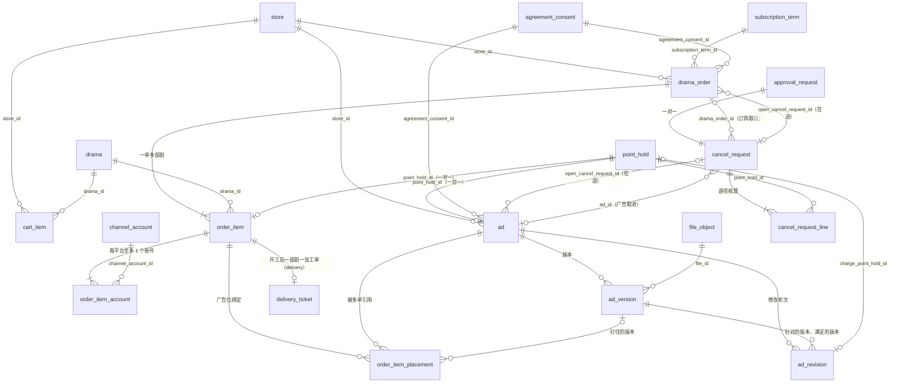
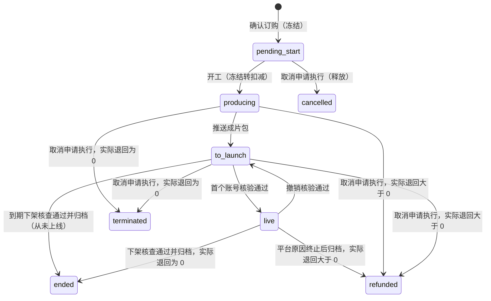
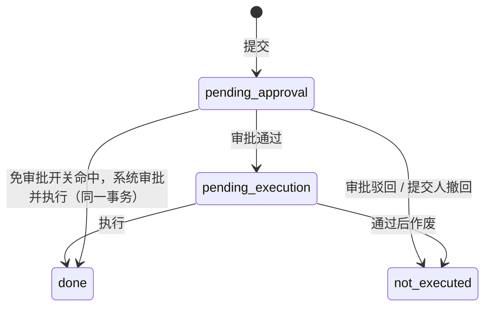
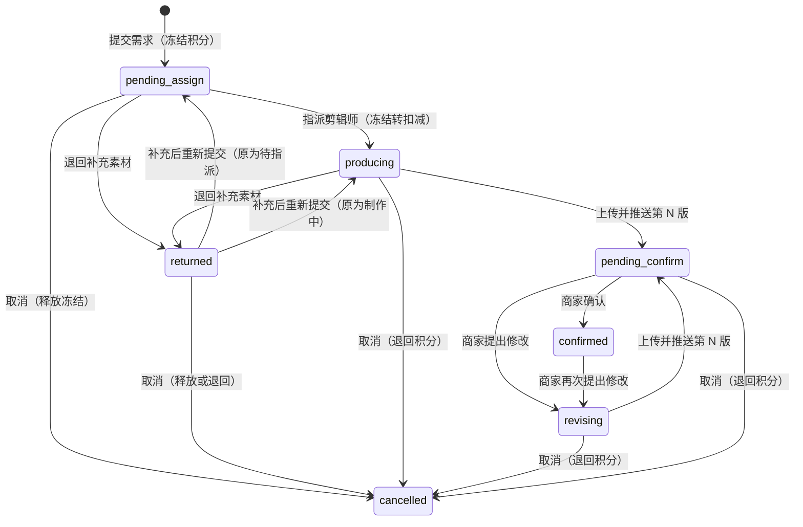

# 09 订购与广告（order、ad）

| 项 | 内容 |
| --- | --- |
| 模块 | `order`（L3）：选剧单、订购单、订单项、取消申请；`ad`（L3）：广告、版本、修改轮次 |
| 表 | 10 张：`cart_item`、`drama_order`、`order_item`、`order_item_account`、`order_item_placement`、`cancel_request`、`cancel_request_line`、`ad`、`ad_version`、`ad_revision` |
| 依据 | 草案 `docs/appendix/design/d3-flow.md` 第 4、5、6.5、9、16、17 节（下文写作 d3:行号）；`d2-payment.md` 第 3.4 节（d2）、`d1-ledger.md` 第 5.3、7.4 节（d1）、`d8-content.md` 第 6 节（d8）；裁决 M12、M17、M19、M20、M32、M33、M34、M44，第二轮按 M46–M92、第三轮按 M93–M110 修订（见第 7 节）；`catalogue.json` 的 conventions 与本分组 10 张表的 notes；`decisions.md` 第 1 节 #5、#6、#29，第 6、8 节；PRD 第 2.3–2.8、6.4、6.7–6.9、7.5 节（PRD:行号）；画板 `merchant/Cart`、`merchant/Checkout`、`merchant/Ads`、`merchant/AdDetail`、`admin/OrderDetail`、`admin/Refunds`、`admin/AdTasks` |

出处写法：`d3:285` 指 d3 第 285 行；“约定”指 `catalogue.json` 的 conventions；“补”指草案没有写、字段级阶段按规则补上的列，后面跟理由。

## 1. 概览

这组表存“商家用积分买了什么、做到哪一步、退了多少”。

- 选剧单按门店保存待订购的剧。确认订购在一个事务里建订购单、订单项、发布账号与广告位绑定，并逐部冻结积分。
- 订购单与订单项的状态不是独立的状态机：订单项阶段由交付工单步骤与账本的实际退回推导，订购单状态由订单项阶段与“是否有在途取消”推导，推导结果在同一事务里物化到列上（d3:462-476）。
- 广告是独立对象（GG 编号），不是订购单。一条广告 = 一次制作需求 + 它的全部版本 + 修改轮次，可被多个订单项引用；引用是浮动的，样片确认时钉住版本（d3:1328-1358）。
- 取消与终止（退回积分）走“预览 → 申请 → 审批 → 执行”。审批结论在 `approval_request`，申请内容与执行状态在本分组的 `cancel_request`，逐项核算与账本的实际结果在 `cancel_request_line`（裁决 M12；decisions #5、#6）。
- 积分数量只有两类来源：本模块按规则算出的“请求量”，和账本返回的“实际量”。展示、阶段判断、对账一律用实际量（d3:376）。

## 2. 表定义

通用说明：

- 主键 `id` 为 UUID v7，由应用生成，不设数据库默认值。草案里的 `bigint` 主键与引用列一律改为 `uuid`（约定“主键”），下文各表的“相对草案的改动”不再逐列重复这一条。
- `created_at`、`updated_at` 由应用时钟写入，不设数据库默认值（约定“时间”）。草案多数表没有列出这两列，按约定补齐。
- 外键的删除行为都是 Restrict（指向 `store` 的复合外键同样，M93：门店不物理删除）。订购单、订单项、广告、取消申请不做物理删除。
- 归属一致性（M47）：带 `entity_id`、`store_id` 的八张表，门店外键是复合外键 `(store_id, entity_id)` → `store (id, entity_id)`，名为 `fk_<表>_store_entity`；另保留 `entity_id` → `entity.id` 的单列外键。行上的主体因此不可能与门店的实际主体不一致。草案的门店外键都是单列，下文各表的“相对草案的改动”不再逐表重复这一条。
- 物理删除只发生在三张表（M63 已列入允许物理删除的对象）：`cart_item`（商家移除、订购成功后清除，d3:270）、`order_item_account`（方案修订换账号，d3:669）、`order_item_placement`（方案修订换广告、工单终止，d3:2168）。没有任何表对这三张表建外键（`launch_task` 对 `order_item_account` 只靠不变量 I10 校验）。
- 列间关系的 CHECK 按语句逐行求值。状态列与它的伴随列必须在同一条 UPDATE 里写，不能分步写；各表的“说明”列出具体的组合。草案里分步写的地方（如 d3:606-618 开工先写 `captured_at`、后改阶段）在实现时合并为一条 UPDATE。
- 写入顺序（d3:400-444、1283 相应调整）：单据 id 由应用预先生成 → 经 `agreements.assertConsents` 记协议同意记录（`agreement_consent.biz_id` 填该 id，不建外键；`biz_no` 传单号：订购单传 `LYX…` 订购单号，广告传 `GG…` 广告编号，13 分组的 `ck_agreement_consent_biz_no`）→ 以该 id 为业务引用调用 `billing.hold`（`point_hold.ref_id` 不建外键；`group_ref` 传订购单号或广告编号，只作展示聚合）→ 插入单据行。所以 `agreement_consent_id`、`point_hold_id` 可以非空并建外键。
- 积分列一律 `integer`、以 `_points` 结尾（约定“金额与积分”）；比例存万分比、以 `_bp` 结尾。
- 数组列（`text[]`、`uuid[]`）的“非空”由手写 SQL 的 `ALTER COLUMN … SET NOT NULL` 保证：Prisma 给标量数组列建的是只带默认值的可空列。
- 字数上限（说明 200 字、文案 50 字等）只在契约层校验，不进数据库（d3:238）。
- 参考素材不存数组列：订购单与广告的参考素材经 `file_ref` 登记（`ref_type` = `drama_order` 或 `ad`，`role = reference`）；来自素材库的另写一行 `store_asset_usage`，来自档案媒体的只走 `file_ref`（M20）。素材库素材的守卫由 media 校验（06 分组 2.15）：选作参考要求 `deleted_at` 为空、`moderation_state` 不是 `block`、`usability` 不是 `need_reshoot`（不要求已复核）；记为“已采用”（`store_asset_usage.role = adopted`，`used_by_type` 为 `ad_version`、`order_item`）要求 `usability` 为 `ready` 或 `reference_only`。

### 2.1 `cart_item` 选剧单

按门店保存待订购的剧目与加入时的积分价。状态不落库，读取时算：剧目未上架或剩余授权期不足为 `invalid`；当前价不等于 `list_price_points` 为 `price_changed`；否则 `valid`（d3:267）。归属：门店维度。主键：`id uuid`。不是只增表。`lock_rank = null`（不参与锁排序；加入时取事务级咨询锁 `cart:{store_id}` 后数行数再插入，上限 50 部，d3:268）。

| 列 | 类型 | 空 | 默认 | 说明 | 出处 |
| --- | --- | --- | --- | --- | --- |
| `id` | uuid | 否 | — | 主键 | d3:252 |
| `entity_id` | uuid | 否 | — | 所属主体，创建时从门店复制，不可变 | d3:253 |
| `store_id` | uuid | 否 | — | 所属门店。选剧单按门店保存，不按用户 | d3:254、266 |
| `drama_id` | uuid | 否 | — | 剧目，指向 `drama` | d3:255 |
| `added_by_user_id` | uuid | 否 | — | 加入人，指向 `merchant_user` | d3:256 |
| `list_price_points` | integer | 否 | — | 加入（或最近一次“确认新价格”）时的剧目积分价 P，> 0。与当前价不同即“积分价已变动” | d3:257；PRD:552；画板 Cart |
| `price_acked_at` | timestamptz | 可 | — | 最近一次“确认新价格”的时间；从未确认过为空 | d3:258；画板 Cart |
| `created_at` | timestamptz | 否 | — | 加入时间 | d3:259 |
| `updated_at` | timestamptz | 否 | — | 最近更新时间 | d3:259 |

**键与索引**

- 主键：`pk_cart_item (id)`。
- 外键：`entity_id` → `entity.id`（`fk_cart_item_entity_id`）；`(store_id, entity_id)` → `store (id, entity_id)`（`fk_cart_item_store_entity`，M47）；`drama_id` → `drama.id`（`fk_cart_item_drama_id`）；`added_by_user_id` → `merchant_user.id`（`fk_cart_item_added_by_user_id`）。都是 Restrict。
- 唯一约束：`uq_cart_item_store_id_drama_id (store_id, drama_id)`。选剧单按剧去重，订购单不去重（d3:269）。
- 普通索引：`ix_cart_item_store_id_created_at (store_id, created_at DESC)`，选剧单列表与底部导航角标计数。

**手写约束**

| 名称 | 规则 |
| --- | --- |
| `ck_cart_item_list_price_points` | `list_price_points > 0` |

**不变量**：无。上限 50 部由咨询锁加计数保证，不是数据库约束。

**相对草案的改动**

| 改动 | 依据 |
| --- | --- |
| `price_snapshot` 改名 `list_price_points` | 约定“金额与积分”：积分列以 `_points` 结尾；`_snapshot` 后缀留给 jsonb 快照列（约定“命名规则”）。与 `order_item.list_price_points` 同名同义 |

### 2.2 `drama_order` 订购单

一单多部剧的头：下单时的套餐、折扣、加扣快照，整单录入的定制要求，以及由订单项聚合后物化的状态。归属：门店维度。主键：`id uuid`。不是只增表。业务状态机（machine = `drama_order`）。锁顺序：`lock_rank = 160`（广告之后、订单项之前；多行按 id 升序）。

| 列 | 类型 | 空 | 默认 | 说明 | 出处 |
| --- | --- | --- | --- | --- | --- |
| `id` | uuid | 否 | — | 主键 | d3:286 |
| `order_no` | text | 否 | — | 订购单号：`LYX` + 8 位日期 + 5 位流水，经 `biz_sequence` 取号。不可变 | d3:287、241；约定“业务单号” |
| `entity_id` | uuid | 否 | — | 所属主体，不可变 | d3:288 |
| `store_id` | uuid | 否 | — | 下单门店，不可变 | d3:289 |
| `placed_by_user_id` | uuid | 否 | — | 下单人，指向 `merchant_user`。V1.0 只有老板能订购。不可变 | d3:290、418 |
| `status` | text | 否 | — | 状态：`pending_start` 待开工、`producing` 制作中、`to_launch` 待上线、`live` 上线中、`ended` 已结束、`cancelled` 已取消、`after_sale` 售后处理中、`refunded` 已退回积分。由订单项阶段与在途取消推导后物化，不直接写 | d3:292、513-533；PRD 5.3 |
| `sub_status` | text | 可 | — | 展示用子状态，取值随 `status`，见本节“子状态”表 | d3:293、535-544 |
| `status_changed_at` | timestamptz | 否 | — | 最近一次状态变化的时间 | d3:294 |
| `item_count` | smallint | 否 | — | 订单项数，1 到 50。不可变 | d3:295、422 |
| `total_charge_points` | integer | 否 | — | 应扣积分合计 ΣS（逐部取整后求和）。不可变 | d3:296、276 |
| `subscription_term_id` | uuid | 否 | — | 下单时的订阅周期，指向 `subscription_term`。不可变 | d3:297；M33 |
| `plan_code` | text | 否 | — | 下单时的套餐版本编码，`plan.code` 的快照（`basic`、`pro`、`flagship`，套餐可新增，不写 CHECK）。不可变 | d3:298；d1:190 |
| `discount_bp` | integer | 否 | — | 下单时的折扣（万分比），1 到 10000。不可变 | d3:299 |
| `is_top_model` | boolean | 否 | false | 是否勾选顶级模型（整单一份）。不可变 | d3:300；PRD:564 |
| `surcharge_bp` | integer | 否 | — | 加扣比例快照（万分比）；旗舰版或未勾选为 0。不可变 | d3:301 |
| `focus_codes` | text[] | 否 | `{}` | 定制重点，字典 `custom_focus` 的编码，至少 1 项。不建外键 | d3:302、424；PRD:563；d6:1464 |
| `note` | text | 可 | — | 补充说明，不超过 200 字 | d3:304；PRD:563 |
| `expected_launch_date` | date | 可 | — | 期望上线日；空表示成片交付后尽快上线。不早于订购日后第 7 个工作日（应用层按日历校验） | d3:305、426；PRD:566 |
| `agreement_consent_id` | uuid | 否 | — | 《定制内容授权使用协议》的同意记录，指向 `agreement_consent`。不可变 | d3:306、427；PRD:568 |
| `delivery_manager_id` | uuid | 可 | — | 冗余：门店的交付经理，指向 `staff`。下单时从门店复制，门店没有交付经理则为空；之后只在订购单未结（状态不在 `ended`、`cancelled`、`refunded`）时随门店同步，已结束的保留当时的交付经理 | d3:307、447、599、655、3157；M61 |
| `open_cancel_request_id` | uuid | 可 | — | 在途的取消申请，指向 `cancel_request`；无则为空。非空时挡住开工，也不能再被别的申请覆盖 | d3:308、696、2084；catalogue notes |
| `submitted_at` | timestamptz | 否 | — | 提交时间（积分冻结）。时间轴“已订购”。不可变 | d3:309、563 |
| `started_at` | timestamptz | 可 | — | 开工时间（积分扣减）。时间轴“开始制作” | d3:310、564 |
| `closed_at` | timestamptz | 可 | — | 进入 `ended`、`cancelled`、`refunded` 的时间 | d3:311 |
| `lock_version` | integer | 否 | 0 | 乐观锁版本号 | d3:312 |
| `created_at` | timestamptz | 否 | — | 创建时间 | 补：约定“时间” |
| `updated_at` | timestamptz | 否 | — | 最近更新时间 | 补：约定“时间” |

子状态（`sub_status`）取“最靠前的那一项”的细节（d3:535-544）：

| `status` | `sub_status` 取值 |
| --- | --- |
| `pending_start` | `qualification_reviewing` 资质审核中、`qualification_rejected` 资质已驳回待补正、`starting` 即将开工 |
| `producing` | 最靠前工单的步骤：`assigning`、`plan_confirm`、`ad_prep`、`sample_making`、`sample_confirm`、`batch_compose`、`delivering` |
| `to_launch` | `awaiting_links` 待回填、`verifying` 核验中、`need_fix` 需补充、`expired_unlaunched` 已到期待核查 |
| `live` | `in_service` 服务中、`takedown_pending` 待下架、`takedown_overdue` 逾期未下架 |
| `after_sale` | `cancel_reviewing` 取消审批中、`refund_executing` 待执行 |
| `cancelled` | `cancelled_before_start` 开工前取消、`terminated_no_return` 已终止未退回积分 |
| `ended`、`refunded` | 为空 |

**键与索引**

- 主键：`pk_drama_order (id)`。
- 外键：`entity_id` → `entity.id`（`fk_drama_order_entity_id`）；`(store_id, entity_id)` → `store (id, entity_id)`（`fk_drama_order_store_entity`）；`placed_by_user_id` → `merchant_user.id`（`fk_drama_order_placed_by_user_id`）；`subscription_term_id` → `subscription_term.id`（`fk_drama_order_subscription_term_id`）；`agreement_consent_id` → `agreement_consent.id`（`fk_drama_order_agreement_consent_id`）；`delivery_manager_id` → `staff.id`（`fk_drama_order_delivery_manager_id`）；`open_cancel_request_id` → `cancel_request.id`（`fk_drama_order_open_cancel_request_id`）。都是 Restrict。
- 唯一约束：`uq_drama_order_order_no (order_no)`。
- 普通索引：`ix_drama_order_store_id_submitted_at (store_id, submitted_at DESC)`，商家端“我的订单”；`ix_drama_order_entity_id_submitted_at (entity_id, submitted_at DESC)`，后台商家详情与主体维度列表；`ix_drama_order_status_submitted_at (status, submitted_at DESC)`，后台订购单列表按状态筛选与状态条计数；`ix_drama_order_delivery_manager_id_status (delivery_manager_id, status)`，按交付经理筛选与数据范围过滤。

**手写约束**

| 名称 | 规则 |
| --- | --- |
| `ck_drama_order_status` | `status` ∈ 上述 8 个取值 |
| `ck_drama_order_sub_status` | `sub_status` 的取值随 `status`（见子状态表）；任何状态下都允许为空；`ended`、`refunded` 必须为空 |
| `ck_drama_order_item_count` | `item_count` 在 1 到 50 之间 |
| `ck_drama_order_total_charge_points` | `total_charge_points > 0` |
| `ck_drama_order_discount_bp` | `discount_bp` 在 1 到 10000 之间 |
| `ck_drama_order_surcharge_bp` | `surcharge_bp >= 0`；未勾选顶级模型时为 0 |
| `ck_drama_order_focus_codes` | `focus_codes` 至少 1 个元素 |
| `ck_drama_order_after_sale` | `status = after_sale` 当且仅当 `open_cancel_request_id` 非空 |
| `ck_drama_order_started` | 待开工时 `started_at` 为空；`producing`、`to_launch`、`live`、`ended`、`refunded` 时非空；不早于 `submitted_at` |
| `ck_drama_order_closed` | `closed_at` 非空当且仅当 `status` ∈ {`ended`,`cancelled`,`refunded`} |
| `ix_drama_order_pending_start_store_id` | 部分索引 `(store_id) WHERE status = 'pending_start'`；资质通过事件的订阅者与待开工补偿扫描用（d3:584-585） |
| `ix_drama_order_open_cancel_request_id` | 部分索引 `(open_cancel_request_id) WHERE open_cancel_request_id IS NOT NULL`；取消申请关闭时找回要清空的订购单 |
| `trg_drama_order_immutable` | 行级 BEFORE UPDATE OF … 触发器，公共函数 `lyx_forbid_column_change()`（M50）：`order_no`、`entity_id`、`store_id`、`placed_by_user_id`、`item_count`、`total_charge_points`、`subscription_term_id`、`plan_code`、`discount_bp`、`is_top_model`、`surcharge_bp`、`agreement_consent_id`、`submitted_at` 写入后不可改 |
| 数组列非空 | `focus_codes` 一列 `SET NOT NULL` |

说明：`ck_drama_order_after_sale`、`ck_drama_order_started`、`ck_drama_order_closed` 是列间关系，按语句求值。物化状态的那一条 UPDATE 必须同时写伴随列（进入售后同时写 `open_cancel_request_id`，开工同时写 `started_at`，关闭同时写 `closed_at`）。

**状态机**（machine = `drama_order`，state_field = `status`（M53）；每次状态变化写 `status_transition`，同事务补写一条活动流的审计行，M31）

订购单没有自己的事件驱动状态机。状态是 `orderStatus(订单项阶段, 是否有在途取消)` 的结果（`packages/shared/aggregate.ts`，d3:515-526），在改变订单项阶段或在途取消的同一事务里重新推导并物化：

| 推导条件 | 状态 |
| --- | --- |
| `open_cancel_request_id` 非空 | `after_sale` |
| 存在未关闭的订单项（阶段不在 `cancelled`、`refunded`、`terminated`） | 取未关闭订单项里最靠前的阶段：`pending_start` → `producing` → `to_launch` → `live` → `ended` |
| 订单项全部关闭，且至少一项为 `refunded` | `refunded` |
| 订单项全部关闭，没有 `refunded` | `cancelled` |

会触发重新推导的写入点：

| 触发 | 可能的变化 | 触发者 |
| --- | --- | --- |
| 确认订购 `order.submit` | 新建为 `pending_start` | 商家（老板） |
| 开工 `order.start`（定时器，关键类） | `pending_start` → `producing` | 系统 |
| 工单步骤迁移（delivery 的 `transition()` 的副作用） | 在 `producing`、`to_launch`、`live`、`ended` 之间变化 | 员工、商家、系统 |
| 取消申请提交 | 任意未关闭状态 → `after_sale` | 客服、系统 |
| 取消申请驳回、撤回、作废 | `after_sale` → 重新推导出的原状态 | 财务、申请人 |
| 取消申请执行 | `after_sale` → `cancelled`、`refunded` 或剩余订单项的阶段 | 财务、系统 |

守卫：开工要求 `status = pending_start`、`open_cancel_request_id` 为空、门店闸门为 `full`（d3:604）。

开工定时器（d3:583-585、2969；01 分组 2.5、3.3；M97）：

| 项 | 写法 |
| --- | --- |
| 键 | `order.start:drama_order:{订购单 id}`，不带轮次；关键类 |
| 跳过后可复活 | `order.start` 注册时声明 `rearmAfterSkip`：到点时有在途取消或资质不再通过，处理器返回 `skipped`；之后取消申请关闭为 `not_executed`、或资质重新通过，经 `timers.arm` 以同一个键重新登记，`skipped` 行复活（与 `failed` 相同） |
| 登记点 | 确认订购（下单时资质已通过）；`store.qualification.approved` 的订阅者（对该门店待开工、无在途取消的订购单逐单登记，`fire_at = max(now, 提交时间 + 开工延迟)`）；取消申请关闭为 `not_executed` 时（订购单待开工且资质已通过） |
| 补偿扫描 | `order.pending_start_sweep` 作为周期任务登记定时器行（`subject_type`、`subject_id` 为空）。条件①“没有定时器”指没有 `scheduled`、`dispatched` 的 `order.start` 定时器：无行、`skipped`、`failed` 都算，经 `timers.arm` 补登记或复活 |

`delivery_manager_id` 的写入点（不改变状态，不写 `status_transition`）：

| 时机 | 写法 |
| --- | --- |
| 确认订购 | 从门店复制当前交付经理（可空） |
| 门店的交付经理被写入或更换：开通套餐时分配、开工兜底分配（d3:599、629-630）、转移交付经理（d3:655、3157）、员工禁用移交、不变量 I13 自动改派 | 同一事务把该门店未结订购单（状态不在 `ended`、`cancelled`、`refunded`）的本列改为新值；已结束的不动。转移、移交与自动改派逐单写 `assignment_history`（`source = store_manager`，`subject_type = drama_order`）。“新交付经理 1 个工作日内联系商家”的时限只记在门店那一行（`subject_type = store` 的 `contact_due_at`，03 分组，M107），订购单的行不带 |

**不变量**（每日校验；编号沿用 d3:3243-3261）

- I2：`status = orderStatus(订单项阶段, 是否有在途取消)`；`open_cancel_request_id` 非空当且仅当它指向的 `cancel_request.closed_at` 为空，且该申请的明细覆盖本单的订单项。违反时重新推导并告警。
- `item_count` = 订单项行数；`total_charge_points` = Σ `order_item.charge_points`。
- 未结订购单（状态不在 `ended`、`cancelled`、`refunded`）的 `delivery_manager_id` 与门店当前的交付经理一致；已结束的不校验。（`entity_id` 与门店一致已由复合外键保证。）
- I17：终局驳回的门店没有 `pending_start` 的订购单，除非有在途的 `qualification_cancel`。
- 对账（d3:3268）：Σ `charge_points` − Σ `refund_requested_points` = 账本里这些冻结单仍留在已消耗或冻结中的数量之和。

**相对草案的改动**

| 改动 | 依据 |
| --- | --- |
| 删除 `acting_as`（V1.1 代操作人） | catalogue notes；01:176 |
| 删除 `reference_asset_ids` | M20：参考素材统一经 `file_ref` 登记 |
| `total_charge` 改名 `total_charge_points` | 约定“金额与积分” |
| `term_id` 改名 `subscription_term_id` | M33 |
| `tier_code` 改名 `plan_code` | 它是 `plan.code` 的快照（d1:190），计费侧没有 tier 这个列名 |
| `top_model` 改名 `is_top_model` | 约定“命名规则”：布尔列用 `is_` 前缀 |
| `focus_tags` 改名 `focus_codes` | 存的是字典编码；与 05、04 分组的 `*_codes` 写法一致 |
| `open_after_sale_id` 改名 `open_cancel_request_id`，由指向审批单改为指向 `cancel_request` 并建外键 | catalogue notes；M12、M33 |
| `delivery_manager_id` 的同步范围限定为未结订购单，开工兜底分配交付经理时同样回写 | d3:599、655、3157（只改在办工单与未结订购单） |
| 补 `created_at`、`updated_at` | 约定“时间” |
| 补子状态、售后、开工、关闭的 CHECK 与快照列防改触发器 | d3:535-544、604、311；d3:3246 的 I2 |

### 2.3 `order_item` 订单项

订购单里的一部剧：计价快照、账本冻结单、四个退回数量、阶段、使用期起止。归属：门店维度。主键：`id uuid`。不是只增表。业务状态机（machine = `order_item`）。锁顺序：`lock_rank = 170`（订购单之后、交付工单之前；按 id 升序）。

写入顺序：按第 2 节通用说明。确认订购的事务里：预生成订购单与各订单项的 id → 记《定制内容授权使用协议》的同意记录（`scene = order_submit`、`biz_type = drama_order`、`biz_no` = 订购单号、`method = checkbox`）→ 逐项以订单项 id 调用 `billing.hold`（`ref_type = order_item`，`group_ref` = 订购单号）→ 插入订购单、订单项（d3:400-444 的“先插入订单项、再写回 hold_ref”“先插订购单、再记签署”相应调整）。

| 列 | 类型 | 空 | 默认 | 说明 | 出处 |
| --- | --- | --- | --- | --- | --- |
| `id` | uuid | 否 | — | 主键。账本冻结的业务引用与幂等键 `hold:order_item:{id}` | d3:319、444；M19 |
| `drama_order_id` | uuid | 否 | — | 所属订购单。不可变 | d3:320；M17 |
| `item_no` | smallint | 否 | — | 订购单内序号 1..n，对应工单号后缀（`JF…-1`）。不可变 | d3:321、241；M34 |
| `entity_id` | uuid | 否 | — | 所属主体，创建时从订购单复制，不可变 | d3:322 |
| `store_id` | uuid | 否 | — | 所属门店，创建时从订购单复制，不可变 | d3:322 |
| `drama_id` | uuid | 否 | — | 剧目，指向 `drama`。不可变 | d3:323 |
| `drama_snapshot` | jsonb | 否 | — | 下单时的剧目快照（`DramaSnapshot`），结构见第 4 节。之后改剧目资料不影响已下的单。不可变 | d3:324；d8:448、493 |
| `episode_count` | integer | 否 | — | 订购集数（整部剧的总集数），≥ 1。不可变 | d3:325；PRD:174；M59 |
| `list_price_points` | integer | 否 | — | 剧目积分价 P，> 0。不可变 | d3:326 |
| `discount_bp` | integer | 否 | — | 套餐折扣 R（万分比），1 到 10000。不可变 | d3:327 |
| `surcharge_bp` | integer | 否 | — | 顶级模型加扣 T（万分比），≥ 0。不可变 | d3:328 |
| `charge_points` | integer | 否 | — | 应扣积分 S，> 0。不可变 | d3:329；PRD 2.4 |
| `pricing_snapshot` | jsonb | 否 | — | 完整计价快照（账本 `hold` 返回，含价格来源、取消扣除比例、原周期结束后的退回去向），结构见第 4 节。不可变 | d3:330；d1:680-697 |
| `production_model` | text | 否 | — | 制作模型：`standard` 标准、`advanced` 高级、`top` 顶级。V1.0 仅用于计价与标签。不可变 | d3:331；d1:208 |
| `point_hold_id` | uuid | 否 | — | 账本冻结单，指向 `point_hold`；一个订单项一张冻结单。不可变 | d3:332；decisions #29；M33 |
| `captured_at` | timestamptz | 可 | — | 冻结转扣减的时间（开工） | d3:333、607 |
| `refund_requested_points` | integer | 否 | 0 | 已向账本请求退回或释放的数量累计，等于下面三列之和 | d3:334、376 |
| `returned_points` | integer | 否 | 0 | 账本实际回到原批次可用的数量累计（`backToOriginal`） | d3:335 |
| `converted_points` | integer | 否 | 0 | 账本转为加购积分的数量累计（`convertedToAddon`） | d3:336 |
| `forfeited_points` | integer | 否 | 0 | 账本判定不予退回的数量累计（`forfeited`） | d3:337 |
| `phase` | text | 否 | — | 阶段：`pending_start` 待开工、`producing` 制作中、`to_launch` 待上线、`live` 上线中、`ended` 已结束、`cancelled` 已取消（开工前）、`refunded` 已退回积分、`terminated` 已终止（实际退回为 0） | d3:338、498-507 |
| `phase_changed_at` | timestamptz | 否 | — | 最近一次阶段变化的时间 | d3:339 |
| `agreed_launch_date` | date | 可 | — | 约定上线日；方案确认时写入，可改期 | d3:340 |
| `usage_start_date` | date | 可 | — | 上线首日（核验通过时写入，取各已上线任务首日的最小值）；空表示从未上线 | d3:341、3250 |
| `usage_end_date` | date | 否 | — | 使用期止日。下单时取剧目授权期结束日（快照里的 `licenseEndDate`）；版权续期时顺延；提前结束时改为终止日 | d3:342、2169；d8:405；PRD 2.5 |
| `usage_end_source` | text | 否 | `license` | 止日来源：`license` 随剧目授权期、`early_end` 提前结束、`expired` 已到期。后两者不再随版权续期顺延 | d3:343 |
| `live_episode_count` | integer | 否 | 0 | 已核验上线集数（各账号取最大值），不超过 `episode_count` | d3:344；M59 |
| `cancel_reason_code` | text | 可 | — | 取消或终止原因：`merchant_request`、`store_closed`、`platform_fault`、`qualification_final`，与取消申请的原因相同 | d3:345、159-166 |
| `cancelled_at` | timestamptz | 可 | — | 取消或终止的时间，取消申请执行时写入 | d3:346、2166 |
| `lock_version` | integer | 否 | 0 | 乐观锁版本号 | d3:347 |
| `created_at` | timestamptz | 否 | — | 创建时间 | 补：约定“时间” |
| `updated_at` | timestamptz | 否 | — | 最近更新时间 | 补：约定“时间” |

**键与索引**

- 主键：`pk_order_item (id)`。
- 外键：`drama_order_id` → `drama_order.id`（`fk_order_item_drama_order_id`）；`entity_id` → `entity.id`（`fk_order_item_entity_id`）；`(store_id, entity_id)` → `store (id, entity_id)`（`fk_order_item_store_entity`）；`drama_id` → `drama.id`（`fk_order_item_drama_id`）；`point_hold_id` → `point_hold.id`（`fk_order_item_point_hold_id`）。都是 Restrict。
- 唯一约束：`uq_order_item_drama_order_id_item_no (drama_order_id, item_no)`；`uq_order_item_point_hold_id (point_hold_id)`。
- 普通索引：`ix_order_item_store_id_phase (store_id, phase)`，商家端“我的短剧”与门店在办统计；`ix_order_item_drama_id_phase (drama_id, phase)`，后台按剧目筛选、版权续期后找受影响的订单项、剧目订购统计。

**手写约束**

| 名称 | 规则 |
| --- | --- |
| `ck_order_item_item_no` | `item_no >= 1` |
| `ck_order_item_episode_count` | `episode_count >= 1` |
| `ck_order_item_list_price_points` | `list_price_points > 0` |
| `ck_order_item_discount_bp` | `discount_bp` 在 1 到 10000 之间 |
| `ck_order_item_surcharge_bp` | `surcharge_bp >= 0` |
| `ck_order_item_charge_points` | `charge_points > 0` |
| `ck_order_item_production_model` | `production_model` ∈ {`standard`,`advanced`,`top`} |
| `ck_order_item_phase` | `phase` ∈ 上述 8 个取值 |
| `ck_order_item_usage_end_source` | `usage_end_source` ∈ {`license`,`early_end`,`expired`} |
| `ck_order_item_cancel_reason_code` | `cancel_reason_code` ∈ {`merchant_request`,`store_closed`,`platform_fault`,`qualification_final`} |
| `ck_order_item_refund_sum` | `refund_requested_points = returned_points + converted_points + forfeited_points` |
| `ck_order_item_refund_range` | 三个实际去向都 ≥ 0；`refund_requested_points <= charge_points` |
| `ck_order_item_capture` | `phase` ∈ {`pending_start`,`cancelled`} 当且仅当 `captured_at` 为空 |
| `ck_order_item_usage_dates` | `usage_start_date` 不晚于 `usage_end_date`；`phase = live` 时 `usage_start_date` 非空 |
| `ck_order_item_live_episode_count` | `live_episode_count` 在 0 到 `episode_count` 之间 |
| `ck_order_item_cancelled` | `cancelled_at` 与 `cancel_reason_code` 同有同无；`phase = cancelled` 时二者非空 |
| `ck_order_item_snapshots` | `drama_snapshot`、`pricing_snapshot` 都是 JSON 对象 |
| `ix_order_item_usage_end_date_active` | 部分索引 `(usage_end_date) WHERE phase IN ('to_launch','live')`；使用期结束、止日对账扫描用 |
| `ix_order_item_agreed_launch_date_active` | 部分索引 `(agreed_launch_date) WHERE phase IN ('producing','to_launch')`；上线提醒、逾期未上线、交付日历用 |
| `trg_order_item_immutable` | 行级 BEFORE UPDATE OF … 触发器，公共函数 `lyx_forbid_column_change()`（M50）：`drama_order_id`、`item_no`、`entity_id`、`store_id`、`drama_id`、`drama_snapshot`、`episode_count`、`list_price_points`、`discount_bp`、`surcharge_bp`、`charge_points`、`pricing_snapshot`、`production_model`、`point_hold_id` 写入后不可改 |

说明：`ck_order_item_capture`、`ck_order_item_refund_sum`、`ck_order_item_usage_dates`、`ck_order_item_cancelled` 按语句求值，下列伴随列与阶段必须在同一条 UPDATE 里写：

| 写入 | 同一条 UPDATE 里的列 |
| --- | --- |
| 开工（`billing.capture` 成功后） | `captured_at`、`phase = producing`、`phase_changed_at`（d3:606-618 的第 2、5 步合并写） |
| 取消申请执行，按账本结果累加 | `refund_requested_points`、`returned_points`、`converted_points`、`forfeited_points` 四列，连同因此变化的 `phase`、`phase_changed_at`（d3:2177-2179） |
| 取消或终止留痕 | `cancelled_at` 与 `cancel_reason_code`（待开工的项可在第 4 步先写，阶段在第 6 步与四个数量一起改为 `cancelled`） |
| 首个账号核验通过 | `usage_start_date`、`phase = live` |
| 撤销核验后没有已上线账号 | `usage_start_date = null`、`phase = to_launch`（d3:1848） |

**状态机**（machine = `order_item`，state_field = `phase`（M53：本表的状态列不叫 `status`）；每次阶段变化写 `status_transition`）

开工前由订购流程直接写（待开工、已取消）；开工后阶段由工单步骤与订单项上的事实推导：`phaseFromTicket(step, { everLive, effectiveReturn })`（d3:480-496），其中 `everLive` = `usage_start_date` 非空，`effectiveReturn` = `returned_points + converted_points`。

| 当前阶段 | 事件 | 新阶段 | 守卫 | 触发者 |
| --- | --- | --- | --- | --- |
| — | `order.submit` | `pending_start` | 确认订购的 12 项校验（d3:416-429）；账本冻结成功 | 商家（老板） |
| `pending_start` | `order.start` | `producing` | 订购单待开工、无在途取消、门店闸门 `full`；`billing.capture` 成功 | 系统（定时器） |
| `pending_start` | `cancel.execute`（`mode = release`） | `cancelled` | 取消申请已通过且重新校验一致 | 财务、系统 |
| `producing`、`to_launch` | 工单 `ticket.terminate`（取消申请执行） | `refunded` 或 `terminated` | 同上；按账本实际退回是否大于 0 区分 | 财务 |
| `producing` | 工单进入 `awaiting_launch` | `to_launch` | 成片包推送的守卫（delivery） | 交付经理 |
| `to_launch` | 工单进入 `in_service` | `live` | 至少一条上线任务核验通过 | 发布专员 |
| `live` | 撤销核验通过 | `to_launch` | 撤销时限内、主管权限（d3 第 12.7 节） | 交付主管 |
| `to_launch`、`live` | 工单 `archived` | `ended` 或 `refunded` | 下架核查全部通过；平台原因终止过且实际退回大于 0 时为 `refunded` | 发布专员、系统 |

已上线的订单项被平台原因终止时留在 `live`（`usage_end_source = early_end`，止日改为终止日），归档时再定为 `ended` 或 `refunded`（d3:2179）。

**不变量**（每日校验）

- I1：阶段在 `producing`、`to_launch`、`live`、`ended`、`refunded`、`terminated` 的订单项恰有一张交付工单；`pending_start`、`cancelled` 的没有。
- I3：有工单的订单项 `phase = phaseFromTicket(...)`。违反时自愈并告警。
- I4：冻结与阶段一致——待开工时冻结单为冻结中，制作中及以后为已扣减，已取消为已释放；四个退回数量与账本冻结单上的累计逐项相等（d3:3267）。涉及积分，不自愈。
- I6：`usage_end_source = license` 且未进入到期下架的订单项，`usage_end_date` 等于剧目当前授权止日；剧目止日变早时不自动缩短，只告警并生成人工待办（d8:411、642 ②）。上线中的订单项 `usage_start_date` = 各已上线任务首日的最小值。
- `entity_id`、`store_id` 与所属订购单一致；`episode_count` 与 `drama_snapshot.totalEpisodes` 一致；`usage_end_date` 在下单时等于 `drama_snapshot.licenseEndDate`。
- 每个订单项至少有一行 `order_item_account`（阶段不在 `cancelled` 时）。

**相对草案的改动**

| 改动 | 依据 |
| --- | --- |
| `order_id` 改名 `drama_order_id` | M17 |
| `seq` 改名 `item_no` | M34：序号叫 `<含义>_no` |
| `list_price` 改名 `list_price_points`，`charge` 改名 `charge_points` | 约定“金额与积分” |
| `hold_ref text` 改为 `point_hold_id uuid`，建外键并加唯一约束 | decisions #29；M33（列名用被引用表全名） |
| `drama_snapshot` 的内容扩为 d8 的 `DramaSnapshot`（增加 `licenseEndDate`、`posterFileId`、`allowedPlacements`、`isAiGenerated`） | catalogue notes；d8:493、642 |
| 账本业务引用与幂等键的类型段 `drama_order_item` 改为 `order_item` | M19 |
| `episode_count`、`live_episode_count` 由 `smallint` 改为 `integer` | M59 |
| 补 `created_at`、`updated_at` | 约定“时间” |
| 补扣减与阶段、使用期、取消原因的 CHECK 与快照列防改触发器 | d3:3248 的 I4；d3:341-346 |

### 2.4 `order_item_account` 订单项的发布账号

订单项选定的发布账号，每平台至多 1 个。授权书、上线任务、下架任务都按“订单项 × 账号”展开。归属：不带归属列，只经订单项访问。主键：复合 `(order_item_id, channel_account_id)`。不是只增表。`lock_rank = null`（只在持有订单项行锁的事务里增删）。

| 列 | 类型 | 空 | 默认 | 说明 | 出处 |
| --- | --- | --- | --- | --- | --- |
| `order_item_id` | uuid | 否 | — | 订单项 | d3:357 |
| `channel_account_id` | uuid | 否 | — | 渠道账号，指向 `channel_account`（publish，同层） | d3:358 |
| `platform` | text | 否 | — | 平台：`douyin` 抖音、`wechat_channels` 视频号。从账号复制，用来表达“每平台至多 1 个” | d3:359；PRD:175 |
| `created_at` | timestamptz | 否 | — | 创建时间 | 补：约定“时间” |

**键与索引**

- 主键：`pk_order_item_account (order_item_id, channel_account_id)`。
- 外键：`order_item_id` → `order_item.id`（`fk_order_item_account_order_item_id`）；`channel_account_id` → `channel_account.id`（`fk_order_item_account_channel_account_id`）。都是 Restrict。
- 唯一约束：`uq_order_item_account_order_item_id_platform (order_item_id, platform)`。
- 普通索引：`ix_order_item_account_channel_account_id (channel_account_id)`，账号“在用剧目数”与解绑前的引用检查。

**手写约束**

| 名称 | 规则 |
| --- | --- |
| `ck_order_item_account_platform` | `platform` ∈ {`douyin`,`wechat_channels`} |

行只增删、不更新，所以没有 `updated_at`。方案修订换账号时删除旧行、插入新行，旧账号的授权书由 `docs.ensureLetters` 作废（d3:669）。

**不变量**：I10——账号与订单项属于同一门店；`platform` 与 `channel_account` 的平台一致；每条 `launch_task` 的（订单项, 账号）都在本表里。

**相对草案的改动**：补 `created_at`（约定“时间”）。

### 2.5 `order_item_placement` 广告位绑定

订单项的片头、片尾位绑定哪条广告。`bound_version_no` 为空表示浮动（跟随该广告最新的已确认版本），商家确认样片时钉住为样片所用的版本（d3:1334-1336）。归属：不带归属列，只经订单项访问。主键：`id uuid`。不是只增表。`lock_rank = null`（只在持有订单项行锁的事务里修改）。

| 列 | 类型 | 空 | 默认 | 说明 | 出处 |
| --- | --- | --- | --- | --- | --- |
| `id` | uuid | 否 | — | 主键 | d3:365 |
| `order_item_id` | uuid | 否 | — | 订单项 | d3:366 |
| `slot` | text | 否 | — | 广告位：`opening` 片头贴片、`ending` 片尾贴片、`corner` 角标字幕条、`mid_roll` 片中插播。V1.0 只写前两个，后两个为 V1.1 预留 | d3:367；enums_shared `placement_slot` |
| `ad_id` | uuid | 否 | — | 绑定的广告。广告的 `type` 必须等于本行的 `slot`（应用层校验） | d3:368、425 |
| `bound_version_no` | smallint | 可 | — | 钉住的广告版本号；空表示浮动 | d3:369 |
| `duration_sec` | smallint | 否 | — | 广告时长（秒），绑定时从广告复制，> 0 | d3:370 |
| `pinned_at` | timestamptz | 可 | — | 钉住时间（样片确认时写入）；返工解除钉住时与版本号一起清空 | d3:371、1358 |
| `created_at` | timestamptz | 否 | — | 创建时间 | 补：约定“时间” |
| `updated_at` | timestamptz | 否 | — | 最近更新时间 | 补：约定“时间” |

**键与索引**

- 主键：`pk_order_item_placement (id)`。
- 外键：`order_item_id` → `order_item.id`（`fk_order_item_placement_order_item_id`）；`ad_id` → `ad.id`（`fk_order_item_placement_ad_id`）；`(ad_id, bound_version_no)` → `ad_version (ad_id, version_no)`（`fk_order_item_placement_bound_version`，`bound_version_no` 为空时不检查）。都是 Restrict。
- 唯一约束：`uq_order_item_placement_order_item_id_slot (order_item_id, slot)`。
- 普通索引：`ix_order_item_placement_ad_id (ad_id)`，广告确认或提出修改时找浮动绑定它的订单项、广告“使用中 N 部剧”、广告取消前的引用检查。

**手写约束**

| 名称 | 规则 |
| --- | --- |
| `ck_order_item_placement_slot` | `slot` ∈ {`opening`,`ending`,`corner`,`mid_roll`} |
| `ck_order_item_placement_duration_sec` | `duration_sec > 0` |
| `ck_order_item_placement_pin` | `bound_version_no` 与 `pinned_at` 同有同无；`bound_version_no >= 1` |

**不变量**

- 广告与订单项属于同一门店；`slot` 等于广告的 `type`；`slot` 在订单项 `drama_snapshot.allowedPlacements` 之内。
- I5：工单越过样片确认时，订单项的广告位都已钉住。
- 已钉住的版本曾被商家确认过（`ad_version.decision = confirmed`，或它是确认时刻的 `confirmed_version_no`）。

**相对草案的改动**

| 改动 | 依据 |
| --- | --- |
| `bound_version_no` 的类型由 `int` 改为 `smallint` | 与 `ad_version.version_no`（d3:1221）同型，复合外键要求两端类型一致 |
| `slot` 的取值 `midroll` 改为 `mid_roll` | enums_shared `placement_slot`（d8:121） |
| 补 `(ad_id, bound_version_no)` 到 `ad_version` 的复合外键 | 补：钉住的版本必须存在；两张表同在本分组 |
| 补 `created_at`、`updated_at` | 约定“时间” |

### 2.6 `cancel_request` 取消申请

取消与终止（退回积分）的申请头：订购取消、广告取消、资质终局驳回后的整店取消。存申请级的原因、说明、合计与执行状态；与审批单一对一，单号（`TK…`）与审批结论在 `approval_request` 上，逐项核算在 `cancel_request_line`。归属：门店维度。主键：`id uuid`。不是只增表。业务状态机（machine = `cancel_request`）。锁顺序：`lock_rank = 50`（紧跟审批单之后，M32）。

提交时即建本表的行（三种类型都有执行步，M12）。订购取消整单发起、按订单项逐行核算；数据上支持只取消其中几部，后台默认全选（d3:2082）。“同一对象只允许一张在途申请”由本表上 `WHERE closed_at IS NULL` 的部分唯一索引表达，不用审批单的去重键。

| 列 | 类型 | 空 | 默认 | 说明 | 出处 |
| --- | --- | --- | --- | --- | --- |
| `id` | uuid | 否 | — | 主键 | catalogue（新增表） |
| `approval_request_id` | uuid | 否 | — | 对应的审批单，一对一。不可变 | d2:291；R3；catalogue cross_module_fks |
| `kind` | text | 否 | — | 类型：`order_cancel` 订购取消、`ad_cancel` 广告取消、`qualification_cancel` 资质终局驳回后的整店取消。与审批单的 `kind` 相同。不可变 | d3:2056-2060、2357-2359 |
| `entity_id` | uuid | 否 | — | 所属主体。不可变 | d2:294；约定“归属列” |
| `store_id` | uuid | 否 | — | 所属门店；`qualification_cancel` 的对象就是它。不可变 | d2:294；d3:2060 |
| `drama_order_id` | uuid | 可 | — | 被取消的订购单；仅 `order_cancel` 填写。不可变 | d2:295（`subject_type` / `subject_id` 拆成两个外键列）；d3:2058 |
| `ad_id` | uuid | 可 | — | 被取消的广告；仅 `ad_cancel` 填写。不可变 | d2:295；d3:2059 |
| `reason_code` | text | 否 | — | 取消原因：`merchant_request` 商家申请取消、`store_closed` 门店停业或转让、`platform_fault` 平台原因无法交付或无法继续上线、`qualification_final` 资质审核不通过且无法补正（仅系统生成）。决定各明细行的账本原因类别。不可变 | d3:159-166；d2:303；画板 OrderDetail |
| `note` | text | 否 | — | 申请说明，5 到 200 字（应用层校验）；系统生成的整店取消写固定文案。不可变 | d2:303；d3:2221；画板 OrderDetail |
| `line_count` | smallint | 否 | — | 明细行数，≥ 1。不可变 | d3:2221（申请级合计） |
| `total_base_points` | integer | 否 | — | 基数合计：Σ（应扣 − 提交时已请求退回）。不可变 | d2:297 `base_amount` |
| `total_deduct_points` | integer | 否 | — | 扣除合计。不可变 | d2:297 `deduct_amount` |
| `total_refund_points` | integer | 否 | — | 请求退回或释放合计，= 基数合计 − 扣除合计；全部为“仅终止”时为 0。不可变 | d2:297 `amount` |
| `status` | text | 否 | — | 执行状态：`pending_approval` 已提交、待审批，`pending_execution` 已批准、待执行，`done` 已执行，`not_executed` 未执行即关闭。与 `refund_request` 同一套取值；`executing`（执行中）只有现金退款用，积分退回在同一事务里完成，不用它 | d2:304；d3:2259；decisions #5；M54 |
| `exec_due_at` | timestamptz | 可 | — | 执行时限；审批通过时写入（默认 1 个工作日） | d3:2271、2370 |
| `sla_snapshot` | jsonb | 可 | — | 执行时限的参数快照（`SlaSnapshot`），结构见第 4 节；与 `exec_due_at` 同有同无 | 补：d3:3052 要求算出时限时存策略快照，供日历修订后重算；M60（列名统一） |
| `executed_by_staff_id` | uuid | 可 | — | 执行人，指向 `staff`；系统自动执行时为空 | d3:2277；d2:309 |
| `is_executed_by_system` | boolean | 否 | false | 是否由系统自动执行（免审批开关命中，决定人与执行人都记为系统） | d3:687；与 `approval_request.is_decided_by_system` 对称；M104（保留这两列的写法，不改为操作人三列） |
| `executed_at` | timestamptz | 可 | — | 执行时间 | d3:2278；d2:309 |
| `exec_confirm_checks` | text[] | 否 | `{}` | 执行时勾选的核对项（如“已核对订购单与退回积分”） | d3:2279、2368；画板 Refunds |
| `recheck_log` | jsonb | 可 | — | 审批时与执行时的重新校验结果，各存最近一份，结构见第 4 节。校验不通过时在独立的小事务里写入，供待执行队列展示与排查 | d2:301；d3:2095-2104 |
| `closed_at` | timestamptz | 可 | — | 关闭时间：执行完成，或审批被驳回、撤回、通过后作废时写入。在途唯一索引以它为条件 | M12 |
| `close_reason` | text | 可 | — | 未执行即关闭的原因：`rejected` 审批驳回、`withdrawn` 提交人在审批前撤回、`voided` 审批通过后作废（尚未执行，审批单保持 `approved`）。仅 `not_executed` 时非空 | d2:304、310；d3:2307、2319；M54 |
| `close_note` | text | 可 | — | 通过后作废的说明；仅 `voided` 填写。驳回与撤回的说明在审批单的 `decision_note` | d2:310 `cancel_note` |
| `lock_version` | integer | 否 | 0 | 乐观锁版本号 | d2:312 `version`；约定“乐观锁” |
| `created_at` | timestamptz | 否 | — | 创建时间，即提交时间 | 约定“时间” |
| `updated_at` | timestamptz | 否 | — | 最近更新时间 | 约定“时间” |

不在本表的内容：单号、发起人、提交时间、审批人、审批时间、驳回原因在 `approval_request`（约定“业务单号”第 3 条；R3）；关联的客服工单在 `service_ticket_ref`（`ref_type = approval_request`）；现金退款的规则码、窗口、退款交易留在 `refund_request`。

**键与索引**

- 主键：`pk_cancel_request (id)`。
- 外键：`approval_request_id` → `approval_request.id`（`fk_cancel_request_approval_request_id`）；`entity_id` → `entity.id`（`fk_cancel_request_entity_id`）；`(store_id, entity_id)` → `store (id, entity_id)`（`fk_cancel_request_store_entity`）；`drama_order_id` → `drama_order.id`（`fk_cancel_request_drama_order_id`）；`ad_id` → `ad.id`（`fk_cancel_request_ad_id`）；`executed_by_staff_id` → `staff.id`（`fk_cancel_request_executed_by_staff_id`）。都是 Restrict。
- 唯一约束：`uq_cancel_request_approval_request_id (approval_request_id)`。
- 普通索引：`ix_cancel_request_status_exec_due_at (status, exec_due_at)`，后台“退款管理”的待执行队列与超时排序；`ix_cancel_request_store_id_created_at (store_id, created_at DESC)`，门店的取消记录、终局驳回后的补偿扫描；`ix_cancel_request_entity_id_created_at (entity_id, created_at DESC)`，商家详情；`ix_cancel_request_drama_order_id (drama_order_id)`，订购单详情的取消记录；`ix_cancel_request_ad_id (ad_id)`，广告详情的取消记录。

**手写约束**

| 名称 | 规则 |
| --- | --- |
| `ck_cancel_request_kind` | `kind` ∈ {`order_cancel`,`ad_cancel`,`qualification_cancel`} |
| `ck_cancel_request_reason_code` | `reason_code` ∈ {`merchant_request`,`store_closed`,`platform_fault`,`qualification_final`} |
| `ck_cancel_request_status` | `status` ∈ {`pending_approval`,`pending_execution`,`done`,`not_executed`} |
| `ck_cancel_request_close_reason` | `close_reason` ∈ {`rejected`,`withdrawn`,`voided`} |
| `ck_cancel_request_target` | `order_cancel`：`drama_order_id` 非空、`ad_id` 为空；`ad_cancel`：`ad_id` 非空、`drama_order_id` 为空；`qualification_cancel`：两列都为空 |
| `ck_cancel_request_qualification` | `kind = qualification_cancel` 当且仅当 `reason_code = qualification_final` |
| `ck_cancel_request_totals` | `line_count >= 1`；三个合计都 ≥ 0；`total_refund_points = total_base_points - total_deduct_points` |
| `ck_cancel_request_closed` | `closed_at` 非空当且仅当 `status` ∈ {`done`,`not_executed`}；`close_reason` 非空当且仅当 `status = not_executed`；`close_note` 非空当且仅当 `close_reason = voided` |
| `ck_cancel_request_executed` | `executed_at` 非空当且仅当 `status = done`；已执行时执行人与“系统执行”二选一；其余状态执行人为空且不是系统执行 |
| `ck_cancel_request_sla` | `exec_due_at` 与 `sla_snapshot` 同有同无；审批中没有执行时限；待执行必有执行时限 |
| `ck_cancel_request_recheck_log` | `recheck_log` 为空或是 JSON 对象 |
| `uq_cancel_request_drama_order_id_open` | 部分唯一索引 `(drama_order_id) WHERE closed_at IS NULL AND drama_order_id IS NOT NULL`：同一订购单只允许一张在途的订购取消 |
| `uq_cancel_request_ad_id_open` | 部分唯一索引 `(ad_id) WHERE closed_at IS NULL AND ad_id IS NOT NULL`：同一条广告只允许一张在途的广告取消 |
| `uq_cancel_request_store_id_qualification_open` | 部分唯一索引 `(store_id) WHERE closed_at IS NULL AND kind = 'qualification_cancel'`：同一门店只允许一张在途的整店取消 |
| `trg_cancel_request_immutable` | 行级 BEFORE UPDATE OF … 触发器，公共函数 `lyx_forbid_column_change()`（M50）：`approval_request_id`、`kind`、`entity_id`、`store_id`、`drama_order_id`、`ad_id`、`reason_code`、`note`、`line_count`、三个合计列写入后不可改 |
| 数组列非空 | `exec_confirm_checks` 一列 `SET NOT NULL` |

跨类型的互斥不靠这三个索引：订购单或广告被任何一张在途申请（含整店取消）覆盖时，它的 `open_cancel_request_id` 非空，别的申请提交时在对象行锁下检查这一列（d3:2084；M69）。审批单不填 `dedupe_key`（在途唯一只由本表与对象上的指针表达，03 分组的请求）。

说明：`ck_cancel_request_closed`、`ck_cancel_request_executed`、`ck_cancel_request_sla` 按语句求值。状态迁移与伴随列在同一条 UPDATE 里写：审批通过写 `status`、`exec_due_at`、`sla_snapshot`；执行写 `status = done`、`executed_at`、执行人或系统标记、`closed_at`；关闭写 `status = not_executed`、`closed_at`、`close_reason`（作废另写 `close_note`）。

**状态机**（machine = `cancel_request`，state_field = `status`（M53）；每次迁移写 `status_transition`）

本表只表达执行一侧。审批中、驳回、撤回的事实在审批单上，本表的状态由审批处理器的钩子在同一事务里跟进，不另作判断（decisions #5：一处真相）。

| 当前状态 | 事件 | 新状态 | 守卫 | 触发者 |
| --- | --- | --- | --- | --- |
| — | `cancel.submit` | `pending_approval` | 对象没有在途申请（部分唯一索引；明细涉及的订购单与广告 `open_cancel_request_id` 都为空）；每条明细的核算有效（d3:2112-2134）；已取到账本的去向预览 | 客服（订购取消）；客服或交付经理（广告取消）；系统代审核人（整店取消） |
| `pending_approval` | `approval.approved` | `pending_execution` | 审批单已通过；`revalidate` 一致（d3:2095-2104） | 财务（经审批引擎的 `onApproved`） |
| `pending_approval` | `approval.rejected` | `not_executed`（`close_reason = rejected`） | — | 财务（`onRejected`） |
| `pending_approval` | `approval.withdrawn` | `not_executed`（`close_reason = withdrawn`） | — | 提交人；对象失效时系统 |
| `pending_execution` | `cancel.execute` | `done` | 执行权限与二次确认；`revalidate` 一致，否则 409 且状态不变 | 财务（`finance.refund.execute`，经 `admin.cancelRequest.execute`；整店取消同此）。V1.0 这一行没有系统入口：免审批的自动执行走下面的 `cancel.auto_execute` 一行（x01 5.10） |
| `pending_execution` | `cancel.void` | `not_executed`（`close_reason = voided`） | 说明必填 | 申请人；对象失效时系统 |
| `pending_approval` | `cancel.auto_execute` | `done` | 开关 `refund.points.auto_approve_before_production` 打开；全部明细为释放且预览全额回到原批次（d3:687-690） | 系统 |

同一事务的写入（d3:2086-2092、2159-2191）：

- 提交：建审批单（`kind` 同本表；`category = approval`；`subject_type` / `subject_id` 为 `drama_order`、`ad` 或 `store`（`subject_id = store_id`）；`entity_id`、`store_id` 必填；`round_no = 1`；`requester_staff_id` 填发起的员工，整店取消填作出终局驳回的审核人；员工发起时 `submit_actor_type = staff`、`submit_actor_id = requester_staff_id`、`submit_client = admin`，系统生成的整店取消 `submit_actor_type = system`、后两列为空；不填 `dedupe_key`（有执行步的四类必为空，`ck_approval_request_dedupe_key`））与本表、明细行；明细涉及的订购单写 `open_cancel_request_id` 并重新推导为 `after_sale`；明细涉及的广告写 `open_cancel_request_id`（M69）；工单在步骤 1～9 的加暂停原因 `cancel_review`（`delivery_ticket_pause.ref_type = approval_request`，`ref_id` 为审批单 id）。从客服工单发起的，发起用例另写一行 `service_ticket_ref`（`ref_type = approval_request`）。
- 审批单的摘要（03 分组 `ck_approval_request_summary_snapshot`）：`summary_snapshot` 由本分组为三个 `kind` 注册的处理器在 `approval.submit` 里生成，调用方不传，没有默认值。必有 `title`（如“订购取消 LYX… · 3 部”）；`points` 取 `total_refund_points`；`domain = { type: 'cancel_request', id }`。只放展示用的脱敏内容，审批期间会变的角标不进快照。单号、对象、归属、摘要等列创建后不可改（`trg_approval_request_immutable`）。
- 审批通过：写 `exec_due_at`、`sla_snapshot`，登记执行时限的 `sla.breach` 定时器。定时器主体用一对一的审批单（`timer.subject_type = approval_request`，d3:2941-2942；M71），与审批时限靠 `dedupe_key` 的用途后缀 `:execution` 区分（03 分组 `approval.I3`）。
- 关闭为 `not_executed`：解除本申请加的暂停原因（`release_event` 与 `close_reason` 同名：`rejected`、`withdrawn`、`voided`；`voided` 需 10 分组增补，见第 5 节）；清空订购单与广告的 `open_cancel_request_id`，订购单重新推导；待开工且资质已通过的重新登记 `order.start`（同一个键，`skipped` 行复活，见 2.2 的开工定时器）；写 `closed_at`。
- 执行：按“审批单 → 本表与明细行 → 广告 → 订购单 → 订单项 → 工单 → 子表”锁齐（M32），先完成全部状态迁移（广告置 `cancelled` 时同一条 UPDATE 清空它的 `open_cancel_request_id`；被终止的工单暂停随终止解除，`release_event = terminated`），再逐行调用账本，按返回值写明细行的执行结果与订单项、广告的四个退回数量，清空订购单的 `open_cancel_request_id` 并重新推导，最后写 `status = done`、`executed_at`、`closed_at`。执行入口只有 `order.executeCancel` 一个（d3:2156）。

没有“执行中”这个状态：积分退回在同一个数据库事务里完成，不存在异步的中间态（现金退款的执行中在 `refund_request`）。

**不变量**（每日校验）

- I9：`status = done` 时每条明细都有执行结果，且与账本里该幂等键（`refund:{明细 id}`，或释放键 `release:point_hold:{id}`）的结果一致（d3 的“取消类审批单 done”即本表的 `done`）。
- 本表的状态与审批单一致：`pending_approval` ⇔ 审批单 `pending`；`pending_execution`、`done`、`close_reason = voided` ⇒ 审批单 `approved`；`close_reason = rejected` / `withdrawn` ⇔ 审批单 `rejected` / `withdrawn`。
- `line_count`、三个合计列等于明细行的汇总。
- `kind`、`entity_id`、`store_id`、对象与审批单的 `kind`、`entity_id`、`store_id`、`subject_type` / `subject_id` 一致。
- 在途申请覆盖的每张订购单、每条广告，`open_cancel_request_id` 都指向它；反过来见订购单的 I2 与广告的同名不变量。
- I17：终局驳回的门店有待开工订购单或未指派广告时，存在在途的 `qualification_cancel`。

**相对草案的改动**

| 改动 | 依据 |
| --- | --- |
| 新增表。d3 把申请级信息放在审批单 `payload`（d3:2221），d2 把它做成 `refund_request` 的 `kind = points`（d2:290-298） | decisions #6；rulings 第五节；R3（领域表与审批单一对一） |
| 承接 d3 审批单上的执行列：`exec_due_at`、`executed_by`（改名 `executed_by_staff_id`）、`executed_at`、`exec_confirm_checks`；`execution_ref`、`execution_error` 不要（没有外部执行凭据；失败即整体回滚，复核结果记在 `recheck_log`） | catalogue notes；d3:2271-2281 |
| 承接 d2 积分一侧的列：合计三列、`reason_code`、`note`、`recheck_log`、作废说明；`unit`、`exec_route`、`rule_code`、`window_ref_at`、`is_override`、`entitlement_revoked_at` 是现金一侧的，不要；`breakdown` 由明细表取代；`service_ticket_id` 删除（关联只在 `service_ticket_ref`）；`applicant_*`、`approved_*` 不冗余，读审批单 | d2:297-311；decisions #5、#28 |
| `subject_type` / `subject_id`（d2:295）拆为 `drama_order_id`、`ad_id` 两个外键列，整店取消以 `store_id` 为对象 | 对象都在同层，能建外键就不用多态；在途唯一索引按对象分别建 |
| `status` 只留执行一侧四个取值（`pending_approval`、`pending_execution`、`done`、`not_executed`），另设 `closed_at`、`close_reason`、`close_note`；d3 审批单上的 `executing` 不用 | decisions #5；M12；M54 |
| 补执行时限的参数快照，列名 `sla_snapshot` | d3:3052；M60 |
| 去重由 `dedupe_key`（d3:2084、2287）改为本表的部分唯一索引 | M12 |
| 执行事务的加锁步骤：明细行的加锁点前移到审批单之后 | M32；decisions 第 6 节 #6 |

### 2.7 `cancel_request_line` 取消申请明细

取消申请的逐项核算与实际结果：一行 = 一个订单项或一条广告。行的 `id` 是账本退回幂等键 `refund:{id}` 的来源。归属：门店维度（接口会按 id 读，带归属列）。主键：`id uuid`。提交后内容不可改、不可删，只允许把执行结果写一次；不是 catalogue 意义上的只增表。锁顺序：`lock_rank = 60`（与头表一起锁）。

| 列 | 类型 | 空 | 默认 | 说明 | 出处 |
| --- | --- | --- | --- | --- | --- |
| `id` | uuid | 否 | — | 主键。账本退回的幂等键 `refund:{id}`、账本调用的 `opRef` 取自这里 | d3:2197、2172-2173 |
| `cancel_request_id` | uuid | 否 | — | 所属取消申请 | d3:2198；catalogue notes |
| `entity_id` | uuid | 否 | — | 所属主体，创建时从申请复制 | 补：约定“归属列”第 2 条 |
| `store_id` | uuid | 否 | — | 所属门店，创建时从申请复制 | 补：约定“归属列”第 2 条 |
| `target_type` | text | 否 | — | 对象类型：`order_item` 订单项、`ad` 广告 | d3:2199；M19 |
| `target_id` | uuid | 否 | — | 对象 id。多态，不建外键 | d3:2200 |
| `point_hold_id` | uuid | 否 | — | 对象的账本冻结单，指向 `point_hold` | d3:2201；decisions #29；M33 |
| `mode` | text | 否 | — | 账本动作：`release` 释放冻结（全额）、`refund` 已扣减后的退回、`terminate_only` 仅终止（请求退回为 0，不调用账本） | d3:2202、2172-2174 |
| `stage` | text | 否 | — | 核算阶段：`pending_start` 待开工、`plan_confirm` 待分配与方案确认、`ad_and_sample` 广告准备与样片制作、`sample_pending` 样片确认、`post_sample` 样片确认后至上线前、`live` 已上线、`ad_unassigned` 广告未指派、`ad_in_production` 广告制作中 | d3:2203、2145-2150、1398-1404 |
| `step_at_submit` | text | 可 | — | 提交时的工单步骤或广告状态，重新校验时比对；待开工订单项没有工单，为空 | d3:2204、2100 |
| `reason_class` | text | 否 | — | 账本原因类别：`merchant`、`platform`、`qualification`。由申请的 `reason_code` 按固定映射得出 | d3:2205、159-166 |
| `charge_points` | integer | 否 | — | 应扣积分 S（订单项或广告的 `charge_points`） | d3:2206 |
| `prior_requested_points` | integer | 否 | — | 提交时已请求退回的累计 | d3:2207 |
| `ratio_bp` | integer | 可 | — | 适用的扣除比例（计价快照里的值，万分比；平台原因为 0）。释放、已上线按天折算、人工录入扣除数的行为空 | d3:2208、2129；catalogue notes |
| `deduct_points` | integer | 否 | — | 扣除数量。有比例时按比例算；样片确认后至上线前且快照没有比例时由客服填写、财务核定 | d3:2209；03:310；d1:1254 |
| `deduct_note` | text | 可 | — | 人工录入扣除数时的依据说明；没有比例、又不是释放或已上线折算的行必填 | 补：d1:1254 要求“填写扣除数并说明依据” |
| `refund_points` | integer | 否 | — | 本次请求退回或释放的数量 | d3:2210 |
| `termination_date` | date | 可 | — | 仅已上线：申请里固定的终止日（默认提交当天，可填更早的平台事故日；不早于上线首日，不晚于提交日与使用期止日）；折算只依赖它，不随审批跨日而变 | d3:2211、2092、2139 |
| `usage_start_date` | date | 可 | — | 仅已上线：提交时的上线首日快照 | d3:2212 |
| `usage_end_date` | date | 可 | — | 仅已上线：提交时的使用期止日快照 | d3:2212 |
| `usage_end_source` | text | 可 | — | 仅已上线：提交时的止日来源快照 `license`、`early_end`、`expired` | 补：d3:2101 的重新校验要比对止日“及其来源” |
| `preview_snapshot` | jsonb | 否 | — | 提交时 `billing.previewReturn` 的结果，结构见第 4 节。财务审批时看到的就是这一份 | d3:2213、2085 |
| `result_snapshot` | jsonb | 可 | — | 执行时账本返回的 `ReturnResult`，结构同上；未执行为空 | d3:2214 |
| `returned_points` | integer | 可 | — | 执行后：账本实际回到原批次的数量 | d3:2215 |
| `converted_points` | integer | 可 | — | 执行后：账本转为加购积分的数量 | d3:2215 |
| `forfeited_points` | integer | 可 | — | 执行后：账本判定不予退回的数量 | d3:2215 |
| `executed_at` | timestamptz | 可 | — | 执行时间 | d3:2216 |
| `created_at` | timestamptz | 否 | — | 创建时间 | 补：约定“时间” |

没有 `updated_at`：行在提交后只会被写一次执行结果，`executed_at` 即那次写入的时间。

**键与索引**

- 主键：`pk_cancel_request_line (id)`。
- 外键：`cancel_request_id` → `cancel_request.id`（`fk_cancel_request_line_cancel_request_id`）；`entity_id` → `entity.id`（`fk_cancel_request_line_entity_id`）；`(store_id, entity_id)` → `store (id, entity_id)`（`fk_cancel_request_line_store_entity`）；`point_hold_id` → `point_hold.id`（`fk_cancel_request_line_point_hold_id`）。都是 Restrict。`target_id` 不建外键（多态）。
- 唯一约束：`uq_cancel_request_line_cancel_request_id_target (cancel_request_id, target_type, target_id)`。
- 普通索引：`ix_cancel_request_line_target_type_target_id (target_type, target_id)`，订单项或广告的取消记录、提交时查对象是否已在别的在途申请里；`ix_cancel_request_line_point_hold_id (point_hold_id)`，与账本按冻结单对账。

**手写约束**

| 名称 | 规则 |
| --- | --- |
| `ck_cancel_request_line_target_type` | `target_type` ∈ {`order_item`,`ad`} |
| `ck_cancel_request_line_mode` | `mode` ∈ {`release`,`refund`,`terminate_only`} |
| `ck_cancel_request_line_stage` | `stage` ∈ 上述 8 个取值 |
| `ck_cancel_request_line_reason_class` | `reason_class` ∈ {`merchant`,`platform`,`qualification`} |
| `ck_cancel_request_line_usage_end_source` | `usage_end_source` ∈ {`license`,`early_end`,`expired`} |
| `ck_cancel_request_line_stage_target` | `target_type = ad` 当且仅当 `stage` ∈ {`ad_unassigned`,`ad_in_production`} |
| `ck_cancel_request_line_amounts` | `charge_points > 0`；其余三个数量 ≥ 0；`deduct_points + refund_points = charge_points - prior_requested_points` |
| `ck_cancel_request_line_mode_rule` | `mode = release` 当且仅当 `stage` ∈ {`pending_start`,`ad_unassigned`}，此时扣除为 0、已请求退回为 0（即全额释放）；`refund` 的请求退回 > 0；`terminate_only` 的请求退回 = 0 |
| `ck_cancel_request_line_ratio_bp` | `ratio_bp` 在 0 到 10000 之间；释放与已上线的行没有比例 |
| `ck_cancel_request_line_manual_deduct` | 没有比例、又不是释放或已上线的行（人工录入扣除数），`deduct_note` 必填 |
| `ck_cancel_request_line_live` | `stage = live` 当且仅当 `termination_date`、`usage_start_date`、`usage_end_date`、`usage_end_source` 四列非空；终止日落在使用期内，且不晚于提交日（`created_at` 的北京时间日期，d3:2092）；已上线只有平台原因 |
| `ck_cancel_request_line_step_at_submit` | `stage = pending_start` 当且仅当 `step_at_submit` 为空 |
| `ck_cancel_request_line_result` | `executed_at`、`result_snapshot`、三个实际去向五列同有同无；三个实际去向 ≥ 0 且之和等于 `refund_points` |
| `ck_cancel_request_line_snapshots` | `preview_snapshot` 是 JSON 对象；`result_snapshot` 为空或是 JSON 对象 |
| `trg_cancel_request_line_write_once` | 行级 BEFORE UPDATE OR DELETE 触发器，公共函数 `lyx_write_once('result_snapshot','returned_points','converted_points','forfeited_points','executed_at')`：只允许把这五列从空写一次，其余列不可改，不可删 |

说明：执行结果的五列必须在同一条 UPDATE 里一起写（`ck_cancel_request_line_result` 按语句求值）。被驳回、撤回、作废的申请，明细行保留不动。超次修改的扣减（`ad_revision.charge_point_hold_id`）不进明细，广告取消时不退回；平台原因时是否要退见第 6 节第 5 项。

**不变量**（每日校验）

- I9 与对账（d3:3269）：已执行的明细，`result_snapshot` 与账本按幂等键查到的操作结果一致；`preview_snapshot` 与 `result_snapshot` 的三个数不同的单列出来。
- `target_id` 指向的订单项或广告存在，与本行同门店，且 `point_hold_id`、`charge_points` 与对象行一致。
- `reason_class` 等于申请 `reason_code` 的映射值。
- 同一个订单项或广告不同时出现在两张在途申请的明细里（提交时由订购单、广告上的 `open_cancel_request_id` 挡住，这里核对）。
- 申请 `status = done` 当且仅当它的每条明细 `executed_at` 非空。

**相对草案的改动**

| 改动 | 依据 |
| --- | --- |
| `approval_id` 改为 `cancel_request_id`，指向头表 | catalogue notes；decisions #6 |
| 补 `entity_id`、`store_id` | 约定“归属列”第 2 条（点名 `cancel_request_line`） |
| `hold_ref text` 改为 `point_hold_id uuid` 并建外键 | decisions #29；M33 |
| `stage` 的取值由驼峰改为蛇形：`pendingStart` → `pending_start`、`planConfirm` → `plan_confirm`、`adAndSample` → `ad_and_sample`、`samplePending` → `sample_pending`、`postSample` → `post_sample`、`adUnassigned` → `ad_unassigned`、`adInProduction` → `ad_in_production` | 全库枚举取值都是蛇形；计价快照（JSON）里的键仍是驼峰，对应关系见第 3 节 |
| `charge`、`prior_requested`、`deduct`、`refund_qty` 改名 `charge_points`、`prior_requested_points`、`deduct_points`、`refund_points` | 约定“金额与积分” |
| `preview`、`result` 改名 `preview_snapshot`、`result_snapshot` | 约定“命名规则”：快照列以 `_snapshot` 结尾 |
| `ratio_bp` 可空的含义扩大，补 `deduct_note` | catalogue notes；03:310；d1:1254 |
| 补 `usage_end_source` | d3:2101 |
| 终止日补上限“不晚于提交日” | d3:2092 |
| 补 `created_at`；不设 `updated_at` | 约定“时间”；行只写一次结果 |
| “提交后不可改”（d3:2221）落为写一次触发器 | 约定“只增表”的同类做法 |

### 2.8 `ad` 广告

一条广告 = 一次制作需求 + 它的所有版本，独立的 GG 编号。存需求内容、计价快照、冻结单、四个退回数量、免费修改额度与状态。其他草案里的“广告任务 `ad_task`”“广告需求 `ad_request`”都指本表。归属：门店维度。主键：`id uuid`。不是只增表。业务状态机（machine = `ad`）。锁顺序：`lock_rank = 150`（门店、剧目之后，订购单之前；广告自身迁移 `FOR UPDATE`，别人读它的状态做求值 `FOR SHARE`；多行按 id 升序）。

写入顺序按第 2 节通用说明：预生成广告 id → 记《广告制作与交付服务协议》的同意记录（`scene = ad_request`、`biz_type = ad`、`biz_no` = 广告编号；每次提交都落一条：该主体的老板已同意过当前版本时 `method = prior_consent`，弹层不显示勾选框，否则 `checkbox`，13 分组）→ `billing.hold`（`ref_type = ad`，业务引用 `hold:ad:{id}`，`group_ref` = 广告编号）→ 插入广告行（d3:1283 的“先插入广告行，再 hold、再记签署”相应调整）。

不另存的展示项：后台广告任务列表的“套餐版本”取 `pricing_snapshot.planId`；“使用中 N 部剧”按 `order_item_placement` 现算；封面取最新版本文件的派生封面；制作记录时间线读 `audit_log`（M31）。

| 列 | 类型 | 空 | 默认 | 说明 | 出处 |
| --- | --- | --- | --- | --- | --- |
| `id` | uuid | 否 | — | 主键。账本冻结的业务引用与幂等键 `hold:ad:{id}` | d3:1184；M19 |
| `ad_no` | text | 否 | — | 广告编号：`GG` + 8 位日期 + 3 位流水（当日超过 999 扩到 4 位）。不可变 | d3:1185、241 |
| `entity_id` | uuid | 否 | — | 所属主体，不可变 | d3:1186 |
| `store_id` | uuid | 否 | — | 所属门店，不可变 | d3:1186 |
| `requested_by_user_id` | uuid | 否 | — | 提交人（老板），指向 `merchant_user`。不可变 | d3:1187；约定“操作人列” |
| `type` | text | 否 | — | 广告类型，即植入形式：`opening` 片头贴片、`ending` 片尾贴片、`corner` 角标字幕条、`mid_roll` 片中插播。V1.0 只接受前两个。不可变 | d3:1188；PRD:490；enums_shared `placement_slot` |
| `duration_sec` | smallint | 否 | — | 时长（秒）：片头 3 或 5，片尾 5 或 10（可选值按参数，应用层校验） | d3:1189；PRD:491 |
| `promo_point_codes` | text[] | 否 | `{}` | 宣传重点，字典 `ad_promo_point` 的编码（品牌露出、优惠活动、团购、主推服务、到店引导；14 分组），至少 1 项。不建外键 | d3:1190；PRD:492 |
| `copy` | text | 可 | — | 广告文案，不超过 50 字；不填由剪辑师依据档案撰写 | d3:1191；PRD:493 |
| `remark` | text | 可 | — | 备注，不超过 200 字 | d3:1193；PRD:495 |
| `status` | text | 否 | — | 状态：`pending_assign` 待指派、`producing` 制作中、`returned` 待补充、`pending_confirm` 待商家确认、`revising` 修改中、`confirmed` 已确认、`cancelled` 已取消。商家端映射为 4 种（d3:1257） | d3:1194、1255-1277 |
| `returned_from` | text | 可 | — | 被退回前的状态：`pending_assign`、`producing`。补充后回到这里；取消时据此区分释放还是退回 | d3:1195、1290-1291 |
| `returned_at` | timestamptz | 可 | — | 最近一次被退回补充的时间 | d3:1196 |
| `return_reason` | text | 可 | — | 最近一次退回补充的原因 | d3:1197、1285 |
| `resubmit_count` | smallint | 否 | 0 | 补充后重新提交的次数，`ad.resubmit` 时加 1。首版时限定时器的去重键 `sla.breach:ad:{id}:first:{resubmit_count}` 取它：已触发的定时器行不清理，重新登记必须换键 | 补：d3:1387 要求键里带“提交或补充的序号”；`timer` 在 `status <> cancelled` 上对 `dedupe_key` 唯一 |
| `editor_id` | uuid | 可 | — | 剪辑师，指向 `staff`；指派时写入。“本人任务”的数据范围键。剪辑师离职移交只改在办的广告，已确认与已取消的保留原剪辑师 | d3:1198、3144 |
| `unit_price_points` | integer | 否 | — | 提交时的每条积分（快照）。不可变 | d3:1199；PRD:199 |
| `discount_bp` | integer | 否 | — | 提交时的折扣（万分比，快照）。不可变 | d3:1200 |
| `charge_points` | integer | 否 | — | 应扣积分 = `quoteAd(unit_price_points, R)`。不可变 | d3:1201 |
| `pricing_snapshot` | jsonb | 否 | — | 计价快照（账本 `hold` 返回，含免费修改次数、取消扣除比例），结构见第 4 节。不可变 | d3:1202；d1:696 |
| `point_hold_id` | uuid | 否 | — | 账本冻结单，指向 `point_hold`；一条广告一张冻结单。不可变 | d3:1203；decisions #29；M33 |
| `captured_at` | timestamptz | 可 | — | 冻结转扣减的时间（指派剪辑师即开始制作） | d3:1204、1284、1293 |
| `refund_requested_points` | integer | 否 | 0 | 已向账本请求退回或释放的数量累计，等于下面三列之和 | d3:1205 |
| `returned_points` | integer | 否 | 0 | 账本实际回到原批次可用的数量累计 | d3:1205 |
| `converted_points` | integer | 否 | 0 | 账本转为加购积分的数量累计 | d3:1205 |
| `forfeited_points` | integer | 否 | 0 | 账本判定不予退回的数量累计 | d3:1205 |
| `free_revision_quota` | smallint | 否 | — | 提交时的免费修改次数（快照，默认 2）。不可变 | d3:1206、1323；PRD:200 |
| `revision_count` | smallint | 否 | 0 | 商家提出修改的累计次数，等于 `ad_revision` 行数 | d3:1207 |
| `latest_version_no` | smallint | 否 | 0 | 最新版本号；尚无版本为 0 | d3:1208 |
| `confirmed_version_no` | smallint | 可 | — | 最近一次被确认的版本号；非空即可在订购中选用 | d3:1209、1356 |
| `agreement_consent_id` | uuid | 否 | — | 《广告制作与交付服务协议》的同意记录，指向 `agreement_consent`。不可变 | 补：d3:1283 要求提交时带协议版本并记录签署（d3:3407）；与 `drama_order.agreement_consent_id` 对称（R13） |
| `open_cancel_request_id` | uuid | 可 | — | 在途的取消申请（`ad_cancel` 或覆盖本广告的整店取消），指向 `cancel_request`；无则为空。非空时广告的其他迁移一律拒绝，也不能再被别的申请覆盖 | M69；d3:685、2084、2100 |
| `submitted_at` | timestamptz | 否 | — | 提交时间（积分冻结）。不可变 | d3:1210 |
| `first_due_at` | timestamptz | 否 | — | 首版应交付时间：提交时算出（2 个工作日），补充后重新提交时按补充时刻重算，日历修订时随 `due_at` 重算；首版推送后不再变。“首版按时率”用它与第 1 版的推送时间比较 | 补：d3:1385-1388；画板 RptAds（V1.1）；`due_at` 在提出修改时会被覆盖 |
| `first_breached_at` | timestamptz | 可 | — | 首版超时标记：首版时限定时器到期时广告仍在待指派或制作中，写入到期处理的时间。门店资质在审、等待指派的广告到期只提醒，不写（不计入超时报表） | 补：d3:1388、1392；PRD 时间规则 T12 |
| `due_at` | timestamptz | 可 | — | 当前应交付时间（首版 2 个工作日，修改版 1 个工作日）；待补充期间为空。后台广告任务队列按它排序 | d3:1211、1385-1388 |
| `sla_snapshot` | jsonb | 可 | — | 当前时限的参数快照，结构见第 4 节；与 `due_at` 同有同无 | 补：d3:3052 要求算出时限时存策略快照，供日历修订后重算 |
| `confirmed_at` | timestamptz | 可 | — | 最近一次确认的时间 | d3:1212 |
| `cancel_reason_code` | text | 可 | — | 取消原因：`merchant_request`、`store_closed`、`platform_fault`、`qualification_final` | d3:1213、159-166 |
| `cancelled_at` | timestamptz | 可 | — | 取消时间 | d3:1214 |
| `lock_version` | integer | 否 | 0 | 乐观锁版本号 | d3:1215 |
| `created_at` | timestamptz | 否 | — | 创建时间 | 补：约定“时间” |
| `updated_at` | timestamptz | 否 | — | 最近更新时间；商家端列表的“更新时间” | 补：约定“时间”；PRD:504 |

**键与索引**

- 主键：`pk_ad (id)`。
- 外键：`entity_id` → `entity.id`（`fk_ad_entity_id`）；`(store_id, entity_id)` → `store (id, entity_id)`（`fk_ad_store_entity`）；`requested_by_user_id` → `merchant_user.id`（`fk_ad_requested_by_user_id`）；`editor_id` → `staff.id`（`fk_ad_editor_id`）；`point_hold_id` → `point_hold.id`（`fk_ad_point_hold_id`）；`agreement_consent_id` → `agreement_consent.id`（`fk_ad_agreement_consent_id`）；`open_cancel_request_id` → `cancel_request.id`（`fk_ad_open_cancel_request_id`）。都是 Restrict。`ad` 与 `cancel_request` 之间有两条关系，Prisma 里分别命名 `AdOpenCancelRequest`、`CancelRequestAd`（M46）。
- 唯一约束：`uq_ad_ad_no (ad_no)`；`uq_ad_point_hold_id (point_hold_id)`。
- 普通索引：`ix_ad_store_id_status (store_id, status)`，商家端“我的广告”、订购时选可用广告、终局驳回后找未指派广告；`ix_ad_editor_id_status (editor_id, status)`，剪辑师的本人任务、员工禁用时的在办移交；`ix_ad_status_due_at (status, due_at)`，后台广告任务队列与超时排序；`ix_ad_entity_id (entity_id)`，商家详情与主体维度统计。

**手写约束**

| 名称 | 规则 |
| --- | --- |
| `ck_ad_type` | `type` ∈ {`opening`,`ending`,`corner`,`mid_roll`} |
| `ck_ad_status` | `status` ∈ 上述 7 个取值 |
| `ck_ad_returned_from` | `returned_from` ∈ {`pending_assign`,`producing`} |
| `ck_ad_cancel_reason_code` | `cancel_reason_code` ∈ {`merchant_request`,`store_closed`,`platform_fault`,`qualification_final`} |
| `ck_ad_duration_sec` | `duration_sec > 0` |
| `ck_ad_promo_point_codes` | `promo_point_codes` 至少 1 个元素 |
| `ck_ad_unit_price_points` | `unit_price_points > 0` |
| `ck_ad_discount_bp` | `discount_bp` 在 1 到 10000 之间 |
| `ck_ad_charge_points` | `charge_points > 0` |
| `ck_ad_refund_sum` | `refund_requested_points = returned_points + converted_points + forfeited_points` |
| `ck_ad_refund_range` | 三个实际去向都 ≥ 0；`refund_requested_points <= charge_points` |
| `ck_ad_revision_counters` | `free_revision_quota`、`revision_count`、`latest_version_no` 都 ≥ 0 |
| `ck_ad_confirmed_version` | `confirmed_version_no` 与 `confirmed_at` 同有同无；在 1 到 `latest_version_no` 之间；`status = confirmed` 时等于 `latest_version_no`；`status = pending_confirm` 时 `latest_version_no >= 1` |
| `ck_ad_returned` | `status = returned` 时 `returned_from`、`returned_at`、`return_reason` 非空 |
| `ck_ad_assign_capture` | `editor_id` 与 `captured_at` 同有同无（指派即扣减）；待指派时未扣减；制作中、待确认、修改中、已确认时已扣减；待补充时是否已扣减取决于 `returned_from` |
| `ck_ad_sla` | `due_at` 与 `sla_snapshot` 同有同无；待补充期间 `due_at` 为空 |
| `ck_ad_cancelled` | `status = cancelled` 当且仅当 `cancelled_at` 非空；`cancelled_at` 与 `cancel_reason_code` 同有同无 |
| `ck_ad_pricing_snapshot` | `pricing_snapshot` 是 JSON 对象 |
| `ck_ad_resubmit_count` | `resubmit_count >= 0` |
| `ck_ad_open_cancel_request` | `open_cancel_request_id` 非空时 `status` 不在 {`confirmed`,`cancelled`}（已确认的广告不可取消；取消执行时与置 `cancelled` 同一条 UPDATE 清空） |
| `ix_ad_open_cancel_request_id` | 部分索引 `(open_cancel_request_id) WHERE open_cancel_request_id IS NOT NULL`；取消申请关闭时找回要清空的广告、不变量核对 |
| `trg_ad_immutable` | 行级 BEFORE UPDATE OF … 触发器，公共函数 `lyx_forbid_column_change()`（M50）：`ad_no`、`entity_id`、`store_id`、`requested_by_user_id`、`type`、`unit_price_points`、`discount_bp`、`charge_points`、`pricing_snapshot`、`point_hold_id`、`free_revision_quota`、`agreement_consent_id`、`submitted_at` 写入后不可改 |
| 数组列非空 | `promo_point_codes` 一列 `SET NOT NULL` |

说明：`ck_ad_assign_capture`、`ck_ad_returned`、`ck_ad_sla`、`ck_ad_cancelled`、`ck_ad_confirmed_version`、`ck_ad_refund_sum`、`ck_ad_open_cancel_request` 按语句求值，下列伴随列与状态必须在同一条 UPDATE 里写：

| 迁移 | 同一条 UPDATE 里的列 |
| --- | --- |
| `ad.assign` | `status = producing`、`editor_id`、`captured_at`（d3:1284） |
| `ad.return` | `status = returned`、`returned_from`、`returned_at`、`return_reason`、`due_at = null`、`sla_snapshot = null` |
| `ad.resubmit` | `status`、`resubmit_count + 1`、`due_at`、`sla_snapshot`、`first_due_at` |
| `ad.confirm` | `status = confirmed`、`confirmed_version_no`、`confirmed_at` |
| `ad.cancel` | `status = cancelled`、`cancelled_at`、`cancel_reason_code`、`open_cancel_request_id = null` |
| 取消申请执行，按账本结果累加 | `refund_requested_points`、`returned_points`、`converted_points`、`forfeited_points` 四列（d3:2177-2178） |

**状态机**（machine = `ad`，state_field = `status`（M53）；每次迁移写 `status_transition`）

| 当前状态 | 事件 | 新状态 | 守卫 | 触发者 |
| --- | --- | --- | --- | --- |
| — | `ad.submit` | `pending_assign` | 套餐生效；门店闸门为 `full` 或 `parallel`；类型在 V1.0 开放范围；时长在该类型可选值内；宣传重点至少 1 项；协议版本为现行版本；带幂等键；账本冻结成功 | 商家（老板） |
| `pending_assign` | `ad.assign` | `producing` | 门店闸门为 `full`（资质已通过）；剪辑师启用中（事务开头对员工行 `FOR SHARE`）；`billing.capture` 成功；无在途取消 | 交付经理或主管（`delivery.ad.assign`） |
| `pending_assign`、`producing` | `ad.return` | `returned` | 必填原因；无在途取消 | 剪辑师、交付经理 |
| `returned` | `ad.resubmit` | `returned_from` 的值 | 不重复冻结；时限从补充时刻重计，首版定时器用新序号登记；无在途取消 | 商家 |
| `producing`、`revising` | `ad.push_version` | `pending_confirm` | 文件已确认上传；竖屏 9:16、1080×1920；时长与类型相符；查看方式已确定（`ad_version.preview_channels` 由系统按开关写入、至少 1 项；补 `wecom` 时已登记企业微信发送；接口裁决 A97）；无在途取消 | 剪辑师（本人任务） |
| `pending_confirm` | `ad.confirm` | `confirmed` | 请求里的版本号 = `latest_version_no`；`viewedVia` ∈ 该版本的 `preview_channels`，不是小程序内播放的须勾选已查看（d3:1532-1543）；无在途取消 | 商家（老板） |
| `pending_confirm`、`confirmed` | `ad.request_revision` | `revising` | 意见非空；超出免费次数时须商家本人提交并回传接受的金额，套餐须生效（d3:1297-1326）；无在途取消 | 商家（老板）；交付经理代录（仅免费次数内） |
| `pending_assign`；`returned`（原为待指派） | `ad.cancel`（释放） | `cancelled` | 没有在办订单项绑定它；取消申请已通过；`open_cancel_request_id` 指向该申请 | 取消申请执行（`ad_cancel`、`qualification_cancel`） |
| `producing`、`revising`、`pending_confirm`；`returned`（原为制作中） | `ad.cancel`（退回） | `cancelled` | 同上 | 取消申请执行（`ad_cancel`） |

已确认的广告不可取消（已交付，可复用）。“无在途取消”即 `open_cancel_request_id` 为空：在途期间广告保持提交时的状态，与工单的 `cancel_review` 暂停同理，避免执行时的重新校验（“广告仍在提交时的状态”，d3:2100）必然失败。各迁移的副作用（时限、定时器、通知、对浮动绑定工单的重新求值）见 d3:1281-1291、1360-1370。

时限的落点（d3:1385-1392）：首版 `sla.breach` 的键为 `sla.breach:ad:{id}:first:{resubmit_count}`，到期仍在待指派或制作中时写 `first_breached_at`（门店资质在审的待指派广告只提醒、不写）；修改版的键为 `sla.breach:ad:{id}:rev:{revision_no}`，到期仍未被满足时写该轮的 `ad_revision.breached_at`。人工催办商家确认时，限频闸 `manual_reminder_log` 的 `subject_type = ad`、`scene = confirm_ad`（13 分组）。

**不变量**（每日校验）

- I11：`revision_count` = `ad_revision` 行数；超出免费次数的轮次都有扣减冻结单；已扣减的广告都经历过指派，且指派时门店资质已通过。
- I4（广告部分）：待指派时冻结单为冻结中；已扣减后为已扣减；四个退回数量与账本冻结单上的累计逐项相等（d3:3267）。
- I7：未完成且有 `due_at` 的广告，要么已过期，要么有对应的 `scheduled` 定时器（`sla.breach`）。d3 的“待确认的广告有未到期的确认提醒”不校验：确认提醒（T14）是纯提醒，不建定时器行（R6；decisions #22；01 分组 3.3）。
- `latest_version_no` = `ad_version` 的最大 `version_no`；`confirmed_version_no` 指向的版本 `decision = confirmed`（版本的决定只写一次，从已确认再次提出修改不动版本行）。
- `open_cancel_request_id` 非空当且仅当它指向的 `cancel_request.closed_at` 为空，且该申请的明细覆盖本广告（与订购单的 I2 对称）。
- I17：终局驳回的门店没有未指派的广告，除非有在途的 `qualification_cancel`。
- 对账（d3:3268）：`charge_points` ＋ Σ 计费轮次的 `ad_revision.charge_points` − `refund_requested_points` ＝ 账本里本广告冻结单与各超次扣减冻结单仍留在已消耗或冻结中的数量之和。超次扣减不退回（第 6 节第 5 项），所以各超次扣减冻结单恒为全额已消耗。

**相对草案的改动**

| 改动 | 依据 |
| --- | --- |
| `requested_by` 改名 `requested_by_user_id` | 约定“操作人列” |
| `promo_points` 改名 `promo_point_codes` | 存的是字典编码；与 `focus_codes` 等写法一致 |
| 删除 `reference_asset_ids` | M20 |
| `unit_price` 改名 `unit_price_points`，`charge` 改名 `charge_points` | 约定“金额与积分” |
| `hold_ref text` 改为 `point_hold_id uuid`，建外键并加唯一约束 | decisions #29；M33 |
| `type` 的取值 `midroll` 改为 `mid_roll` | enums_shared `placement_slot` |
| 账本业务引用与幂等键的类型段 `ad_task` 改为 `ad` | M19 |
| 补 `agreement_consent_id` | d3:1283、3407；R13 |
| 补 `sla_snapshot` | d3:3052 |
| 补 `open_cancel_request_id`（与订购单相同的做法） | M69 |
| 补 `resubmit_count`、`first_due_at`、`first_breached_at` | d3:1387-1392（首版定时器键的序号、超时标记、资质在审不计超时）；画板 RptAds 的首版按时率 |
| 补 `created_at`、`updated_at` | 约定“时间” |
| 补状态与扣减、确认版本、退回、取消的 CHECK 与快照列防改触发器 | d3:1284、1293、3255 的 I11 |

### 2.9 `ad_version` 广告视频版本

广告的每个视频版本一行：上传、推送与推送时确定的查看方式（系统按开关写入，员工只能补 `wecom`，A97）、员工补登的企业微信发送、商家的决定与确认证据。广告确认的查看方式与样片同一口径（d3:1532-1543；A97），证据列与 10 分组的 `sample` 同口径。归属：门店维度（接口会按 id 读写，带归属列）。主键：`id uuid`。不是只增表。`lock_rank = null`（只在持有广告行锁的事务里修改）。

| 列 | 类型 | 空 | 默认 | 说明 | 出处 |
| --- | --- | --- | --- | --- | --- |
| `id` | uuid | 否 | — | 主键 | d3:1219 |
| `ad_id` | uuid | 否 | — | 所属广告。不可变 | d3:1220 |
| `entity_id` | uuid | 否 | — | 所属主体，创建时从广告复制，不可变 | 补：约定“归属列”第 2 条（点名 `ad_version`） |
| `store_id` | uuid | 否 | — | 所属门店，创建时从广告复制，不可变 | 补：约定“归属列”第 2 条 |
| `version_no` | smallint | 否 | — | 版本号，从 1 起，= 上传时广告的 `latest_version_no + 1`。不可变 | d3:1221 |
| `file_id` | uuid | 否 | — | 视频文件，指向 `file_object`；经 `file_ref` 登记（`ref_type = ad_version`）。已确认版本的引用不释放，未确认且被取代的 90 天后释放。不可变 | d3:1222；d5:363 |
| `duration_ms` | integer | 否 | — | 时长（毫秒），> 0 | d3:1223 |
| `width` | integer | 否 | — | 宽（像素）；规格 1080 | d3:1224；PRD:507 |
| `height` | integer | 否 | — | 高（像素）；规格 1920 | d3:1224；PRD:507 |
| `segments` | jsonb | 可 | — | 分段元数据，结构见第 4 节，供修改意见选时间段。由剪辑师上传时填写，之后不可改（修改轮次按 `index` 引用）；可空 | d3:1225、1326；d5:1524；画板 AdDetail |
| `uploaded_by_staff_id` | uuid | 否 | — | 上传人（剪辑师），指向 `staff`。不可变 | d3:1226；约定“操作人列” |
| `uploaded_at` | timestamptz | 否 | — | 上传时间。不可变 | d3:1227 |
| `pushed_at` | timestamptz | 可 | — | 推送给商家确认的时间 | d3:1228 |
| `preview_channels` | text[] | 否 | `{}` | 推送时确定的查看方式，取 `weapp` 小程序内播放、`album` 保存到相册、`portal` 电脑端、`wecom` 企业微信的子集；推送前为空，推送后至少 1 项。前三种由系统按推送时的开关 `weapp.video.ad.enabled` 写入：开时写 `weapp`，关时写 `album`、`portal`；员工只能补 `wecom`（须已登记企业微信发送，见 `offline_sent_at`）。推送后开关再变，不回改已推送版本 | 补：d3:1532-1536、1543；M62；与 `sample.preview_channels` 同口径；接口裁决 A97、A142 |
| `offline_sent_at` | timestamptz | 可 | — | 经企业微信把该版本发给老板并点“已发送”的时间（广告视频不加水印，接口裁决 A97）；`preview_channels` 含 `wecom` 时必有 | d3:1229、1535、1543 |
| `offline_sent_by_staff_id` | uuid | 可 | — | 点“已发送”的员工，指向 `staff`；与 `offline_sent_at` 同有同无 | 补：d3:1535 写 `offline_sent_at / offline_sent_by`；与 `sample.offline_sent_by_staff_id` 同口径 |
| `decision` | text | 可 | — | 商家决定：`confirmed` 已确认、`revision_requested` 待确认时被提出修改、`superseded` 未决即被新版本取代。未决为空；只写一次 | d3:1230 |
| `decided_at` | timestamptz | 可 | — | 决定时间；只写一次 | d3:1231 |
| `confirm_viewed_via` | text | 可 | — | 商家确认时声明的查看方式：`weapp`、`album`、`portal`、`wecom`，须在 `preview_channels` 之内。`confirmed` 时必填，其余为空；只写一次 | 补：d3:1541、1543；M62 |
| `viewed_ack_at` | timestamptz | 可 | — | 商家勾选“我已查看第 N 版”的时间，随确认一起提交。确认且查看方式不是 `weapp` 时必填；只写一次。勾选人即确认人（老板），见审计日志 | 补：d3:1539-1541 的 `ackViewed`；与 `sample.viewed_ack_at` 同口径 |
| `created_at` | timestamptz | 否 | — | 创建时间 | 补：约定“时间” |
| `updated_at` | timestamptz | 否 | — | 最近更新时间 | 补：约定“时间” |

**键与索引**

- 主键：`pk_ad_version (id)`。
- 外键：`ad_id` → `ad.id`（`fk_ad_version_ad_id`）；`entity_id` → `entity.id`（`fk_ad_version_entity_id`）；`(store_id, entity_id)` → `store (id, entity_id)`（`fk_ad_version_store_entity`）；`file_id` → `file_object.id`（`fk_ad_version_file_id`）；`uploaded_by_staff_id` → `staff.id`（`fk_ad_version_uploaded_by_staff_id`）；`offline_sent_by_staff_id` → `staff.id`（`fk_ad_version_offline_sent_by_staff_id`）。都是 Restrict。对 `staff` 的两条关系在 Prisma 里分别命名 `AdVersionUploadedByStaff`、`AdVersionOfflineSentByStaff`（M46）。
- 唯一约束：`uq_ad_version_ad_id_version_no (ad_id, version_no)`。它同时是三条复合外键的被引用键（`order_item_placement` 一条、`ad_revision` 两条）。
- 普通索引：无（按广告取版本走唯一约束的前缀）。

**手写约束**

| 名称 | 规则 |
| --- | --- |
| `ck_ad_version_version_no` | `version_no >= 1` |
| `ck_ad_version_media` | `duration_ms`、`width`、`height` 都 > 0 |
| `ck_ad_version_decision` | `decision` ∈ {`confirmed`,`revision_requested`,`superseded`} |
| `ck_ad_version_decided` | `decision` 与 `decided_at` 同有同无；确认或提出修改只能针对已推送的版本；`pushed_at` 不早于 `uploaded_at` |
| `ck_ad_version_confirm_viewed_via` | `confirm_viewed_via` ∈ {`weapp`,`album`,`portal`,`wecom`}，且只在 `decision = confirmed` 时非空 |
| `ck_ad_version_preview_channels` | `preview_channels` ⊆ {`weapp`,`album`,`portal`,`wecom`}；推送后至少 1 项，推送前为空 |
| `ck_ad_version_offline_sent` | `offline_sent_at` 与 `offline_sent_by_staff_id` 同有同无；`preview_channels` 含 `wecom` 时 `offline_sent_at` 非空 |
| `ck_ad_version_confirmed` | `decision = confirmed` 时：`confirm_viewed_via` 非空且 ∈ `preview_channels`；不是 `weapp` 时 `viewed_ack_at` 非空（与 `ck_sample_confirmed` 同口径） |
| `ck_ad_version_viewed_ack` | `viewed_ack_at` 只在 `decision = confirmed` 时非空 |
| `ck_ad_version_segments` | `segments` 为空或是 JSON 数组 |
| `uq_ad_version_ad_id_undecided` | 部分唯一索引 `(ad_id) WHERE decision IS NULL`：同一条广告同一时刻至多一个未决版本；上传新版本前旧的未决版本先置 `superseded` |
| `trg_ad_version_immutable` | 行级 BEFORE UPDATE OF … 触发器，公共函数 `lyx_forbid_column_change()`（M50）：`ad_id`、`entity_id`、`store_id`、`version_no`、`file_id`、`segments`、`uploaded_by_staff_id`、`uploaded_at` 写入后不可改 |
| `trg_ad_version_decision_once` | 行级 BEFORE UPDATE OF … 触发器，本组函数 `lyx_09_set_once()`：`decision`、`decided_at`、`confirm_viewed_via`、`viewed_ack_at` 只能从空写一次，写入后不可再改（已确认的版本不会被改成别的决定）。公共的 `lyx_write_once` 不允许改其他列，不适用 |
| 数组列非空 | `preview_channels` 一列 `SET NOT NULL` |

规格（竖屏 9:16、1080×1920、时长与类型相符）在推送守卫里校验，不写成数据库约束：规格是参数，且上传登记时就拒收不合规的文件。

**状态**：本表没有状态机，不写 `status_transition`。`decision` 随广告的迁移在同一事务里写，各写一次：

| 广告迁移 | 版本行的写入 |
| --- | --- |
| `ad.push_version` | 最新版本写 `pushed_at`、`preview_channels`，同一条 UPDATE。`offline_sent_at`、`offline_sent_by_staff_id` 由交付经理单独登记（a05 3.57 `admin.adVersion.markSent`，版本有决定之前随时可登记），不随迁移写；带 `wecom` 推送时须已登记（a05 3.58） |
| `ad.confirm` | 最新版本写 `decision = confirmed`、`decided_at`、`confirm_viewed_via`、`viewed_ack_at`，同一条 UPDATE |
| `ad.request_revision`，广告在 `pending_confirm` | 最新版本（已推送、未决）写 `decision = revision_requested`、`decided_at`；`ad_revision.on_version_no` = 该版本 |
| `ad.request_revision`，广告在 `confirmed` | 不改任何版本行；`ad_revision.on_version_no` = `confirmed_version_no`。已确认的版本仍是 `confirmed`，`ad.confirmed_version_no` 不变，新订购照常选用 |
| 上传新版本 | 旧的未决版本（上传后未推送的）写 `decision = superseded` |

**不变量**：广告 `status = pending_confirm` 时，最新版本已推送且未决；`ad.confirmed_version_no` 指向的版本 `decision = confirmed`；`entity_id`、`store_id` 与所属广告一致（`entity_id` 与门店一致已由复合外键保证）；`confirm_viewed_via = portal` 时该版本有电脑端查看记录（d3:1540）。

**相对草案的改动**

| 改动 | 依据 |
| --- | --- |
| 表名沿用 `ad_version`（d5 写作 `ad_video_version`） | catalogue `renamed_from` |
| 补 `entity_id`、`store_id` | 约定“归属列”第 2 条 |
| `uploaded_by` 改名 `uploaded_by_staff_id` 并建外键 | 约定“操作人列” |
| 补 `confirm_viewed_via`（取值含 `album`） | d3:1541、1543；M62 |
| 补 `preview_channels`、`offline_sent_by_staff_id`、`viewed_ack_at` 与确认证据的 CHECK | d3:1532-1543（广告确认采用样片的同一做法）；与 10 分组 `sample` 同口径 |
| `decision` 等四列只写一次；`segments` 上传后不可改 | 已确认的版本被订购钉住、被 `confirmed_version_no` 引用；修改轮次按 `index` 引用分段 |
| 补 `created_at`、`updated_at` | 约定“时间” |
| 补“至多一个未决版本”的部分唯一索引与不可改触发器 | d3:1287（推送即取代）；被复合外键引用的键不应变 |

### 2.10 `ad_revision` 广告修改轮次

一次修改意见一行：针对哪个版本、是否计费、超次扣减的冻结单、时间段与截图、由哪个版本满足。归属：门店维度。主键：`id uuid`。不是只增表（要回写满足它的版本）。`lock_rank = null`（只在持有广告行锁的事务里写）。

写入顺序：计费的轮次先以预生成的行 id 调用 `billing.charge`（业务引用 `hold:ad_revision:{id}`），再插入本行。

| 列 | 类型 | 空 | 默认 | 说明 | 出处 |
| --- | --- | --- | --- | --- | --- |
| `id` | uuid | 否 | — | 主键。超次扣减的业务引用与幂等键 `hold:ad_revision:{id}` | d3:1235、1242 |
| `ad_id` | uuid | 否 | — | 所属广告。不可变 | d3:1236 |
| `entity_id` | uuid | 否 | — | 所属主体，创建时从广告复制，不可变 | 补：catalogue 定为门店维度；约定“归属列”第 2 条 |
| `store_id` | uuid | 否 | — | 所属门店，创建时从广告复制，不可变 | 补：同上 |
| `revision_no` | smallint | 否 | — | 第几次修改，从 1 起，= 提出时广告的 `revision_count + 1`。大于 `free_revision_quota` 即计费。不可变 | d3:1237、1307；M34 |
| `on_version_no` | smallint | 否 | — | 针对的版本号。不可变 | d3:1238 |
| `source` | text | 否 | — | 来源：`ad_page` 商家在广告页提交、`sample_feedback` 来自样片反馈里的广告内容意见、`staff_on_behalf` 员工代录。不可变 | d3:1239、1325 |
| `is_chargeable` | boolean | 否 | false | 是否计费（超出免费次数）。不可变 | d3:1240、1307 |
| `charge_points` | integer | 否 | 0 | 超次扣减的积分，按修改当时的单价与折扣算；不计费为 0。不可变 | d3:1241、1310；PRD:200 |
| `charge_point_hold_id` | uuid | 可 | — | 超次扣减的账本冻结单，指向 `point_hold`；不计费为空。不可变 | d3:1242；decisions #29；M33 |
| `time_start_ms` | integer | 可 | — | 修改意见针对的时间段起点（毫秒）；“整条广告”为空。不可变 | d3:1243、1326 |
| `time_end_ms` | integer | 可 | — | 时间段终点（毫秒）。不可变 | d3:1243 |
| `segment_index` | smallint | 可 | — | 选用的预置分段：`on_version_no` 那个版本 `segments` 里元素的 `index`；选分段时起止时间从该分段复制。自由输入时间段或整条广告为空。不可变 | 补：d5:1524（修改意见可带 `segmentIndex`）；画板 AdDetail 的预置分段（分段说明可由 `index` 找回） |
| `note` | text | 否 | — | 修改意见，不超过 200 字。不可变 | d3:1244 |
| `screenshot_file_ids` | uuid[] | 否 | `{}` | 截图文件，有序小集合（至多 1 张，应用层按参数校验）。不建外键，经 `file_ref` 登记（`ref_type = ad_revision`、`role = screenshot`，文件分类 `ticket_attachment`，释放规则见第 5 节）。不可变 | d3:1245、1326；约定“命名规则”第 4 条 |
| `actor_type` | text | 否 | — | 提出人类型：`merchant`、`staff`、`system`、`partner`（V1.0 实际只写前两个） | d3:1246；约定“操作人列”；M44 |
| `actor_id` | uuid | 可 | — | 提出人 id（商家用户或员工）；多态，不建外键 | d3:1246；M44 |
| `client` | text | 可 | — | 客户端来源：`weapp`、`portal`、`admin` | d3:1246；M44 |
| `due_at` | timestamptz | 否 | — | 修改版应交付时间（1 个工作日）。日历修订时与广告的 `due_at` 一起重算 | d3:1248、1388 |
| `breached_at` | timestamptz | 可 | — | 修改版超时标记：本轮的 `sla.breach` 到期时仍未被满足，写入到期处理的时间 | 补：d3:1388；PRD 时间规则 T12 |
| `fulfilled_by_version_no` | smallint | 可 | — | 由哪个版本满足；未满足为空。推送新版本时回写 | d3:1249、1287 |
| `created_at` | timestamptz | 否 | — | 提出时间。不可变 | d3:1247 |
| `updated_at` | timestamptz | 否 | — | 最近更新时间 | 补：约定“时间” |

**键与索引**

- 主键：`pk_ad_revision (id)`。
- 外键：`ad_id` → `ad.id`（`fk_ad_revision_ad_id`）；`entity_id` → `entity.id`（`fk_ad_revision_entity_id`）；`(store_id, entity_id)` → `store (id, entity_id)`（`fk_ad_revision_store_entity`）；`charge_point_hold_id` → `point_hold.id`（`fk_ad_revision_charge_point_hold_id`）；`(ad_id, on_version_no)` → `ad_version (ad_id, version_no)`（`fk_ad_revision_on_version`）；`(ad_id, fulfilled_by_version_no)` → `ad_version (ad_id, version_no)`（`fk_ad_revision_fulfilled_by_version`，为空时不检查）。都是 Restrict。`actor_id`、`screenshot_file_ids` 不建外键。
- 唯一约束：`uq_ad_revision_ad_id_revision_no (ad_id, revision_no)`；`uq_ad_revision_charge_point_hold_id (charge_point_hold_id)`。
- 普通索引：无（按广告取轮次走唯一约束的前缀）。

**手写约束**

| 名称 | 规则 |
| --- | --- |
| `ck_ad_revision_revision_no` | `revision_no >= 1` |
| `ck_ad_revision_source` | `source` ∈ {`ad_page`,`sample_feedback`,`staff_on_behalf`} |
| `ck_ad_revision_actor_type` | `actor_type` ∈ {`merchant`,`staff`,`system`,`partner`} |
| `ck_ad_revision_client` | `client` ∈ {`weapp`,`portal`,`admin`} |
| `ck_ad_revision_actor` | `actor_type = system` 当且仅当 `actor_id` 为空；系统动作没有客户端来源 |
| `ck_ad_revision_charge` | `charge_points >= 0`；是否计费、扣减数量大于 0、冻结单非空三者一致；计费的轮次只能由商家本人提交 |
| `ck_ad_revision_time_range` | 起止时间同有同无；起点 ≥ 0，终点大于起点 |
| `ck_ad_revision_segment_index` | `segment_index` 为空，或 ≥ 0 且起止时间非空 |
| `ck_ad_revision_fulfilled` | `fulfilled_by_version_no` 大于 `on_version_no` |
| `uq_ad_revision_ad_id_unfulfilled` | 部分唯一索引 `(ad_id) WHERE fulfilled_by_version_no IS NULL`：同一条广告同一时刻至多一个未被满足的轮次（修改中不能再提修改） |
| `trg_ad_revision_immutable` | 行级 BEFORE UPDATE OF … 触发器，公共函数 `lyx_forbid_column_change()`（M50）：除 `due_at`、`breached_at`、`fulfilled_by_version_no`、`updated_at` 外的列写入后不可改 |
| 数组列非空 | `screenshot_file_ids` 一列 `SET NOT NULL` |

**状态**：没有状态列，不写 `status_transition`。“在途”即 `fulfilled_by_version_no` 为空。广告被取消时在途的轮次保持未满足。

**不变量**：I11（`revision_no` 连续且行数 = `ad.revision_count`；`is_chargeable` = `revision_no > ad.free_revision_quota`；计费轮次的冻结单在账本里为已扣减）；`entity_id`、`store_id` 与所属广告一致；广告 `status = revising` 当且仅当存在未满足的轮次（已取消的广告除外）。

**相对草案的改动**

| 改动 | 依据 |
| --- | --- |
| `seq` 改名 `revision_no` | M34 |
| 补 `entity_id`、`store_id` | catalogue（tenant = store）；约定“归属列” |
| `chargeable` 改名 `is_chargeable` | 约定“命名规则”：布尔列用 `is_` 前缀 |
| `charge` 改名 `charge_points` | 约定“金额与积分” |
| `charge_hold_ref text` 改为 `charge_point_hold_id uuid` 并建外键 | decisions #29；M33 |
| `created_by jsonb` 拆为 `actor_type`、`actor_id`、`client` | 约定“操作人列”；M44 |
| `screenshot_file_ids` 的类型由 `bigint[]` 改为 `uuid[]` | 约定“主键” |
| 补到 `ad_version` 的两条复合外键 | 补：针对的版本与满足的版本必须存在；两张表同在本分组 |
| 补 `segment_index` | d5:1524 |
| 补 `breached_at` | d3:1388；T12 |
| 补 `updated_at` | 约定“时间” |
| 账本业务引用的类型段保持 `ad_revision`（已是最终表名） | M19 |

## 3. 枚举汇总

| 枚举（表.列） | 取值 | 含义 |
| --- | --- | --- |
| 订购单状态（`drama_order.status`） | `pending_start`、`producing`、`to_launch`、`live`、`ended`、`cancelled`、`after_sale`、`refunded` | 待开工、制作中、待上线、上线中、已结束、已取消、售后处理中、已退回积分（PRD 5.3 的 8 种） |
| 订购单子状态（`drama_order.sub_status`） | 见 2.2 的子状态表，共 21 个取值 | 展示用；随状态 |
| 订单项阶段（`order_item.phase`） | `pending_start`、`producing`、`to_launch`、`live`、`ended`、`cancelled`、`refunded`、`terminated` | 待开工、制作中、待上线、上线中、已结束、已取消（开工前）、已退回积分、已终止（实际退回为 0） |
| 制作模型（`order_item.production_model`） | `standard`、`advanced`、`top` | 标准、高级、顶级；与 07 分组 `plan_revision.production_model` 同一组（d1:208） |
| 止日来源（`order_item.usage_end_source`、`cancel_request_line.usage_end_source`） | `license`、`early_end`、`expired` | 随剧目授权期、提前结束、已到期 |
| 取消原因（`cancel_request.reason_code`、`order_item.cancel_reason_code`、`ad.cancel_reason_code`） | `merchant_request`、`store_closed`、`platform_fault`、`qualification_final` | 商家申请取消、门店停业或转让、平台原因无法交付或无法继续上线、资质审核不通过且无法补正。到原因类别的映射固定：前两个 → `merchant`，第三个 → `platform`，第四个 → `qualification`（d3:159-166） |
| 取消申请类型（`cancel_request.kind`） | `order_cancel`、`ad_cancel`、`qualification_cancel` | `approval_kind` 的子集，见 catalogue enums_shared |
| 取消申请执行状态（`cancel_request.status`） | `pending_approval`、`pending_execution`、`done`、`not_executed` | 已提交待审批、已批准待执行、已执行、未执行即关闭。与 08 分组 `refund_request.status` 同一套（M54），积分退回不用 `executing` |
| 关闭原因（`cancel_request.close_reason`） | `rejected`、`withdrawn`、`voided` | 审批驳回、审批前撤回、审批通过后作废 |
| 明细对象类型（`cancel_request_line.target_type`） | `order_item`、`ad` | 最终表名（M19） |
| 账本动作（`cancel_request_line.mode`） | `release`、`refund`、`terminate_only` | 释放冻结、已扣减后退回、仅终止不动积分 |
| 核算阶段（`cancel_request_line.stage`） | `pending_start`、`plan_confirm`、`ad_and_sample`、`sample_pending`、`post_sample`、`live`、`ad_unassigned`、`ad_in_production` | 见下表 |
| 原因类别（`cancel_request_line.reason_class`） | `merchant`、`platform`、`qualification` | 见 catalogue enums_shared 的 `return_reason_class` |
| 广告位（`order_item_placement.slot`、`ad.type`） | `opening`、`ending`、`corner`、`mid_roll` | 见 catalogue enums_shared 的 `placement_slot`；V1.0 只写前两个 |
| 平台（`order_item_account.platform`） | `douyin`、`wechat_channels` | 见 catalogue enums_shared 的 `channel_platform` |
| 广告状态（`ad.status`） | `pending_assign`、`producing`、`returned`、`pending_confirm`、`revising`、`confirmed`、`cancelled` | 待指派、制作中、待补充、待商家确认、修改中、已确认、已取消 |
| 退回前状态（`ad.returned_from`） | `pending_assign`、`producing` | 广告状态的子集 |
| 版本决定（`ad_version.decision`） | `confirmed`、`revision_requested`、`superseded` | 已确认、已提出修改、未决即被取代 |
| 查看方式（`ad_version.confirm_viewed_via`；`ad_version.preview_channels` 的元素） | `weapp`、`album`、`portal`、`wecom` | 小程序内播放、保存到相册、电脑端、企业微信；与 10 分组 `sample` 的两列同一组（M62；`wecom` 能否单独作为确认证据待法务，取值先保留） |
| 修改来源（`ad_revision.source`） | `ad_page`、`sample_feedback`、`staff_on_behalf` | 广告页提交、样片反馈转入、员工代录 |
| 操作人类型（`ad_revision.actor_type`） | `merchant`、`staff`、`system`、`partner` | 见 catalogue enums_shared 的 `actor_type` |
| 客户端来源（`ad_revision.client`） | `weapp`、`portal`、`admin` | 见 catalogue enums_shared 的 `client` |

核算阶段与工单步骤、计价快照键的对应（d3:2145-2150、1398-1404）：

| `stage` | 对象所处位置 | 计价快照 `cancelDeductionBp` 的键 | 默认比例 |
| --- | --- | --- | --- |
| `pending_start` | 订单项待开工 | —（释放，不扣） | — |
| `plan_confirm` | 工单待分配、方案确认 | `planConfirm` | 10% |
| `ad_and_sample` | 工单广告准备、样片制作 | `adAndSample` | 30% |
| `sample_pending` | 工单样片确认 | `samplePending` | 50% |
| `post_sample` | 工单批量合成、成片交付、待上线、上线核验 | `postSample` | 不设默认值；为空时人工录入扣除数 |
| `live` | 工单服务中、到期下架 | —（按剩余天数 ÷ 总天数折算，仅平台原因） | — |
| `ad_unassigned` | 广告待指派；待补充（原为待指派） | —（释放，不扣） | — |
| `ad_in_production` | 广告制作中、修改中、待确认；待补充（原为制作中） | `adInProduction` | 占位 100% |

多态取值登记（M19、M45、M52）：本分组的表作为别人的多态引用方时，取值都是最终表名——`point_hold.ref_type`：`order_item`、`ad`、`ad_revision`；`ledger_operation.ref_type`：`order_item`、`ad`、`ad_revision`、`cancel_request_line`；`status_transition.machine` 与 `outbox_event.aggregate_type`：`drama_order`、`order_item`、`cancel_request`、`ad`（`status_transition.state_field`：`order_item` 为 `phase`，其余为 `status`，M53）；`timer.subject_type`：`drama_order`（`order.start`，键 `order.start:drama_order:{id}`；`order.rejected_stale`）、`order_item`（`usage.end` 等）、`ad`（`sla.breach`、`ad.returned_stale`；确认提醒是纯提醒，不建定时器行，R6）；周期任务行 `order.pending_start_sweep`（主体为空，M97）；`file_ref.ref_type`：`drama_order`、`ad`、`ad_version`、`ad_revision`；`store_asset_usage.used_by_type`：作参考 `drama_order`、`ad`，记采用 `ad_version`、`order_item`；`agreement_consent.biz_type`：`drama_order`、`ad`；`service_ticket_ref.ref_type`：`drama_order`、`ad`；`assignment_history.subject_type`：`drama_order`（`source = store_manager`）、`ad`（`source = ad_editor`）；`manual_reminder_log.subject_type`：`ad`（`scene = confirm_ad`）。取消申请执行时限的定时器主体是 `approval_request`（M71）。没有不是表名的例外取值。

## 4. jsonb 快照结构

每个 jsonb 列对应 `packages/contract` 里的一个 Zod schema。键名用驼峰。

### 4.1 `order_item.drama_snapshot`（`DramaSnapshot`，由 `content.assertOrderable` 返回，d8:493）

| 键 | 类型 | 含义 |
| --- | --- | --- |
| `dramaId` | string（uuid） | 剧目 id |
| `title` | string | 剧名 |
| `totalEpisodes` | number | 总集数 |
| `dramaClass` | string | 微短剧类别：`class_1`、`class_2`、`class_3` |
| `genreCodes` | string[] | 题材的字典编码 |
| `permits` | `{ platform, kind, number }[]` | 所选各平台的许可信息；`platform` 为 `all` 或具体平台，`kind` 为许可种类编码，`number` 为许可号。授权书的许可号取这里 |
| `licenseEndDate` | string（日期） | 剧目授权期结束日；下单时写入 `usage_end_date` |
| `posterFileId` | string（uuid）或 null | 封面文件；发布清单默认封面用 |
| `allowedPlacements` | string[] | 允许的植入形式；推送方案时按这里校验 |
| `isAiGenerated` | boolean | 原片本身是否 AI 制作 |

### 4.2 `order_item.pricing_snapshot`、`ad.pricing_snapshot`（`PricingSnapshot`）

结构以 07 分组文档第 4.5 节为准：一份按 `kind` 区分的 schema（`drama`、`ad`、`ad_revision`），由 `billing.hold` 在账户锁内生成，同一份存在 `point_hold.pricing_snapshot` 与本分组的行上（d1:680-698）。本分组不另定义结构，只读下列键：

| 读取方 | `kind` | 读的键 | 用途 |
| --- | --- | --- | --- |
| `order_item` | `drama` | `P`、`discountBp`、`surchargeBp`、`S` | 与列 `list_price_points`、`discount_bp`、`surcharge_bp`、`charge_points` 相等（不变量） |
| `order_item` | `drama` | `cancelDeductionBp` 的 `planConfirm`、`adAndSample`、`samplePending`、`postSample` | 取消明细的 `ratio_bp`（见第 3 节的阶段对照）；`postSample` 为 null 时人工录入扣除数 |
| `ad` | `ad` | `unitPoints`、`discountBp`、`S`、`freeRevisions` | 与列 `unit_price_points`、`discount_bp`、`charge_points`、`free_revision_quota` 相等 |
| `ad` | `ad` | `cancelDeductionBp.adInProduction` | 商家原因取消制作中、修改中、待确认广告的扣除比例。07 已把它定为 `billing_param` 键 `cancelDeductionBp` 的子键（默认 10000，即 100%，需提前公告），`hold(kind = ad)` 时写进快照；不另设参数键 `ad.cancel_deduction_bp`（M24、M35）。广告快照的 `cancelDeductionBp` 只带这一个子键，也不带 `surchargeBp`、`topModelSelected`（07 分组 4.5） |
| 两者 | 两者 | `planId`、`expiredTermRefund` | 后台展示套餐版本；退回去向由账本按快照计算，本分组不解析 |

`ad_revision` 的超次扣减快照（`kind = ad_revision`）只存在 `point_hold` 上，本分组的 `ad_revision` 行只存 `charge_points` 与冻结单 id。这份快照不带 `cancelDeductionBp`：超次修改即扣即消耗，没有“制作中取消”的扣除比例（07 分组 4.5）。

### 4.3 `ad.sla_snapshot`、`cancel_request.sla_snapshot`（`SlaSnapshot`，d3:3052；全仓共用，M101）

| 键 | 类型 | 含义 |
| --- | --- | --- |
| `policy` | string | 时限策略编码（时限参数键去掉 `sla.` 前缀）：`ad.first_version`、`ad.revision`、`review.refund_execute` |
| `amount` | number（整数） | 数量。`unit = same_day_cutoff` 时是截止时刻距当日零点的分钟数（18:00 记 1080）；本分组的三个策略不用这个单位 |
| `unit` | string | 单位：`work_minutes`、`work_days`、`natural_hours`、`natural_days`、`same_day_cutoff` |
| `calendarVersion` | number（整数） | 计算时 `work_calendar_day` 全表最大的 `calendar_version`（M60、M101） |
| `computedAt` | string（ISO 时间） | 计算时刻（与 01、03、06、10、11、12 分组的同一 schema 相同） |

日历重导入（01 分组 2.7；M97）：批次号只在日历类型实际变化时升，`calendar.imported` 的负载带 `changedDays`。订阅者只重算计算窗口覆盖了变化日期的行：广告的 `due_at`、`first_due_at`，修改轮次的 `due_at`，取消申请的 `exec_due_at`，并重排对应的 `sla.breach` 定时器。

### 4.4 `ad_version.segments`（数组）

元素 `{ index: number, fromMs: number, toMs: number, label: string }`：分段序号（从 0 起，等于数组下标）、起止（毫秒）与说明（如“标题与价格”）。键名与 d5:1524 的广告详情接口一致；商家提修改意见时选分段，`ad_revision.segment_index` 记 `index`，起止复制到 `time_start_ms`、`time_end_ms`（d3:1225、1326；画板 AdDetail）。约束（服务端校验）：`0 ≤ fromMs < toMs ≤ duration_ms`，`index` 连续。

### 4.5 `cancel_request_line.preview_snapshot`、`result_snapshot`（`ReturnBreakdown`，d3:133-139）

| 键 | 类型 | 含义 |
| --- | --- | --- |
| `qty` | number | 请求退回的数量 |
| `backToOriginal` | number | 回到原批次的可用 |
| `convertedToAddon` | number | 原周期已结束、转为加购积分 |
| `forfeited` | number | 原周期已结束、不予退回 |
| `lots` | `{ lotKind, expiresAt?, qty, route }[]` | 逐批次去向：`lotKind` 为 `plan` 或 `addon`，`route` 为 `original`、`converted`、`forfeited` |

恒有 `qty = backToOriginal + convertedToAddon + forfeited`。`result_snapshot` 的三个数同时落在 `returned_points`、`converted_points`、`forfeited_points` 三列。

### 4.6 `cancel_request.recheck_log`（本稿所定，承接 d2:301）

| 键 | 类型 | 含义 |
| --- | --- | --- |
| `approve` | `RecheckEntry` 或 null | 审批时最近一次重新校验 |
| `execute` | `RecheckEntry` 或 null | 执行时最近一次重新校验 |

`RecheckEntry` = `{ at: string, ok: boolean, diffs: { lineId: string, field: string, expected: unknown, actual: unknown }[] }`。`diffs` 列出与明细快照不一致的项（最常见的是去向三个数因周期结束而变化）。

## 5. 与其他分组的关系

**本分组引用的外部表（建外键）**

| 外部表 | 分组 | 本分组的列 |
| --- | --- | --- |
| `entity` | 02 | 八张带归属列的表的 `entity_id` |
| `store` | 02 | 同上，`(store_id, entity_id)` → `store (id, entity_id)` 复合外键（M47；依赖 `uq_store_id_entity_id`） |
| `merchant_user` | 02 | `cart_item.added_by_user_id`、`drama_order.placed_by_user_id`、`ad.requested_by_user_id` |
| `staff` | 03 | `drama_order.delivery_manager_id`、`ad.editor_id`、`ad_version.uploaded_by_staff_id`、`ad_version.offline_sent_by_staff_id`、`cancel_request.executed_by_staff_id` |
| `approval_request` | 03 | `cancel_request.approval_request_id`（一对一） |
| `drama` | 05 | `cart_item.drama_id`、`order_item.drama_id` |
| `file_object` | 06 | `ad_version.file_id` |
| `subscription_term` | 07 | `drama_order.subscription_term_id` |
| `point_hold` | 07 | `order_item.point_hold_id`、`ad.point_hold_id`、`ad_revision.charge_point_hold_id`、`cancel_request_line.point_hold_id` |
| `channel_account` | 11 | `order_item_account.channel_account_id`（同层） |
| `agreement_consent` | 13 | `drama_order.agreement_consent_id`、`ad.agreement_consent_id` |

**本分组只存 id、不建外键的引用**

| 列 | 指向 | 原因 |
| --- | --- | --- |
| `cancel_request_line.target_id` | `order_item` 或 `ad` | 按 `target_type` 多态 |
| `ad_revision.actor_id` | `merchant_user` 或 `staff` | 操作人多态 |
| `ad_revision.screenshot_file_ids` | `file_object` | 数组列，经 `file_ref` 登记 |
| `drama_order.focus_codes`、`ad.promo_point_codes` | `dict_item.code` | 字典编码不建外键，由不变量校验引用存在 |

**引用本分组的外部表**

| 外部表 | 分组 | 引用方式 |
| --- | --- | --- |
| `point_hold` | 07 | `ref_type` + `ref_id` 多态指向 `order_item`、`ad`、`ad_revision`，只存 id（L2 不引用 L3） |
| `delivery_ticket`、`delivery_plan`、`sample`、`episode_output`、`delivery_release` 等 | 10 | `delivery_ticket.order_item_id`、`drama_order_id`，`delivery_plan.drama_order_id` 建外键（同层）；`sample` 的 `ad_versions_used` 以 JSON 记录（广告位, 广告 id, 版本号） |
| `launch_task`、`takedown_task` | 11 | `order_item_id` 建外键（同层） |
| `license_letter` | 13 | `drama_order_id`、`order_item_id`、`channel_account_id` 只存 id（L1 不引用 L3） |
| `agreement_consent` | 13 | `biz_type` + `biz_id` 多态指向 `drama_order`、`ad`，只存 id |
| `approval_request` | 03 | `subject_type` + `subject_id` 多态指向 `drama_order`、`ad`、`store`，只存 id |
| `service_ticket_ref` | 12 | `ref_type` + `ref_id` 多态指向 `drama_order`、`ad` |
| `file_ref`、`store_asset_usage`、`production_record`、`master_checkout`、`playable_asset` | 06 | 多态或只存 id（L1 不引用 L3）。`store_asset_usage` 作参考时 `used_by_type` = `drama_order`、`ad`（`role = reference`），记“已采用”时取 `ad_version`、`order_item`；`production_record`、`master_checkout`、`playable_asset` 对 `order_item`、`ad`、`ad_version` 只存 id，这三张表的主键保持单列 uuid |
| `delivery_ticket_pause` | 10 | 取消审批期间的暂停原因 `cancel_review`，`ref_type = approval_request`、`ref_id` 为审批单 id |
| `assignment_history` | 03 | 转移交付经理时 `subject_type = drama_order`（`source = store_manager`）；广告剪辑师改派时 `subject_type = ad`（`source = ad_editor`） |
| `manual_reminder_log` | 13 | 人工催办商家确认广告：`subject_type = ad`、`scene = confirm_ad` |
| `status_transition`、`outbox_event`、`timer`、`audit_log` | 01、03 | 多态，只存 id |

**文件引用的登记**（`FILE_REF_TYPES`，06 分组 3.2 节留给本分组定的部分；保留期都是可配参数）

| `ref_type` | 角色 | 文件分类 | 建立 | 释放 → 保留 |
| --- | --- | --- | --- | --- |
| `drama_order` | `reference` | 来源文件原有的分类（素材库 `store_asset`、档案 `profile_*`） | 确认订购（同一事务） | 订购单进入 `ended`、`cancelled`、`refunded` → 90 天 |
| `ad` | `reference` | 同上 | 提交广告需求或补充素材时 | 广告取消 → 90 天；其余不释放（已确认的广告仍可再次提出修改） |
| `ad_version` | `main` | `ad_video` | 登记版本 | 已在 06 分组登记：已确认版本不释放；未确认（`revision_requested` 或 `superseded`）→ 90 天 |
| `ad_revision` | `screenshot` | `ticket_attachment`（现有分类，含“修改意见截图”） | 提出修改 | 本轮被满足 → 180 天；广告取消 → 90 天 |

**调用方向**：`order → ad`、`order → delivery` 在同层白名单内（d7:204）。取消申请的审批处理器由 order 向 approval 注册；`QualificationImpactPort.previewFinalReject` 由 profile 定义、order 实现（d9:735）。闸门与建档齐全的判定调 `profile.storeGate`、`profile.assertProfileComplete`。

**不变量的登记**（15 分组 2.4、2.5、5.2 的约定）：d3 编号的不变量 `code` 写 `flow.I<编号>`（如 `flow.I2`），`module` 取 `order` 或 `ad`；本稿补的未编号项登记时按 `order.<编号>`、`ad.<编号>` 另行编号。`subject_type` 用最终表名；涉及积分的（I4、I9、与账本对账）为 P1，其余 P2。本分组的项都是每日校验，`InvariantCheck` 登记 `modes: ['full']`、不写 `every`；`heal` 按下表：

| `heal` | 本分组的项 |
| --- | --- |
| `heal_and_alert` | I2（重新推导）、I3、I6（只顺延、不缩短）、I17（生成整店取消） |
| `heal_only` | I7（补登记、取消孤儿定时器；自愈成功即自动关闭） |
| `none` | I1、I4、I5、I9、I10、I11、与账本对账，以及本稿补的未编号项（涉及积分的一律不自愈） |

上报经 kernel 定义、ops 实现的两个端口（M30）：`invariants.report({ code, module, severity, subject?, entityId?, detail, healed? })` 与 `alerts.raise({ rule, dimension?, severity, detail })`。本分组的对象都属于某个主体，`entityId` 必传；告警指纹由 ops 拼，调用方不自拼。两个端口都在 ops 的独立短事务里写，失败只记日志、不抛给调用方，业务事务回滚也不影响已上报的行。

**需要其他分组配合的事项**（第二轮发出，第三轮核对对方现稿）

| 分组 | 表 | 内容 | 第三轮核对 |
| --- | --- | --- | --- |
| 07 | `billing_param`、`point_hold.pricing_snapshot` | `cancelDeductionBp` 的结构增加 `adInProduction`（占位 10000），`hold(kind = ad)` 时写入快照。本分组撤回初稿发给 14 的参数键 `ad.cancel_deduction_bp` | 已落实（07 分组 4.3、4.5） |
| 10 | `delivery_ticket_pause` | `release_event` 增加 `voided`，只配 `cancel_review`（取消申请通过后作废，M54）；不变量 I14 对 `cancel_review` 的“在途”改按 `cancel_request.closed_at IS NULL` 判断（审批通过后审批单停在 `approved`） | 已落实（10 分组 2.3、2.4） |
| 06 | `file_ref` | 按上表登记 `drama_order`、`ad` 的 `reference` 与 `ad_revision` 的 `screenshot` | 已落实（06 分组 3.2） |
| 14 | `dict_type` | 登记广告宣传重点字典（暂名 `ad_promo_point`，播种 PRD:492 的 5 项）；`custom_focus` 已登记 | 已落实，定名 `ad_promo_point`（14 分组 2.1） |
| 01 | `timer` | 已知取值补 `ad` 的 `ad.confirm_remind`（T14） | 撤回：纯提醒不建定时器行（R6；decisions #22；01 分组 3.3），本稿相应删去 |

## 6. 待确认

只列需要业务、产品或法务决定、且会改表结构的问题（M92）。初稿的第 1、3、4、15 项已由裁决定论（M55、M69、M54、M63），第 5、6、7、11、12、13 项不影响表结构，默认做法已写在正文里，见第 7 节。第二轮的第 1 项（广告宣传重点的字典类型）已由 14 分组登记为 `ad_promo_point`，第三轮删除，其余各项顺序前移。

| # | 问题 | 默认做法 | 对表结构的影响 | 拍板 |
| --- | --- | --- | --- | --- |
| 1 | 选剧单按门店还是按用户保存 | 按门店（d3:266） | 改为按用户须迁移唯一约束 | 产品 |
| 2 | 订购单子状态的取值集合 | 按 d3:535-544 写 CHECK | 产品调整子状态时要改 `ck_drama_order_sub_status` | 产品 |
| 3 | 广告的扣减时点。PRD 2.7 写“剪辑师开始制作时扣减”，原型是“指派即扣减” | 指派即开始制作、即扣减，不另设“开始”动作（d3:1293）；`ck_ad_assign_capture` 把“剪辑师与扣减时间同有同无”写成了约束 | 业务要求把指派与开始制作分开时，放宽这条 CHECK，并加一个“开始制作”的时间列 | 业务 |
| 4 | 广告视频的查看证据要不要与样片完全相同。样片另有访问回写的 `first_viewed_at`（M27） | `ad_version` 已有推送时的查看方式、线下提供人与时间、勾选确认时间；不加 `first_viewed_at`，电脑端或相册的访问只记审计流 | 要同等证据时给 `ad_version` 加 `first_viewed_at` 一列 | 产品、法务 |
| 5 | 广告因平台原因取消时，超次修改的扣减（`ad_revision.charge_point_hold_id`）退不退。PRD:201 写“因平台原因未能交付的广告，退回对应积分”，d3 §9.7 只对广告自身的冻结单退回。商家原因的已定为不退：07 分组的 `ad_revision` 计价快照不带 `cancelDeductionBp`，超次修改即扣即消耗 | 不退：取消明细只覆盖广告自身的冻结单，`ad` 的四个退回数量只对应首次冻结；对账口径见 2.8 的不变量 | 要退时：`cancel_request_line.target_type` 增加 `ad_revision`（只用于平台原因，每个已扣减的轮次一行，`point_hold_id` 取 `charge_point_hold_id`，`stage` 沿用广告的，扣除为 0），并改 `ck_cancel_request_line_target_type`、`ck_cancel_request_line_stage_target` | 业务、财务 |

## 7. 修订记录

### 第二轮（2026-10-03）

依据：`rulings.md` 第六、七节（M33–M92）、其他分组发来的配合请求（`xreq-09-order-ad`）、两位复核员（A：来源，B：约定与衔接）的意见。

| # | 改动 | 涉及 | 依据 |
| --- | --- | --- | --- |
| 1 | 八张带归属列的表，门店外键改为 `(store_id, entity_id)` → `store (id, entity_id)` 复合外键，名为 `fk_<表>_store_entity`；保留主体单列外键 | 全部带归属列的表 | M47；复核 A、B |
| 2 | 删除本组的 `lyx_09_forbid_column_change()`，六个防改触发器改用公共函数 `lyx_forbid_column_change()`，保留 `BEFORE UPDATE OF` 列清单（`ad_version` 加 `segments`、`ad_revision` 加 `segment_index`，见第 13 项） | 六个 `trg_*_immutable` | M50；复核 A、B |
| 3 | `cancel_request.status` 的 `executed` 改为 `done`；三条 CHECK、状态机、I9、枚举汇总同步改 | `cancel_request` | M54；08 分组的请求；复核 A、B |
| 4 | `ad` 增加 `open_cancel_request_id`（外键 `fk_ad_open_cancel_request_id`、`ck_ad_open_cancel_request`、部分索引 `ix_ad_open_cancel_request_id`）；广告其他迁移加“无在途取消”守卫；提交、关闭、执行三处写清广告指针；`Ad` 与 `CancelRequest` 的两条关系命名 | `ad`、`cancel_request` | M69、M46；复核 A、B |
| 5 | `cancel_request.exec_sla_snapshot` 改名 `sla_snapshot`，`ck_cancel_request_exec_sla` 改名 `ck_cancel_request_sla`；`SlaSnapshot.calendarVersion` 改为整数 | `cancel_request`；第 4.3 节 | M60；01 分组的请求；复核 A、B |
| 6 | `order_item.episode_count`、`live_episode_count` 由 `smallint` 改为 `integer` | `order_item` | M59；复核 A、B |
| 7 | `ad_version.confirm_viewed_via` 取值加 `album`；补 `preview_channels`、`offline_sent_by_staff_id`、`viewed_ack_at` 与 `ck_ad_version_preview_channels`、`ck_ad_version_offline_sent`、`ck_ad_version_confirmed`、`ck_ad_version_viewed_ack`；对 `staff` 的两条关系命名 | `ad_version` | M62；d3:1532-1543；10 分组的请求；复核 A |
| 8 | 版本的决定改为只写一次（新触发器 `trg_ad_version_decision_once`，本组函数 `lyx_09_set_once()`）；写明只有广告在 `pending_confirm` 时才把最新版本置 `revision_requested`，从 `confirmed` 提出修改不动版本行 | `ad_version`、`ad` | 复核 A、B；d3:1271、1289 |
| 9 | 各表写明“状态与伴随列在同一条 UPDATE 里写”的组合（开工、取消执行、撤销核验、指派、退回、补充、确认、取消） | `order_item`、`ad`、`cancel_request`、`ad_version`；第 2 节通用说明 | 复核 A；d3:606-618、1284、1848、2177-2179 |
| 10 | 写入顺序改为“预生成 id → 记同意记录 → `billing.hold` → 插入单据行”；`hold` 的 `group_ref` 传订购单号或广告编号 | 第 2 节通用说明；2.3、2.8 | 13、07 分组的请求；复核 A |
| 11 | `drama_order.delivery_manager_id` 的同步与不变量限定为未结订购单；补开工兜底分配、转移、移交三个写入点与 `assignment_history` 的写法 | `drama_order` | 复核 A；d3:599、655、3157；03 分组的请求 |
| 12 | 广告时限的落点：补 `resubmit_count`（首版定时器键的序号）、`first_due_at`、`first_breached_at`、`ad_revision.breached_at`，并写明定时器键 | `ad`、`ad_revision` | 复核 A；d3:1387-1392；T12；画板 RptAds |
| 13 | 分段键名改为 `{ index, fromMs, toMs, label }`；`ad_revision` 补 `segment_index` 与 `ck_ad_revision_segment_index`；`segments` 上传后不可改 | `ad_version`、`ad_revision`；第 4.4 节 | 复核 A；d5:1524 |
| 14 | `ck_cancel_request_line_live` 增加“终止日不晚于提交日” | `cancel_request_line` | 复核 A；d3:2092 |
| 15 | 计价快照改为引用 07 分组第 4.5 节的同一份 schema，本分组只列读取的键；`cancelDeductionBp.adInProduction` 请 07 加进 `billing_param`，撤回初稿发给 14 的 `ad.cancel_deduction_bp` | 第 4.2 节；第 5 节 | 复核 A、B；M24、M35 |
| 16 | 状态机标题补 `state_field`（`order_item` 为 `phase`） | 2.2、2.3、2.6、2.8 | M53；复核 B |
| 17 | 第 5 节补文件引用的登记（`drama_order`、`ad` 的 `reference`，`ad_revision` 的 `screenshot` 用 `ticket_attachment`）、`delivery_ticket_pause` 的三种 `release_event`、不变量的登记写法、需要其他分组配合的事项 | 第 5 节；2.6 | 复核 B；06、15 分组的请求 |
| 18 | 审批单的提交参数写明（`entity_id`、`store_id` 必填，`requester_staff_id`，不填 `dedupe_key`）；多态取值登记补 `ledger_operation`、`assignment_history`、`manual_reminder_log`、`state_field` | 2.6；第 3 节 | 03、13、07 分组的请求 |
| 19 | 第 6 节按 M92 清理：删除初稿第 1（M55）、3（M69）、4（M54）、15（M63）项；第 5、6、7、11、12、13 项不影响表结构，删出待确认，默认做法留在正文；第 8 项改写为只问 `first_viewed_at`；新增“超次修改的扣减退不退” | 第 6 节 | M92；复核 A、B |

复核意见给了两个选项时的取舍：

- 语句级 CHECK 与分步写入（复核 A）：保留行内 CHECK，写明同一条 UPDATE 的组合；没有改为可延迟的约束触发器。
- 超次修改的扣减（复核 A）：没有直接给 `target_type` 加 `ad_revision`，因为退不退、商家原因时扣多少都没有依据；列入第 6 节第 6 项（第三轮起为第 5 项）并写清对账口径。
- 广告时限（复核 A）：补列，而不是只靠定时器行派生；与 `delivery_ticket_stage.is_breached` 一样把超时落在业务行上，报表不必解析定时器。
- 时限快照列（M60）：只把快照列改名为 `sla_snapshot`，`exec_due_at` 沿用草案列名。

### 第三轮（2026-10-03）

依据：`rulings.md` 第八节（M93–M110）、其他分组在第二轮发来的请求（`xreq3-09-order-ad`）、库结构比对出的疑似旧列名（`stale-09-order-ad`）。本轮没有增删列、没有改类型与约束，Prisma 片段只改了一行注释，手写 SQL 不变。

| # | 改动 | 涉及 | 依据 |
| --- | --- | --- | --- |
| 1 | 写明开工定时器：键 `order.start:drama_order:{id}`、注册时声明 `rearmAfterSkip`（取消申请关闭为 `not_executed` 或资质重新通过时同键重新登记，`skipped` 行复活）、三个登记点；`order.pending_start_sweep` 作为周期任务登记定时器行，条件①把 `skipped` 行视同没有定时器 | 2.2；2.6 的关闭写入；第 3 节多态取值登记 | M97；01 分组的请求 |
| 2 | `SlaSnapshot` 注明全仓共用、`amount` 为整数、`same_day_cutoff` 的 `amount` 是分钟数；补日历重导入只重算计算窗口覆盖 `changedDays` 的行 | 第 4.3 节 | M101、M97；01、10 分组的请求 |
| 3 | 审批单的提交参数补 `category`、`subject_type`、`round_no`、提交人三列与 `submit_client = admin`；新增一条写明 `summary_snapshot` 由本分组的处理器生成、必有 `title`、角标不进快照、创建后不可改；执行时限定时器的 `dedupe_key` 带用途后缀 `:execution` | 2.6 | 03 分组的请求 |
| 4 | 参考素材与“已采用”的守卫（`deleted_at`、`moderation_state`、`usability`）写进通用说明 | 第 2 节通用说明 | 06 分组的请求 |
| 5 | `cancelDeductionBp.adInProduction` 改写为已定结论（07 已落为 `billing_param` 的子键，默认 10000）；广告快照不带 `surchargeBp`、`topModelSelected`；`ad_revision` 快照不带 `cancelDeductionBp` | 第 4.2 节 | 07 分组的请求；M24、M35 |
| 6 | 同意记录写明 `scene`、`biz_no`（订购单传 `LYX` 单号，广告传 `GG` 编号）与 `method`：订购单 `checkbox`；广告每次提交都落一条，老板已同意过当前版本时 `prior_consent` | 第 2 节通用说明；2.3、2.8 的写入顺序 | 13 分组的请求 |
| 7 | 不变量的登记补 `InvariantCheck` 的 `heal` 分配（I2、I3、I6、I17 自愈并告警，I7 只自愈，其余不自愈）与 `modes`；两个上报端口的签名，`entityId` 必传，ops 独立短事务写入 | 第 5 节 | 15 分组的请求 |
| 8 | 删去 `ad.confirm_remind` 定时器：确认提醒是纯提醒，不建定时器行；I7 不再校验确认提醒；撤回第二轮发给 01 的请求 | 2.8 的 I7；第 3 节；第 5 节 | R6；decisions #22；01 分组 3.3；`stale-09-order-ad` 第 1032、1167 行 |
| 9 | 第 5 节“需要其他分组配合的事项”加第三轮核对列：07、10、06、14 已落实，01 撤回 | 第 5 节 | M109 |
| 10 | 第 6 节删除第二轮第 1 项（14 分组已登记 `ad_promo_point`），其余顺序前移；`ad.promo_point_codes` 的说明与 Prisma 注释写明字典名；原第 6 项（现第 5 项）收窄为“平台原因时超次扣减退不退”，商家原因不退已由 07 的快照定论 | 第 6 节；2.7、2.8 的引用；2.8 | M92；07、14 分组现稿 |
| 11 | 交付经理变更的写入点补“不变量 I13 自动改派”，写明联系时限只在门店那一行（`assignment_history.contact_due_at`） | 2.2 | M107 |
| 12 | 外键删除行为注明指向 `store` 的复合外键同为 Restrict（门店不物理删除）；`is_executed_by_system` 的出处补 M104 | 第 2 节通用说明；2.6 | M93、M104 |

核对后无需改动的：

- `cancel_request.status` 的 `executed` 改为 `done`（08 分组的请求）、`SlaSnapshot.calendarVersion` 为整数（10 分组的请求）：第二轮已改，三处一致。
- 第二轮各分组的列改名（M110）：本文档提到的其他分组的列都是现名；`stale-09-order-ad` 列出的 14 项里，`ad.submit` 等 8 个是广告迁移事件名，`ad.first_version`、`ad.revision` 是时限策略编码，`ad.returned_stale` 是定时器 kind，`ad.cancel_deduction_bp` 是已撤回的参数键名，`cancel_request.exec_sla_snapshot` 在第二轮修订记录里记录改名，都不是旧列名；`ad.confirm_remind` 见上表第 8 项。

**接口阶段回写（2026-10-03）**：按接口契约阶段的裁决（[../api/working/api-rulings.md](../api/working/api-rulings.md) 的 A97、A142（广告版本的查看方式由系统按开关写入，员工只能补 `wecom`；广告视频不加水印））改了本文少量说明；2.9 版本行的写入表与 `ad.push_version` 守卫按 a05 3.57、3.58 的现行做法改写；表结构未变。
第二批（2026-10-03）：按 x01 的请求（x01-events-jobs.md 5.10），2.6 `cancel_request` 状态机 `pending_execution → done`（`cancel.execute`）一行的触发者删去“系统”：V1.0 没有系统执行入口，免审批的自动执行只走 `cancel.auto_execute` 一行，其余（含整店取消）由财务经 `admin.cancelRequest.execute` 执行。表结构与约束未变。
