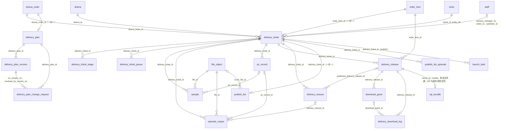
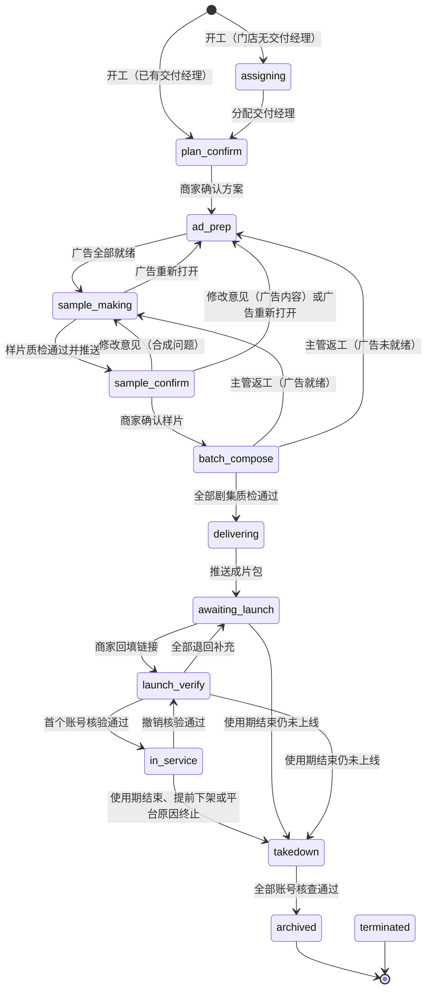
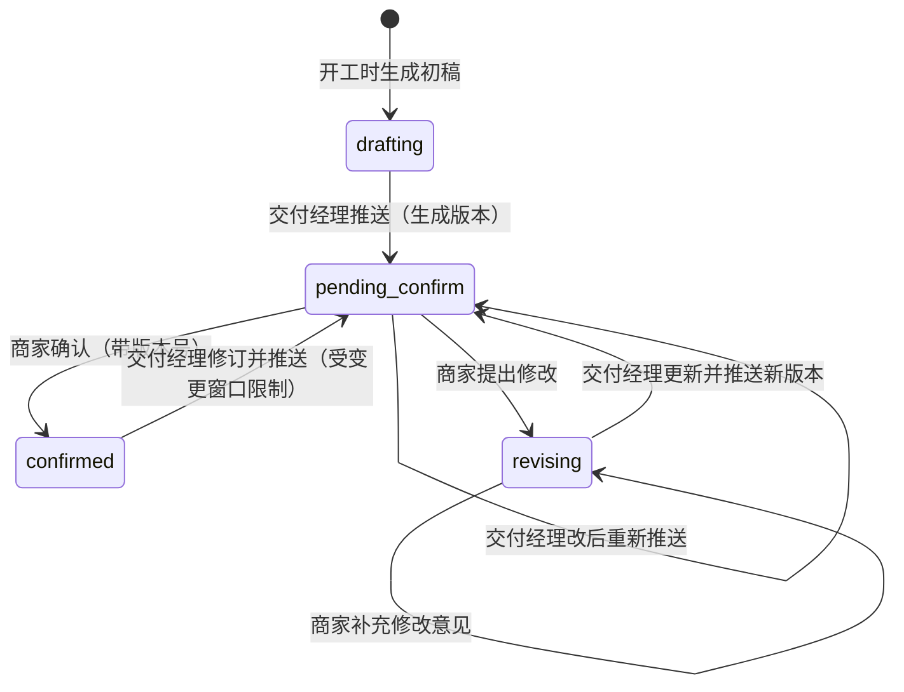
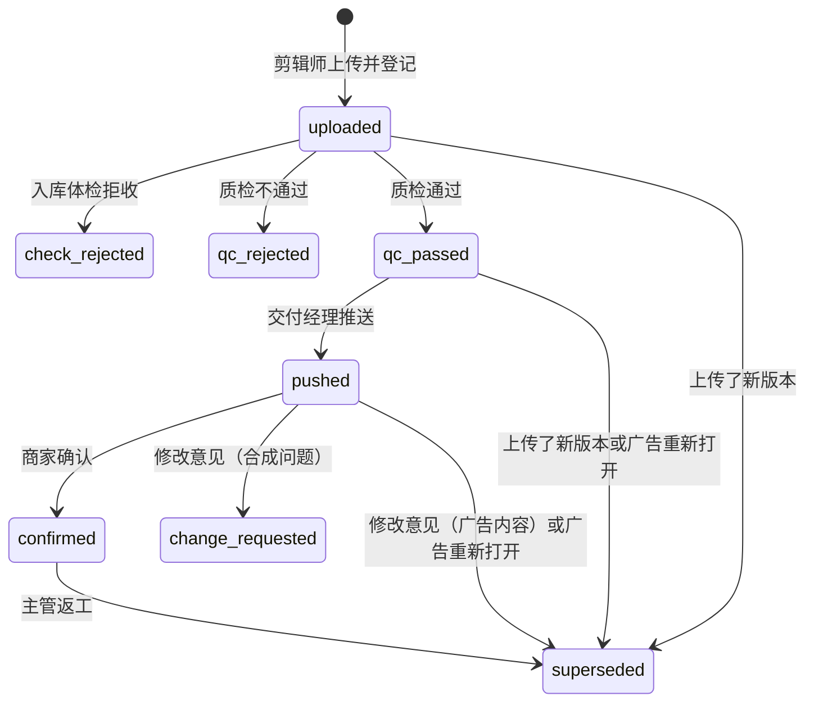

# 10 交付（delivery）

| 项 | 内容 |
| --- | --- |
| 模块 | `delivery`（L3） |
| 表 | 15 张：`delivery_ticket`、`delivery_ticket_stage`、`delivery_ticket_pause`、`delivery_plan`、`delivery_plan_version`、`delivery_plan_change_request`、`sample`、`episode_output`、`qc_record`、`delivery_release`、`delivery_reissue`、`download_grant`、`delivery_download_log`、`publish_list`、`publish_list_episode` |
| 依据 | 草案 `docs/appendix/design/d3-flow.md` 第 6、7、8、10、11 节（下文写作 d3:行号）；`d5-media.md` 第 1.5、4.7、8、12.1 节（d5:行号）；裁决 M8、M15、M17、M19、M27、M33、M34、M38、M44，第二轮另依据 M46、M47、M48、M53、M54、M56、M59–M62、M70、M92，第三轮另依据 M101、M109、M110（见第 7 节“修订记录”）；`catalogue.json` 的 conventions 与本分组 15 张表的 notes；`decisions.md` #16、#17、#37 与第 6、8 节；主文档 `03-key-designs.md` 第 3.3、3.4、3.7、3.8 节（03:行号）；PRD 第 5.2、6.9、6.10.1、7.6、7.7 节（PRD:行号）；画板 `admin/Tickets`、`admin/TicketDetail`、`admin/Delivery`、`merchant/Plan`、`merchant/Sample`、`merchant/Publish` |

## 1. 概览

这组表承载从开工到归档的交付事实：工单与环节、方案、样片与成片、质检、成片包与下载、发布清单。上线、巡检、下架的任务行在 11 分组。

- **工单**是唯一由事件驱动的状态机（d3:470）。一个订单项一张工单，11 个步骤加“已归档”“已终止”两个终态。订单项阶段、订购单状态都由工单步骤推导，不在这里存。
- **环节记录**与**暂停原因**是工单的两张子表：前者支撑时效指标，后者把“暂停”建成可叠加的原因集合，而不是一个步骤。
- **方案**是订购单级的（一单一份，内含逐剧的行），带版本与结构化的修改请求。
- **样片**、**成片剧集**是流程视角的版本行：只记版本号、质检、推送、商家决定。文件属性、体检结论、AI 标识状态按 `file_id` 读 media（`file_object`、`media_check`、`production_record`），这里只留登记时复制的时长与大小。
- **质检记录**保存清单模板的编码与版本号，事后能还原当时按哪一版清单检查；写入后不可改、不可删（M70）。
- **成片包**（`delivery_release`）一次推送一行，清单快照不可变，补发即再推一行。ZIP 缓存与打包时生成的发布清单文件不在这里，在 media 的 `zip_bundle`（M8）。
- **下载授权**与**下载记录**：“7 天有效”是业务授权的属性，不是签名地址的属性；每次签发都留一行记录，小程序回报“已存相册”。
- **发布清单**是每张工单一份的头表加逐集覆盖行。

## 2. 表定义

通用说明：

- 主键 `id` 为 UUID v7，由应用生成，不设数据库默认值。
- `created_at`、`updated_at` 由应用时钟写入，不设数据库默认值（约定“时间”）。出处里的“约定”指 `catalogue.json` 的 conventions。
- 归属列 `entity_id`、`store_id` 创建时从父行复制，不可变（约定“归属列”）。草案 d3、d5 的这些表多数没有归属列，统一补齐；只经父表访问的三张表（环节记录、暂停原因、逐集清单）不带。
- 所有外键的删除行为都是 Restrict：本分组的行与被引用的行都不物理删除。
- 带归属列的 12 张表，门店外键一律是归属复合外键 `(store_id, entity_id)` → `store (id, entity_id)`，名为 `fk_<表>_store_entity`；另保留主体的单列外键 `fk_<表>_entity_id`（M47）。下文各表“键与索引”写作“`(store_id, entity_id)` → `store`”。
- 所有外键都由 Prisma 片段生成，手写 SQL 里没有外键（M46）。一张表有多条外键指向同一张外部表（`delivery_ticket` → `staff` 三条，`sample` → `staff` 四条、→ `merchant_user` 两条）时，每条关系都带关系名。
- 数组列的“非空”由手写 SQL 的 `ALTER COLUMN … SET NOT NULL` 保证：Prisma 给标量数组列建的是只带默认值的可空列（M49）。
- 业务状态机的表登记 `status_transition` 时同时写 `state_field`（被迁移的状态列名，M53）：`delivery_ticket` 是 `step`，`delivery_plan`、`sample` 是 `status`。
- 每日校验的不变量按 `<命名空间>.<编号>` 编码（15 分组的约定）：本分组登记的一律是 `delivery.I<n>`，module 为 `delivery`，severity 都是 P2（不涉及资金）；违规对象的 `subject_type` 写表名、`subject_id` 写行 id（`publish_list_episode` 用 `subject_key = '<delivery_ticket_id>:<episode_no>'`）。由其他分组登记的草案不变量注明登记方。
- 检查项登记（15 分组 2.4 的 `InvariantCheck`）：16 项都是每日校验，`modes: ['full']`，不写 `every`；`heal` 只有 `delivery.I2`、`delivery.I3` 是 `heal_and_alert`（d3 I14、I15 原为“自愈并告警”），其余 `none`，没有 `heal_only` 的项。违规对象都带主体（三张不带归属列的子表取所属工单的主体），经 `invariants.report` 上报时一律传 `entityId`。本分组不直接调告警端口；`invariants.report` 与 `alerts.raise({ rule, dimension?, severity, detail })` 都由 ops 在独立短事务里写，失败不抛给调用方。
- 字数上限（说明 200 字、简介 200 字等）在契约层校验，不写数据库约束（d3:238）。

### 2.1 `delivery_ticket` 交付工单

开工后一部剧一张。承载步骤、负责人、当前环节截止时间、暂停计数与里程碑时间。归属：门店维度。主键：`id uuid`。不是只增表。业务状态机（machine = `delivery_ticket`）。锁顺序：`lock_rank = 180`（履约主干，订单项之后；多行按 id 升序）。

| 列 | 类型 | 空 | 默认 | 说明 | 出处 |
| --- | --- | --- | --- | --- | --- |
| `id` | uuid | 否 | — | 主键 | d3:734 |
| `ticket_no` | text | 否 | — | 工单号：`JF` + 订购单号数字部分 + `-` + 订单项序号（`order_item.item_no`），如 `JF2026092600018-1`。唯一 | d3:735、241、610；画板 Tickets |
| `entity_id` | uuid | 否 | — | 所属主体，创建时从订单项复制 | d3:738；约定“归属列” |
| `store_id` | uuid | 否 | — | 所属门店，创建时从订单项复制 | d3:738 |
| `drama_order_id` | uuid | 否 | — | 所属订购单 | d3:736；M17 |
| `order_item_id` | uuid | 否 | — | 所属订单项，唯一（一对一） | d3:737 |
| `drama_id` | uuid | 否 | — | 剧目 | d3:738 |
| `step` | text | 否 | — | 步骤，13 个取值：`assigning` 待分配、`plan_confirm` 方案确认、`ad_prep` 广告准备、`sample_making` 样片制作、`sample_confirm` 样片确认、`batch_compose` 批量合成、`delivering` 成片交付、`awaiting_launch` 待上线、`launch_verify` 上线核验、`in_service` 服务中（商家端“上线中”）、`takedown` 到期下架、`archived` 已归档、`terminated` 已终止。只经 `flow.transition()` 迁移 | d3:739、794；PRD:355-365 |
| `step_entered_at` | timestamptz | 否 | — | 进入当前步骤的时间 | d3:740 |
| `step_due_at` | timestamptz | 可 | — | 当前环节的员工侧截止时间；等待商家的环节可为空 | d3:741；画板 Tickets“截止时间” |
| `waiting_on` | text | 否 | — | 当前等待方：`staff` 员工、`merchant` 商家、`none` 无 | d3:742；画板 TicketDetail“等待商家” |
| `pause_count` | smallint | 否 | 0 | 未解除的暂停原因数，等于 `delivery_ticket_pause` 里 `released_at` 为空的行数。大于 0 即暂停 | d3:743、826 |
| `paused_at` | timestamptz | 可 | — | 第一个暂停原因加入的时间；未暂停时为空 | d3:744 |
| `pause_remaining_min` | integer | 可 | — | 进入暂停时当前环节剩余的工作分钟数，已超时记 0；环节没有员工时限时为空。恢复时据此重算 `step_due_at` | d3:745、884 |
| `delivery_manager_id` | uuid | 可 | — | 交付经理，指向 `staff`。待分配时为空。与 `store`、`drama_order` 上的同名列一致 | d3:746；M61 |
| `editor_id` | uuid | 可 | — | 剪辑师，指向 `staff`。未指派时为空 | d3:747、992 |
| `publisher_id` | uuid | 可 | — | 发布专员，指向 `staff`。开工时轮询指派，池为空则留空。核验、巡检、下架核查的处理人读取时取这一列（d3:242） | d3:748、993 |
| `schedule_priority` | text | 否 | `standard` | 制作排期：`standard` 标准、`priority` 优先、`rush` 加急，取值与 `plan_revision.schedule_priority`、`subscription_term.schedule_priority` 相同。开工时从订阅周期的权益快照复制。只影响工单池排序（`CASE schedule_priority WHEN 'rush' THEN 0 WHEN 'priority' THEN 1 ELSE 2 END`，在办工单量小，不另建表达式索引），不改各步时限 | d3:749、614；03:285；07 分组 `subscription_term.schedule_priority` |
| `sample_round_no` | smallint | 否 | 0 | 样片返修轮次，从 0 起；商家提出合成问题的修改意见时加 1。“样片一次通过率”取它等于 0 的工单 | d3:750、839、2591 |
| `current_sample_version_no` | smallint | 可 | — | 最近一次推送给商家的样片版本号；未推送过为空 | d3:751、838 |
| `delivery_target_at` | timestamptz | 否 | — | 成片交付目标时间。开工时按参数 `sla.delivery.target`（默认 6 个工作日）计算并固化 | d3:752、615；画板 TicketDetail“成片交付目标” |
| `assigned_at` | timestamptz | 可 | — | 里程碑：分配交付经理。时间轴“服务经理已对接” | d3:753、565 |
| `plan_confirmed_at` | timestamptz | 可 | — | 里程碑：方案确认 | d3:753、566 |
| `ads_ready_at` | timestamptz | 可 | — | 里程碑：广告全部就绪（首次） | d3:753、836 |
| `sample_first_pushed_at` | timestamptz | 可 | — | 里程碑：样片首次推送 | d3:753 |
| `sample_confirmed_at` | timestamptz | 可 | — | 里程碑：样片确认 | d3:753、838 |
| `composed_at` | timestamptz | 可 | — | 里程碑：全部剧集质检通过、进入成片交付 | d3:754、842 |
| `delivered_at` | timestamptz | 可 | — | 里程碑：成片包首次推送。“成片交付时长”的终点 | d3:754、2589 |
| `links_submitted_at` | timestamptz | 可 | — | 里程碑：商家首次回填上线链接 | d3:754、845 |
| `live_at` | timestamptz | 可 | — | 里程碑：首个账号核验通过。撤销核验通过时清空，是唯一会回退的里程碑 | d3:754-755、855 |
| `usage_ended_at` | timestamptz | 可 | — | 里程碑：使用期结束、进入到期下架 | d3:754、848 |
| `archived_at` | timestamptz | 可 | — | 里程碑：归档。非空当且仅当 `step = archived` | d3:754、850 |
| `terminated_at` | timestamptz | 可 | — | 里程碑：终止。非空当且仅当 `step = terminated` | d3:754、853 |
| `lock_version` | integer | 否 | 0 | 乐观锁版本号；每次迁移加 1 | d3:756、908 |
| `created_at` | timestamptz | 否 | — | 创建时间（开工时间） | d3:757 |
| `updated_at` | timestamptz | 否 | — | 最近更新时间 | d3:757 |

**键与索引**

- 主键：`pk_delivery_ticket (id)`。
- 外键：`entity_id` → `entity.id`；`fk_delivery_ticket_store_entity`：`(store_id, entity_id)` → `store (id, entity_id)`；`drama_order_id` → `drama_order.id`；`order_item_id` → `order_item.id`；`drama_id` → `drama.id`；`fk_delivery_ticket_delivery_manager_id`、`fk_delivery_ticket_editor_id`、`fk_delivery_ticket_publisher_id`：三个负责人列 → `staff.id`（关系名 `DeliveryTicketDeliveryManager`、`DeliveryTicketEditor`、`DeliveryTicketPublisher`）。都是 Restrict。
- 唯一约束：`uq_delivery_ticket_ticket_no (ticket_no)`；`uq_delivery_ticket_order_item_id (order_item_id)`。
- 普通索引：`ix_delivery_ticket_delivery_manager_id_step`、`ix_delivery_ticket_editor_id_step`、`ix_delivery_ticket_publisher_id_step`（各自 `(负责人, step)`）：“本人任务”列表、工作台待办、员工禁用时找在办事项；`ix_delivery_ticket_store_id`：商家端与商家详情按门店取工单；`ix_delivery_ticket_entity_id`：数据范围按主体过滤；`ix_delivery_ticket_drama_order_id`：订购单详情的同单工单、方案确认时锁同单工单；`ix_delivery_ticket_drama_id`：版权续期、剧目下架时找受影响的在办工单。

**手写约束**

| 名称 | 规则 |
| --- | --- |
| `ck_delivery_ticket_step` | `step` 在 13 个取值内 |
| `ck_delivery_ticket_waiting_on` | `waiting_on` ∈ {`staff`,`merchant`,`none`} |
| `ck_delivery_ticket_schedule_priority` | `schedule_priority` ∈ {`standard`,`priority`,`rush`} |
| `ck_delivery_ticket_sample_no` | `sample_round_no >= 0`；`current_sample_version_no >= 1` |
| `ck_delivery_ticket_pause` | `pause_count >= 0`；`pause_count > 0` 当且仅当 `paused_at` 非空；未暂停时 `pause_remaining_min` 为空；`pause_remaining_min >= 0` |
| `ck_delivery_ticket_pause_steps` | 暂停只发生在步骤 1～9：`pause_count = 0` 或 `step` 在 `assigning` 至 `launch_verify` 之间（d3:860） |
| `ck_delivery_ticket_delivery_manager_required` | 离开待分配之后必有交付经理：`step` ∈ {`assigning`,`terminated`} 或 `delivery_manager_id` 非空 |
| `ck_delivery_ticket_archived` | `step = archived` 当且仅当 `archived_at` 非空 |
| `ck_delivery_ticket_terminated` | `step = terminated` 当且仅当 `terminated_at` 非空 |
| `ix_delivery_ticket_step_step_due_at` | 部分索引 `(step, step_due_at) WHERE step NOT IN ('archived','terminated')`：工单池按状态页签与截止时间排序、超时扫描，只扫在办工单 |

**状态机**（每次迁移写 `status_transition`，machine = `delivery_ticket`，`state_field = step`（状态列叫 `step`，不是 `status`，M53）；同事务补写一条活动流的审计行，M31）

步骤 1～9 的任一状态都可因取消执行进入 `terminated`（图中未画）。通用守卫：工单未暂停（`pause_count = 0`）；操作人有对应权限点且在数据范围内。标“系统求值”的行只由 `reevaluate()` 触发，暂停时不求值，恢复后补求值（d3:830）。

| # | 当前步骤 | 事件 | 新步骤 | 守卫 | 触发者 |
| --- | --- | --- | --- | --- | --- |
| 1 | `assigning` | `ticket.assign` | `plan_confirm` | 被分配人是启用的交付经理 | 交付主管 |
| 2 | `plan_confirm` | `plan.confirmed` | `ad_prep` | 方案已确认，且已确认版本的内容已落到本订单项 | 商家（老板）；系统求值 |
| 3 | `ad_prep` | `ads.ready` | `sample_making` | 绑定的广告全部就绪 | 系统求值 |
| 4 | `sample_making` | `sample.pushed` | `sample_confirm` | 当前样片质检通过；所用广告版本是各广告当前确认版本；有可用的查看方式 | 交付经理 |
| 5 | `sample_confirm` | `sample.confirmed` | `batch_compose` | 版本号等于当前已推送版本；广告版本未变 | 商家（老板） |
| 6 | `sample_confirm` | `sample.change_requested`（合成问题） | `sample_making` | 意见非空 | 商家；交付经理代录 |
| 7 | `sample_confirm` | `sample.change_requested`（广告内容） | `ad_prep` | 该广告还有免费修改次数 | 交付经理代录 |
| 8 | `sample_making`、`sample_confirm` | `ad.reopened` | `ad_prep` | 存在未钉住且广告不处于“已确认”的广告位 | 系统求值 |
| 9 | `batch_compose` | `episodes.all_passed` | `delivering` | 当前有效剧集数等于订购集数且全部质检通过；成片包级质检通过 | 系统求值 |
| 10 | `batch_compose`、`delivering` | `ticket.rework` | `sample_making` 或 `ad_prep` | 必填原因；按广告是否就绪选目标 | 交付主管 |
| 11 | `delivering` | `package.pushed` | `awaiting_launch` | 剧集齐全且质检通过；发布清单完整；交付前检查通过；每个发布账号有未作废的授权书（d3:1639-1644） | 发布专员 |
| 12 | `awaiting_launch` | `launch.changed` | `launch_verify` | 没有已上线的任务，存在核验中的任务 | 系统求值 |
| 13 | `launch_verify` | `launch.changed` | `awaiting_launch` | 没有已上线、也没有核验中的任务 | 系统求值 |
| 14 | `awaiting_launch`、`launch_verify` | `launch.changed` | `in_service` | 存在已上线的任务 | 系统求值 |
| 15 | `in_service` | `usage.ended` | `takedown` | 今天已过使用期止日，或下架任务全部已由商家确认 | 定时器；系统求值 |
| 15b | `awaiting_launch`、`launch_verify` | `usage.ended` | `takedown` | 今天已过使用期止日（从未上线） | 定时器；系统求值 |
| 16 | `takedown` | `takedown.all_checked` | `archived` | 未作废的下架任务至少 1 条且全部已核查 | 系统求值 |
| 17 | 步骤 1～9 | `ticket.hold(reason, ref)` | 不变 | — | 系统 |
| 18 | 暂停中 | `ticket.resume(reason, ref)` | 不变 | 该原因存在 | 系统 |
| 19 | 步骤 1～9 | `ticket.terminate` | `terminated` | 只能由取消执行事务调用；暂停中同样可用 | 系统 |
| 20 | `in_service`、`takedown` | `ticket.terminate` | `takedown` | 同上（已上线、平台原因） | 系统 |
| 21 | `in_service` | `launch.verify_revoked` | `launch_verify` | 撤销后没有任何已上线的任务，也没有已确认或已核查的下架任务 | 系统 |
| 22 | 更正白名单内的步骤对 | `admin.force` | 指定步骤 | 目标在白名单内；更正后结构性不变量仍成立 | 超级管理员 |

第 17、18 行不改步骤，照常写状态历史（`from_state = to_state`，`state_field = step`）。开工那一行 `from_state` 为空，事件名 `ticket.created`。事件名沿用草案的 `ticket.hold`、`ticket.resume`，以契约的事件目录为准。迁移的副作用（写里程碑、关旧开新环节、登记定时器、发事件）见 d3:832-856。

**第 15、15b、19、20 行与 publish 的收尾**（d3:848-854；11 分组的请求）：这四行的处理器在迁移的同一事务里按顺序调 publish 的端口，逐条处理该订单项未作废的上线任务：

1. 未上线（`is_live` 为假）的任务 `launch.void`：`void_reason` 在第 15、15b 行为 `usage_expired`，在第 19、20 行为 `terminated`；在途核验单随之撤回。
2. 已上线、但停在 `verifying` 或 `need_fix` 的任务 `launch.settle`，收尾回 `passed`，同时撤回在途的补充核验单。已上线且 `passed` 的不动。
3. 最后调 `ensureTakedownTasks`，确保每个发布账号都有下架或核查任务（第 19 行只在成片包推送过时调）。终止（第 19、20 行）时，它同时改写该订单项已有的未核查下架任务：`trigger_kind` 改为 `platform_termination`（第 20 行）或 `terminated_after_delivery`（第 19 行），`usage_end_date` 取终止日，`due_date` = 终止执行日 + 1（终止执行日取 `cancel_request_line.executed_at`），并重设 `takedown.overdue` 定时器。

同一事务里另：撤销下载授权（第 15b、19 行，见 2.12）；该工单补发单仍在办的跟进调 staff 的接口关闭（见 2.11）。

**不变量**（每日校验，d3:3245-3260）

- `delivery.I1`（d3 I5）：越过样片制作则方案有已确认版本；越过样片确认则有已确认样片；越过成片交付则当前有效剧集数等于订购集数且全部质检通过（补发期间同样成立）。“广告位都已钉住”那一半由 09 分组在订单项上登记。
- `delivery.I2`（d3 I14）：`pause_count` 等于未解除的暂停原因行数；每个未解除的原因仍有效（口径见 2.3）。违反时自愈并告警（`heal_and_alert`）。
- `delivery.I3`（d3 I15）：未暂停的工单不存在“求值条件已满足仍停在原步骤”。违反时自愈（`reevaluate`）并告警（`heal_and_alert`）；5 分钟一次的补偿扫描命中时另写 `flow.STUCK_TICKET`（15 分组的写法）。
- `delivery.I4`（补）：归属与父行一致。工单的 `entity_id`、`store_id`、`drama_order_id`、`drama_id` 与所属订单项一致；方案与订购单一致；方案版本、修改请求与方案一致；样片、成片剧集、质检记录、成片包、补发单、发布清单与所属工单一致；下载授权、下载记录与成片包一致。门店属于主体已由归属复合外键保证（M47），这里只核对“与父行一致”，不再为它建复合外键。
- 由其他分组登记、本分组提供数据的：d3 I1、I3（订单项恰有一张工单、阶段由步骤推导）由 09 分组在 `order_item` 上登记；d3 I7（有截止时间的环节都有定时器）由 01 分组登记为 `timers.I7`，本分组提供 `delivery_ticket_stage` 的检查项；d3 I12（状态历史连续）是 01 分组的 `flow.I12`；d3 I13（已禁用员工没有在办事项）由 03 分组登记为 `staff.I10`，本分组注册三个负责人列为在办来源（见第 5 节）。

**相对草案的改动**

| 改动 | 依据 |
| --- | --- |
| 主键与外键由 bigint 改为 uuid | 约定“主键” |
| `order_id` → `drama_order_id` | M17 |
| `hold_count` → `pause_count`，`hold_since` → `paused_at`，`hold_remaining_min` → `pause_remaining_min` | 子表已由 `ticket_hold` 改名 `delivery_ticket_pause`（hold 在账本里指积分冻结）；时刻列以 `_at` 结尾（约定“命名规则”） |
| `sample_round` → `sample_round_no`，`current_sample_version` → `current_sample_version_no` | M34：轮次、版本号叫 `<含义>_no` |
| `manager_id` → `delivery_manager_id`；`editor_id`、`publisher_id` 保留。三列建外键 → `staff` | M61；约定“跨模块外键”（L3 引用 L1）；列名按角色命名，不受 M33 限制 |
| `priority smallint`（0/1/2）→ `schedule_priority text`（`standard`/`priority`/`rush`） | 与 billing 的同一枚举一致，开工复制时不再映射；约定“枚举用 text + CHECK” |
| 门店外键为归属复合外键 `(store_id, entity_id)` | M47 |
| 补 `ck_delivery_ticket_pause_steps`、`ck_delivery_ticket_delivery_manager_required`、终态与里程碑的两条 CHECK | d3:860、611-612、850、853 的规则落成约束 |
| 补 `ix_delivery_ticket_entity_id`、`ix_delivery_ticket_drama_id` | 数据范围过滤；版权续期与剧目下架的反查 |

### 2.2 `delivery_ticket_stage` 环节记录

工单每进入一次环节一行，记录截止时间、完成时间、暂停分钟、是否超时与时限参数快照，支撑时效指标。归属：不带归属列（只经工单访问）。主键：`id uuid`。不是只增表（离开环节时回写）。不参与锁排序：只在持有工单行锁的事务里修改。

| 列 | 类型 | 空 | 默认 | 说明 | 出处 |
| --- | --- | --- | --- | --- | --- |
| `id` | uuid | 否 | — | 主键。也是 `sla.breach` 定时器的主体（`timer.subject_type = delivery_ticket_stage`） | d3:763 |
| `delivery_ticket_id` | uuid | 否 | — | 所属工单 | d3:764；M17 |
| `step` | text | 否 | — | 环节：工单的 11 个步骤之一（`assigning` 至 `takedown`）。终态不开环节行 | d3:765 |
| `visit_no` | smallint | 否 | — | 同一环节第几次进入，从 1 起（样片制作会多次） | d3:766 |
| `entered_at` | timestamptz | 否 | — | 进入时间 | d3:767 |
| `due_at` | timestamptz | 可 | — | 员工侧截止时间；没有员工时限的环节为空 | d3:768 |
| `completed_at` | timestamptz | 可 | — | 离开环节的时间；仍在环节内为空 | d3:769 |
| `exit_event` | text | 可 | — | 离开环节的状态机事件名（如 `plan.confirmed`、`ticket.terminate`、`admin.force`）。取值是工单状态机的事件常量，只校验格式。开工时门店已有交付经理而补的 `assigning` 行取 `ticket.created` | d3:770、616 |
| `paused_minutes` | integer | 否 | 0 | 暂停累计的工作分钟；“各环节平均用时”要扣除它 | d3:771、2593 |
| `is_breached` | boolean | 否 | false | 是否超时；到期时或离开时判定。“超时工单数”取它 | d3:772、2592 |
| `sla_snapshot` | jsonb | 可 | — | 进入环节时的时限参数快照，结构见第 4 节。没有时限的环节为空 | d3:773、3052 |
| `created_at` | timestamptz | 否 | — | 创建时间 | 约定“时间” |
| `updated_at` | timestamptz | 否 | — | 最近更新时间 | 约定“时间” |

**键与索引**

- 主键：`pk_delivery_ticket_stage (id)`。
- 外键：`delivery_ticket_id` → `delivery_ticket.id`（Restrict）。
- 唯一约束：`uq_delivery_ticket_stage_delivery_ticket_id_step_visit_no (delivery_ticket_id, step, visit_no)`。它的前缀同时供“取某工单的全部环节”（工单详情进度条）使用。
- 普通索引：`ix_delivery_ticket_stage_step_entered_at (step, entered_at)`：各环节平均用时按环节、周期分组。

**手写约束**

| 名称 | 规则 |
| --- | --- |
| `ck_delivery_ticket_stage_step` | `step` 在 11 个步骤内（不含 `archived`、`terminated`） |
| `ck_delivery_ticket_stage_visit_no` | `visit_no >= 1` |
| `ck_delivery_ticket_stage_paused_minutes` | `paused_minutes >= 0` |
| `ck_delivery_ticket_stage_completed` | `completed_at` 与 `exit_event` 同时有或同时无；`completed_at >= entered_at` |
| `ck_delivery_ticket_stage_exit_event` | `exit_event` 匹配 `^[a-z][a-z0-9_.]{1,63}$` |
| `ck_delivery_ticket_stage_sla_snapshot` | `sla_snapshot` 为空或是 JSON 对象 |
| `uq_delivery_ticket_stage_open` | 部分唯一索引 `(delivery_ticket_id) WHERE completed_at IS NULL`：一张工单同时至多一个未完成的环节 |
| `ix_delivery_ticket_stage_breached` | 部分索引 `(step, entered_at) WHERE is_breached`：超时环节统计 |

开工时门店已有交付经理、工单直接进入 `plan_confirm` 的（d3:616-617），同事务补一行 `assigning` 环节记录：`visit_no = 1`，`entered_at = completed_at` = 开工时间，`exit_event = ticket.created`，`due_at`、`sla_snapshot` 为空，`paused_minutes = 0`，`is_breached = false`；再开 `plan_confirm` 的未完成行。“待分配”环节的平均用时因此把这类工单计为 0。

时限的计算与重算（暂停恢复、日历重导入）都用 `sla_snapshot` 里的策略，结构见第 4 节；`same_day_cutoff`（成片交付，18:00）的截止时刻存在 `amount` 里。

**日历修正后的重算**（01 分组 2.6、2.7；d3:3054；01 分组的请求）：delivery 订阅 `calendar.imported`，取未完成（`completed_at` 为空）、`due_at` 非空、`sla_snapshot.unit` 为 `work_days` 或 `work_minutes`、且计算窗口覆盖负载 `changedDays` 的环节行；所属工单暂停中的跳过（恢复时按剩余工作分钟与当时的日历重算）。对其余的行，用快照里的策略与新日历重算 `due_at`，同时更新 `sla_snapshot` 的 `calendarVersion`、`computedAt`（策略、数值、单位不变），重设 `sla.breach` 定时器，并把新值同步到工单的 `step_due_at`。留痕：本表不是状态机表，只写 `audit_log`（带重算前后的截止时间与批次号）；工单是状态机表，另写一行 `from_state = to_state` 的状态历史（machine = `delivery_ticket`，`state_field = step`，事件名由 `sla` 登记，如 `sla.recalculated`，`payload` 为 `{ calendarVersion, dueAtBefore, dueAtAfter }`）。已离开的环节不回算。

**不变量**：`delivery.I5` 未归档、未终止的工单恰有一行未完成的环节，且它的 `step` 等于工单的 `step`；已归档、已终止的工单没有未完成的环节；直接进入方案确认的工单有一行 `exit_event = ticket.created` 的 `assigning` 记录。

**相对草案的改动**

| 改动 | 依据 |
| --- | --- |
| 表名 `ticket_stage` → `delivery_ticket_stage` | decisions 2.1 |
| `ticket_id` → `delivery_ticket_id` | M17 |
| `held_minutes` → `paused_minutes` | 与 `delivery_ticket_pause` 的用词一致 |
| `breached` → `is_breached` | 约定“命名规则”：布尔列用 `is_` 前缀 |
| 补 `created_at`、`updated_at` | 约定“时间” |
| 补 `uq_delivery_ticket_stage_open` | d3:910“关旧开新”落成约束 |
| `sla_snapshot` 的键补 `computedAt`；`calendarVersion` 为整数 | d3:3052（d3:773 少列了这一键）；M60 |
| 明确直接进入方案确认时补的 `assigning` 行怎么写 | d3:616-617 只写了“进入时间 = 完成时间”，`ck_delivery_ticket_stage_completed` 要求同时有离开事件 |
| 日历修正后的重算：本表只写 `audit_log`，工单另写一行 `from_state = to_state` 的状态历史 | d3:3054 只写了“写一条状态历史”；01 分组 2.6：非状态机表只写审计 |

### 2.3 `delivery_ticket_pause` 工单暂停原因

工单暂停原因的集合：一个原因一行，可叠加；解除时写 `released_at`。集合非空即暂停。归属：不带归属列。主键：`id uuid`。不是只增表。不参与锁排序：只在持有工单行锁的事务里修改。

| 列 | 类型 | 空 | 默认 | 说明 | 出处 |
| --- | --- | --- | --- | --- | --- |
| `id` | uuid | 否 | — | 主键 | d3:777 |
| `delivery_ticket_id` | uuid | 否 | — | 所属工单 | d3:778；M17 |
| `reason` | text | 否 | — | 暂停原因：`cancel_review` 取消审批中、`plan_amendment` 方案修订待商家确认 | d3:779、864 |
| `ref_type` | text | 否 | — | 引用对象类型：`approval_request`、`delivery_plan_version`（最终表名）。由 `reason` 决定 | d3:780；M19 |
| `ref_id` | uuid | 否 | — | 引用对象 id。多态，不建外键（`approval_request` 在 L1）。`cancel_review` 引用审批单，与 `cancel_request` 一对一（09 分组） | d3:781 |
| `actor_type` | text | 否 | — | 加入暂停原因的操作人类型：`merchant`、`staff`、`system`、`partner`（V1.0 不写入）。取消审批由客服提交、方案修订由交付经理推送，资质终局驳回时为系统 | d3:783；约定“操作人列”；M44 |
| `actor_id` | uuid | 可 | — | 操作人 id；`system` 时为空，其余必有。多态，不建外键 | 同上 |
| `client` | text | 可 | — | 客户端来源：`weapp`、`portal`、`admin`；系统动作为空，其余必有 | 同上 |
| `released_at` | timestamptz | 可 | — | 解除时间；未解除为空 | d3:784 |
| `release_event` | text | 可 | — | 解除事件：`rejected` 取消被驳回、`withdrawn` 取消被撤回、`voided` 取消审批通过后、执行前作废（与 `cancel_request.close_reason` 同名）、`plan_confirmed` 商家确认了方案、`superseded` 方案版本被新版本取代、`terminated` 工单终止、`self_heal` 不变量自愈解除的孤儿原因 | d3:785、1174、3258；M54 |
| `created_at` | timestamptz | 否 | — | 加入暂停原因的时间 | d3:782 |
| `updated_at` | timestamptz | 否 | — | 最近更新时间 | 约定“时间” |

**键与索引**

- 主键：`pk_delivery_ticket_pause (id)`。
- 外键：`delivery_ticket_id` → `delivery_ticket.id`（Restrict）。
- 唯一约束：`uq_delivery_ticket_pause_delivery_ticket_id_reason_ref_id (delivery_ticket_id, reason, ref_id)`：同一原因同一引用只加一次，重放幂等。
- 普通索引：`ix_delivery_ticket_pause_ref_type_ref_id (ref_type, ref_id)`：审批单被驳回或撤回、方案版本被确认或取代时，找出引用它的暂停原因。

**手写约束**

| 名称 | 规则 |
| --- | --- |
| `ck_delivery_ticket_pause_reason` | `reason` ∈ {`cancel_review`,`plan_amendment`} |
| `ck_delivery_ticket_pause_ref_type` | `ref_type` ∈ {`approval_request`,`delivery_plan_version`} |
| `ck_delivery_ticket_pause_reason_ref` | `cancel_review` 配 `approval_request`；`plan_amendment` 配 `delivery_plan_version` |
| `ck_delivery_ticket_pause_actor_type` | `actor_type` ∈ {`merchant`,`staff`,`system`,`partner`} |
| `ck_delivery_ticket_pause_client` | `client` ∈ {`weapp`,`portal`,`admin`} |
| `ck_delivery_ticket_pause_actor` | `actor_type = system` 当且仅当 `actor_id` 为空，也当且仅当 `client` 为空（M44：非系统动作三列齐全） |
| `ck_delivery_ticket_pause_release_event` | `release_event` 在 7 个取值内 |
| `ck_delivery_ticket_pause_released` | `released_at` 与 `release_event` 同时有或同时无 |
| `ck_delivery_ticket_pause_release_event_reason` | `rejected`、`withdrawn`、`voided` 只属于 `cancel_review`；`plan_confirmed`、`superseded` 只属于 `plan_amendment`；`terminated`、`self_heal` 两者都可 |
| `ix_delivery_ticket_pause_open` | 部分索引 `(delivery_ticket_id) WHERE released_at IS NULL`：恢复时判断集合是否为空、核对 `pause_count` |

**状态**：没有状态列，`released_at` 为空即生效。暂停与恢复在 `status_transition` 里记在工单上（machine = `delivery_ticket`，`state_field = step`，事件 `ticket.hold`、`ticket.resume`），本表不另写状态历史。

**加入与解除的规则**

| 原因 | 加入 | 解除 |
| --- | --- | --- |
| `cancel_review` | 取消申请提交时，对明细涉及、处于步骤 1～9 的工单加入，`ref_id` 为审批单 id（09 分组） | 取消申请关闭为 `not_executed`：`release_event` 与 `cancel_request.close_reason` 同名（`rejected`、`withdrawn`、`voided`）；执行完成：工单终止，`terminated` |
| `plan_amendment` | 方案从 `confirmed` 修订推送时，对受影响的工单加入，引用新版本；方案处于**修订周期**（`confirmed_version_no` 非空且 `status` ≠ `confirmed`）时，**每次** `plan.push` 都为新版本重新加入（受影响范围相对已确认版本重算） | 修订周期内再次推送：该方案原有的未解除原因一律 `superseded`（不论旧版本的 `decision` 是被取代还是商家提出修改）；商家确认：该方案全部未解除的原因 `plan_confirmed`（此时它们都引用被确认的版本）；工单终止：`terminated` |

同一事务里先加入新原因、再解除旧原因，集合不会在事务中途变空而触发恢复。

**不变量**（`delivery.I2` 的第二半，d3:3258 的 I14）：每个未解除的原因仍有效，否则自愈（写 `release_event = self_heal` 并 `reevaluate`）。有效的口径：

- `cancel_review`：`ref_id` 对应的 `cancel_request`（`cancel_request.approval_request_id = ref_id`）尚未关闭（`closed_at` 为空）。审批单已批准、领域行在 `pending_execution` 时仍有效；不看审批单是否在途（M54）。
- `plan_amendment`：`ref_id` 指向的方案版本的 `version_no` 等于方案的 `current_version_no`，且方案 `status` ∈ {`pending_confirm`,`revising`}。不看版本的 `decision` 是否为空（商家对修订版提出修改后，版本是 `change_requested`，原因仍有效）。

**相对草案的改动**

| 改动 | 依据 |
| --- | --- |
| 表名 `ticket_hold` → `delivery_ticket_pause` | decisions 2.1 |
| `ticket_id` → `delivery_ticket_id` | M17 |
| `ref_type` 取值 `approval`、`plan_version` → `approval_request`、`delivery_plan_version` | M19；decisions 8.1 |
| `created_by jsonb` 拆为 `actor_type`、`actor_id`、`client` | 约定“操作人列”；M44 |
| `release_event` 补 `superseded`、`self_heal`、`voided` | d3:1174（旧方案版本被取代时解除）；d3:3258（I14 自愈）；M54（取消审批通过后作废，09 分组的请求） |
| 修订周期内每次推送都换引用的版本；I14 的有效口径改为看领域行与方案当前版本 | d3:1128 只写了从 `confirmed` 修订时加原因，商家对修订版提出修改后再推送，旧原因不会被取代；M54 之后审批单批准即不在途 |
| 非系统动作 `client` 必填 | M44 |
| 补 `updated_at`、`ix_delivery_ticket_pause_ref_type_ref_id` 与原因、引用、解除事件之间的三条 CHECK | 约定“时间”；d3:864 的对应关系落成约束 |

### 2.4 `delivery_plan` 交付方案

一张订购单一份，内含逐剧的行。保存交付经理正在编辑的草稿、当前与已确认的版本号、方案状态。归属：门店维度。主键：`id uuid`。不是只增表。业务状态机（machine = `delivery_plan`）。锁顺序：`lock_rank = 200`（履约子表，工单之后）。

| 列 | 类型 | 空 | 默认 | 说明 | 出处 |
| --- | --- | --- | --- | --- | --- |
| `id` | uuid | 否 | — | 主键 | d3:1057 |
| `entity_id` | uuid | 否 | — | 所属主体，创建时从订购单复制 | 约定“归属列” |
| `store_id` | uuid | 否 | — | 所属门店，创建时从订购单复制 | 约定“归属列” |
| `drama_order_id` | uuid | 否 | — | 所属订购单，唯一（一单一份） | d3:1058；M17 |
| `status` | text | 否 | — | 方案状态：`drafting` 起草中（尚未推送）、`pending_confirm` 待商家确认、`revising` 修改中（商家提了修改）、`confirmed` 已确认。只经 `flow.transition()` 迁移 | d3:1059；画板 Plan |
| `draft` | jsonb | 否 | — | 交付经理正在编辑的内容（`PlanContent`，结构见第 4 节）。开工时由订购录入生成初稿 | d3:1060、617 |
| `draft_lock_version` | integer | 否 | 0 | 草稿的乐观锁版本号；保存草稿与推送都要带回 | d3:1061、1160 |
| `current_version_no` | integer | 否 | 0 | 最近一次推送的版本号；0 表示尚未推送 | d3:1062 |
| `confirmed_version_no` | integer | 可 | — | 商家确认过的最新版本号；未确认过为空 | d3:1063 |
| `pushed_at` | timestamptz | 可 | — | 最近一次推送时间 | d3:1064；画板 Plan“推送人与时间” |
| `confirmed_at` | timestamptz | 可 | — | 最近一次商家确认时间 | d3:1064 |
| `staff_due_at` | timestamptz | 可 | — | 交付经理应推送或应答复修改的时间（1 个工作日） | d3:1065、1130 |
| `lock_version` | integer | 否 | 0 | 乐观锁版本号；每次迁移加 1 | d3:1066 |
| `created_at` | timestamptz | 否 | — | 创建时间 | 约定“时间” |
| `updated_at` | timestamptz | 否 | — | 最近更新时间 | 约定“时间” |

**键与索引**

- 主键：`pk_delivery_plan (id)`。
- 外键：`entity_id` → `entity.id`；`fk_delivery_plan_store_entity`：`(store_id, entity_id)` → `store`；`drama_order_id` → `drama_order.id`。都是 Restrict。
- 唯一约束：`uq_delivery_plan_drama_order_id (drama_order_id)`。
- 普通索引：`ix_delivery_plan_store_id`、`ix_delivery_plan_entity_id`：按门店、主体取方案；`ix_delivery_plan_status_staff_due_at (status, staff_due_at)`：工作台“方案待推送、待答复修改”的派生待办。

**手写约束**

| 名称 | 规则 |
| --- | --- |
| `ck_delivery_plan_status` | `status` ∈ {`drafting`,`pending_confirm`,`revising`,`confirmed`} |
| `ck_delivery_plan_draft` | `draft` 是 JSON 对象（结构在契约层校验） |
| `ck_delivery_plan_version_no` | `draft_lock_version >= 0`；`current_version_no >= 0`；`confirmed_version_no` 在 1 到 `current_version_no` 之间 |
| `ck_delivery_plan_drafting` | `status = drafting` 当且仅当 `current_version_no = 0`；`current_version_no = 0` 当且仅当 `pushed_at` 为空 |
| `ck_delivery_plan_confirmed` | `confirmed_version_no` 与 `confirmed_at` 同时有或同时无；`status = confirmed` 时 `confirmed_version_no` 非空且等于 `current_version_no` |

**状态机**（每次迁移写 `status_transition`，machine = `delivery_plan`，`state_field = status`）

通用守卫：订购单没有在途的取消申请，否则三个事件都返回 `409 ORDER_IN_AFTER_SALE`（d3:1124）。

| 当前状态 | 事件 | 新状态 | 守卫 | 触发者 |
| --- | --- | --- | --- | --- |
| `drafting`、`revising`、`pending_confirm`、`confirmed` | `plan.push` | `pending_confirm` | 请求带的草稿版本号等于 `draft_lock_version`；内容校验通过（d3:1150-1156）；从 `confirmed` 修订时在变更窗口内（d3:1167-1172） | 交付经理 |
| `pending_confirm` | `plan.confirm` | `confirmed` | 请求的版本号等于 `current_version_no` | 商家（老板） |
| `pending_confirm`、`revising` | `plan.request_change` | `revising` | 修改项至少 1 项、说明非空 | 商家（老板） |

`plan.push` 同事务写版本行、把上一个未决版本（`decision` 为空）置 `superseded`、给未处理的修改请求写 `resolved_by_version_no`；从 `confirmed` 修订、以及修订周期内的每次推送，按 2.3 的规则换 `plan_amendment` 暂停原因。`plan.request_change` 写一行修改请求；只有当前版本 `decision` 为空时（`pending_confirm → revising`）才把它置 `change_requested`，`revising → revising` 只插修改请求、不更新版本行（版本的决定只写一次）。`plan.confirm` 同事务把内容落到订单项、发布账号、广告位绑定，解除该方案全部未解除的 `plan_amendment` 原因或重新求值（d3:1132-1146）。

方案里参考素材（`PlanContent.referenceAssetIds`）只含素材库素材（`store_asset.id`）；订购时引用的门店档案媒体不进方案内容，引用留在订购单上（接口裁决 A142）。参考素材的文件引用登记在订购单上（M20：`file_ref` 的 `ref_type = drama_order`，素材库来源另写 `store_asset_usage`，档案媒体只有 `file_ref`）；方案修订改了参考素材时，由确认方案的用例同步订购单上素材库来源的登记，档案媒体的登记不动；方案与版本自己不登记引用。

**不变量**：`delivery.I1` 的方案部分（工单越过样片制作则 `confirmed_version_no` 非空）；`delivery.I6` `current_version_no` 等于该方案版本行的最大 `version_no`，`status = revising` 时存在未解决的修改请求；归属与订购单一致（`delivery.I4`）。

**相对草案的改动**

| 改动 | 依据 |
| --- | --- |
| `order_id` → `drama_order_id` | M17 |
| `current_version` → `current_version_no`，`confirmed_version` → `confirmed_version_no` | M34 |
| 补 `entity_id`、`store_id`、`created_at`、`updated_at`；门店外键为归属复合外键 | 约定“归属列”“时间”；M47 |
| 补状态与版本号、时间之间的两条 CHECK | d3:1062-1063、1114-1121 的规则落成约束 |
| `revising → revising` 不再写版本的决定 | d3:1130 的副作用“版本置 change_requested”只在版本未决时成立，与版本行的写一次触发器一致 |

### 2.5 `delivery_plan_version` 方案版本

推送即生成一行，内容快照不可变；记录商家对该版本的决定。归属：门店维度。主键：`id uuid`。不是只增表，但受限更新：只允许把决定相关的五列从空写一次。不参与锁排序：只在持有方案行锁的事务里写入。

| 列 | 类型 | 空 | 默认 | 说明 | 出处 |
| --- | --- | --- | --- | --- | --- |
| `id` | uuid | 否 | — | 主键。`delivery_ticket_pause` 的 `plan_amendment` 原因引用它 | d3:1069 |
| `entity_id` | uuid | 否 | — | 所属主体，创建时从方案复制 | 约定“归属列” |
| `store_id` | uuid | 否 | — | 所属门店，创建时从方案复制 | 约定“归属列” |
| `delivery_plan_id` | uuid | 否 | — | 所属方案 | d3:1070；M33 |
| `version_no` | integer | 否 | — | 版本号，同一方案内从 1 递增 | d3:1071 |
| `content_snapshot` | jsonb | 否 | — | 推送时的方案内容快照（`PlanContent`，结构见第 4 节），不可变 | d3:1072 |
| `change_summary` | text | 可 | — | 相对上一版的变更摘要 | d3:1073 |
| `pushed_by_staff_id` | uuid | 否 | — | 推送人，指向 `staff` | d3:1074 |
| `pushed_at` | timestamptz | 否 | — | 推送时间 | d3:1075 |
| `decision` | text | 可 | — | 对该版本的决定：`confirmed` 商家确认、`change_requested` 商家提出修改、`superseded` 未决时被新版本取代。未决为空；写入后不可改 | d3:1076 |
| `decided_at` | timestamptz | 可 | — | 决定时间 | d3:1077 |
| `decide_actor_type` | text | 可 | — | 决定人类型：`merchant`、`staff`、`system`、`partner`（V1.0 不写入）。商家确认与提出修改为 `merchant`；被取代为 `system` | d3:1078；约定“操作人列”；M44 |
| `decide_actor_id` | uuid | 可 | — | 决定人 id；`system` 时为空，其余必有。多态，不建外键 | 同上 |
| `decide_client` | text | 可 | — | 决定时的客户端来源：`weapp`、`portal`、`admin`；系统动作为空，其余必有 | 同上 |
| `created_at` | timestamptz | 否 | — | 创建时间 | 约定“时间” |

不带 `updated_at`：唯一的更新是把决定写一次，时间就是 `decided_at`。

**键与索引**

- 主键：`pk_delivery_plan_version (id)`。
- 外键：`entity_id` → `entity.id`；`fk_delivery_plan_version_store_entity`：`(store_id, entity_id)` → `store`；`delivery_plan_id` → `delivery_plan.id`；`pushed_by_staff_id` → `staff.id`。都是 Restrict。
- 唯一约束：`uq_delivery_plan_version_delivery_plan_id_version_no (delivery_plan_id, version_no)`。它也是修改请求两条复合外键的目标。
- 普通索引：`ix_delivery_plan_version_store_id`：按门店取版本。

**手写约束**

| 名称 | 规则 |
| --- | --- |
| `ck_delivery_plan_version_version_no` | `version_no >= 1` |
| `ck_delivery_plan_version_content_snapshot` | `content_snapshot` 是 JSON 对象 |
| `ck_delivery_plan_version_decision` | `decision` ∈ {`confirmed`,`change_requested`,`superseded`} |
| `ck_delivery_plan_version_decide_actor_type` | `decide_actor_type` ∈ {`merchant`,`staff`,`system`,`partner`} |
| `ck_delivery_plan_version_decide_client` | `decide_client` ∈ {`weapp`,`portal`,`admin`} |
| `ck_delivery_plan_version_decided` | `decision`、`decided_at`、`decide_actor_type` 同时有或同时无；有决定人时，`system` 当且仅当 `decide_actor_id` 为空，也当且仅当 `decide_client` 为空（M44） |
| `trg_delivery_plan_version_write_once` | 行级 BEFORE UPDATE OR DELETE 触发器，函数 `lyx_write_once('decision','decided_at','decide_actor_type','decide_actor_id','decide_client')`：这五列只能从空写一次，其余列不可改，不可删 |

**状态**：`decision` 是这一版的结局，不是状态机，不写状态历史（方案的迁移记在 `delivery_plan` 上）。空 → `confirmed`、`change_requested`、`superseded` 三者之一，写入即终局。商家在 `revising` 状态再补修改意见时不再改版本行（见 2.4）；推送新版本时只把 `decision` 为空的上一版置 `superseded`，已是 `change_requested` 的不动。

**不变量**：`delivery.I6` 的版本部分——每个方案至多一个 `decision` 为空的版本，且它的 `version_no` 等于方案的 `current_version_no`。

**相对草案的改动**

| 改动 | 依据 |
| --- | --- |
| `plan_id` → `delivery_plan_id` | M33 |
| `content` → `content_snapshot` | 约定“命名规则”：快照列以 `_snapshot` 结尾 |
| `pushed_by` → `pushed_by_staff_id`，建外键 | 约定“操作人列” |
| `decided_by jsonb` 拆为 `decide_actor_type`、`decide_actor_id`、`decide_client` | 约定“操作人列”；M44 |
| 补 `entity_id`、`store_id`、`created_at`；门店外键为归属复合外键 | 约定“归属列”“时间”（接口会按 id 直接读版本）；M47 |
| 补防改触发器 | d3:1068“推送即生成，不可变” |

### 2.6 `delivery_plan_change_request` 方案修改请求

商家在方案确认页点“联系服务经理修改”提交的结构化请求；被后续版本解决时回写版本号。归属：门店维度。主键：`id uuid`。不是只增表。不参与锁排序：只在持有方案行锁的事务里修改。

| 列 | 类型 | 空 | 默认 | 说明 | 出处 |
| --- | --- | --- | --- | --- | --- |
| `id` | uuid | 否 | — | 主键 | d3:1082 |
| `entity_id` | uuid | 否 | — | 所属主体，创建时从方案复制 | 约定“归属列” |
| `store_id` | uuid | 否 | — | 所属门店，创建时从方案复制 | 约定“归属列” |
| `delivery_plan_id` | uuid | 否 | — | 所属方案 | d3:1083；M33 |
| `on_version_no` | integer | 否 | — | 针对哪个版本提出 | d3:1084 |
| `kinds` | text[] | 否 | — | 需要修改的内容，至少 1 项：`launch_date` 上线日期、`account` 上线账号、`customization` 定制内容、`placement` 植入形式、`ad` 广告视频、`other` 其他 | d3:1085；画板 Plan 修改弹层 |
| `note` | text | 否 | — | 修改说明，必填，不超过 200 字 | d3:1086 |
| `created_by_user_id` | uuid | 否 | — | 提出人，指向 `merchant_user`。只有老板能提出（d3:1130） | d3:1087；约定“操作人列” |
| `resolved_by_version_no` | integer | 可 | — | 解决它的版本号；未解决为空。交付经理推送新版本时回写 | d3:1089、1128 |
| `created_at` | timestamptz | 否 | — | 提出时间 | d3:1088 |
| `updated_at` | timestamptz | 否 | — | 最近更新时间 | 约定“时间” |

**键与索引**

- 主键：`pk_delivery_plan_change_request (id)`。
- 外键：`entity_id` → `entity.id`；`fk_delivery_plan_change_request_store_entity`：`(store_id, entity_id)` → `store`；`delivery_plan_id` → `delivery_plan.id`；`created_by_user_id` → `merchant_user.id`；复合外键 `fk_delivery_plan_change_request_on_version`：`(delivery_plan_id, on_version_no)` → `delivery_plan_version (delivery_plan_id, version_no)`；复合外键 `fk_delivery_plan_change_request_resolved_by_version`：`(delivery_plan_id, resolved_by_version_no)` → 同上。都是 Restrict。
- 普通索引：`ix_delivery_plan_change_request_delivery_plan_id_created_at (delivery_plan_id, created_at)`：方案页按时间列出修改记录；`ix_delivery_plan_change_request_store_id`：按门店过滤。

**手写约束**

| 名称 | 规则 |
| --- | --- |
| `ck_delivery_plan_change_request_kinds` | `kinds` 至少 1 个元素，且都在 6 个取值内 |
| `ck_delivery_plan_change_request_note` | `note` 去掉首尾空白后非空 |
| `ck_delivery_plan_change_request_on_version_no` | `on_version_no >= 1` |
| `ck_delivery_plan_change_request_resolved_by_version_no` | `resolved_by_version_no > on_version_no` |
| `ix_delivery_plan_change_request_open` | 部分索引 `(delivery_plan_id) WHERE resolved_by_version_no IS NULL`：推送时找出未处理的修改请求 |
| 数组列非空 | `kinds` `SET NOT NULL` |

**相对草案的改动**

| 改动 | 依据 |
| --- | --- |
| 表名 `plan_change_request` → `delivery_plan_change_request` | decisions 2.1 |
| `plan_id` → `delivery_plan_id` | M33 |
| `on_version` → `on_version_no`，`resolved_by_version` → `resolved_by_version_no` | M34 |
| `created_by jsonb` → `created_by_user_id`，建外键 | 约定“操作人列”：提出人固定为商家用户（d3:1130） |
| 两个版本号列建复合外键指向版本行 | 补：草案用版本号指代版本行，没有约束保证版本存在 |
| 补 `entity_id`、`store_id`、`updated_at`；门店外键为归属复合外键 | 约定“归属列”“时间”；M47 |

### 2.7 `sample` 样片版本

样片每个版本一行，流程视角：质检、推送、查看方式、商家决定与修改意见。归属：门店维度。主键：`id uuid`。不是只增表。业务状态机（machine = `sample`）。锁顺序：`lock_rank = 260`（履约子表）。

| 列 | 类型 | 空 | 默认 | 说明 | 出处 |
| --- | --- | --- | --- | --- | --- |
| `id` | uuid | 否 | — | 主键 | d3:1420 |
| `entity_id` | uuid | 否 | — | 所属主体，创建时从工单复制 | 约定“归属列” |
| `store_id` | uuid | 否 | — | 所属门店，创建时从工单复制 | 约定“归属列” |
| `delivery_ticket_id` | uuid | 否 | — | 所属工单 | d3:1421；M17 |
| `version_no` | smallint | 否 | — | 版本号，同一工单内从 1 递增 | d3:1422 |
| `file_id` | uuid | 否 | — | 样片原版文件，指向 `file_object`（类别 `sample_video`）。经 `file_ref` 登记。体检结论、AI 标识状态、水印播放版按它读 media | d3:1424；d5:103 |
| `duration_ms` | integer | 可 | — | 时长（毫秒）。上传登记时体检还没完成，为空；收到 `media.production.checked`（`gate = pass`）时由 delivery 的订阅者从探测结果回写。进入质检及以后的状态必有。商家端进度条按它画广告位 | d3:1425；d5:1965、1981 |
| `ad_slots` | jsonb | 否 | — | 广告位标记，结构见第 4 节 | d3:1426；画板 Sample |
| `ad_versions_used` | jsonb | 否 | — | 本版所用的广告版本，结构见第 4 节。推送与确认时比对各广告当前确认版本 | d3:1427、1335 |
| `status` | text | 否 | — | 状态：`uploaded` 已上传待质检、`check_rejected` 入库体检拒收、`qc_rejected` 质检不通过、`qc_passed` 质检通过待推送、`pushed` 已推送待商家确认、`confirmed` 商家已确认、`change_requested` 商家提出修改、`superseded` 已被取代。只经 `flow.transition()` 迁移 | d3:1428；d5:1981、1986 |
| `uploaded_by_staff_id` | uuid | 否 | — | 上传人（剪辑师），指向 `staff` | d3:1429 |
| `uploaded_at` | timestamptz | 否 | — | 上传时间 | d3:1430 |
| `qc_record_id` | uuid | 可 | — | 最近一次质检记录，指向 `qc_record`；未质检为空 | d3:1431 |
| `pushed_by_staff_id` | uuid | 可 | — | 推送人（交付经理），指向 `staff` | d3:1432 |
| `pushed_at` | timestamptz | 可 | — | 推送时间 | d3:1433 |
| `preview_channels` | text[] | 否 | `{}` | 推送时确定的查看方式，至少 1 种：`weapp` 小程序内播放、`album` 在小程序里保存水印版到相册、`portal` 电脑端下载页预览（扫码登录）、`wecom` 交付经理经企业微信发送水印版。前三种由系统按推送时的开关 `weapp.video.sample.enabled` 写入：开时写 `weapp`，关时写 `album`、`portal`；交付经理只能额外勾选 `wecom`。推送后开关再变，不回改已推送版本 | d3:1434、1532-1536；03:325；d5:1490；M62 |
| `offline_sent_at` | timestamptz | 可 | — | 交付经理标记“已经企业微信发送水印版”的时间 | d3:1435 |
| `offline_sent_by_staff_id` | uuid | 可 | — | 标记“已发送”的员工，指向 `staff` | d3:1436 |
| `first_viewed_at` | timestamptz | 可 | — | 商家首次经下载页预览或相册保存访问样片文件的时间。访问写 `audit_log` 的访问流，由 delivery 的访问用例同事务回写这一列 | M27 |
| `viewed_ack_at` | timestamptz | 可 | — | 商家在小程序勾选“我已查看第 N 版样片”的时间 | M27；d3:1537 |
| `viewed_ack_by_user_id` | uuid | 可 | — | 勾选的商家用户，指向 `merchant_user` | M27 |
| `decided_at` | timestamptz | 可 | — | 商家决定（确认或提出修改）的时间；交付经理代录时为代录时间 | d3:1437 |
| `decided_by_user_id` | uuid | 可 | — | 做出决定的商家用户，指向 `merchant_user`；交付经理代录时为空 | d3:1438 |
| `decide_client` | text | 可 | — | 决定时的客户端来源：`weapp`、`portal`、`admin`。商家决定不能是 `admin`，代录必是 `admin`；未决为空 | 约定“操作人列”；M44 |
| `confirm_viewed_via` | text | 可 | — | 商家确认时声明的查看方式，取值同 `preview_channels` 的元素，且必须在该集合内 | d3:1439、1539-1541 |
| `on_behalf_staff_id` | uuid | 可 | — | 代录修改意见的交付经理，指向 `staff` | d3:1440；画板 TicketDetail“代录修改意见” |
| `feedback_kind` | text | 可 | — | 修改意见类型：`compose` 合成问题（不计次）、`ad_content` 广告内容（计入广告修改次数） | d3:1441；画板 Sample |
| `feedback_note` | text | 可 | — | 修改意见，不超过 200 字 | d3:1442；PRD:582 |
| `feedback_time_ms` | integer | 可 | — | 修改意见指向的时间点（毫秒），选填 | d3:1443；PRD:582 |
| `feedback_file_ids` | uuid[] | 否 | `{}` | 修改意见截图（类别 `ticket_attachment`），不建外键，经 `file_ref` 登记（角色 `feedback`） | d3:1444；PRD:582 |
| `lock_version` | integer | 否 | 0 | 乐观锁版本号；每次迁移加 1 | 补：d3:908（`transition()` 对每个状态机都递增版本号，d3:1419 的列表里漏了） |
| `created_at` | timestamptz | 否 | — | 创建时间 | 约定“时间” |
| `updated_at` | timestamptz | 否 | — | 最近更新时间 | 约定“时间” |

**键与索引**

- 主键：`pk_sample (id)`。
- 外键：`entity_id` → `entity.id`；`fk_sample_store_entity`：`(store_id, entity_id)` → `store`；`delivery_ticket_id` → `delivery_ticket.id`；`file_id` → `file_object.id`；`qc_record_id` → `qc_record.id`；`uploaded_by_staff_id`、`pushed_by_staff_id`、`offline_sent_by_staff_id`、`on_behalf_staff_id` → `staff.id`（关系名 `SampleUploadedByStaff`、`SamplePushedByStaff`、`SampleOfflineSentByStaff`、`SampleOnBehalfStaff`）；`decided_by_user_id`、`viewed_ack_by_user_id` → `merchant_user.id`（关系名 `SampleDecidedByUser`、`SampleViewedAckByUser`）。都是 Restrict。
- 唯一约束：`uq_sample_delivery_ticket_id_version_no (delivery_ticket_id, version_no)`。
- 普通索引：`ix_sample_store_id`：商家端按门店取待确认样片；`ix_sample_file_id`：media 的“在用判定”与访问回写按文件找样片行。

**手写约束**

| 名称 | 规则 |
| --- | --- |
| `ck_sample_status` | `status` 在 8 个取值内 |
| `ck_sample_version_no` | `version_no >= 1` |
| `ck_sample_duration_ms` | `duration_ms > 0`；状态为 `qc_rejected`、`qc_passed`、`pushed`、`confirmed`、`change_requested` 时非空 |
| `ck_sample_ad_slots` | `ad_slots` 是 JSON 数组 |
| `ck_sample_ad_versions_used` | `ad_versions_used` 是 JSON 数组 |
| `ck_sample_preview_channels` | `preview_channels` 的元素都在 {`weapp`,`album`,`portal`,`wecom`} 内 |
| `ck_sample_confirm_viewed_via` | `confirm_viewed_via` ∈ {`weapp`,`album`,`portal`,`wecom`} |
| `ck_sample_decide_client` | `decide_client` ∈ {`weapp`,`portal`,`admin`} |
| `ck_sample_decided` | `decided_at`、`decide_client` 同时有或同时无；有决定时间当且仅当 `decided_by_user_id`、`on_behalf_staff_id` 恰有一个非空；代录时 `decide_client = admin`，商家决定时不是 `admin` |
| `ck_sample_feedback_kind` | `feedback_kind` ∈ {`compose`,`ad_content`} |
| `ck_sample_feedback_time_ms` | `feedback_time_ms >= 0` |
| `ck_sample_qc_record` | 状态为 `qc_rejected`、`qc_passed`、`pushed`、`confirmed`、`change_requested` 时 `qc_record_id` 非空 |
| `ck_sample_pushed` | `pushed_at` 与 `pushed_by_staff_id` 同时有或同时无；状态为 `pushed`、`confirmed`、`change_requested` 时 `pushed_at` 非空；推送过的版本 `preview_channels` 至少 1 个元素 |
| `ck_sample_offline_sent` | `offline_sent_at` 与 `offline_sent_by_staff_id` 同时有或同时无；`preview_channels` 含 `wecom` 时 `offline_sent_at` 非空 |
| `ck_sample_viewed_ack` | `viewed_ack_at` 与 `viewed_ack_by_user_id` 同时有或同时无 |
| `ck_sample_confirmed` | `status = confirmed` 时：`decided_at`、`decided_by_user_id`、`confirm_viewed_via` 非空，`on_behalf_staff_id` 为空，`confirm_viewed_via` 在 `preview_channels` 内；查看方式不是 `weapp` 的必须已勾选“我已查看”（`viewed_ack_at` 非空） |
| `ck_sample_confirm_viewed_via_status` | `confirm_viewed_via` 只出现在 `confirmed` 或由它转来的 `superseded` 上 |
| `ck_sample_change_requested` | `status = change_requested` 时：`decided_at`、`feedback_kind` 非空，`feedback_note` 非空白；`decided_by_user_id` 与 `on_behalf_staff_id` 恰有一个非空 |
| `ck_sample_feedback` | `feedback_kind` 与 `feedback_note` 同时有或同时无；没有意见时 `feedback_time_ms` 为空、`feedback_file_ids` 为空数组 |
| `uq_sample_live` | 部分唯一索引 `(delivery_ticket_id) WHERE status IN ('uploaded','qc_passed','pushed','confirmed')`：一张工单同时至多一个“活着”的版本 |
| 数组列非空 | `preview_channels`、`feedback_file_ids` 两列 `SET NOT NULL` |

说明：

- `uq_sample_live` 按语句求值：上传新版本、返工、广告重新打开时，必须先把旧版本置 `superseded`，再插入或推进新版本。
- 列间关系的 CHECK 要求迁移的那一条 UPDATE 同时写入伴随列（如确认时一并写 `decided_at`、`decided_by_user_id`、`decide_client`、`confirm_viewed_via`）。
- 进入质检的前提（文件体检通过，即 `production_record.pipeline_state = ready`）是读 media 得到的守卫，不在本表另设状态。体检通过事件只回写 `duration_ms`，不改状态。
- 决定人用两条带类型的外键列（`decided_by_user_id` 商家、`on_behalf_staff_id` 代录员工）代替 `actor_type` + `actor_id`：决定人只有这两种，都要建外键；客户端来源照 M44 补 `decide_client`。这是 M44 写法的例外，登记在这里。

**状态机**（每次迁移写 `status_transition`，machine = `sample`，`state_field = status`）

| 当前状态 | 事件 | 新状态 | 守卫 | 触发者 |
| --- | --- | --- | --- | --- |
| — | `sample.uploaded` | `uploaded` | 工单在样片制作、未暂停；先把该工单未决的旧版本置 `superseded` | 剪辑师 |
| `uploaded` | `sample.check_rejected` | `check_rejected` | 收到 `media.production.checked`（`gate = reject`） | 系统 |
| `uploaded` | `sample.qc_failed` | `qc_rejected` | 文件体检已通过；质检人不是上传人；清单版本是当前启用的版本 | 交付经理 |
| `uploaded` | `sample.qc_passed` | `qc_passed` | 同上 | 交付经理 |
| `qc_passed` | `sample.pushed` | `pushed` | 工单迁移表第 4 行的守卫；推送时由系统按开关写入 `preview_channels`，交付经理可加 `wecom`（须已标记发送） | 交付经理 |
| `pushed` | `sample.confirmed` | `confirmed` | 工单迁移表第 5 行的守卫；`confirm_viewed_via` 在 `preview_channels` 内，不可在小程序内播放时须勾选“我已查看”并有对应的提供或访问记录 | 商家（老板） |
| `pushed` | `sample.change_requested`（合成问题） | `change_requested` | 意见非空 | 商家；交付经理代录 |
| `pushed` | `sample.change_requested`（广告内容） | `superseded` | 该广告还有免费修改次数 | 交付经理代录 |
| `uploaded`、`qc_passed`、`pushed` | `sample.superseded` | `superseded` | 上传了新版本，或绑定的广告被重新打开（工单迁移表第 8 行） | 系统 |
| `confirmed` | `sample.superseded` | `superseded` | 主管返工（工单迁移表第 10 行） | 系统 |

事件名里 `sample.pushed`、`sample.confirmed`、`sample.change_requested` 取自草案（d3:2722）；其余几个草案没有命名，这里的写法是建议，以契约的事件目录为准。

**不变量**：`delivery.I1` 的样片部分（工单越过样片确认则存在 `confirmed` 的样片）；`delivery.I7` 工单在样片确认时存在一行 `pushed` 的样片，且 `version_no` 等于工单的 `current_sample_version_no`；归属与所属工单一致（`delivery.I4`）。

**相对草案的改动**

| 改动 | 依据 |
| --- | --- |
| `deliverable_version_id` 删除 | decisions #17；d5:103 |
| `ticket_id` → `delivery_ticket_id` | M17 |
| `uploaded_by`、`pushed_by`、`offline_sent_by` → `*_by_staff_id`，建外键 | 约定“操作人列” |
| 补 `first_viewed_at`、`viewed_ack_at`、`viewed_ack_by_user_id` | M27 |
| `preview_channels`、`confirm_viewed_via` 的取值由 `weapp`、`portal`、`wecom` 增加 `album`；`portal` 改指下载页扫码登录后的预览，不再生成“链接 + 提取码” | 03:325 与 d5:1490 把“保存水印版到相册”列为替代途径之一；M27 把相册保存的访问列为“已查看”证据；decisions #37；R5 |
| `offline_sent_at` 只表示企业微信发送，不再表示“生成电脑端查看链接” | decisions #37 |
| `status` 补 `check_rejected` | d5:1981、1986：体检拒收时版本置为拒收并释放文件引用 |
| 补 `lock_version` | d3:908 |
| 补 `entity_id`、`store_id`、`created_at`、`updated_at`；门店外键为归属复合外键 | 约定“归属列”“时间”；M47 |
| 补 `uq_sample_live` 与各条列间 CHECK | d3:1519（旧版本未决的置 `superseded`）、1532-1541 的规则落成约束 |
| `duration_ms` 由非空改为可空，体检通过时回写 | d5:1965、1981：样片行在上传登记时建立，体检在其后异步完成 |
| 补 `decide_client` | M44 |
| `preview_channels` 的 `weapp`、`album`、`portal` 由系统按开关写入，交付经理只勾选 `wecom` | d5:1490（开关关闭时相册与电脑预览两条途径始终可用）；d3:1532-1536 原写法由交付经理选择 |

### 2.8 `episode_output` 成片剧集

成片每集每变体每修订一行，流程视角：质检状态、是否当前版、补发替换集。归属：门店维度。主键：`id uuid`。不是只增表。有状态列但不是业务状态机，不写状态历史。锁顺序：`lock_rank = 220`（履约子表）。

| 列 | 类型 | 空 | 默认 | 说明 | 出处 |
| --- | --- | --- | --- | --- | --- |
| `id` | uuid | 否 | — | 主键。成片包清单快照里的 `outputId` 指向它 | d3:1448 |
| `entity_id` | uuid | 否 | — | 所属主体，创建时从工单复制 | 约定“归属列” |
| `store_id` | uuid | 否 | — | 所属门店，创建时从工单复制 | 约定“归属列” |
| `delivery_ticket_id` | uuid | 否 | — | 所属工单 | d3:1449；M17 |
| `episode_no` | integer | 否 | — | 集号，从 1 起 | d3:1450 |
| `variant` | text | 否 | `common` | 平台变体：`common` 通用、`douyin` 抖音、`wechat_channels` 视频号。V1.0 只写 `common` | d3:1451；M38 |
| `revision_no` | smallint | 否 | 1 | 修订号，同一集同一变体内从 1 递增 | d3:1452 |
| `file_id` | uuid | 否 | — | 成片文件，指向 `file_object`（类别 `final_episode`；样片采用为第 1 集时是同一个 `sample_video` 文件）。经 `file_ref` 登记 | d3:1454；d5:1967 |
| `size_bytes` | bigint | 否 | — | 文件大小（字节），登记时从 `file_object` 复制。出接口转字符串 | d3:1455；M15 |
| `duration_ms` | integer | 可 | — | 时长（毫秒）。登记时已有探测结果则复制，否则收到 `media.production.checked`（`gate = pass`）时回写，与样片相同 | d3:1456；d5:1981 |
| `source` | text | 否 | `manual_upload` | 来源：`manual_upload` 人工上传、`normalized` 云端规格化产物、`sample_adopted` 样片采用为第 1 集、`restamped` AI 标识补标产物、`auto_compose` 批量合成（V1.1，只声明）。登记文件时按其制作留痕的 `production_record.source` 照写 `manual_upload`、`normalized`、`restamped`。`normalized` 的产物由规格化接口 `admin.productionRecord.normalize`（a05 3.64，权限点 `production.normalize`）生成，体检通过后由剪辑师经 `admin.deliveryTicket.episodeOutput.create`（a05 3.30）登记为该集的新修订；不再借用 `manual_upload` | d3:1457；d5:1967、1971；接口裁决 A142 |
| `status` | text | 否 | — | 状态：`uploaded` 已登记待质检、`check_rejected` 入库体检拒收、`qc_passed` 质检通过、`qc_rejected` 质检不通过、`replaced` 已被新修订取代或已作废 | d3:1458；d5:1981、1986 |
| `is_current` | boolean | 否 | false | 是否当前版本。质检通过才置真；每集每变体至多一行 | d3:1459；d5:103、1987 |
| `delivery_reissue_id` | uuid | 可 | — | 交付后补发时所属的补发单，指向 `delivery_reissue`；非补发登记为空。补发的替换行在发布补发之前 `is_current = false` | d3:1460、1672；M33 |
| `qc_record_id` | uuid | 可 | — | 最近一次质检记录，指向 `qc_record`；未质检为空 | d3:1461 |
| `uploaded_by_staff_id` | uuid | 否 | — | 上传人（剪辑师），指向 `staff` | d3:1462 |
| `uploaded_at` | timestamptz | 否 | — | 上传时间 | d3:1463 |
| `created_at` | timestamptz | 否 | — | 创建时间 | 约定“时间” |
| `updated_at` | timestamptz | 否 | — | 最近更新时间 | 约定“时间” |

**键与索引**

- 主键：`pk_episode_output (id)`。
- 外键：`entity_id` → `entity.id`；`fk_episode_output_store_entity`：`(store_id, entity_id)` → `store`；`delivery_ticket_id` → `delivery_ticket.id`；`file_id` → `file_object.id`；`delivery_reissue_id` → `delivery_reissue.id`；`qc_record_id` → `qc_record.id`；`uploaded_by_staff_id` → `staff.id`。都是 Restrict。
- 唯一约束：`uq_episode_output_ticket_episode_variant_revision (delivery_ticket_id, episode_no, variant, revision_no)`。它的前缀同时供“取某工单的全部剧集”使用。
- 普通索引：`ix_episode_output_store_id`：按门店过滤；`ix_episode_output_file_id`：media 的“在用判定”与体检事件按文件找版本行；`ix_episode_output_delivery_reissue_id`：发布或取消补发时取补发单下的替换行。

**手写约束**

| 名称 | 规则 |
| --- | --- |
| `ck_episode_output_variant` | `variant` ∈ {`common`,`douyin`,`wechat_channels`} |
| `ck_episode_output_source` | `source` ∈ {`manual_upload`,`normalized`,`sample_adopted`,`restamped`,`auto_compose`} |
| `ck_episode_output_status` | `status` ∈ {`uploaded`,`check_rejected`,`qc_passed`,`qc_rejected`,`replaced`} |
| `ck_episode_output_no` | `episode_no >= 1`；`revision_no >= 1` |
| `ck_episode_output_size` | `size_bytes > 0`；`duration_ms > 0` |
| `ck_episode_output_current` | 当前版本必须质检通过：`is_current` 为假，或 `status = qc_passed` |
| `ck_episode_output_qc_record` | 状态为 `qc_passed`、`qc_rejected` 时 `qc_record_id` 非空 |
| `uq_episode_output_current` | 部分唯一索引 `(delivery_ticket_id, episode_no, variant) WHERE is_current`：每集每变体至多一个当前版本 |

**状态**（技术性的版本状态，用带原状态条件的 UPDATE 推进，不写 `status_transition`；补发动作在状态历史里记在工单上，d3:2562）

| 当前状态 | 动作 | 新状态 | `is_current` | 说明 |
| --- | --- | --- | --- | --- |
| — | 登记（`episodes:register`） | `uploaded` | 假 | 同一集再次登记即换版：批量合成、成片交付（未推送）两步里，旧的当前行同事务置 `replaced` 并取消当前；未决的旧修订同样置 `replaced` |
| `uploaded` | 体检拒收（`media.production.checked`，`gate = reject`） | `check_rejected` | 假 | 释放文件引用 |
| `uploaded` | 质检不通过 | `qc_rejected` | 假 | 可再次登记 |
| `uploaded` | 质检通过（非补发） | `qc_passed` | 真 | 质检只能作用于该集最新的修订（d5:1987） |
| `uploaded` | 质检通过（补发的替换行） | `qc_passed` | 假 | 发布补发前当前版本不动，商家下载到的仍是旧的已通过版本 |
| `qc_passed`（替换行） | 发布补发 | `qc_passed` | 真 | 同事务把旧的当前行置 `replaced` 并取消当前；先改旧行、再改新行 |
| `qc_passed`、`uploaded`、`qc_rejected`（替换行） | 取消补发 | `replaced` | 假 | — |
| `qc_passed`（当前行） | 主管返工（工单迁移表第 10 行） | `replaced` | 假 | — |

**不变量**

- `delivery.I1` 的成片部分：工单越过成片交付，则每集（每个启用的变体）恰有一行当前版本且质检通过，当前有效剧集数等于订购集数；补发的整个过程中同样成立（d3:1681、3249）。
- `delivery.I8`：质检通过的非当前行只出现在在途补发单下。
- 归属与所属工单一致（`delivery.I4`）。

**相对草案的改动**

| 改动 | 依据 |
| --- | --- |
| `deliverable_version_id` 删除 | decisions #17；d5:103 |
| `ticket_id` → `delivery_ticket_id`，`reissue_id` → `delivery_reissue_id`（建外键） | M17；M33 |
| `variant` 保持 `text NOT NULL DEFAULT 'common'` | M38（取代 M28 与 catalogue notes 里“可空、默认空”的写法） |
| `is_current` 默认值由真改为假，质检通过才置真 | d5:103、1987 |
| `episode_no` 由 smallint 改为 integer | M59 |
| `size_bytes` 为 bigint，出接口转字符串 | M15 |
| `status` 补 `check_rejected`；`source` 补 `sample_adopted`、`restamped` | d5:1981、1986；d5:1967、1971 |
| `source` 补 `normalized`（规格化产物），不再借用 `manual_upload` | 接口裁决 A142；a05 3.30、3.64 |
| `uploaded_by` → `uploaded_by_staff_id`，建外键 | 约定“操作人列” |
| 补 `entity_id`、`store_id`、`created_at`、`updated_at`；门店外键为归属复合外键 | 约定“归属列”“时间”；M47 |

### 2.9 `qc_record` 质检记录

对样片、单集、成片包的一次清单检查结论，保存清单模板的编码与版本号。重新质检另写一行。归属：门店维度。主键：`id uuid`。清单里登记为非只增表（没有 `seq`），但质检记录是证据：触发器拦 UPDATE、DELETE、TRUNCATE（M70）。不参与锁排序。

| 列 | 类型 | 空 | 默认 | 说明 | 出处 |
| --- | --- | --- | --- | --- | --- |
| `id` | uuid | 否 | — | 主键 | d3:1480 |
| `entity_id` | uuid | 否 | — | 所属主体，创建时从工单复制 | 约定“归属列” |
| `store_id` | uuid | 否 | — | 所属门店，创建时从工单复制 | 约定“归属列” |
| `delivery_ticket_id` | uuid | 否 | — | 所属工单 | d3:1481；M17 |
| `target_type` | text | 否 | — | 质检对象类型（最终表名）：`sample` 样片、`episode_output` 单集、`delivery_ticket` 成片包级。成片包级质检在推送之前（批量合成环节），那时还没有成片包行，对象记为工单 | d3:1482；M19；M70 |
| `target_id` | uuid | 否 | — | 质检对象 id。多态，不建外键。成片包级质检填本工单 id（等于 `delivery_ticket_id`） | d3:1483；M70 |
| `checklist_code` | text | 否 | — | 清单模板编码：`qc.sample`、`qc.episode`、`qc.package`，由 `target_type` 决定。与 `checklist_version_no` 一起按值引用 `checklist_template (code, version_no)`，不建外键 | d3:1484、1498；M56 |
| `checklist_version_no` | integer | 否 | — | 清单模板版本号（`checklist_template.version_no`） | d3:1485；M56 |
| `results` | jsonb | 否 | — | 逐项结论，结构见第 4 节 | d3:1486；PRD:369-375 |
| `verdict` | text | 否 | — | 结论：`pass` 通过、`fail` 不通过 | d3:1487 |
| `reject_reason` | text | 可 | — | 不通过原因；`verdict = fail` 时必填，`pass` 时为空 | d3:1488；PRD:797 |
| `inspected_by_staff_id` | uuid | 否 | — | 质检人，指向 `staff`。样片的质检人不能是上传人（d3:1520）；剧集是否要求不同由参数 `qc.episode.four_eyes` 定 | d3:1489 |
| `inspected_at` | timestamptz | 否 | — | 质检时间 | d3:1490 |
| `created_at` | timestamptz | 否 | — | 创建时间 | 约定“时间” |

不带 `updated_at`：行写入后不修改。

**键与索引**

- 主键：`pk_qc_record (id)`。
- 外键：`entity_id` → `entity.id`；`fk_qc_record_store_entity`：`(store_id, entity_id)` → `store`；`delivery_ticket_id` → `delivery_ticket.id`；`inspected_by_staff_id` → `staff.id`。都是 Restrict。
- 普通索引：`ix_qc_record_delivery_ticket_id_target_type (delivery_ticket_id, target_type)`：工单详情的质检页签、判断成片包级质检是否通过；`ix_qc_record_target_type_target_id (target_type, target_id)`：某个样片或某集的质检历史；`ix_qc_record_store_id`：按门店过滤。

**手写约束**

| 名称 | 规则 |
| --- | --- |
| `ck_qc_record_target_type` | `target_type` ∈ {`sample`,`episode_output`,`delivery_ticket`} |
| `ck_qc_record_target_id` | `target_type = delivery_ticket` 时 `target_id = delivery_ticket_id` |
| `ck_qc_record_checklist_code` | `sample` 配 `qc.sample`；`episode_output` 配 `qc.episode`；`delivery_ticket` 配 `qc.package` |
| `ck_qc_record_checklist_version_no` | `checklist_version_no >= 1` |
| `ck_qc_record_results` | `results` 是 JSON 数组 |
| `ck_qc_record_verdict` | `verdict` ∈ {`pass`,`fail`} |
| `ck_qc_record_reject_reason` | `verdict = fail` 当且仅当 `reject_reason` 非空；有原因时去掉首尾空白后非空 |
| `trg_qc_record_no_update` | 行级 BEFORE UPDATE 触发器，函数 `lyx_forbid_update()` |
| `trg_qc_record_no_delete` | 行级 BEFORE DELETE 触发器，函数 `lyx_forbid_delete()` |
| `trg_qc_record_no_truncate` | 语句级 BEFORE TRUNCATE 触发器，函数 `lyx_forbid_delete()` |

只在应用层校验：必填项都有结论、`fail` 项有说明、`na` 只出现在允许“不适用”的项上、请求带的模板版本是当前启用的版本（d3:1499）。

“成片包级质检通过”的判定：该工单 `target_type = delivery_ticket` 的最近一条记录 `verdict = pass`（用 `ix_qc_record_delivery_ticket_id_target_type`）。

**不变量**：`delivery.I9`——`(checklist_code, checklist_version_no)` 在 `checklist_template` 里存在且该版本不是 `draft`（14 分组的请求）；`target_id` 指向的样片或剧集属于同一张工单。

**相对草案的改动**

| 改动 | 依据 |
| --- | --- |
| `ticket_id` → `delivery_ticket_id`，补外键 | M17 |
| `target_type` 取值 `episode` → `episode_output`；`package` → `delivery_ticket`（对象记为工单，`target_id` 填工单 id，保持非空） | M19；M70 |
| `template_code`、`template_version` → `checklist_code`、`checklist_version_no` | M56 |
| `inspector_id` → `inspected_by_staff_id`，建外键 | 约定“操作人列” |
| 补 `entity_id`、`store_id`、`created_at`；门店外键为归属复合外键 | 约定“归属列”“时间”；M47 |
| 补 `ck_qc_record_checklist_code`、`ck_qc_record_reject_reason`、`ck_qc_record_target_id`，补 `(target_type, target_id)` 索引 | d3:1469、1502-1506；PRD:797；M70 |
| 补防改、防删触发器 | M70（质检记录是证据） |

### 2.10 `delivery_release` 成片包

成片包的一次推送或补发：不可变的文件清单快照、交付前检查结果、发布清单文本。同一订单项可多次推送，每次一行。归属：门店维度。主键：`id uuid`。不是只增表，但清单相关的列不可改。`state` 是技术状态，不写状态历史。锁顺序：`lock_rank = 210`（履约子表）。

| 列 | 类型 | 空 | 默认 | 说明 | 出处 |
| --- | --- | --- | --- | --- | --- |
| `id` | uuid | 否 | — | 主键。`zip_bundle.owner_id`、`file_ref.ref_id` 按它多态引用 | d5:781 |
| `entity_id` | uuid | 否 | — | 所属主体，创建时从工单复制 | 约定“归属列” |
| `store_id` | uuid | 否 | — | 所属门店，创建时从工单复制 | 约定“归属列” |
| `order_item_id` | uuid | 否 | — | 所属订单项 | d5:782 |
| `delivery_ticket_id` | uuid | 否 | — | 所属工单 | d5:783；M17 |
| `release_no` | integer | 否 | — | 推送序号，同一订单项内从 1 递增 | d5:784 |
| `variant` | text | 否 | `common` | 平台变体：`common`、`douyin`、`wechat_channels`。V1.0 只写 `common` | d5:785；M38 |
| `kind` | text | 否 | — | 推送类型：`initial` 首次推送、`reissue` 补发 | d3:1583 |
| `state` | text | 否 | — | 技术状态：`pushed` 生效中、`superseded` 已被新包取代、`closed` 已关闭（订单项取消或退回、使用期结束） | d5:786 |
| `episode_count` | integer | 否 | — | 集数，等于订单项总集数 | d5:787、1568 |
| `total_bytes` | bigint | 否 | — | 清单内文件总字节数。出接口转字符串 | d5:788；M15 |
| `manifest_snapshot` | jsonb | 否 | — | 文件清单快照，不可变，结构见第 4 节 | d5:789 |
| `changed_episode_nos` | integer[] | 否 | `{}` | 相对上一包变更的集号；首次推送为空数组。商家端据此提示“有变更的集” | d5:790；d3:1585 |
| `publish_list_text` | text | 可 | — | 渲染好的发布清单文本，不超过 200KB；推送后可修订。打包时由 delivery 传给 media，media 把它落成文件，文件 id 记在 `zip_bundle.publish_list_file_id`（本表不存文件 id） | d5:791、1680；M8 |
| `checklist_code` | text | 否 | — | 交付前检查的清单模板编码，固定 `delivery.precheck`。与 `checklist_version_no` 一起按值引用 `checklist_template (code, version_no)`，不建外键 | d3:1588；M56 |
| `checklist_version_no` | integer | 否 | — | 交付前检查的清单模板版本号（`checklist_template.version_no`） | d3:1588；M56 |
| `precheck_results` | jsonb | 否 | — | 交付前检查的逐项结论，由 delivery 的推送用例传入、原样保存，结构见第 4 节 | d3:1589；d5:793 |
| `reason_code` | text | 可 | — | 补发原因，字典 `reissue_reason` 的编码（错别字、广告版本、AI 标识、画面问题、其他）；补发时必填。不建外键 | d3:1586；14 分组 |
| `note` | text | 可 | — | 推送或补发说明 | d3:1587 |
| `pushed_by_staff_id` | uuid | 否 | — | 推送人（发布专员），指向 `staff` | d5:797 |
| `pushed_at` | timestamptz | 否 | — | 推送时间 | d5:798 |
| `superseded_at` | timestamptz | 可 | — | 被新包取代的时间 | d5:799 |
| `closed_at` | timestamptz | 可 | — | 关闭时间；重开（版权续期使使用期顺延）时清空 | d5:799、1564 |
| `close_reason` | text | 可 | — | 关闭原因：`cancelled` 订单项取消或退回、`usage_ended` 使用期结束。只有因 `usage_ended` 关闭的可以重开 | d5:799、1561-1564 |
| `idempotency_key` | text | 否 | — | 推送请求的幂等键，同一订单项内唯一 | d5:800 |
| `created_at` | timestamptz | 否 | — | 创建时间 | 约定“时间” |
| `updated_at` | timestamptz | 否 | — | 最近更新时间 | 约定“时间” |

**键与索引**

- 主键：`pk_delivery_release (id)`。
- 外键：`entity_id` → `entity.id`；`fk_delivery_release_store_entity`：`(store_id, entity_id)` → `store`；`order_item_id` → `order_item.id`；`delivery_ticket_id` → `delivery_ticket.id`；`pushed_by_staff_id` → `staff.id`。都是 Restrict。
- 唯一约束：`uq_delivery_release_order_item_id_release_no (order_item_id, release_no)`；`uq_delivery_release_order_item_id_idempotency_key (order_item_id, idempotency_key)`。
- 普通索引：`ix_delivery_release_delivery_ticket_id`：工单详情的成片包历史；`ix_delivery_release_store_id`：下载页列出门店名下可下载的订单项。

**手写约束**

| 名称 | 规则 |
| --- | --- |
| `ck_delivery_release_variant` | `variant` ∈ {`common`,`douyin`,`wechat_channels`} |
| `ck_delivery_release_kind` | `kind` ∈ {`initial`,`reissue`} |
| `ck_delivery_release_state` | `state` ∈ {`pushed`,`superseded`,`closed`} |
| `ck_delivery_release_close_reason` | `close_reason` ∈ {`cancelled`,`usage_ended`} |
| `ck_delivery_release_counts` | `release_no >= 1`；`episode_count >= 1`；`total_bytes > 0`；`checklist_version_no >= 1` |
| `ck_delivery_release_checklist_code` | `checklist_code = delivery.precheck` |
| `ck_delivery_release_changed_episode_nos` | `changed_episode_nos` 没有空元素，元素都不小于 1（空数组照常允许） |
| `ck_delivery_release_manifest_snapshot` | `manifest_snapshot` 是 JSON 数组，条数等于 `episode_count` |
| `ck_delivery_release_precheck_results` | `precheck_results` 是 JSON 数组 |
| `ck_delivery_release_publish_list_text` | `publish_list_text` 不超过 204800 字节 |
| `ck_delivery_release_reissue` | `kind = reissue` 时 `reason_code` 非空且 `changed_episode_nos` 至少 1 个元素 |
| `ck_delivery_release_state_times` | `state = superseded` 当且仅当 `superseded_at` 非空；`state = closed` 当且仅当 `closed_at` 非空；`closed_at` 与 `close_reason` 同时有或同时无 |
| `uq_delivery_release_live` | 部分唯一索引 `(order_item_id, variant) WHERE state = 'pushed'`：同一订单项同一变体至多一个生效中的成片包 |
| `trg_delivery_release_guard` | 行级 BEFORE UPDATE OR DELETE 触发器，函数 `lyx_10_delivery_release_guard()`：只允许改 `state`、`superseded_at`、`closed_at`、`close_reason`、`publish_list_text`、`updated_at`，其余列不可改；不可删 |
| 数组列非空 | `changed_episode_nos` `SET NOT NULL` |

**状态**（技术状态，用带原状态条件的 UPDATE 推进；推送与补发在出站事件里是 `package.delivered`、`package.reissued`）

| 当前状态 | 动作 | 新状态 | 说明 |
| --- | --- | --- | --- |
| — | 推送成片包（工单迁移表第 11 行）或发布补发 | `pushed` | 同事务：同订单项同变体的上一个 `pushed` 包置 `superseded`（先改旧行、再插新行）；清单内每个文件登记引用；新建一条下载授权 |
| `pushed` | 被新包取代 | `superseded` | 其授权一并 `superseded`；清单引用释放，保留 30 天；调 media 作废该包的 ZIP 缓存 |
| `pushed` | 订单项取消或退回 | `closed`（`cancelled`） | 授权置 `revoked`；清单引用释放，保留 90 天；作废 ZIP 缓存 |
| `pushed` | 使用期结束并归档 | `closed`（`usage_ended`） | 授权置 `revoked`；清单引用保留到使用期结束日次日 + 90 天；作废 ZIP 缓存。从未上线而到期的工单在进入到期下架时先撤销授权（d3:849），成片包到归档时关闭 |
| `closed`（`usage_ended`） | 版权续期使使用期顺延 | `pushed` | 仅最后一个因到期关闭的包，且清单内文件全部仍在；清空 `closed_at`、`close_reason`；不自动建授权 |

推送后修订发布清单只改 `publish_list_text`，同事务调 media 把该成片包的 ZIP 缓存作废（d5:1559）；成片包被取代或关闭时同样调作废。作废在任何 `zip_state` 下都可以调，打包中（`building`）也要调：media 升代次，旧任务收尾时守卫不成立，产物直接等清除（06 分组 `zip_bundle` 状态机）。ZIP 与随它生成的发布清单文件都在 `zip_bundle`，作废时 media 一并置空，下次打包按新文本重新生成。

调用 `media.ensureZip` 时，由 delivery 传入打包任务 `input` 需要的全部字段（M8：media 不读本表；06 分组的请求）：清单 `items`（对象键与包内文件名，取自 `manifest_snapshot`）、`entityId`、`storeId`、`orderItemId`、`ownerType = delivery_release`、`ownerId`（本行 id）、`publishListText`（本行的 `publish_list_text`，可空）、`publishListKey`（发布清单文件的键，格式按 06 分组 `zip_package` 任务的约定）、`keepUntil`（该成片包有效授权最晚的 `expires_at` + 1 天）、`zipFileName`（`{安全剧名}_全{N}集.zip`）。返回的 `zipFileId`、`publishListFileId` 用于写下载记录（2.13）。

**不变量**（d5:2053-2056 的 I3 后半、I4、I6，06 分组的请求改由本分组登记）

- `delivery.I10`（d5 I3 后半）：每个（订单项, 变体）至多一个 `pushed` 的成片包（唯一索引已保证，这里防人工改库）。
- `delivery.I11`（d5 I4）：`pushed` 的成片包：清单集数等于订单项总集数；清单内每个文件 `stored`，且存在指向该成片包的在用引用。
- `delivery.I12`（d5 I6）：清单内成片文件不超过 200MB，AI 标识状态为不需要或已验证。
- `delivery.I13`：清单里的 `outputId` 都是同一工单下的 `episode_output` 行；`(checklist_code, checklist_version_no)` 在 `checklist_template` 里存在且不是 `draft`。
- 归属与所属工单一致（`delivery.I4`）。

**相对草案的改动**

| 改动 | 依据 |
| --- | --- |
| 以 d5:780-804 为基线，并入 d3:1579-1592 的 `kind`、`reason_code`、`note`、`precheck_version`；d3 的 `delivery_package`（每工单一行的头表）不建 | decisions #16；2.3 |
| ZIP 缓存三列 `zip_state`、`zip_gen`、`zip_file_id` 移到 media 的 `zip_bundle` | M8 |
| `publish_list_file_id` 删除，发布清单文件改由 `zip_bundle.publish_list_file_id` 承载 | 文件在打包时由 media 的 worker 生成（d5:1680），M8 规定 media 不写 L3 的表，本列没有合法的写入方；06 分组已把该列加在 `zip_bundle` 上 |
| `precheck_version` → `checklist_version_no`，补 `checklist_code`（固定 `delivery.precheck`） | M56；M34 |
| 归属由 media 改为 delivery | decisions 2.4 |
| `ticket_id` → `delivery_ticket_id`，补外键；`order_item_id` 补外键 | M17；同层外键 |
| `manifest` → `manifest_snapshot` | 约定“命名规则”：快照列以 `_snapshot` 结尾 |
| `precheck` → `precheck_results`，由可空改为非空 | 取 d3:1589 的列名，与 `qc_record.results` 对应；每次推送与补发都要过交付前检查（d3:1643、1674） |
| `changed_episodes` → `changed_episode_nos` | 取 d3:1585 的列名；`*_nos` 表示集号数组 |
| `pushed_by` → `pushed_by_staff_id`，建外键 | 约定“操作人列” |
| `close_reason` 由 `varchar(32)` 改为 text + CHECK，取值 `canceled` → `cancelled`，补 `usage_ended` | 约定“枚举”；全仓其余表都拼作 `cancelled`；d5:1563-1564 的“因到期关闭”需要一个取值 |
| `idempotency_key` 由 `varchar(64)` 改为 text | d3:238 |
| `total_bytes` 为 bigint，出接口转字符串 | M15 |
| 补 `entity_id`、`store_id`、`created_at`、`updated_at`；门店外键为归属复合外键 | 约定“归属列”“时间”；M47 |
| 补防改触发器；补 `ck_delivery_release_changed_episode_nos` | d5:780“不可变快照”；数组元素的空值与下限 |
| `reason_code` 的字典类型键 `REISSUE_REASON` → `reissue_reason` | 14 分组 `ck_dict_type_type_key` 只接受小写蛇形，已按此播种 |
| 成片包被取代或关闭时同样作废 ZIP 缓存；`ensureZip` 传入打包任务 `input` 的全部字段 | d5:1559 只写了清单修订时作废；M8 之后 media 不读本表（06 分组的请求） |

### 2.11 `delivery_reissue` 补发单

成片包推送后替换个别集，从发起到发布（或取消）。它不改变工单步骤。归属：门店维度。主键：`id uuid`。不是只增表。`status` 不写状态历史，补发动作在 `status_transition` 里记在工单上（d3:2562）。不参与锁排序：只在持有工单行锁的事务里修改。

| 列 | 类型 | 空 | 默认 | 说明 | 出处 |
| --- | --- | --- | --- | --- | --- |
| `id` | uuid | 否 | — | 主键。`follow_up.subject_type = delivery_reissue` 按它引用 | d3:1595 |
| `entity_id` | uuid | 否 | — | 所属主体，创建时从工单复制 | 约定“归属列” |
| `store_id` | uuid | 否 | — | 所属门店，创建时从工单复制 | 约定“归属列” |
| `delivery_ticket_id` | uuid | 否 | — | 所属工单 | d3:1596；M17 |
| `status` | text | 否 | — | 状态：`open` 在途、`published` 已发布、`cancelled` 已取消 | d3:1597 |
| `episode_nos` | integer[] | 否 | — | 计划替换的集号，至少 1 个 | d3:1598 |
| `reason_code` | text | 否 | — | 补发原因，字典 `reissue_reason` 的编码。不建外键 | d3:1599；14 分组 |
| `note` | text | 否 | — | 补发说明，必填 | d3:1600、1671 |
| `opened_by_staff_id` | uuid | 否 | — | 发起人（交付经理或主管），指向 `staff` | d3:1601 |
| `opened_at` | timestamptz | 否 | — | 发起时间 | d3:1602 |
| `published_delivery_release_id` | uuid | 可 | — | 发布补发时生成的成片包，指向 `delivery_release`；未发布为空 | d3:1603；M33 |
| `closed_at` | timestamptz | 可 | — | 关闭（发布或取消）时间 | d3:1604 |
| `created_at` | timestamptz | 否 | — | 创建时间 | 约定“时间” |
| `updated_at` | timestamptz | 否 | — | 最近更新时间 | 约定“时间” |

**键与索引**

- 主键：`pk_delivery_reissue (id)`。
- 外键：`entity_id` → `entity.id`；`fk_delivery_reissue_store_entity`：`(store_id, entity_id)` → `store`；`delivery_ticket_id` → `delivery_ticket.id`；`opened_by_staff_id` → `staff.id`；`published_delivery_release_id` → `delivery_release.id`。都是 Restrict。
- 普通索引：`ix_delivery_reissue_delivery_ticket_id_opened_at (delivery_ticket_id, opened_at)`：工单详情的补发历史；`ix_delivery_reissue_store_id`：按门店过滤。

**手写约束**

| 名称 | 规则 |
| --- | --- |
| `ck_delivery_reissue_status` | `status` ∈ {`open`,`published`,`cancelled`} |
| `ck_delivery_reissue_episode_nos` | `episode_nos` 至少 1 个元素，没有空元素，且都不小于 1 |
| `ck_delivery_reissue_note` | `note` 去掉首尾空白后非空 |
| `ck_delivery_reissue_closed` | `status = open` 当且仅当 `closed_at` 为空；`status = published` 当且仅当 `published_delivery_release_id` 非空 |
| `uq_delivery_reissue_open` | 部分唯一索引 `(delivery_ticket_id) WHERE status = 'open'`：同一工单同时只有一张在途补发单 |
| 数组列非空 | `episode_nos` `SET NOT NULL` |

**状态**

| 当前状态 | 动作 | 新状态 | 守卫 | 触发者 |
| --- | --- | --- | --- | --- |
| — | 发起补发 | `open` | 工单在待上线、上线核验或服务中，未暂停，未过使用期；没有在途补发单；原因与说明必填 | 交付经理或主管 |
| `open` | 发布补发 | `published` | 补发单内每一集都有一条质检通过的替换行；交付前检查通过 | 发布专员 |
| `open` | 取消补发 | `cancelled` | — | 发起人或主管 |

发布补发同事务：替换行置当前、旧行置 `replaced`；插入 `kind = reissue` 的成片包并回写 `published_delivery_release_id`；下载授权重新计期；发布清单对应集写 `changed_in_release_no`；发 `package.reissued`（d3:1674）。

“补发后确认商家已替换”的跟进待办由本模块在发布补发的事务里调 staff 的接口写入 `follow_up`（03 分组）；只在该订单项已有上线任务通过核验时写（d3:1680）。写法：`subject_type = delivery_reissue`、`subject_id` 为补发单 id；系统生成的行 `channel = system`、`actor_type = system`、`client` 为空，必带 `next_follow_at`（`ck_follow_up_system_todo`；默认取发布补发的时间，发布即进入待办），`owner_staff_id` 填门店交付经理。在办 = `next_follow_at` 非空且 `done_at` 为空。来源事项消失时（工单终止或进入到期下架，即 2.1 第 15、15b、19、20 行），同事务调 staff 的接口关闭该补发单仍在办的跟进。

**不变量**：`delivery.I14`——补发单的 `episode_nos` 都在订单项的集数范围内；`published` 的补发单，其成片包的 `changed_episode_nos` 等于 `episode_nos`。归属与所属工单一致（`delivery.I4`）。

**相对草案的改动**

| 改动 | 依据 |
| --- | --- |
| 表名 `package_reissue` → `delivery_reissue` | decisions 2.1 |
| `ticket_id` → `delivery_ticket_id` | M17 |
| `published_release_no smallint` → `published_delivery_release_id uuid`，建外键 | `delivery_package` 不建后，推送序号不再能单独指代一行；M33 |
| `episode_nos` 由 `smallint[]` 改为 `integer[]` | M59 |
| `reason_code` 的字典类型键 `REISSUE_REASON` → `reissue_reason` | 14 分组 `ck_dict_type_type_key` 只接受小写蛇形 |
| `opened_by` → `opened_by_staff_id`，建外键 | 约定“操作人列” |
| 补 `entity_id`、`store_id`、`created_at`、`updated_at`；门店外键为归属复合外键 | 约定“归属列”“时间”；M47 |

### 2.12 `download_grant` 下载授权

成片下载的业务授权，默认 7 天，可重新生成；过期由 `expires_at` 判定，不设“已过期”状态。归属：门店维度。主键：`id uuid`。不是只增表。`state` 是技术状态。不参与锁排序：生成与撤销都在持有成片包行锁的事务里（d5:2031）。

| 列 | 类型 | 空 | 默认 | 说明 | 出处 |
| --- | --- | --- | --- | --- | --- |
| `id` | uuid | 否 | — | 主键 | d5:807 |
| `entity_id` | uuid | 否 | — | 所属主体，创建时从成片包复制 | 约定“归属列” |
| `store_id` | uuid | 否 | — | 所属门店，创建时从成片包复制 | 约定“归属列” |
| `order_item_id` | uuid | 否 | — | 所属订单项 | d5:808 |
| `delivery_release_id` | uuid | 否 | — | 授权对应的成片包 | d5:809；M33 |
| `grantee_type` | text | 否 | — | 被授权方类型：`entity` 主体、`partner` 服务商（V1.1，只声明） | d5:810 |
| `grantee_id` | uuid | 否 | — | 被授权方 id。多态，不建外键；`entity` 时等于本行的 `entity_id` | d5:811 |
| `state` | text | 否 | — | 技术状态：`active` 有效、`superseded` 已被新授权或新成片包取代、`revoked` 已撤销 | d5:812 |
| `expires_at` | timestamptz | 否 | — | 到期时间 | d5:813；PRD:597 |
| `valid_days` | smallint | 否 | — | 有效天数，生成时取参数 `package.link_ttl_days`（1 到 30，默认 7）的快照 | d5:814；14 分组 |
| `actor_type` | text | 否 | — | 生成授权的操作人类型：`merchant`（商家点“重新生成”）、`staff`、`system`（推送成片包时自动生成）、`partner`（V1.0 不写入） | d5:815；约定“操作人列” |
| `actor_id` | uuid | 可 | — | 操作人 id；`system` 时为空，其余必有。多态，不建外键 | d5:816 |
| `client` | text | 可 | — | 客户端来源：`weapp`、`portal`、`admin`；系统动作为空，其余必有 | 约定“操作人列”；M44 |
| `revoke_reason` | text | 可 | — | 撤销原因，不超过 200 字 | d5:817 |
| `ended_at` | timestamptz | 可 | — | 结束（被取代或撤销）时间；有效时为空 | d5:818 |
| `created_at` | timestamptz | 否 | — | 授权生成时间 | 约定“时间” |
| `updated_at` | timestamptz | 否 | — | 最近更新时间 | 约定“时间” |

**键与索引**

- 主键：`pk_download_grant (id)`。
- 外键：`entity_id` → `entity.id`；`fk_download_grant_store_entity`：`(store_id, entity_id)` → `store`；`order_item_id` → `order_item.id`；`delivery_release_id` → `delivery_release.id`。都是 Restrict。
- 普通索引：`ix_download_grant_order_item_id_created_at (order_item_id, created_at DESC)`：取订单项的当前授权与授权历史、“每日至多重新生成 5 次”的计数；`ix_download_grant_delivery_release_id`：成片包被取代或关闭时取它的授权；`ix_download_grant_store_id`：按门店过滤。

**手写约束**

| 名称 | 规则 |
| --- | --- |
| `ck_download_grant_grantee_type` | `grantee_type` ∈ {`entity`,`partner`} |
| `ck_download_grant_grantee` | `grantee_type = entity` 时 `grantee_id = entity_id` |
| `ck_download_grant_state` | `state` ∈ {`active`,`superseded`,`revoked`} |
| `ck_download_grant_valid_days` | `valid_days` 在 1 到 30 之间 |
| `ck_download_grant_expires_at` | `expires_at > created_at` |
| `ck_download_grant_actor_type` | `actor_type` ∈ {`merchant`,`staff`,`system`,`partner`} |
| `ck_download_grant_client` | `client` ∈ {`weapp`,`portal`,`admin`} |
| `ck_download_grant_actor` | `actor_type = system` 当且仅当 `actor_id` 为空，也当且仅当 `client` 为空（M44） |
| `ck_download_grant_ended` | `state = active` 当且仅当 `ended_at` 为空；`revoke_reason` 只出现在 `revoked` 的行上 |
| `uq_download_grant_active` | 部分唯一索引 `(delivery_release_id, grantee_type, grantee_id) WHERE state = 'active'`：同一成片包、同一被授权方至多一条有效授权 |

**状态**

| 当前状态 | 动作 | 新状态 | 说明 |
| --- | --- | --- | --- |
| — | 推送成片包、发布补发 | `active` | `expires_at` = 当前时间 + `valid_days` 天（取 `package.link_ttl_days`） |
| — | 商家点“重新生成” | `active` | 守卫：老板；订单项处于待上线、上线核验或上线中；未过使用期；每日至多 5 次。先把旧授权置 `superseded` |
| `active` | 重新生成；成片包被新包取代 | `superseded` | 写 `ended_at` |
| `active` | 订单项取消或退回；使用期结束；工单终止 | `revoked` | 写 `ended_at`、`revoke_reason` |

到期不需要任务：下载时比较 `expires_at`（d5:1562）。

**不变量**：`delivery.I15`（d5:2055 的 I5，06 分组的请求改由本分组登记）——`active` 授权所属的成片包为 `pushed`；每个成片包对每个被授权方至多一个 `active` 授权。归属与成片包一致（`delivery.I4`）。

**相对草案的改动**

| 改动 | 依据 |
| --- | --- |
| 归属由 media 改为 delivery | decisions 2.4 |
| `release_id` → `delivery_release_id` | M33 |
| `created_by_type`、`created_by_id` → `actor_type`、`actor_id`，补 `client`；取值 `user` → `merchant` | 约定“操作人列”；M44；enums_shared 的 `actor_type` |
| `revoke_reason` 由 `varchar(200)` 改为 text | d3:238 |
| `order_item_id` 补外键 | 同层外键 |
| 补 `entity_id`、`store_id`、`created_at`、`updated_at`；索引 `(order_item_id, id DESC)` 改为按 `created_at`；门店外键为归属复合外键 | 约定“归属列”“时间”；M47 |
| 补 `ck_download_grant_grantee` | V1.0 的被授权方就是所属主体（d5:1549） |
| 非系统动作 `client` 必填 | M44 |
| `valid_days` 的快照来源定为参数 `package.link_ttl_days` | 14 分组的请求（d5:814 只写“系统参数”） |

### 2.13 `delivery_download_log` 成片下载记录

成片、ZIP、发布清单的每次签发一行。它是业务数据：后台要看“商家已保存 45 / 80”。归属：门店维度。主键：`id uuid` + `seq bigint`。只增表，`client_ack`、`client_ack_at` 两列允许由触发器放行、从空写一次。不参与锁排序。

| 列 | 类型 | 空 | 默认 | 说明 | 出处 |
| --- | --- | --- | --- | --- | --- |
| `id` | uuid | 否 | — | 主键。签发接口把它作为 `logId` 返回，小程序回报时带回 | d5:824、1589 |
| `seq` | bigint | 否 | 自增 | 自增序号，唯一；只用于排序与回放，不出接口 | 约定“主键” |
| `entity_id` | uuid | 否 | — | 所属主体，创建时从成片包复制 | 约定“归属列” |
| `store_id` | uuid | 否 | — | 所属门店，创建时从成片包复制 | 约定“归属列” |
| `delivery_release_id` | uuid | 否 | — | 所属成片包 | d5:826；M33 |
| `download_grant_id` | uuid | 可 | — | 凭哪条授权下载；员工下载不经授权表，为空 | d5:827；M33 |
| `order_item_id` | uuid | 否 | — | 所属订单项 | d5:828 |
| `kind` | text | 否 | — | 下载内容：`episode` 单集、`zip` 整包、`publish_list` 发布清单 | d5:829 |
| `episode_no` | integer | 可 | — | 集号；`kind = episode` 时必填，其余为空 | d5:830 |
| `file_id` | uuid | 否 | — | 被签发的文件，指向 `file_object`。只留痕，不是文件引用，不经 `file_ref` 登记。`episode` 取清单里该集的文件；`zip`、`publish_list` 取本次 `media.ensureZip` 返回的 `zipFileId`、`publishListFileId`（即该成片包 `zip_bundle` 上的两个文件，随同一次打包生成；delivery 不直接读 `zip_bundle`。没有打包好时不签发文件，下载页直接展示 `delivery_release.publish_list_text`，不写本表） | d5:831、1680；M8；06 分组 |
| `actor_type` | text | 否 | — | 操作人类型：`merchant`、`staff`、`partner`（V1.1，只声明）。下载页请求的操作人是商家用户 | d5:832；enums_shared 的 `actor_type` |
| `actor_id` | uuid | 否 | — | 操作人 id。多态，不建外键 | d5:833 |
| `client` | text | 否 | — | 客户端来源：`weapp`、`portal`、`admin` | d5:834 |
| `url_ttl_sec` | integer | 否 | — | 签发的直链有效期（秒）：单集 900，ZIP 10800，发布清单文件 900 | d5:835、1574；接口裁决 A125 |
| `ip` | text | 可 | — | 来源 IP | d5:836 |
| `user_agent` | text | 可 | — | 浏览器或客户端 UA | d5:836 |
| `client_ack` | text | 可 | — | 小程序回报：`saved` 已存相册、`failed` 失败。只可从空写一次 | d5:837、843 |
| `client_ack_at` | timestamptz | 可 | — | 回报时间；与 `client_ack` 同时写入 | d5:838 |
| `created_at` | timestamptz | 否 | — | 签发时间 | d5:825 |

**键与索引**

- 主键：`pk_delivery_download_log (id)`。
- 外键：`entity_id` → `entity.id`；`fk_delivery_download_log_store_entity`：`(store_id, entity_id)` → `store`；`delivery_release_id` → `delivery_release.id`；`download_grant_id` → `download_grant.id`；`order_item_id` → `order_item.id`；`file_id` → `file_object.id`。都是 Restrict。
- 唯一约束：`uq_delivery_download_log_seq (seq)`。
- 普通索引：`ix_delivery_download_log_order_item_id_episode_no_created_at (order_item_id, episode_no, created_at DESC)`：每集最近一次下载时间与渠道；`ix_delivery_download_log_store_id_created_at (store_id, created_at DESC)`：按门店看下载流水。

**手写约束**

| 名称 | 规则 |
| --- | --- |
| `ck_delivery_download_log_kind` | `kind` ∈ {`episode`,`zip`,`publish_list`} |
| `ck_delivery_download_log_episode_no` | `kind = episode` 当且仅当 `episode_no` 非空；`episode_no >= 1` |
| `ck_delivery_download_log_actor_type` | `actor_type` ∈ {`merchant`,`staff`,`partner`} |
| `ck_delivery_download_log_client` | `client` ∈ {`weapp`,`portal`,`admin`} |
| `ck_delivery_download_log_actor` | `actor_type = staff` 当且仅当 `client = admin`；`actor_type = staff` 当且仅当 `download_grant_id` 为空 |
| `ck_delivery_download_log_url_ttl_sec` | `url_ttl_sec > 0` |
| `ck_delivery_download_log_client_ack` | `client_ack` ∈ {`saved`,`failed`} |
| `ck_delivery_download_log_client_ack_at` | `client_ack` 与 `client_ack_at` 同时有或同时无 |
| `ix_delivery_download_log_saved` | 部分索引 `(delivery_release_id, episode_no) WHERE client_ack = 'saved'`：按成片包数已保存的集 |
| `trg_delivery_download_log_write_once` | 行级 BEFORE UPDATE OR DELETE 触发器，函数 `lyx_write_once('client_ack','client_ack_at')`：这两列只能从空写一次，其余列不可改，不可删 |
| `trg_delivery_download_log_no_truncate` | 语句级 BEFORE TRUNCATE 触发器，函数 `lyx_forbid_mutation()` |

数据库应用角色对本表只有 INSERT、SELECT 权限，另对 `client_ack`、`client_ack_at` 两列授 UPDATE（列级权限；授权语句不在手写 SQL 里）。

**相对草案的改动**

| 改动 | 依据 |
| --- | --- |
| 归属由 media 改为 delivery | decisions 2.4 |
| 主键由 bigint 改为 uuid，另加 `seq` | 约定“主键”：流水与日志表带 `seq` |
| `at` → `created_at`，去掉数据库默认值 `now()` | 约定“时间”：所有表有 `created_at`，业务时间由应用时钟写入 |
| `release_id` → `delivery_release_id`，`grant_id` → `download_grant_id`，都建外键；`order_item_id`、`file_id` 建外键 | M33；同模块与同层外键 |
| `actor_type` 取值 `user` → `merchant` | enums_shared 的 `actor_type` |
| `ip` 由 inet 改为 text；`user_agent` 由 `varchar(255)` 改为 text | 与 `audit_log` 的同名列一致；d3:238 |
| 补 `entity_id`、`store_id`；门店外键为归属复合外键 | 约定“归属列”；M47 |
| 补 TRUNCATE 触发器与操作人、授权之间的 CHECK | 约定“只增表”；d5:1552（员工下载不经授权表） |
| `kind = publish_list` 的文件取自 `zip_bundle.publish_list_file_id` | 发布清单文件随 ZIP 生成、记在 media 的 `zip_bundle` 上（M8；06 分组） |

### 2.14 `publish_list` 发布清单

合集名、封面、标题模板、话题、简介、AI 声明。进入“成片交付”时创建，每工单一份。归属：门店维度。主键：`id uuid`。不是只增表。不参与锁排序：编辑用 `lock_version` 做乐观锁。

| 列 | 类型 | 空 | 默认 | 说明 | 出处 |
| --- | --- | --- | --- | --- | --- |
| `id` | uuid | 否 | — | 主键 | d3:1608 |
| `entity_id` | uuid | 否 | — | 所属主体，创建时从工单复制 | 约定“归属列” |
| `store_id` | uuid | 否 | — | 所属门店，创建时从工单复制 | 约定“归属列” |
| `delivery_ticket_id` | uuid | 否 | — | 所属工单，唯一（每工单一份） | d3:1609；M17 |
| `collection_name` | text | 可 | — | 合集名称，如“夜巷疑云（全 45 集）”。推送成片包前必填 | d3:1610、1642；PRD:598 |
| `cover_file_id` | uuid | 可 | — | 合集封面文件，指向 `file_object`；默认取剧目竖版海报。推送前必填 | d3:1611；画板 Delivery |
| `title_template` | text | 可 | — | 每集标题模板，如 `{剧名} 第{集数}集｜{看点}` | d3:1612；画板 Delivery |
| `topics` | text[] | 否 | `{}` | 话题标签；推送前至少 1 个 | d3:1613、1642 |
| `intro` | text | 可 | — | 简介，不超过 200 字。推送前必填 | d3:1614 |
| `is_ai_declaration_required` | boolean | 否 | false | 发布时是否需要做 AI 内容声明；随剧与制作方式带出 | d3:1615 |
| `saved_by_staff_id` | uuid | 可 | — | 最近一次保存的员工（发布专员），指向 `staff` | d3:1616 |
| `saved_at` | timestamptz | 可 | — | 最近一次保存的时间 | d3:1617 |
| `lock_version` | integer | 否 | 0 | 乐观锁版本号 | d3:1618 |
| `created_at` | timestamptz | 否 | — | 创建时间 | 约定“时间” |
| `updated_at` | timestamptz | 否 | — | 最近更新时间 | 约定“时间” |

**键与索引**

- 主键：`pk_publish_list (id)`。
- 外键：`entity_id` → `entity.id`；`fk_publish_list_store_entity`：`(store_id, entity_id)` → `store`；`delivery_ticket_id` → `delivery_ticket.id`；`cover_file_id` → `file_object.id`；`saved_by_staff_id` → `staff.id`。都是 Restrict。
- 唯一约束：`uq_publish_list_delivery_ticket_id (delivery_ticket_id)`。
- 普通索引：`ix_publish_list_store_id`：按门店过滤。

**手写约束**

| 名称 | 规则 |
| --- | --- |
| `ck_publish_list_saved` | `saved_at` 与 `saved_by_staff_id` 同时有或同时无 |
| 数组列非空 | `topics` `SET NOT NULL` |

“合集名称、封面、简介已填，每集都能得到非空标题，话题至少 1 个”是推送成片包的守卫（d3:1642），不是行约束：清单在推送前允许不完整。

**状态**：没有状态列。首个上线任务提交回填后锁定、工单暂停期间不可编辑（d3:1635），都由用例按工单与上线任务的状态判断。每次保存发 `publish_list.updated`；推送后的修订同时更新生效成片包的 `publish_list_text` 并作废它的 ZIP 缓存（2.10）。

**不变量**：归属与所属工单一致（`delivery.I4`）。

**相对草案的改动**

| 改动 | 依据 |
| --- | --- |
| `ticket_id` → `delivery_ticket_id` | M17 |
| `ai_declaration` → `is_ai_declaration_required` | 约定“命名规则”：布尔列用 `is_` 前缀 |
| `saved_by` → `saved_by_staff_id`，建外键；`cover_file_id` 建外键 | 约定“操作人列”；catalogue 的 cross_module_fks |
| 补 `entity_id`、`store_id`、`created_at`、`updated_at`；门店外键为归属复合外键 | 约定“归属列”“时间”；M47 |

### 2.15 `publish_list_episode` 发布清单逐集内容

发布清单的逐集覆盖内容（看点、标题、话题、简介）与“因补发而变化”的推送序号。归属：不带归属列（只经发布清单访问）。主键：复合主键 `(delivery_ticket_id, episode_no)`。不是只增表。不参与锁排序。

| 列 | 类型 | 空 | 默认 | 说明 | 出处 |
| --- | --- | --- | --- | --- | --- |
| `delivery_ticket_id` | uuid | 否 | — | 所属工单；与 `episode_no` 组成主键。同一工单必有 `publish_list` 行 | d3:1621；M17 |
| `episode_no` | integer | 否 | — | 集号，从 1 起 | d3:1622 |
| `highlight` | text | 可 | — | 看点，用于标题模板渲染 | d3:1623；画板 Delivery |
| `title` | text | 可 | — | 逐集标题；空则按模板渲染 | d3:1624 |
| `topics` | text[] | 可 | — | 逐集话题；空则沿用清单头的话题 | d3:1625 |
| `intro` | text | 可 | — | 逐集简介；空则沿用清单头的简介 | d3:1626；PRD:598 |
| `changed_in_release_no` | integer | 可 | — | 最近一次因补发而变化的推送序号（`delivery_release.release_no`）；商家端据此标“已更新” | d3:1627、1674 |
| `created_at` | timestamptz | 否 | — | 创建时间 | 约定“时间” |
| `updated_at` | timestamptz | 否 | — | 最近更新时间 | 约定“时间” |

**键与索引**

- 主键：`pk_publish_list_episode (delivery_ticket_id, episode_no)`。
- 外键：`delivery_ticket_id` → `delivery_ticket.id`（Restrict）。

**手写约束**

| 名称 | 规则 |
| --- | --- |
| `ck_publish_list_episode_episode_no` | `episode_no >= 1` |
| `ck_publish_list_episode_changed_in_release_no` | `changed_in_release_no >= 2`（补发的推送序号至少是 2） |

**不变量**：`delivery.I16`——有逐集行的工单必有 `publish_list` 行；`episode_no` 不超过订单项的集数（违规对象用 `subject_key`，见第 2 节通用说明）。

**相对草案的改动**

| 改动 | 依据 |
| --- | --- |
| `ticket_id` → `delivery_ticket_id`，补外键 | M17 |
| `changed_in_release` → `changed_in_release_no`，smallint 改为 integer | M34；与 `delivery_release.release_no` 的类型一致 |
| `episode_no` 由 smallint 改为 integer | M59 |
| 补 `created_at`、`updated_at` | 约定“时间” |

## 3. 枚举汇总

| 枚举（表.列） | 取值 | 含义 | 备注 |
| --- | --- | --- | --- |
| `delivery_ticket.step` | `assigning`、`plan_confirm`、`ad_prep`、`sample_making`、`sample_confirm`、`batch_compose`、`delivering`、`awaiting_launch`、`launch_verify`、`in_service`、`takedown`、`archived`、`terminated` | 待分配、方案确认、广告准备、样片制作、样片确认、批量合成、成片交付、待上线、上线核验、服务中、到期下架、已归档、已终止 | 业务状态机，machine = `delivery_ticket`。`delivery_ticket_stage.step` 取前 11 个 |
| `delivery_ticket.waiting_on` | `staff`、`merchant`、`none` | 等员工、等商家、无 | — |
| `delivery_ticket.schedule_priority` | `standard`、`priority`、`rush` | 标准、优先、加急 | 与 07 分组 `plan_revision.schedule_priority`、`subscription_term.schedule_priority` 相同 |
| `delivery_ticket_pause.reason` | `cancel_review`、`plan_amendment` | 取消审批中、方案修订待确认 | — |
| `delivery_ticket_pause.ref_type` | `approval_request`、`delivery_plan_version` | 审批单、方案版本 | 多态，最终表名（M19） |
| `delivery_ticket_pause.release_event` | `rejected`、`withdrawn`、`voided`、`plan_confirmed`、`superseded`、`terminated`、`self_heal` | 取消被驳回、被撤回、审批通过后作废、方案已确认、方案版本被取代、工单终止、不变量自愈 | 前三个与 `cancel_request.close_reason` 同名（M54） |
| `delivery_plan.status` | `drafting`、`pending_confirm`、`revising`、`confirmed` | 起草中、待确认、修改中、已确认 | 业务状态机，machine = `delivery_plan`，`state_field = status` |
| `delivery_plan_version.decision` | `confirmed`、`change_requested`、`superseded` | 已确认、提出修改、被取代 | 写一次 |
| `delivery_plan_change_request.kinds[]` | `launch_date`、`account`、`customization`、`placement`、`ad`、`other` | 上线日期、上线账号、定制内容、植入形式、广告视频、其他 | — |
| `sample.status` | `uploaded`、`check_rejected`、`qc_rejected`、`qc_passed`、`pushed`、`confirmed`、`change_requested`、`superseded` | 已上传、体检拒收、质检不通过、质检通过、已推送、已确认、提出修改、已被取代 | 业务状态机，machine = `sample`，`state_field = status` |
| `sample.preview_channels[]`、`sample.confirm_viewed_via` | `weapp`、`album`、`portal`、`wecom` | 小程序内播放、保存水印版到相册、下载页预览、企业微信发送水印版 | 与 `client` 不是同一组；与 `ad_version.confirm_viewed_via` 相同（M62） |
| `sample.feedback_kind` | `compose`、`ad_content` | 合成问题、广告内容 | — |
| `episode_output.variant`、`delivery_release.variant` | `common`、`douyin`、`wechat_channels` | 通用、抖音专用、视频号专用 | 后两个见 catalogue enums_shared 的 `channel_platform`；V1.0 只写 `common`（M38） |
| `episode_output.source` | `manual_upload`、`normalized`、`sample_adopted`、`restamped`、`auto_compose` | 人工上传、规格化产物、样片采用、补标产物、批量合成 | `auto_compose` 为 V1.1，只声明；`normalized` 见接口裁决 A142 |
| `episode_output.status` | `uploaded`、`check_rejected`、`qc_passed`、`qc_rejected`、`replaced` | 已登记、体检拒收、质检通过、质检不通过、已被取代 | 不写状态历史 |
| `qc_record.target_type` | `sample`、`episode_output`、`delivery_ticket` | 样片、单集、成片包级（对象记为工单） | 多态，最终表名（M19、M70） |
| `qc_record.checklist_code`、`delivery_release.checklist_code` | `qc.sample`、`qc.episode`、`qc.package`；`delivery.precheck` | 三套质检清单；交付前检查 | `checklist_template.code` 的子集（M56） |
| `qc_record.verdict` | `pass`、`fail` | 通过、不通过 | — |
| `delivery_release.kind` | `initial`、`reissue` | 首次推送、补发 | — |
| `delivery_release.state` | `pushed`、`superseded`、`closed` | 生效中、已被取代、已关闭 | 技术状态 |
| `delivery_release.close_reason` | `cancelled`、`usage_ended` | 订单项取消或退回、使用期结束 | — |
| `delivery_reissue.status` | `open`、`published`、`cancelled` | 在途、已发布、已取消 | 不写状态历史 |
| `download_grant.grantee_type` | `entity`、`partner` | 主体、服务商 | `partner` 为 V1.1，只声明 |
| `download_grant.state` | `active`、`superseded`、`revoked` | 有效、已被取代、已撤销 | 技术状态；过期看 `expires_at` |
| `delivery_download_log.kind` | `episode`、`zip`、`publish_list` | 单集、整包、发布清单 | — |
| `delivery_download_log.client_ack` | `saved`、`failed` | 已存相册、失败 | — |
| `*.actor_type`、`delivery_plan_version.decide_actor_type` | `merchant`、`staff`、`system`、`partner` | 见 catalogue enums_shared 的 `actor_type` | `delivery_download_log.actor_type` 不含 `system` |
| `*.client`、`delivery_plan_version.decide_client`、`sample.decide_client` | `weapp`、`portal`、`admin` | 见 catalogue enums_shared 的 `client` | — |

不是枚举的编码列：`delivery_release.reason_code`、`delivery_reissue.reason_code` 存字典 `reissue_reason` 的编码，不写 CHECK，不建外键；`delivery_ticket_stage.exit_event` 存工单状态机的事件名，只校验格式。

本分组登记的多态取值与事件键（M19，都用最终表名；跨模块的多态列只写格式 CHECK，取值清单在 `packages/contract` 的登记表，M52）：

| 位置 | 取值 |
| --- | --- |
| `status_transition.machine` / `state_field` | `delivery_ticket` / `step`；`delivery_plan` / `status`；`sample` / `status`（M53）。暂停与恢复的行同样写 `delivery_ticket` / `step` |
| `timer.subject_type` | `delivery_ticket_stage`（`sla.breach`）。样片未处理提醒是纯提醒，不登记定时器行（R6） |
| `outbox_event.aggregate_type` | `delivery_ticket`、`delivery_plan`、`sample`；`delivery_release`（`package.delivered`）、`delivery_reissue`（`package.reissued`）、`publish_list`（`publish_list.updated`） |
| `outbox_event.payload`（进客服时间线的事件） | 负载带上级对象的 id（12 分组的请求；12 分组 2.3 据此逐层匹配 `service_ticket_ref`，不同步调用 delivery）：`ticket.created`、`ticket.assigned`、`ticket.step_changed`（`aggregate_type = delivery_ticket`）带 `dramaOrderId`；`sample.pushed`、`sample.confirmed`、`sample.change_requested`（`aggregate_type = sample`）带 `deliveryTicketId`、`dramaOrderId`（d3:2717、2722） |
| `audit_log.target_type` | 本分组各表的表名；下载页预览与相册保存对样片文件的访问写访问流，`target_type = sample`（M27） |
| `file_ref.ref_type` / 角色 | `sample` / `main`（`file_id`）、`feedback`（`feedback_file_ids`）；`episode_output` / `main`；`delivery_release` / `ep`（清单内的成片文件）；`publish_list` / `cover`（`cover_file_id`）。以上都已在 06 分组第 3.2 节登记。发布清单文件随 ZIP 生成，记在 `zip_bundle.publish_list_file_id`，引用由 media 以 `zip_bundle` / `list` 登记，不再是 `delivery_release` 的角色。`delivery_download_log.file_id` 只留痕、不登记引用，06 分组已标为“非引用列”。各角色的释放与保留期按 06 分组第 3.2 节的默认值（`sample` / `feedback`：关联单据关闭后 3 年；`publish_list` / `cover`：封面被替换 30 天、订单项结束 90 天），本分组没有不同意见 |
| `follow_up.subject_type` | `delivery_reissue`（“补发后确认商家已替换”；系统生成的行 `channel = system`、`actor_type = system`、`client` 为空，必带 `next_follow_at`，`owner_staff_id` 填门店交付经理；来源事项消失时调 staff 的接口关闭，见 2.11） |
| `zip_bundle.owner_type` | `delivery_release` |
| `store_asset_usage.used_by_type` | `episode_output` |
| `service_ticket_ref.ref_type` | `delivery_ticket` |
| `manual_reminder_log.subject_type` / `scene` | `delivery_ticket` / `confirm_plan`（方案人工催办）、`confirm_sample`（样片人工催办）。以工单为对象（13 分组的 CHECK 已含） |
| `assignment_history.source`（在办来源 StaffWorkSource） | `store_manager`：`delivery_ticket.delivery_manager_id`（`subject_type = delivery_ticket`）；`ticket_editor`：`delivery_ticket.editor_id`；`ticket_publisher`：`delivery_ticket.publisher_id`（都在 03 分组的 CHECK 内）。在办条件：工单 `step` 不是 `archived`、`terminated` |
| `invariant_violation.code` | `delivery.I1`～`delivery.I16`（module `delivery`，severity P2，`modes: ['full']`；`heal`：`delivery.I2`、`delivery.I3` 为 `heal_and_alert`，其余 `none`；上报带 `entityId`），各表“不变量”里列出 |

不是表名的多态取值（M45 要求登记的例外）：`download_grant.grantee_type` 的 `partner`（V1.1 的服务商，V1.0 不建表、不写入）。

## 4. jsonb 快照结构

| 列 | 契约 schema | 结构 |
| --- | --- | --- |
| `delivery_ticket_stage.sla_snapshot` | `SlaSnapshot`（全仓共用，01 分组定义） | 对象：`policy` string，策略编码（时限参数键去掉 `sla.` 前缀，如 `ticket.plan_confirm`）；`amount` integer；`unit` `'work_minutes'｜'work_days'｜'natural_hours'｜'natural_days'｜'same_day_cutoff'`；`calendarVersion` integer，计算时 `work_calendar_day` 全表最大的 `calendar_version`（批次号只在日历类型实际变化时升，`calendar.imported` 的负载带 `changedDays`；01 分组 2.7；M60、M97）；`computedAt` string（ISO 时间）。`unit = same_day_cutoff` 时 `amount` 是截止时刻距当日 00:00 的分钟数（成片交付 `ticket.delivering` 的 18:00 记 1080），与参数值 `sla_policy` 一致（M101），暂停恢复与日历重导入据此重算，不另加键。与 `timer.payload` 的时限类键相同（d3:3019、3052） |
| `delivery_plan.draft`、`delivery_plan_version.content_snapshot` | `PlanContent` | 对象：`focusTags` string[]，定制重点；`referenceAssetIds` string[]（uuid），参考素材，只含素材库素材（`store_asset.id`），门店档案媒体不在此列、引用留在订购单上（2.4；接口裁决 A142）；`note` string，补充说明；`launchMode` `'merchant_self'`（V1.1 增加 `platform`、`partner`）；`items` 数组，每个未取消的订单项一行。行：`orderItemId` string（uuid）；`accounts` 数组 `{ channelAccountId, platform }`，每平台至多 1 个；`placements` 数组 `{ slot: 'opening'｜'ending', adId, durationSec }`；`agreedLaunchDate` string（`YYYY-MM-DD`）；`expectedDeliveryDate` string 或 null（d3:1094-1105） |
| `sample.ad_slots` | `SampleAdSlots` | 数组，元素：`slot` `'opening'｜'ending'`；`startMs` number；`endMs` number；`label` string（如“品牌露出”）。商家端进度条上的广告位标记（d3:1426；画板 Sample） |
| `sample.ad_versions_used` | `SampleAdVersionsUsed` | 数组，元素：`slot` `'opening'｜'ending'`；`adId` string（uuid）；`versionNo` integer。（`adId`, `versionNo`）对应 `ad_version (ad_id, version_no)`（09 分组）（d3:1427） |
| `qc_record.results`、`delivery_release.precheck_results` | `ChecklistResults` | 数组，元素：`key` string，清单条目的键；`result` `'pass'｜'fail'｜'na'`；`note` string，可空，`fail` 时必填（d3:1486、1499）。与 03 分组 `approval_request.checklist_result` 共用同一个 schema |
| `delivery_release.manifest_snapshot` | `ReleaseManifest` | 数组，条数等于 `episode_count`，集号恰为 `1..N`。元素：`episodeNo` number；`outputId` string（uuid，`episode_output.id`）；`fileId` string（uuid）；`name` string，推送时生成的文件名（`剧名_第NN集.mp4`）；`size` string，字节数（bigint，按字符串存）；`crc64` string（d5:789、1568-1570） |

`delivery_plan.draft` 不是快照，是可编辑的当前值；版本行上的才是快照。`slot` 的取值见 catalogue enums_shared 的 `placement_slot`，V1.0 只接受 `opening`、`ending`。

## 5. 与其他分组的关系

本分组引用的外部表：

| 外部表 | 分组 | 方式 | 本分组的列 |
| --- | --- | --- | --- |
| `entity`、`store` | 02 | 建外键（L3 → L1）。门店是归属复合外键 `(store_id, entity_id)` → `store (id, entity_id)`（目标是 `store` 上的 `uq_store_id_entity_id`），主体另有单列外键（M47） | 12 张带归属列的表的 `entity_id`、`store_id` |
| `merchant_user` | 02 | 建外键 | `delivery_plan_change_request.created_by_user_id`、`sample.decided_by_user_id`、`sample.viewed_ack_by_user_id` |
| `staff` | 03 | 建外键 | `delivery_ticket.delivery_manager_id`、`editor_id`、`publisher_id`；`delivery_plan_version.pushed_by_staff_id`；`sample.uploaded_by_staff_id`、`pushed_by_staff_id`、`offline_sent_by_staff_id`、`on_behalf_staff_id`；`episode_output.uploaded_by_staff_id`；`qc_record.inspected_by_staff_id`；`delivery_release.pushed_by_staff_id`；`delivery_reissue.opened_by_staff_id`；`publish_list.saved_by_staff_id` |
| `drama` | 05 | 建外键 | `delivery_ticket.drama_id` |
| `file_object` | 06 | 建外键 | `sample.file_id`、`episode_output.file_id`、`delivery_download_log.file_id`、`publish_list.cover_file_id` |
| `file_object` | 06 | 只存 id，不建外键，经 `file_ref` 登记 | `sample.feedback_file_ids`；`delivery_release.manifest_snapshot` 里的 `fileId` |
| `drama_order`、`order_item` | 09 | 建外键（同层，delivery 引用 order） | `delivery_ticket.drama_order_id`、`order_item_id`；`delivery_plan.drama_order_id`；`delivery_release.order_item_id`；`download_grant.order_item_id`；`delivery_download_log.order_item_id` |
| `approval_request`（经 `cancel_request.approval_request_id` 找到领域行） | 03、09 | 只存 id，不建外键（多态） | `delivery_ticket_pause.ref_id` |
| `checklist_template` | 14 | 按值引用 `(code, version_no)`，不建外键（M56）；引用的版本不得是 `draft`（`delivery.I9`、`delivery.I13`） | `qc_record.checklist_code` + `checklist_version_no`；`delivery_release.checklist_code` + `checklist_version_no` |
| `zip_bundle` | 06 | 不直接读：ZIP 与发布清单文件的 id 取 `media.ensureZip` 的返回值（`zipFileId`、`publishListFileId`） | `delivery_download_log.file_id`（`kind` 为 `zip`、`publish_list` 时） |
| `dict_item` | 14 | 只存编码，不建外键 | `delivery_release.reason_code`、`delivery_reissue.reason_code`（字典 `reissue_reason`） |
| `param_value` | 14 | 经 config 的参数服务取值后存快照，不引用行 | `download_grant.valid_days`（`package.link_ttl_days`）；`delivery_ticket_stage.sla_snapshot`（`sla.*`） |
| `ad`、`ad_version`、`channel_account`、`store_asset` | 09、11、06 | 只在 jsonb 里存 id | `PlanContent`、`sample.ad_versions_used` |

所有外键都在 Prisma 片段里（M46）。指向同一外部模型的多条关系带关系名：`DeliveryTicket` → `Staff` 三条（`DeliveryTicketDeliveryManager`、`DeliveryTicketEditor`、`DeliveryTicketPublisher`），`Sample` → `Staff` 四条（`SampleUploadedByStaff`、`SamplePushedByStaff`、`SampleOfflineSentByStaff`、`SampleOnBehalfStaff`），`Sample` → `MerchantUser` 两条（`SampleDecidedByUser`、`SampleViewedAckByUser`）；`Staff`、`MerchantUser` 上的反向字段由合并工具补。

“子表的归属与所属工单一致”不建复合外键，由每日不变量 `delivery.I4` 核对；门店与主体的一致已由归属复合外键保证（M47）。

引用本分组的外部表：

| 外部表 | 分组 | 说明 |
| --- | --- | --- |
| `launch_task`、`patrol_task`、`takedown_task` | 11 | `delivery_ticket_id` → `delivery_ticket.id`（同层外键）。处理人读工单的 `publisher_id` |
| `approval_request` | 03 | `delivery_ticket_id` 只存 id、不建外键，只作数据范围键 |
| `service_ticket_ref` | 12 | `ref_type = delivery_ticket`，多态无外键 |
| `zip_bundle` | 06 | `owner_type = delivery_release`、`owner_id`，多态无外键（M8）。打包、收尾、清除都只写 `zip_bundle`；打包时生成的发布清单文件记在它的 `publish_list_file_id` |
| `file_ref` | 06 | `ref_type` 取 `sample`、`episode_output`、`delivery_release`、`publish_list`；角色见第 3 节 |
| `store_asset_usage` | 06 | `used_by_type = episode_output` |
| `playable_asset` | 06 | 样片水印版的属主是订单项（`owner_type = order_item`），不指向本分组的表；按 `sample.file_id` 找 |
| `follow_up` | 03 | `subject_type = delivery_reissue` |
| `status_transition`、`timer`、`audit_log`、`outbox_event` | 01、03 | L0，只存 id；取值见第 3 节 |

调用方向：delivery 同步调用 media（`files.link`、`files.release`、`media.productionFacts`、ZIP 的 `ensureZip` 与作废；`ensureZip` 由 delivery 传入打包任务 `input` 的全部字段，作废在任何 `zip_state` 下都可调，见 2.10）、docs（`hasActiveLetters`）与 staff（写、关闭补发的跟进待办，见 2.11）；delivery 向 docs 注册授权书事实端口 `delivery.getLicenseFacts(tx, orderItemId)`（d6:1263-1270，13 分组的请求），返回结构沿用 d6:1264，保留 `orderNo`（取 `drama_order.order_no`；授权书快照新增的 `orderNo` 键取自它，商家端授权书列表显示“订单 LYX…”），读订单项、订单项账号与方案的现有列，不需要新增列；delivery 向 staff 注册在办来源（第 3 节）；同层白名单内的 `order → delivery`、`delivery → ad`、`delivery → publish`（d7:204），其中 `delivery → publish` 含工单进入到期下架或终止时的收尾调用（`launch.void`、`launch.settle`、`ensureTakedownTasks`，见 2.1）。成片包与授权的生命周期函数（d5:1554-1564 的 `createRelease`、`regrant`、`revokeGrants`、`closeReleases`、`reopenReleases`、`updateReleasePublishList`）随三张表改归 delivery，其中“关于文件的事实”的核对（d5:1566-1570）仍调 media。media 不写本分组的表（M8）：体检结论经出站事件 `media.production.checked` 到达，由 delivery 的订阅者改 `sample`、`episode_output` 的状态。

## 6. 待确认

按 M92 只留需要业务、法务决定且会影响表结构的问题。初稿第 6 节其余各项的结论已写进正文，见第 7 节“修订记录”。

| # | 问题 | 默认做法 | 由谁定 |
| --- | --- | --- | --- |
| 1 | 小程序内不能播放样片时，`wecom`（交付经理经企业微信发送水印版）是否足以作为确认证据（03:325；M62） | 四种查看方式都登记：`weapp`、`album`、`portal`、`wecom`。`album`、`portal` 的访问写审计访问流并回写 `first_viewed_at`；`wecom` 只有员工标记的 `offline_sent_at`。不是 `weapp` 的确认一律要求勾选“我已查看”。法务若不认可 `wecom`，从 `ck_sample_preview_channels`、`ck_sample_confirm_viewed_via` 里去掉该取值（09 分组 `ad_version` 同改） | 法务 |

## 7. 修订记录

第二轮（2026-10-03）。依据：`rulings.md` 第六、七节，其他分组的配合请求（`review/xreq-10-delivery.md`），两位复核员的意见（A 来源、B 约定与衔接），整体校验。

| # | 改动 | 涉及 | 依据 |
| --- | --- | --- | --- |
| 1 | 12 张带归属列的表，门店外键改为归属复合外键 `fk_<表>_store_entity`：`(store_id, entity_id)` → `store (id, entity_id)`，保留主体单列外键 | Prisma、各表“键与索引”、第 2、5 节 | M47；复核 A、B |
| 2 | 6 条指向 `staff`、`merchant_user` 的外键（`fk_delivery_ticket_editor_id`、`fk_delivery_ticket_publisher_id`、`fk_sample_pushed_by_staff_id`、`fk_sample_offline_sent_by_staff_id`、`fk_sample_on_behalf_staff_id`、`fk_sample_viewed_ack_by_user_id`）从手写 SQL 移回 Prisma，所有同模型关系加关系名；删除注释掉的关系字段与 SQL 里的同名语句 | Prisma、SQL、2.1、2.7、第 2、5 节 | M46；复核 A、B；整体校验 |
| 3 | 工单的交付经理列 `manager_id` → `delivery_manager_id`；外键 `fk_delivery_ticket_delivery_manager_id`、索引 `ix_delivery_ticket_delivery_manager_id_step`、CHECK `ck_delivery_ticket_delivery_manager_required` 随之改名 | 2.1、ER 图、第 5 节 | M61；复核 A、B |
| 4 | 工单的 `priority smallint`（0/1/2）→ `schedule_priority text`（`standard`/`priority`/`rush`），CHECK 改为 `ck_delivery_ticket_schedule_priority` | 2.1、第 3 节 | 复核 B（与 07 分组同一枚举） |
| 5 | `qc_record` 成片包级质检：`target_type` 的 `delivery_release` → `delivery_ticket`，`target_id` 改为非空并加 `ck_qc_record_target_id`（等于 `delivery_ticket_id`）；加 `trg_qc_record_no_update`、`trg_qc_record_no_delete`、`trg_qc_record_no_truncate` | 2.9、第 3 节 | M70；复核 A、B |
| 6 | 清单模板引用列：质检记录的 `template_code`、`template_version` → `checklist_code`、`checklist_version_no`（CHECK 改为 `ck_qc_record_checklist_code`、`ck_qc_record_checklist_version_no`）；成片包的 `precheck_version` → `checklist_version_no`，补 `checklist_code`（`ck_delivery_release_checklist_code` 固定 `delivery.precheck`）；不变量补“引用的版本不是 `draft`” | 2.9、2.10、第 3、5 节 | M56；14 分组的请求；复核 A、B |
| 7 | 删除成片包上的发布清单文件列（`publish_list_file_id`）及其外键；发布清单文件改由 `zip_bundle.publish_list_file_id` 承载；`delivery_download_log` 的 `zip`、`publish_list` 从 `zip_bundle` 取文件 id；触发器 `lyx_10_delivery_release_guard` 的可改列去掉该列 | 2.10、2.13、第 3、5 节、SQL | M8；06 分组的修订；复核 A、B |
| 8 | `delivery_ticket_pause.release_event` 加 `voided`（取消审批通过后作废），`ck_delivery_ticket_pause_release_event_reason` 归入 `cancel_review`；写明修订周期内每次推送都换 `plan_amendment` 原因；I14 有效口径改为看 `cancel_request.closed_at` 与“方案当前版本、状态待确认或修改中” | 2.3、2.4 | M54；09 分组的请求；复核 A、B |
| 9 | `ck_delivery_plan_confirmed` 堵空值漏洞；`revising → revising` 不再写版本的决定 | 2.4、2.5 | 复核 B |
| 10 | `sample.duration_ms` 改为可空，体检通过时回写，`ck_sample_duration_ms` 要求进入质检后非空 | 2.7 | 复核 A |
| 11 | `sample` 补 `decide_client`，加 `ck_sample_decide_client`、`ck_sample_decided`；两条带类型的决定人外键列登记为 M44 写法的例外 | 2.7 | M44；复核 B |
| 12 | `preview_channels` 的 `weapp`、`album`、`portal` 由系统按开关写入，交付经理只勾选 `wecom` | 2.7 | 复核 A；d5:1490 |
| 13 | `ck_delivery_ticket_pause_actor`、`ck_download_grant_actor`、`ck_delivery_plan_version_decided`：非系统动作 `client` 必填 | 2.3、2.5、2.12 | M44；复核 B |
| 14 | 空值漏洞：`ck_qc_record_reject_reason`（另要求通过时不写原因）、`ck_delivery_reissue_episode_nos` 与新增的 `ck_delivery_release_changed_episode_nos`（数组无空元素）、`ck_sample_change_requested`（意见为空时不再放行） | 2.7、2.9、2.10、2.11 | 复核 B；自查 |
| 15 | 写明开工即进入方案确认时补的 `assigning` 环节行（`exit_event = ticket.created`） | 2.2 | 复核 A；d3:616-617 |
| 16 | `SlaSnapshot.calendarVersion` 为整数；`same_day_cutoff` 的截止时刻存在 `amount`（分钟数，18:00 记 1080） | 2.2、第 4 节 | M60；复核 A、B；01 分组的请求 |
| 17 | 三个状态机登记 `state_field`（`delivery_ticket` 为 `step`，`delivery_plan`、`sample` 为 `status`） | 2.1、2.4、2.7、第 2、3 节 | M53；复核 A、B |
| 18 | 不变量按 `delivery.I1`～`I16` 编码，注明 d3、d5 原编号；d5 的 I3 后半、I4、I5、I6 由本分组登记；d3 的 I1、I3、I7、I12、I13 注明由 09、01、03 分组登记 | 各表“不变量”、第 2 节 | 15 分组的请求；06 分组的请求 |
| 19 | 多态登记补 `manual_reminder_log`（`delivery_ticket` / `confirm_plan`、`confirm_sample`）、`assignment_history.source` 在办来源、`invariant_violation.code`；`follow_up` 写明系统行的写法；`file_ref` 去掉 `delivery_release` / `list` | 第 3 节、2.11 | 13、03、06 分组的请求；复核 B |
| 20 | 第 4 节：`ChecklistResults` 与 `approval_request.checklist_result` 共用；`ad_versions_used` 对应 `ad_version (ad_id, version_no)` | 第 4 节 | 03、09 分组的请求 |
| 21 | 第 5 节补授权书事实端口 `delivery.getLicenseFacts`、`ensureZip` 的入参 | 第 5 节 | 13、06 分组的请求 |
| 22 | 第 6 节按 M92 清理：初稿第 1 项（M38）、第 3、4 项（M70）、第 8 项（M59）、第 9 项（M61）、第 14 项（M46）已裁决；第 5、6、7、10、11、12 项为作者默认、裁决未提及，视为接受，结论写进正文；第 13 项按 M47 与 `delivery.I4` 写为结论；第 2 项只留 `wecom` 是否可作证据 | 第 6 节 | M92；复核 A、B |

第三轮（2026-10-03）。依据：`rulings.md` 第八节（M93–M110），其他分组在第二轮发来的请求（`review/xreq3-10-delivery.md`），stale 扫描（`review/stale-10-delivery.md`）。按 M109 只处理这两类，不做全面复核。表结构不变：列、类型、约束都没改，三处文件只改说明与注释（Prisma 注释同步，手写 SQL 没有要改的语句）。

| # | 改动 | 涉及 | 依据 |
| --- | --- | --- | --- |
| 1 | 写明日历修正后的重算：环节记录不是状态机表，只写 `audit_log`；同步工单的 `step_due_at`，工单是状态机表，另写一行 `from_state = to_state` 的状态历史；暂停中的工单跳过 | 2.2 | 01 分组的请求；01 分组 2.6；d3:3054 |
| 2 | `SlaSnapshot.calendarVersion` 写明记计算时 `work_calendar_day` 全表最大的批次号（只在日历类型实际变化时升，负载带 `changedDays`）；`same_day_cutoff` 的 `amount` 与参数值 `sla_policy` 一致 | 第 4 节、Prisma 注释 | 01、14 分组的请求；M97、M101 |
| 3 | 补发跟进：只在该订单项已有上线任务通过核验时写；`client` 为空、必带 `next_follow_at`（`ck_follow_up_system_todo`）；工单终止或进入到期下架时调 staff 的接口关闭 | 2.1、2.11、第 3、5 节 | 03 分组的请求；d3:1680 |
| 4 | ZIP：成片包被取代或关闭时同样作废缓存，作废在任何 `zip_state` 下都可调；`ensureZip` 传入打包任务 `input` 的全部字段；下载记录的 ZIP 与清单文件 id 取 `ensureZip` 的返回值，delivery 不直接读 `zip_bundle`；06 分组第 3.2 节 `sample` / `feedback`、`publish_list` / `cover` 的保留期默认值无不同意见 | 2.10、2.13、第 3、5 节、Prisma 注释 | 06 分组的请求 |
| 5 | 工单迁移表第 15、15b、19、20 行补与 publish 的收尾：先 `launch.void`，再 `launch.settle`（撤回在途补充核验单），最后 `ensureTakedownTasks`；终止时改写已有未核查下架任务的 `trigger_kind`、`usage_end_date`、`due_date`（终止执行日取 `cancel_request_line.executed_at`）并重设 `takedown.overdue` | 2.1、第 5 节 | 11 分组的请求；d3:848-854 |
| 6 | 进客服时间线的事件负载带上级对象 id：`ticket.*` 三个带 `dramaOrderId`，`sample.*` 三个带 `deliveryTicketId`、`dramaOrderId` | 第 3 节 | 12 分组的请求 |
| 7 | 授权书事实端口 `delivery.getLicenseFacts` 保留 d6:1264 的 `orderNo`（取 `drama_order.order_no`） | 第 5 节 | 13 分组的请求 |
| 8 | 补发原因的字典类型键 `REISSUE_REASON` → `reissue_reason`；`download_grant.valid_days` 的快照来源定为 `package.link_ttl_days`（1–30，默认 7） | 2.10、2.11、2.12、第 3、5 节、Prisma 注释 | 14 分组的请求 |
| 9 | 不变量检查项登记：16 项都是 `modes: ['full']`；`delivery.I2`、`delivery.I3` 为 `heal_and_alert`，其余 `none`；上报带 `entityId`；本分组不直接调告警端口 | 第 2 节、2.1、第 3 节 | 15 分组的请求 |
| 10 | 核对后无需再改：06 分组第 1 条（删除成片包上的发布清单文件列、触发器可改列、`file_ref` 角色、修订清单只改文本再作废 ZIP）与 09 分组的请求（`release_event` 的 `voided`、I14 看 `cancel_request.closed_at`）已在第二轮落实 | — | 06、09 分组的请求 |
| 11 | stale 扫描 20 处：15 处是方案、样片、广告、发布清单的事件名与样片播放开关的参数键片段，误报不动；5 处是第二轮修订记录里描述本分组改名的旧列名，改成不带表名前缀的写法，含义不变 | 第 7 节 | stale 扫描 |
| 12 | M110 核对：文档里提到的其他分组的列都是第二轮之后的现名（对照 `lyx_full`）；M93（引用 `store` 的外键一律 Restrict）本分组已满足 | 全文 | M93、M110 |

**接口阶段回写（2026-10-03）**：按接口契约阶段的裁决（[../api/working/api-rulings.md](../api/working/api-rulings.md) 的 A125（发布清单文件的直链 15 分钟）、A142（`episode_output.source` 补 `normalized`；`PlanContent.referenceAssetIds` 只含素材库素材，档案媒体的引用留在订购单上））改了本文少量说明；`ck_episode_output_source` 的取值随之增加 `normalized`，其余表结构未变。
