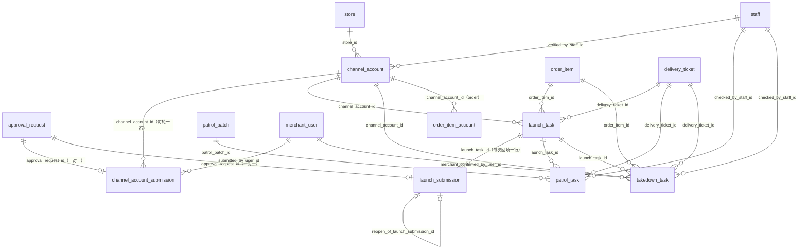
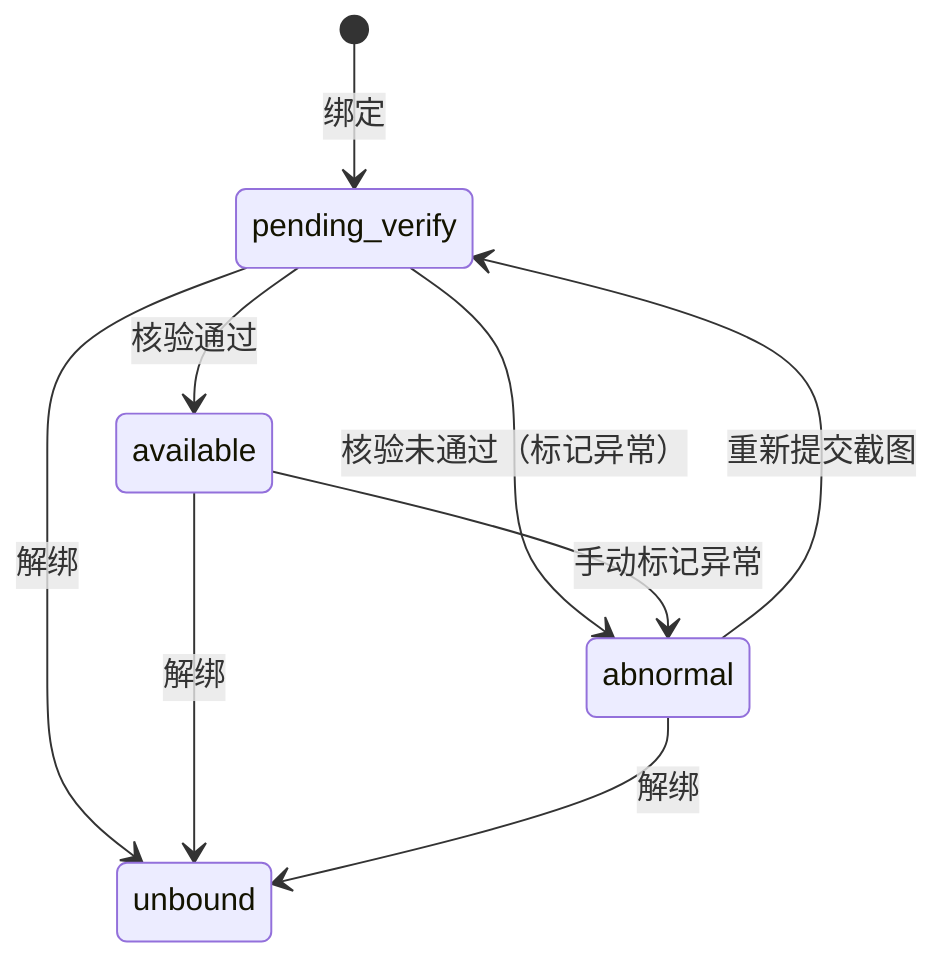
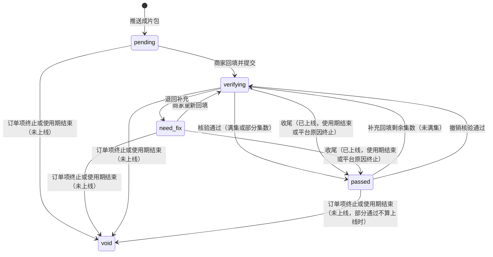
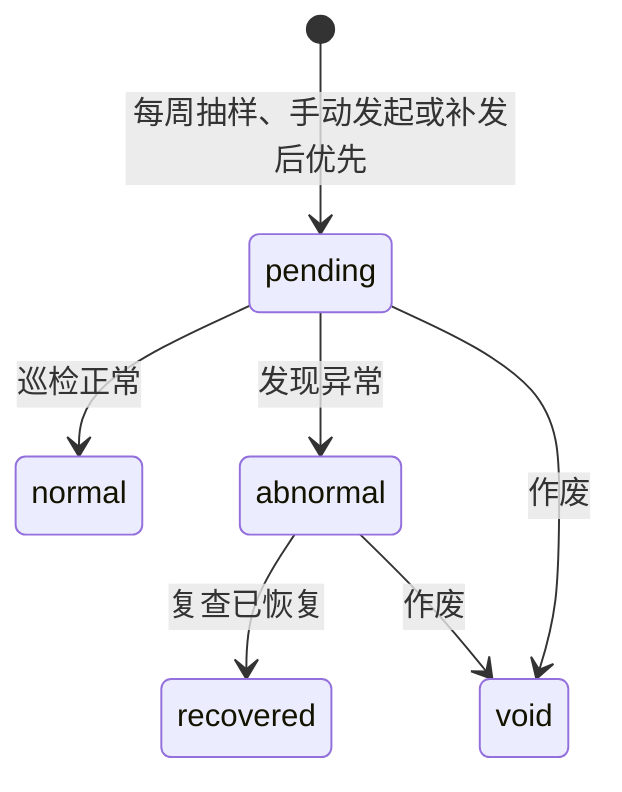
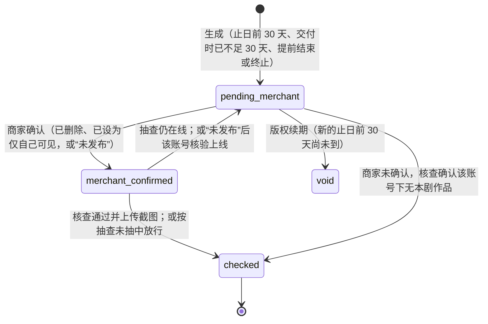

# 11 发布：渠道账号、上线、巡检、下架（publish）

| 项 | 内容 |
| --- | --- |
| 模块 | `publish`（L3 履约） |
| 表 | 7 张：`channel_account`、`channel_account_submission`、`launch_task`、`launch_submission`、`patrol_batch`、`patrol_task`、`takedown_task` |
| 依据 | 草案 `docs/appendix/design/d3-flow.md` 第 12–15 节（下文写作 d3:行号）；裁决 M4、M12、M17、M19、M31、M33、M34、M44，第二轮 M46–M49、M52、M53、M55、M56、M59、M60、M71–M73、M92，第三轮 M101、M102、M106、M109、M110；`catalogue.json` 的 conventions 与本分组 7 张表的 notes；`decisions.md` 第 1 节 #5、第 6 节；主文档 `docs/03-key-designs.md` 第 3.7 节（03:313-321）；PRD 第 2.5、6.10、7.7 节（PRD:180-186、586-624、800-810）；`d5-media.md` 第 3.2 节的文件分类（d5:271、277）；画板 `merchant/Accounts`、`merchant/Publish`、`merchant/LaunchRecord`、`admin/Accounts`、`admin/Verify`、`admin/Patrol`、`admin/Offline`、`admin/Overdue` |

## 1. 概览

这组表管“成片交到商家手里之后”的全部事实：发到哪个账号、有没有上线、上线后还在不在、到期后撤没撤。

- 粒度统一为“订单项 × 发布账号”：上线任务、回填、巡检、下架任务都落在“某部剧在某个账号上”（d3:1689）。
- V1.0 与抖音、视频号没有任何接口。回填、核验、巡检、下架核查都是人工动作，表里只存链接、清单结论与截图，不存平台密码或令牌（PRD:621；d3:2031）。
- “批没批”在统一审批单 `approval_request`，“核验的内容”在本分组的两张提交表：`channel_account_submission`（账号核验，M4）与 `launch_submission`（链接核验）。两张表各与审批单一对一。
- 处理人不复制到任务行上：链接核验单、巡检任务、下架任务的处理人一律读取时取所属交付工单的发布专员（`delivery_ticket.publisher_id`），行上只存不可变的 `delivery_ticket_id`（d3:242、3122）。员工禁用时它们随工单的“发布专员”这一在办来源（`ticket_publisher`，10 分组登记）一并移交，本模块不另登记在办来源。
- 账号核验除外：它没有交付工单，按权限点 `publish.account.verify` 进入角色队列，任何有权限的发布专员都能处理，禁用时不移交（d3:2352、3124）。不加指定处理人列（M106）。画板 admin/Accounts 队列卡片上的“发布专员”怎么显示是产品待确认项，见第 6 节。
- 跟进记录 `follow_up`（M3，归 staff）与人工催办限频 `manual_reminder_log`（M2，归 notify）不在本分组。

## 2. 表定义

通用说明：

- 主键 `id` 为 UUID v7，由应用生成，不设数据库默认值。
- `created_at`、`updated_at` 由应用时钟写入，不设数据库默认值（conventions“时间”）。草案的字段表没有列这两列，7 张表都按约定补上，下文“相对草案的改动”不再逐表重复。
- 草案主键与外键是 `bigint`，全部改为 `uuid`（decisions 第 1 节 #1），同样不逐表重复。
- 所有外键的删除行为都是 Restrict：本分组的行都是履约事实，不做物理删除。
- 除 `patrol_batch` 外的 6 张表都带 `entity_id`、`store_id`，创建时从来源行复制，之后不可变（conventions“归属列”）。对 `entity` 建单列外键 `fk_<表>_entity_id`；对 `store` 建复合外键 `(store_id, entity_id)` → `store (id, entity_id)`，名为 `fk_<表>_store_entity`（M47，引用 `store` 上的 `uq_store_id_entity_id`），库级保证门店属于该主体。下文各表不再逐条重复这一改动。
- 数组列（`uuid[]`）的“非空”由手写 SQL 的 `ALTER COLUMN … SET NOT NULL` 保证：Prisma 给标量数组列建的是只带默认值的可空列（M49）。元素不含 NULL、不重复由各表的 CHECK 调用函数 `lyx_11_uuid_array_is_set` 保证。数组列不建外键，一律经 `file_ref` 登记。
- 出处里的“约定”指 `catalogue.json` 的 conventions；“补”指草案没有、按规则或画板补的列。
- 本分组没有只增表，没有触发器；手写 SQL 只定义了一个供 CHECK 调用的函数 `lyx_11_uuid_array_is_set(uuid[])`。应用角色对 7 张表都是常规读写权限。
- 四个业务状态机写 `status_transition` 时的 `state_field`（M53）：`channel_account`、`patrol_task`、`takedown_task` 写 `status`；`launch_task` 写 `review_status`。
- 不变量按 `<命名空间>.<编号>` 登记（15 分组）：本模块自有的检查项为 `publish.I1`–`publish.I20`，module `publish`，severity 均为 P2，`subject_type` 为所在表名、`subject_id` 为行 id。沿用 d3 编号的通用项由登记方统一检查，本文只写本分组相关的部分：`flow.I12` 状态历史连续（01 分组登记）；`timers.I7` 定时器与主体状态一致（01 分组登记，本模块提供 `patrol_task`、`takedown_task` 的检查项）；`staff.I10` 已禁用员工名下没有在办事项（03 分组登记，本分组的任务经工单的发布专员计入，d3:3257 的 I13）；`media.I14` 登记的文件列都有 `file_ref` 引用（06 分组登记）。
- 检查项的登记（15 分组的 `InvariantCheck`）：本模块的检查项都是每日项，`modes: ['full']`，不写 `every`。`heal` 按各表不变量的“处理”列登记：“告警”为 `none`，“自愈并告警”为 `heal_and_alert`（`publish.I15`、`publish.I16`）；“自愈（补登记、取消孤儿）”是 `timers.I7` 的只自愈项，由 01 分组按 `heal_only` 登记，本模块只提供检查。检查对象都属于某个主体，`invariants.report` 一律传 `entityId`。本模块不直接调告警端口 `alerts.raise`。

### 2.1 `channel_account` 渠道账号

门店绑定的抖音号、视频号及其核验状态。只存当前值；每轮核验的填报、截图与比对结果在 `channel_account_submission`（M4）。归属：门店维度。主键：`id uuid`。不是只增表。业务状态机（machine = `channel_account`）。锁顺序：`lock_rank = 190`（履约子表段）。

| 列 | 类型 | 空 | 默认 | 说明 | 出处 |
| --- | --- | --- | --- | --- | --- |
| `id` | uuid | 否 | — | 主键 | d3:2011 |
| `entity_id` | uuid | 否 | — | 所属主体，创建时从门店复制，不可变 | d3:2012 |
| `store_id` | uuid | 否 | — | 所属门店。账号按门店绑定，订购时只能选下单门店的账号 | d3:2012；PRD:619 |
| `platform` | text | 否 | — | 平台：`douyin` 抖音、`wechat_channels` 视频号。创建后不可改 | d3:2013；PRD:613 |
| `account_name` | text | 否 | — | 账号名称（当前值），与平台主页一致 | d3:2014；PRD:614 |
| `account_uid` | text | 否 | — | 抖音号或视频号 ID（当前值），商家填写的原样 | d3:2015；PRD:615 |
| `account_uid_norm` | text | 否 | — | 账号 ID 去空格、转小写后的值。唯一性按它判定 | d3:2016 |
| `account_type` | text | 可 | — | 账号类型：`enterprise` 企业认证、`personal` 个人认证、`none` 未认证。核验时由发布专员按截图核定，核验通过前为空；商家在绑定表单里选的值只进当轮提交行的快照（M72） | d3:2017；PRD:617；M72 |
| `cert_subject_name` | text | 可 | — | 认证主体名称（企业认证时），核验时由发布专员填写 | d3:2018；画板 admin/Accounts 比对表 |
| `status` | text | 否 | — | 状态：`pending_verify` 待核验、`available` 可用、`abnormal` 异常、`unbound` 已解绑。只经 `flow.transition()` 迁移 | d3:2020；PRD:620 |
| `abnormal_source` | text | 可 | — | 异常来源：`verify` 核验未通过、`manual` 发布专员手动标记。仅 `status = abnormal` 时有值；重新提交或核验通过时清空 | d3:2021 |
| `abnormal_reason_code` | text | 可 | — | 异常原因，字典 `reject_reason`（场景 `account_verify`）的编码，不建外键 | d3:2022、2039；d6:1462 |
| `abnormal_note` | text | 可 | — | 异常说明，异常时必填。不超过 200 字，应用层校验 | d3:2023；画板 admin/Accounts 标记异常弹窗 |
| `submitted_at` | timestamptz | 否 | — | 最近一轮提交核验的时间；首次即绑定时间 | d3:2024 |
| `verified_at` | timestamptz | 可 | — | 最近一次核验通过的时间。之后被标记异常或重新提交时保留 | d3:2024 |
| `verified_by_staff_id` | uuid | 可 | — | 最近一次核验通过的发布专员，指向 `staff` | d3:2025；约定“操作人列” |
| `unbound_at` | timestamptz | 可 | — | 解绑时间。解绑后该行不再占用账号唯一键，同一账号可重新绑定（新建一行） | d3:2024 |
| `lock_version` | integer | 否 | 0 | 乐观锁版本号 | d3:2026 |
| `created_at` | timestamptz | 否 | — | 创建时间 | 约定“时间” |
| `updated_at` | timestamptz | 否 | — | 最近更新时间 | 约定“时间” |

**键与索引**

- 主键：`pk_channel_account (id)`。
- 外键：`entity_id` → `entity.id`（Restrict，`fk_channel_account_entity_id`）；`(store_id, entity_id)` → `store (id, entity_id)`（Restrict，`fk_channel_account_store_entity`，M47）；`verified_by_staff_id` → `staff.id`（Restrict，`fk_channel_account_verified_by_staff_id`）。
- 普通索引：`ix_channel_account_store_id_status (store_id, status)`，商家端账号列表、订购页取本店可用账号、后台商家详情。

**手写约束**

| 名称 | 规则 |
| --- | --- |
| `ck_channel_account_platform` | `platform` ∈ {`douyin`,`wechat_channels`} |
| `ck_channel_account_account_type` | `account_type` ∈ {`enterprise`,`personal`,`none`} |
| `ck_channel_account_status` | `status` ∈ {`pending_verify`,`available`,`abnormal`,`unbound`} |
| `ck_channel_account_abnormal_source` | `abnormal_source` ∈ {`verify`,`manual`} |
| `ck_channel_account_account_uid_norm` | `account_uid_norm` 非空串、已转小写、不含空白。规范化本身在应用层做，这里只挡明显没做的情况 |
| `ck_channel_account_abnormal_fields` | 异常时来源、原因、说明三列齐全；待核验与可用时三列为空（已解绑的行保留解绑前的值） |
| `ck_channel_account_verified` | `verified_at` 与 `verified_by_staff_id` 同有同无；`status = available` 时两列与 `account_type` 都非空 |
| `ck_channel_account_unbound` | `status = unbound` ⇔ `unbound_at` 非空 |
| `uq_channel_account_platform_uid_active` | 部分唯一索引 `(platform, account_uid_norm) WHERE status <> 'unbound'`：同一账号不能同时绑定两家门店（PRD:619） |

只在应用层校验的：账号名称与说明的字数；企业认证账号的认证主体须与营业执照主体一致才能通过，个人认证与未认证账号不比对主体（d3:2048）；绑定的门店闸门（d3:2037）；解绑的守卫（d3:2042，按账号取未核查的下架任务走 `ix_takedown_task_channel_account_id_status`）。

业务口径未定、但不影响表结构的两点：个人认证或未认证的账号能否作为被授权账号（d3:2048，待法务；现按三种类型都可核验通过）；主体名称经变更重审后已核验的账号是否要重新核验（d9:613，现不联动；要联动时由 profile 的事件触发“手动标记异常”或新一轮核验）。

**状态机**（每次迁移写 `status_transition`，machine = `channel_account`，`state_field = status`（M53）；同事务补写一条活动流的审计行，M31）

| 当前状态 | 事件 | 新状态 | 守卫 | 触发者 | 同事务的写入 |
| --- | --- | --- | --- | --- | --- |
| — | `account.bind` | `pending_verify` | 门店闸门：首店资质已提交即可，新增门店须已通过（d3:2037）；账号唯一键不冲突；平台、账号名称、账号 ID、账号类型、主页截图都已填（PRD:613-617） | 商家（老板） | 建第 1 轮 `channel_account_submission`（`kind = new_binding`，快照含商家选的账号类型，M72）与核验审批单（`kind = channel_account`，时限策略 `review.channel_account`，参数键 `sla.review.channel_account`，值 `{ amount, unit }`，默认 1 个工作日）；写 `submitted_at`；发 `account.submitted` |
| `pending_verify` | `account.verify_pass` | `available` | 比对表没有不一致项；已填账号类型（d3:2038） | 发布专员（`publish.account.verify`） | 审批单 → `approved`；提交行写 `compare_result`；本行写发布专员核定的 `account_type`（M72）、`cert_subject_name`、`verified_at`、`verified_by_staff_id`；发 `account.verified` |
| `pending_verify` | `account.verify_reject` | `abnormal` | 原因（字典）与说明必填 | 发布专员 | 审批单 → `rejected`（原因与说明同时写在审批单上）；提交行写 `compare_result`；本行写异常三列，`abnormal_source = verify`；发 `account.abnormal` |
| `abnormal` | `account.resubmit` | `pending_verify` | 重新上传主页截图；账号名称与账号 ID 不可改（d3:2040；改账号 ID 等于换账号，走解绑后重新绑定），账号类型可重选（画板 admin/Accounts 的退回说明“请修改账号类型”） | 商家（老板） | 新一轮提交行（`round_no + 1`，`kind = resubmit`，快照记当轮的值）与核验审批单；清空异常三列；写 `submitted_at`；发 `account.submitted` |
| `available` | `account.mark_abnormal` | `abnormal` | 原因与说明必填 | 发布专员（`publish.account.mark_abnormal`） | 写异常三列，`abnormal_source = manual`。新订购与新方案不可选，不影响在办订单（d3:2041）；发 `account.abnormal` |
| 任意未解绑状态（`pending_verify`、`available`、`abnormal`） | `account.unbind` | `unbound` | 不存在引用该账号且阶段为待开工、制作中、待上线、上线中的订单项；不存在该账号上未核查的下架任务（d3:2042） | 商家（老板） | 写 `unbound_at`；在途核验审批单置 `withdrawn`；发 `account.unbound` |

事件名取自 d3 的出站事件目录（d3:2730）并补齐，以 `packages/shared` 的状态迁移表为准。巡检异常不自动改账号状态（d3:1909）。

**不变量**（每日校验）

| 编号 | 不变量 | 处理 |
| --- | --- | --- |
| `publish.I1` | `order_item_account` 引用的账号与订单项属于同一门店（d3:3254 的 I10；未解绑账号按 `(platform, account_uid_norm)` 唯一已由部分唯一索引保证，不再巡检） | 告警 |
| `publish.I2` | `pending_verify` 的账号恰有一张 `pending` 的核验审批单，且指向 `round_no` 最大的提交行；其余状态没有在途核验单 | 告警 |
| `flow.I12` | 状态历史连续：最后一行的 `to_state` = 当前 `status`（d3:3256，01 分组统一检查） | 告警 |

`entity_id` 与 `store.entity_id` 一致已由复合外键保证（M47），不再列为每日校验。

**相对草案的改动**

| 改动 | 依据 |
| --- | --- |
| 删 `screenshot_file_ids`，移到 `channel_account_submission` | M4：截图文件存在每轮的提交行 |
| `verified_by` 改名 `verified_by_staff_id`，建外键 | 约定“操作人列” |
| 比对表不再存审批单的 `result.compare`（d3:2046），移到提交行的 `compare_result` | M4；审批单已收窄，不承载领域内容（decisions 第 1 节 #5） |
| `abnormal_reason_code` 的字典写作 `reject_reason`（场景 `account_verify`） | d6:1462 是字典的定义方；d3:2039 写作 `ACCOUNT_REJECT` |
| 补 4 条 CHECK：`ck_channel_account_account_uid_norm`、`ck_channel_account_abnormal_fields`、`ck_channel_account_verified`、`ck_channel_account_unbound` | WRITER-GUIDE 第 4 节；规则原本只在状态机的守卫里（d3:2037-2042） |

### 2.2 `channel_account_submission` 账号核验提交

渠道账号每提交或重新提交一次核验一行，记当轮填报快照、主页截图与比对结果；与审批单一对一。按 R3，“核验的内容”在本表，“批没批”在审批单。归属：门店维度。主键：`id uuid`。不是只增表。没有自己的状态列。锁顺序：不参与（`lock_rank = null`，只在持有渠道账号与对应审批单行锁的事务里修改）。

| 列 | 类型 | 空 | 默认 | 说明 | 出处 |
| --- | --- | --- | --- | --- | --- |
| `id` | uuid | 否 | — | 主键 | M4 |
| `entity_id` | uuid | 否 | — | 所属主体，创建时从渠道账号复制，不可变 | 约定“归属列” |
| `store_id` | uuid | 否 | — | 所属门店，创建时从渠道账号复制，不可变 | 约定“归属列” |
| `channel_account_id` | uuid | 否 | — | 渠道账号 | M4；M33 |
| `round_no` | integer | 否 | — | 该账号的第几轮核验，从 1 递增。与审批单的 `round_no` 相同（同为 integer） | d3:2037、2040；M34 |
| `kind` | text | 否 | — | 轮次类型：`new_binding` 新绑定、`resubmit` 重新提交。第 1 轮为新绑定，之后为重新提交 | M4；d3:2040；画板 admin/Accounts 队列卡片 |
| `filled_snapshot` | jsonb | 否 | — | 当轮填报快照（平台、账号名称、账号 ID、商家选的账号类型），结构见第 4 节。提交后不可改 | M4；M72；d3:2013-2015；PRD:613-617 |
| `screenshot_file_ids` | uuid[] | 否 | `{}` | 当轮主页截图（`file_object` 的 id，分类 `channel_screenshot`），至少 1 张，不重复。经 `file_ref` 登记 | M4；d3:2019；PRD:616；d5:277 |
| `compare_result` | jsonb | 可 | — | 比对结果 `[{ field, filled, recognized, match }]`，核验决定（通过或标记异常）时写入，结构见第 4 节。V1.0 的识别值由发布专员看截图后手填 | M4；d3:2046 |
| `approval_request_id` | uuid | 否 | — | 对应的核验审批单（`kind = channel_account`），一对一 | M4；R3；catalogue cross_module_fks |
| `submitted_by_user_id` | uuid | 否 | — | 提交人（商家用户，老板），指向 `merchant_user` | 补：d3:2037、2040 的触发者都是商家；约定“操作人列” |
| `submitted_at` | timestamptz | 否 | — | 提交时间 | 补：画板 admin/Accounts 队列卡片“提交时间”；d3:2024 |
| `created_at` | timestamptz | 否 | — | 创建时间 | 约定“时间” |
| `updated_at` | timestamptz | 否 | — | 最近更新时间 | 约定“时间” |

**键与索引**

- 主键：`pk_channel_account_submission (id)`。
- 外键：`entity_id` → `entity.id`（`fk_channel_account_submission_entity_id`）；`(store_id, entity_id)` → `store (id, entity_id)`（`fk_channel_account_submission_store_entity`，M47）；`channel_account_id` → `channel_account.id`（`fk_channel_account_submission_channel_account_id`）；`approval_request_id` → `approval_request.id`（`fk_channel_account_submission_approval_request_id`，L3 → L1）；`submitted_by_user_id` → `merchant_user.id`（`fk_channel_account_submission_submitted_by_user_id`）。都是 Restrict。
- 唯一约束：`uq_channel_account_submission_approval_request_id (approval_request_id)`，与审批单一对一；`uq_channel_account_submission_channel_account_id_round_no (channel_account_id, round_no)`，也供“按账号取各轮记录、取最新一轮”。
- 无其他索引：队列从审批单进入，按 `approval_request_id` 取本行。

**手写约束**

| 名称 | 规则 |
| --- | --- |
| `ck_channel_account_submission_kind` | `kind` ∈ {`new_binding`,`resubmit`} |
| `ck_channel_account_submission_round_no` | `round_no >= 1`，且第 1 轮 ⇔ `kind = new_binding` |
| `ck_channel_account_submission_screenshot_file_ids` | 主页截图至少 1 张；不含 NULL、不重复（`lyx_11_uuid_array_is_set`） |
| `ck_channel_account_submission_filled_snapshot` | `filled_snapshot` 是 JSON 对象，且含 `platform`、`accountName`、`accountUid`、`accountType` 四个键 |
| `ck_channel_account_submission_compare_result` | `compare_result` 为空或是非空 JSON 数组 |
| 数组列非空 | `screenshot_file_ids` `SET NOT NULL` |

写入规则：

- 行与审批单在同一事务里建（先建审批单，审批单的对象是渠道账号，`subject_type = channel_account`）。
- 审批单的提交（03 分组的规则）：本模块登记的 `channel_account` 处理器在 `approval.submit` 里生成 `summary_snapshot`，必有 `title`（如“抖音 · 账号名称”），`domain = { type: 'channel_account_submission', id }`，不含截图与比对内容；队列上的角标（如比对异常）读队列时从本表派生，不进快照。`dedupe_key` 必填（见下），`delivery_ticket_id` 为空，`round_no` 取本行的 `round_no`。提交人是商家：`submit_actor_type = merchant`，`submit_client` 为 `weapp` 或 `portal`。审批单的编号、对象、归属、摘要、提交人等列创建后不可改（`trg_approval_request_immutable`），本模块只经审批的迁移写决定列。
- 建行之后只写一次 `compare_result`，与审批决定同事务；其余列不可改（应用层保证）。
- `compare_result` 各项的 `filled`（商家填报值）：账号名称、账号 ID、账号类型取本行 `filled_snapshot`；认证主体取核验决定时主体的名称（`entity.name`），写入后即冻结，主体以后改名不影响这一轮的比对记录；账号状态没有填报值，为 null。
- 在途去重走审批单的去重索引（`dedupe_key = channel_account:{账号 id}`，只覆盖 `pending`，M12）：账号核验没有执行步，本表不设 `closed_at`。
- 结论、原因、说明、清单结论（模板 `account.verify`）、决定人与时间都在审批单上，本表不重复存。
- 账号解绑时在途审批单置 `withdrawn`，本行保留。

**不变量**

| 编号 | 不变量 | 处理 |
| --- | --- | --- |
| `publish.I3` | 每行对应的审批单 `kind = channel_account`、`subject_id` = 本行的 `channel_account_id`、`round_no` 相同 | 告警 |
| `publish.I4` | 审批单已决定（通过或驳回）⇒ `compare_result` 非空 | 告警 |
| `publish.I5` | `entity_id`、`store_id` 与所属渠道账号一致 | 告警 |
| `media.I14` | `screenshot_file_ids` 里的每个文件在 `file_ref` 里都有登记（06 分组统一检查，本分组在 `FILE_REF_TYPES` 登记这一列） | 告警 |

**相对草案的改动**

| 改动 | 依据 |
| --- | --- |
| 新表，草案没有 | M4 |
| 承接草案 `channel_account.screenshot_file_ids`（d3:2019）与审批单里的比对表（d3:2046） | M4 |
| 列名与取值为本稿所定：`kind`（`new_binding` / `resubmit`）、`filled_snapshot`、`compare_result` | catalogue notes：“列名与取值在字段级阶段定” |
| `filled_snapshot` 含商家选的账号类型；重新提交可改账号类型 | M72；PRD:617；画板 admin/Accounts |

### 2.3 `launch_task` 上线任务

粒度“订单项 × 发布账号”，推送成片包时为每个发布账号建一行（d3:1650）。`is_live` 表达“已上线”这个事实，`review_status` 只表达最近一轮回填审到哪了；巡检候选、下架任务、工单求值都只看 `is_live`（d3:1734）。归属：门店维度。主键：`id uuid`。不是只增表。业务状态机（machine = `launch_task`，状态列 `review_status`）。锁顺序：`lock_rank = 230`。

| 列 | 类型 | 空 | 默认 | 说明 | 出处 |
| --- | --- | --- | --- | --- | --- |
| `id` | uuid | 否 | — | 主键 | d3:1695 |
| `entity_id` | uuid | 否 | — | 所属主体，创建时从订单项复制，不可变 | d3:1700 |
| `store_id` | uuid | 否 | — | 所属门店，创建时从订单项复制，不可变 | d3:1700 |
| `order_item_id` | uuid | 否 | — | 订单项 | d3:1696 |
| `delivery_ticket_id` | uuid | 否 | — | 所属交付工单，不可变。处理人读取时取该工单的发布专员 | d3:1697；M17 |
| `channel_account_id` | uuid | 否 | — | 发布账号 | d3:1698 |
| `platform` | text | 否 | — | 平台：`douyin`、`wechat_channels`。创建时从账号复制 | d3:1699 |
| `review_status` | text | 否 | — | 最近一轮回填的审核结果：`pending` 待回填、`verifying` 核验中、`need_fix` 需补充、`passed` 已通过、`void` 已作废 | d3:1703；PRD:601 |
| `is_live` | boolean | 否 | false | 是否已上线。一旦为真，不因之后的补充回填或退回变回假；只有“撤销核验通过”能让它变回假 | d3:1704、1775 |
| `went_live_at` | timestamptz | 可 | — | 首次变为已上线的时间；撤销后清空 | d3:1705 |
| `current_round_no` | integer | 否 | 0 | 当前回填轮次号；尚未回填为 0。每建一行 `launch_submission` 加 1 | d3:1706；M34 |
| `first_launch_date` | date | 可 | — | 该账号核验通过的实际上线首日 = 各已通过回填的 `actual_launch_date` 的最小值 | d3:1707、1786 |
| `verified_episode_count` | integer | 否 | 0 | 已核验通过的集数（累计），取最近一条已通过回填的核验集数 | d3:1708、1785；M59 |
| `completed_at` | timestamptz | 可 | — | 全部集数核验通过的时间 | d3:1709 |
| `last_patrolled_at` | timestamptz | 可 | — | 最近一次巡检给出结论的时间。每周抽样按它排“最久未巡检优先” | d3:1710、1892 |
| `last_patrol_result` | text | 可 | — | 最近一次巡检结论：`normal` 正常、`abnormal` 异常、`recovered` 已恢复 | d3:1711、1903、1906 |
| `void_reason` | text | 可 | — | 作废原因：`terminated` 订单项终止、`usage_expired` 使用期已结束、`account_changed` 发布账号变更。仅 `review_status = void` 时有值 | d3:1712 |
| `created_at` | timestamptz | 否 | — | 创建时间（推送成片包的时间） | 约定“时间” |
| `updated_at` | timestamptz | 否 | — | 最近更新时间 | 约定“时间” |

**键与索引**

- 主键：`pk_launch_task (id)`。
- 外键：`entity_id` → `entity.id`（`fk_launch_task_entity_id`）；`(store_id, entity_id)` → `store (id, entity_id)`（`fk_launch_task_store_entity`，M47）；`order_item_id` → `order_item.id`（`fk_launch_task_order_item_id`，同层）；`delivery_ticket_id` → `delivery_ticket.id`（`fk_launch_task_delivery_ticket_id`，同层）；`channel_account_id` → `channel_account.id`（`fk_launch_task_channel_account_id`）。都是 Restrict。
- `(order_item_id, channel_account_id)` 逻辑上对到 `order_item_account` 的复合主键，不建外键（被引用表是复合主键），由不变量校验。
- 唯一约束：`uq_launch_task_order_item_id_channel_account_id (order_item_id, channel_account_id)`；按订单项取全部任务（工单求值、上线记录页）也用它。
- 普通索引：`ix_launch_task_review_status (review_status)`，逾期跟踪与流程扫描按状态取；`ix_launch_task_channel_account_id (channel_account_id)`，解绑守卫、账号“使用情况”；`ix_launch_task_store_id_review_status (store_id, review_status)`，商家端发布任务页签与待办。

**手写约束**

| 名称 | 规则 |
| --- | --- |
| `ck_launch_task_platform` | `platform` ∈ {`douyin`,`wechat_channels`} |
| `ck_launch_task_review_status` | `review_status` ∈ {`pending`,`verifying`,`need_fix`,`passed`,`void`} |
| `ck_launch_task_last_patrol_result` | `last_patrol_result` ∈ {`normal`,`abnormal`,`recovered`} |
| `ck_launch_task_void_reason` | `void_reason` ∈ {`terminated`,`usage_expired`,`account_changed`} |
| `ck_launch_task_counts` | `current_round_no >= 0`、`verified_episode_count >= 0` |
| `ck_launch_task_void` | 作废 ⇔ `void_reason` 非空；作废的任务 `is_live` 为假（只作废未上线的任务，d3:849、853；已上线的任务走 `launch.settle`） |
| `ck_launch_task_live` | `is_live` ⇔ `went_live_at` 非空；`is_live` ⇒ `verified_episode_count > 0`（`publish.I6` 的行内部分） |
| `ck_launch_task_verified` | `first_launch_date` 为空 ⇔ `verified_episode_count = 0` |
| `ck_launch_task_round` | `pending` ⇒ 轮次为 0；`verifying`、`need_fix`、`passed` ⇒ 轮次 ≥ 1 |
| `ck_launch_task_completed` | `completed_at` 非空 ⇒ `is_live` 且 `review_status = passed` |
| `ck_launch_task_patrol` | `last_patrolled_at` 与 `last_patrol_result` 同有同无 |
| `ix_launch_task_order_item_id_live` | 部分索引 `(order_item_id) WHERE is_live`；巡检候选、下架任务生成、订单项的已上线集数与上线首日重算 |

列间关系的 CHECK 按语句求值：核验通过、撤销这类处理必须用一条 UPDATE 同时写状态列与伴随列（如 `is_live` 与 `went_live_at`）。

**状态机**（每次迁移写 `status_transition`，machine = `launch_task`，`state_field = review_status`（M53）；`is_live` 的变化记在迁移行的载荷里）

| 当前状态 | 事件 | 新状态 | 守卫 | 触发者 | 同事务的写入 |
| --- | --- | --- | --- | --- | --- |
| — | `launch.create` | `pending` | 推送成片包的四项守卫（d3:1639-1644） | 系统（发布专员推送成片包） | 每个发布账号一行 |
| `pending`、`need_fix`、`passed`（未满集） | `launch.submit` | `verifying` | 带幂等键；工单未暂停且在待上线、上线核验或服务中；今天未过使用期止日；链接通过校验；`actual_launch_date` 不晚于今天、不早于成片交付日、不晚于止日；声明集数不小于已核验集数、不大于订购集数（d3:1754） | 商家（老板） | `current_round_no + 1`；建 `launch_submission` 与核验审批单（`kind = launch_link`，时限策略 `review.launch_link`，参数键 `sla.review.launch_link`，默认 1 个工作日；带 `delivery_ticket_id`）；`reevaluate(工单)`；发 `launch.submitted` |
| `verifying` | `launch.verify_pass` | `passed` | 工单未暂停，且在待上线、上线核验或服务中（未进入到期下架、未终止）；清单 `launch.verify` 全部通过；填写核验集数（d3:1755） | 发布专员（`publish.link.verify`） | 回填行 `result = passed` 或 `passed_partial`；本行写 `verified_episode_count`、`first_launch_date`，满集写 `completed_at`；`is_live = is_live OR 满集 OR 参数 launch.partial_goes_live`，首次为真时写 `went_live_at`；订单项重算已上线集数与使用期起点；该账号未核查的下架任务按改写后的 `is_live` 重算 `basis`（见 2.7“依据重算”）；`reevaluate(工单)`；发 `launch.verified`（d3:1783-1792） |
| `verifying` | `launch.return` | `need_fix` | 原因（字典 `reject_reason`，场景 `link_verify`）至少 1 项，说明必填（审批单驳回必带 `decision_note`，03 分组的 `ck_approval_request_decision`） | 发布专员 | 审批单 → `rejected`；回填行 `result = returned`；`is_live` 不变；`reevaluate(工单)`；发 `launch.returned` |
| `passed` | `launch.verify_revoke` | `verifying` | 撤销的是该任务最近一条已通过的回填；距核验决定不超过 1 个工作日（参数 `launch.verify_revoke_window`）；该订单项没有已确认或已核查的下架任务；工单在服务中、未暂停（d3:1842-1844；d3:855 第 21 行） | 发布主管或交付主管（`publish.link.verify_revoke`） | 被撤销的回填行 `result = revoked`；复制它的内容新建一行（见 2.4）并建新一轮核验审批单，`current_round_no + 1`；`verified_episode_count`、`first_launch_date`、`completed_at` 按剩余的已通过回填重算，没有剩余时 `is_live = false`、清空 `went_live_at`；名下未完成的巡检任务作废；该账号未核查的下架任务按改写后的 `is_live` 重算 `basis`；发 `launch.verify_revoked`（d3:1845-1852） |
| `pending`、`need_fix`、`verifying`、`passed` | `launch.void` | `void` | `NOT is_live`；订单项终止（d3:853-854 第 19、20 行），或使用期结束（第 15、15b 行） | 系统 | 写 `void_reason`（`terminated` 或 `usage_expired`）；有在途核验审批单的撤回（→ `withdrawn`），对应回填行 `result = withdrawn`；发 `launch.voided` |
| `verifying`、`need_fix` | `launch.settle` | `passed` | `is_live`；订单项进入到期下架（第 15 行），或已上线订单项因平台原因终止（第 20 行） | 系统 | `verifying` 时在途核验审批单撤回（→ `withdrawn`），对应回填行 `result = withdrawn`；`is_live`、已核验集数、上线首日不变；发 `launch.settled` |

说明：

- 双平台时各账号独立核验（d3:1777）。某个任务 `is_live` 为真之后，无论它或别的任务之后如何回填、退回，工单都留在服务中。
- 部分集数通过是否即算已上线由参数 `launch.partial_goes_live` 控制，默认为真（d3:1761）。置为假时会出现“`passed`、未满集、`is_live` 为假”的任务。草案的状态图没有给它画作废的边；按 d3:849“未上线的上线任务作废”，迁移表的 `launch.void` 已含 `passed`（守卫 `NOT is_live`）。
- **使用期结束与终止时的收尾**：订单项进入到期下架（第 15、15b 行）或被终止（第 19、20 行）时，由 delivery 在同一事务里调用本模块，逐条处理该订单项未作废的上线任务：未上线的走 `launch.void`；已上线、但还停在补充回填核验中或需补充的走 `launch.settle`，撤回在途的补充核验单，任务回到 `passed`（之前已通过的回填仍是有效事实）；已上线且 `passed` 的不动。之后再调 `ensureTakedownTasks`（2.7）。这样“待核验上线”队列与商家的“需补充”待办里不会留下已过使用期的任务，`launch.verify_pass` 的守卫也挡住了到期后才处理的核验单。
- `account_changed` 在 V1.0 没有正常路径：发布账号只能在推送成片包之前变更（d3:1170），那时还没有上线任务。它只供人工纠偏使用；唯一约束覆盖全部行（含作废的），纠偏改回原账号时恢复原行而不是新建。
- 逾期未上线是派生判定，不落库（d3:1814）。后台“逾期跟踪”的“近 30 天逾期 N 单、平均逾期天数、其中已上线 M 单”（画板 admin/Overdue）同样派生，口径：对每条上线任务，起算日取 `max(约定上线日次日, 成片交付次日)`（d3:1816），按本表的状态历史（`status_transition`，M31 规定它供指标使用）取 `review_status ∈ {pending, need_fix}` 且未上线的区间，与“起算日至今”求交，得到逾期天数；近 30 天内有逾期天数的订单项计入，按订单项取各任务的最大值求平均，“已上线”看当前是否有 `is_live` 的任务。约定上线日在首个账号核验通过前可以改期（d3:1171），改期由 `delivery.rescheduleLaunch` 写审计，统计时按审计还原改期前的约定日，改期前已发生的逾期照样计入。不为这项指标加列。

**不变量**（每日校验）

| 编号 | 不变量 | 处理 |
| --- | --- | --- |
| `publish.I6` | `is_live` ⇒ 已核验集数 > 0 且存在已通过的回填；工单在服务中 ⇒ 至少一条任务 `is_live`；工单在待上线或上线核验 ⇒ 没有任务 `is_live`（d3:3260 的 I16） | 告警 |
| `publish.I7` | 每条任务的 `(order_item_id, channel_account_id)` 在 `order_item_account` 里存在（`account_changed` 作废的除外）；任务、订单项、账号属于同一门店；`platform` 与账号一致（d3:3254 的 I10） | 告警 |
| `publish.I8` | `verified_episode_count`、`first_launch_date` 与该任务已通过回填算出的值一致；`current_round_no` = 回填行的最大 `round_no`；`verifying` ⇔ 存在 `result = pending` 的回填行 | 告警 |
| `publish.I9` | `delivery_ticket_id` 是该订单项的工单；`verified_episode_count` 不大于订购集数；工单已进入到期下架、已归档或已终止 ⇒ 名下任务只有 `passed`（且 `is_live`）与 `void` 两种 | 告警 |
| `flow.I12` | 状态历史连续（d3:3256，01 分组统一检查） | 告警 |

d3:3250 的 I6 里“上线中的订单项 `usage_start_date` = 各已上线任务 `first_launch_date` 的最小值”这一部分校验的是 `order_item` 的列，由 09 分组登记，本分组不重复。

**相对草案的改动**

| 改动 | 依据 |
| --- | --- |
| `ticket_id` 改名 `delivery_ticket_id`，建外键 | M17；catalogue cross_module_fks（同层） |
| 删 `executor_type`、`executor_id`（V1.1 代发布） | 01:176；catalogue notes |
| `current_round` 改名 `current_round_no` | M34：轮次叫 `<含义>_no` |
| 补 6 条 CHECK：`ck_launch_task_void`、`ck_launch_task_live`、`ck_launch_task_verified`、`ck_launch_task_round`、`ck_launch_task_completed`、`ck_launch_task_patrol` | WRITER-GUIDE 第 4 节；d3:1734、1775、1783-1792、3260 |
| `last_patrol_result` 定为三值枚举并写 CHECK | 草案只写了 `text`（d3:1711）；取值按巡检的三种结论（d3:1903-1906） |
| `current_round_no`、`verified_episode_count` 由 `smallint` 改 `integer` | M59（集数一律 integer）；轮次号与审批单的 `round_no` 同型 |
| 迁移表补 `passed → void`（守卫 `NOT is_live`）与 `launch.settle`（已上线任务的在途补充轮在使用期结束或平台原因终止时收尾）；`launch.verify_pass` 补“工单未进入到期下架、未终止”的守卫；`launch.verify_revoke` 补“工单在服务中” | 草案状态图缺这三处（d3:1747-1749 的作废边只覆盖未上线任务，d3:848-854 第 15、20 行没写已上线任务的在途核验单怎么处理）；复核意见 A、B |
| `launch.return` 要求说明必填 | 审批单驳回必带 `decision_note`（03 分组的请求与 CHECK）；d3:1756 只要求原因 |

### 2.4 `launch_submission` 链接回填

上线任务每次回填一行：合集链接或逐集链接、声明已发布的集数、实际上线日期；与核验审批单一对一。回填内容在本表，结论在审批单（R3）。归属：门店维度。主键：`id uuid`。不是只增表。`result` 是本轮结果，不写状态历史。锁顺序：不参与（`lock_rank = null`，只在持有上线任务与对应审批单行锁的事务里修改）。

| 列 | 类型 | 空 | 默认 | 说明 | 出处 |
| --- | --- | --- | --- | --- | --- |
| `id` | uuid | 否 | — | 主键。审批单的 `subject_id` 指它（`subject_type = launch_submission`） | d3:1718 |
| `entity_id` | uuid | 否 | — | 所属主体，创建时从上线任务复制，不可变 | 约定“归属列”；catalogue tenant = store |
| `store_id` | uuid | 否 | — | 所属门店，创建时从上线任务复制，不可变 | 同上 |
| `launch_task_id` | uuid | 否 | — | 上线任务 | d3:1719 |
| `round_no` | integer | 否 | — | 该上线任务的第几轮回填，从 1 递增。与审批单的 `round_no` 相同（同为 integer） | d3:1720；M34 |
| `link_kind` | text | 否 | — | 链接形态：`collection` 合集链接、`episodes` 逐集链接 | d3:1721；PRD:600 |
| `collection_url` | text | 可 | — | 合集链接。只接受 `https`，长度不超过 2000 | d3:1722、1759 |
| `episode_urls` | jsonb | 可 | — | 逐集链接 `[{ episodeNo, url }]`，结构见第 4 节 | d3:1723 |
| `reported_episode_count` | integer | 否 | — | 本次声明已发布的集数（累计），≥ 1 | d3:1724；M59 |
| `actual_launch_date` | date | 否 | — | 商家填报的实际上线日期（首批发布日期），不晚于回填当天 | d3:1725；PRD:600 |
| `submit_actor_type` | text | 否 | — | 提交人类型：`merchant`、`staff`、`system`、`partner`。V1.0 只有 `merchant`（老板） | d3:1726；约定“操作人列”；M44 |
| `submit_actor_id` | uuid | 可 | — | 提交人 id；`system` 时为空。多态，不建外键 | 同上 |
| `submit_client` | text | 可 | — | 提交的客户端来源：`weapp`、`portal`、`admin`；系统动作为空，其余必有（商家为 `weapp` 或 `portal`，员工为 `admin`） | 同上 |
| `submitted_at` | timestamptz | 否 | — | 回填时间 | d3:1727 |
| `approval_request_id` | uuid | 否 | — | 对应的核验审批单（`kind = launch_link`），一对一 | d3:1728；catalogue notes |
| `result` | text | 否 | `pending` | 本轮结果：`pending` 核验中、`passed` 满集通过、`passed_partial` 部分集数通过、`returned` 退回补充、`revoked` 通过后被撤销、`withdrawn` 核验单被撤回（订单项终止或使用期结束时作废任务或收尾，见 2.3） | d3:1729 |
| `verified_episode_count` | integer | 可 | — | 本轮核验通过的集数（累计）；通过时写入，被撤销后保留 | d3:1730；M59 |
| `evidence_file_ids` | uuid[] | 否 | `{}` | 链接核验截图（`file_object` 的 id，分类 `evidence`），选填，不重复。经 `file_ref` 登记 | 补：d5:271 把“链接核验截图”列为 `evidence` 分类的用途，草案没有落点；主文档与草案都没有要求链接核验留截图（03:318），所以选填 |
| `reopen_of_launch_submission_id` | uuid | 可 | — | 撤销核验通过后重开的行，指向被撤销的那一行；商家回填的行为空 | 补：d3:1845“新建一轮核验单”与回填行、审批单一对一（R3）两条叠加的结果，见下 |
| `created_at` | timestamptz | 否 | — | 创建时间 | 约定“时间” |
| `updated_at` | timestamptz | 否 | — | 最近更新时间 | 约定“时间” |

**键与索引**

- 主键：`pk_launch_submission (id)`。
- 外键：`entity_id` → `entity.id`（`fk_launch_submission_entity_id`）；`(store_id, entity_id)` → `store (id, entity_id)`（`fk_launch_submission_store_entity`，M47）；`launch_task_id` → `launch_task.id`（`fk_launch_submission_launch_task_id`）；`approval_request_id` → `approval_request.id`（`fk_launch_submission_approval_request_id`，L3 → L1）；`reopen_of_launch_submission_id` → `launch_submission.id`（`fk_launch_submission_reopen_of_launch_submission_id`，自引用）。都是 Restrict。
- 唯一约束：`uq_launch_submission_launch_task_id_round_no (launch_task_id, round_no)`，也供“按任务取各轮回填、取最近一条已通过的回填”；`uq_launch_submission_approval_request_id (approval_request_id)`，与审批单一对一；`uq_launch_submission_reopen_of_launch_submission_id (reopen_of_launch_submission_id)`，一行至多被重开一次。

**手写约束**

| 名称 | 规则 |
| --- | --- |
| `ck_launch_submission_link_kind` | `link_kind` ∈ {`collection`,`episodes`} |
| `ck_launch_submission_result` | `result` ∈ {`pending`,`passed`,`passed_partial`,`returned`,`revoked`,`withdrawn`} |
| `ck_launch_submission_round_no` | `round_no >= 1` |
| `ck_launch_submission_reported_episode_count` | `reported_episode_count >= 1` |
| `ck_launch_submission_links` | `collection` ⇒ `collection_url` 非空；`episodes` ⇒ `episode_urls` 非空。另一种链接可以同时提供 |
| `ck_launch_submission_collection_url` | 合集链接以 `https://` 开头且主机名非空，长度不超过 2000。数据库兜底，完整的链接校验在契约层与服务层（d3:1759） |
| `ck_launch_submission_episode_urls` | `episode_urls` 为空或是非空 JSON 数组（元素结构与每条链接的校验在应用层） |
| `ck_launch_submission_actual_launch_date` | `actual_launch_date` 不晚于 `submitted_at` 按 Asia/Shanghai 取的日期 |
| `ck_launch_submission_submit_actor_type` | `submit_actor_type` ∈ {`merchant`,`staff`,`system`,`partner`} |
| `ck_launch_submission_submit_client` | `submit_client` ∈ {`weapp`,`portal`,`admin`} |
| `ck_launch_submission_submitter` | `system` ⇔ `submit_actor_id` 为空 ⇔ `submit_client` 为空；`merchant` 的客户端为 `weapp` 或 `portal`，`staff` 的为 `admin`（与 `approval_request` 的提交人三列同一规则） |
| `ck_launch_submission_verified` | `passed`、`passed_partial`、`revoked` 的行必有核验集数，且在 1 与本次声明集数之间；其余结果没有核验集数 |
| `ck_launch_submission_reopen_of` | 不能指向自己 |
| `ck_launch_submission_evidence_file_ids` | 截图不含 NULL、不重复（`lyx_11_uuid_array_is_set`） |
| 数组列非空 | `evidence_file_ids` `SET NOT NULL` |

**本轮结果**（不写 `status_transition`；每次变化都与审批单的迁移、上线任务的迁移同事务，历史在这两处）

| 当前 `result` | 触发 | 新 `result` | 说明 |
| --- | --- | --- | --- |
| — | 商家回填，或撤销后重开 | `pending` | 同事务建核验审批单 |
| `pending` | 审批单通过 | `passed` / `passed_partial` | 核验集数 = 订购集数为 `passed`，否则 `passed_partial`；写 `verified_episode_count` |
| `pending` | 审批单驳回（退回补充） | `returned` | 原因与说明在审批单上 |
| `pending` | 审批单撤回（`launch.void` 或 `launch.settle`，见 2.3） | `withdrawn` | — |
| `passed`、`passed_partial` | 撤销核验通过 | `revoked` | 原审批单保持 `approved` 不动；撤销原因写审计 |

撤销核验通过时怎样保持“一行回填对一张审批单”（M73 已采纳）：被撤销的行置 `revoked` 后不再变化；同一事务里复制它的链接、声明集数、实际上线日期、提交人三列与 `submitted_at`，新建一行（`round_no + 1`、`result = pending`、`reopen_of_launch_submission_id` 指向被撤销的行），并为新行建一张核验审批单。这样每张审批单的决定都能对到唯一一行回填，被撤销的那次通过也留有完整记录。草案的写法是在原行上“重新打开”（d3:1845），审批单与回填行会变成多对一，与 R3 不符。

其余写入规则：

- 回填内容提交后不可改；补充或更正一律新建一轮。
- 核验的清单结论（模板 `launch.verify`）、退回原因、说明、决定人与时间都在审批单上，本表不重复存；`evidence_file_ids` 与审批决定同事务写入。
- 审批单的 `round_no` 取本行的 `round_no`，`delivery_ticket_id` 取上线任务的工单（`launch_link` 必填，03 分组的 `ck_approval_request_delivery_ticket`）。
- 审批单的提交（03 分组的规则）：本模块登记的 `launch_link` 处理器在 `approval.submit` 里生成 `summary_snapshot`，必有 `title`（如“剧名 · 平台 · 账号名称”），`lines` 为声明集数与实际上线日期，`domain = { type: 'launch_submission', id }`，不含链接原文；角标不进快照。商家回填建的审批单，提交人是商家（`merchant`，`submit_client` 为 `weapp` 或 `portal`）；撤销核验通过后为重开行建的审批单，提交人是执行撤销的员工（`staff`，`submit_client = admin`，`submit_actor_id` = `requester_staff_id` = 撤销人）。重开行自己的提交人三列仍复制被撤销的那一行：它记的是回填内容的提交人，不是送审人。审批单创建后不可改的列（`trg_approval_request_immutable`）本模块不写。
- 在途去重走审批单的去重索引（`dedupe_key = launch_link:{上线任务 id}`，只覆盖 `pending`，M12）：同一上线任务同时只有一张在途核验单；链接核验没有执行步，本表不设 `closed_at`。

**不变量**

| 编号 | 不变量 | 处理 |
| --- | --- | --- |
| `publish.I10` | `result` 与审批单状态一致：`pending` ⇔ 审批单 `pending`；`passed`、`passed_partial`、`revoked` ⇒ 审批单 `approved`；`returned` ⇔ `rejected`；`withdrawn` ⇔ `withdrawn`（d3:3253 的 I9 对 `launch_link` 的落法） | 告警 |
| `publish.I11` | 每个上线任务至多一行 `result = pending`；`reopen_of_launch_submission_id` 指向的行 `result = revoked` 且属于同一上线任务 | 告警 |
| `publish.I12` | `result = passed` ⇔ `verified_episode_count` = 订购集数；`reported_episode_count` 不大于订购集数 | 告警 |
| `publish.I13` | `entity_id`、`store_id` 与所属上线任务一致 | 告警 |
| `media.I14` | `evidence_file_ids` 里的文件在 `file_ref` 里都有登记（06 分组统一检查） | 告警 |

**相对草案的改动**

| 改动 | 依据 |
| --- | --- |
| `approval_id` 改名 `approval_request_id`，改为非空、唯一并建外键 | M17、M33；catalogue notes。主键由应用生成，审批单可以先建，不需要“同事务内建单后回填”（d3:1728） |
| `submitted_by jsonb` 拆成 `submit_actor_type`、`submit_actor_id`、`submit_client` | 约定“操作人列”：不用 jsonb 存操作人；M44。列名与 `approval_request` 的提交人三列一致 |
| 补 `entity_id`、`store_id` | catalogue tenant = store；接口会按 id 直接读写的子表带归属列 |
| 补 `evidence_file_ids` | d5:271 |
| 补 `reopen_of_launch_submission_id`，撤销后新建一行而不是重开原行 | R3 的一对一；d3:1845；M73 |
| `round_no`、`reported_episode_count`、`verified_episode_count` 用 `integer` | M59；轮次号与审批单的 `round_no` 同型 |
| 补链接、日期、核验集数、提交人的 CHECK | WRITER-GUIDE 第 4 节；d3:1754-1759 |

### 2.5 `patrol_batch` 巡检批次

每周一行，是每周抽查名单的幂等键，也是后台巡检页页头“本周上线中 N 部、抽查 M 部”的来源。归属：全局（不带归属列）。主键：`id uuid`。不是只增表。无状态列。锁顺序：不参与。

| 列 | 类型 | 空 | 默认 | 说明 | 出处 |
| --- | --- | --- | --- | --- | --- |
| `id` | uuid | 否 | — | 主键 | d3:1865 |
| `week_start_date` | date | 否 | — | 周起始日（周一），按 Asia/Shanghai 取日。唯一 | d3:1865 |
| `live_total` | integer | 否 | 0 | 生成抽查名单时的候选总数：已上线、订单项处于上线中、工单在服务中的上线任务数 | d3:1865、1891；画板 admin/Patrol 页头 |
| `sampled_count` | integer | 否 | 0 | 本批每周生成时实际新建的巡检任务数（`weekly_sample` 与 `reissue`，不含手动发起的） | d3:1865、1893 |
| `generated_at` | timestamptz | 可 | — | 每周抽查名单的生成时间。空 = 尚未生成：批次行因当周的手动巡检先建 | d3:1865 |
| `created_at` | timestamptz | 否 | — | 创建时间 | 约定“时间” |
| `updated_at` | timestamptz | 否 | — | 最近更新时间 | 约定“时间” |

**键与索引**

- 主键：`pk_patrol_batch (id)`。
- 唯一约束：`uq_patrol_batch_week_start_date (week_start_date)`；`INSERT … ON CONFLICT DO NOTHING` 的冲突目标（d3:1890）。
- 无外键，无其他索引。

**手写约束**

| 名称 | 规则 |
| --- | --- |
| `ck_patrol_batch_week_start_date` | `week_start_date` 是周一 |
| `ck_patrol_batch_counts` | `live_total >= 0`、`sampled_count >= 0`、`sampled_count <= live_total` |

生成规则（周期任务 `patrol.weekly_generate`，每周一 09:00，d3:1887-1895）：按周幂等地取得批次行 → 候选 = `is_live` 的上线任务且订单项上线中、工单在服务中，且名下没有在办（待巡检、异常）的巡检 → 排序（近 14 天内发布过补发的优先 → 从未巡检的优先 → `last_patrolled_at` 最早的优先 → 上线未满 7 天的优先）→ 取前 N 条（参数 `patrol.weekly_sample`，默认按条数 10，抽样量待业务确认，d3:1897）→ 逐条 `INSERT patrol_task … ON CONFLICT DO NOTHING`（不指定冲突目标，`uq_patrol_task_batch_launch_task_generated` 与 `uq_patrol_task_launch_task_id_open` 都按“已存在即跳过”处理）；因补发优先而入选的 `source = reissue`，其余 `weekly_sample` → 写 `live_total`、`sampled_count`（实际插入的行数）、`generated_at`。重跑的判据是 `generated_at` 为空。

**相对草案的改动**

| 改动 | 依据 |
| --- | --- |
| `week_start` 改名 `week_start_date` | 约定“命名规则”：日期列以 `_date` 结尾 |
| `sampled` 改名 `sampled_count` | 原名容易读成布尔 |
| `live_total`、`sampled_count` 定为非空、默认 0；`generated_at` 可空并给出含义 | 草案只有行内写法（d3:1864-1865），没有可空性；手动巡检也要挂批次（`patrol_task` 的批次列非空） |
| 补“是周一”与计数范围两条 CHECK | WRITER-GUIDE 第 4 节 |

### 2.6 `patrol_task` 巡检任务

挂在当周批次上的上线任务巡检：每周生成的行（每周抽样、补发后优先）按“批次 × 上线任务”幂等，手动发起的不受此限；同一上线任务同时至多一条在办的巡检。记录清单结果、截图、异常类型、通知与恢复。归属：门店维度。主键：`id uuid`。不是只增表。业务状态机（machine = `patrol_task`）。锁顺序：`lock_rank = 250`。

| 列 | 类型 | 空 | 默认 | 说明 | 出处 |
| --- | --- | --- | --- | --- | --- |
| `id` | uuid | 否 | — | 主键 | d3:1868 |
| `entity_id` | uuid | 否 | — | 所属主体，创建时从上线任务复制，不可变 | d3:1872 |
| `store_id` | uuid | 否 | — | 所属门店，创建时从上线任务复制，不可变 | d3:1872 |
| `patrol_batch_id` | uuid | 否 | — | 巡检批次 | d3:1869；M33 |
| `launch_task_id` | uuid | 否 | — | 上线任务（订单项 × 账号） | d3:1870 |
| `delivery_ticket_id` | uuid | 否 | — | 所属交付工单，不可变。处理人读取时取该工单的发布专员 | d3:1871；M17 |
| `order_item_id` | uuid | 否 | — | 订单项，创建时从上线任务复制 | d3:1872 |
| `source` | text | 否 | — | 来源：`weekly_sample` 每周抽样、`manual` 手动发起、`reissue` 补发后优先巡检。V1.1 增加 `data_anomaly`（数据异常触发），届时再放进 CHECK | d3:1873、1680、3361 |
| `status` | text | 否 | — | 状态：`pending` 待巡检、`normal` 正常、`abnormal` 异常、`recovered` 已恢复、`void` 已作废 | d3:1874 |
| `checklist_code` | text | 可 | — | 清单模板编码，固定为 `patrol.check`；给出结论时写入。与 `checklist_version_no` 一起按值引用 `checklist_template (code, version_no)`，不建外键 | 补：模板按 (code, version) 引用（d3:1484-1485、1498）；草案本表只有版本号；列名按 M56 |
| `checklist_version_no` | integer | 可 | — | 清单模板版本号（`checklist_template.version_no`） | d3:1875；M56 |
| `results` | jsonb | 可 | — | 清单结果 `[{ key, result, note }]`，结构见第 4 节 | d3:1876、1486 |
| `abnormal_kind_code` | text | 可 | — | 异常类型，字典 `patrol_issue` 的编码（被删除、仅自己可见、审核异常或限流、被搬运、集数缺失、标识被裁剪），不建外键 | d3:1877；d6:1464 |
| `note` | text | 可 | — | 说明；发现异常时必填。不超过 200 字，应用层校验 | d3:1878；画板 admin/Patrol |
| `evidence_file_ids` | uuid[] | 否 | `{}` | 巡检截图（`file_object` 的 id，分类 `evidence`），不重复；给出结论（正常、异常、已恢复）时至少 1 张，复查恢复时追加。经 `file_ref` 登记 | 补：03:319“人工检查并截图”；d5:271。主文档优先于画板（admin/Patrol 没有上传控件） |
| `checked_at` | timestamptz | 可 | — | 最近一次给出巡检结论（正常、异常、已恢复）的时间 | 补：画板 admin/Patrol“正常 · 09-29”、merchant/LaunchRecord 的巡检日期；草案对“正常”没有时间列 |
| `checked_by_staff_id` | uuid | 可 | — | 最近一次给出巡检结论的员工，指向 `staff`。处理人不存在行上，工单改派后要能查到当时是谁检查的 | 补：画板 merchant/LaunchRecord“发布专员陈默”；与 `takedown_task` 的核查人同一做法（d3:1941） |
| `found_at` | timestamptz | 可 | — | 发现异常的时间 | d3:1879 |
| `notified_at` | timestamptz | 可 | — | 首次通知商家的时间 | d3:1879 |
| `recovered_at` | timestamptz | 可 | — | 复查确认已恢复的时间 | d3:1879 |
| `remind_count` | smallint | 否 | 0 | 再次提醒的次数 | d3:1880 |
| `created_at` | timestamptz | 否 | — | 创建时间 | 约定“时间” |
| `updated_at` | timestamptz | 否 | — | 最近更新时间 | 约定“时间” |

**键与索引**

- 主键：`pk_patrol_task (id)`。
- 外键：`entity_id` → `entity.id`（`fk_patrol_task_entity_id`）；`(store_id, entity_id)` → `store (id, entity_id)`（`fk_patrol_task_store_entity`，M47）；`patrol_batch_id` → `patrol_batch.id`（`fk_patrol_task_patrol_batch_id`）；`launch_task_id` → `launch_task.id`（`fk_patrol_task_launch_task_id`）；`delivery_ticket_id` → `delivery_ticket.id`（`fk_patrol_task_delivery_ticket_id`，同层）；`order_item_id` → `order_item.id`（`fk_patrol_task_order_item_id`，同层）；`checked_by_staff_id` → `staff.id`（`fk_patrol_task_checked_by_staff_id`）。都是 Restrict。
- 唯一约束：没有全表唯一约束；两条部分唯一索引（每周生成的行按周幂等、同一上线任务至多一条在办巡检）写在手写约束里。
- 普通索引：`ix_patrol_task_patrol_batch_id_launch_task_id (patrol_batch_id, launch_task_id)`，后台按周列出任务，也供批次外键使用；`ix_patrol_task_status_delivery_ticket_id (status, delivery_ticket_id)`，工作台“待巡检”按工单的发布专员过滤；`ix_patrol_task_launch_task_id (launch_task_id)`，上线记录页的巡检记录、撤销核验时作废名下任务。

**手写约束**

| 名称 | 规则 |
| --- | --- |
| `ck_patrol_task_source` | `source` ∈ {`weekly_sample`,`manual`,`reissue`} |
| `ck_patrol_task_status` | `status` ∈ {`pending`,`normal`,`abnormal`,`recovered`,`void`} |
| `ck_patrol_task_checklist` | `checklist_code` 与 `checklist_version_no` 同有同无；`checklist_code` 只能是 `patrol.check`；版本号 ≥ 1 |
| `ck_patrol_task_results` | `results` 为空或是非空 JSON 数组 |
| `ck_patrol_task_remind_count` | `remind_count >= 0` |
| `ck_patrol_task_checked` | `checked_at` 与 `checked_by_staff_id` 同有同无；待巡检没有结论；正常、异常、已恢复必有结论 |
| `ck_patrol_task_passed` | 正常与已恢复都要求清单全部通过：`results` 与模板编码非空 |
| `ck_patrol_task_abnormal` | 待巡检与正常：异常类型、发现时间、通知时间、恢复时间都为空；异常与已恢复：异常类型、说明、发现时间非空；`recovered` ⇔ `recovered_at` 非空；有通知时间必有发现时间 |
| `ck_patrol_task_evidence_file_ids` | 截图不含 NULL、不重复（`lyx_11_uuid_array_is_set`）；正常、异常、已恢复时至少 1 张（03:319） |
| `uq_patrol_task_batch_launch_task_generated` | 部分唯一索引 `(patrol_batch_id, launch_task_id) WHERE source <> 'manual'`：每周生成的行按周幂等（d3:1894） |
| `uq_patrol_task_launch_task_id_open` | 部分唯一索引 `(launch_task_id) WHERE status IN ('pending','abnormal')`：同一上线任务同时至多一条在办的巡检 |
| 数组列非空 | `evidence_file_ids` `SET NOT NULL` |

**状态机**（每次迁移写 `status_transition`，machine = `patrol_task`，`state_field = status`（M53）；“再次提醒”不改状态，记一行 `from = to`）

| 当前状态 | 事件 | 新状态 | 守卫 | 触发者 | 同事务的写入 |
| --- | --- | --- | --- | --- | --- |
| — | `patrol.create` | `pending` | 上线任务 `is_live`，订单项上线中，工单在服务中；该上线任务没有在办（待巡检、异常）的巡检（手动发起时若已有，直接返回那一条，不新建） | 系统（`patrol.weekly_generate`）；发布专员手动发起 | 取得当周批次行（没有则先建，`generated_at` 为空）；归属列、工单、订单项从上线任务复制 |
| `pending` | `patrol.ok` | `normal` | 清单 `patrol.check` 全部通过；截图至少 1 张 | 发布专员（`publish.patrol.do`） | 写清单结果与模板（`checklist_code`、`checklist_version_no`）、截图、结论人与时间；回写 `launch_task.last_patrolled_at`、`last_patrol_result`（d3:1903） |
| `pending` | `patrol.abnormal` | `abnormal` | 异常类型与说明必填；截图至少 1 张 | 发布专员 | 写异常类型、说明、截图、`found_at`、`notified_at`、结论人与时间；回写上线任务（`last_patrol_result = abnormal`）；通知商家；登记定时器 `patrol.followup`（主体 `patrol_task`，3 个自然日后仍异常 → 交付经理待办）；发 `patrol.abnormal`（d3:1904） |
| `abnormal` | `patrol.remind` | `abnormal` | 人工催办限频（`manual_reminder_log`） | 发布专员 | `remind_count + 1`；通知商家（d3:1905） |
| `abnormal` | `patrol.recover` | `recovered` | 清单全部通过 | 发布专员 | 写清单结果、追加复查截图、`recovered_at`、结论人与时间；取消跟进定时器；关闭本任务在办的系统跟进待办（如有）；回写上线任务；发 `patrol.recovered`（d3:1906） |
| `pending`、`abnormal` | `patrol.void` | `void` | 订单项终止、使用期结束或核验被撤销 | 系统 | 取消跟进定时器；关闭本任务在办的系统跟进待办（如有，d3:1907、1851） |

**跟进待办**（`follow_up` 归 03 分组，经 staff 的接口写入与关闭）：定时器 `patrol.followup` 到点时任务仍是 `abnormal`，处理器写一条系统跟进待办：`subject_type = patrol_task`、`subject_id` 为本行 id，归属列取本行；`channel = system`、`actor_type = system`、`actor_id` 与 `client` 为空；`next_follow_at` 必填（`ck_follow_up_system_todo`），取定时器触发时刻；`owner_staff_id` 填门店的交付经理。在办 = `next_follow_at` 非空且 `done_at` 为空。来源事项消失（`patrol.recover`、`patrol.void`）时，同一事务里调 staff 的接口关闭这条待办。到点时任务已不是 `abnormal` 的，定时器按跳过处理，不写跟进。

巡检异常不自动修改渠道账号状态，也不自动结束使用期（d3:1909）。

**不变量**（每日校验）

| 编号 | 不变量 | 处理 |
| --- | --- | --- |
| `publish.I14` | 归属列、`order_item_id`、`delivery_ticket_id` 与所属上线任务一致 | 告警 |
| `publish.I15` | 上线任务已作废或已不在线、订单项已终止或已过使用期 ⇒ 名下没有 `pending`、`abnormal` 的巡检任务 | 自愈（作废）并告警 |
| `timers.I7` | `abnormal` 的任务：要么发现异常已满 3 个自然日，要么存在未取消的 `patrol.followup` 定时器；其余状态没有该定时器（d3:3251；本模块向 01 分组的 `timers.I7` 提供这一检查项） | 自愈（补登记、取消孤儿） |
| `flow.I12` | 状态历史连续（d3:3256，01 分组统一检查） | 告警 |
| `staff.I10` | 已禁用员工名下没有在办的巡检任务（处理人取工单的发布专员，d3:3257 的 I13；03 分组统一检查） | 自愈并告警 |

**相对草案的改动**

| 改动 | 依据 |
| --- | --- |
| `batch_id` 改名 `patrol_batch_id` | M33 |
| `ticket_id` 改名 `delivery_ticket_id`；`delivery_ticket_id`、`order_item_id`、归属列都建外键 | M17；约定“跨模块外键”（同层允许）、“归属列” |
| `abnormal_kind` 改名 `abnormal_kind_code`；字典写作 `patrol_issue` | 存的是字典编码，与 `abnormal_reason_code` 等列一致；d6:1464 是字典的定义方，d3:1877 写作 `PATROL_ABNORMAL` |
| 补 `checklist_code`；`template_version` 改名 `checklist_version_no` | 清单模板按 (code, version_no) 引用；M56 |
| 补 `evidence_file_ids`，给出结论时至少 1 张 | 03:319；d5:271 |
| 补 `checked_at`、`checked_by_staff_id` | 画板 admin/Patrol、merchant/LaunchRecord |
| 补 `ix_patrol_task_launch_task_id` 与 5 条 CHECK：`ck_patrol_task_checklist`、`ck_patrol_task_checked`、`ck_patrol_task_passed`、`ck_patrol_task_abnormal`、`ck_patrol_task_evidence_file_ids` | 上线记录页与撤销核验的查询；WRITER-GUIDE 第 4 节；d3:1903-1907 的守卫 |
| `UNIQUE (batch_id, launch_task_id)` 改为两条部分唯一索引：每周生成的行按周幂等；同一上线任务至多一条在办巡检 | 草案只要求每周抽样按周幂等（d3:1894）；手动发起也挂当周批次，全表唯一会挡住复查；复核意见 A、B |
| `source` 的 CHECK 不含 `data_anomaly` | 约定“枚举”：V1.1 的取值到时用 NOT VALID + VALIDATE 加入 |

### 2.7 `takedown_task` 下架任务

粒度“订单项 × 发布账号”。只要成片包推送过，使用期结束或订单项终止时每个发布账号都要有一条任务，不管这个账号有没有通过核验（d3:1949）。商家确认下架方式，发布专员按清单核查并留证据截图；参数 `takedown.check_mode` 改为按比例抽查时，未抽中的任务凭商家确认放行。归属：门店维度。主键：`id uuid`。不是只增表。业务状态机（machine = `takedown_task`）。锁顺序：`lock_rank = 280`。

| 列 | 类型 | 空 | 默认 | 说明 | 出处 |
| --- | --- | --- | --- | --- | --- |
| `id` | uuid | 否 | — | 主键 | d3:1919 |
| `entity_id` | uuid | 否 | — | 所属主体，创建时从上线任务复制，不可变 | d3:1924 |
| `store_id` | uuid | 否 | — | 所属门店，创建时从上线任务复制，不可变 | d3:1924 |
| `order_item_id` | uuid | 否 | — | 订单项 | d3:1920 |
| `delivery_ticket_id` | uuid | 否 | — | 所属交付工单，不可变。处理人读取时取该工单的发布专员 | d3:1921；M17 |
| `launch_task_id` | uuid | 否 | — | 对应的上线任务（含因终止或到期而作废的） | d3:1922、1954 |
| `channel_account_id` | uuid | 否 | — | 发布账号 | d3:1923 |
| `trigger_kind` | text | 否 | — | 生成原因：`expiry` 使用期到期、`early_end` 提前结束、`platform_termination` 已上线后因平台原因终止、`terminated_after_delivery` 成片交付后未上线即终止。到期类任务未核查时遇到终止，改为对应的终止类（见“止日与应完成日的同步”） | d3:1925、1962-1968 |
| `basis` | text | 否 | — | 核查依据：`live` 该账号已核验上线、`delivered_unverified` 成片已交付但该账号未通过核验。未核查时随上线任务的 `is_live` 重算（见“依据重算”） | d3:1926、1790、1851 |
| `usage_end_date` | date | 否 | — | 使用期止日；订单项止日变更（续期、平台原因终止）时未核查的任务同步 | d3:1927 |
| `due_date` | date | 否 | — | 商家应完成下架的日期：到期类 = 止日；终止类 = 终止执行日 + 1 个自然日。随止日同步 | d3:1928 |
| `status` | text | 否 | — | 状态：`pending_merchant` 待商家下架、`merchant_confirmed` 商家已确认、`checked` 已核查、`void` 已作废 | d3:1929 |
| `merchant_method` | text | 可 | — | 商家确认的下架方式：`delete` 已删除、`private` 已设为仅自己可见、`not_published` 未发布（仅 `basis = delivered_unverified` 可选，应用层守卫） | d3:1930；PRD:606 |
| `merchant_confirmed_at` | timestamptz | 可 | — | 商家确认时间 | d3:1931 |
| `merchant_confirmed_by_user_id` | uuid | 可 | — | 确认下架的商家用户（老板），指向 `merchant_user` | d3:1932；约定“操作人列” |
| `check_due_at` | timestamptz | 可 | — | 核查时限：从 `max(确认时刻, 应完成日当日结束)` 起按策略 `takedown.check` 计（默认 1 个工作日，即 `addWorkingDays(…, 1)`），商家确认时算出；应完成日变更、日历修正时按快照里的策略重算 | d3:1933、1983 |
| `sla_snapshot` | jsonb | 可 | — | 核查时限的参数快照（策略 `takedown.check`，参数键 `sla.takedown.check`，值 `{ amount, unit }`），结构见第 4 节。日历事后修正时按快照里的策略重算 | 补：d3:3052-3054 要求算时限的行存参数快照；d3:3032；列名按 M60 |
| `still_online_count` | smallint | 否 | 0 | 抽查仍在线的次数 | d3:1934 |
| `escalated_at` | timestamptz | 可 | — | 最近一次升级交付主管的时间 | d3:1935 |
| `breach_notice_count` | smallint | 否 | 0 | 违约提醒的次数 | d3:1936 |
| `check_method` | text | 可 | — | 核查方式：`evidence` 逐条核查留证、`sampled_out` 按抽查口径未抽中、凭商家确认放行。核查完成（`checked`）时写入，其余状态为空 | 补：d3:1998、3398 的参数 `takedown.check_mode`（默认逐条，可改为按比例抽查）；PRD:186、606、808“平台抽查核验” |
| `checklist_code` | text | 可 | — | 清单模板编码：`takedown.check`（已上线账号）、`takedown.absence_check`（未核验账号，核查“无本剧作品”）。逐条核查时写入，按值引用 `checklist_template (code, version_no)`，不建外键 | d3:1937、1984；M56 |
| `checklist_version_no` | integer | 可 | — | 清单模板版本号（`checklist_template.version_no`） | d3:1938；M56 |
| `results` | jsonb | 可 | — | 清单结果 `[{ key, result, note }]`，结构见第 4 节 | d3:1939、1486 |
| `evidence_file_ids` | uuid[] | 否 | `{}` | 证据截图（`file_object` 的 id，分类 `evidence`），不重复。逐条核查时至少 2 张（账号主页、合集页），保存不少于 3 年。经 `file_ref` 登记，引用不释放 | d3:1940；d5:271；画板 admin/Offline |
| `checked_by_staff_id` | uuid | 可 | — | 核查人（发布专员），指向 `staff`。逐条核查时必有，按抽查放行的为空 | d3:1941；约定“操作人列” |
| `checked_at` | timestamptz | 可 | — | 核查完成时间（逐条核查通过或按抽查放行） | d3:1942 |
| `created_at` | timestamptz | 否 | — | 创建时间 | 约定“时间” |
| `updated_at` | timestamptz | 否 | — | 最近更新时间 | 约定“时间” |

**键与索引**

- 主键：`pk_takedown_task (id)`。
- 外键：`entity_id` → `entity.id`（`fk_takedown_task_entity_id`）；`(store_id, entity_id)` → `store (id, entity_id)`（`fk_takedown_task_store_entity`，M47）；`order_item_id` → `order_item.id`（`fk_takedown_task_order_item_id`，同层）；`delivery_ticket_id` → `delivery_ticket.id`（`fk_takedown_task_delivery_ticket_id`，同层）；`launch_task_id` → `launch_task.id`（`fk_takedown_task_launch_task_id`）；`channel_account_id` → `channel_account.id`（`fk_takedown_task_channel_account_id`）；`merchant_confirmed_by_user_id` → `merchant_user.id`（`fk_takedown_task_merchant_confirmed_by_user_id`）；`checked_by_staff_id` → `staff.id`（`fk_takedown_task_checked_by_staff_id`）。都是 Restrict。
- 普通索引：`ix_takedown_task_status_due_date (status, due_date)`，工作台“待核查下架”、预警“逾期未下架”；`ix_takedown_task_store_id_status (store_id, status)`，商家端“待下架”页签与待办；`ix_takedown_task_launch_task_id (launch_task_id)`，核验通过或撤销时重算 `basis`；`ix_takedown_task_channel_account_id_status (channel_account_id, status)`，账号解绑守卫“该账号上没有未核查的下架任务”（d3:2042）。

**手写约束**

| 名称 | 规则 |
| --- | --- |
| `ck_takedown_task_trigger_kind` | `trigger_kind` ∈ {`expiry`,`early_end`,`platform_termination`,`terminated_after_delivery`} |
| `ck_takedown_task_basis` | `basis` ∈ {`live`,`delivered_unverified`} |
| `ck_takedown_task_status` | `status` ∈ {`pending_merchant`,`merchant_confirmed`,`checked`,`void`} |
| `ck_takedown_task_merchant_method` | `merchant_method` ∈ {`delete`,`private`,`not_published`} |
| `ck_takedown_task_check_method` | `check_method` ∈ {`evidence`,`sampled_out`} |
| `ck_takedown_task_checklist` | `checklist_code` 与 `checklist_version_no` 同有同无；`checklist_code` ∈ {`takedown.check`,`takedown.absence_check`}；版本号 ≥ 1 |
| `ck_takedown_task_results` | `results` 为空或是非空 JSON 数组 |
| `ck_takedown_task_counts` | `still_online_count >= 0`、`breach_notice_count >= 0` |
| `ck_takedown_task_merchant_confirm` | 商家确认三列（方式、时间、确认人）同有同无；`merchant_confirmed` 必有；`pending_merchant` 必空（抽查仍在线、依据重算退回时清空） |
| `ck_takedown_task_check_due` | `check_due_at` 与 `sla_snapshot` 同有同无，快照是 JSON 对象；`merchant_confirmed` 必有；`pending_merchant` 必空 |
| `ck_takedown_task_checked` | `checked` ⇔ `checked_at` 非空 ⇔ `check_method` 非空；`checked_by_staff_id` 非空 ⇔ `check_method = evidence`；逐条核查必有清单模板、清单结果与不少于 2 张证据截图；按抽查放行必有商家确认，没有清单与证据 |
| `ck_takedown_task_evidence_file_ids` | 证据截图不含 NULL、不重复（`lyx_11_uuid_array_is_set`），所以“不少于 2 张”是 2 个不同的文件 |
| `uq_takedown_task_item_account_active` | 部分唯一索引 `(order_item_id, channel_account_id) WHERE status <> 'void'`：同一订单项的同一账号至多一条未作废的任务（d3:1943）；也供“按订单项取全部任务”（工单归档求值） |
| 数组列非空 | `evidence_file_ids` `SET NOT NULL` |

**状态机**（每次迁移写 `status_transition`，machine = `takedown_task`，`state_field = status`（M53）；升级、违约提醒不改状态，各记一行 `from = to`）

| 当前状态 | 事件 | 新状态 | 守卫 | 触发者 | 同事务的写入 |
| --- | --- | --- | --- | --- | --- |
| — | `takedown.create` | `pending_merchant` | 该订单项推送过成片包；该账号没有未作废的任务（`ensureTakedownTasks`，幂等，d3:1952-1957） | 系统（定时器 `takedown.create`、推送成片包、进入到期下架、终止） | `basis` 按上线任务的 `is_live` 取；登记定时器 `takedown.overdue`（主体 `takedown_task`，到点 = `due_date` 次日 09:00，键 `takedown.overdue:takedown_task:{id}:{due_date}`，M71）；发 `takedown.created` |
| `pending_merchant` | `takedown.merchant_confirm` | `merchant_confirmed` | 选择方式；`not_published` 仅 `basis = delivered_unverified` 可选 | 商家（老板） | 写确认三列、`check_due_at` 与快照；取消 `takedown.overdue`；`takedown.check_mode` 为按比例抽查时在本事务抽签，结果记在迁移行的载荷里，未抽中的紧接着走 `takedown.sample_release`；`reevaluate(工单)`；发 `takedown.merchant_confirmed`（d3:1983） |
| `merchant_confirmed`、`pending_merchant` | `takedown.check_pass` | `checked` | `basis = live`：清单 `takedown.check` 全部通过；`basis = delivered_unverified`：清单 `takedown.absence_check` 通过；证据截图 ≥ 2 张 | 发布专员（`publish.takedown.check`） | `check_method = evidence`；写模板、清单结果、证据、核查人与时间；证据文件打长期留存标记；从 `pending_merchant` 来的取消 `takedown.overdue`；`reevaluate(工单)`；发 `takedown.checked`（d3:1984） |
| `merchant_confirmed` | `takedown.sample_release` | `checked` | 参数 `takedown.check_mode` 为按比例抽查，且本任务在商家确认时未被抽中 | 系统 | `check_method = sampled_out`；写 `checked_at`；`reevaluate(工单)`；发 `takedown.checked`（载荷标明按抽查放行） |
| `merchant_confirmed` | `takedown.still_online` | `pending_merchant` | — | 发布专员 | `still_online_count + 1`；清空确认三列、`check_due_at` 与快照；写 `escalated_at`；通知商家；升级交付主管（d3:1985）；应完成日次日 09:00 尚未到时重新登记 `takedown.overdue` |
| `merchant_confirmed` | `takedown.basis_reopen` | `pending_merchant` | 商家确认的方式是 `not_published`，且该账号的上线任务变为 `is_live`（`launch.verify_pass` 同事务调用） | 系统 | `basis = live`；清空确认三列、`check_due_at` 与快照；通知商家重新确认下架；应完成日次日 09:00 尚未到时重新登记 `takedown.overdue`，已过则同事务写 `escalated_at` 并升级 |
| `pending_merchant`（已过 `due_date`） | `takedown.escalate` | 不变 | — | 定时器 `takedown.overdue`（`due_date` 次日 09:00）或发布专员 | 写 `escalated_at`；通知交付主管与交付经理；发 `takedown.escalated`（d3:1986） |
| `pending_merchant`（已过 `due_date`） | `takedown.breach_notice` | 不变 | 人工催办限频 | 发布专员、交付经理（`publish.takedown.breach_notice`） | `breach_notice_count + 1`；通知商家“24 小时内下架”（d3:1987） |
| `pending_merchant` | `takedown.void` | `void` | 工单未进入到期下架；新的止日前 30 天尚未到 | 系统（`usage.resync`） | 取消 `takedown.overdue`（d3:1988） |

说明：

- 工单归档的条件是该订单项未作废的任务至少 1 条且全部已核查（含按抽查放行的，d3:1992）。进入到期下架之后任务不再因续期被作废。
- 已终止工单名下的核查任务照常进行，不驱动任何工单迁移（d3:1994）。
- 核查支持批量，每个任务各带自己的证据截图（d3:1999）。
- **核查口径**（d3:1998，§28 第 22 项待业务、法务确认）：参数 `takedown.check_mode` 默认逐条核查留证，此时只有 `check_method = evidence`；改为按比例抽查时，商家确认那一刻抽签，抽中的照常逐条核查，未抽中的由系统以 `sampled_out` 放行，不留清单与截图。商家未确认、靠核查“无本剧作品”收口的任务一律逐条核查。参数取哪种都不用改表。
- **依据重算**：`basis` 只在未核查的任务上随上线任务变化，取值一律 `is_live ? live : delivered_unverified`，按改写后的 `is_live` 算，不看触发它的动作。核验通过时（`partial_goes_live = false` 且只通过部分集数，`is_live` 仍为假）依据不变；撤销核验通过后若仍有剩余已通过的回填，`is_live` 仍为真，依据也不变。商家已按“未发布”确认、而该账号随后核验上线的，走 `takedown.basis_reopen` 退回待商家下架。
- **止日与应完成日的同步**：订单项止日变更时，该订单项未作废、未核查的任务同步 `usage_end_date` 与 `due_date`。续期（`usage.resync`）时到期类任务的 `due_date` 取新止日，新的止日前 30 天尚未到的 `pending_merchant` 任务作废（`takedown.void`）。平台原因终止（d3:854 第 20 行）、或待上线订单项被取消终止（第 19 行）时，`ensureTakedownTasks` 对已有的未核查任务改写：`trigger_kind` 改为 `platform_termination` 或 `terminated_after_delivery`，`usage_end_date` 取终止日，`due_date` = 终止执行日 + 1。`due_date` 变了的 `pending_merchant` 任务按前缀 `takedown.overdue:takedown_task:{id}:` 取消旧定时器、按新日期登记；`merchant_confirmed` 的任务按快照里的策略重算 `check_due_at`。这些改写不改状态，不写状态历史，写审计。
- **日历修正后的核查时限重算**（01 分组 2.7；d3:3054）：本模块订阅 `calendar.imported`，取 `merchant_confirmed`、`sla_snapshot.unit` 按工作日计、且计算窗口（起算时刻到 `check_due_at`）覆盖负载 `changedDays` 的任务，用快照里的策略与新日历重算 `check_due_at`，同时更新快照的 `calendarVersion`、`computedAt`（策略、数值、单位不变）。本表是状态机表，按 01 分组的口径另写一行 `from_state = to_state` 的状态历史（`state_field = status`，事件由 `sla` 登记，载荷 `{ calendarVersion, dueAtBefore, dueAtAfter }`）。
- **跟进**：逾期未下架的跟进（`follow_up.subject_type = takedown_task`）是交付经理在后台记的人工跟进，本模块不写系统跟进待办；`takedown.escalate` 只通知交付主管与交付经理，工作台预警“逾期未下架”按 `ix_takedown_task_status_due_date` 派生（d3:1986）。
- 下架提醒（止日前 30、7、1 天与当日）、上线提醒、逾期未上线提醒都是纯提醒，不登记定时器行（R6；decisions #22；01 分组 3.3 节），由通知模块按规则调本模块的只读端口 `publish.listLaunchReminderTargets`、`publish.listTakedownReminderTargets`、`publish.listOverdueLaunchItems` 派生（d6:692-693；d3:1817）。

**不变量**（每日校验）

| 编号 | 不变量 | 处理 |
| --- | --- | --- |
| `publish.I16` | 成片包已推送且未归档、未终止的订单项，距止日不足 30 天时每个发布账号都有未作废的下架任务（d3:3250 的 I6 中下架任务的部分） | 自愈（补建）并告警 |
| `publish.I17` | 未核查的任务 `basis` = 对应上线任务 `is_live ? live : delivered_unverified`；`basis = live` 的未核查任务没有 `merchant_method = not_published` | 告警 |
| `publish.I18` | 归属列、`order_item_id`、`channel_account_id`、`delivery_ticket_id` 与所属上线任务一致 | 告警 |
| `publish.I19` | 未作废、未核查的任务：`usage_end_date` = 订单项当前止日；到期类（`expiry`、`early_end`）`due_date` = `usage_end_date`，终止类 `due_date` = 终止执行日 + 1（终止执行日取该订单项取消明细 `cancel_request_line.executed_at` 按 Asia/Shanghai 取的日期） | 告警 |
| `publish.I20` | `check_method = evidence` 的任务，证据文件在 `file_ref` 里有不释放的 `live` 引用 | 告警 |
| `timers.I7` | `pending_merchant` 的任务：要么已过 `due_date` 次日 09:00，要么存在未取消、到点与 `due_date` 相符的 `takedown.overdue` 定时器；其余状态没有该定时器（本模块向 01 分组的 `timers.I7` 提供这一检查项） | 自愈（补登记、取消孤儿） |
| `flow.I12` | 状态历史连续（d3:3256，01 分组统一检查） | 告警 |
| `staff.I10` | 已禁用员工名下没有未核查的下架任务（含已终止工单名下的，d3:3116、3257 的 I13；03 分组统一检查） | 自愈并告警 |

**相对草案的改动**

| 改动 | 依据 |
| --- | --- |
| `ticket_id` 改名 `delivery_ticket_id`；`delivery_ticket_id`、`launch_task_id`、`channel_account_id` 建外键 | M17；约定“跨模块外键”；草案只给 `order_item_id` 写了 REFERENCES（d3:1920-1923） |
| `trigger` 改名 `trigger_kind` | `TRIGGER` 是 SQL 标准的保留字，手写约束与排障查询里要加引号才稳妥 |
| `merchant_confirmed_by jsonb` 改为 `merchant_confirmed_by_user_id uuid`，建外键 | 约定“操作人列”：操作人固定为商家用户时用单列，不用 jsonb；V1.0 只有老板能确认 |
| `checked_by` 改名 `checked_by_staff_id`，建外键 | 约定“操作人列” |
| `evidence_file_ids` 由 `bigint[]` 改 `uuid[]` | 主键统一 UUID |
| `template_code`、`template_version` 改名 `checklist_code`、`checklist_version_no` | M56 |
| 补 `sla_snapshot` | d3:3052-3054；列名按 M60 |
| 补 `check_method` 与事件 `takedown.sample_release` | d3:1998 的参数 `takedown.check_mode` 允许抽查，硬性“逐条留证”的 CHECK 要给未抽中的任务留出口；复核意见 A |
| 补 `ix_takedown_task_store_id_status`、`ix_takedown_task_launch_task_id`、`ix_takedown_task_channel_account_id_status` | 商家端页签；核验通过或撤销时按上线任务重算 `basis`；解绑守卫 |
| 补 4 条 CHECK：`ck_takedown_task_merchant_confirm`、`ck_takedown_task_check_due`、`ck_takedown_task_checked`（证据不少于 2 张取自 d3:1940）、`ck_takedown_task_evidence_file_ids`；“抽查仍在线”退回时清空商家确认与核查时限 | WRITER-GUIDE 第 4 节；草案没写退回后这几列怎么处理 |
| `takedown.overdue` 改为以任务为主体，在建任务时登记；补事件 `takedown.basis_reopen`；写明止日、应完成日、`trigger_kind` 的同步规则与 `basis` 的重算规则 | M71（d3:1652 写的是推送时以订单项为主体登记）；d3:1790、1851 两处改写没看 `is_live`；d3:1955 已有任务即跳过，终止时应完成日不会更新；复核意见 A、B |

## 3. 枚举汇总

| 枚举（表.列） | 取值 | 含义 | 备注 |
| --- | --- | --- | --- |
| `channel_account.platform`、`launch_task.platform` | `douyin`、`wechat_channels` | 抖音、视频号 | 见 catalogue enums_shared 的 `channel_platform` |
| `channel_account.account_type`；`channel_account_submission.filled_snapshot.accountType` | `enterprise`、`personal`、`none` | 企业认证、个人认证、未认证 | PRD:617；快照里的取值由契约校验 |
| `channel_account.status` | `pending_verify`、`available`、`abnormal`、`unbound` | 待核验、可用、异常、已解绑 | 业务状态机，machine = `channel_account` |
| `channel_account.abnormal_source` | `verify`、`manual` | 核验未通过、手动标记 | — |
| `channel_account_submission.kind` | `new_binding`、`resubmit` | 新绑定、重新提交 | M4；取值为本稿所定 |
| `launch_task.review_status` | `pending`、`verifying`、`need_fix`、`passed`、`void` | 待回填、核验中、需补充、已通过、已作废 | 业务状态机，machine = `launch_task`，`state_field = review_status` |
| `launch_task.last_patrol_result` | `normal`、`abnormal`、`recovered` | 正常、异常、已恢复 | 取自巡检任务的三种结论 |
| `launch_task.void_reason` | `terminated`、`usage_expired`、`account_changed` | 订单项终止、使用期已结束、发布账号变更 | 最后一个只供人工纠偏 |
| `launch_submission.link_kind` | `collection`、`episodes` | 合集链接、逐集链接 | — |
| `launch_submission.result` | `pending`、`passed`、`passed_partial`、`returned`、`revoked`、`withdrawn` | 核验中、满集通过、部分通过、退回补充、通过后被撤销、已撤回 | 不写状态历史 |
| `launch_submission.submit_actor_type` | `merchant`、`staff`、`system`、`partner` | 商家、员工、系统、服务商 | 见 catalogue enums_shared 的 `actor_type`；V1.0 只写 `merchant` |
| `launch_submission.submit_client` | `weapp`、`portal`、`admin` | 小程序、下载页、后台 | 见 catalogue enums_shared 的 `client`；`cli` 只在审计日志上允许（M102），本列不取 |
| `patrol_task.source` | `weekly_sample`、`manual`、`reissue` | 每周抽样、手动发起、补发后优先 | V1.1 增加 `data_anomaly` |
| `patrol_task.status` | `pending`、`normal`、`abnormal`、`recovered`、`void` | 待巡检、正常、异常、已恢复、已作废 | 业务状态机，machine = `patrol_task` |
| `patrol_task.checklist_code` | `patrol.check` | 巡检清单 | 清单模板编码，代码常量 |
| `takedown_task.trigger_kind` | `expiry`、`early_end`、`platform_termination`、`terminated_after_delivery` | 使用期到期、提前结束、平台原因终止、交付后未上线即终止 | — |
| `takedown_task.basis` | `live`、`delivered_unverified` | 已核验上线、已交付未核验 | — |
| `takedown_task.status` | `pending_merchant`、`merchant_confirmed`、`checked`、`void` | 待商家下架、商家已确认、已核查、已作废 | 业务状态机，machine = `takedown_task` |
| `takedown_task.merchant_method` | `delete`、`private`、`not_published` | 已删除、已设为仅自己可见、未发布 | 最后一项仅 `basis = delivered_unverified` 可选 |
| `takedown_task.check_method` | `evidence`、`sampled_out` | 逐条核查留证、按抽查口径未抽中放行 | 第二轮补；后者只在参数 `takedown.check_mode` 为按比例抽查时出现 |
| `takedown_task.checklist_code` | `takedown.check`、`takedown.absence_check` | 下架核查清单、“无本剧作品”核查清单 | 清单模板编码，代码常量 |

不是枚举的编码列（存字典编码，不写 CHECK，不建外键，由不变量校验引用存在）。状态机不依赖这两个原因码的取值，按 M55 保持为可维护字典：

| 列 | 字典 | 说明 |
| --- | --- | --- |
| `channel_account.abnormal_reason_code` | `reject_reason`（场景 `account_verify`） | d3 写作 `ACCOUNT_REJECT`；类型键以 14 分组的登记为准 |
| `patrol_task.abnormal_kind_code` | `patrol_issue` | d3 写作 `PATROL_ABNORMAL` |

链接核验的退回原因（字典 `reject_reason`，场景 `link_verify`；d3 写作 `LINK_RETURN`）存在审批单的 `reason_codes`，本分组没有列。

本分组登记的多态取值（M19，都用最终表名）：

| 位置 | 取值 |
| --- | --- |
| `status_transition.machine` / `state_field` | `channel_account`、`patrol_task`、`takedown_task` / `status`；`launch_task` / `review_status`（M53） |
| `approval_request.subject_type` | `channel_account`（`kind = channel_account`）、`launch_submission`（`kind = launch_link`） |
| `timer.subject_type` | 本模块登记：`patrol_task`（`patrol.followup`）、`takedown_task`（`takedown.overdue`，M71）；周期任务 `patrol.weekly_generate` 没有主体（M45）。以 `order_item` 为主体的 `usage.end`、`usage.resync`、`takedown.create` 由推送成片包与续期处理登记（01 分组 3.3 节），`takedown.create` 的处理器调本模块的 `ensureTakedownTasks`。`launch.remind`、`launch.overdue`、`takedown.remind` 是纯提醒，不登记定时器行（R6；decisions #22） |
| `outbox_event.aggregate_type` | `channel_account`、`launch_task`、`patrol_task`、`takedown_task` |
| `audit_log.target_type` | 本分组 7 张表的表名 |
| `follow_up.subject_type` | `patrol_task`（巡检异常；`patrol.followup` 到点仍异常时由本模块写系统待办，写法与关闭见 2.6）、`takedown_task`（逾期未下架；交付经理的人工跟进，本模块不写系统行）；逾期未上线的跟进主体是 `order_item`。都经 staff 的接口写入；系统行 `channel = system`、`actor_type = system`、`client` 为空、`next_follow_at` 必填，`owner_staff_id` 填门店交付经理（03 分组的请求） |
| `manual_reminder_log.subject_type` | `patrol_task`（场景 `patrol_fix`）、`takedown_task`（场景 `takedown`、`breach`）；上线催办（场景 `golive`）的主体是 `order_item` |
| `file_ref.ref_type` / 角色 | `channel_account_submission` / `screenshot`；`launch_submission` / `evidence`；`patrol_task` / `evidence`；`takedown_task` / `evidence`（不释放）。角色名是本稿的建议，以 06 分组的 `FILE_REF_TYPES` 登记为准；四列都在业务事务里调 `files.link()`（06 分组的请求） |
| `invariant_violation.code` / `subject_type` | `publish.I1`–`publish.I20`（module `publish`，P2）/ 所在表名 |

## 4. jsonb 快照结构

| 列 | 契约 schema | 结构 |
| --- | --- | --- |
| `channel_account_submission.filled_snapshot` | `ChannelAccountFilledSnapshot` | 对象，四个键都必有：`platform` `'douyin'｜'wechat_channels'`；`accountName` string；`accountUid` string（商家填写的原样）；`accountType` `'enterprise'｜'personal'｜'none'`（商家在绑定表单或重新提交时选的账号类型，M72）。记的是当轮提交时刻的值，提交后不可改 |
| `channel_account_submission.compare_result` | `ChannelAccountCompareResult` | 数组，每个核对项一个元素：`field` `'account_name'｜'account_uid'｜'account_type'｜'cert_subject_name'｜'account_status'`；`filled` string 或 null（商家填报值：账号名称、账号 ID、账号类型取本轮 `filled_snapshot`，认证主体取核验决定时的 `entity.name`，账号状态为 null）；`recognized` string 或 null（截图识别值，V1.0 由发布专员手填）；`match` boolean。核验通过要求没有 `match = false` 的元素 |
| `launch_submission.episode_urls` | `LaunchEpisodeUrls` | 数组，元素：`episodeNo` integer（≥ 1）；`url` string（`https`，长度 ≤ 2000）。同一集号不重复 |
| `patrol_task.results`、`takedown_task.results` | `ChecklistResults` | 数组，与清单模板的条目一一对应：`key` string（模板条目的键）；`result` `'pass'｜'fail'｜'na'`；`note` string，可空（`fail` 时必填）。与 `qc_record.results`、审批单的 `checklist_result` 是同一个结构（d3:1486） |
| `takedown_task.sla_snapshot` | `SlaSnapshot`（全仓共用，01、03 分组定义） | 对象：`policy` string，时限参数键去掉 `sla.` 前缀，本列恒为 `takedown.check`（参数键 `sla.takedown.check`，值 `{ amount, unit }`，默认 1 `work_days`）；`amount` integer；`unit` `'work_minutes'｜'work_days'｜'natural_hours'｜'natural_days'｜'same_day_cutoff'`，`same_day_cutoff` 时 `amount` 是截止时刻距当日零点的分钟数（18:00 = 1080），本列不用这个单位；`calendarVersion` integer，记计算时 `work_calendar_day` 全表最大的 `calendar_version`（批次号只在日历类型实际变化时升，01 分组 2.7）；`computedAt` string（ISO 时间）。与各表的 `sla_snapshot` 是同一个结构（d3:3052；M60；M101） |

`compare_result`、`episode_urls`、`results` 不是快照，是随一次动作整体写入的小集合；列名不带 `_snapshot` 后缀。

## 5. 与其他分组的关系

本分组引用的外部表：

| 外部表 | 分组 | 方式 | 本分组的列 |
| --- | --- | --- | --- |
| `entity`、`store` | 02 | 建外键：`entity_id` → `entity.id` 单列；`(store_id, entity_id)` → `store (id, entity_id)` 复合（M47） | 6 张表的 `entity_id`、`store_id` |
| `merchant_user` | 02 | 建外键 | `channel_account_submission.submitted_by_user_id`、`takedown_task.merchant_confirmed_by_user_id` |
| `staff` | 03 | 建外键 | `channel_account.verified_by_staff_id`、`patrol_task.checked_by_staff_id`、`takedown_task.checked_by_staff_id` |
| `approval_request` | 03 | 建外键（L3 → L1），一对一 | `channel_account_submission.approval_request_id`、`launch_submission.approval_request_id` |
| `order_item` | 09 | 建外键（同层） | `launch_task`、`patrol_task`、`takedown_task` 的 `order_item_id` |
| `delivery_ticket` | 10 | 建外键（同层） | `launch_task`、`patrol_task`、`takedown_task` 的 `delivery_ticket_id` |
| `order_item_account` | 09 | 只存 id，不建外键（复合主键） | `launch_task` 的 `(order_item_id, channel_account_id)` |
| `merchant_user` / `staff` | 02 / 03 | 只存 id，不建外键（操作人多态） | `launch_submission.submit_actor_id` |
| `file_object` | 06 | 只存 id，不建外键，经 `file_ref` 登记 | `channel_account_submission.screenshot_file_ids`、`launch_submission.evidence_file_ids`、`patrol_task.evidence_file_ids`、`takedown_task.evidence_file_ids` |
| `checklist_template` | 14 | 只存 `(code, version_no)` 的值，不建外键（M56） | `patrol_task`、`takedown_task` 的 `checklist_code`、`checklist_version_no` |
| `dict_item` | 14 | 只存编码，不建外键 | `channel_account.abnormal_reason_code`、`patrol_task.abnormal_kind_code` |

引用本分组的外部表：

| 外部表 | 分组 | 说明 |
| --- | --- | --- |
| `order_item_account` | 09 | `channel_account_id` → `channel_account.id`，建外键（同层） |
| `license_letter` | 13 | 授权书按“订单项 × 发布账号”生成，对渠道账号只存 id、不建外键（L1 不引用 L3） |
| `approval_request` | 03 | `subject_id` 多态指向 `channel_account`、`launch_submission`，不建外键 |
| `status_transition`、`timer`、`outbox_event`、`audit_log`、`follow_up`、`manual_reminder_log`、`file_ref` | 01、03、13、06 | L0、L1 的多态引用，只存 id；取值见第 3 节 |

模块间的同步调用（不是外键）：`delivery → publish`（白名单 d7:204）：推送成片包时建上线任务；工单进入到期下架（d3:848-849 第 15、15b 行）或被终止（d3:853-854 第 19、20 行）时，在同一事务里调本模块收尾上线任务（`launch.void`、`launch.settle`）并 `ensureTakedownTasks`（含已有未核查任务的止日、应完成日改写）。publish 调下层的 `approval`、`flow`、`timers`、`notify`、`media`（`files.link()`）、`docs`（`hasActiveLetters`）与 `staff`（写入与关闭跟进待办）。上线任务对订单项、工单的回写（使用期起点、已上线集数、工单求值）经 `reevaluate()` 与 order、delivery 注册的端口完成，本分组的表不持有这些列。本模块对外提供只读端口 `listLaunchReminderTargets`、`listTakedownReminderTargets`、`listOverdueLaunchItems`，供通知模块按规则派生提醒（d6:692-693；d3:1817）。员工禁用移交不另登记在办来源：链接核验单、巡检、下架任务经工单的 `ticket_publisher` 来源（10 分组）移交，账号核验是角色队列。

## 6. 待确认

| # | 问题 | 默认做法 | 影响 |
| --- | --- | --- | --- |
| 1 | 画板 admin/Accounts 账号核验队列卡片上的“发布专员”显示什么（产品待确认，M106） | 账号核验按权限点进入角色队列，不加指定处理人列；卡片在决定前不显示处理人，决定后显示审批单的 `decided_by_staff_id` | 若产品要求“指定处理人”（领单、按人分派），需要新增承载列与改派规则，并让账号核验进入员工禁用移交 |

第一轮列出的 15 项已全部定下：第 1、4、11、12 项由 M73、M72、M71、M47 裁决，第 2、7、9 项随复核意见改写，均已并入正文；其余按 rulings 第七节“作者的默认处理视为接受”写成结论（见第 7 节第 9 条）。

仍待业务或法务确认、但不影响表结构的口径，记在对应表的说明里：个人认证与未认证账号能否作为被授权账号、主体名称变更后是否重新核验（2.1）；每周抽样量（2.5，参数 `patrol.weekly_sample`）；下架核查逐条还是按比例抽查（2.7，参数 `takedown.check_mode`，两种口径表结构都已支持）；下架证据保存不少于 3 年（2.7，保留期在 media 的文件分类上，d5:271）。

## 7. 修订记录

### 7.1 第二轮（2026-10-03）

按裁决落实：

| # | 改动 | 依据 |
| --- | --- | --- |
| 1 | 6 张表的门店外键改为复合外键 `(store_id, entity_id)` → `store (id, entity_id)`（`fk_<表>_store_entity`），保留 `fk_<表>_entity_id`；删去每日不变量“`entity_id` 与 `store.entity_id` 一致” | M47；复核意见 B |
| 2 | `patrol_task`、`takedown_task` 的 `template_code`、`template_version` 改名 `checklist_code`、`checklist_version_no`；`ck_patrol_task_template`、`ck_takedown_task_template` 改名 `ck_patrol_task_checklist`、`ck_takedown_task_checklist` | M56；14 分组的请求；复核意见 B |
| 3 | 集数列 `launch_task.verified_episode_count`、`launch_submission.reported_episode_count`、`launch_submission.verified_episode_count` 由 `smallint` 改 `integer`；轮次号 `channel_account_submission.round_no`、`launch_task.current_round_no`、`launch_submission.round_no` 同改 `integer`，与 03 分组已改为 `integer` 的 `approval_request.round_no` 同型 | M59；10 分组的请求；复核意见 B；03 分组修订记录第 18 条 |
| 4 | `takedown_task.check_sla_snapshot` 改名 `sla_snapshot`（这一行只有一个核查时限） | M60 |
| 5 | `takedown.overdue` 以 `takedown_task` 为主体：建任务时登记，商家确认、核查、作废时取消，回到待商家下架或应完成日变更时重设；第 3 节 `timer.subject_type` 一行改写，去掉 `launch.remind`、`takedown.remind`（纯提醒不登记定时器行），改由通知模块经只读端口派生 | M71；R6；decisions #22；01 分组的请求；复核意见 B |
| 6 | `filled_snapshot` 增加必填的 `accountType`（`ck_channel_account_submission_filled_snapshot` 校验四个键）；重新提交可改账号类型；写明 `compare_result.filled` 各项的取值来源 | M72；复核意见 A、B |
| 7 | 撤销核验通过后新建一行回填并建新审批单的做法注明已采纳 | M73 |
| 8 | 四个状态机注明 `state_field`（`launch_task` 为 `review_status`，其余为 `status`） | M53；复核意见 B |
| 9 | 第 6 节按 M92 清理，原 15 项全部删除或改写为结论（并入 2.1、2.3、2.5、2.6、2.7） | M92；复核意见 B |
| 10 | 核对 M46、M48、M49：外键都在 Prisma 片段里，SQL 不写外键；没有注释掉的关系字段（`LaunchSubmission.reopenedAs` 是分组内手写的自引用反向字段，按 M46 ③ 保留）；主键约束名都是 `pk_<表>`；4 个数组列都有 `SET NOT NULL` | M46、M48、M49 |
| 11 | 两个原因码（`abnormal_reason_code`、`abnormal_kind_code`）不驱动状态机，保持为字典并注明 | M55 |

落实其他分组的请求：

| # | 改动 | 来源 |
| --- | --- | --- |
| 12 | 各表不变量按 `<命名空间>.<编号>` 编码：本模块 `publish.I1`–`publish.I20`（P2，`subject_type` 为表名）；沿用 d3 编号的通用项注明登记方（`flow.I12`、`timers.I7`、`staff.I10`、`media.I14`），d3 I6 的使用期起点部分归 09 分组 | 15 分组；复核意见 B |
| 13 | `launch.return` 要求说明必填（审批单驳回必带 `decision_note`） | 03 分组；复核意见 B |
| 14 | 第 1、5 节写明：链接核验单、巡检、下架任务随工单的 `ticket_publisher` 来源移交，本模块不另登记在办来源；跟进记录经 staff 的接口写，系统行的负责人填门店交付经理 | 03 分组 |
| 15 | 4 个文件列在业务事务里调 `files.link()`，分类沿用 06 已登记的 `channel_screenshot`、`evidence` | 06 分组 |
| 16 | 其余请求核对后无需改动：timer 主体用最终表名、`SlaSnapshot.calendarVersion` 为整数（01）；本分组不引用会话与门户票据表（02）；领域表列名 `approval_request_id`，`dedupe_key` 按 `kind:对象`，账号与链接核验带归属列（03）；`channel_account` 单列 uuid 主键、平台取值、`(order_item_id, channel_account_id)` 落在 `order_item_account` 里（09）；`delivery_ticket_id` 与 `publisher_id`（10）；催办场景与对象类型（13） | 01、02、03、09、10、13 分组 |

落实复核意见：

| # | 改动 | 来源 |
| --- | --- | --- |
| 17 | 下架核查支持按比例抽查：补 `takedown_task.check_method`（`evidence`、`sampled_out`）、CHECK `ck_takedown_task_check_method` 与事件 `takedown.sample_release`；`ck_takedown_task_checked` 改为只对逐条核查要求清单、结果与 2 张截图 | 复核意见 A；d3:1998、3398 |
| 18 | 上线任务补 `launch.settle`（已上线任务停在补充核验中或需补充时，使用期结束或平台原因终止即收尾回 `passed`，撤回在途核验单）与 `passed → void`（守卫 `NOT is_live`）；`launch.verify_pass` 补“工单未进入到期下架、未终止”，`launch.verify_revoke` 补“工单在服务中”；2.3 写明收尾顺序；不变量 `publish.I9` 补收尾部分 | 复核意见 A、B |
| 19 | 下架任务写明止日、应完成日与 `trigger_kind` 的同步规则（续期、平台原因终止、交付后终止），重设 `takedown.overdue`、重算 `check_due_at`；`publish.I19` 改为覆盖全部未核查任务 | 复核意见 A |
| 20 | `basis` 一律按改写后的 `is_live` 重算，只作用于未核查的任务；“未发布”后该账号核验上线的走新事件 `takedown.basis_reopen`（原第 6 节第 7 项的默认做法） | 复核意见 A |
| 21 | `uq_patrol_task_patrol_batch_id_launch_task_id` 改为普通索引 `ix_patrol_task_patrol_batch_id_launch_task_id`，另加部分唯一索引 `uq_patrol_task_batch_launch_task_generated`（每周生成的行按周幂等）与 `uq_patrol_task_launch_task_id_open`（同一上线任务至多一条在办巡检）；手动发起遇到在办巡检时返回那一条；每周生成改为不指定冲突目标 | 复核意见 A、B |
| 22 | 巡检给出结论时截图至少 1 张（`ck_patrol_task_evidence_file_ids`）；链接核验截图仍选填 | 复核意见 A；03:319（主文档优先于画板） |
| 23 | 补 `ix_takedown_task_channel_account_id_status`，供解绑守卫 | 复核意见 B |
| 24 | 4 个数组列不含 NULL、不重复（函数 `lyx_11_uuid_array_is_set`，新增 `ck_launch_submission_evidence_file_ids`、`ck_takedown_task_evidence_file_ids`）；`results`、`compare_result` 须为非空数组 | 复核意见 B |
| 25 | `ck_launch_submission_submitter` 改为系统 ⇔ 无操作人 id ⇔ 无客户端，商家限 `weapp`、`portal`，员工限 `admin`（与 `approval_request` 一致） | 复核意见 B |
| 26 | 第 1 节写明账号核验按权限点进入角色队列，没有指定处理人、不随员工禁用移交 | 复核意见 A；d3:2352、3124 |
| 27 | 2.3 写明“近 30 天逾期”指标的派生口径（状态历史加改期审计），不加列 | 复核意见 A |

没有采纳的复核意见：

| 意见 | 理由 |
| --- | --- |
| `filled_snapshot` 另存提交时的主体名称 `entityLegalName` | 认证主体的比对值在核验决定时写进 `compare_result.filled` 后即冻结，主体以后改名不影响已决定的那一轮；待核验期间比对的就是主体当前名称，提交时的旧名没有用处 |
| `launch_task` 加首次逾期日 `first_overdue_date`，或由每日任务写逾期事实 | 逾期按 d3:1814 是派生判定；“近 30 天逾期”可由本表状态历史（M31 定为指标来源）与改期审计还原（2.3）。写列需要一个每日写入的周期任务，而 01 分组已把 `launch.overdue` 定为纯提醒、不登记定时器行 |

### 7.2 第三轮（2026-10-03）

范围按 M109：只处理第二轮其他分组发来的请求（`review/xreq3-11-publish.md`）与 rulings 第八节。本轮没有表结构改动，Prisma 片段与手写 SQL 不变，只改文档。

按裁决落实：

| # | 改动 | 依据 |
| --- | --- | --- |
| 1 | 第 1 节写明账号核验不加指定处理人列；画板 admin/Accounts 队列卡片上的“发布专员”显示列为第 6 节第 1 项（产品待确认，附默认做法与对表结构的影响） | M106；M92 |
| 2 | 第 4 节 `SlaSnapshot` 对齐全仓定义：`policy` 是参数键去掉 `sla.` 的部分；`calendarVersion` 记计算时 `work_calendar_day` 全表最大的批次号；`same_day_cutoff` 时 `amount` 是距零点的分钟数 | M101；M97 |
| 3 | 第 3 节注明 `launch_submission.submit_client` 不取 `cli` | M102 |
| 4 | 核对后无需改动：引用 `store` 的外键都是 Restrict（M93）；文档里提到的其他分组的列都是对方第二轮之后的现名（`delivery_ticket.publisher_id`、`approval_request.checklist_code`、`reason_codes`、`decision_note`、`cancel_request_line.executed_at`、`follow_up.owner_staff_id`、`work_calendar_day.calendar_version` 等，已在合并库里逐一核对） | M93；M110 |

落实其他分组的请求：

| # | 改动 | 来源 |
| --- | --- | --- |
| 5 | 2.7 补“日历修正后的核查时限重算”：订阅 `calendar.imported`，按负载 `changedDays` 取计算窗口覆盖变化日期的 `merchant_confirmed` 任务重算 `check_due_at`，更新快照的 `calendarVersion`、`computedAt`，写一行 `from = to` 的状态历史；`calendarVersion` 的取法写进第 4 节 | 01 分组 |
| 6 | `channel_account_submission.round_no`、`launch_submission.round_no` 第二轮已改为 `integer`（7.1 第 3 条），合并库里与 `approval_request.round_no` 同型，无需改动 | 03 分组 |
| 7 | 2.6 补“跟进待办”：`patrol.followup` 到点仍异常时写系统跟进待办（`channel = system`、`actor_type = system`、`client` 为空、`next_follow_at` 必填、负责人为门店交付经理），`patrol.recover`、`patrol.void` 时同事务调 staff 的接口关闭；2.7 写明逾期未下架的跟进是人工记录，本模块不写系统行；第 3 节 `follow_up.subject_type` 一行同步 | 03 分组 |
| 8 | 2.2、2.4 补“审批单的提交”：两个处理器在 `approval.submit` 里生成 `summary_snapshot`（必有 `title`，`domain` 指向领域行，角标不进快照）；`dedupe_key` 必填，`launch_link` 带 `delivery_ticket_id`；商家提交时 `submit_client` 为 `weapp` 或 `portal`；撤销核验通过后为重开行建的审批单以撤销人（`staff`、`admin`）提交；本模块不写审批单的不可变列 | 03 分组 |
| 9 | 三个时限策略写明参数键与值形态：`sla.review.channel_account`（2.1）、`sla.review.launch_link`（2.3）、`sla.takedown.check`（2.7、第 4 节），值 `{ amount, unit }`；撤销核验的时间窗写明参数 `launch.verify_revoke_window`（14 分组已按本分组的请求登记） | 14 分组 |
| 10 | 第 2 节通用说明补检查项登记：都是每日项（`modes: ['full']`，不写 `every`）；`heal` 按“处理”列登记为 `none` 或 `heal_and_alert`，`timers.I7` 的只自愈项由 01 分组按 `heal_only` 登记；`invariants.report` 传 `entityId`；本模块不直接调告警端口 | 15 分组 |

脚本扫出的“库里不存在的列”（`review/stale-11-publish.md`）：

| 引用 | 判断 |
| --- | --- |
| 草案 `channel_account` 的 `screenshot_file_ids`（2.2“相对草案的改动”） | 误报：有意引用草案 d3:2019 的列，说明这一列移到了本表，不改 |
| `takedown_task` 的 `check_sla_snapshot`（7.1 第 4 条） | 误报：第二轮修订记录里的改名前旧名，不改 |
