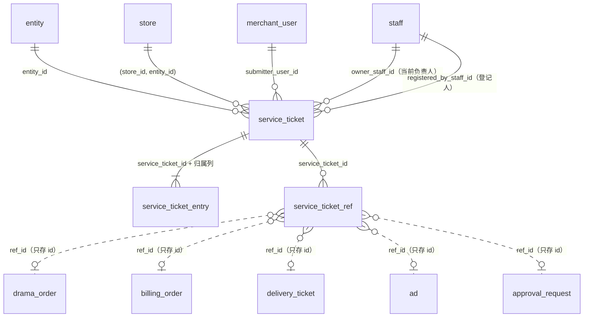
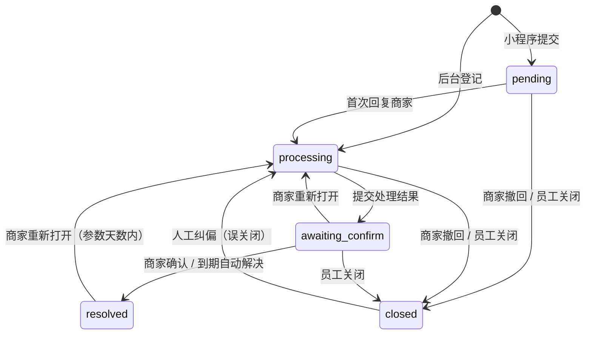

# 12 客服工单（support）

| 项 | 内容 |
| --- | --- |
| 模块 | `support`（L3 履约）。客服中心、提交工单、工单池、工单详情 |
| 表 | 3 张：`service_ticket`、`service_ticket_entry`、`service_ticket_ref` |
| 依据 | 草案 `docs/appendix/design/d3-flow.md` 第 18 节（下文写作 d3:行号），以及第 3.3、7.5、7.9、19–25 节里与客服工单有关的条目；`d6-notify-docs-data.md` 第 2.8、4.1 节（d6:行号）；`d5-media.md` 第 3 节（d5:行号）；裁决 M17、M19、M31、M33、M44、M45，以及第二轮的 M46–M48、M50、M53、M55、M60、M63、M78、M92，第三轮的 M95、M97、M99、M101、M110；`catalogue.json` 的 conventions 与本分组 3 张表的 notes；`decisions.md` #24–#28、第 6、8 节；主文档 `03-key-designs.md` 第 3.9 节（03:行号）；PRD 6.12、7.8（PRD:行号）；画板 `admin/Service`、`admin/ServiceDetail`、`merchant/Service`、`merchant/Ticket`、`merchant/TicketDone` |
| 配套文件 | Prisma 片段 `12-support.prisma`；手写约束 `12-support.sql`。三处的表、列、类型、可空性一致 |

## 1. 概览

这组表记录商家的售后问题从提出到结束的全过程：

- **工单**（`service_ticket`）：谁、哪家门店、什么类型的问题；现在由谁负责、处在哪个状态；三类时限（响应、处理方案、自动解决）到哪了。
- **时间线**（`service_ticket_entry`）：会话式的处理记录。四种条目：商家消息、回复商家、内部备注、系统事件。商家端只读可见的条目。
- **关联业务**（`service_ticket_ref`）：工单关联的订购单、付款单、交付工单、广告、审批单。关联对象（或它名下的交付工单、样片）发生业务事件时，订阅者据此往时间线追加一条系统事件（匹配规则见 2.3）。

在线客服用微信客服，会话内容不落库；需要跟进的会话由客服在后台手工登记成工单，来源记“在线客服”（03:331）。

通用约定（逐表不再重复）：

- 主键 `id uuid`，UUID v7，应用生成，库里不设默认值。
- 时刻列 `timestamptz`，库内存 UTC，由注入的应用时钟写入，列上不设 `now()` 默认值。`updated_at` 不由触发器维护，每次 UPDATE 由写入方显式赋值。
- 枚举列 `text` + CHECK，取值的唯一来源是 `packages/contract` 的 Zod enum。字典编码（工单类型、撤回原因、转派原因）不是枚举，不写取值 CHECK、不建外键（M55：不参与状态机逻辑的原因码保持为字典）。
- 文本长度（描述 500 字、关闭说明 200 字等）在契约层校验，库里不设定宽列（d3:238）。
- 本分组在 L3，对 `entity`、`store`、`merchant_user`、`staff`（都在 L1）建外键，一律 `ON DELETE RESTRICT`；指向门店的外键是复合外键 `(store_id, entity_id) → store (id, entity_id)`，库级保证门店属于该主体（M47）。工单与时间线是服务过程的证据，行不物理删除。建议数据库应用角色对 `service_ticket` 只有 INSERT、SELECT、UPDATE 权限，对 `service_ticket_entry` 只有 INSERT、SELECT 权限，对 `service_ticket_ref` 只有 INSERT、SELECT、DELETE 权限（关联行允许物理删除，M95）。
- jsonb 可空列的“空”指 SQL NULL，不写 JSON `null`。
- 出处里的“约定”指 `catalogue.json` 的 conventions；“补”表示草案没有、按约定或画板补的列。

## 2. 表定义

### 2.1 `service_ticket` 客服工单

一张工单是商家的一个售后问题。小程序提交的进入“待受理”，后台登记（电话、在线客服）的直接进入“处理中”。

归属：门店维度（`entity_id`、`store_id` 都必填）。主键：`id`（uuid）。不是只增表。`state_machine = true`。锁顺序：`lock_rank = 270`（履约子表一级，同级内按表名、再按 id；d3:937）。转派、分配、禁用移交时先对目标员工行 `FOR SHARE`，再锁工单行（d3:994、3149）。

| 列 | 类型 | 空 | 默认 | 说明 | 出处 |
| --- | --- | --- | --- | --- | --- |
| `id` | uuid | 否 | — | 主键 | d3:2435；约定“主键” |
| `ticket_no` | text | 否 | — | 工单号：`KF` + 8 位日期 + 3 位日流水，当日超过 999 自动扩到 4 位（如 `KF20260929011`）。由 `biz_sequence` 在创建事务内取号 | d3:2436、241；画板 admin/Service |
| `entity_id` | uuid | 否 | — | 所属主体。创建时从门店复制，不可改；与 `store_id` 一起由复合外键保证门店属于该主体 | d3:2437；约定“归属列”；M47 |
| `store_id` | uuid | 否 | — | 所属门店。不可改 | d3:2437 |
| `source` | text | 否 | — | 来源：`weapp` 商家在小程序提交；`online_chat` 客服按在线客服（微信客服）会话登记；`phone` 客服按来电登记。不可改 | d3:2438；PRD:814；03:331 |
| `submitter_user_id` | uuid | 可 | — | 提出问题的商家用户。小程序提交必填；后台登记时可选填，不填为空。不可改 | d3:2439 |
| `registered_by_staff_id` | uuid | 可 | — | 后台登记人。小程序提交为空。不可改 | d3:2440（原名 `registered_by`）；约定“操作人列” |
| `type_code` | text | 否 | — | 问题类型：字典 `ticket_type` 的编码（`K01`…），小程序与后台读同一份字典。按值引用，不建外键。员工可改 | d3:2441、2523；d6:1463 |
| `priority` | text | 否 | — | 优先级：`high` 高、`mid` 中、`low` 低。小程序提交时取字典项的 `defaultPriority`；后台登记时由登记人选；员工可改 | d3:2442；PRD:814；d6:1463 |
| `description` | text | 否 | — | 问题描述，不超过 500 字，不可为空。提交后不可改 | d3:2443；PRD:638 |
| `image_file_ids` | uuid[] | 否 | `{}` | 问题图片，至多 9 张（`file_object.id`，类别 `ticket_attachment`）。不建外键，经 `file_ref` 登记（`ref_type = 'service_ticket'`，角色 `image`）。提交后不可改 | d3:2444；PRD:638；d5:278；catalogue notes |
| `contact_phone_enc` | text | 可 | — | 联系电话密文（AES-256-GCM） | d3:2445（原为 `bytea`）；PRD:638；约定“敏感字段三件套” |
| `contact_phone_mask` | text | 可 | — | 联系电话脱敏串（`138****5678`），后台工单信息卡展示用 | 补：catalogue notes；画板 admin/ServiceDetail |
| `owner_staff_id` | uuid | 可 | — | 当前负责人（客服，或被转派的交付经理）。新工单在当班客服之间轮流分配；没有人当班时为空，进入客服主管待办，由主管“分配”。只存当前值；创建时的负责人记在创建那一行状态历史的 `payload.ownerStaffId`，此后每次分配、转派各记一行（见 4.3） | d3:2446（原名 `owner_id`）、2536；画板 admin/RptService“受理工单按首次分配的客服统计” |
| `status` | text | 否 | — | 状态：`pending` 待受理、`processing` 处理中、`awaiting_confirm` 待商家确认（商家端称“待您确认”）、`resolved` 已解决、`closed` 已关闭 | d3:2447；PRD:639、816 |
| `close_reason` | text | 可 | — | 关闭原因：`duplicate` 重复工单、`invalid` 无效工单、`withdrawn` 商家撤回。系统枚举加 CHECK，不进可维护字典（状态机依赖 `withdrawn`） | d3:2448；PRD:816；画板 admin/ServiceDetail；M55 |
| `withdraw_reason_code` | text | 可 | — | 商家自己撤回时选的原因：字典 `ticket_withdraw_reason` 的编码（原型四项：问题已解决、不再需要、重复提交、其他），按值引用，不建外键、不逐值 CHECK。只在 `close_reason = 'withdrawn'` 时可有值；员工代为关闭（原因选“商家撤回”）时为空 | 补：PRD:639“撤回须选择原因”；d3:2515 的守卫“选择原因”没有落点；画板 merchant/Ticket；d6:2446 第 20 项（写死的选项进字典）；M55 |
| `close_note` | text | 可 | — | 关闭说明，不超过 200 字。员工关闭时必填；商家撤回时为空 | d3:2449；画板 admin/ServiceDetail |
| `closed_at` | timestamptz | 可 | — | 关闭时间。人工纠偏把误关闭的工单重新打开时，与关闭原因、说明一并清空 | 补：画板 admin/ServiceDetail 服务时效卡“已关闭 · 时间 · 原因”；文件保留期按“关闭后 3 年”计（d5:278）；与 `resolved_at` 对称 |
| `response_due_at` | timestamptz | 可 | — | 当前一轮的响应截止时间。小程序提交时写入（创建 + 30 工作分钟）；商家重新打开时改写为新一轮的截止时间；负责人回复商家后清空；工单进入待商家确认、已解决、已关闭时清空。后台登记的工单创建时为空。每一轮的截止时间另记在提交、重新打开那一行状态历史的 `payload.responseDueAt`，首轮可随时还原（见 4.3） | d3:2450（原名 `first_response_due_at`）、2507、2514、2938 |
| `first_response_at` | timestamptz | 可 | — | 首次回复商家的时间。待受理 → 处理中时写入，只写一次；“客服首次响应时长”指标用它 | d3:2451、2509、2595 |
| `solution_due_at` | timestamptz | 否 | — | 给出处理方案的截止时间：创建时刻 + 24 自然小时。两种来源的工单都在创建时写入，之后不变 | d3:2452、2507-2508、2531 |
| `solution_at` | timestamptz | 可 | — | 首次给出处理方案的时间：勾选了“此回复为处理方案”的回复，或提交处理结果，取较早者。只写一次 | d3:2453、2510-2511、2521 |
| `awaiting_confirm_at` | timestamptz | 可 | — | 最近一次进入待商家确认的时间。离开该状态后保留，下一次进入时覆盖 | d3:2454（原名 `awaiting_since`） |
| `auto_resolve_at` | timestamptz | 可 | — | 自动解决时间：`awaiting_confirm_at` + 3 个自然日，精确到分钟。只在待商家确认期间有值，离开时清空 | d3:2455、2511、2513、2524 |
| `resolved_at` | timestamptz | 可 | — | 解决时间。只在已解决状态有值，重新打开时清空 | d3:2456 |
| `resolved_via` | text | 可 | — | 解决方式：`merchant` 商家确认解决、`auto` 到期未确认自动解决。与 `resolved_at` 同有同无 | d3:2457（原名 `resolved_by`）、2512-2513 |
| `reopened_count` | smallint | 否 | `0` | 商家重新打开的次数。人工纠偏的重开不计 | d3:2458、2514 |
| `escalated_at` | timestamptz | 可 | — | 最近一次响应超时、升级至客服主管的时间。列表副说明“已升级至客服主管”据此显示。每次超时另在状态历史记一行 `escalate`，历次超时可查 | d3:2459、2530；画板 admin/Service |
| `sla_snapshot` | jsonb | 否 | — | 时限参数快照，分 `response`、`solution`、`autoResolve` 三段，各在算出对应截止时间时写入；`solution` 段创建时必写。之后改参数不影响已有的截止时间。结构见第 4 节 | d3:2460、3052；M60 |
| `lock_version` | integer | 否 | `0` | 乐观锁版本号。后台改类型、改优先级等内容编辑带回它；状态迁移用行锁加状态守卫 | d3:2461、239 |
| `created_at` | timestamptz | 否 | — | 创建时间（提交或登记时刻）。时限自它起算。不可改 | d3:2462 |
| `updated_at` | timestamptz | 否 | — | 更新时间 | 补：约定“时间” |

列表里的“标题”（画板 merchant/Service、merchant/Ticket）取 `description` 的开头，不单独存列。“已转派交付经理”“取消待财务审批”两个状态副说明（画板 admin/Service）是派生的：前者看负责人是不是该门店的交付经理，后者看 `service_ticket_ref` 里有没有在途的取消类审批单。

**键与索引**

- 主键：`pk_service_ticket (id)`。
- 外键（都是 `ON DELETE RESTRICT`，都在 Prisma 片段里）：`entity_id` → `entity.id`（`fk_service_ticket_entity_id`）；`(store_id, entity_id)` → `store (id, entity_id)`（`fk_service_ticket_store_entity`，复合外键，保证门店属于该主体，M47）；`submitter_user_id` → `merchant_user.id`（`fk_service_ticket_submitter_user_id`）；`owner_staff_id` → `staff.id`（`fk_service_ticket_owner_staff_id`，关系名 `ServiceTicketOwnerStaff`）；`registered_by_staff_id` → `staff.id`（`fk_service_ticket_registered_by_staff_id`，关系名 `ServiceTicketRegisteredByStaff`）。指向 `staff` 的两个关系都带关系名（M46）。
- 唯一约束：`uq_service_ticket_ticket_no (ticket_no)`；`uq_service_ticket_id_entity_id_store_id (id, entity_id, store_id)`：只为让 `service_ticket_entry` 的复合外键有处可指，保证条目的归属列与工单一致。
- 普通索引：
  - `ix_service_ticket_store_id_created_at (store_id, created_at DESC)`：商家端“我的工单”；后台商家详情的客服工单页签（d3:2463）。
  - `ix_service_ticket_owner_staff_id_status (owner_staff_id, status)`：按负责人筛选；候选人的待处理单量；工作台“待处理工单”；员工禁用时找其名下未结工单，`staff.I10` 校验（d3:2463、3086、3118）。
  - `ix_service_ticket_status_created_at (status, created_at DESC)`：工单池各状态页签，按提交时间倒序（画板 admin/Service）。

**手写约束**

| 约束名 | 规则 |
| --- | --- |
| `image_file_ids` 的 NOT NULL | `ALTER COLUMN … SET NOT NULL`。Prisma 的标量数组列建表时不带 NOT NULL |
| `ck_service_ticket_source` | `source IN ('weapp','online_chat','phone')` |
| `ck_service_ticket_priority` | `priority IN ('high','mid','low')` |
| `ck_service_ticket_status` | `status` 在五个取值之内 |
| `ck_service_ticket_close_reason` | `close_reason` 为空或在 `duplicate`、`invalid`、`withdrawn` 之内（M55 系统枚举） |
| `ck_service_ticket_withdraw_reason_code` | `withdraw_reason_code` 为空或非空串（字典编码，不逐值校验） |
| `ck_service_ticket_resolved_via` | `resolved_via` 为空或在 `merchant`、`auto` 之内 |
| `ck_service_ticket_creator` | 小程序来源 ⇔ 没有登记人；小程序来源必有提交人 |
| `ck_service_ticket_type_code` | `type_code` 非空串 |
| `ck_service_ticket_description` | `description` 去掉首尾空白后非空 |
| `ck_service_ticket_image_file_ids` | 图片至多 9 张 |
| `ck_service_ticket_contact_phone` | 密文与脱敏串同有同无 |
| `ck_service_ticket_pending` | 待受理只出现在小程序来源的工单上，且此时 `first_response_at` 为空 |
| `ck_service_ticket_response_due` | `response_due_at` 只在待受理、处理中有值 |
| `ck_service_ticket_solution` | 待商家确认、已解决时 `solution_at` 非空（提交处理结果即视为给出方案） |
| `ck_service_ticket_awaiting` | 待商家确认 ⇔ `auto_resolve_at` 非空；待商家确认时 `awaiting_confirm_at` 非空；`auto_resolve_at` 晚于 `awaiting_confirm_at` |
| `ck_service_ticket_resolved` | 已解决 ⇔ `resolved_at` 非空；`resolved_at` 与 `resolved_via` 同有同无 |
| `ck_service_ticket_closed` | 已关闭 ⇔ `closed_at` 非空；`closed_at` 与 `close_reason` 同有同无；有 `withdraw_reason_code` 时 `close_reason = 'withdrawn'`；`close_note` 只在已关闭时有且非空白；已关闭时 `close_note` 与 `withdraw_reason_code` 至少有一个 |
| `ck_service_ticket_reopened_count` | `reopened_count >= 0` |
| `ck_service_ticket_sla_snapshot` | `sla_snapshot` 是对象；`solution` 段恒为对象；有 `response_due_at`、`auto_resolve_at` 时，`response`、`autoResolve` 段分别是对象（`jsonb_typeof(...) = 'object'`，JSON `null` 不算） |
| `ix_service_ticket_response_due_at` | 部分索引 `(response_due_at) WHERE response_due_at IS NOT NULL`：工单池“仅看响应超时”与“按时效紧急程度排序”，工作台“响应超时数”，`timers.I7` 的本表检查项 |
| `ix_service_ticket_unassigned` | 部分索引 `(created_at) WHERE owner_staff_id IS NULL AND status IN ('pending','processing','awaiting_confirm')`：没有负责人的未结工单，客服主管待办，可“分配”（d3:2536；与状态机的 `assign` 守卫同一口径） |
| `trg_service_ticket_immutable` | 行级 `BEFORE UPDATE OF …`，公共函数 `lyx_forbid_column_change(…)`（M50）：`ticket_no`、`entity_id`、`store_id`、`source`、`submitter_user_id`、`registered_by_staff_id`、`description`、`image_file_ids`、`created_at` 写入后不可改 |

**状态机**（`service_ticket.status`；经 `flow.transition()`，`machine = 'service_ticket'`、`state_field = 'status'`（M53），每次写 `status_transition`，并在同一事务里补一条活动流的审计行，M31。不改状态的动作（分配、转派、响应超时、日历修正重算）写 `from_state = to_state` 的一行）

| 当前状态 | 事件 | 新状态 | 守卫 | 触发者 | 本表的写入 |
| --- | --- | --- | --- | --- | --- |
| — | `submit` 提交 | `pending` | 幂等键；描述非空；类型在字典内且启用 | 商家用户（仅老板，见第 6 节第 1 项） | 取号；轮流分配写 `owner_staff_id`（没有人当班为空）；`response_due_at`、`solution_due_at`、`sla_snapshot` 的 `response`、`solution` 两段；写提交条目与关联行；登记图片引用 |
| — | `register` 登记 | `processing` | 幂等键；权限点 `service.ticket.register` | 客服 | 同上，但没有 `response_due_at` 与 `response` 段；提交条目由登记人代录 |
| `pending` | `reply` 回复商家 | `processing` | 负责人，或有权限的员工（负责人为空时也可回复，回复人不因此成为负责人） | 员工 | `first_response_at`；清空 `response_due_at` |
| `processing` | 回复、内部备注、商家补充说明 | 不变（不写状态历史） | — | 员工、商家 | 只写条目（带图片的登记图片引用）。回复会清空 `response_due_at`；勾选“此回复为处理方案”且 `solution_at` 为空时写 `solution_at` |
| `processing` | `submit_result` 提交处理结果 | `awaiting_confirm` | 结果非空 | 负责人 | `solution_at`（若空）；`awaiting_confirm_at`；`auto_resolve_at`；`sla_snapshot.autoResolve`；清空 `response_due_at` |
| `awaiting_confirm` | `confirm` 确认解决 | `resolved` | — | 商家用户 | `resolved_at`；`resolved_via = 'merchant'`；清空 `auto_resolve_at`；释放图片引用 |
| `awaiting_confirm` | `auto_resolve` 到期未确认 | `resolved` | 状态仍为待商家确认，且 `auto_resolve_at` 与定时器登记时一致 | 定时器 `service.auto_resolve` | `resolved_at`；`resolved_via = 'auto'`；清空 `auto_resolve_at`；释放图片引用 |
| `awaiting_confirm`、`resolved` | `reopen` 重新打开 | `processing` | 必填说明；已解决的距 `resolved_at` 不超过参数 `service.reopen_window_days` 天（默认 7，0 即关闭此入口） | 商家用户 | `reopened_count + 1`；新的 `response_due_at` 与 `sla_snapshot.response`；清空 `auto_resolve_at`、`resolved_at`、`resolved_via`；从已解决重开时重新链接图片引用 |
| `pending`、`processing` | `withdraw` 撤回 | `closed` | 必选撤回原因（字典 `ticket_withdraw_reason` 内且启用） | 商家用户 | `closed_at`；`close_reason = 'withdrawn'`；`withdraw_reason_code`；清空 `response_due_at`；释放图片引用 |
| `pending`、`processing`、`awaiting_confirm` | `close` 关闭 | `closed` | 必选原因并填说明；权限点 `service.ticket.close` | 负责人 | `closed_at`；`close_reason`；`close_note`；清空 `response_due_at`、`auto_resolve_at`；释放图片引用 |
| 未结状态，且 `owner_staff_id` 为空 | `assign` 分配 | 不变（from = to） | 目标员工启用中；必选原因（字典 `ticket_transfer_reason`） | 客服、主管 | `owner_staff_id`。时限不变 |
| 未结状态，且 `owner_staff_id` 非空 | `transfer` 转派 | 不变（from = to） | 目标员工启用中，且不是当前负责人；必选转派原因（字典 `ticket_transfer_reason`，选人后按目标岗位带出默认值） | 客服、主管 | `owner_staff_id`。时限不变 |
| `pending`、`processing` | `escalate` 响应超时 | 不变（from = to） | `response_due_at` 非空且与定时器登记时一致 | 定时器 `service.first_response_due` | `escalated_at` |
| `closed` | `admin.force` 人工纠偏 | `processing` | 权限点 `flow.admin.transition`、第二因子、原因不少于 10 字；状态历史 `is_forced = true` | 超级管理员 | 清空 `closed_at`、`close_reason`、`withdraw_reason_code`、`close_note`；重新链接图片引用 |

写进状态历史的原因与载荷（`payload` 的结构见 4.3）：

- `withdraw`、`close`：`reason_code` 分别记撤回原因编码、关闭原因。
- `assign`、`transfer`：`reason_code` 记字典 `ticket_transfer_reason` 的编码（原型四项：需客服跟进、需交付侧评估、工作量调整、其他）；`payload` 记原负责人、新负责人及其岗位。时间线另写一条 `system_event` / `transfer`（后台文案“唐悦将工单转派给林晓（交付经理），原因：需交付侧评估”，商家可见时另写 `merchant_body`）；填了说明的再写一条 `internal_note` / `transfer`（d3:2517）。
- 员工禁用移交与 `staff.I10` 的自动改派由 staff 模块的 `reassign` 发起（`assignment_history.source = 'service_ticket_owner'`，d3:3118），本模块注册的改派实现同样写一行 `transfer`：`reason_code` 取该行 `assignment_history.reason_code`，`payload` 另带 `assignmentBatchId`；操作人是发起移交的员工，自动改派时为 `system`。
- 首次分配的负责人取创建那一行的 `payload.ownerStaffId`，为空时取第一行 `assign` 的 `toStaffId`。报表“受理工单按首次分配的客服统计”“转派交付经理”（画板 admin/RptService）都从状态历史取，不在本表加列。
- 每一轮响应时限：创建行与每个 `reopen` 行的 `payload.responseDueAt`、`payload.responseSla`；历次超时是 `escalate` 行。`response_due_at`、`sla_snapshot.response`、`escalated_at` 只存当前值。
- 停留时长（01 分组 2.6，A144）：`assign`、`transfer`、`escalate` 与日历重算这些 from = to 的行照常切段，每行的 `elapsed_work_min` 只是与上一行之间的工作分钟。待受理、处理中各停留多久，把 `from_state` 为该状态的各行相加；`reply` 那一行单独不是首次响应时长。“客服首次响应时长”按 `created_at` 到 `first_response_at` 的工作分钟计（a08 同口径）。

图片引用（06 分组 `file_ref` 的状态机，由本模块在同一业务事务里调用；d5:278）：

| 时机 | 调用 |
| --- | --- |
| 提交、登记；写带图片的条目 | `files.link()`：工单图片 `ref_type = 'service_ticket'`，条目图片 `ref_type = 'service_ticket_entry'`，角色 `image`，类别 `ticket_attachment` |
| 进入已解决（`confirm`、`auto_resolve`）、已关闭（`withdraw`、`close`） | `files.release()`：本工单及其全部条目的图片，`keep_until` = 迁移时刻 + 3 年 |
| 从已解决 `reopen`；`admin.force` | 对同一批引用再次 `files.link()`，回到 `live`（清空 `keep_until`、`released_at`） |

定时器（`timer.subject_type = 'service_ticket'`，d3:2938-2940；去重键的类型段用最终表名 `service_ticket`，不用缩写 `st`，A96、A144）：

| 定时器 | 去重键 | 登记 | 触发时间 | 取消 |
| --- | --- | --- | --- | --- |
| `service.first_response_due` | `service.first_response_due:service_ticket:{id}:r{reopened_count}` | 小程序提交（`r0`）；商家重新打开（`r` 取重开后的次数） | `response_due_at` | 负责人回复；工单进入待商家确认、已关闭 |
| `service.solution_due` | `service.solution_due:service_ticket:{id}` | 创建 | `solution_due_at` | 给出方案；工单关闭 |
| `service.auto_resolve`（关键类） | `service.auto_resolve:service_ticket:{id}:{awaiting_confirm_at 的 Unix 毫秒数}` | 进入待商家确认 | `auto_resolve_at` | 商家确认、重新打开；员工关闭 |

响应时限与自动解决都可能在同一张工单上出现多轮：上一轮的定时器已 `fired`（升级过主管、已自动解决）时，同键不会重新创建（d3:2795-2802），所以这两个键都带轮次；`timers.I7` 自愈补登记用同一个键。日历事后修正（d3:3054；01 分组 2.6、2.7）：日历导入只在至少一天的类型实际变化时升批次并发 `calendar.imported`，负载带变化的日期 `changedDays`（M97）。本模块的订阅者取未结、`response_due_at` 非空、且这一轮的计算窗口（`sla_snapshot.response.computedAt` 即提交或重新打开的时刻，到 `response_due_at`）覆盖某个变化日期的工单，从 `computedAt` 起用快照里的策略与新日历重算 `response_due_at`，改写 `sla_snapshot.response.calendarVersion`（`computedAt` 保留为这一轮的起算时刻，策略、数值、单位不变），重设 `service.first_response_due` 定时器（同一个键），并写一行 from = to 的状态历史（事件名由 sla 登记，如 `sla.recalculated`；`payload` 见 4.3）。另外两个时限按自然时间计，不受日历影响。

事件（写 `outbox_event`，`aggregate_type = 'service_ticket'`，d3:2732）：`service_ticket.created`、`.replied`、`.result_submitted`、`.resolved`、`.reopened`、`.closed`、`.transferred`（分配与转派都发，分配时原负责人为空）、`.escalated`、`.supplemented`（商家在处理中补充说明，`m.serviceTicket.entry.create`；不改状态、不写状态历史；载荷 `{ serviceTicketId, entryId, storeId, ownerStaffId? }`，notify 据此提醒负责人；A144、A95，事件目录由 x01 补登）。

**不变量**（每日校验；按 15 分组 2.4、5.2 的登记规则：module `support`，severity 均为 P2；检查项登记在 `support/invariants.ts`，`modes: ['full']`、不写 `every`，`heal: 'none'`（只上报、不自愈）；对象都属于某个主体，`invariants.report` 传 `entityId`（工单的 `entity_id`）。违规由 ops 在独立的短事务里落库，上报失败不抛给调用方；告警由 15 的探针规则“不变量校验失败”产生，本模块不直接调告警端口）

| 编码 | 不变量 | 违反时 |
| --- | --- | --- |
| `support.S2` | 每张工单恰有一条 `tag = 'submit'` 的条目；`solution_at` 非空 ⇔ 存在 `is_solution` 的条目，且等于其中最早一条的 `created_at`；`first_response_at` 非空时存在不晚于它的回复条目。`subject_type = 'service_ticket'` | 上报违规 |

第二轮的 `support.S1`（字典编码存在）不再登记，编号不复用：它由 14 分组的 `config.N7` 覆盖（见下），两处都登记会对同一问题重复上报。

本表另由下列检查项覆盖，本模块不重复登记：

- `config.N7`（14 分组 2.2、5.4）：`type_code` 在字典 `ticket_type` 里、`withdraw_reason_code` 在字典 `ticket_withdraw_reason` 里存在（可以已停用）。本模块在 `DICT_REFS` 登记这两列（`service_ticket.type_code` 已在 14 的初始内容里）。
- `timers.I7`（01 分组；本模块提供检查项；登记为 `heal_only`，自愈成功即自动关闭）：未结工单上每个还有效的截止时间（`response_due_at`；`solution_at` 为空时的 `solution_due_at`；`auto_resolve_at`）要么已过，要么存在对应的 `scheduled` 定时器；每个 `scheduled` 的 `service.*` 定时器，其工单仍处在需要它的状态。自愈：按上表的去重键补登记、取消孤儿。
- `flow.I12`（01 分组）：状态历史按 `(machine, subject_id, state_field)` 连续，最后一行的 `to_state` 等于当前 `status`。
- `staff.I10`（03 分组；登记为 `heal_and_alert`）：已禁用员工名下没有在办事项，含本表的 `owner_staff_id`；违反时由 staff 自动改派，经本模块注册的改派实现写入。
- `media.I14`（06 分组）：`image_file_ids`（本表与条目表）里的每个文件都有对应的 `file_ref` 行。
- 门店属于 `entity_id` 所指主体：由复合外键 `fk_service_ticket_store_entity` 保证，不再校验。

**相对草案的改动**

| 改动 | 依据 |
| --- | --- |
| 主键与全部引用列由 `bigint` 改 `uuid` | R1；约定“主键” |
| `source` 的取值 `miniapp` 改为 `weapp` | 全仓把小程序写作 `weapp`（`enums_shared.client` 的说明：d2 的 `miniapp` 已对齐） |
| `registered_by` → `registered_by_staff_id`，建外键 | 约定“操作人列” |
| `owner_id` → `owner_staff_id`，建外键 | `owner` 在商家侧指老板（`merchant_role`），`owner_id` 又是全仓多态引用的列名（`owner_type` + `owner_id`），单用会混淆；与 `follow_up.owner_staff_id`、`referral_code.owner_staff_id` 一致。M33 允许按角色命名 |
| `image_file_ids` 由 `bigint[]` 改 `uuid[]`；补“至多 9 张”的 CHECK | catalogue notes；PRD:638 |
| `contact_phone_enc` 由 `bytea` 改 `text`；补 `contact_phone_mask` | 约定“敏感字段三件套”；catalogue notes。不需要等值查找，不建盲索引列 |
| `first_response_due_at` → `response_due_at`，改为“当前一轮的响应截止时间，回复后清空” | 草案规定重新打开后“重新计 30 工作分钟响应时限”（d3:2514、2938“重开重设”），但重开后的状态是处理中，只凭草案的两列分不出“这一轮回复了没有”。清空后“等待响应”⇔ 非空，“响应超时”⇔ 非空且已过。首轮及每一轮的截止时间、参数快照与初始负责人固定记在提交、登记、重新打开那一行状态历史的 `payload` 里，历次超时各记一行 `escalate`（4.3），满足草案“只保证明细留痕齐全”（d3:2599） |
| 索引 `(status, first_response_due_at)` 改为部分索引 `ix_service_ticket_response_due_at`，另加 `(status, created_at DESC)` | 同上；页签按提交时间倒序（画板 admin/Service） |
| `resolved_by` → `resolved_via` | 约定“操作人列”把 `_by` 留给操作人 id 列；这一列存的是解决方式 |
| `awaiting_since` → `awaiting_confirm_at` | 约定“命名规则”：时刻以 `_at` 结尾 |
| `solution_due_at` 改为 NOT NULL | 两种来源的工单都在创建时写入、之后不变（d3:2507-2508、2531）；`sla_snapshot.solution` 段随之必有 |
| `entity_id` 不再单独校验与门店一致，改由复合外键 `(store_id, entity_id) → store (id, entity_id)` 保证 | M47 |
| 补 `withdraw_reason_code`（字典 `ticket_withdraw_reason` 的编码） | PRD:639；画板 merchant/Ticket。草案只有 `close_reason = withdrawn`，商家选的四种原因没有落点；原型写死的选项进字典（d6:2446 第 20 项），不参与逻辑的原因码保持为字典（M55） |
| 补 `closed_at` | 画板 admin/ServiceDetail；d5:278。草案有 `resolved_at` 却没有关闭时间；`status_transition` 只供指标与进度时间轴（M31），不宜当主数据读 |
| 补 `updated_at` | 约定“时间” |
| 补唯一约束 `(id, entity_id, store_id)` | 给条目表的复合外键用 |
| 补状态与各时间列之间的一致性 CHECK、不可改列触发器（公共函数 `lyx_forbid_column_change`） | 约定“枚举”“命名规则”；M50；草案只写了列 |
| 转派原因不在本表加列，记在状态历史 from = to 那一行的 `reason_code`（字典 `ticket_transfer_reason`） | 画板 admin/ServiceDetail 转派弹窗必选原因；admin/RptService“转派交付经理”；状态历史供指标取数（M31） |
| 审批单、退款申请上指向本表的列（`related_service_ticket_id`、`service_ticket_id`）已删，关联只存在 `service_ticket_ref` | decisions #28 |

### 2.2 `service_ticket_entry` 工单时间线条目

工单的处理记录，一行一条。商家端接口只查 `is_visible_to_merchant = true` 的条目，过滤写在查询层，响应 schema 也不含内部备注与后台文案（d3:2487）。

归属：门店维度（`entity_id`、`store_id` 创建时从工单复制，由复合外键保证与工单一致）。主键：`id`（uuid）。catalogue 标 `append_only = false`、主键不带 `seq`；草案里没有任何更新路径，本表只拦 UPDATE（`lyx_forbid_update()`），不加 `seq`、不拦 DELETE（初稿的默认做法，第二轮按 M92 视为接受）。`lock_rank = null`：只在持有工单行锁的事务里写入，或由事件订阅者追加，不参与锁排序。

排序：同一工单内按 `created_at`、`id`（UUID v7 按时间有序）。`created_at` 是条目时间：关联业务事件条目（`tag = 'biz_event'`）取源事件的 `outbox_event.occurred_at`，其余条目取写入时刻。订阅者可能在重试退避后才写入（d3:2690-2692），按发生时刻排序才不会让晚到的业务事件排到之后的回复下面（d3:2699“需要顺序的展示（时间线）用 occurred_at 排序”）。

| 列 | 类型 | 空 | 默认 | 说明 | 出处 |
| --- | --- | --- | --- | --- | --- |
| `id` | uuid | 否 | — | 主键 | d3:2466 |
| `service_ticket_id` | uuid | 否 | — | 所属工单 | d3:2467（原名 `ticket_id`）；M17 |
| `entity_id` | uuid | 否 | — | 所属主体，从工单复制 | 补：catalogue（`tenant = store`）；约定“归属列”第 2 条 |
| `store_id` | uuid | 否 | — | 所属门店，从工单复制 | 同上 |
| `kind` | text | 否 | — | 条目类型：`merchant_message` 商家消息、`staff_reply` 回复商家、`internal_note` 内部备注（商家不可见）、`system_event` 系统事件 | d3:2468；画板 admin/ServiceDetail |
| `tag` | text | 可 | — | 标签，按 `kind` 取值，见下表 | d3:2469；画板 admin/ServiceDetail、merchant/Ticket |
| `actor_type` | text | 否 | — | 操作人类型：`merchant`、`staff`、`system`、`partner`（V1.0 只声明） | d3:2470（原为 jsonb `actor`）；约定“操作人列”；M44 |
| `actor_id` | uuid | 可 | — | 操作人 id（`merchant_user.id` 或 `staff.id`）；`system` 时为空。多态，不建外键 | 同上 |
| `client` | text | 可 | — | 客户端来源：`weapp`、`portal`、`admin`；系统动作为空 | M44 |
| `body` | text | 可 | — | 正文，不超过 500 字。系统事件存后台看到的文案（如“唐悦将工单转派给林晓（交付经理），原因：需交付侧评估”） | d3:2471；画板 admin/ServiceDetail |
| `merchant_body` | text | 可 | — | 系统事件面向商家的文案（如“工单已转给您的服务经理小林跟进”）。为空时商家端显示 `body`。只有商家可见的系统事件可填 | 补：同一事件两端文案不同（画板 admin/ServiceDetail 与 merchant/Ticket 的 09-29 15:36 转派、09-30 09:30 广告新版本）；后台文案带内部人名与原因，不能原样给商家 |
| `image_file_ids` | uuid[] | 否 | `{}` | 图片，至多 9 张（`file_object.id`，类别 `ticket_attachment`）。不建外键，经 `file_ref` 登记（`ref_type = 'service_ticket_entry'`，角色 `image`）。系统事件不带图片 | d3:2472；PRD:815 |
| `link` | jsonb | 可 | — | 深链：商家端条目上的跳转按钮（如“去确认新片尾”）。结构见第 4 节 | d3:2473；d6:763-771；画板 merchant/Ticket、merchant/TicketDone |
| `is_visible_to_merchant` | boolean | 否 | `false` | 商家是否可见。内部备注恒为 `false`；商家消息、回复商家恒为 `true`；系统事件逐条决定 | d3:2474（原名 `visible_to_merchant`）；约定“命名规则”的布尔列前缀 |
| `is_solution` | boolean | 否 | `false` | 是否计为“处理方案”：勾选了“此回复为处理方案”的回复（`tag = 'solution'`），或处理结果（`tag = 'result'`） | d3:2475、2510、2521 |
| `outbox_event_id` | uuid | 可 | — | 来源出站事件（`outbox_event.id`）。只有关联业务事件条目有值，其余为空。同一工单内唯一：同一事件命中同一工单的多条关联行、或被重复投递时，只写一条。只存 id、不建外键（出站事件只在 V1.0 不清理，M65） | 补：d3:2700 第 3 条“订阅者的写操作带幂等键”；复核意见（排障时从条目找回事件） |
| `created_at` | timestamptz | 否 | — | 条目时间。关联业务事件条目取源事件的 `occurred_at`，其余取写入时刻（见上文“排序”） | d3:2476、2699 |

`tag` 的取值与 `kind` 的对应：

| `kind` | 允许的 `tag` | 含义 | 操作人 |
| --- | --- | --- | --- |
| `merchant_message` | `submit` | 提交工单。正文与图片同工单的 `description`、`image_file_ids`（时间线自包含）。后台登记的工单同样写这一条，由登记人代录 | 商家；后台登记时为员工 |
| | `supplement` | 补充说明 | 商家 |
| | `reopen` | 重新打开时填的“仍未解决的问题” | 商家 |
| | 空 | 普通消息 | 商家 |
| `staff_reply` | `reply` | 普通回复 | 员工 |
| | `solution` | 勾选了“此回复为处理方案”的回复 | 员工 |
| | `result` | 处理结果（提交后工单进入待商家确认） | 员工 |
| `internal_note` | 空 | 内部备注 | 员工 |
| | `transfer` | 分配、转派时填的交接说明 | 员工 |
| `system_event` | `transfer` | 分配、转派（谁转给谁、原因） | 员工（禁用移交时是发起移交的员工）；`staff.I10` 自动改派时为系统 |
| | `status` | 状态变更：进入待商家确认、确认解决、自动解决、重新打开、撤回、关闭 | 触发迁移的商家、员工或系统 |
| | `biz_event` | 关联业务对象的事件（广告新版本、样片推送、取消申请的审批结果等），由订阅者 `support.onBizEvent` 按 2.3 的规则追加，带 `outbox_event_id` | 系统 |

条目上的姓名与岗位（“唐悦 · 客服主管”“小林 · 服务经理”）在读取时按 `actor_id` 取，不存快照。

**键与索引**

- 主键：`pk_service_ticket_entry (id)`。
- 外键（都是 `ON DELETE RESTRICT`，都在 Prisma 片段里）：`(service_ticket_id, entity_id, store_id)` → `service_ticket (id, entity_id, store_id)`（`fk_service_ticket_entry_service_ticket_id`，复合外键）；`entity_id` → `entity.id`（`fk_service_ticket_entry_entity_id`）；`(store_id, entity_id)` → `store (id, entity_id)`（`fk_service_ticket_entry_store_entity`，复合外键，M47）。
- 唯一约束：无（`outbox_event_id` 的部分唯一索引见手写约束）。
- 普通索引：`ix_service_ticket_entry_service_ticket_id_created_at (service_ticket_id, created_at)`：按工单取时间线（d3:2477）。

**手写约束**

| 约束名 | 规则 |
| --- | --- |
| `image_file_ids` 的 NOT NULL | `ALTER COLUMN … SET NOT NULL` |
| `ck_service_ticket_entry_kind` | `kind` 在四个取值之内 |
| `ck_service_ticket_entry_tag` | `tag` 为空或在九个取值之内 |
| `ck_service_ticket_entry_kind_tag` | `tag` 按 `kind` 取值（上表）；回复与系统事件必有标签 |
| `ck_service_ticket_entry_actor_type` | `actor_type` 在四个取值之内 |
| `ck_service_ticket_entry_client` | `client` 为空或在 `weapp`、`portal`、`admin` 之内 |
| `ck_service_ticket_entry_actor` | `system` ⇔ `actor_id` 为空；`system` ⇔ `client` 为空（其余操作人 `client` 必填，M44） |
| `ck_service_ticket_entry_kind_actor` | 商家消息的操作人是商家（`tag = 'submit'` 时也可以是代录的员工）；回复与内部备注的操作人是员工；`biz_event` 的操作人是系统 |
| `ck_service_ticket_entry_visible` | 内部备注不可见；商家消息、回复商家可见 |
| `ck_service_ticket_entry_body` | `body` 为空或去掉首尾空白后非空 |
| `ck_service_ticket_entry_content` | 系统事件必有正文、不带图片；其余条目正文与图片至少有一样 |
| `ck_service_ticket_entry_image_file_ids` | 图片至多 9 张 |
| `ck_service_ticket_entry_merchant_body` | `merchant_body` 只在商家可见的系统事件上有，且非空白 |
| `ck_service_ticket_entry_solution` | `is_solution` ⇔ `kind = 'staff_reply'` 且 `tag` 是 `solution` 或 `result` |
| `ck_service_ticket_entry_link` | `link` 为空，或是带 `route` 键的对象 |
| `ck_service_ticket_entry_outbox_event` | `outbox_event_id` 非空 ⇔ `tag = 'biz_event'` |
| `uq_service_ticket_entry_outbox_event_id` | 部分唯一索引 `(service_ticket_id, outbox_event_id) WHERE outbox_event_id IS NOT NULL`：同一事件在同一工单上只写一条 |
| `trg_service_ticket_entry_no_update` | 行级 `BEFORE UPDATE`，函数 `lyx_forbid_update()`：条目写入后不改 |

**不变量**：见 2.1 的 `support.S2`；图片引用由 `media.I14` 覆盖。条目的归属列与工单一致、门店属于主体都由复合外键保证，不需要校验。

**相对草案的改动**

| 改动 | 依据 |
| --- | --- |
| `ticket_id` → `service_ticket_id` | M17 |
| 补 `entity_id`、`store_id`，并用复合外键指向工单 | catalogue（`tenant = store`）；约定“归属列”：接口会按 id 直接读写的子表带归属列 |
| `actor`（jsonb）拆成 `actor_type`、`actor_id`、`client` | 约定“操作人列”；M44 |
| `image_file_ids` 由 `bigint[]` 改 `uuid[]` | 约定“主键” |
| `visible_to_merchant` → `is_visible_to_merchant`，默认 `false` | 约定“命名规则”：布尔列用 `is_` 前缀并带默认值；默认不可见更安全 |
| 补 `merchant_body` | 画板两端对同一事件的文案不同（见列说明） |
| `link` 的结构由 `{ target, id }` 改为 D6 的 `DeepLink`（`{ route, params }`）加可选的 `label` | d6:763-771：消息与订阅消息落地页共用一份路由表，不存页面路径；时间线的深链并入同一份 |
| 明确 `tag` 与 `kind` 的对应、后台登记时提交条目由员工代录 | 草案只列了取值；画板 admin/ServiceDetail 的详情页靠第一条条目展示问题描述 |
| 加只拦 UPDATE 的触发器 | 草案没有更新路径；防止误改已发给商家的内容 |
| 补 `outbox_event_id` 与部分唯一索引；业务事件条目的 `created_at` 取源事件的 `occurred_at` | d3:2699、2700；时间线按发生时刻排序，同一事件在同一工单只写一条 |
| 门店外键改为复合外键 `(store_id, entity_id) → store (id, entity_id)` | M47 |

### 2.3 `service_ticket_ref` 工单关联的业务对象

工单与业务对象的关联只存在这里。来源有三种：商家提交时选的“关联订单”（只选订购单，画板 merchant/Service）；客服登记时带出的关联单号，以及处理中补关联的订购单、付款单、交付工单、广告；客服从工单里发起取消、退款申请时，把生成的审批单关联进来。套餐退款与客服工单的关联同样只在这里（`ref_type` 为 `billing_order` 或 `approval_request`），billing 不引用本模块（08 分组的请求）。

用途：详情页“关联业务”卡片；工单池“商家与单号”一栏与按单号搜索；业务事件进时间线。“关联业务”卡片除本表的行外，还列出关联订购单名下的交付工单（画板 admin/ServiceDetail 同时列出订购单与它的两张交付工单），由路由层的读模型按订购单组装，不在本表补行。

**业务事件进时间线**（d3:2542）：订阅者 `support.onBizEvent` 订阅下表的事件，往命中的工单追加一条 `system_event` / `biz_event`。事件主体往往不是工单关联的那个对象（商家提交时只选订购单，样片、交付工单的事件主体却是样片和交付工单），所以按“事件主体及其上级对象”逐层匹配。上级对象的 id 由事件负载带出，support 不同步调用 order、delivery（同层白名单里没有），也不为下级对象补写关联行。

| 事件 | 事件主体（`aggregate_type`） | 用来匹配的 `(ref_type, ref_id)` |
| --- | --- | --- |
| `ticket.created`、`ticket.assigned`、`ticket.step_changed`（d3:2717） | `delivery_ticket` | `(delivery_ticket, aggregate_id)`；`(drama_order, payload.dramaOrderId)` |
| `sample.pushed`、`sample.confirmed`、`sample.change_requested`（d3:2722） | `sample` | `(delivery_ticket, payload.deliveryTicketId)`；`(drama_order, payload.dramaOrderId)` |
| `ad.*` 中进时间线的事件，如 `ad.version_pushed`、`ad.confirmed`（d3:2721） | `ad` | `(ad, aggregate_id)` |
| `approval.submitted`、`.approved`、`.rejected`、`.withdrawn`、`.executed`（d3:2731；`.withdrawn` 为接口阶段补，a08 的请求，x01 3 节 `support.onBizEvent` 已订阅） | `approval_request` | `(approval_request, aggregate_id)` |

匹配规则：

1. 只找未结工单（`pending`、`processing`、`awaiting_confirm`）。
2. 只认关联建立之后发生的事件：`outbox_event.occurred_at >= service_ticket_ref.created_at`。客服事后补关联时，关联之前的历史事件不倒灌进时间线。
3. 一个事件命中同一张工单的多条关联行（如订购单与它的交付工单都关联了）只写一条。条目带 `outbox_event_id`，`uq_service_ticket_entry_outbox_event_id` 兜底；重复投递另由投递行去重。
4. 条目的 `created_at` 取事件的 `occurred_at`（2.2“排序”）。
5. 以后有别的事件要进时间线，按同一规则在上表补一行，并让产生方在负载里带上上级对象的 id。

归属：不带归属列（纯关联表，只经工单访问）。主键：复合主键 `(service_ticket_id, ref_type, ref_id)`。不是只增表：行只增删、不更新，客服可以移除关联错的行（物理删除，M95），增删都写审计。`lock_rank = null`：只在持有工单行锁的事务里修改。

员工增删关联的守卫（A92；a08 的 `admin.serviceTicket.ref.create`、`admin.serviceTicket.ref.batchRemove`），在应用层判断，库里不拦：

| 动作 | 工单状态 | 可用的 `ref_type` | 其他 |
| --- | --- | --- | --- |
| 补关联 | 只在 `processing` | `drama_order`、`billing_order`、`delivery_ticket`、`ad` | 对象属于工单的门店（付款单按主体，同 `support.S3`）；已有同一行时拒绝 |
| 移除关联 | 只在未结状态（`pending`、`processing`、`awaiting_confirm`） | 同上；`approval_request` 行不可删（由发起取消、退款申请的用例写入） | 已因该关联写进时间线的条目保留 |

两者都不写状态历史、不写时间线条目、不发事件。

| 列 | 类型 | 空 | 默认 | 说明 | 出处 |
| --- | --- | --- | --- | --- | --- |
| `service_ticket_id` | uuid | 否 | — | 所属工单 | d3:2480（原名 `ticket_id`）；M17 |
| `ref_type` | text | 否 | — | 业务对象类型（最终表名）：`drama_order` 订购单、`billing_order` 付款单、`delivery_ticket` 交付工单、`ad` 广告、`approval_request` 审批单 | d3:2481；M19；画板 admin/Service、admin/ServiceDetail |
| `ref_id` | uuid | 否 | — | 业务对象 id。按 `ref_type` 多态，只存 id，不建外键 | d3:2482；catalogue `cross_module_fks` |
| `created_at` | timestamptz | 否 | — | 建立关联的时间 | 补：约定“时间” |

工单池“商家与单号”一栏只显示一个单号：取 `ref_type` 为 `drama_order` 或 `billing_order` 的行里 `created_at` 最早的一条；没有则显示“未关联订单”。

**键与索引**

- 主键：`pk_service_ticket_ref (service_ticket_id, ref_type, ref_id)`。
- 外键：`service_ticket_id` → `service_ticket.id`（`fk_service_ticket_ref_service_ticket_id`，`ON DELETE RESTRICT`）。
- 普通索引：`ix_service_ticket_ref_ref_type_ref_id (ref_type, ref_id)`：业务事件到达时反查工单；按单号搜索工单（d3:2484）。

**手写约束**

| 约束名 | 规则 |
| --- | --- |
| `ck_service_ticket_ref_ref_type` | `ref_type` 在五个取值之内 |
| `trg_service_ticket_ref_no_update` | 行级 `BEFORE UPDATE`，函数 `lyx_forbid_update()`：关联行只增删，不改 |

**不变量**（每日校验，P2；登记方式同 2.1：`modes: ['full']`、不写 `every`、`heal: 'none'`）：`support.S3` `ref_id` 在 `ref_type` 所指的表里存在，且对象所属门店与工单的门店一致（付款单按主体比对）。违反时上报违规；`subject_type = 'service_ticket_ref'`，复合主键写 `subject_key = '{service_ticket_id}:{ref_type}:{ref_id}'`，`entityId` 取所属工单的 `entity_id`（15 分组的登记规则）。

**相对草案的改动**

| 改动 | 依据 |
| --- | --- |
| `ticket_id` → `service_ticket_id` | M17 |
| `ref_type` 的取值 `order`、`payment_order`、`approval` 改为 `drama_order`、`billing_order`、`approval_request` | M19；decisions 第 8.1 节 |
| `ref_id` 由 `bigint` 改 `uuid` | 约定“主键” |
| 补 `created_at`、取值 CHECK、防改触发器 | 约定“时间”“枚举” |
| 草案里的 `approval_request.related_service_ticket_id`（d3:2282、2544）不建，改为在本表写一行 `ref_type = 'approval_request'` | decisions #28：L1 不引用 L3 |
| 写明业务事件到关联行的匹配规则：按事件主体及其上级对象逐层匹配，上级 id 取自事件负载；只认关联之后发生的事件 | 草案只写了“查引用了该对象的工单”（d3:2542），样片、交付工单的事件匹配不到商家选的订购单 |

## 3. 枚举汇总

| 枚举（表.列） | 取值 | 含义 |
| --- | --- | --- |
| `service_ticket.source` | `weapp`、`online_chat`、`phone` | 小程序提交、在线客服登记、电话登记 |
| `service_ticket.priority` | `high`、`mid`、`low` | 高、中、低 |
| `service_ticket.status` | `pending`、`processing`、`awaiting_confirm`、`resolved`、`closed` | 待受理、处理中、待商家确认、已解决、已关闭 |
| `service_ticket.close_reason` | `duplicate`、`invalid`、`withdrawn` | 重复工单、无效工单、商家撤回。系统枚举（M55），不进可维护字典 |
| `service_ticket.resolved_via` | `merchant`、`auto` | 商家确认、到期自动解决 |
| `service_ticket_entry.kind` | `merchant_message`、`staff_reply`、`internal_note`、`system_event` | 商家消息、回复商家、内部备注、系统事件 |
| `service_ticket_entry.tag` | `submit`、`supplement`、`reopen`、`reply`、`solution`、`result`、`transfer`、`status`、`biz_event` | 见 2.2 的对应表 |
| `service_ticket_entry.actor_type` | `merchant`、`staff`、`system`、`partner` | 操作人类型，见 catalogue enums_shared 的 `actor_type` |
| `service_ticket_entry.client` | `weapp`、`portal`、`admin` | 客户端来源，见 catalogue enums_shared 的 `client` |
| `service_ticket_ref.ref_type` | `drama_order`、`billing_order`、`delivery_ticket`、`ad`、`approval_request` | 关联对象的最终表名（M19） |

不是枚举的编码（字典编码，按值引用，不逐值 CHECK；M55 与 d6:2446 第 20 项）：

| 列 | 字典 | 说明 |
| --- | --- | --- |
| `service_ticket.type_code` | `ticket_type` | 原型 10 类，以字典为准（d6:1463）。扩展属性 `defaultPriority`、`transferable`（可一键转给该门店的交付经理）、`notifyLead`（创建时同时通知客服主管）由 14 分组定义 |
| `service_ticket.withdraw_reason_code` | `ticket_withdraw_reason` | 原型四项：问题已解决、不再需要、重复提交、其他（画板 merchant/Ticket） |
| `status_transition.reason_code`（`machine = 'service_ticket'` 的 `assign`、`transfer` 行） | `ticket_transfer_reason` | 原型四项：需客服跟进、需交付侧评估、工作量调整、其他（画板 admin/ServiceDetail 转派弹窗）。员工禁用移交与自动改派的行取 `assignment_history.reason_code` 的值 |

多态取值：本分组唯一的 `*_type` 列是 `service_ticket_ref.ref_type`，取值都是最终表名。外部表里指向本分组的取值：`status_transition.machine`、`timer.subject_type`、`assignment_history.subject_type` 取 `service_ticket`；`file_ref.ref_type` 取 `service_ticket`、`service_ticket_entry`。`service_ticket_entry.link.route` 是深链路由键，不是表名，也不是 `*_type` 列，不属于 M45 要登记的例外。

## 4. jsonb 快照结构

### 4.1 `service_ticket.sla_snapshot` — `ServiceTicketSlaSnapshot`

| 键 | 类型 | 含义 |
| --- | --- | --- |
| `response` | `SlaSnapshot`，可缺 | 最近一次算出 `response_due_at` 时的参数（策略 `service.first_response`，默认 30 `work_minutes`）。小程序提交时写入，重新打开时覆盖；后台登记且未重开过的工单没有这一段。每一轮的值另记在状态历史的 `payload.responseSla`（4.3） |
| `solution` | `SlaSnapshot` | 算出 `solution_due_at` 时的参数（策略 `service.solution`，默认 24 `natural_hours`）。创建时必写 |
| `autoResolve` | `SlaSnapshot`，可缺 | 最近一次算出 `auto_resolve_at` 时的参数（策略 `service.auto_resolve`，默认 3 `natural_days`）。每次进入待商家确认时覆盖 |

参数键是策略名加 `sla.` 前缀：`sla.service.first_response`、`sla.service.solution`、`sla.service.auto_resolve`（d3:3033-3035）；另有不属于时限的 `service.reopen_window_days`（已解决后可重新打开的天数，默认 7，0 即关闭此入口；d3:2514、2522）。四个键都已由 14 分组登记（14 文档 2.3），d6 的 `sla.kf.first_response_min` 作废。

`SlaSnapshot` 是全仓共用的时限快照（d3:3052；M101；与 01、03、06、08、10 分组同一 schema；`calendarVersion` 的取法见 01 分组 2.7）：

| 键 | 类型 | 含义 |
| --- | --- | --- |
| `policy` | string | 时限参数键去掉 `sla.` 前缀的部分 |
| `amount` | integer | 时限数值。`unit = same_day_cutoff` 时是截止时刻距当日零点的分钟数（18:00 = 1080，M101）；本模块的三个时限不用这个单位 |
| `unit` | string | `work_minutes`、`work_days`、`natural_hours`、`natural_days`、`same_day_cutoff` |
| `calendarVersion` | integer | 计算所用的工作日历批次号，取计算时 `work_calendar_day.calendar_version` 的全表最大值（M60、M101）。批次号只在日历类型实际变化时升（M97；01 分组 2.7）；日历修正重算时改写为新的批次号 |
| `computedAt` | string（ISO 时间） | 计算时刻。`response` 段即这一轮的起算时刻（提交或重新打开），日历修正重算时不改（2.1“日历事后修正”） |

### 4.2 `service_ticket_entry.link` — `ServiceTicketEntryLink`

| 键 | 类型 | 含义 |
| --- | --- | --- |
| `route` | string | 深链路由键，取值以 `packages/contract` 的 `DeepLink` 路由表为准，与站内消息、订阅消息落地页共用（d6:763-771）。如广告详情、样片确认、渠道账号 |
| `params` | object | 该路由的参数（对象 id、`storeId` 等），结构随 `route` 而定 |
| `label` | string，可缺 | 按钮文案，如“去确认新片尾”“去渠道账号上传截图”（画板 merchant/Ticket、merchant/TicketDone） |

### 4.3 本模块写进 `status_transition.payload` 的键 — `TransitionPayload['service_ticket'][event]`

`status_transition` 是 01 分组的表；`payload` 的结构按 `machine` + `state_field` + `event` 定义（01 分组第 4 节），下面是 `machine = 'service_ticket'`、`state_field = 'status'` 的约定。时间都是 ISO 字符串。

| 事件 | 键 | 含义 |
| --- | --- | --- |
| `submit`、`register` | `ownerStaffId`（string 或 null） | 创建时分配到的负责人；没有人当班为 null。“首次分配的负责人”取它，为 null 时取第一行 `assign` 的 `toStaffId` |
| | `responseDueAt`（string 或 null）、`responseSla`（`SlaSnapshot`，可缺） | 首轮响应截止时间与参数；后台登记为 null、不带 `responseSla` |
| | `solutionDueAt`（string） | 处理方案截止时间 |
| `reopen` | `round`（number）、`responseDueAt`（string）、`responseSla`（`SlaSnapshot`） | 重开后的 `reopened_count` 与这一轮的响应时限 |
| `assign`、`transfer` | `fromStaffId`（string 或 null）、`toStaffId`（string）、`toStaffRoleKey`（string） | 原负责人（分配时为 null）、新负责人及其当时的岗位（`staff.staff_role_key`），报表“转派交付经理”按它统计。`reason_code` 记转派原因（第 3 节） |
| | `assignmentBatchId`（string，可缺） | 员工禁用移交、自动改派时为 `assignment_history.batch_id` |
| `escalate` | `responseDueAt`（string） | 超时的那一轮的截止时间 |
| 日历修正重算（事件名由 sla 登记，如 `sla.recalculated`） | `calendarVersion`（integer）、`dueAtBefore`（string）、`dueAtAfter`（string） | 01 分组第 4 节的统一载荷：新日历批次号，重算前后的 `response_due_at` |
| `withdraw`、`close` | — | `reason_code` 分别记 `withdraw_reason_code`、`close_reason`，不另带载荷 |
| `admin.force` | 按 01 分组的人工纠偏约定 | — |

## 5. 与其他分组的关系

### 5.1 本分组引用的外部表

| 外部表（分组） | 本分组的列 | 方式 | 说明 |
| --- | --- | --- | --- |
| `entity`（02） | `service_ticket.entity_id`、`service_ticket_entry.entity_id` | 外键 | L3 → L1 |
| `store`（02） | `service_ticket (store_id, entity_id)`、`service_ticket_entry (store_id, entity_id)` | 复合外键 → `store (id, entity_id)` | 同上；M47，引用 `store` 的 `uq_store_id_entity_id` |
| `merchant_user`（02） | `service_ticket.submitter_user_id` | 外键 | 同上 |
| `staff`（03） | `service_ticket.owner_staff_id`、`registered_by_staff_id` | 外键 | 同上；两个关系带关系名 `ServiceTicketOwnerStaff`、`ServiceTicketRegisteredByStaff`（M46） |
| `merchant_user`、`staff` | `service_ticket_entry.actor_id` | 只存 id | 操作人多态 |
| `drama_order`、`ad`（09）；`delivery_ticket`（10）；`billing_order`（08）；`approval_request`（03） | `service_ticket_ref.ref_id` | 只存 id | 按 `ref_type` 多态。同层的 order、ad、delivery 不在 support 的同步调用白名单里，关联对象的展示信息由路由层的读模型组装 |
| `file_object`（06） | `service_ticket.image_file_ids`、`service_ticket_entry.image_file_ids` | 只存 id | 经 `file_ref` 登记 |
| `outbox_event`（01） | `service_ticket_entry.outbox_event_id` | 只存 id | 业务事件条目的来源事件；出站事件只在 V1.0 不清理（M65），不建外键 |
| `dict_item`（14） | `service_ticket.type_code`、`withdraw_reason_code` | 只存编码 | 字典 `ticket_type`、`ticket_withdraw_reason` |

### 5.2 引用本分组的外部表

| 外部表（分组） | 列 | 方式 |
| --- | --- | --- |
| `status_transition`（01） | `machine = 'service_ticket'`、`state_field = 'status'` 时的 `subject_id`；`reason_code`、`payload` 的约定见第 3 节与 4.3 | 只存 id |
| `timer`（01） | `subject_type = 'service_ticket'` 时的 `subject_id`；`kind` 为 `service.first_response_due`、`service.solution_due`、`service.auto_resolve`（去重键见 2.1） | 只存 id |
| `outbox_event`（01） | `service_ticket.*` 事件的聚合 id | 只存 id |
| `audit_log`（03） | 活动流与操作流的对象引用 | 只存 id |
| `assignment_history`（03） | `subject_type = 'service_ticket'` 时的 `subject_id`（来源 `service_ticket_owner`、`store_manager`） | 只存 id |
| `file_ref`（06） | `ref_type` 为 `service_ticket`、`service_ticket_entry` 时的 `ref_id` | 只存 id |
| `notification`（13） | 场景 `m.ticket_reply`、`s.kf_assigned`、`s.kf_response_overdue`、`s.complaint_created` 的业务对象（d6:243、265-267） | 只存 id |

审批单（03）、退款申请（08）不再有指向客服工单的列（decisions #28），关联只在 `service_ticket_ref`（`ref_type` 为 `billing_order` 或 `approval_request`）。套餐退款的 7 天窗口按退款申请的创建时刻判断（M99），不取关联客服工单的创建时刻（d2:953 的默认做法不采用，08 分组 2.4），billing 不读本模块的表。

### 5.3 需要其他分组登记或配合的事项

| 分组 | 事项 |
| --- | --- |
| 06 media | `FILE_REF_TYPES` 登记 `service_ticket` / `image`、`service_ticket_entry` / `image`（文件类别 `ticket_attachment`，已有）。本模块在业务事务里调 `files.link()`；工单进入已解决、已关闭时 `files.release(keep_until = +3 年)`，从已解决重开、人工纠偏时再次 `files.link()`（2.1“图片引用”；d5:278） |
| 03 staff | 分配池 `cs` 的当班开关（`assignment_pool_member.on_duty`）决定新工单的轮流分配；在办来源 `service_ticket_owner`（对象类型 `service_ticket`，已在 `assignment_history` 的 CHECK 里）的改派实现是：改本表的 `owner_staff_id`，追加一条 `system_event` / `transfer` 条目，写一行 `transfer` 状态历史（d3:3118）。已禁用员工名下的未结工单由 `staff.I10` 校验并自动改派，本模块不另设检查项 |
| 14 config | 字典 `ticket_type` 及其扩展属性；新增字典 `ticket_withdraw_reason`（问题已解决、不再需要、重复提交、其他）、`ticket_transfer_reason`（需客服跟进、需交付侧评估、工作量调整、其他）；`close_reason` 不进可维护字典（M55；14 分组第二轮的字典表里已去掉）。字典编码的存在由 14 的 `config.N7` 按 `DICT_REFS` 校验，本模块登记 `service_ticket.withdraw_reason_code → ticket_withdraw_reason`。参数（已登记，14 文档 2.3）：时限 `sla.service.first_response`（30 `work_minutes`）、`sla.service.solution`（24 `natural_hours`）、`sla.service.auto_resolve`（3 `natural_days`），取代 d6 的 `sla.kf.first_response_min`（d3:3033-3035）；`service.reopen_window_days`（默认 7，0 即关闭，d3:2514、2522） |
| 13 notify | `DeepLink` 路由表登记工单详情（d6:243 的 `ticket.detail`）；时间线深链复用同一份路由表。补员工场景：`service_ticket.supplemented` 提醒负责人（m08 的请求，A95） |
| 10 delivery | 进时间线的事件在负载里带上级对象的 id：`ticket.created`、`ticket.assigned`、`ticket.step_changed` 带 `dramaOrderId`；`sample.pushed`、`sample.confirmed`、`sample.change_requested` 带 `deliveryTicketId`、`dramaOrderId`（2.3 的匹配表） |
| 01 kernel | `timer` 3.3 里 `service.auto_resolve` 的键改按 `awaiting_confirm_at` 生成（列已改名），`service.first_response_due` 的键带轮次 `r{reopened_count}`；三个键的类型段用 `service_ticket`（A96、A144，01 已同步） |

## 6. 待确认

| # | 问题 | 影响的结构 | 默认做法 | 谁定 |
| --- | --- | --- | --- | --- |
| 1 | 店员能否提交工单。d3:3448 默认不能；d6:757、2430 按“店员能收到本人提交工单的回复”设计（M78 列为待确认） | 允许时要补提交人的角色快照列（`owner` / `clerk`），店员只看本人提交的工单，需要 `submitter_user_id` 上的索引 | 仅老板可提交，不建这两样 | 业务 |

已由裁决定案、从本节移出的：

- `service_ticket_ref` 允许物理删除（M95：客服移除关联错的行，写审计），不改软删除，见 2.3。
- 关闭原因用系统枚举加 CHECK（M55）；撤回原因改为字典编码 `withdraw_reason_code`（M55“不参与逻辑的保持为字典”，d6:2446 第 20 项），见 2.1。
- 初稿按默认处理、裁决未提及而视为接受的（M46–M92 的前言）：已解决后 7 天内可重开（参数 `service.reopen_window_days`），重开后重新计 30 工作分钟响应时限、方案时限不重计；联系电话两列保留、可空；时间线条目只拦 UPDATE，不加 `seq`、不拦 DELETE；员工回复的图片同样至多 9 张；条目上的姓名与岗位不快照，读取时取当前值。
- 服务评价是 V1.1（PRD:640；d3:3364），不影响 V1.0 的表结构。

## 7. 修订记录

第二轮（2026-10-03），依据 rulings 第六、七节、其他分组的配合请求（xreq）与两位复核员（A 来源、B 约定与衔接）的意见：

| # | 改动 | 涉及 | 依据 |
| --- | --- | --- | --- |
| 1 | `registered_by_staff_id` 的外键从手写 SQL 移回 Prisma；指向 `staff` 的两个关系都加关系名（`ServiceTicketOwnerStaff`、`ServiceTicketRegisteredByStaff`）；删掉 SQL 里的同名语句与例外说明 | 文档 2.1、5.1；Prisma；SQL | M46；复核 A、B |
| 2 | 两张表的门店外键改为复合外键 `fk_service_ticket_store_entity`、`fk_service_ticket_entry_store_entity`（`(store_id, entity_id) → store (id, entity_id)`），保留主体单列外键；删除不变量“`entity_id` 等于门店所属主体”（原 S5） | 文档 2.1、2.2、5.1；Prisma | M47；复核 A、B |
| 3 | `trg_service_ticket_immutable` 改用公共函数 `lyx_forbid_column_change`，删除本分组自定义的 `lyx_12_forbid_column_change` | 文档 2.1；SQL | M50；复核 A、B |
| 4 | 4.1 `SlaSnapshot.calendarVersion` 由 string 改为 integer | 文档 4.1 | M60；01 分组的请求；复核 A、B |
| 5 | `withdraw_reason`（枚举）改为 `withdraw_reason_code`（字典 `ticket_withdraw_reason` 的编码）；`ck_service_ticket_withdraw_reason` 换成只校验非空串的 `ck_service_ticket_withdraw_reason_code`；“仅 `close_reason = 'withdrawn'` 时有值”保留在 `ck_service_ticket_closed` | 文档 2.1、3；Prisma；SQL | M55；d6:2446 第 20 项；复核 A |
| 6 | 转派、分配的原因记在状态历史 from = to 那一行的 `reason_code`（字典 `ticket_transfer_reason`）；分配与转派拆成 `assign`、`transfer` 两个事件 | 文档 2.1 状态机、3、4.3 | 复核 A（画板 admin/ServiceDetail 转派弹窗、admin/RptService） |
| 7 | 初始负责人、每一轮响应截止时间与参数固定记在提交、登记、重开那一行状态历史的 `payload`；响应超时每次记一行 `escalate`；新增 4.3 定义这些键 | 文档 2.1、4.3 | 复核 A（d3:2599“只保证明细留痕齐全”；admin/RptService“受理工单按首次分配的客服统计”） |
| 8 | 时间线排序：业务事件条目的 `created_at` 取源事件的 `occurred_at`；补 `service_ticket_entry.outbox_event_id`、`ck_service_ticket_entry_outbox_event` 与部分唯一索引 `uq_service_ticket_entry_outbox_event_id` | 文档 2.2；Prisma；SQL | 复核 A；d3:2699、2700 |
| 9 | 2.3 写明业务事件到关联行的匹配：按事件主体及其上级对象逐层匹配（样片 → 交付工单 → 订购单），上级 id 取自事件负载；只认关联建立之后发生的事件；一事件一工单只写一条 | 文档 2.3、5.3 | 复核 A；d3:2542、2717、2722 |
| 10 | 状态机补图片引用的释放与重新链接（已解决、已关闭 → `files.release(+3 年)`；从已解决重开、人工纠偏 → `files.link()`） | 文档 2.1、5.3 | 复核 A；06 分组 `file_ref` 状态机；d5:278；06 分组的请求 |
| 11 | 第 6 节按 M92 清理：删“关闭原因用枚举还是字典”（M55 已定）、“撤回原因”（改字典）及初稿已被接受的默认项；保留店员提交（M78）；新增 `service_ticket_ref` 物理删除一项 | 文档 6 | M92；M55；M78；复核 A、B |
| 12 | 状态机注明 `state_field = 'status'`；人工纠偏写 `is_forced = true` | 文档 2.1、5.2 | M53；复核 B |
| 13 | `service.first_response_due` 的去重键带轮次 `r{reopened_count}`；三个定时器的去重键写进定时器表 | 文档 2.1、5.3 | 复核 B；d3:2795-2802 |
| 14 | 不变量改按 15 分组的规则编码：`support.S1`（字典编码存在）、`support.S2`（条目一致）、`support.S3`（关联对象存在，`subject_key`），均 P2；原 S1 改为给 `timers.I7` 提供的检查项；原 S2、S3、S7 分别由 `flow.I12`、`staff.I10`、`media.I14` 覆盖，删除 | 文档 2.1、2.2、2.3 | 15 分组的请求；复核 B |
| 15 | “分配”的守卫改为“`owner_staff_id` 为空的未结工单”（不限待受理），与 `ix_service_ticket_unassigned` 一致；写明负责人为空时有权限的员工也可回复 | 文档 2.1 | 复核 B |
| 16 | 写定参数键 `sla.service.first_response`、`sla.service.solution`、`sla.service.auto_resolve`、`service.reopen_window_days`，请 14 分组取代 `sla.kf.first_response_min` | 文档 2.1、4.1、5.3 | 复核 B；d3:3033-3035 |
| 17 | `awaiting_since` 改名 `awaiting_confirm_at` | 文档、Prisma、SQL（`ck_service_ticket_awaiting`） | 约定“命名规则”；复核 B |
| 18 | `ck_service_ticket_entry_actor` 改为 `(actor_type = 'system') = (client IS NULL)`，堵住非系统操作人 `client` 为空 | 文档 2.2；SQL | M44；复核 B |
| 19 | `ck_service_ticket_sla_snapshot` 各段改为 `jsonb_typeof(...) = 'object'`，JSON `null` 不再通过 | 文档 2.1；SQL | 复核 B |
| 20 | `solution_due_at` 改为 NOT NULL，`sla_snapshot.solution` 段随之必有 | 文档 2.1、4.1；Prisma；SQL | 复核 B |
| 21 | 5.1、5.2 补退款与工单的关联口径、`assignment_history` 来源与对象类型、`outbox_event` 引用 | 文档 2.3、5 | 08、03、01 分组的请求 |

未采纳：订阅者改名 `support.on_biz_event`（复核 B）——01 分组第二轮已把 `ck_outbox_delivery_subscriber` 放宽为允许大写（01 分组 2.4 与修订记录第 4 条，理由正是 d3:2542 的 `support.onBizEvent`），沿用草案名，避免两个分组各写一套。

第三轮（2026-10-03，收尾），依据 rulings 第八节、其他分组在第二轮发来的请求（`xreq3-12-support`）与旧列名扫描（`stale-12-support`）。表结构没有变化，Prisma 与 SQL 只改了注释：

| # | 改动 | 涉及 | 依据 |
| --- | --- | --- | --- |
| 1 | `service_ticket_ref` 允许物理删除已由裁决确认：删去第 6 节第 2 项，改记为“已定案”；通用约定与 2.3 的“待补进允许名单”改为 M95 | 文档通用约定、2.3、6；Prisma、SQL 注释 | M95 |
| 2 | 5.2 删去“套餐退款窗口取关联客服工单的创建时刻、由路由层读本表传给 billing”：窗口按退款申请的创建时刻判断，billing 不读本模块的表 | 文档 5.2 | M99；08 分组 2.4（`window_ref_at` 已删除） |
| 3 | 4.1 `SlaSnapshot` 按全仓结构补说明：`amount` 为整数，`same_day_cutoff` 时是距零点的分钟数（18:00 = 1080）；`calendarVersion` 为整数，批次号只在日历类型实际变化时升。`calendarVersion` 第二轮已改为整数，10 分组的请求不需再改 | 文档 4.1 | M101、M97；01、10 分组的请求 |
| 4 | 2.1 的日历修正重算写明：订阅 `calendar.imported`，按负载的 `changedDays` 与这一轮的计算窗口（`sla_snapshot.response.computedAt` 到 `response_due_at`）挑工单；重算后改写 `calendarVersion`、保留 `computedAt`；4.3 补重算那一行状态历史的 `payload`（`calendarVersion`、`dueAtBefore`、`dueAtAfter`） | 文档 2.1、4.1、4.3 | 01 分组的请求（01 文档 2.6、2.7、第 4 节）；M97 |
| 5 | 不变量按 15 分组新的登记字段写明：`modes: ['full']`、不写 `every`、`heal: 'none'`，上报带 `entityId`（工单的 `entity_id`），告警由 15 的探针规则产生、本模块不直接调告警端口；注明 `timers.I7` 为 `heal_only`、`staff.I10` 为 `heal_and_alert` | 文档 2.1、2.3 | 15 分组的请求 |
| 6 | `support.S1`（字典编码存在）不再登记，改由 14 分组的 `config.N7` 按 `DICT_REFS` 覆盖，本模块在 `DICT_REFS` 登记 `withdraw_reason_code`；避免同一问题重复上报 | 文档 2.1、5.3 | M110（14 分组第二轮的 `config.N7`，14 文档 2.2、5.4） |
| 7 | 4.1、5.3 写明四个参数键（`sla.service.first_response`、`sla.service.solution`、`sla.service.auto_resolve`、`service.reopen_window_days`）已由 14 分组登记，`sla.kf.first_response_min` 作废 | 文档 4.1、5.3 | 14 分组的请求 |

旧列名扫描的 7 处都是误报，没有改：`ad.confirmed`、`ad.version_pushed`、`sample.pushed`、`sample.confirmed`、`sample.change_requested`、`service_ticket.created` 是事件名；`approval_request.related_service_ticket_id` 是 2.3“相对草案的改动”里引用的草案列，正文写明不建。改名清单里其他分组的列，本文档引用的（`staff.staff_role_key`、`assignment_history` 的各列等）已是现名。

**接口阶段回写（2026-10-03）**：按接口契约阶段的裁决（[../api/working/api-rulings.md](../api/working/api-rulings.md) 的 A92、A95、A96、A144）改了本文少量说明：定时器去重键的类型段 `st` 改为 `service_ticket`；事件清单补 `service_ticket.supplemented`；2.1 补停留时长的统计口径；2.3 补员工增删关联的守卫；5.3 同步 01、13 的配合事项。表结构未变，手写 SQL 只补注释。 第二批（接口第三轮之后）：2.3 业务事件进时间线的匹配表，审批一行补 `.withdrawn`（`support.onBizEvent` 已订阅 `approval.withdrawn`，a08 的请求）。
