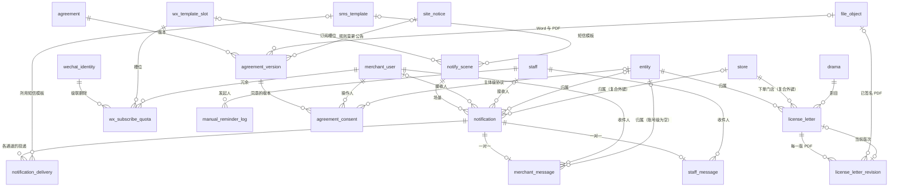

# 13 通知与文书

| 项 | 内容 |
| --- | --- |
| 模块 | notify（10 张）、docs（5 张），都在 L1 |
| 表 | 15 张：`notify_scene`、`wx_template_slot`、`sms_template`、`notification`、`notification_delivery`、`notification_fanout`、`merchant_message`、`staff_message`、`wx_subscribe_quota`、`manual_reminder_log`、`agreement`、`agreement_version`、`agreement_consent`、`license_letter`、`license_letter_revision` |
| 依据 | rulings M2、M9、M13、M17、M19、M26、M29、M33、M34、M41、M45，第二轮按 M46–M53、M57、M58、M63、M65、M80、M92 修订，第三轮按 M93、M94、M105、M109、M110 与其他分组的请求修订；catalogue 的约定与本分组 14 张表的条目；decisions 第 1 节 #9、#22、#28、#36，第 6 节（`license_letter` 的 lock_rank = 240），第 8 节；03-key-designs 第 8 节与 R6、R13、R14；草案 d6-notify-docs-data 第 1.4、2、3、7 节，d3-flow 第 12.6 节（`reminder_log`），d4-identity 第 3.1 节（`user_consent`） |
| Prisma 片段 | 工作目录 `dm/prisma/frag/13-notify-docs.prisma`（合并后进 `packages/db`） |
| 手写约束 | 工作目录 `dm/sql/13-notify-docs.sql`（合并后进迁移） |

## 1. 概览

这组表解决两件事。

**通知**：业务事务只写出站事件，通知模块把“事件或提醒规则”变成通知（场景 × 业务对象 × 节点 × 接收人，带去重键），再按通道拆成投递。站内消息与通知同事务落库；订阅消息、短信、企业微信、邮件各是一条投递行，行上的 `due_at`、状态与认领序号同时充当到期任务、发送日志和成功率数据源。验证码这类不属于任何通知的短信是“直发投递”，只借用投递表做限频、日志与对账。场景的定义（触发、接收人、文案、深链）在代码注册表里，库里只存开关、订阅槽位与短信策略。后台人工催办在发通知前先过限频闸 `manual_reminder_log`。

**文书**：点击同意类的协议做版本管理，到点生效；每次登录、加入、交易落一条同意记录作证据。平台出具的《定制内容授权书》按“订单项 × 发布账号”各一封，信件行保存法律要素现状，每一版 PDF 是一行版次。

本分组通用的写法（下文各表不再重复）：

| 事项 | 写法 | 依据 |
| --- | --- | --- |
| 主键 | 业务表 `id uuid`（UUID v7，应用生成）；配置表用自然键（`scene_key`、`slot_key`、`template_key`、`key`）；`wx_subscribe_quota` 用复合主键；两张只增表另带 `seq` | 约定·主键 |
| 时间 | 每张表有 `created_at`；可变表有 `updated_at`；都由应用时钟写入，不设数据库默认值 | 约定·时间 |
| 长度上限 | 草案的 `varchar(n)` 落地为 `text`，上限合并成每表一条 `ck_<表>_text_len` | d6:81 |
| 内容哈希 | 文件与内容的 SHA-256 存 `text`，十六进制小写 64 位，各带格式 CHECK；openid 的 HMAC 存 `bytea`，32 字节 | 同 06 分组的 `file_object.sha256`、02 分组的盲索引 |
| 密文 | `text`，格式 `v1:<kid>:<base64url>`；草案写的 `bytea` 不采用 | 约定·敏感字段三件套 |
| IP | `text`，存规范化后的文本地址（草案写 `inet`） | M51 |
| 外键列名 | 被引用表全名加 `_id`（`merchant_user_id`、`license_letter_id`、`site_notice_id`、`drama_order_id`）；指向自然键表的列用“被引用表全名 + `_` + 主键列名”（`notify_scene_key`、`wx_template_slot_key`、`sms_template_key`、`agreement_key`）；文件列用 `file_id`、`<角色>_file_id`；按角色命名的保留（`updated_by_staff_id`、`current_revision_id`） | M33、M57、M58 |
| 序号列名 | `seq` 只留给两张只增表的 identity 列；其余改名：`resend_no`、`attempt_no`、`render_attempt_no`、`rev_no` | M34 |
| 布尔列 | `is_` 前缀或 `_enabled` 后缀，NOT NULL 带默认值 | 约定·命名规则 |
| 外键 | 全部写在 Prisma 片段里，SQL 文件不建外键。同一模型指向同一模型的多个关系都写关系名（`agreement_version` 指向 `file_object`、`staff` 各两个） | M46 |
| 外键删除行为 | 一律 `RESTRICT`；唯一例外是 `wx_subscribe_quota.wechat_identity_id`（`CASCADE`） | d6:465 |
| 门店归属 | 同时带 `entity_id`、`store_id` 的四张表（`notification`、`merchant_message`、`agreement_consent`、`license_letter`）对门店只建复合外键 `fk_<表>_store_entity`：`(store_id, entity_id) → store(id, entity_id)`，另保留 `entity_id → entity.id` 的单列外键。复合外键是 MATCH SIMPLE，`entity_id` 为空时整条不检查，所以三张归属可空的表另有 CHECK“有 `store_id` 必有 `entity_id`” | M47；约定·归属列 |
| 主键约束名 | `pk_<表>`（单列 `@id(map:)`，复合 `@@id(map:)`） | M48 |
| 不可变列 | 触发器 `trg_<表>_immutable`，公共函数 `lyx_forbid_column_change(列…)`：列出的列在 UPDATE 时值有变化即报错 | M50；约定·归属列（创建时复制，不可变） |
| 禁止删除 | 证据表的 `trg_<表>_no_delete`（行级 BEFORE DELETE）与 `trg_<表>_no_truncate`（语句级 BEFORE TRUNCATE），公共函数 `lyx_forbid_delete()`；只增表用 `lyx_forbid_mutation()` | M50；约定·只增表 |

物理删除的范围：

| 表 | 何时删行 | 依据 |
| --- | --- | --- |
| `merchant_message` | 用户注销时删除该账号的站内消息 | d6:782；约定·软删除 |
| `wx_subscribe_quota` | 微信身份行被删时级联删除（移除微信、改绑、注销、空账号清理） | d6:465、782；02 分组 2.2 |
| `agreement_version` | 只有草稿可以删 | 触发器 `trg_agreement_version_guard` |
| 其余 11 张 | 不删。通知与投递不做定期清理（每日约 10³ 行）；超过 1,000 万行再按月归档投递表 | d6:782 |

用户注销时另把该用户名下投递行的 `target_ref`、`target_masked` 清空，只留统计字段（d6:782“投递记录保留脱敏后的统计字段”；见第 6 节第 1 项）。注销不做同步调用：通知模块订阅 02 分组的出站事件 `merchant_user.deleted` 后删站内消息、清空投递目标（02 分组第 2.1 节；M94 增补的 identity → notify 只用于 `notify.sendDirect`）。

外部行的物理删除（M63、M93）：本分组引用的外部行里，只有 `wechat_identity` 会被物理删除（移除微信、改绑、注销、空账号清理），`wx_subscribe_quota` 对它是 `CASCADE`，其余表不引用它（同意记录只存 openid 的 HMAC 快照）。草稿门店不物理删除、只做停用，引用 `store` 的外键一律 `RESTRICT`（M93），本分组四张表对 `store` 的复合外键即是如此。`user_session`、`portal_session`、`portal_ticket` 本分组不引用。

## 2. 表定义

### 2.1 `notify_scene` 通知场景开关

通知场景的可切换开关与通道绑定。场景定义本身在代码注册表（`packages/services/src/notify/registry.ts`），注册表里的每个键在本表必须有一行，由迁移播种；后台只能改开关，不能增删行。归属：全局。主键：自然键 `scene_key`。不是只增表。没有状态机。lock_rank = null。

| 列 | 类型 | 空 | 默认 | 说明 | 出处 |
| --- | --- | --- | --- | --- | --- |
| scene_key | text | 否 | — | 主键。场景键，与注册表一致；商家场景以 `m.` 开头，员工场景以 `s.` 开头；不超过 48 字符 | d6:354、231-275 |
| audience | text | 否 | — | 受众，冗余自注册表，便于筛选：`merchant` 商家 / `staff` 员工 | d6:355 |
| name | text | 否 | — | 后台显示名，不超过 32 字 | d6:356 |
| ext_enabled | boolean | 否 | true | 外部通道开关，即画板上的“启用”开关：关闭后不再发订阅消息、短信、企业微信、邮件，站内消息照发 | d6:357；admin/OpsTemplates |
| scene_enabled | boolean | 否 | true | 场景总开关：关闭后站内也不发。仅超级管理员可改，须填原因并写审计 | d6:358 |
| wx_template_slot_key | text | 可 | — | 订阅消息槽位；空 = 不发订阅消息 | d6:359 |
| sms_policy | text | 否 | `never` | 短信策略：`never` 不发 / `fallback` 订阅消息未送达才补发 / `always` 总是发。画板上的“补发短信”开关 = `fallback` ⇄ `never` | d6:360；admin/OpsTemplates |
| sms_template_key | text | 可 | — | 短信模板；`sms_policy` 不是 `never` 时必填。带订阅槽位的商家场景一律播种模板（没有专用模板的用 `generic_todo`），后台的“补发短信”开关只改 `sms_policy` | d6:361、899 |
| sms_nodes | jsonb | 可 | — | 只有这些节点允许短信，字符串数组，如 `["T-1"]`、`["R1"]`；空 = 全部节点 | d6:362 |
| send_window | text | 否 | — | 发送时段：`immediate` 立即 / `window` 08:00–21:00 之外顺延 / `scheduled` 由提醒规则在指定时刻派生 | d6:363；admin/OpsTemplates |
| manager_escalation_enabled | boolean | 否 | false | 订阅消息与短信均未送达时，是否转交付经理人工跟进（派发 `s.merchant_unreached`） | d6:364、605-606 |
| collapse_window_sec | integer | 否 | 0 | 合并窗口（秒）：大于 0 时，同一接收人同一场景在窗口内的外部通道只保留第一条，站内照发 | d6:365、674 |
| lock_version | integer | 否 | 0 | 乐观锁；后台改开关带 `expectedVersion` | d6:366；约定·乐观锁 |
| updated_by_staff_id | uuid | 可 | — | 最近修改人；播种后没改过为空 | d6:367；约定·操作人列 |
| created_at | timestamptz | 否 | — | 创建时间（播种时间） | d6:348 |
| updated_at | timestamptz | 否 | — | 更新时间 | d6:367 |

**键与索引**

- 主键：`pk_notify_scene (scene_key)`。
- 外键：`wx_template_slot_key → wx_template_slot.slot_key`（`fk_notify_scene_wx_template_slot_key`）；`sms_template_key → sms_template.template_key`（`fk_notify_scene_sms_template_key`）；`updated_by_staff_id → staff.id`（`fk_notify_scene_updated_by_staff_id`）。都是 RESTRICT。
- 普通索引：`ix_notify_scene_wx_template_slot_key`、`ix_notify_scene_sms_template_key`（槽位或模板被停用时找受影响的场景）。

**手写约束**

| 约束名 | 规则 |
| --- | --- |
| `ck_notify_scene_audience` | `audience IN ('merchant','staff')` |
| `ck_notify_scene_scene_key` | 键的写法为 `m.` 或 `s.` 加小写蛇形名，前缀与 `audience` 一致 |
| `ck_notify_scene_sms_policy` | `sms_policy IN ('never','fallback','always')` |
| `ck_notify_scene_send_window` | `send_window IN ('immediate','window','scheduled')` |
| `ck_notify_scene_sms_template` | `sms_policy` 不是 `never` 时 `sms_template_key` 非空 |
| `ck_notify_scene_staff_channels` | 员工场景没有订阅槽位、没有短信（员工的外部通道是企业微信，由注册表声明） |
| `ck_notify_scene_sms_nodes` | `sms_nodes` 为空或是 JSON 数组 |
| `ck_notify_scene_collapse_window_sec` | `collapse_window_sec >= 0` |
| `ck_notify_scene_text_len` | `scene_key` ≤ 48、`name` ≤ 32 |

**播种**（V1.0，取自 d6:231-275）：商家场景 18 行——`m.pay_success`、`m.order_submitted`、`m.plan_pending`、`m.ad_pending`、`m.sample_pending`、`m.delivered`、`m.launch_remind`、`m.verify_result`、`m.plan_expiring`、`m.offline_remind`、`m.ticket_reply`、`m.invoice_issued`、`m.points_changed`、`m.review_result`、`m.member_changed`、`m.asset_feedback`、`m.refund_result`、`m.rule_change_notice`；员工场景 14 行——`s.work_ticket_assigned`、`s.step_overdue`、`s.kf_assigned`、`s.kf_response_overdue`、`s.complaint_created`、`s.launch_overdue`、`s.offline_overdue`、`s.copyright_expiring`、`s.approval_pending`、`s.approval_decided`、`s.receipt_pending`、`s.merchant_unreached`、`s.export_ready`、`s.system_alert`。只发站内的其余场景（积分已扣减、套餐已开通、渠道账号核验结果、对公收款驳回、巡检异常、发票驳回、授权书已更新等，d6:253）键名由注册表定稿后同批播种（接口阶段已定稿，见下文“补登播种”表，共 31 行）。各场景的 `send_window` 与短信策略默认值取 d6:231-249 的“发送时段”“短信策略”两栏。

短信的播种口径：

| 事项 | 播种值 | 依据 |
| --- | --- | --- |
| 短信模板 | 原型“消息模板”页的 17 个订阅场景都有“补发短信”开关，接口只带 `smsFallback`（d6:961）。所以带订阅槽位的商家场景一律填 `sms_template_key`：样片与广告用 `sample_pending`，上线用 `launch_remind`，套餐到期用 `plan_expiring`，下架用 `offline_remind`，资质审核用 `review_result`，其余（含成片已交付、核验结果）用 `generic_todo`。开关只改 `sms_policy`（`fallback` ⇄ `never`），不会撞 `ck_notify_scene_sms_template` | d6:891-901、899、961；admin/OpsTemplates |
| 默认开启补发 | 样片、广告、成片已交付、上线提醒、核验结果（仅“需补充”，由场景的策略函数判断）、套餐到期（仅 `T-1`）、下架提醒（仅 `T-1`）、资质审核结果 | d6:231-249 |
| `sms_nodes` | 样片、广告为 `["R1","M"]`：自动催办 `R1` 与人工催办 `M` 都可补短信（原型的人工催办提示“已通过订阅消息和短信提醒”）；套餐到期、下架为 `["T-1"]`；其余为空（全部节点，含人工催办的 `M`） | d6:236-237、739；admin/TicketDetail、AdTasks、Calendar、Overdue |

人工催办不另设场景：`manual_reminder_log` 写入后发出站事件，通知模块“按对应场景派发”，节点记 `M`（d6:739）。默认映射（补：取同一业务对象的同类场景，写在注册表）：`confirm_plan` → `m.plan_pending`，`confirm_sample` → `m.sample_pending`，`confirm_ad` → `m.ad_pending`，`golive` → `m.launch_remind`，`takedown`、`breach` → `m.offline_remind`，`patrol_fix` → 巡检异常 `m.patrol_abnormal`，`renewal` → `m.plan_expiring`。

几个场景的接收人约定（注册表的 `recipients`，不改表结构）：

| 场景 | 接收人 | 依据 |
| --- | --- | --- |
| `m.ticket_reply` | `service_ticket.submitter_user_id`；后台登记、没有提交人的工单发给该门店的老板 | d6:243；12 分组的请求 |
| `m.asset_feedback` | 订阅 06 分组的三个出站事件（前两个只在 `store_asset.upload_actor_type = merchant` 时发，员工代传的素材没有商家接收人）：`asset.adopted`（素材被采用）发给上传人；`asset.reviewed` 只在复核结论 `usability` 为 `need_reshoot`（需重拍）或 `need_portrait_auth`（需补肖像授权）时提醒上传人，其余结论不发；`asset.demand_created`（素材需求发起）按 `store_asset_demand.notify_scope` 取 `owner_and_clerks`（老板与门店店员）或 `owner_only` | d6:248；06 分组的请求 |

`m.rule_change_notice` 的正文（14 分组 2.6）：派发时按 `copy_mode` 取公告行的摘要：`offline_contract`（`showPrice = false`）取 `site_notice.summary_no_price`，该列为空（协议版本的公告，没有价格）时取 `summary`；其余模式取 `summary`。 其他分组已提出、要随注册表补的场景（不改表结构）：

- 证照到期提醒与 `store.qualification_change.*`、`store.profile.changed` 的接入（d9:703-704、725；catalogue notes）。
- 员工的跟进到期提醒与待审批提醒（03 分组 2.9、请求）：纯提醒，由通知规则派生（`source_rule` 非空），用 `notification.dedupe_key` 去重，不登记定时器行；取数经 03 注册的查询端口，分别用 `follow_up` 的部分索引 `ix_follow_up_next_follow_at`（提醒对象 `owner_staff_id`，`biz_type = follow_up`）与 `approval_request` 的 `pending` 行（`biz_type = approval_request`）。
- 账号级的账号安全通知：站内消息不归属主体（`entity_id`、`store_id`、`copy_mode` 都为空，见 2.4、2.6），`biz_type = merchant_user`。
  - 新微信登录（d4:386-389；订阅 02 分组的出站事件 `merchant_user.wechat_bound`，A95 改名，x01 3.17）：短信用 `account_notice` 模板、策略 `always`；订阅消息要排除刚绑定的那个微信身份，事件载荷带 `wechatIdentityId`，场景的 `vars` 带 `excludeWechatIdentityId`，额度预留跳过它（见 2.8）。
  - 换绑手机号：订阅 02 分组的出站事件 `merchant_user.phone_changed` 生成站内消息，载荷不带手机号，场景不发短信。给原号码的账号安全短信不经场景：identity 在换绑事务提交后调 `notify.sendDirect`（`purpose = account_notice`，见 2.5“直发”；02 分组 2.8）。

**补登播种**（接口阶段，a09-ops.md 2.9 标“补登”的原31个键及W2-10追加场景，随注册表同批播种；只加行、不改表）：默认 `ext_enabled = true`、`scene_enabled = true`、`sms_policy = never`、`send_window = immediate`，槽位与短信模板为空（只发站内；员工场景的企业微信由注册表声明）。触发事件、接收人与深链以 a09 2.9 为准，下表只列键与显示名。

| `scene_key` | `audience` | `name` | 例外与说明 |
| --- | --- | --- | --- |
| `m.rule_change_withdrawn` | merchant | 调整已取消 | `site_notice.withdrawn` |
| `m.quota_exceeded` | merchant | 名额超限提醒 | W2-10 权益变动；既有默认绑定，只发立即站内 |
| `m.plan_activated` | merchant | 套餐已开通 | — |
| `m.plan_renewed` | merchant | 续费成功 | — |
| `m.plan_upgraded` | merchant | 套餐已升级 | — |
| `m.plan_extended` | merchant | 有效期延长 | — |
| `m.points_captured` | merchant | 积分已扣减 | — |
| `m.points_expired` | merchant | 上期积分已清零 | — |
| `m.transfer_rejected` | merchant | 对公收款驳回 | — |
| `m.invoice_rejected` | merchant | 发票驳回 | — |
| `m.store_review_submitted` | merchant | 新增门店已提交审核 | — |
| `m.profile_proxy_edited` | merchant | 档案已代改 | — |
| `m.channel_account_result` | merchant | 渠道账号核验结果 | — |
| `m.patrol_abnormal` | merchant | 巡检异常 | 即人工催办 `patrol_fix` 映射的“巡检异常”场景 |
| `m.license_letter_updated` | merchant | 授权书已更新 | — |
| `m.account_security` | merchant | 账号安全通知 | 例外：`sms_policy = always`、`sms_template_key = account_notice`（只对 `merchant_user.wechat_bound`；`merchant_user.phone_changed` 只站内，由注册表的策略函数区分）；订阅槽位本批播种为空（a09 2.9 写“由 13 分组定”；要绑时取已有槽位改播种值，派发时按 `vars.excludeWechatIdentityId` 排除刚绑定的身份，见上一条与 2.8） |
| `m.order_progress` | merchant | 订单与交付进度 | — |
| `m.cart_price_changed` | merchant | 选剧单变价提示 | — |
| `m.refund_initiated` | merchant | 已发起原路退款 | — |
| `s.approval_overdue` | staff | 审批超时 | — |
| `s.handover_overdue` | staff | 转移后未联系商家 | — |
| `s.asset_feedback` | staff | 商家素材反馈 | — |
| `s.asset_review_overdue` | staff | 素材整理超时 | — |
| `s.finance_overdue` | staff | 财务待办超时 | — |
| `s.payment_exception` | staff | 支付差异单 | — |
| `s.kf_solution_overdue` | staff | 处理方案超时 | — |
| `s.kf_supplemented` | staff | 商家补充了说明 | — |
| `s.kf_todo` | staff | 客服待办 | — |
| `s.finance_config` | staff | 受控财务配置变更 | — |
| `s.delivery_progress` | staff | 交付进度 | — |
| `s.publish_progress` | staff | 发布待办 | — |
| `s.merchant_changed` | staff | 商家变动 | — |
| `s.receipt_daily_digest` | staff | 对公确认日摘要 | W4-12；默认 `ext_enabled = false`，始终只发站内；当前在职超级管理员按业务日/员工去重；安全清单保存在通知变量，页面消费待 W4-18 |
| `s.wecom_invite` | staff | 企业微信绑定邀请 | W2-03 必要补登；active+invited 当前员工，站内-only，真实邀请审计 ID 去重 |
| `s.followup_due` | staff | 跟进到期提醒 | W2-17 按既有跟进提醒请求补登；到期日 09:00、当前负责人、仍待跟进 |

**不变量**：注册表里的每个键在本表有行（启动自检，d6:314）；`wx_template_slot_key` 所指槽位的字段名与场景 `wx()` 的返回一致（启动自检，同上）。

**相对草案的改动**

| 改动 | 依据 |
| --- | --- |
| `wx_slot_key` → `wx_template_slot_key` | M33（外键列用被引用表全名） |
| `escalate_to_manager` → `manager_escalation_enabled` | 约定·命名规则（布尔列） |
| `rev` → `lock_version`，默认值由 1 改为 0 | 约定·乐观锁 |
| `updated_by bigint` → `updated_by_staff_id uuid`，建外键 | 约定·操作人列；R1 |
| `sms_policy` 补默认值 `never` | 补：未显式配置的场景不发短信 |
| 补 `ck_notify_scene_staff_channels` | d6:496-503 的派发算法只给商家场景建订阅与短信投递 |
| 播种：带订阅槽位的商家场景都填短信模板；样片、广告的 `sms_nodes` 加 `M` | 原型每个订阅场景都有补发开关（d6:961）；人工催办原型写“订阅消息和短信” |

### 2.2 `wx_template_slot` 订阅消息模板槽位

槽位键 → 微信模板 ID 与字段定义。模板只能从类目的公共模板库选，所以场景与槽位解耦；每个环境各自配置模板 ID。归属：全局。主键：自然键 `slot_key`。不是只增表。没有状态机（`status` 是技术状态）。lock_rank = null。

| 列 | 类型 | 空 | 默认 | 说明 | 出处 |
| --- | --- | --- | --- | --- | --- |
| slot_key | text | 否 | — | 主键。槽位键，如 `service_progress`；用中性名，不取“会员”“充值”类措辞；不超过 32 字符 | d6:373、344 |
| title | text | 否 | — | 模板标题，不超过 32 字；同一次授权调用里标题不能重复 | d6:374 |
| provider_template_id | text | 可 | — | 微信侧模板 ID，不超过 64 字符；空 = 未配置，全链路不发 | d6:375 |
| fields | jsonb | 否 | — | 模板字段定义数组，与微信后台逐字一致。结构见第 4 节 | d6:376 |
| status | text | 否 | — | 槽位状态：`active` 可用 / `unconfigured` 未配置 / `disabled` 已停用 | d6:377 |
| fail_streak | integer | 否 | 0 | 字段类错误（47003）连续失败的通知数；任一次成功清零；达到参数 `notify.wx.field_fail_streak`（默认 5）即自动停用 | d6:378、381 |
| disabled_reason | text | 可 | — | 停用原因：`template_invalid` 模板不存在或已删除 / `field_mismatch_streak` 字段错误连续超限 / `manual` 人工停用 | d6:379 |
| created_at | timestamptz | 否 | — | 创建时间（播种时间） | d6:348 |
| updated_at | timestamptz | 否 | — | 更新时间 | 补：约定·时间 |

**键与索引**：主键 `pk_wx_template_slot (slot_key)`。没有外键与其他索引。

**手写约束**

| 约束名 | 规则 |
| --- | --- |
| `ck_wx_template_slot_slot_key` | 键为小写蛇形名 |
| `ck_wx_template_slot_status` | `status IN ('active','unconfigured','disabled')` |
| `ck_wx_template_slot_disabled_reason` | 取值在三个之内 |
| `ck_wx_template_slot_disabled` | `status = 'disabled'` 当且仅当 `disabled_reason` 非空 |
| `ck_wx_template_slot_configured` | `active` 必有模板 ID；`unconfigured` 必无模板 ID |
| `ck_wx_template_slot_fail_streak` | `fail_streak >= 0` |
| `ck_wx_template_slot_fields` | `fields` 是 JSON 数组 |
| `ck_wx_template_slot_text_len` | `slot_key` ≤ 32、`title` ≤ 32、`provider_template_id` ≤ 64 |

**状态**（技术状态，带原状态条件的 UPDATE，不写状态历史）

| 当前状态 | 事件 | 新状态 | 守卫 | 触发者 |
| --- | --- | --- | --- | --- |
| `unconfigured` | 绑定模板 ID | `active` | 字段定义与场景 `wx()` 的返回一致 | 超级管理员 |
| `active` | 微信返回“模板 ID 不正确或已删除” | `disabled`（`template_invalid`） | — | 系统；同时告警 |
| `active` | 47003 连续失败达到阈值 | `disabled`（`field_mismatch_streak`） | `fail_streak` ≥ 参数值 | 系统；同时告警 |
| `active` | 人工停用 | `disabled`（`manual`） | 写审计 | 超级管理员 |
| `disabled` | 重新启用 | `active` | 模板 ID 非空；`fail_streak` 清零；写审计 | 超级管理员 |

**播种**（V1.0 默认方案，d6:794-807；类目确定后按公共模板库实际可选模板调整）：`pay_result`、`order_result`、`refund_result`、`invoice_result`、`service_progress`、`todo_remind`、`review_result`、`svc_expiry`、`quota_change`、`ticket_reply`、`member_change`、`asset_feedback`，共 12 个，初始 `unconfigured`。

**不变量**（`notify.N3` 的后半，d6 的 N3；每日，module = `notify`，severity = P2）：槽位未配置或 `disabled` 期间，不存在使用该槽位模板 ID 的 `sent` 投递。

**相对草案的改动**：补 `updated_at`（约定·时间）；补 `ck_wx_template_slot_disabled`、`ck_wx_template_slot_configured` 两条状态一致性约束（d6:375、377、379 的语义）。

### 2.3 `sms_template` 短信模板登记

模板键 → 服务商模板 ID、签名、变量定义、保活与失效探测状态。归属：全局。主键：自然键 `template_key`。不是只增表。没有状态机（`status` 是技术状态）。lock_rank = null。

| 列 | 类型 | 空 | 默认 | 说明 | 出处 |
| --- | --- | --- | --- | --- | --- |
| template_key | text | 否 | — | 主键。模板键，不超过 32 字符 | d6:387、891-901 |
| kind | text | 否 | — | 类型：`verify` 验证码类（不受发送时段限制）/ `notice` 通知类 | d6:388 |
| provider_template_id | text | 可 | — | 服务商侧模板 ID，不超过 32 字符；空 = 未配置 | d6:389 |
| sign_name | text | 可 | — | 短信签名，按环境配置，不超过 16 字；空 = 未配置 | d6:390、907 |
| params | jsonb | 否 | — | 有序变量定义数组。结构见第 4 节 | d6:391 |
| status | text | 否 | — | 模板状态：`active` 可用 / `pending_carrier` 平台已审、运营商报备中 / `unconfigured` 未配置 / `suspect` 近 N 次全部失败，疑似签名失效 / `disabled` 已停用 | d6:392、909 |
| last_ok_at | timestamptz | 可 | — | 最近一次发送成功的时间；保活任务与失效探测用 | d6:393、909 |
| created_at | timestamptz | 否 | — | 创建时间（播种时间） | d6:348 |
| updated_at | timestamptz | 否 | — | 更新时间 | 补：约定·时间 |

**键与索引**：主键 `pk_sms_template (template_key)`。没有外键与其他索引。

**手写约束**

| 约束名 | 规则 |
| --- | --- |
| `ck_sms_template_template_key` | 键为小写蛇形名 |
| `ck_sms_template_kind` | `kind IN ('verify','notice')` |
| `ck_sms_template_status` | 取值在五个之内 |
| `ck_sms_template_configured` | `active`、`pending_carrier`、`suspect` 时模板 ID 与签名都非空 |
| `ck_sms_template_params` | `params` 是 JSON 数组 |
| `ck_sms_template_text_len` | `template_key` ≤ 32、`provider_template_id` ≤ 32、`sign_name` ≤ 16 |

**播种**（d6:891-901）：`verify_code`（`verify`）、`review_result`、`sample_pending`、`launch_remind`、`plan_expiring`、`offline_remind`、`generic_todo`、`account_notice`、`ops_alert`（后 8 个为 `notice`），共 9 个，初始 `unconfigured`。

**不变量**：通知类模板超过 `notify.sms.keepalive_days` 没有成功发送时由保活任务处理（d6:909），不是数据不变量。

**相对草案的改动**：`sign_name` 定为可空并补 `ck_sms_template_configured`（未配置时没有签名）；补 `updated_at`（约定·时间）。

### 2.4 `notification` 通知

一次“场景 × 业务对象 × 节点 × 接收人”，带去重键；所有派发的幂等锚点，也承担纯提醒的去重（R6）。归属：门店维度，`entity_id`、`store_id` 可空（主体级、账号级、平台级通知）。主键 `uuid`。不是只增表，但创建后不再更新，所以没有 `updated_at`。没有状态机。lock_rank = null。

| 列 | 类型 | 空 | 默认 | 说明 | 出处 |
| --- | --- | --- | --- | --- | --- |
| id | uuid | 否 | — | 主键 | d6:399；R1 |
| notify_scene_key | text | 否 | — | 场景 | d6:400 |
| dedupe_key | text | 否 | — | 去重键：`{场景业务键}:{节点}:{接收人}`，不超过 160 字符；唯一。重复事件、规则重扫、人工催办都靠它幂等 | d6:401、299 |
| source_outbox_event_id | uuid | 可 | — | 触发它的出站事件；规则派生的为空（人工催办经 `manual_reminder_log` 的出站事件派发，带事件 id）。只存 id，不建外键 | d6:402、739；catalogue cross_module_fks |
| source_rule | text | 可 | — | 提醒规则键（如 `R2.launch`），不超过 24 字符；非规则派生的为空 | d6:403 |
| biz_type | text | 可 | — | 业务对象类型，取最终表名；V1.0 的已知取值见第 3 节。没有业务对象的通知（如按员工聚合的版权到期提醒、逾期未上线提醒，见 5.3）为空 | d6:404；M19；decisions 第 8 节 |
| biz_id | uuid | 可 | — | 业务对象 id；多态，不建外键。与 `biz_type` 同有同无 | d6:404；约定·主键第 5 条 |
| node | text | 否 | `N0` | 节点：`N0` 首发 / `R1` 催办 / `T-7`、`T-1`、`T-0` 日期型 / `M` 人工 / `C` 任务生成 | d6:405、733 |
| merchant_user_id | uuid | 可 | — | 接收的商家用户；与 `staff_id` 恰有一个非空 | d6:406 |
| staff_id | uuid | 可 | — | 接收的员工 | d6:406 |
| entity_id | uuid | 可 | — | 所属主体（可见范围）；平台级与账号级通知（新微信登录、换绑手机号）为空 | d6:407；M13；d4:386-389 |
| store_id | uuid | 可 | — | 所属门店；主体级、账号级通知为空 | d6:407 |
| vars | jsonb | 否 | — | 场景 `load()` 读出的渲染变量；不放手机号、证照号，验证码不经过本表。结构见第 4 节 | d6:408 |
| copy_mode | text | 可 | — | 派发时的购买入口模式：`in_app` 可在小程序内购买 / `offline_contract` 线下签约 / `hidden` 隐藏购买入口。按主体计算（`notifyPurchaseMode(entityId)`），站内消息的文案按它定格；员工场景与账号级通知为空 | d6:409、319-328 |
| created_at | timestamptz | 否 | — | 创建时间（派发时间） | d6:411 |

**键与索引**

- 主键：`pk_notification (id)`。
- 外键：`notify_scene_key → notify_scene.scene_key`（`fk_notification_notify_scene_key`）；`merchant_user_id → merchant_user.id`（`fk_notification_merchant_user_id`）；`staff_id → staff.id`（`fk_notification_staff_id`）；`entity_id → entity.id`（`fk_notification_entity_id`）；复合外键 `(store_id, entity_id) → store(id, entity_id)`（`fk_notification_store_entity`，M47）。都是 RESTRICT。
- 唯一：`uq_notification_dedupe_key (dedupe_key)`；派发用 `INSERT … ON CONFLICT (dedupe_key) DO NOTHING`。
- 普通索引：`ix_notification_notify_scene_key_created_at (notify_scene_key, created_at)`（场景近 7 天统计、发送日志按场景筛）；`ix_notification_biz_type_biz_id (biz_type, biz_id)`（按单据查通知、发票邮件重发）；`ix_notification_merchant_user_id_created_at`、`ix_notification_staff_id_created_at`（按接收人查，合并窗口判断）；`ix_notification_entity_id`、`ix_notification_store_id`（外键列）。

**手写约束**

| 约束名 | 规则 |
| --- | --- |
| `ck_notification_recipient` | `merchant_user_id`、`staff_id` 恰有一个非空 |
| `ck_notification_biz_type` | 写法为小写蛇形名（表名）；取值清单在场景注册表，数据库只约束写法（同 06 分组的 `file_ref.ref_type`） |
| `ck_notification_biz_pair` | `biz_type` 与 `biz_id` 同有同无 |
| `ck_notification_node` | 写法为 `N0`、`R<n>`、`T-<n>`、`M`、`C` 之一 |
| `ck_notification_copy_mode` | `copy_mode IN ('in_app','offline_contract','hidden')` |
| `ck_notification_copy_mode_audience` | 发给商家且有主体的通知必有 `copy_mode`；发给员工的、账号级（无主体）的必为空 |
| `ck_notification_source` | `source_outbox_event_id`、`source_rule` 至多一个非空 |
| `ck_notification_store_entity` | 有 `store_id` 必有 `entity_id`（复合外键在 `entity_id` 为空时不检查，靠它补上） |
| `ck_notification_vars` | `vars` 是 JSON 对象 |
| `ck_notification_text_len` | `dedupe_key` ≤ 160、`source_rule` ≤ 24、`node` ≤ 16 |
| `ix_notification_source_outbox_event_id` | 部分索引 `(source_outbox_event_id) WHERE source_outbox_event_id IS NOT NULL`：排障时按事件查它派发了哪些通知 |

**不变量**（每日校验，登记见 5.4，违规经 `invariants.report` 写入；module = `notify`，severity = P2）

- `notify.N1`（d6 的 N1）：每个通知恰有一条站内消息（`merchant_message` 或 `staff_message` 其一，与接收人类型一致），已注销用户被删除的站内消息除外；站内消息的接收人、`entity_id`、`store_id` 与通知一致；每个通知在每个通道上 `resend_no = 0` 的投递至多一条（由唯一约束保证）。违规的 `subject_type = notification`。

**相对草案的改动**

| 改动 | 依据 |
| --- | --- |
| `scene_key` → `notify_scene_key`；`user_id` → `merchant_user_id` | M33 |
| `source_event_id` → `source_outbox_event_id`，类型 uuid，不建外键 | M33；catalogue cross_module_fks |
| `biz_id varchar(40)` → uuid；`biz_type` 取最终表名 | 约定·主键第 5 条；M19 |
| `entity_id` 建外键；门店建复合外键 `fk_notification_store_entity` | 约定·归属列（L1 及以上对 entity、store 建外键）；M47 |
| 补 `ck_notification_copy_mode_audience`、`ck_notification_source`、`ck_notification_store_entity` | d6:485、402-403、407 的语义；账号级通知没有主体，算不出购买模式（d6:319-328） |
| 补按接收人的两个索引与按事件的部分索引 | 合并窗口判断（d6:674）与排障 |
| 删 `is_test`：测试发送改走直发（`notification_delivery.purpose = 'test'`），不建通知、不写站内消息、不占额度 | d6:410、963 的测试发送对象是登记的 openid / 手机号，不是商家用户或员工，放不进接收人、站内消息与额度的约束；直发天然不进场景统计 |

### 2.5 `notification_delivery` 投递

通知在某个通道上的一次发送。它同时是“到点要做的那件事”、发送日志与成功率数据源；验证码等直发短信与后台的测试发送也借用本表做限频、日志与对账。归属：全局（不带归属列，经通知行取归属）。主键 `uuid`。不是只增表。`status` 是技术状态，不写状态历史。lock_rank = null（认领用带原状态条件的单行 UPDATE）。

| 列 | 类型 | 空 | 默认 | 说明 | 出处 |
| --- | --- | --- | --- | --- | --- |
| id | uuid | 否 | — | 主键 | d6:417；R1 |
| notification_id | uuid | 可 | — | 所属通知；直发投递为空 | d6:418 |
| is_direct | boolean | 否 | false | 是否直发；与 `notification_id` 为空等价 | d6:419 |
| channel | text | 否 | — | 通道：`inbox` 站内 / `wx_subscribe` 微信订阅消息 / `sms` 短信 / `wecom` 企业微信应用消息 / `mail` 邮件 | d6:420 |
| resend_no | smallint | 否 | 0 | 重发序号：自动产生的投递为 0（一个通知在一个通道上至多一条），人工重发为上一条 + 1 | d6:421；M34 |
| origin | text | 否 | — | 来源：`primary` 首发 / `fallback` 补发（订阅未送达后的短信）/ `manual` 人工重发 / `direct` 直发 | d6:422 |
| status | text | 否 | — | 投递状态：`pending` 待发 / `sending` 已认领 / `sent` 通道返回成功 / `failed` 失败 / `skipped` 预检不通过未发 / `cancelled` 守卫失效取消 | d6:423、516-548 |
| reason | text | 可 | — | 终态非成功的原因，只在 `failed`、`skipped`、`cancelled` 时有值；15 个取值见第 3 节 | d6:424、535-548、596 |
| due_at | timestamptz | 否 | — | 到期时间（已按发送时段顺延，另加 0–300 秒确定性抖动） | d6:425、660 |
| attempt_no | smallint | 否 | 0 | 认领序号：每次认领加 1；所有结果落库都以它为条件 | d6:426；M34 |
| max_attempts | smallint | 否 | 3 | 最多认领次数 | d6:426 |
| lease_until | timestamptz | 可 | — | `sending` 的租约到期时间（认领 60 秒，标记开始调用后 30 秒；邮件 90 秒） | d6:427、552 |
| call_started_at | timestamptz | 可 | — | 发起外部调用前写入；租约回收据此区分“没调过”（可重试）与“调了没结果”（不重发） | d6:428 |
| target_ref | text | 可 | — | 投递目标的引用，不超过 64 字符：微信身份 id / 手机号 HMAC / 企业微信 userid / 邮箱 HMAC（测试发送的订阅消息存 openid 的 HMAC）；明文不落本表。限频按它计数。解析目标前为空 | d6:429、668、963 |
| target_masked | text | 可 | — | 脱敏后的目标（`138****5678`、`a***@x.com`），发送日志页展示 | d6:430 |
| purpose | text | 可 | — | 直发用途：`verify_code` 验证码 / `staff_activation` 员工激活码 / `account_notice` 账号安全通知 / `ops_alert` 值班告警 / `keepalive` 签名保活 / `test` 后台测试发送。只有直发填 | d6:431、963 |
| direct_key | text | 可 | — | 直发的幂等键，不超过 120 字符（调用方重试时用，如验证码 `sms_verification:{id}`、员工激活码 `staff_act:{activationId}`）；唯一 | d6:432、935；02 分组 2.6 |
| sms_template_key | text | 可 | — | 所用短信模板；短信通道必填，其他通道为空。直发行靠它记“用了哪个模板”，保活与失效探测按模板统计 | 补：d6:925、934（“投递行只有模板键、脱敏手机号与结果”）、909 |
| provider_template_id | text | 可 | — | 发送时使用的服务商模板 ID 快照 | d6:433 |
| provider_msg_id | text | 可 | — | 服务商返回的消息 id；短信回执、订阅消息下发结果事件按它回写 | d6:433、848 |
| error_code | text | 可 | — | 通道错误码（发送调用的同步结果），不超过 32 字符 | d6:434 |
| error_msg | text | 可 | — | 通道错误信息，不超过 200 字 | d6:434 |
| receipt_status | text | 可 | — | 异步回执给出的最终结果码，不超过 16 字符，原样存通道的写法：短信状态回执成功为 `SUCCESS`，失败存回执的 `errCode`（缺失时存 `reportStatus`）；订阅消息下发结果事件（`subscribe_msg_sent_event`）存该项的 `errorCode`（`0` 为成功）。只追加写这两列，不改变状态机、不触发补发 | d6:435、848、938；15 分组 `webhook_event` 的载荷 |
| receipt_reported_at | timestamptz | 可 | — | 回执上报时间：短信取回执的 `reportedAt`；订阅消息事件没有时间字段，取 `webhook_event.received_at` | d6:435、848；15 分组 |
| sent_at | timestamptz | 可 | — | 通道返回成功的时间 | d6:436 |
| finished_at | timestamptz | 可 | — | 进入终态的时间；站内投递建立时与 `sent_at` 同写 | d6:436 |
| created_at | timestamptz | 否 | — | 创建时间 | d6:348 |
| updated_at | timestamptz | 否 | — | 更新时间 | 补：约定·时间 |

**键与索引**

- 主键：`pk_notification_delivery (id)`。
- 外键：`notification_id → notification.id`（`fk_notification_delivery_notification_id`）；`sms_template_key → sms_template.template_key`（`fk_notification_delivery_sms_template_key`）。都是 RESTRICT。
- 唯一：`uq_notification_delivery_notification_channel_resend (notification_id, channel, resend_no)`（自动补发固定 `resend_no = 0`，一个通知最多一条自动短信；直发行 `notification_id` 为空，不受它约束）；`uq_notification_delivery_direct_key (direct_key)`。
- 普通索引：`ix_notification_delivery_channel_created_at (channel, created_at)`（成功率统计）；`ix_notification_delivery_target_ref_channel_created_at (target_ref, channel, created_at)`（限频计数）；`ix_notification_delivery_sms_template_key_created_at (sms_template_key, created_at)`（按模板算失败率）。

**手写约束**

| 约束名 | 规则 |
| --- | --- |
| `ck_notification_delivery_channel` | 取值在五个之内 |
| `ck_notification_delivery_origin` | 取值在四个之内 |
| `ck_notification_delivery_status` | 取值在六个之内 |
| `ck_notification_delivery_reason` | 取值在 15 个之内 |
| `ck_notification_delivery_reason_by_status` | `pending`、`sending`、`sent` 时 `reason` 为空；`cancelled`、`skipped`、`failed` 时 `reason` 非空，且只能取本状态的原因（见第 3 节） |
| `ck_notification_delivery_purpose` | 取值在六个之内 |
| `ck_notification_delivery_direct` | `is_direct = (notification_id IS NULL)` |
| `ck_notification_delivery_direct_fields` | 直发 ⇔ `origin = 'direct'` ⇔ `purpose` 非空；非直发没有 `direct_key`；直发只走短信，唯一例外是测试发送（`purpose = 'test'`）可走订阅消息 |
| `ck_notification_delivery_resend_no` | `resend_no >= 0`；`origin = 'manual'` 当且仅当 `resend_no > 0` |
| `ck_notification_delivery_inbox` | 站内投递建立即 `sent`，来源只能是 `primary` |
| `ck_notification_delivery_attempt` | `0 <= attempt_no <= max_attempts`，`max_attempts >= 1` |
| `ck_notification_delivery_lease` | `sending` 时 `lease_until` 非空 |
| `ck_notification_delivery_sent` | `sent` 时 `sent_at` 非空 |
| `ck_notification_delivery_finished` | 终态（`sent`、`failed`、`skipped`、`cancelled`）当且仅当 `finished_at` 非空 |
| `ck_notification_delivery_sms_template` | 短信通道当且仅当 `sms_template_key` 非空 |
| `ck_notification_delivery_receipt` | 回执两列同有同无，且只在短信、订阅消息两个通道出现 |
| `ck_notification_delivery_text_len` | `target_ref`、`target_masked`、`provider_template_id`、`provider_msg_id` ≤ 64；`direct_key` ≤ 120；`error_code` ≤ 32；`error_msg` ≤ 200；`receipt_status` ≤ 16 |
| `ix_notification_delivery_pending_due` | 部分索引 `(due_at) WHERE status = 'pending'`：`notify.scan` 取到期行 |
| `ix_notification_delivery_sending_lease` | 部分索引 `(lease_until) WHERE status = 'sending'`：租约回收 |
| `ix_notification_delivery_provider_msg_id` | 部分索引 `(channel, provider_msg_id) WHERE provider_msg_id IS NOT NULL`：回执与下发结果事件按消息 id 回写 |

**状态机**（技术状态，带原状态与认领序号条件的 UPDATE；不写 `status_transition`）

| 当前状态 | 事件 | 新状态 | 守卫 | 触发者 |
| --- | --- | --- | --- | --- |
| — | 派发 / 补发判定 / 人工重发 | `pending` | 站内投递直接建为 `sent` | 派发函数；员工（重发） |
| — | 直发 | `sending` | 限频通过；`attempt_no = 1`，`call_started_at` 与 `lease_until = now + 30 秒` 同时写入 | `notify.sendDirect`；测试发送接口 |
| `pending` | 认领 | `sending` | `status = 'pending' AND due_at <= now`，影响 1 行；`attempt_no + 1`，租约 60 秒，`call_started_at` 清空 | 投递任务 |
| `sending` | 守卫失效 | `cancelled` | 场景 `revalidate()` 为假，或场景开关已关；原因 `guard_invalid` / `scene_disabled`；不补发 | 投递任务 |
| `sending` | 预检不通过 | `skipped` | 原因 `no_target`、`no_quota`、`unconfigured`、`slot_disabled`、`policy_suppressed`、`rate_limited`、`collapsed`；后两个不补发 | 投递任务 |
| `sending` | 顺延 | `pending` | 企业微信分钟限速已满；`due_at` 改到下一分钟，`attempt_no - 1` | 投递任务 |
| `sending` | 标记开始调用 | `sending` | `attempt_no = :my AND lease_until > now`，影响 1 行，否则放弃不调用；写 `call_started_at`，租约 30 秒 | 投递任务 |
| `sending` | 成功 | `sent` | `status = 'sending' AND attempt_no = :my` | 投递任务 |
| `sending` | 确定未受理的可重试错误 | `pending` | `attempt_no < max_attempts`；`due_at` 后移 30 秒、2 分钟 | 投递任务 |
| `sending` | 不可重试错误或重试耗尽 | `failed` | 原因 `user_refused`、`provider_rejected`、`retry_exhausted` | 投递任务 |
| `sending` | 请求已发出但结果未知 | `failed` | 原因 `unknown_outcome`；不重发 | 投递任务 |
| `sending` | 租约过期，未开始调用 | `pending` | `attempt_no < max_attempts`；到次数则 `failed`（`claim_exhausted`） | `notify.scan` |
| `sending` | 租约过期，已开始调用 | `failed` | 原因 `unknown_outcome` | `notify.scan` |
| `failed`（`unknown_outcome`） | 迟到的成功结果 | `sent` | 认领序号相符；`reason` 清空；同事务把尚未发出的补发短信置 `cancelled`（`primary_late_success`） | 投递任务 |

`failed`、`skipped` 进入终态的同一事务做补发判定：订阅消息的原因属于可补发清单且场景允许时新建一条短信投递；短信也未送达且场景要求时派发 `s.merchant_unreached`（d6:593-607）。直发（含测试发送）不重试、不补发。

**回执回写**（只追加，不改 `status`；d6:848、938）：通知模块向 15 分组的回调框架注册处理函数，一条 `webhook_event` 可带多项，逐项处理：

| 来源与事件 | 载荷（15 分组） | 每一项的处理 |
| --- | --- | --- |
| 短信状态回执 | `{ reports: [{ serialNo, reportStatus, errCode?, reportedAt }] }`；`event_id` 取整个请求体的 sha256 | 按 `(channel = 'sms', provider_msg_id = serialNo)` 找投递行，写 `receipt_status`、`receipt_reported_at`（取值见本节列定义） |
| 订阅消息 `subscribe_msg_sent_event` | `{ event, wechatIdentityId, items: [{ templateId, msgId?, status?, errorCode?, errorStatus?, popupScene? }] }` | 按 `(channel = 'wx_subscribe', provider_msg_id = msgId)` 找投递行，写 `receipt_status`（`errorCode` 的文本）、`receipt_reported_at` |
| 订阅消息 `subscribe_msg_change_event` | 同上 | 用户在服务通知里关闭：按 `templateId` 找槽位（`wx_template_slot.provider_template_id`），把 `(wechatIdentityId, 槽位)` 的额度行置 `state = 'rejected'`、`est_remaining = 0`（2.8） |
| 订阅消息 `subscribe_msg_popup_event` | 同上 | 只记日志，不改表（额度以小程序上报的授权结果为准，d6:813-848） |

找不到对应行的项跳过并记日志，不让整条失败；同一条回调重放时写入相同的值，天然幂等。`error_code` 只记发送调用当时的同步结果，与回执两列不混用。载荷不存 openid、手机号（15 分组：用户标识落库前换成 `wechat_identity.id`，回执里的手机号丢弃）。

**直发**（d6:918-935）：不属于任何通知的短信走 `notify.sendDirect`，只借用本表做限频、日志与对账，不重试、不补发。V1.0 的调用方：

| 用途（`purpose`） | 调用方 | `direct_key` | 依据 |
| --- | --- | --- | --- |
| `verify_code` | identity 在插入 `sms_verification` 的事务提交后同步调用（M94） | `sms_verification:{id}` | 02 分组 2.6 |
| `account_notice` | identity 在换绑事务提交后同步调用，发给原号码（原号码只在内存里） | 由 02 分组定 | 02 分组 2.8；d4:418 |
| `staff_activation` | 03 分组的用例在事务提交后直发（不经出站事件，接口裁决 A95） | `staff_act:{activationId}` | d6:934 |
| `ops_alert`、`keepalive`、`test` | 本模块与 ops | 见各自说明 | d6:909、963 |

每个号码的限频只按本表计数（`target_ref` 为手机号 HMAC，索引 `ix_notification_delivery_target_ref_channel_created_at`）：验证码类 60 秒 1 条、1 小时 5 条、1 天 10 条，超限抛 `RATE_LIMITED`（d6:672）。02 分组的 `sms_verification` 不再承担限频，只负责核销。

**测试发送**（d6:963）：后台“测试发送”发给当前员工在参数 `notify.test_recipients` 里登记的 openid 或手机号。它走直发：`purpose = 'test'`，通道是短信或订阅消息，不建通知、不写站内消息、不经 `wx_subscribe_quota` 预留额度（是否有额度以微信返回码为准），也就不进场景统计。渲染用场景的示例变量；`sms_template_key` 取场景的模板；被测的场景键写进审计，`direct_key` 可用 `test:{scene_key}:{请求号}`。限频按 `target_ref` 计数。

**不变量**（每 10 分钟，随 quick 运行，登记见 5.4；module = `notify`，severity = P2）

- `notify.N2`（d6 的 N2）：不存在 `sending` 且租约已过期超过 5 分钟的投递；不存在 `pending` 且 `due_at` 早于 10 分钟前的投递。违规的 `subject_type = notification_delivery`。

**相对草案的改动**

| 改动 | 依据 |
| --- | --- |
| `seq` → `resend_no` | M34；catalogue notes（新列名留字段级阶段定） |
| `attempt` → `attempt_no` | M34（认领序号） |
| 补 `sms_template_key`，建外键 | d6:925、934、909：直发行只有模板键可用于按模板统计 |
| 补 `updated_at` | 约定·时间 |
| `reason` 列出 15 个取值并按状态配对；迟到的成功把 `reason` 清空 | d6:535-548、596 的原因表落成 CHECK；清空是为了让“终态非成功才有原因”成立 |
| 补 `ck_notification_delivery_direct_fields`、`_inbox`、`_resend_no`、`_finished` 等一致性约束 | d6:491、421、926-931 的语义 |
| 补 `ix_notification_delivery_provider_msg_id`、`ix_notification_delivery_sms_template_key_created_at` | d6:848、938（按消息 id 回写）；d6:909（按模板探测失效） |
| `carrier_status`、`carrier_reported_at` 改名 `receipt_status`、`receipt_reported_at`，放开到订阅消息通道 | d6:848 要求按消息 id 回写订阅消息的下发结果；原名只指短信运营商 |
| `purpose` 增加 `test`，测试发送可走订阅消息通道 | d6:963；原 `notification.is_test` 删去（见 2.4） |
| `ck_notification_delivery_sms_template` 改为双向（短信必有模板） | 按模板统计失败率与保活要求每条短信都有模板键（d6:909） |

### 2.6 `merchant_message` 商家端站内消息

商家端消息中心的收件箱行，与通知一对一，派发时同事务写入。归属：门店维度，`entity_id`、`store_id` 都可空：`store_id` 空 = 主体级消息（套餐、积分、发票等）；两者都空 = 账号级消息（新微信登录、换绑手机号），在任何主体下都可见。主键 `uuid`（UUID v7 按时间有序，列表游标与 `read-all` 的 `upToId` 直接用它）。不是只增表：会变的只有 `read_at`（与 `updated_at`）。没有状态机。lock_rank = null。

| 列 | 类型 | 空 | 默认 | 说明 | 出处 |
| --- | --- | --- | --- | --- | --- |
| id | uuid | 否 | — | 主键 | d6:444；R1；catalogue notes |
| notification_id | uuid | 否 | — | 所属通知；唯一 | d6:445 |
| merchant_user_id | uuid | 否 | — | 收件人 | d6:446 |
| entity_id | uuid | 可 | — | 所属主体；空 = 账号级消息 | d6:447；d4:386-389 |
| store_id | uuid | 可 | — | 所属门店；空 = 主体级或账号级消息 | d6:448 |
| is_owner_only | boolean | 否 | false | 是否只有当前老板可读；取自场景的 `ownerOnly`。读取时再校验当前角色：老板更换后，原老板即使仍是店员也读不到 | d6:449、758 |
| category | text | 否 | — | 站内分类：`order` 订单 / `delivery` 交付 / `launch` 上线 / `plan_points` 套餐与积分 / `review` 审核 / `store` 门店 / `service` 客服 / `system` 公告（V1.1 才有页签，V1.0 只声明） | d6:450、255；PRD 6.13；merchant/Messages |
| title | text | 否 | — | 标题，不超过 40 字；按接收人角色与购买模式渲染后的成品文案 | d6:451 |
| body | text | 否 | — | 正文，不超过 200 字；店员版本不含积分与金额 | d6:451 |
| cta_text | text | 可 | — | 按钮文案，不超过 12 字 | d6:452；merchant/Messages |
| link | jsonb | 否 | — | 深链 `{route, params}`，不存页面路径字符串。结构见第 4 节 | d6:453、763-775 |
| read_at | timestamptz | 可 | — | 已读时间；空 = 未读 | d6:454 |
| created_at | timestamptz | 否 | — | 创建时间；消息中心按它分组（今天 / 昨天 / 日期） | d6:455；merchant/Messages |
| updated_at | timestamptz | 否 | — | 更新时间：建立时与 `created_at` 相同，标记已读（含 `read-all`）时写入 | 补：约定·时间（可变表有 `updated_at`） |

**键与索引**

- 主键：`pk_merchant_message (id)`。
- 外键：`notification_id → notification.id`（`fk_merchant_message_notification_id`）；`merchant_user_id → merchant_user.id`（`fk_merchant_message_merchant_user_id`）；`entity_id → entity.id`（`fk_merchant_message_entity_id`）；复合外键 `(store_id, entity_id) → store(id, entity_id)`（`fk_merchant_message_store_entity`，M47）。都是 RESTRICT。
- 唯一：`uq_merchant_message_notification_id (notification_id)`。
- 普通索引：`ix_merchant_message_merchant_user_id_entity_id_id (merchant_user_id, entity_id, id DESC)`（列表游标分页：`WHERE merchant_user_id = :u AND (entity_id = :e OR entity_id IS NULL)`，账号级消息并入当前主体的列表）；`ix_merchant_message_entity_id`、`ix_merchant_message_store_id`（外键列）。

**手写约束**

| 约束名 | 规则 |
| --- | --- |
| `ck_merchant_message_category` | 取值在八个之内 |
| `ck_merchant_message_store_entity` | 有 `store_id` 必有 `entity_id` |
| `ck_merchant_message_link` | `link` 是 JSON 对象且有 `route` 键 |
| `ck_merchant_message_text_len` | `title` ≤ 40、`body` ≤ 200、`cta_text` ≤ 12 |
| `ix_merchant_message_unread` | 部分索引 `(merchant_user_id, entity_id, category, store_id) WHERE read_at IS NULL`：未读数（按分类、按门店；账号级消息 `entity_id` 为空，同样计入） |

**不变量**：见 2.4 的 `notify.N1`。本行的 `merchant_user_id`、`entity_id`、`store_id` 与所属通知一致。

**相对草案的改动**

| 改动 | 依据 |
| --- | --- |
| `user_id` → `merchant_user_id` | M33 |
| `owner_only` → `is_owner_only`，补默认值 | 约定·命名规则 |
| `entity_id` 建外键；门店建复合外键 `fk_merchant_message_store_entity`，补 `ck_merchant_message_store_entity` | 约定·归属列；M47 |
| `entity_id` 由 not null 改为可空 | d4:386-389 的新微信登录通知、02 分组的换绑手机号通知是账号级的，没有归属主体 |
| 补 `updated_at` | 约定·时间（`read_at` 会被更新） |

### 2.7 `staff_message` 后台员工站内消息

后台铃铛，与通知一对一。归属：全局。主键 `uuid`。不是只增表：会变的只有 `read_at`（与 `updated_at`）。没有状态机。lock_rank = null。草案只有一行行内写法（d6:459），下表按它补全。

| 列 | 类型 | 空 | 默认 | 说明 | 出处 |
| --- | --- | --- | --- | --- | --- |
| id | uuid | 否 | — | 主键 | d6:459；R1 |
| notification_id | uuid | 否 | — | 所属通知；唯一 | d6:459 |
| staff_id | uuid | 否 | — | 收件员工 | d6:459 |
| kind | text | 否 | — | 消息类别：`todo` 待办（工单指派、收款待确认等）/ `alert` 预警（超时、逾期、商家未触达）/ `approval` 审批（待审批、审批结果）/ `system` 系统（导出完成、系统告警副本） | d6:459、261-275 |
| title | text | 否 | — | 标题，不超过 40 字 | d6:459；长度补：同商家消息 |
| body | text | 否 | — | 正文，不超过 200 字 | d6:459；长度补：同商家消息 |
| link | jsonb | 否 | — | 后台页面链接 `{route, params}`。结构见第 4 节 | d6:459、942 |
| read_at | timestamptz | 可 | — | 已读时间；空 = 未读 | d6:459 |
| created_at | timestamptz | 否 | — | 创建时间 | d6:459 |
| updated_at | timestamptz | 否 | — | 更新时间：建立时与 `created_at` 相同，标记已读时写入 | 补：约定·时间 |

**键与索引**

- 主键：`pk_staff_message (id)`。
- 外键：`notification_id → notification.id`（`fk_staff_message_notification_id`）；`staff_id → staff.id`（`fk_staff_message_staff_id`）。都是 RESTRICT。
- 唯一：`uq_staff_message_notification_id (notification_id)`。
- 普通索引：`ix_staff_message_staff_id_id (staff_id, id DESC)`（铃铛列表）。

**手写约束**

| 约束名 | 规则 |
| --- | --- |
| `ck_staff_message_kind` | `kind IN ('todo','alert','approval','system')` |
| `ck_staff_message_link` | `link` 是 JSON 对象且有 `route` 键 |
| `ck_staff_message_text_len` | `title` ≤ 40、`body` ≤ 200 |
| `ix_staff_message_unread` | 部分索引 `(staff_id) WHERE read_at IS NULL`：铃铛未读数 |

**不变量**：见 2.4 的 `notify.N1`。

**相对草案的改动**：草案只列了列名；类型、可空、长度上限、`link` 的结构按商家消息的写法补齐；`kind` 四个取值的含义按 d6:261-275 的员工场景清单补；补 `updated_at`（约定·时间）。

### 2.8 `wx_subscribe_quota` 订阅消息额度估计值

每个微信身份 × 槽位一行，记“估计还能发几条”。估计值只用来避免“明显没额度还去调一次接口”，真相以微信返回码为准。不是证据表。归属：全局。主键：复合 `(wechat_identity_id, wx_template_slot_key)`。不是只增表。没有状态机。lock_rank = null（预留额度用 `FOR UPDATE SKIP LOCKED` 的单行条件更新）。

| 列 | 类型 | 空 | 默认 | 说明 | 出处 |
| --- | --- | --- | --- | --- | --- |
| wechat_identity_id | uuid | 否 | — | 主键之一。额度属于点了“允许”的那个 openid；微信身份行被删时级联删除 | d6:465 |
| wx_template_slot_key | text | 否 | — | 主键之二。槽位 | d6:466 |
| merchant_user_id | uuid | 否 | — | 所属商家用户；冗余，创建时取自微信身份行，不可改。发送时按用户找可用额度 | d6:467、831-837 |
| est_remaining | integer | 否 | 0 | 估计剩余可发条数，不小于 0；上限为参数 `notify.wx.quota_cap`（上线默认 1） | d6:468、813-818 |
| state | text | 否 | `ok` | 状态：`ok` 正常 / `rejected` 用户在服务通知里关闭 / `banned` 模板被封 | d6:469、827、848 |
| last_accept_at | timestamptz | 可 | — | 最近一次授权（accept）时间；多个身份都有额度时取最近授权的 | d6:470、836 |
| last_send_at | timestamptz | 可 | — | 最近一次预留额度（发送）时间 | d6:470、832 |
| last_error_code | text | 可 | — | 最近一次发送失败的微信错误码，不超过 16 字符 | d6:471 |
| created_at | timestamptz | 否 | — | 创建时间 | d6:348 |
| updated_at | timestamptz | 否 | — | 更新时间 | 补：约定·时间 |

**键与索引**

- 主键：`pk_wx_subscribe_quota (wechat_identity_id, wx_template_slot_key)`。
- 外键：`wechat_identity_id → wechat_identity.id`（`fk_wx_subscribe_quota_wechat_identity_id`，CASCADE）；`wx_template_slot_key → wx_template_slot.slot_key`（`fk_wx_subscribe_quota_wx_template_slot_key`，RESTRICT）；`merchant_user_id → merchant_user.id`（`fk_wx_subscribe_quota_merchant_user_id`，RESTRICT）。
- 普通索引：`ix_wx_subscribe_quota_merchant_user_id_slot (merchant_user_id, wx_template_slot_key)`（`reserveQuota` 按用户与槽位取行）；`ix_wx_subscribe_quota_wx_template_slot_key`（外键列）。

**冗余列的同步**：额度行的 `merchant_user_id` 必须等于所指身份行的 `merchant_user_id`，否则改绑后旧账号的通知会经这个 openid 发到新账号持有人的微信上。保证方式：02 分组规定 `wechat_identity.merchant_user_id` 创建后不可改（`trg_wechat_identity_immutable`），一个 openid 从账号 A 改绑到 B 时同一事务里删旧身份行、插新行（新 `id`），额度行经 `CASCADE` 随旧行删除，B 名下从零开始累积（02 分组 2.2“改绑”）；本表三列创建后也不可改（`trg_wx_subscribe_quota_immutable`）。待发的订阅消息投递若 `target_ref` 指向已删除的身份，解析不到目标即按未发处理：`skipped`，原因 `no_target`（02 分组的请求，确认用这个取值，不新增原因）。微信推送的关闭事件按 2.5“回执回写”改本表。

**额度预留**（d6:831-837）：`reserveQuota(user, slot, excludeIdentityId?)` 按 `merchant_user_id`、槽位取 `state = 'ok' AND est_remaining > 0` 中 `last_accept_at` 最近的一行，`FOR UPDATE SKIP LOCKED` 后减 1；场景的 `vars` 带 `excludeWechatIdentityId` 时跳过该身份（新微信登录通知不能发给刚绑定的那个微信，d4:388）。测试发送不经过本表（见 2.5）。

**手写约束**

| 约束名 | 规则 |
| --- | --- |
| `ck_wx_subscribe_quota_state` | `state IN ('ok','rejected','banned')` |
| `ck_wx_subscribe_quota_est_remaining` | `est_remaining >= 0` |
| `ck_wx_subscribe_quota_state_remaining` | `state` 不是 `ok` 时 `est_remaining = 0`（关闭与被封都把额度清零，d6:827、848） |
| `ck_wx_subscribe_quota_text_len` | `last_error_code` ≤ 16 |
| `trg_wx_subscribe_quota_immutable` | `wechat_identity_id`、`wx_template_slot_key`、`merchant_user_id` 不可改（`lyx_forbid_column_change`） |

**不变量**（`notify.N3` 的前半，d6 的 N3）：`est_remaining >= 0`，由 CHECK 保证。

**相对草案的改动**：`slot_key` → `wx_template_slot_key`，并建外键（M33、M57：复合主键里的外键列同样用被引用表全名加主键列名；catalogue 的 pk 写的是 `slot_key`，以 M57 为准）；`user_id` → `merchant_user_id`（M33）；补 `created_at`、`updated_at`（约定·时间）；补 `ck_wx_subscribe_quota_state_remaining`；补 `trg_wx_subscribe_quota_immutable` 并写明冗余列的同步规则（复核意见：改绑后额度行不能仍挂在旧账号）。

### 2.9 `manual_reminder_log` 人工催办限频闸

后台人工催办在发通知前先插一行；同一对象同一场景每日 1 次，唯一冲突即返回 `429 REMINDED_TODAY`，不发通知。插入成功后发出站事件（聚合类型 `manual_reminder_log`），通知模块按对应场景派发（映射见 2.1），节点记 `M`，去重键含业务日期（d6:739）。自动提醒不走本表，由通知规则派生并用 `notification.dedupe_key` 去重（R6）。归属：全局（M2 下沉到 notify 后不带归属列）。主键 `uuid` + `seq`。**只增表**。没有状态机。lock_rank = null。

| 列 | 类型 | 空 | 默认 | 说明 | 出处 |
| --- | --- | --- | --- | --- | --- |
| id | uuid | 否 | — | 主键 | d3:1828；R1 |
| seq | bigint | 否 | identity | 自增序号，只用于排序与回放，不出接口 | 约定·主键 |
| subject_type | text | 否 | — | 被催办对象的类型，取最终表名：`delivery_ticket` 交付工单 / `ad` 广告 / `order_item` 订单项 / `takedown_task` 下架任务 / `patrol_task` 巡检任务 / `subscription_term` 订阅周期 | d3:1828；M19；decisions 第 8 节；d3:3523-3532 |
| subject_id | uuid | 否 | — | 被催办对象 id；多态，只存 id，不建外键（指向 L2、L3 的表） | d3:1828；decisions #28 |
| scene | text | 否 | — | 催办场景：`confirm_plan` 确认方案 / `confirm_ad` 确认广告 / `confirm_sample` 确认样片 / `golive` 上线 / `takedown` 下架 / `breach` 逾期未下架的违约提醒 / `patrol_fix` 巡检异常整改 / `renewal` 续费 | d3:1828 |
| biz_date | date | 否 | — | 催办发生的业务日（Asia/Shanghai）；限频按它计 | d3:1829 |
| sent_by_staff_id | uuid | 否 | — | 发起催办的员工 | d3:1829；约定·操作人列 |
| created_at | timestamptz | 否 | — | 创建时间 | d3:1829 |

**键与索引**

- 主键：`pk_manual_reminder_log (id)`。
- 外键：`sent_by_staff_id → staff.id`（`fk_manual_reminder_log_sent_by_staff_id`，RESTRICT）。
- 唯一：`uq_manual_reminder_log_seq (seq)`；`uq_manual_reminder_log_subject_scene_biz_date (subject_type, subject_id, scene, biz_date)`（限频闸本身，也是按对象查催办记录的索引）。
- 普通索引：`ix_manual_reminder_log_sent_by_staff_id_created_at (sent_by_staff_id, created_at)`（按员工查催办记录）。

**手写约束**

| 约束名 | 规则 |
| --- | --- |
| `ck_manual_reminder_log_subject_type` | 取值在六个之内 |
| `ck_manual_reminder_log_scene` | 取值在八个之内 |
| `ck_manual_reminder_log_scene_subject` | 场景与对象类型配对：`confirm_plan`、`confirm_sample` → `delivery_ticket`；`confirm_ad` → `ad`；`golive` → `order_item`；`takedown`、`breach` → `takedown_task`；`patrol_fix` → `patrol_task`；`renewal` → `subscription_term`。同一场景只认一种对象类型，限频才不会被绕开 |
| `trg_manual_reminder_log_append_only` | 行级 BEFORE UPDATE OR DELETE，`lyx_forbid_mutation()` |
| `trg_manual_reminder_log_no_truncate` | 语句级 BEFORE TRUNCATE，`lyx_forbid_mutation()` |

数据库应用角色对本表只有 INSERT、SELECT 权限（授权语句在部署脚本里，不在本分组 SQL）。

**不变量**（每日；module = `notify`，severity = P2）：`notify.N15`（补）：`subject_id` 指向的行存在（多态引用没有外键，靠它兜底）；违规的 `subject_type` 取本行的 `subject_type`。

**相对草案的改动**

| 改动 | 依据 |
| --- | --- |
| 表名 `reminder_log` → `manual_reminder_log`；由 publish（L3）下沉到 notify（L1） | decisions #22；M2 |
| `sent_by` → `sent_by_staff_id`，建外键 | 约定·操作人列 |
| 补 `seq` 与只增触发器 | 约定·主键、只增表（catalogue：pk = uuid+seq，append_only = true） |
| `subject_type` 定出六个取值并与场景配对 | decisions 第 8 节末段（字段级阶段按最终表名定）；配对依据 d3:3523-3532 的催办接口与 11 分组第 3 节；09、11 分组已按此写（M52：取值少、由本模块写入的多态列逐值 CHECK） |

### 2.10 `agreement` 协议清单

点击同意类协议的清单。V1.0 由迁移播种 6 份，后台不可增删；《服务商合作协议》留到 V1.1 的迁移（M9）。归属：全局。主键：自然键 `key`。不是只增表。没有状态机。lock_rank = null。

| 列 | 类型 | 空 | 默认 | 说明 | 出处 |
| --- | --- | --- | --- | --- | --- |
| key | text | 否 | — | 主键。协议键，不超过 24 字符 | d6:1028、1014-1022 |
| name | text | 否 | — | 协议名称（带书名号） | d6:1028；admin/OpsAgreements |
| subject_kind | text | 否 | — | 同意主体：`user` 用户（含店员）/ `entity` 经营主体（老板操作）/ `partner` 服务商（V1.0 只声明） | d6:1028、1014-1022 |
| consent_mode | text | 否 | — | 同意方式：`checkbox` 勾选 / `by_action` 付款即同意（页面明示）/ `esign` 第三方电子签（V1.0 只声明） | d6:1028、1014-1022 |
| scenes | text[] | 否 | `{}` | 会落同意记录的签署场景，取值同 `agreement_consent.scene` | d6:1028、1014-1022 |
| sign_scene_label | text | 否 | — | 后台“签署场景”一栏的说明文案，如“首次登录时勾选同意” | 补：admin/OpsAgreements（列表与详情展示这一栏；清单由迁移播种，文案随行） |
| audience_label | text | 否 | — | 后台“适用对象”一栏的说明文案，如“全部用户” | 补：admin/OpsAgreements |
| since_version | text | 否 | — | 起始产品版本：`V1.0` / `V1.1`；画板据此打 V1.1 标记 | d6:1028；admin/OpsAgreements |
| sort_no | integer | 否 | — | 列表排序号 | d6:1028 |
| created_at | timestamptz | 否 | — | 创建时间（播种时间） | 补：约定·时间 |
| updated_at | timestamptz | 否 | — | 更新时间（迁移改文案或同意方式时更新） | 补：约定·时间 |

**键与索引**：主键 `pk_agreement (key)`。没有外键与其他索引。

**手写约束**

| 约束名 | 规则 |
| --- | --- |
| `ck_agreement_key` | 键为小写蛇形名 |
| `ck_agreement_subject_kind` | `subject_kind IN ('user','entity','partner')` |
| `ck_agreement_consent_mode` | `consent_mode IN ('checkbox','by_action','esign')` |
| `ck_agreement_scenes` | `scenes` 是七个签署场景的子集；列的 `NOT NULL` 由 `ALTER TABLE agreement ALTER COLUMN scenes SET NOT NULL` 补（Prisma 的标量数组列不生成 NOT NULL，M49、M80） |
| `ck_agreement_since_version` | `since_version IN ('V1.0','V1.1')` |
| `ck_agreement_text_len` | `key` ≤ 24 |

**播种**（V1.0，d6:1014-1021；`sort_no` 按此顺序）

| key | name | subject_kind | consent_mode | scenes |
| --- | --- | --- | --- | --- |
| `user` | 《用户服务协议》 | `user` | `checkbox` | `login`、`reconsent`、`member_join` |
| `privacy` | 《隐私政策》 | `user` | `checkbox` | `login`、`reconsent`、`member_join` |
| `member` | 《会员服务协议》 | `entity` | `by_action` | `plan_purchase` |
| `points` | 《积分规则》 | `entity` | `by_action` | `plan_purchase`、`topup` |
| `custom_license` | 《定制内容授权使用协议》 | `entity` | `checkbox` | `order_submit` |
| `ad_service` | 《广告制作与交付服务协议》 | `entity` | `checkbox` | `ad_request` |

**相对草案的改动**：只播种 6 份，`partner` 一行不播种（M9；d6:1022、2438 的第 7 份作废）；补 `sign_scene_label`、`audience_label`（画板的两栏文案）；补 `created_at`、`updated_at`；`scenes` 在库里补 `SET NOT NULL`（M80）。

### 2.11 `agreement_version` 协议版本

协议的每个版本：Word + PDF 双文件、展示版 HTML、内容哈希、到点生效。“当前版本”按 `effective_at` 实时解析（取 `pending`、`active` 中 `effective_at <= now` 的最新一条），`status` 的翻转只是簿记，由 `docs.sweep` 每 5 分钟执行，不写状态历史。归属：全局。主键 `uuid`。不是只增表。lock_rank = null。

| 列 | 类型 | 空 | 默认 | 说明 | 出处 |
| --- | --- | --- | --- | --- | --- |
| id | uuid | 否 | — | 主键 | d6:1034；R1 |
| agreement_key | text | 否 | — | 所属协议；不可改 | d6:1035 |
| major | smallint | 否 | — | 主版本号，从 1 起；由超级管理员手动升 | d6:1036 |
| minor | smallint | 否 | — | 次版本号，从 0 起；新建版本时自动加 1。展示为 `v1.1` | d6:1036；admin/OpsAgreements |
| status | text | 否 | — | 版本状态：`draft` 草稿 / `pending` 待生效 / `active` 生效中 / `superseded` 已失效（被下一版取代）/ `withdrawn` 已撤回（待生效时撤回，终态） | d6:1037、1078 |
| effective_at | timestamptz | 可 | — | 生效时间；到点生效的唯一依据。草稿可空，其余状态必有 | d6:1038 |
| summary | text | 可 | — | 变更摘要，1–60 字；草稿可空，其余状态必有。版本记录、重新同意弹窗、规则变更公告用 | d6:1039；admin/OpsAgreements（“保存为待生效”时才校验摘要） |
| is_reconsent_required | boolean | 否 | true | 是否需要用户重新同意；涉及权利义务或个人信息处理规则变化时开启。关闭的小修订不弹窗，但之后的交易引用新版本 | d6:1040、1184 |
| source_file_id | uuid | 可 | — | 法务上传的 Word（展示版来源）；只传 PDF 的降级为空 | d6:1041、1061 |
| pdf_file_id | uuid | 可 | — | 法务上传的 PDF（下载版，证据基准文件）；草稿可空，其余状态必有 | d6:1042 |
| content_html | text | 可 | — | 由 Word 转出并清洗后的展示版 HTML；只传 PDF 时为空，小程序改用打开 PDF | d6:1043、1058-1061 |
| content_sha256 | text | 可 | — | PDF 文件字节的 SHA-256；同意记录引用它。草稿可空，其余状态必有 | d6:1044 |
| html_sha256 | text | 可 | — | 展示版 HTML 的 SHA-256；与 `content_html` 同有同无 | d6:1045 |
| is_legal_approved | boolean | 否 | false | 操作人自证“正文已经法务审定”；为 true 才能进入待生效 | d6:1046；admin/OpsAgreements |
| site_notice_id | uuid | 可 | — | `member`、`points` 版本的规则变更公告；保存为待生效时同事务建立（`site_notice.kind = agreement_version`，`ref_id` = 本行 id），这两份协议的非草稿版本必有。撤回时保留原值（指向已撤回的那条公告，不置空）；撤回后复制出的新草稿为空，重新保存时写入新公告的 id | d6:1047、1080；M33；14 分组的请求 |
| short_notice_reason | text | 可 | — | 公告期不足参数 `agreement.announce_min_days`（14 分组，默认 30 天）时填写的原因，不超过 100 字。同一事务原样写进 `site_notice.short_notice_reason`（公告展示用的副本）；以本列为准，离开草稿后两处都不可改 | d6:1048、1080；14 分组的请求 |
| expected_consents | integer | 可 | — | 生效时应同意人数快照（簿记翻转时记下的状态正常用户数），重新同意进度条的分母 | d6:1049、1187 |
| created_by_staff_id | uuid | 否 | — | 新建该版本的员工 | d6:1050；约定·操作人列 |
| published_by_staff_id | uuid | 可 | — | 保存为待生效的员工，即画板版本记录里的“发布人”；草稿可空 | d6:1050；admin/OpsAgreements |
| activated_at | timestamptz | 可 | — | 簿记翻转为生效中的时间 | d6:1050 |
| lock_version | integer | 否 | 0 | 乐观锁；编辑草稿带 `expectedVersion` | 补：约定·乐观锁（草稿会被多人编辑） |
| created_at | timestamptz | 否 | — | 创建时间 | d6:348 |
| updated_at | timestamptz | 否 | — | 更新时间 | 补：约定·时间 |

**键与索引**

- 主键：`pk_agreement_version (id)`。
- 外键：`agreement_key → agreement.key`（`fk_agreement_version_agreement_key`）；`pdf_file_id → file_object.id`（`fk_agreement_version_pdf_file_id`，关系名 `AgreementVersionPdfFile`）；`source_file_id → file_object.id`（`fk_agreement_version_source_file_id`，关系名 `AgreementVersionSourceFile`）；`site_notice_id → site_notice.id`（`fk_agreement_version_site_notice_id`）；`created_by_staff_id → staff.id`（`fk_agreement_version_created_by_staff_id`，关系名 `AgreementVersionCreatedBy`）；`published_by_staff_id → staff.id`（`fk_agreement_version_published_by_staff_id`，关系名 `AgreementVersionPublishedBy`）。都是 RESTRICT，都在 Prisma 片段里（M46）。
- 唯一：`uq_agreement_version_id_agreement_key (id, agreement_key)`（供同意记录的复合外键引用）；版本号唯一是部分唯一索引，见手写约束。
- 普通索引：`ix_agreement_version_agreement_key_effective_at (agreement_key, effective_at DESC)`（解析当前版本）；`ix_agreement_version_pdf_file_id`、`ix_agreement_version_source_file_id`、`ix_agreement_version_site_notice_id`（外键列）。

**手写约束**

| 约束名 | 规则 |
| --- | --- |
| `ck_agreement_version_status` | 取值在五个之内 |
| `ck_agreement_version_version_no` | `major >= 1`、`minor >= 0` |
| `ck_agreement_version_effective_at` | 非草稿必有 `effective_at` |
| `ck_agreement_version_published` | 非草稿必有 `pdf_file_id`、`content_sha256`、`summary`、`published_by_staff_id`，且 `is_legal_approved` 为真 |
| `ck_agreement_version_html` | `content_html` 与 `html_sha256` 同有同无；有展示版必有 Word 源文件 |
| `ck_agreement_version_content_sha256`、`ck_agreement_version_html_sha256` | 十六进制小写 64 位 |
| `ck_agreement_version_activated` | `active`、`superseded` 当且仅当 `activated_at` 非空 |
| `ck_agreement_version_expected_consents` | 非负，且只在 `active`、`superseded` 时有值 |
| `ck_agreement_version_notice` | 只有 `member`、`points` 的版本可挂公告；有 `short_notice_reason` 必有公告；`member`、`points` 的非草稿版本必有公告 |
| `ck_agreement_version_text_len` | `summary` 有值时 1–60 字、`short_notice_reason` ≤ 100 |
| `uq_agreement_version_agreement_key_major_minor` | 部分唯一索引 `(agreement_key, major, minor) WHERE status <> 'withdrawn'`：版本号唯一，已撤回的行不占号（撤回后复制出的新草稿沿用原版本号） |
| `uq_agreement_version_one_draft` | 部分唯一索引 `(agreement_key) WHERE status = 'draft'`：每份协议至多一个草稿 |
| `uq_agreement_version_one_pending` | 部分唯一索引 `(agreement_key) WHERE status = 'pending'`：至多一个待生效 |
| `uq_agreement_version_one_active` | 部分唯一索引 `(agreement_key) WHERE status = 'active'`：至多一个生效中 |
| `trg_agreement_version_guard` | 行级 BEFORE UPDATE OR DELETE，函数 `lyx_13_agreement_version_guard()`：① `agreement_key` 不可改；② 离开草稿后只可改簿记列（`status`、`activated_at`、`expected_consents`、`lock_version`、`updated_at`），版本号、`effective_at`、两个文件、`content_html`、两个哈希、摘要、两个开关、发布人、公告与公告期原因都不可改，改内容只能出新版本；③ 状态只能 `draft → pending → active → superseded`，`pending` 可撤回为 `withdrawn`（且该版本尚无同意记录），`withdrawn` 整行冻结；④ 只有草稿可以删除 |

**状态机**（簿记，不写 `status_transition`；人工动作写审计）

| 当前状态 | 事件 | 新状态 | 守卫 | 触发者 |
| --- | --- | --- | --- | --- |
| — | 新建版本 | `draft` | 该协议当前没有草稿；次版本号取未撤回版本的最大值加 1 | 员工（协议管理 · 编辑） |
| `draft` | 编辑 | `draft` | `lock_version` 相符；新文件 `files.link()`，被替换或清空的旧 Word、PDF 对本行的引用解除（`files.unlink()`，7 天后回收，见 5.1 文件引用登记） | 员工 |
| `draft` | 保存为待生效 | `pending` | 锁版本相符（接口裁决 A105）；文件齐全、摘要已填、`is_legal_approved`、`effective_at > now + 10 分钟`、该协议无其他 `pending`；`member` / `points` 距生效不足公告期时须权限点 `agreement.short_notice` 并填原因；`member` / `points` 同事务调 `notices.announce` 建公告（`kind = agreement_version`，`ref_id` = 本行 id），写入 `site_notice_id` | 员工 |
| `pending` | 撤回 | `withdrawn` | 单条条件更新：`effective_at > now + 10 分钟` 且没有同意记录；有公告的同事务调 `notices.withdraw`，本行的 `site_notice_id` 保留原值。同一事务里，若该协议当前没有草稿，复制本行内容（文件、展示版、哈希、摘要、两个开关、版本号；`effective_at` 保留供修改）为一行新草稿（新 `id`，文件经 `files.link()` 登记到新行；`site_notice_id`、`short_notice_reason`、发布人为空）；已有草稿时不复制，由员工在已有草稿上继续 | 员工 |
| `pending` | 到点（簿记） | `active` | `effective_at <= now`；同事务把旧 `active` 置 `superseded`（先改旧行），写 `activated_at`、`expected_consents`；以系统身份写审计 | `docs.sweep` |
| `active` | 下一版生效（簿记） | `superseded` | 同上一行 | `docs.sweep` |

撤回不回退到草稿（d6:1078 写的是 `pending → draft`）的原因：① 已有草稿时回退会撞 `uq_agreement_version_one_draft`；② 离开草稿后内容冻结，回退要给触发器开口子，撤回的行也不再能作为“这一版曾经公告、又撤回”的记录。公告一侧已不是障碍：14 分组把 `site_notice` 的唯一约束改为部分唯一 `uq_site_notice_kind_ref_id_announced`（只约束 `announced` 的行），撤回后同一 `ref_id` 可以再公告。本设计里撤回的行保留原 `site_notice_id`（`ck_agreement_version_notice` 要求 `member`、`points` 的非草稿版本必有公告，置空会违反它），新草稿是新 `id`，重新保存为待生效时 `notices.announce`（`ref_id` = 新草稿的 id）新建一条公告并返回新 id，写入新行的 `site_notice_id`；N13 只检查 `pending` 的行，不受撤回行影响。

**不变量**（每日校验；module = `docs`，severity = P2）

- `docs.N4`（d6 的 N4）：每份协议任一时刻解析出的当前版本唯一；已生效版本的 `content_sha256` 与文件实际哈希一致（抽查）；同意记录引用的版本都已发布且未撤回（触发器已在写入时拦截）。违规的 `subject_type = agreement_version`。
- `docs.N13`（d6 的 N13 中协议版本的部分）：每条生效时间在未来的 `pending` 的 `member`、`points` 版本，其 `site_notice_id` 指向一条 `announced` 的公告。价目修订与计费参数的部分由 14、07 分组登记。

**相对草案的改动**

| 改动 | 依据 |
| --- | --- |
| `require_reconsent` → `is_reconsent_required`；`legal_approved` → `is_legal_approved` | 约定·命名规则（布尔列） |
| `notice_id` → `site_notice_id` | M33 |
| `created_by` / `published_by` → `created_by_staff_id` / `published_by_staff_id`，建外键 | 约定·操作人列 |
| `content_html`、`content_sha256`、`html_sha256`、`summary` 由 not null 改为可空，另用 CHECK 规定非草稿必有 PDF、内容哈希与摘要 | 草稿在上传文件、填写摘要前就要落库；d6:1061 允许只传 PDF 的降级，此时没有展示版 |
| 补 `lock_version`、`updated_at` | 约定·乐观锁、时间 |
| 触发器除“内容列不可改”（d6:1052）外，另约束状态次序、撤回时无同意记录、只删草稿，并把摘要、开关、发布人、公告一并冻结 | d6:1067-1082 的状态表；d6:1094 的互斥条件多一道库内防线；公告与版本须一致 |
| 补 `uq_agreement_version_id_agreement_key` | 供 `agreement_consent` 的复合外键引用 |
| 撤回由 `pending → draft` 改为 `pending → withdrawn`（新增终态），同事务复制出新草稿；版本号唯一改为部分唯一索引（不含已撤回的行） | 草稿与待生效并存时 d6:1078 的回退会撞 `uq_agreement_version_one_draft`（复核意见）；回退还要给“离开草稿即冻结”的触发器开口子。第二轮时的另一条理由（`site_notice` 整列唯一、重新保存拿不到新公告）已因 14 分组改为部分唯一而不成立 |
| `ck_agreement_version_notice` 补“`member`、`points` 的非草稿版本必有公告” | d6:1071 的副作用（这两份协议保存为待生效时同事务公告）；N13 |

### 2.12 `agreement_consent` 协议同意记录

证据表：每次登录、重新同意、加入、交易各落一条，记版本、内容哈希、场景、单据、身份与设备快照。同意记录只此一张，由 docs 的 `agreements.assertConsents` 统一写入，与对应的业务写入同一事务（R13）；d4 的 `user_consent` 并入本表。归属：门店维度，`entity_id`、`store_id` 可空（用户级协议没有主体）。主键 `uuid` + `seq`。**只增表**。没有状态机。lock_rank = null。

对外的“同意记录编号”取 `seq` 的十进制字符串（授权书上印的也是它），不另设业务单号列：同意记录在登录与每笔交易里写入，不值得为它在 `biz_sequence` 上多取一次行锁（初稿的默认处理，第七节导语视为接受）。

| 列 | 类型 | 空 | 默认 | 说明 | 出处 |
| --- | --- | --- | --- | --- | --- |
| id | uuid | 否 | — | 主键；`drama_order.agreement_consent_id`、`ad.agreement_consent_id` 引用它 | d6:1102；R1 |
| seq | bigint | 否 | identity | 自增序号；对外的同意记录编号；日摘要按它排序 | 约定·主键；catalogue notes |
| agreement_key | text | 否 | — | 协议键，冗余自版本行；与 `agreement_version_id` 一起做复合外键 | d6:1103 |
| agreement_version_id | uuid | 否 | — | 同意的版本 | d6:1103 |
| content_sha256 | text | 否 | — | 同意时该版本 PDF 的 SHA-256（冗余，防版本行被替换）；写入时由触发器核对与版本行一致 | d6:1104 |
| merchant_user_id | uuid | 否 | — | 操作人。账号注销只改状态、不删行，外键不受影响 | d6:1105 |
| appid | text | 可 | — | 当时登录的小程序 appid 快照，不超过 32 字符 | d6:1106 |
| openid_hmac | bytea | 可 | — | 当时登录的微信身份 openid 的 HMAC（32 字节）快照。不建到微信身份表的外键：注销会删除那张表的行 | d6:1106；03:570 |
| phone_enc | text | 否 | — | 当时的登录手机号密文，证明“是这个实名手机号的人”；作为合同证据留存，不随注销清空。只能经带审计的后台“证据查询”接口解密 | d6:1107、1137 |
| phone_mask | text | 否 | — | 当时的登录手机号脱敏串（`138****5678`）；授权书上的“经办人”取它与 `operator_name_mask` | 补：约定·敏感字段三件套；d6:1249 |
| operator_name_mask | text | 可 | — | 当时经办人称呼的脱敏串（保留首字，其余换成 `*`，如 `王*`），不超过 20 字：取成员关系上的称呼，没有则取账号称呼，都没有为空；与手机号、主体快照一样由调用方从请求上下文带入，docs 不读身份表。称呼在注销时会被清空，授权书后续版次的经办人取本列而不读账号表 | 补：d6:1249（`consent.by` = “王*（138****5678）”）；02 分组 `merchant_user.display_name`、`entity_member.display_name` |
| role | text | 可 | — | 当时的商家角色快照：`owner` 老板 / `clerk` 店员；首次登录时还没有成员关系，为空 | d6:1108；enums_shared merchant_role |
| entity_id | uuid | 可 | — | 所属主体；主体级协议（四个交易场景）必填 | d6:1109 |
| entity_name | text | 可 | — | 当时的主体名称快照 | d6:1110 |
| uscc_enc | text | 可 | — | 当时的统一社会信用代码密文快照（取自 `entity.uscc_enc`，列名相同）；主体尚未提交营业执照时为空 | d6:1110；02 分组 `entity` |
| uscc_mask | text | 可 | — | 当时的统一社会信用代码脱敏串；与密文同有同无 | 补：约定·敏感字段三件套；02 分组 `entity.uscc_mask` |
| store_id | uuid | 可 | — | 下单门店；订购与广告需求必填 | d6:1111 |
| scene | text | 否 | — | 签署场景：`login` 登录 / `reconsent` 重新同意 / `member_join` 店员受邀加入 / `plan_purchase` 开通、续费、升级套餐 / `topup` 加购积分 / `order_submit` 提交订购 / `ad_request` 提交广告需求 | d6:1112、1014-1021 |
| biz_type | text | 可 | — | 关联单据类型，取最终表名：`billing_order` 付款单 / `drama_order` 订购单 / `ad` 广告；无单据的同意为空 | d6:1113；M19；decisions 第 8 节 |
| biz_id | uuid | 可 | — | 关联单据 id；多态，只存 id，不建外键（指向 L2、L3 的表） | d6:1113；约定·主键第 5 条 |
| biz_no | text | 可 | — | 关联单据的业务单号快照（付款单 `FK…`、订购单 `LYX…`、广告 `GG…`），不超过 40 字符；由调用方随 `ref` 传入（单号在业务行插入前已取得）；与 `biz_id` 同有同无。商家端“合同与授权书 › 协议”的“关联单据”直接显示它 | d6:1113（草案的 `biz_id` 存的就是单号）；merchant/Contracts |
| method | text | 否 | — | 同意方式：`checkbox` 勾选 / `by_action` 付款即同意（只用于套餐与加购）/ `prior_consent` 沿用此前对同一版本的同意（只用于广告需求：该主体的老板已同意过当前版本，弹层不显示勾选框，接口自动引用并仍落一条） | d6:1114、1179 |
| consented_at | timestamptz | 否 | — | 同意时间（业务时间，应用时钟） | d6:1115；约定·时间 |
| ip | text | 否 | — | 请求来源 IP（规范化后的文本地址） | d6:1116；d4:227 |
| user_agent | text | 可 | — | 请求的 User-Agent，不超过 300 字符 | d6:1116 |
| device_snapshot | jsonb | 否 | — | 设备信息快照：机型、系统、微信版本、基础库版本、小程序版本号。结构见第 4 节 | d6:1117；d4:227 |
| request_id | text | 否 | — | 请求号，不超过 40 字符；与访问日志关联 | d6:1118 |
| created_at | timestamptz | 否 | — | 创建时间 | 补：约定·时间 |

**键与索引**

- 主键：`pk_agreement_consent (id)`。
- 外键：复合外键 `(agreement_version_id, agreement_key) → agreement_version(id, agreement_key)`（`fk_agreement_consent_agreement_version_id`），保证冗余的协议键与版本行一致；`merchant_user_id → merchant_user.id`（`fk_agreement_consent_merchant_user_id`）；`entity_id → entity.id`（`fk_agreement_consent_entity_id`）；复合外键 `(store_id, entity_id) → store(id, entity_id)`（`fk_agreement_consent_store_entity`，M47）。都是 RESTRICT。
- 唯一：`uq_agreement_consent_seq (seq)`；两个部分唯一索引见下。
- 普通索引：`ix_agreement_consent_agreement_version_id`（重新同意进度：已同意该版本的用户数）；`ix_agreement_consent_merchant_user_id_agreement_key (merchant_user_id, agreement_key, consented_at)`（登录拦截的复核、用户级协议的首次与最近签署）；`ix_agreement_consent_entity_id_agreement_key (entity_id, agreement_key, consented_at)`（商家端“合同与授权书 › 协议”：主体级协议的首次签署与最近确认）；`ix_agreement_consent_biz_type_biz_id (biz_type, biz_id)`（单据详情的协议区、N5 校验）；`ix_agreement_consent_consented_at`（日摘要取前一日全部记录）；`ix_agreement_consent_store_id`（外键列）。

**手写约束**

| 约束名 | 规则 |
| --- | --- |
| `ck_agreement_consent_scene` | 取值在七个之内 |
| `ck_agreement_consent_method` | `method IN ('checkbox','by_action','prior_consent')` |
| `ck_agreement_consent_method_scene` | `by_action` 只用于 `plan_purchase`、`topup`；`prior_consent` 只用于 `ad_request` |
| `ck_agreement_consent_role` | `role IN ('owner','clerk')` |
| `ck_agreement_consent_biz_type` | `biz_type IN ('billing_order','drama_order','ad')` |
| `ck_agreement_consent_biz_pair` | `biz_type`、`biz_id`、`biz_no` 同有同无 |
| `ck_agreement_consent_biz_no` | 单号前缀与单据类型一致：`billing_order` → `FK`，`drama_order` → `LYX`，`ad` → `GG`，后接数字；预发环境可带前缀 `T` |
| `ck_agreement_consent_scene_biz` | 场景与单据类型配对：`login`、`reconsent`、`member_join` 无单据；`plan_purchase`、`topup` → `billing_order`；`order_submit` → `drama_order`；`ad_request` → `ad`。交易场景的分支都写 `biz_type IS NOT NULL`，空值不能放行 |
| `ck_agreement_consent_content_sha256` | 十六进制小写 64 位 |
| `ck_agreement_consent_openid` | `appid` 与 `openid_hmac` 同有同无；HMAC 为 32 字节 |
| `ck_agreement_consent_scope` | 四个交易场景必有 `entity_id`；订购与广告需求必有 `store_id`；有 `store_id` 必有 `entity_id` |
| `ck_agreement_consent_entity_snapshot` | 没有主体时不带主体名称与信用代码；信用代码密文与脱敏串同有同无 |
| `ck_agreement_consent_device_snapshot` | `device_snapshot` 是 JSON 对象 |
| `ck_agreement_consent_text_len` | `appid` ≤ 32、`user_agent` ≤ 300、`request_id` ≤ 40、`operator_name_mask` ≤ 20、`biz_no` ≤ 40 |
| `uq_agreement_consent_biz` | 部分唯一索引 `(merchant_user_id, agreement_version_id, biz_type, biz_id) WHERE biz_id IS NOT NULL`：有单据的同意每单一条 |
| `uq_agreement_consent_no_biz` | 部分唯一索引 `(merchant_user_id, agreement_version_id) WHERE biz_id IS NULL`：登录、重新同意、加入每版本一条 |
| `trg_agreement_consent_before_insert` | 行级 BEFORE INSERT，函数 `lyx_13_agreement_consent_before_insert()`：所引用的版本是 `pending`、`active` 或 `superseded`（不是草稿，也没有撤回）、`effective_at <= consented_at`，且 `content_sha256` 与版本行一致 |
| `trg_agreement_consent_append_only` | 行级 BEFORE UPDATE OR DELETE，`lyx_forbid_mutation()` |
| `trg_agreement_consent_no_truncate` | 语句级 BEFORE TRUNCATE，`lyx_forbid_mutation()` |

数据库应用角色对本表只有 INSERT、SELECT 权限（d6:1098）。写入用 `INSERT … ON CONFLICT DO NOTHING`，命中唯一约束则返回已有记录的 id（幂等）。

**不变量**（每日校验；module = `docs`，severity = P2）

- `docs.N5`（d6 的 N5）：每张经小程序创建且已支付的套餐与加购付款单、每张已提交的订购单、每条广告需求，都能关联到对应协议的同意记录，且版本在当时有效、`biz_no` 与单据的单号一致（后台开单的线下签约付款单关联合同编号，不在此列）。违规的 `subject_type` 取单据的表名。

另有证据加固（不是不变量）：`evidence.consent_digest` 每日把前一日全部记录按 `seq` 排序、对全部列计算 SHA-256，连同条数写入 `secure` 桶，次日校验可重算，不一致经告警端口 `alerts.raise({ rule, severity: 'P1', detail })` 告警（指纹由 ops 拼，d6:1139；M30；15 分组 5.2）。

“付款即同意”与“广告协议已同意过不再勾选”是 d6 第 13 节第 2 项的默认做法：`member`、`points` 用 `by_action`；`ad_service` 用 `checkbox`，已同意过当前版本时记 `prior_consent`。若法务要求每次都勾选，只改播种值与前端，`prior_consent` 不再写入，表结构不变。

**相对草案的改动**

| 改动 | 依据 |
| --- | --- |
| d4 的 `user_consent` 并入；它的 `client_version` 进 `device_snapshot`，`session_id` 不保留（会话行过期 30 天后被删，改用 `request_id` 关联访问日志） | R13；decisions #9 |
| `user_id` → `merchant_user_id` | M33 |
| 补 `seq` 与只增触发器 | catalogue（pk = uuid+seq）；约定·只增表（d6:1098 只写了权限） |
| `phone_enc`、`credit_code_enc` 由 `bytea` 改 `text`；补 `phone_mask` 与信用代码脱敏串；不建盲索引（没有按手机号或信用代码等值查找本表的需要） | 约定·敏感字段三件套 |
| 信用代码两列由 `credit_code_enc`、`credit_code_mask` 改名 `uscc_enc`、`uscc_mask` | 与 02 分组 `entity` 的同一数据项同名，快照映射与契约只写一套 |
| `biz_id varchar(40)` → uuid；`biz_type` 定为 `billing_order`、`drama_order`、`ad`；另补 `biz_no` 存单号快照 | 约定·主键第 5 条；M19；decisions 第 8 节；docs 在 L1 读不到付款单、订购单、广告的单号，而“合同与授权书”页要显示“关联单据”（merchant/Contracts） |
| `device` 改名 `device_snapshot` | 约定·命名规则（快照列以 `_snapshot` 结尾，对应契约 `ConsentDevice`） |
| `method` 增加 `prior_consent`，补 `ck_agreement_consent_method_scene` | d6:1179：广告协议已同意过时不显示勾选框，记成 `checkbox` 与事实不符 |
| 补 `operator_name_mask` | d6:1249 的授权书经办人是“称呼脱敏 + 手机号脱敏”；称呼注销即清空（02 分组），后续版次不能再读账号表 |
| `ip inet` → text | M51 |
| `consented_at` 由“取数据库时间”改为应用时钟；补 `created_at` | 约定·时间 |
| 唯一约束拆成两个部分唯一索引 | d6:1120 的 `UNIQUE(user_id, agreement_version_id, biz_type, biz_id)` 在 `biz_id` 为空时不生效（空值互不相等），语义等价的写法是两个部分索引 |
| `agreement_key` 的外键改为与版本行的复合外键；补写入前核对版本的触发器 | d6:1094、N4“同意记录引用的版本都不是草稿” |
| `consent_stamp` 不由 docs 更新：`assertConsents` 只返回是否已齐与指纹 | M29 |

### 2.13 `license_letter` 定制内容授权书

《定制内容授权书》信件：订单项（每部剧）× 发布账号各一封。信件行保存这份授权书的**法律要素现状**——状态与使用期起止日；对齐函数 `docs.reconcileLetters` 只比较这三列与当前事实是否一致，不一致就改行并出新版次。归属：门店维度（`entity_id` 是可见范围，`store_id` 是下单门店）。主键 `uuid`。不是只增表。**有状态机**（`status`）。lock_rank = 240（履约子表一级：先锁订单项，再锁授权书）。

| 列 | 类型 | 空 | 默认 | 说明 | 出处 |
| --- | --- | --- | --- | --- | --- |
| id | uuid | 否 | — | 主键 | d6:1201；R1 |
| letter_no | text | 否 | — | 授权书编号：`SQ` + 订购单号的数字部分 + `-` 订单项序号 + `-` 平台码（`DY` / `SPH`），如 `SQ2026092600018-1-DY`；同一订单项同一平台因更换账号或人工作废而重建时追加序号（`…-DY-2`）。不超过 40 字符；唯一；由订购单号派生，不经 `biz_sequence` 取号（M105；01 分组已列入“不经本表取号”的编号） | d6:1195、1202；约定·业务单号；M105；01 分组 `biz_sequence` |
| drama_order_id | uuid | 否 | — | 订购单；只存 id，不建外键（L1 不引用 L3） | d6:1203；M17；decisions #28 |
| order_item_id | uuid | 否 | — | 订单项；只存 id，不建外键 | d6:1203 |
| channel_account_id | uuid | 否 | — | 发布账号；只存 id，不建外键 | d6:1203 |
| entity_id | uuid | 否 | — | 归属主体（可见范围：仅该主体当前的老板可下载） | d6:1204、1411 |
| store_id | uuid | 否 | — | 下单门店 | d6:1204 |
| drama_id | uuid | 否 | — | 剧目 | d6:1204 |
| platform | text | 否 | — | 账号所在平台：`douyin` 抖音 / `wechat_channels` 视频号 | d6:1205；enums_shared channel_platform |
| status | text | 否 | — | 状态：`pending_effective` 待生效 / `effective` 生效中 / `voided` 已作废。“已失效（到期）”是派生状态：`effective` 且 `period_end < 今天`，不落库 | d6:1206 |
| period_start | date | 可 | — | 使用期起始日；首次上线核验通过后才有。双平台统一取订单项的使用期起始日 | d6:1207、1267 |
| period_end | date | 否 | — | 使用期止日（订单项的 `usage_end_date`） | d6:1208 |
| current_revision_id | uuid | 可 | — | 最新 `ready` 的版次；首版渲染完成前为空。新版没出来之前下载拿到的是上一版 | d6:1209、1361 |
| verify_code | text | 否 | — | 验真码：16 位随机串（字母数字），用于验真页地址 `/v?code={verify_code}&rev={版次}`（版次取 `license_letter_revision.rev_no`；接口裁决 A37、A100；完整格式见第 4 节 `verifyUrl`），不可枚举；唯一 | d6:1210、1386 |
| void_reason | text | 可 | — | 作废原因：`cancelled` 订单项取消或退回 / `terminated` 违约终止 / `account_removed` 方案确认时账号被移出 / `manual` 人工作废 | d6:1211、1283 |
| voided_at | timestamptz | 可 | — | 作废时间 | d6:1211 |
| lock_version | integer | 否 | 0 | 乐观锁；法律要素每变一次加 1 | d6:1212；约定·乐观锁 |
| created_at | timestamptz | 否 | — | 创建时间；商家端显示为“生成时间” | d6:348；merchant/Contracts |
| updated_at | timestamptz | 否 | — | 更新时间 | 补：约定·时间 |

**键与索引**

- 主键：`pk_license_letter (id)`。
- 外键：`entity_id → entity.id`（`fk_license_letter_entity_id`）；复合外键 `(store_id, entity_id) → store(id, entity_id)`（`fk_license_letter_store_entity`，M47）；`drama_id → drama.id`（`fk_license_letter_drama_id`）；复合外键 `(current_revision_id, id) → license_letter_revision(id, license_letter_id)`（`fk_license_letter_current_revision_id`），保证当前版次是本信件自己的版次。都是 RESTRICT。
- 唯一：`uq_license_letter_letter_no (letter_no)`；`uq_license_letter_verify_code (verify_code)`；`uq_license_letter_current_revision_id (current_revision_id)`；部分唯一索引见下。
- 普通索引：`ix_license_letter_entity_id_created_at (entity_id, created_at DESC)`（商家端“合同与授权书”列表）；`ix_license_letter_store_id`（按门店筛；外键列）；`ix_license_letter_order_item_id`（对齐函数取订单项名下的信件）；`ix_license_letter_drama_order_id`（订单详情的授权书区）；`ix_license_letter_drama_id`（版权续期后按剧找信件；外键列）。

**手写约束**

| 约束名 | 规则 |
| --- | --- |
| `ck_license_letter_platform` | `platform IN ('douyin','wechat_channels')` |
| `ck_license_letter_status` | `status IN ('pending_effective','effective','voided')` |
| `ck_license_letter_void_reason` | 取值在四个之内 |
| `ck_license_letter_voided` | `status = 'voided'` 当且仅当 `voided_at` 非空；`voided_at` 与 `void_reason` 同有同无 |
| `ck_license_letter_period` | `pending_effective` 时 `period_start` 为空，`effective` 时非空，`voided` 不限；`period_start <= period_end` |
| `ck_license_letter_letter_no` | 编号写法为 `SQ<数字>-<序号>-<DY\|SPH>[-<序号>]`（预发环境可带前缀 `T`），平台码与 `platform` 一致，不超过 40 字符 |
| `ck_license_letter_verify_code` | 16 位字母数字 |
| `uq_license_letter_active` | 部分唯一索引 `(order_item_id, channel_account_id) WHERE status <> 'voided'`：每个“订单项 × 账号”至多一封未作废；作废后同一组合可重建 |
| `trg_license_letter_immutable` | `letter_no`、`drama_order_id`、`order_item_id`、`channel_account_id`、`entity_id`、`store_id`、`drama_id`、`platform`、`verify_code` 不可改（`lyx_forbid_column_change`） |
| `trg_license_letter_no_delete` | 行级 BEFORE DELETE，`lyx_forbid_delete()`：证据不删 |
| `trg_license_letter_no_truncate` | 语句级 BEFORE TRUNCATE，`lyx_forbid_delete()` |

**状态机**（`status`；经 `flow.transition()`，写 `status_transition`，`machine = license_letter`、`state_field = status`（M53）；事件键由 `packages/shared` 的迁移表定稿；出站事件的聚合类型同为 `license_letter`）

| 当前状态 | 事件 | 新状态 | 守卫 | 触发者 |
| --- | --- | --- | --- | --- |
| — | 建信（`license_letter.create`；订单项在制作中且账号被选定） | `pending_effective`；事实里已有起始日时为 `effective` | 订单项阶段为制作中、已上线或已结束；该“订单项 × 账号”没有未作废的信；同事务插入 `initial` 版次。事实里已有起始日的直接建为 `effective` | 对齐函数（系统） |
| `pending_effective` | 止日变化 | `pending_effective` | `period_end` 与事实不同；出 `period_changed` 版次；不写状态历史 | 对齐函数 |
| `pending_effective` | 使用期起始日写入（`license_letter.go_live`；首次上线核验通过） | `effective` | 事实里 `usageStartDate` 非空；出 `go_live` 版次 | 对齐函数 |
| `effective` | 止日变化（版权续期顺延，或提前结束） | `effective` | 同上；出 `period_changed` 版次；不写状态历史 | 对齐函数 |
| `effective` | 起始日被清空（`license_letter.revoke_live`；撤销核验通过） | `pending_effective` | 事实里 `usageStartDate` 变回空；出 `period_changed` 版次 | 对齐函数 |
| `pending_effective`、`effective` | 账号被移出选定集合（`license_letter.void`） | `voided`（`account_removed`） | 方案确认时账号集合变化 | 对齐函数 |
| `pending_effective`、`effective` | 订单项取消、退回或违约终止（`license_letter.void`） | `voided`（`cancelled` / `terminated`） | 订单项阶段为已取消或已终止 | 对齐函数 |
| `pending_effective`、`effective` | 人工作废并重出（`license_letter.void`） | `voided`（`manual`） | 权限点；原因必填；写审计。同一事务随即执行对齐函数：账号仍在选定集合内时为同一“订单项 × 账号”建新信（编号追加序号、新验真码、`initial` 版次）。人工作废不能让该组合从此没有授权书 | 员工 |
| `effective` | 使用期结束 | 不变 | 派生为“已失效”，不改库，不写状态历史 | — |
| `voided` | 任何 | 不变 | 终态；同一组合需要时另建新信 | — |

所有路径都执行同一个收敛函数：锁订单项行（经 delivery 注册的事实端口 `delivery.getLicenseFacts`）→ 锁该订单项名下未作废的信件 → 按当前事实对齐。事件乱序、重复、丢失后重放，终态都相同（d6:1256-1298）。调用方：docs 的事件订阅者、成片交付守卫 `docs.ensureLetters`、每日不变量自愈、后台“更正并重出”与“作废并重出”。

人工作废的语义定为“作废并重出”（d6:1307 只写了“作废”，没有定义作废后怎样）：对齐函数只看未作废的信，账号仍在选定集合内时，作废后的下一次对齐（任何事件、交付守卫、每日自愈）都会重建一封。与其让重建在不确定的时刻发生，不如在作废的同一事务里完成，换出新编号与新验真码。它的用途是让一封已流出的授权书（验真链接外泄、文件被改用）失效并换发；内容有误走“更正并重出”（`correction` 版次，编号不变）。若业务要求“作废后不再自动重建”，需要另加一列记录被人工抑制的组合，见第 6 节。

**不变量**（每日校验；module = `docs`，severity = P2；违规的 `subject_type` 为 `order_item` 或 `license_letter`）

- `docs.N6`（d6 的 N6）：① 每个在制作中、已上线、已结束的订单项 × 选定账号，恰有一封未作废的授权书，且 `status`、`period_start`、`period_end` 与订单项当前事实一致；② 每封未作废的授权书，其订单项未取消、未终止，且账号仍在选定集合内；③ `effective` 的授权书有 `ready` 的版次（`current_revision_id` 非空）。检查项登记为 `heal = heal_and_alert`（d6:1306“自愈并告警”）：①② 发现不一致时调用对齐函数自愈，上报时带 `healed`，违规行写 `auto_healed_at` 但仍待人工看原因；③ 只上报。上报带信件或订单项的 `entityId`（5.4）。
- `docs.N16`（补：只存 id 的引用由不变量校验）：`drama_order_id`、`order_item_id`、`channel_account_id` 指向的行存在，`entity_id`、`store_id`、`drama_id` 与订单项一致。

**相对草案的改动**

| 改动 | 依据 |
| --- | --- |
| `order_id` → `drama_order_id`；三个上层引用只存 id、不建外键 | M17；decisions #28 |
| `platform` 的 `channels` → `wechat_channels` | enums_shared channel_platform |
| `row_version` → `lock_version` | 约定·乐观锁 |
| `current_revision_id` 建复合外键，并加唯一约束 | 补：保证当前版次属于本信件 |
| 状态机补“`effective` → `pending_effective`”一行 | d6:1278-1291 的算法在起始日被清空时就会这样走（d3 第 12.7 节的撤销核验通过）；d6:1320-1330 的状态图未画 |
| 补 `ck_license_letter_period`、`ck_license_letter_letter_no`、不可变列与禁止删除（含 TRUNCATE）的触发器 | d6:1278-1279（状态由起始日是否存在决定）；d6:1195；约定·归属列、软删除（证据不删）；M50 |
| 补 `updated_at` 与四个查询索引 | 约定·时间；merchant/Contracts、admin/OrderDetail |
| 门店外键改为复合外键 `fk_license_letter_store_entity` | M47 |
| 人工作废定为“作废并重出”，同事务重建 | d6:1307 未定义作废后的行为；对齐函数与 N6① 会立刻重建 |

### 2.14 `license_letter_revision` 授权书版次

授权书的每一版 PDF：渲染入参快照、内容指纹、渲染状态、签署信息、文件。快照与版次号写入后不可变；渲染状态、文件与签署信息在渲染完成时回写一次，所以不是严格的只增表。归属：全局（只经信件访问，不带归属列）。主键 `uuid`。没有状态机（`render_status` 是技术状态）。lock_rank = null（只在持有信件行锁的事务里插入；渲染认领用带原状态条件的单行 UPDATE）。

| 列 | 类型 | 空 | 默认 | 说明 | 出处 |
| --- | --- | --- | --- | --- | --- |
| id | uuid | 否 | — | 主键 | d6:1220；R1 |
| license_letter_id | uuid | 否 | — | 所属授权书 | d6:1221；M33 |
| rev_no | integer | 否 | — | 版次号，从 1 起（“第 N 版”）；锁住订单项与信件行后取 `max + 1` | d6:1222、1357 |
| reason | text | 否 | — | 出版原因：`initial` 首版 / `go_live` 上线生效（写入起始日）/ `period_changed` 期限变化 / `correction` 人工更正（主体更名、账号名笔误）/ `resign` 签署方式升级后补签 | d6:1223、1307、1381 |
| trigger_ref | text | 否 | — | 触发来源：`evt-{出站事件 id}` / `guard-{请求号}` / `inv-{校验批次}` / 人工操作号；不超过 80 字符。只用于追溯，不参与幂等 | d6:1224 |
| letter_snapshot | jsonb | 否 | — | 渲染所需的全部入参（PRD 10.5 的 7 项要素）；渲染只读它，不再查库。结构见第 4 节 | d6:1225、1237-1252 |
| content_fp | text | 否 | — | 内容指纹：`letter_snapshot` 规范化 JSON（键排序、无空白、UTF-8）的 SHA-256；印在 PDF 页脚。同一版次无论重渲多少次都相同 | d6:1226、1358 |
| template_version | text | 否 | — | 模板版本（如 `v1`），不超过 12 字符；模板在代码仓库里版本化 | d6:1227 |
| render_status | text | 否 | — | 渲染状态：`queued` 待渲染 / `rendering` 渲染中 / `ready` 已出件 / `failed` 重试耗尽 | d6:1228 |
| render_attempt_no | smallint | 否 | 0 | 渲染认领序号；到 4 次置 `failed` 并告警 | d6:1229、1360；M34 |
| render_lease_until | timestamptz | 可 | — | 渲染租约到期时间（5 分钟） | d6:1229、1349 |
| file_id | uuid | 可 | — | 已签名的 PDF 文件（`secure` 桶，键 `legal/{orderItemId}/{letterNo}-r{revNo}-{文件哈希前 8 位}.pdf`）；`ready` 才有 | d6:1230 |
| pdf_sha256 | text | 可 | — | 最终（已签名）文件字节的 SHA-256；只在验真页展示，不印在文件里 | d6:1231 |
| sign_mode | text | 可 | — | 签署方式：`platform_cert` 平台自持机构数字证书签名（上线必备档）/ `esign_seal` 电子签平台的企业自动签 / `stamp` 只贴印章图样（须审批的临时降级）。出件时按驱动写入 | d6:1232、1368-1381；M26、M41 |
| cert_serial | text | 可 | — | 数字证书序列号；`stamp` 没有 | d6:1233 |
| cert_issuer | text | 可 | — | 数字证书颁发机构 | d6:1233 |
| platform_signed_at | timestamptz | 可 | — | 平台签署时间；`ready` 的版次必有 | d6:1233；M26、M41 |
| merchant_signed_at | timestamptz | 可 | — | 商家签署时间；只在双方电子签时有值，V1.0 的三种方式都是平台单方签署，恒为空 | M26、M41 |
| esign_provider | text | 可 | — | 电子签平台驱动名 | d6:1234 |
| esign_flow_id | text | 可 | — | 电子签平台的签署流程号 | d6:1234 |
| created_at | timestamptz | 否 | — | 创建时间（入队时间）；`docs.sweep` 据此重投停留过久的版次 | d6:1235 |
| ready_at | timestamptz | 可 | — | 渲染并签署完成的时间 | d6:1235 |
| updated_at | timestamptz | 否 | — | 更新时间 | 补：约定·时间 |

**键与索引**

- 主键：`pk_license_letter_revision (id)`。
- 外键：`license_letter_id → license_letter.id`（`fk_license_letter_revision_license_letter_id`）；`file_id → file_object.id`（`fk_license_letter_revision_file_id`）。都是 RESTRICT。
- 唯一：`uq_license_letter_revision_license_letter_id_rev_no (license_letter_id, rev_no)`（版次号并发兜底）；`uq_license_letter_revision_id_license_letter_id (id, license_letter_id)`（供信件的 `current_revision_id` 复合外键引用）。
- 普通索引：`ix_license_letter_revision_file_id`（外键列）。

**手写约束**

| 约束名 | 规则 |
| --- | --- |
| `ck_license_letter_revision_reason` | 取值在五个之内 |
| `ck_license_letter_revision_render_status` | 取值在四个之内 |
| `ck_license_letter_revision_sign_mode` | `sign_mode IN ('platform_cert','esign_seal','stamp')` |
| `ck_license_letter_revision_rev_no` | `rev_no >= 1`；第 1 版当且仅当 `reason = 'initial'` |
| `ck_license_letter_revision_content_fp`、`ck_license_letter_revision_pdf_sha256` | 十六进制小写 64 位 |
| `ck_license_letter_revision_letter_snapshot` | `letter_snapshot` 是 JSON 对象 |
| `ck_license_letter_revision_render_attempt_no` | `render_attempt_no >= 0` |
| `ck_license_letter_revision_render_lease` | `rendering` 时租约非空 |
| `ck_license_letter_revision_ready` | `ready` 当且仅当 `ready_at` 非空；`ready` 必有 `file_id`、`pdf_sha256`、`sign_mode`、`platform_signed_at`；未 `ready` 时文件、文件哈希与两个签署时间都为空 |
| `ck_license_letter_revision_cert` | `stamp` 没有证书信息；`platform_cert` 出件后必有证书序列号与颁发机构 |
| `ck_license_letter_revision_esign` | 有流程号必有驱动名；有商家签署时间必有流程号 |
| `ck_license_letter_revision_text_len` | `trigger_ref` ≤ 80、`template_version` ≤ 12 |
| `ix_license_letter_revision_render_queue` | 部分索引 `(created_at) WHERE render_status IN ('queued','rendering')`：`docs.sweep` 重投与版次滞留探针 |
| `trg_license_letter_revision_immutable` | `license_letter_id`、`rev_no`、`reason`、`trigger_ref`、`letter_snapshot`、`content_fp`、`template_version` 不可改（`lyx_forbid_column_change`） |
| `trg_license_letter_revision_no_delete` | 行级 BEFORE DELETE，`lyx_forbid_delete()`：旧版必须仍可验真 |
| `trg_license_letter_revision_no_truncate` | 语句级 BEFORE TRUNCATE，`lyx_forbid_delete()` |

**状态**（`render_status`，技术状态，不写状态历史）

| 当前状态 | 事件 | 新状态 | 守卫 | 触发者 |
| --- | --- | --- | --- | --- |
| — | 对齐函数出新版次 | `queued` | 同事务写出站事件 `license_letter.revision_queued` | 对齐函数 |
| `queued` | 认领 | `rendering` | `render_attempt_no + 1`，租约 5 分钟；驱动是 `stamp` 而参数 `docs.license.allow_stamp_only` 未置真时不认领（停在 `queued` 并告警） | 渲染任务 |
| `rendering` | 渲染、签名、上传完成 | `ready` | 条件更新：认领序号相符；同事务回写文件与签署信息、把信件的 `current_revision_id` 前移、写出站事件 `license_letter.issued`。影响 0 行不前移当前版；经 putSystemFile 登记的未引用文件交既有 media 保留与清除流程，不直接删除可能已被并发认领引用的同哈希对象（W5-07实际存储公口勘误） | 渲染任务 |
| `rendering` | 租约过期 | `queued` | `render_attempt_no < 4` | `docs.sweep` |
| `rendering` | 租约过期且已到 4 次 | `failed` | 告警；商家端显示“授权书生成中” | `docs.sweep` |
| `failed` | 重新生成 | `queued` | `render_attempt_no` 置 0、`render_lease_until` 清空（重新给满 4 次机会）；写审计 | 员工 |

**不变量**：见 2.13 的 `docs.N6` ③。另（抽查，归入 `docs.N6`）：`ready` 版次的 `pdf_sha256` 与文件实际哈希一致；同一信件的 `rev_no` 连续。

**相对草案的改动**

| 改动 | 依据 |
| --- | --- |
| `letter_id` → `license_letter_id` | M33 |
| `snapshot` → `letter_snapshot` | 约定·命名规则（快照列以 `_snapshot` 结尾） |
| `trigger` → `trigger_ref` | `trigger` 是 SQL 关键字，改名避免歧义 |
| `render_attempt` → `render_attempt_no` | M34 |
| `signed_at` 拆成 `platform_signed_at`（`ready` 必有）与 `merchant_signed_at`（可空）；`sign_mode` 的列名与三个取值沿用 d6 | M26、M41（catalogue notes 里的 `sign_method` 以 M41 为准） |
| 草案标题写“只追加”，实际渲染完成要回写：改为“快照列不可变 + 禁止删除”的触发器 | catalogue notes（不算严格只增表） |
| 补 `updated_at`、渲染队列的部分索引、`(id, license_letter_id)` 唯一约束 | 约定·时间；d6:1360；信件的复合外键 |
| 快照里 `consent.consentId` → `consent.consentNo`；`consent.by` 取自同意记录的 `operator_name_mask` 与 `phone_mask` | 印在授权书上的是同意记录编号（`agreement_consent.seq`），不是 uuid 主键；经办人不读账号表（称呼注销即清空） |
| 快照补 `orderNo` | 事实端口已返回 `orderNo`（d6:1264）；商家端授权书列表显示“订单 LYX…”（merchant/Contracts），docs 在 L1 读不到订购单 |
| “重新生成”把 `render_attempt_no` 置 0 | d6:1360 只在租约过期且到 4 次时置 `failed`；不清零的话人工重投后只剩一次机会 |

### 2.15 `notification_fanout` 公告通知分页任务

归属 notify L1，全局技术任务；不是只增表，不是业务状态机，无业务锁序。D6:514 的超限收件人分页由此持久化，独立迁移 `20261008162000_notification_fanout` 接管，冻结首版底稿不回改。

| 列 | 类型 | 空 | 默认 | 说明 | 出处 |
| --- | --- | --- | --- | --- | --- |
| id | uuid | 否 | — | 应用生成 UUID v7 主键 | 06·主键 |
| source_outbox_event_id | uuid | 否 | — | 原公告事件，只存 id，不绑定 outbox 保留期 | M65；本能力包 |
| notify_scene_key | text | 否 | — | 商家场景外键及 m. 名称约束；本版消费端只接受 m.rule_change_notice / m.rule_change_withdrawn | D6:514 |
| site_notice_id | uuid | 否 | — | 实际公告外键；和场景组成去重唯一键 | D6:514 |
| cursor_merchant_user_id | uuid | 可 | — | 上页最后一个用户，与主体一起为空或非空；无外键 | 本能力包 |
| cursor_entity_id | uuid | 可 | — | 上页最后一个主体，与用户构成有序二元游标；无外键 | 本能力包 |
| status | text | 否 | pending | 复用 NOTIFICATION_DELIVERY_STATUS；条件 UPDATE 推进技术进度 | 06·技术状态 |
| due_at | timestamptz | 否 | — | 到期时刻，注入业务时钟 | 06·时间 |
| attempt_no | integer | 否 | 0 | 本页租约认领次数，0–3；推进成功重置 | 本能力包 |
| lease_until | timestamptz | 可 | — | sending 时必有，其他状态必为空 | 本能力包 |
| finished_at | timestamptz | 可 | — | sent/failed/skipped/cancelled 终态必有，其他为空 | 本能力包 |
| created_at | timestamptz | 否 | — | 注入时钟创建时刻 | 06·时间 |
| updated_at | timestamptz | 否 | — | 注入时钟更新时间 | 06·时间 |

主键 pk_notification_fanout、唯一键 uq_notification_fanout_scene_notice、普通公告 FK 索引 ix_notification_fanout_site_notice_id，以及 pending(due_at,id) / sending(lease_until,id) 两个部分索引。手写 CHECK 为场景、状态、二元游标、0–3 次数、租约等价与终态等价，共 6 条。应用只给 INSERT/SELECT/UPDATE，readonly 继承默认 SELECT；不留 raw phone/openid/正文。TX1 短 CAS 认领；TX2 先取得实际商家/主体等合法事实和业务锁，再页内写通知与站内消息，最终用 status/attempt/lease CAS 写游标，失败须回滚整页，不能先持任务行锁后倒置业务锁。队列、扫描与页内幂等由 W2-17 PR3 实际实现另验。

## 3. 枚举汇总

本分组没有不是表名的多态取值（M45 要登记的例外）：`notification.biz_type`、`manual_reminder_log.subject_type`、`agreement_consent.biz_type` 都取最终表名。按 M52，跨模块的 `notification.biz_type` 只约束写法（小写蛇形），取值清单在 `packages/contract` 的登记表；`manual_reminder_log.subject_type`、`agreement_consent.biz_type` 取值少、由本模块写入，逐值 CHECK。

| 枚举（表.列） | 取值 | 含义 |
| --- | --- | --- |
| `notify_scene.audience` | `merchant`、`staff` | 商家场景、员工场景 |
| `notify_scene.sms_policy` | `never`、`fallback`、`always` | 不发、订阅未送达才补发、总是发 |
| `notify_scene.send_window` | `immediate`、`window`、`scheduled` | 立即、08:00–21:00 之外顺延、由提醒规则定时派生 |
| `wx_template_slot.status` | `active`、`unconfigured`、`disabled` | 可用、未配置、已停用 |
| `wx_template_slot.disabled_reason` | `template_invalid`、`field_mismatch_streak`、`manual` | 模板不存在或已删除、字段错误连续超限、人工停用 |
| `sms_template.kind` | `verify`、`notice` | 验证码类、通知类 |
| `sms_template.status` | `active`、`pending_carrier`、`unconfigured`、`suspect`、`disabled` | 可用、运营商报备中、未配置、疑似失效、已停用 |
| `notification.node`（写法约束，不是固定清单） | `N0`、`R<n>`、`T-<n>`、`M`、`C` | 首发、第 n 次催办、目标日前 n 天（`T-0` 为当天）、人工催办、任务生成通知 |
| `notification.copy_mode` | `in_app`、`offline_contract`、`hidden` | 购买入口模式（定义方是 08 分组的购买入口策略）：小程序内可购买、线下签约、隐藏购买入口 |
| `notification_delivery.channel` | `inbox`、`wx_subscribe`、`sms`、`wecom`、`mail` | 站内、微信订阅消息、短信、企业微信应用消息、邮件 |
| `notification_delivery.origin` | `primary`、`fallback`、`manual`、`direct` | 首发、补发、人工重发、直发 |
| `notification_delivery.status` | `pending`、`sending`、`sent`、`failed`、`skipped`、`cancelled` | 待发、已认领、成功、失败、预检不通过未发、守卫失效取消 |
| `notification_delivery.reason`（`cancelled`） | `guard_invalid`、`scene_disabled`、`primary_late_success` | 发送前守卫失效、场景开关已关、主通道迟到成功所以取消补发 |
| `notification_delivery.reason`（`skipped`） | `no_target`、`no_quota`、`unconfigured`、`slot_disabled`、`policy_suppressed`、`rate_limited`、`collapsed` | 无 openid / 手机号 / 企微绑定、无订阅额度、槽位或模板或驱动未配置、槽位已停用、购买模式不允许该通道、当日限频已满、合并窗口内已有 |
| `notification_delivery.reason`（`failed`） | `user_refused`、`provider_rejected`、`retry_exhausted`、`unknown_outcome`、`claim_exhausted` | 用户拒收或无额度、通道业务错误（字段不符、模板无效、号码无效）、可重试错误已到次数、请求已发出但结果未知、认领次数耗尽仍未开始调用 |
| `notification_delivery.purpose` | `verify_code`、`staff_activation`、`account_notice`、`ops_alert`、`keepalive`、`test` | 验证码、员工激活码、账号安全通知、值班告警、签名保活、后台测试发送 |
| `merchant_message.category` | `order`、`delivery`、`launch`、`plan_points`、`review`、`store`、`service`、`system` | 订单、交付、上线、套餐与积分、审核、门店、客服、公告（V1.0 只声明） |
| `staff_message.kind` | `todo`、`alert`、`approval`、`system` | 待办、预警、审批、系统 |
| `wx_subscribe_quota.state` | `ok`、`rejected`、`banned` | 正常、用户已关闭、模板被封 |
| `manual_reminder_log.subject_type` | `delivery_ticket`、`ad`、`order_item`、`takedown_task`、`patrol_task`、`subscription_term` | 被催办对象的表名 |
| `manual_reminder_log.scene` | `confirm_plan`、`confirm_ad`、`confirm_sample`、`golive`、`takedown`、`breach`、`patrol_fix`、`renewal` | 确认方案、确认广告、确认样片、上线、下架、违约提醒、巡检整改、续费 |
| `agreement.subject_kind` | `user`、`entity`、`partner` | 用户、经营主体、服务商（V1.0 只声明） |
| `agreement.consent_mode` | `checkbox`、`by_action`、`esign` | 勾选、付款即同意、第三方电子签（V1.0 只声明） |
| `agreement.scenes[]`、`agreement_consent.scene` | `login`、`reconsent`、`member_join`、`plan_purchase`、`topup`、`order_submit`、`ad_request` | 登录、重新同意、店员加入、购买套餐、加购积分、提交订购、提交广告需求 |
| `agreement.since_version` | `V1.0`、`V1.1` | 起始产品版本 |
| `agreement_version.status` | `draft`、`pending`、`active`、`superseded`、`withdrawn` | 草稿、待生效、生效中、已失效、已撤回 |
| `agreement_consent.method` | `checkbox`、`by_action`、`prior_consent` | 勾选、付款即同意、沿用此前对同一版本的同意（只用于广告需求） |
| `agreement_consent.role` | `owner`、`clerk` | 见 catalogue enums_shared 的 `merchant_role` |
| `agreement_consent.biz_type` | `billing_order`、`drama_order`、`ad` | 关联单据的表名 |
| `license_letter.platform` | `douyin`、`wechat_channels` | 见 catalogue enums_shared 的 `channel_platform` |
| `license_letter.status` | `pending_effective`、`effective`、`voided` | 待生效、生效中、已作废 |
| `license_letter.void_reason` | `cancelled`、`terminated`、`account_removed`、`manual` | 订单项取消或退回、违约终止、账号被移出、人工作废 |
| `license_letter_revision.reason` | `initial`、`go_live`、`period_changed`、`correction`、`resign` | 首版、上线生效、期限变化、人工更正、补签 |
| `license_letter_revision.render_status` | `queued`、`rendering`、`ready`、`failed` | 待渲染、渲染中、已出件、失败 |
| `license_letter_revision.sign_mode` | `platform_cert`、`esign_seal`、`stamp` | 平台机构数字证书、电子签平台企业自动签、印章图样 |

`notification.biz_type` 的取值清单在 `packages/contract` 的登记表（暂名 `NOTIFY_BIZ_TYPES`，启动时对照表名单校验），数据库只约束写法（M52）。V1.0 已知的取值：

| `biz_type` | 用到它的场景 | 出处 |
| --- | --- | --- |
| `billing_order` | 付款成功、对公收款驳回 | d6:233、253；08 分组 5.2 |
| `recon_day` | 对公确认日摘要 | W4-12；x01 `receipt.daily_digest`，真实 bank 对账日作为业务引用 |
| `refund_request` | 退款结果 | d6:249 |
| `invoice_doc`、`invoice_request` | 发票已开具（含邮件与重发）、发票驳回 | d6:244、253、953 |
| `drama_order` | 订购成功 | d6:234 |
| `delivery_plan` | 方案待确认 | d6:235 |
| `ad` | 广告待确认 | d6:236 |
| `sample` | 样片待确认 | d6:237 |
| `delivery_release` | 成片已交付 | d6:238 |
| `store` | 上线提醒与下架提醒（按门店 × 日期聚合）、资质审核结果、成员变动、代改档案通知 | d6:239、242、246、247、692-693 |
| `launch_task` | 核验结果 | d6:240 |
| `takedown_task` | 下架任务生成、逾期未下架升级 | d6:242、269 |
| `subscription_term` | 套餐到期提醒、套餐开通与续费 | d6:241、253、691 |
| `billing_account` | 积分变动 | d6:245 |
| `service_ticket` | 工单回复、客服工单指派与超时、投诉 | d6:243、265-267；12 分组第 5 节 |
| `store_asset`、`store_asset_demand` | 素材反馈、素材需求 | d6:248 |
| `channel_account`、`patrol_task`、`license_letter`、`site_notice` | 账号核验结果、巡检异常、授权书已更新、规则变更公告 | d6:253 |
| `delivery_ticket` | 工单指派与步骤超时 | d6:263-264 |
| `approval_request`、`transfer_proof`、`export_job`、`alert_event` | 审批待办与结果（含待审批提醒）、对公收款待确认、导出完成、系统告警副本 | d6:271-275；15 分组第 5 节；03 分组的请求 |
| `follow_up` | 员工的跟进到期提醒 | 03 分组 2.9 与请求 |
| `merchant_user` | 账号级的账号安全通知（新微信登录、换绑手机号） | d4:386-389；02 分组第 5 节 |
| `notification` | 商家未触达（指向那条没送达的通知） | d6:273、606 |
| 人工催办 | 取 `manual_reminder_log.subject_type` 与 `subject_id`（含 `order_item`：上线催办） | d6:739 |

逾期未上线（`s.launch_overdue`，规则 R6）按交付经理合并成一条，清单在 `vars.items[]`，`biz_type` 为空（5.3）。

## 4. jsonb 快照结构

| 列 | 结构 | 对应的契约 schema |
| --- | --- | --- |
| `notify_scene.sms_nodes` | 字符串数组，元素是节点写法（`"T-1"`、`"R1"`）；`null` 表示全部节点 | `SmsNodes` |
| `wx_template_slot.fields` | 数组，元素 `{ name: string（如 "thing1"）, type: string（"thing"、"phrase"、"character_string"、"time"、"amount" 等）, label: string（关键词名，如“剧目”）}`，顺序与微信后台一致 | `WxTemplateFields` |
| `sms_template.params` | 有序数组，元素 `{ name: string, maxLen: number }` | `SmsTemplateParams` |
| `notification.vars` | 对象，按场景定义（注册表里每个场景的 `vars` Zod schema）。只放 id 与渲染用的业务字段（剧名、集号、日期、数量、名称），不放手机号、证照号、验证码。聚合类场景放清单（如上线提醒的 `items[]`、`pendingAccounts[]`） | `SceneVars[scene_key]` |
| `merchant_message.link` | `{ route: string, params: object }`。`route` 取深链路由表的键（约 20 个，如 `order.detail`、`delivery.sample`、`publish.task`、`wallet.home`、`ticket.detail`），`params` 按路由定义（多为 `{ orderItemId, storeId }` 这类 id）。旧版小程序遇到不认识的 `route` 落到消息中心。12 分组的 `service_ticket_entry.link` 复用同一份 schema | `DeepLink`（`packages/contract/src/notify/deeplink.ts`） |
| `staff_message.link` | `{ route: string, params: object }`，`route` 取后台路由表的键；企业微信卡片的 `url` 由同一份数据生成 | `AdminLink` |
| `agreement_consent.device_snapshot` | `{ model?: string（机型）, system?: string（系统）, wechatVersion?: string（微信版本）, sdkVersion?: string（基础库版本）, appVersion?: string（小程序版本号）}`；取不到的键省略 | `ConsentDevice` |
| `license_letter_revision.letter_snapshot` | 见下 | `LicenseLetterSnapshot` |

`letter_snapshot` 的键（对应 PRD 10.5 的 7 项要素；d6:1239-1252）：

| 键 | 类型 | 含义 |
| --- | --- | --- |
| `licensor` | `{ name, creditCode }` | ① 授权方：平台运营主体（取参数 `platform.legal_entity`） |
| `licensee` | `{ name, creditCode, store }` | ① 被授权方（营业执照主体）与下单门店名称 |
| `drama` | `{ name, episodes, permits: [{ kind, number, platform }] }` | ② 剧名、集数、许可信息：取与本账号平台对应的那一条 |
| `account` | `{ platform, name, accountId }` | ③ 授权平台与账号（抖音号或视频号 ID） |
| `period` | `{ start: date \| null, startText, end: date, territory }` | ④ 授权期限与地域；未上线时 `start` 为空、`startText` 为“自上线首日起”；地域取该剧版权信息里的授权地域 |
| `rightsClauseKey`、`exclusiveClauseKey`、`obligationClauseKey` | string | ⑤⑥⑦ 权利范围、专属声明、到期下架义务与违约责任的条款键；条款文本随模板版本固定 |
| `consent` | `{ consentNo, agreement, at, by }` | 订购时《定制内容授权使用协议》的同意记录：编号（`agreement_consent.seq`）、协议名与版本、时间、经办人（`by` = 同意记录的 `operator_name_mask` 加 `phone_mask`，如“王*（138****5678）”；不读账号表） |
| `orderNo` | string | 订购单号（事实端口 `delivery.getLicenseFacts` 返回的 `orderNo`，d6:1264）；商家端授权书列表的“订单 LYX…”取它 |
| `letterNo`、`revNo`、`issuedAt`、`verifyUrl` | string / number / 时刻 / string | 编号、版次、出具时间、验真页地址。`verifyUrl` 带版次：`https://portal.<域名>/v?code=<验真码>&rev=<版次>`（`code` 取 `license_letter.verify_code`，`rev` 取本版次的 `rev_no`；A100）；即 PDF 页脚二维码的地址，对齐函数插入版次（`queued`）时随快照写入，之后不可改 |

快照含统一社会信用代码明文（印在 PDF 上的内容），所以授权书文件与本列都按敏感数据对待：文件只有该主体当前的老板可下载，验真页对信用代码与经办人脱敏（d6:1418），被授权方名称保留前 2 后 4 个字、不足 7 个字只留首字（A100，待法务确认）。

## 5. 与其他分组的关系

### 5.1 本分组引用的外部表

建外键的（都是同层或向下，L1 → L1 / L0）：

| 外部表（分组） | 引用它的列 | 删除行为 |
| --- | --- | --- |
| `staff`（03） | `notify_scene.updated_by_staff_id`、`notification.staff_id`、`staff_message.staff_id`、`manual_reminder_log.sent_by_staff_id`、`agreement_version.created_by_staff_id` / `published_by_staff_id` | RESTRICT |
| `merchant_user`（02） | `notification.merchant_user_id`、`merchant_message.merchant_user_id`、`wx_subscribe_quota.merchant_user_id`、`agreement_consent.merchant_user_id` | RESTRICT（账号行不删，注销只改状态） |
| `wechat_identity`（02） | `wx_subscribe_quota.wechat_identity_id` | CASCADE（身份行会被物理删除，含改绑） |
| `entity`（02） | `notification`、`merchant_message`、`agreement_consent`、`license_letter` 的 `entity_id` | RESTRICT |
| `store`（02） | 同上四张表的 `(store_id, entity_id)` → `store(id, entity_id)`，引用 02 的 `uq_store_id_entity_id` | RESTRICT（门店不物理删除，含草稿门店，M93） |
| `drama`（05） | `license_letter.drama_id` | RESTRICT |
| `file_object`（06） | `agreement_version.source_file_id` / `pdf_file_id`、`license_letter_revision.file_id` | RESTRICT |
| `site_notice`（14，L0） | `agreement_version.site_notice_id` | RESTRICT |

全部外键都在 Prisma 片段里（M46、M47）：`agreement_version` 指向 `file_object`、`staff` 的各两个关系带关系名；四张表的门店外键是复合外键 `fk_<表>_store_entity`。SQL 文件只有 CHECK、部分索引、部分唯一索引与触发器。

只存 id、不建外键的：

| 列 | 指向 | 原因 |
| --- | --- | --- |
| `notification.source_outbox_event_id` | `outbox_event`（01） | catalogue 的 cross_module_fks 定为只存 id。事件行 V1.0 不清理（M65），引用天然有效；不建外键是为了将来定了保留期、清理事件行时不被通知挡住，派发时也省一次外键检查 |
| `notification.biz_id` | 第 3 节列出的各业务表 | 多态；多数在 L2–L4 |
| `notification_delivery.target_ref` | 微信订阅通道存 `wechat_identity.id` 的文本 | 身份行会被物理删除（含改绑），解析不到即 `skipped(no_target)`；其余通道存的是 HMAC 或企业微信 userid |
| `manual_reminder_log.subject_id` | `delivery_ticket`（10）、`ad`、`order_item`（09）、`takedown_task`、`patrol_task`（11）、`subscription_term`（07） | 多态；L1 不引用上层（M2、decisions #28） |
| `agreement_consent.biz_id` | `billing_order`（08）、`drama_order`、`ad`（09） | 多态；L1 不引用上层 |
| `license_letter.drama_order_id`、`order_item_id`（09）、`channel_account_id`（11） | 订购单、订单项、渠道账号 | L1 不引用 L3（decisions #28）；事实经上层注册的端口取 |

文件引用登记（06 分组的 `file_ref`）：`agreement_version` 的两个文件（角色 `source`、`pdf`）与 `license_letter_revision` 的 PDF（角色 `pdf`）在各自落库的事务里经 `files.link()` 登记，`ref_type` 用自己的表名，都不释放（协议版本、授权书永久保留，d6:1417）。例外是协议草稿：编辑草稿时被替换或清空的 Word、PDF 解除对该行的引用（`files.unlink()`），按 06 分组的回收规则释放（与 `qualification_doc` 草稿被替换同口径，7 天）；草稿被删除时两个文件同样释放；离开草稿后的版本仍不释放（a09-ops.md 3.4，a09 的请求）。文件分类用 06 分组的 `legal_doc`。

端口（下层不调上层，由上层在装配时注册）：通知场景的只读解析函数 `ctx.read.*` 与提醒规则的查询端口（billing、delivery、publish、ad、content、profile、staff 注册；R1–R7 逐条见 5.3）；授权书的事实端口 `delivery.getLicenseFacts`（delivery 注册）与 `content.getLicenseScope`（content，同层）。

### 5.2 引用本分组的外部表

| 外部表.列（分组） | 指向 | 方式 |
| --- | --- | --- |
| `drama_order.agreement_consent_id`、`ad.agreement_consent_id`（09） | `agreement_consent.id` | 建外键，RESTRICT。同意记录先插入（`biz_id` 填尚未插入的单据 id，UUID 由应用生成），再插入单据 |
| `merchant_user.consent_stamp`（02） | 用户级协议当前版本集合的指纹 | 不是引用；由 identity 自己写，docs 只返回指纹（M29） |
| `invoice_doc.email_state`（08） | 邮件投递的终态 | 通知模块发 `notify.mail_delivered` / `notify.mail_failed`，billing 订阅后回写（R14）；“重新发送”调 `notify.resend` 时 `bizType = invoice_doc` |
| `outbox_event.aggregate_type`（01） | `manual_reminder_log`（人工催办写入后）、`license_letter`（`license_letter.revision_queued`、`license_letter.issued`）、`notification_delivery`（`notify.mail_delivered` / `notify.mail_failed`） | 多态取值。M52 后该列只约束写法，取值在 `packages/contract` 的登记表；三个取值 01 分组已登记 |
| `status_transition.machine`、`state_field`（01） | `license_letter`、`status` | 多态取值（M53） |
| `file_ref.ref_type`（06） | `agreement_version`、`license_letter_revision` | 多态取值 |
| `sms_verification`、`staff_activation`（02、03） | — | 不引用本分组的表；发短信走 `notify.sendDirect`，幂等键写在 `notification_delivery.direct_key`（`sms_verification:{id}`、`staff_act:{activationId}`）。每号码的限频以投递表为准，`sms_verification` 只负责核销（2.5“直发”） |
| `webhook_event`（15） | — | 微信订阅消息事件、短信状态回执由通知模块注册的处理函数逐项写 `notification_delivery`、`wx_subscribe_quota`（2.5“回执回写”）。载荷口径（15 分组）：`provider = wechat` 为 `{ event, wechatIdentityId, items: [...] }`，不存 openid；`provider = sms` 为 `{ reports: [{ serialNo, reportStatus, errCode?, reportedAt }] }`，不存手机号，`event_id` 取整个请求体的 sha256 |
| `invariant_violation`、`alert_event`（15） | — | 本分组的检查项 `notify.N1`–`N3`、`notify.N15`、`docs.N4`–`N6`、`docs.N13`、`docs.N16` 的登记见 5.4，违规经 kernel 的端口 `invariants.report` 写入；本文写“告警”之处（槽位自动停用、`stamp` 驱动未放行、授权书渲染失败、同意记录日摘要不一致）都经 `alerts.raise({ rule, dimension?, severity, detail })`，调用方不拼指纹（M30） |

两个端口都由 ops 在自己的独立短事务里写，写失败只记日志、不抛给调用方，所以不会让通知或授权书的业务事务回滚（15 分组 5.2）。

同层同步调用（白名单已含）：`identity → docs`、`tenant → docs`（登录、加入时调 `assertConsents`）；`identity → notify`，只用于 `notify.sendDirect`（验证码与换绑后给原号码的通知，M94）。上层（billing、order、ad、delivery、publish）调 `assertConsents`、`ensureLetters`、`notify` 属于向下调用。

周期任务（定时器行，`subject_type` 为空，M45）：`notify.remind_scan`（每 5 分钟）、`notify.sms_keepalive`、`notify.sms_balance`（每日）、`docs.sweep`（每 5 分钟）、`evidence.consent_digest`（每日），01 分组已登记；`notify.scan` 是 worker 进程内循环，不是定时器行（d6:140-147）。纯提醒（R1–R7、跟进到期、待审批）由 `notify.remind_scan` 按规则派生，不为每个对象登记定时器行（01、03 分组的请求）：d3 的 `launch.remind`、`launch.overdue`、`takedown.remind` 不登记定时器行（11 分组），07 分组不跑 d1:1147 的每日 10:00 提醒任务、不发 `billing.renewal_reminder_due`，所以 `m.plan_expiring` 不订阅该事件（d6:737 的兼容路径作废）。

### 5.3 提醒规则与查询端口

`notify.remind_scan` 每轮按下表调各领域注册的只读端口，取“此刻该提醒的对象”，按去重键插入 `notification`（`source_rule` 填规则键，`node` 填节点），发送前再跑守卫。端口签名与守卫的全文见 d6:691-697；端口名以注册方分组的文档为准。

| 规则 | 场景（节点） | 查询端口（注册方） | 时点 | 聚合与去重键 | `biz_type` |
| --- | --- | --- | --- | --- | --- |
| R1 套餐到期与清零 | `m.plan_expiring`（`T-7`、`T-3`、`T-1`、`T-0`） | `listTermsDueForReminder(tx, { asOfDate, nodeDays })`（07；d1:1140）：返回当前所处节点与即将清零的套餐积分，停跑后可追赶 | 每日 10:00；节点取计费参数 `renewalReminderDays`（默认 7、3、1）加到期当天 | 逐主体；`plan_expiring:{termId}:{endDate}:T-{n}:{userId}` | `subscription_term` |
| R2 上线提醒 | `m.launch_remind`（`T-1`、`T-0`） | `publish.listLaunchReminderTargets`（11） | 09:00 | 按门店 × 上线日；`launch:{storeId}:{launchDate}:T-{n}:{userId}` | `store` |
| R3 下架提醒 | `m.offline_remind`（`T-30`、`T-7`、`T-1`、`T-0`） | `publish.listTakedownReminderTargets`（11） | 09:00 | 按门店 × 止日；`offline:{storeId}:{usageEndDate}:T-{n}:{userId}` | `store` |
| R4 样片未处理 | `m.sample_pending`（`R1`） | `delivery.listSamplesAwaitingMerchant`（10；d6:694） | 推送后 2 个自然日 | 逐样片版本；`sample:{sampleId}:v{ver}:R1:{userId}` | `sample` |
| R5 广告待确认 | `m.ad_pending`（`R1`） | `ad.listVersionsAwaitingMerchant`（09；d6:695） | 推送后 2 个自然日 | 逐广告版本；`ad:{adId}:v{ver}:R1:{userId}` | `ad` |
| R6 逾期未上线（员工） | `s.launch_overdue`（`N0`） | `publish.listOverdueLaunchItems(date)`（11；d3:1817）：含交付经理、逾期天数、原因（`merchant` / `late_delivery`） | 09:00；当天是工作日，或当天是约定上线日次日（d3:1815），各一次 | 按交付经理合并成一条；`launch_overdue:{staffId}:{date}` | 空（清单在 `vars.items[]`） |
| R7 版权到期（员工） | `s.copyright_expiring`（`N0`） | `content.listDramasLicenseEndingOn`（05） | 每日 09:05；授权期结束前 90 天（`remind.copyright.days`） | 按接收员工；`copyright:{staffId}:{date}` | 空 |

续费的人工催办以 `subscription_term` 为对象（`manual_reminder_log.scene = renewal`，2.9），与 R1 的去重键不同（含节点 `M` 与业务日），两者各发各的。员工的跟进到期与待审批提醒同样由本任务派生，取数端口见 2.1。

### 5.4 不变量检查项的登记

按 15 分组 2.4 的 `InvariantCheck` 登记（`every`、`heal` 是第二轮补的两个字段）。上报时对象属于某个主体的带 `entityId`（写进 `detail.entityId`）；全局对象不带。

| 编码 | 对象（`subject`） | `modes` | `every` | `heal` | `entityId` |
| --- | --- | --- | --- | --- | --- |
| `notify.N1` | `notification` | `full` | — | `none` | 通知的 `entity_id`（有则带） |
| `notify.N2` | `notification_delivery` | `quick`、`full`（随 quick 每 10 分钟） | — | `none` | 不带（投递表没有归属列） |
| `notify.N3` | `wx_template_slot`（`{ type, key }`） | `full` | — | `none` | 不带 |
| `notify.N15` | 本行的 `subject_type`、`subject_id` | `full` | — | `none` | 不带（催办记录没有归属列） |
| `docs.N4` | `agreement_version` | `full` | — | `none` | 不带 |
| `docs.N5` | 单据的表名与 id | `full` | — | `none` | 单据的主体 |
| `docs.N6` | `order_item` 或 `license_letter` | `full` | — | `heal_and_alert` | 信件或订单项的主体 |
| `docs.N13` | `agreement_version` | `full` | — | `none` | 不带 |
| `docs.N16` | `license_letter` | `full` | — | `none` | 信件的 `entity_id` |

`heal_only` 不用：本分组唯一能自愈的 `docs.N6` 按 d6:1306 要“自愈并告警”。

## 6. 待确认

只列需要业务、法务决定且会影响表结构的问题（M92）。初稿的其余各项已由裁决定下或改写为结论，见第 7 节。

| # | 问题 | 默认做法 | 若结论相反要改什么 | 谁定 |
| --- | --- | --- | --- | --- |
| 1 | 账号注销后，同意记录里的手机号密文、脱敏串与经办人称呼脱敏串按合同证据留存（d6 第 13 节第 3 项）；通知投递行的 `target_ref`、`target_masked` 注销时清空 | 同意记录留存、不随注销清空；投递行清空这两列 | 若法务不接受留存：`phone_enc`、`phone_mask` 改可空，并给只增触发器开一个“只允许把这三列置空”的口子；证据的日摘要算法要排除这三列 | 法务 |
| 2 | 主体名称或门店名称经变更重审生效后，已生成的授权书是否换版（d9:612、805 ④） | 不联动；确需更正时由后台“更正并重出”出 `correction` 版次 | 对齐函数多比较一项名称；`license_letter` 加名称快照列或在版次上比对快照；`reason` 增加一个取值 | 法务、D6 |
| 3 | 只传 PDF、没有 Word 的协议版本能否进入待生效（d6:1061 说可降级，d6:1071 的守卫写“双文件齐全”） | 库里允许（`source_file_id`、`content_html` 可空）；服务层默认要求双文件 | 若一律要求双文件：`ck_agreement_version_published` 加上 `source_file_id`、`content_html` 非空 | 产品、法务 |
| 4 | 建档第 4 步的“信息确认”算不算同意记录（d9:794、821） | 不进本表，记在 `qualification_submission` | 若算：`agreement` 增一份、`scene` 增一个取值、`biz_type` 增 `qualification_submission`，由路由层先调 docs 再调 profile | 法务 |
| 5 | 站内消息、通知与投递的保留期（d6:782 写“不做定期删除”） | 不清理；注销时删该用户的站内消息与额度行 | 定了保留期后在约定“软删除”补一条，并给投递表加按月归档 | 产品、法务 |
| 6 | 人工作废授权书后，同一“订单项 × 账号”是否自动重出（d6:1307 未定义） | 作废并重出：同一事务建新信，换编号与验真码（2.13） | 若要求作废后不再自动出信：`license_letter` 加一列标记“人工抑制”（或另记被抑制的组合），对齐函数与 `docs.N6` ① 排除这类组合 | 业务、法务 |

## 7. 修订记录

### 第二轮（2026-10-03）

| # | 改动 | 涉及 | 依据 |
| --- | --- | --- | --- |
| 1 | `agreement_version` 的 `source_file_id`、`published_by_staff_id` 两个第二关系从注释与 SQL 的 `DO` 块移回 Prisma，四个指向 `file_object`、`staff` 的关系都写关系名；删 SQL 的第一个 `DO` 块 | `agreement_version`；第 1、5 节 | M46；复核 A、B |
| 2 | 四张表的门店外键改为 Prisma 里的复合外键 `fk_<表>_store_entity`，删单列 `fk_<表>_store_id` 与 SQL 的第二个 `DO` 块；保留 `ck_notification_store_entity`、`ck_agreement_consent_scope` 的“有门店必有主体”，`merchant_message` 补 `ck_merchant_message_store_entity` | `notification`、`merchant_message`、`agreement_consent`、`license_letter` | M47；复核 A、B |
| 3 | 删本分组的 `lyx_13_forbid_column_change`，改用公共的 `lyx_forbid_column_change`；两张证据表的禁删触发器改用 `lyx_forbid_delete()`，各补 `trg_<表>_no_truncate` | `license_letter`、`license_letter_revision` | M50；复核 A、B |
| 4 | `agreement.scenes` 在 SQL 补 `SET NOT NULL`，`ck_agreement_scenes` 去掉 `scenes IS NOT NULL` | `agreement` | M49、M80；整体校验；复核 B |
| 5 | 修补 CHECK 的空值漏洞：`ck_notification_delivery_reason_by_status`（终态非成功必有原因）、`ck_agreement_consent_scene_biz`（交易场景必有单据类型） | `notification_delivery`、`agreement_consent` | 复核 A、B |
| 6 | 协议版本撤回改为 `pending → withdrawn`（新终态），同事务复制出新草稿（新 `id`）；版本号唯一改为部分唯一索引（不含已撤回的行）；触发器与同意记录的写入前核对随之改；`member`、`points` 的非草稿版本必有公告；离开草稿后只可改簿记列 | `agreement_version`、`agreement_consent` | 复核 A（撤回后重新保存拿不到新公告）、复核 B（撤回撞 `uq_agreement_version_one_draft`）；14 分组的请求 |
| 7 | `agreement_version.summary` 改为可空，非草稿必有 | `agreement_version` | 复核 A |
| 8 | 写明 `wx_subscribe_quota.merchant_user_id` 的同步规则（02 分组改绑删旧行插新行、额度随 CASCADE 删除），补 `trg_wx_subscribe_quota_immutable`；额度预留可排除指定身份 | `wx_subscribe_quota` | 复核 A；02 分组 2.2 |
| 9 | 测试发送改走直发：`purpose` 增加 `test`，可走订阅消息通道，不占额度；删 `notification.is_test` | `notification`、`notification_delivery` | 复核 A |
| 10 | 账号级通知：`merchant_message.entity_id` 改可空，列表把主体为空的行并入；`ck_notification_copy_mode_audience` 改为“商家且有主体”才有购买模式；`notification.biz_type` 增已知取值 `merchant_user` | `notification`、`merchant_message` | 复核 A、复核 B（商家通知可无主体而站内消息主体必填）；d4:386-389 |
| 11 | `carrier_status`、`carrier_reported_at` 改名 `receipt_status`、`receipt_reported_at`，放开到订阅消息通道，写明回写规则；`ck_notification_delivery_carrier` 改名 `ck_notification_delivery_receipt` | `notification_delivery` | 复核 A（d6:848） |
| 12 | `ck_notification_delivery_sms_template` 改为双向；状态机“直发”一行补 `lease_until = now + 30 秒` | `notification_delivery` | 复核 B |
| 13 | 播种：带订阅槽位的商家场景都填短信模板（默认 `generic_todo`）；样片、广告的 `sms_nodes` 加 `M`；写明人工催办的场景映射、`m.ticket_reply` 与 `m.asset_feedback` 的接收人、跟进到期与待审批提醒、账号安全通知 | `notify_scene` | 复核 A；03、06、12 分组的请求 |
| 14 | `agreement_consent` 补 `biz_no`（单号快照）、`operator_name_mask`（经办人称呼脱敏）；`letter_snapshot` 补 `orderNo`，`consent.by` 取自同意记录 | `agreement_consent`、`license_letter_revision` | 复核 A |
| 15 | `agreement_consent.method` 增加 `prior_consent`，补 `ck_agreement_consent_method_scene` | `agreement_consent` | 复核 A（d6:1179） |
| 16 | 改名：`credit_code_enc`、`credit_code_mask` → `uscc_enc`、`uscc_mask`；`device` → `device_snapshot`（`ck_agreement_consent_device` → `ck_agreement_consent_device_snapshot`） | `agreement_consent` | 复核 B；约定·命名规则 |
| 17 | `merchant_message`、`staff_message` 补 `updated_at` | 两张收件表 | 复核 B；约定·时间 |
| 18 | 人工作废授权书定为“作废并重出”，同事务重建；列入第 6 节第 6 项 | `license_letter` | 复核 A |
| 19 | 授权书“重新生成”时 `render_attempt_no` 置 0、清空租约 | `license_letter_revision` | 复核 A |
| 20 | 状态机写明 `state_field = status`；`outbox_event.aggregate_type` 改为在契约登记表登记；`source_outbox_event_id` 不建外键的理由按 M65 改写；不变量编码改为 `notify.N1`–`N3`、`notify.N15`、`docs.N4`–`N6`、`docs.N13`、`docs.N16`，写明 module、severity 与端口；`notification.biz_type` 已知取值补 `follow_up` | 第 2、3、5 节 | M52、M53、M65；01、03、15 分组的请求；复核 B |
| 21 | 写明 `short_notice_reason` 同时写入公告行、以本列为准；`m.ticket_reply` 的深链 `ticket.detail` 登记进路由表；`webhook_event` 的载荷口径 | `agreement_version`；第 4、5 节 | 14、12、15 分组的请求 |
| 22 | 物理删除范围补 M63 的结论：只有 `wechat_identity` 会被删（`CASCADE`），草稿门店 02 不物理删除，门店外键保持 RESTRICT | 第 1 节 | M63；复核 B |
| 23 | 第 6 节按 M92 清理：删去同意记录编号（默认接受，改写为 2.12 的结论）、双方电子签（M26 不影响结构）、人工催办配对（默认接受，09、11 已按此写）、`biz_type` 只约束写法（M52）、付款即同意（只改播种值，改写为 2.12 的结论）；新增人工作废一项 | 第 6 节 | M92；复核 B |
| 24 | 文档补 M48 的主键命名、M51 的 IP 类型、M57 的自然键外键列名的出处 | 第 1 节 | M48、M51、M57 |

### 第三轮（2026-10-03）

按 M109 只处理其他分组第二轮发来的请求与第八节裁决。表结构不变（Prisma 片段只改 `receipt_status`、`receipt_reported_at`、`direct_key` 三列的注释，SQL 不变）。

| # | 改动 | 涉及 | 依据 |
| --- | --- | --- | --- |
| 1 | 物理删除说明改为 M93 的结论：草稿门店不物理删除，引用 `store` 的外键一律 RESTRICT；5.1 的门店一行补 M93 | 第 1、5 节 | M93 |
| 2 | 2.5 补“直发”：调用方、`direct_key`（验证码 `sms_verification:{id}`）、每号码的限频只按投递表计数（`sms_verification` 只管核销）；5.2 的同层调用补 `identity → notify`（只用 `sendDirect`）；注销清理仍走事件 `merchant_user.deleted` | `notification_delivery`；第 1、5 节 | M94；02 分组的请求 |
| 3 | 账号安全通知拆成两条：新微信登录（`merchant_user.wechat_bound`，接口阶段由 `account.new_wechat_bound` 改名，A95；排除刚绑定的身份）；换绑手机号订阅 `merchant_user.phone_changed` 只生成站内消息、载荷不带手机号，给原号码的短信走直发 `account_notice` | 2.1 | 02 分组的请求 |
| 4 | 改绑后 `target_ref` 指向已删除身份的订阅投递按未发处理，确认原因取 `no_target`，不新增取值 | `wx_subscribe_quota`（2.8） | 02 分组的请求 |
| 5 | `m.asset_feedback` 写明订阅 `asset.adopted`、`asset.reviewed`（只在 `need_reshoot`、`need_portrait_auth` 时提醒）、`asset.demand_created`（按 `notify_scope`） | 2.1 | 06 分组的请求 |
| 6 | 新增 5.3 提醒规则表：R1 用 07 的只读端口 `listTermsDueForReminder`，07 不跑每日 10:00 任务、不发 `billing.renewal_reminder_due`，`m.plan_expiring` 不订阅该事件；R2、R3、R6 的端口按 d6 命名（`publish.listLaunchReminderTargets`、`listTakedownReminderTargets`、`listOverdueLaunchItems`）；补 R6“逾期未上线”给交付经理的提醒（工作日或约定上线日次日，按交付经理合并，`biz_type` 为空），第 3 节的已知取值随之调整 | 第 3、5 节 | 07、11 分组的请求；d6:691-697；d3:1815 |
| 7 | 协议版本撤回时 `site_notice_id` 保留原值（不置空，受 `ck_agreement_version_notice` 约束），复制出的新草稿为空，重新保存时写入新公告的 id；“撤回不回退到草稿”的理由按 14 分组改为部分唯一后重写；`m.rule_change_notice` 在 `offline_contract` 下正文取 `site_notice.summary_no_price`（为空时取 `summary`） | `agreement_version`；2.1 | 14 分组的请求 |
| 8 | 回执回写按 15 分组的新载荷逐项处理（短信 `reports[]`、订阅消息 `items[]`，关闭事件改额度行）；写明 `receipt_status`、`receipt_reported_at` 的取值 | `notification_delivery`、`wx_subscribe_quota`；5.2 | 15 分组的请求 |
| 9 | 新增 5.4 检查项登记（`modes`、`every`、`heal`、`entityId`），`docs.N6` 登记 `heal_and_alert`；“告警”统一经 `alerts.raise({ rule, dimension?, severity, detail })`，两个端口在 ops 的独立短事务里写、失败不抛 | 2.4、2.5、2.12、2.13；5.2、5.4 | 15 分组的请求；M30 |
| 10 | 授权书编号不经 `biz_sequence` 补出处 M105；`short_notice_reason` 的说明注明 `agreement.announce_min_days` 是参数键 | `license_letter`、`agreement_version` | M105；stale 扫描 |

未改动的：01 分组的两条请求第二轮已按 M65、M52 改写（5.1 的 `source_outbox_event_id`、5.2 的 `aggregate_type`）；“`sla_snapshot.calendarVersion`”一条不适用（本分组没有该列）。stale 扫描的 9 处是事件名（`merchant_user.deleted`、`merchant_user.phone_changed`、`license_letter.revision_queued`、`license_letter.issued`、`store.profile.changed`、`store.qualification_change.*`）、权限点（`agreement.short_notice`）、参数键（`agreement.announce_min_days`）与改动记录里已删除的 `notification.is_test`，不改。M110 核对：文档引用的其他分组的列都是第二轮之后的现名。

**接口阶段回写（2026-10-03）**：按接口契约阶段的裁决（[../api/working/api-rulings.md](../api/working/api-rulings.md) 的 A3、A15、A32、A37、A41、A46、A95、A105）改了本文少量说明；表结构未变。按 A145（A100）：授权书快照 `letter_snapshot.verifyUrl` 的格式写为 `https://portal.<域名>/v?code=<验真码>&rev=<版次>`，`verify_code` 的说明同步（2.13、第 4 节）；表结构与约束未变。 第二批（接口第三轮之后）：2.1 补“补登播种”表（a09 2.9 标“补登”的 31 个场景键，只加行；`m.account_security` 例外为短信 `account_notice` / `always`），`patrol_fix` 映射写明 `m.patrol_abnormal`；新微信登录事件名 `account.new_wechat_bound` 改为 `merchant_user.wechat_bound`（2.1、第 7 节，A95）；2.11 编辑草稿一行与 5.1 文件引用登记补协议草稿被替换或清空的 Word、PDF 解除引用、7 天释放（a09 的请求）。表结构与 CHECK 未变。

## 8. W2-10 门店归档成员的账号级告知

- 另有 W2-10 最窄成员状态告知：仅真实 `store_archived` 级联的被移除本人，`biz_type = merchant_user`，entity/store/copyMode 均 NULL、非 ownerOnly、`messages.list`。正文及 vars 不含旧主体/门店与个人敏感字段；派发及发送都以实际源 outbox、归档和移除历史及当前账号重验，不泛化其他移除原因或消息读取权限。

## 9. 恢复后的当前归档发生次

门店再次归档后，读取当前五个归档列、最后一条 store.lifecycle 历史和最新真实 store.archived 源。历史与 outbox 的 seq 只在各自表内排序，不跨表比较；经理源必须是当前源 id，本人级联源须在该归档源之后且当前 removedAt 对应同次归档。请求号可重复或为空，三次 Clock 采样不要求相等；同发生次回拨使时间下界失效时保守拒发。

仅 reader 识别当前发生次，原账号级安全告知、当前有效老板/经理筛选、持久来源识别与实际发送前重验保持。恢复不删除历史消息或放宽 messages.list 的业务权限，也不扩张普通 by_owner 移除通知。

### 草稿删除的成员安全告知实施边界（SOURCE）

draft_deleted/store.draft_delete 仅作为同一真实 store_archived 系统级联的发生次配对。
本人仍为 NULL entity/store/copyMode、非 ownerOnly、messages.list；老板只进入当前有效门店。
经理 s.merchant_changed 仍只认 by_owner/store.archive，draft_deleted 全消息及外发链不新增通知。
原历史/来源与发送前重验、消息权限 SQL、acceptedInvitation 和其他成员原因保持；无新通知场景。

W2-10 权益变动伴随：在上述31个补登键之外追加商家场景 `m.quota_exceeded`（名额超限提醒），沿既有 seed 的默认立即站内绑定补行，不改表结构。`notification.biz_type = entity`、`biz_id = entityId`，`vars = { sourceId, sourceType, entityId, merchantUserId, storesOver, seatsOver }`，持久化来源、当前主体/老板与唯一 quota 同 caller Tx 复查；去重键为 `m.quota_exceeded:{outboxEventId}:{currentOwnerUserId}`。只建 `merchant_message` 与已发送 `inbox` 投递；CTA“查看套餐”指向既有 `wallet.home`，无 WX/SMS/provider。
