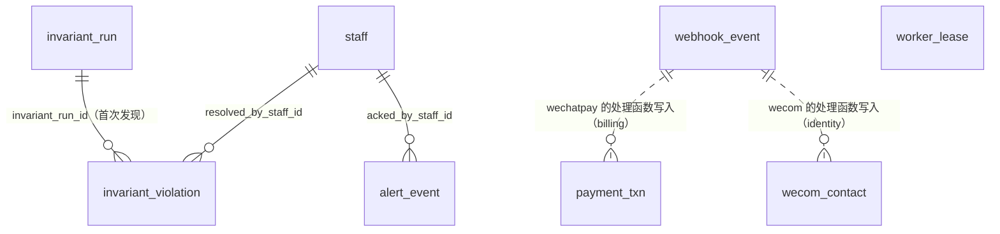

# 15 回调收件、租约与告警、不变量校验结果（security、providers、ops）

| 项 | 内容 |
| --- | --- |
| 模块 | `security`（回调验签与收件，L0）：`webhook_event`；`ops`（租约、探针与告警、不变量校验的调度与落库，L4）：`worker_lease`、`alert_event`、`invariant_run`、`invariant_violation`；`providers`（外部能力的薄封装）没有表 |
| 表 | 5 张：`webhook_event`、`worker_lease`、`alert_event`、`invariant_run`、`invariant_violation` |
| 依据 | 草案 `docs/appendix/design/d4-identity.md` 第 9.6 节（下文写作 d4:行号）；`d2-payment.md` 第 3.10、4.4 节（d2:行号）；`d7-platform.md` 第 7.6、9.3、9.4、9.6 节（d7:行号）；`d3-flow.md` 第 25.4–25.7 节（d3:行号）；`d1-ledger.md` 第 9 节（d1:行号）；`d5-media.md` 第 13.2 节、`d6-notify-docs-data.md`、`d9-profile.md` 第 7.5、8 节（各自的行号）；裁决 M19、M23、M30、M33、M42、M44、M45、M46–M48、M50、M52、M63、M65、M76、M92、M96、M102、M103、M110；`catalogue.json` 的 conventions 与本分组 5 张表的 notes；`decisions.md` 第 1 节 #2、#12、#14、#34 与第 9 节；主文档 `01-architecture.md` 第 5、9、12 节（01:行号）、`03-key-designs.md` 第 1.4、3.1 节（03:行号） |
| Prisma 片段 | 工作目录 `dm/prisma/frag/15-integration-ops.prisma`（合并后进 `packages/db`） |
| 手写约束 | 工作目录 `dm/sql/15-integration-ops.sql`（合并后进迁移） |

## 1. 概览

这组表回答三个问题：外部回调有没有收到并处理完；后台进程是不是活着、哪里越限了；账和状态对不对得上。

- **回调收件**（`webhook_event`）：全系统一张。所有外部回调进 `/api/v1/hooks/{provider}/…`，验签后按 `(provider, event_id)` 去重。有主动查询兜底的来源走内联模式（去重行与处理结果同事务）；没有查询接口的走收件箱模式（先落库，任务进程退避重试，耗尽进死信）。
- **租约**（`worker_lease`）：两台节点都跑任务进程，谁持有这一行谁干活；`/health` 读它判断任务进程是否存活、探针是否新鲜。
- **告警**（`alert_event`）：探针规则越限与各模块报出的事件型告警共用一张表，按指纹去重，记录次数、通知、认领与恢复。
- **不变量校验**（`invariant_run`、`invariant_violation`）：各模块只登记检查项、返回违规；`ops` 调度并落库。同一违规持续存在时只更新最近发现时间，不重复报警。

写入方向（M30；decisions #34）：`alert_event`、`invariant_violation` 在 L4，下层不直接写。`kernel` 定义告警端口与违规上报端口，`ops` 注册实现；各模块里的 `ops.alerts.raise()`（d6:827-828、d7:1422）与 d3 的补偿扫描写违规（d3:1022、3219）都改经端口（签名见 5.2）。`webhook_event` 在 L0，由回调框架写；各来源的验签、事件标识、处理函数由所属模块向框架注册。

`invariant_violation.subject_id` 是多态引用，指向各领域表，图里不逐一画出。虚线表示“处理函数会写那张表”，没有列与列的引用。

## 2. 表定义

通用说明：

- `id` 为 UUID v7，由应用生成，不设数据库默认值。草案里的 `bigint identity` 主键按 R1 改为 `uuid`（decisions #2：`webhook_event` 只用 uuid，不带 `seq`）。
- **时间列的默认值**。这 5 张表都是基础设施表，`created_at`、`updated_at` 带数据库默认值 `now()`（约定“时间”第 3 条允许租约、收件这类表用）。`updated_at` 不由触发器维护，每次 UPDATE 由写入方显式赋值。
- **不写跨节点时钟的先后关系 CHECK**（如 `last_seen_at >= first_seen_at`）。告警与违规的写入方可能在不同节点，时钟偏差不应让记录写不进去；先后关系由写入语句用 `GREATEST` 保证。
- 5 张表的状态列都是技术状态，不经 `flow.transition()`，不写 `status_transition`（约定“状态”第 2 条）；用带原状态条件的 UPDATE 推进。人工动作（重置死信、认领与关闭告警、填写违规处理结论）另写 `audit_log`。
- 都不参与全局加锁排序（`lock_rank = null`），但各自的加锁位置是固定的：
  - `webhook_event` 的行锁总在处理事务的**最前面**取得：内联模式是插入去重行（或已存在时 `SELECT … FOR UPDATE`），收件箱模式是 `FOR UPDATE SKIP LOCKED` 领取；之后处理函数再按全局顺序锁业务行（`payment_txn`、`refund_txn`、`wecom_contact` 等）。处理函数不得回头再锁或更新别的收件行；本行的处理结果由框架在同一事务末尾写回（d4:1816-1821、1837-1838；d2:573-576）。
  - `alert_event`、`invariant_violation`、`invariant_run` 由 `ops` 在自己的短事务里写，不加入调用方的业务事务（见 5.2 的端口）。
  - `worker_lease` 只由续约的专用连接写（d7:1540）。
- 出处里的“约定”指 `catalogue.json` 的 conventions；“补”表示草案没有、按约定或依赖方的要求补的列。

### 2.1 `webhook_event` 回调收件箱

外部回调的去重表与收件箱。一条回调一行；行里留原始报文的摘要值与处理结果，载荷按来源的策略保存并按期清除。

归属：全局。主键：`uuid`。不是只增表（处理状态与载荷会更新），但行不可删、表不可清空、举证用的列不可改（触发器，公共函数，M50）。`lock_rank = null`（行锁在处理事务最前面取得，见通用说明）。

| 列 | 类型 | 空 | 默认 | 说明 | 出处 |
| --- | --- | --- | --- | --- | --- |
| `id` | uuid | 否 | — | 主键 | d4:1848；R1 |
| `provider` | text | 否 | — | 回调来源，与路径 `/api/v1/hooks/{provider}/` 的那一段一致。取值：`wechatpay` 微信支付（支付、退款）；`wechat` 小程序消息推送（订阅消息事件、内容安全异步结果）；`wecom` 企业微信（客户联系事件）；`ci` 数据万象任务；`asr` 语音转写任务；`sms` 短信状态回执；`esign` 电子签（V1.1，V1.0 只声明） | d4:1849、1860-1864；d2:404、560；d5:2121；d6:2253-2254 |
| `event_id` | text | 否 | — | 来源方的事件标识，由该来源注册的 `eventId()` 给出；与 `provider` 一起唯一。微信支付取通知 id；`ci`、`asr` 取 `<回调地址里的 media_job id>:<回调体里的云端任务号>`（数据万象 JobId、语音识别 TaskId；只用于去重，不采信回调体里的状态）。同一 `media_job` 重试会重新提交云端任务，任务号不同，后几次的唤醒不会被去重吞掉。没有平台事件号的协议取验签后报文关键字段的 sha256（十六进制）：`wechat` 的内容安全异步结果取 `sha256("wxa_media_check:" + trace_id)`，订阅消息事件取验签解密后明文的 sha256；`wecom` 取 `sha256(ChangeType + ":" + UserID + ":" + ExternalUserID + ":" + CreateTime)`；一次推多条的（短信状态回执）取整个请求体的 sha256。不得直接拼 openid、手机号。不超过 200 个字符 | d4:1797、1849；d2:404；d5:1379、2121；h01-hooks.md 2.3；补：没有事件号与批量推送时的取法 |
| `event_type` | text | 否 | — | 来源方的事件类型，原样保存，如 `TRANSACTION.SUCCESS`、`REFUND.SUCCESS`、`wxa_media_check`、`subscribe_msg_sent_event`、`change_external_contact`。取值由来源方定，数据库不逐值校验。来源方没有事件名时写本系统的固定值：`ci` 取回调体里的事件名、取不到写 `ci_callback`；`asr` 固定 `asr_callback`；`sms` 固定 `sms_status_report` | d4:1850；d2:404；h01-hooks.md 2.3、第 4 节 `HookFixedEventType` |
| `mode` | text | 否 | — | 这一行实际走的处理方式。`inline` 内联：去重行与处理结果同事务，行一落库就是终态；`inbox` 收件箱：先落库，由任务进程处理。每个来源在注册时写死默认方式；微信支付默认内联，处理事务失败后兜底写入的行（d2:577 的 T1'）记 `inbox` | d4:1798、1813-1842、1850；d2:577；03:59 |
| `received_at` | timestamptz | 否 | `now()` | 报文到达时间 | d4:1851；d2:404 |
| `payload` | jsonb | 可 | — | 来源专有的载荷，结构见第 4 节。按来源的策略存：不存（`ci`、`asr`）；只存处理所需的最小字段（`wechat`、`wecom`、`sms`）；微信支付存不含 openid 的摘要与 APIv3 密文，不存解密后的明文。约定：需要长期保留的摘要放在 `summary` 键下，到期清除时只留这个键 | d4:1852；d2:404-407；M23、M42 |
| `payload_digest` | bytea | 否 | — | 原始请求体的 sha256，32 字节，始终保存；举证与回放比对用 | d4:1853 |
| `key_version` | text | 可 | — | 载荷里密文所用密钥的版本（密钥环里的 `kid`）。只有存了密文的行才填，V1.0 即微信支付的 APIv3 密钥版本；回放时按它取密钥重新解密，旧密钥保留到用它加密的回调过了保留期 | d2:404、406；M42 |
| `process_state` | text | 否 | — | 处理状态。`received` 已收件、待处理；`processed` 已处理；`ignored` 已忽略（处理函数判定与本系统无关，如找不到对应的商户单号）；`failed` 处理失败、等待重试；`dead` 重试耗尽，等人处理 | d4:1854；d2:404 |
| `attempts` | integer | 否 | `0` | 已尝试处理的次数 | d4:1855；d2:404 |
| `next_attempt_at` | timestamptz | 可 | — | 下一次处理的最早时间；`received`、`failed` 必有。退避为 1 分、5 分、15 分、1 小时、6 小时 | d4:1831、1838-1839、1855 |
| `processed_at` | timestamptz | 可 | — | 处理完成时间；`processed`、`ignored` 必有，其余为空 | d4:1855；d2:404 |
| `error` | text | 可 | — | 最近一次处理失败的错误摘要（错误码与消息，不放报文内容）；`failed`、`dead` 必有 | d4:1855；d2:404 |
| `payload_purge_at` | timestamptz | 可 | — | 载荷计划清除时间 = 到达时间 + 该来源的保留天数（微信支付 180 天，`wechat`、`wecom`、`sms` 90 天）。不存载荷的行为空 | d4:1800、1856、1861-1862；d2:407 |
| `payload_purged_at` | timestamptz | 可 | — | 载荷实际清除时间。清除后 `payload` 为空，或只剩 `summary` 键 | 补：微信支付清除后仍留摘要，不能靠 `payload IS NULL` 判断是否已清；M42 的“载荷清除时间” |
| `created_at` | timestamptz | 否 | `now()` | 落库时间 | 补：约定“时间” |
| `updated_at` | timestamptz | 否 | `now()` | 最近一次更新时间 | 补：约定“时间” |

**键与索引**

- 主键 `pk_webhook_event (id)`。
- 外键：无（L0 不引用上层）。
- 唯一 `uq_webhook_event_provider_event_id (provider, event_id)`：去重；写入用 `ON CONFLICT DO NOTHING`（d4:1817、1831）。
- `ix_webhook_event_provider_received_at (provider, received_at)`：后台按来源与时间排查；回放测试按来源取数（d2:1611）。

**手写约束**

| 约束名 | 规则 |
| --- | --- |
| `ck_webhook_event_provider` | `provider IN ('wechatpay','wechat','wecom','ci','asr','sms','esign')` |
| `ck_webhook_event_mode` | `mode IN ('inline','inbox')` |
| `ck_webhook_event_process_state` | `process_state IN ('received','processed','ignored','failed','dead')` |
| `ck_webhook_event_event_id` | `event_id` 非空串，不超过 200 个字符 |
| `ck_webhook_event_event_type` | `event_type` 非空串 |
| `ck_webhook_event_payload_digest` | `payload_digest` 恰 32 字节 |
| `ck_webhook_event_attempts` | `attempts >= 0` |
| `ck_webhook_event_inline_state` | `mode = 'inline'` 的行只能是 `processed` 或 `ignored`（d4:2005 的 I21，由约束直接保证） |
| `ck_webhook_event_processed_at` | `processed_at` 非空 ⇔ 状态为 `processed` 或 `ignored` |
| `ck_webhook_event_next_attempt` | `received`、`failed` 必有 `next_attempt_at` |
| `ck_webhook_event_error` | `failed`、`dead` 必有 `error` |
| `ck_webhook_event_payload_object` | `payload` 非空时是 JSON 对象 |
| `ck_webhook_event_wechatpay_payload` | `provider = 'wechatpay'` 时：载荷非空且 `summary` 是对象；此外只允许 `resourceCipher` 一个键；`summary` 里任何层级都不得有键名含 `openid`（不区分大小写）或键名为 `payer` 的键（`jsonb_path_exists` 递归检查）；有 `resourceCipher` 时必须是完整的三元组 `ciphertext`、`nonce`、`associated_data`（M23；d2:404、575） |
| `ck_webhook_event_cipher_key_version` | 载荷里有 `resourceCipher` 时 `key_version` 必填 |
| `ck_webhook_event_purge_required` | 载荷里有 `summary` 以外的键时 `payload_purge_at` 必填 |
| `ck_webhook_event_purge_plan` | `payload_purge_at` 不早于 `received_at`；有 `payload_purged_at` 就必有 `payload_purge_at` |
| `ck_webhook_event_payload_purged` | `payload_purged_at` 非空时，`payload` 为空或只剩 `summary` 键 |
| `ix_webhook_event_due` | 部分索引 `(next_attempt_at) WHERE process_state IN ('received','failed')`：收件箱扫描（d4:1835-1837） |
| `ix_webhook_event_dead` | 部分索引 `(received_at) WHERE process_state = 'dead'`：死信列表与“回调积压”探针（d4:1977） |
| `ix_webhook_event_purge_due` | 部分索引 `(payload_purge_at) WHERE payload_purge_at IS NOT NULL AND payload_purged_at IS NULL`：每日清除到期载荷（d4:1856、1979） |
| `trg_webhook_event_immutable` | 行级 BEFORE UPDATE，公共函数 `lyx_forbid_column_change('provider','event_id','event_type','received_at','payload_digest')`：这五列不可改 |
| `trg_webhook_event_no_delete` | 行级 BEFORE DELETE，公共函数 `lyx_forbid_delete()`：行不可删 |
| `trg_webhook_event_no_truncate` | 语句级 BEFORE TRUNCATE，公共函数 `lyx_forbid_delete()`：表不可清空 |

**状态机**（技术状态，不写 `status_transition`）

| 当前状态 | 事件 | 新状态 | 守卫 | 触发者 |
| --- | --- | --- | --- | --- |
| — | 内联模式收到并处理成功 | `processed` 或 `ignored`（取处理函数的返回值） | 验签通过；时间戳偏差不超过 5 分钟；去重行与处理同事务，事务失败则行不存在、按协议应答失败。行插入时即为 `processed`（`processed_at` = 当前时间），处理函数返回 `ignored` 时在同一事务里改写；不插 `received` 占位行（否则违反 `ck_webhook_event_inline_state`）（h01-hooks.md 2.1 第 10 步） | 接口进程 |
| — | 收件箱模式收到 | `received`（`next_attempt_at` = 当前时间） | 验签通过；新插入时同一事务写一条出站事件（`aggregate_type = webhook_event`、`aggregate_id` = 本行 id，事件 `webhook.received`，负载 `{ v: 1, webhookEventId, provider }`，`dedupe_key = webhook.received:{webhookEventId}`；以 x01 第 2.3、3.15 节为准，A95），让任务进程立即处理；`ON CONFLICT DO NOTHING` 未插入的不发；落库成功即应答成功 | 接口进程（d4:1832） |
| — | 微信支付内联事务失败后的兜底写入 | `failed`（`mode = 'inbox'`，`attempts = 1`，带 `error` 与 `next_attempt_at`） | 事实落不进业务表但能进收件箱；落库成功即应答成功。支付结果通知与退款结果通知两个端点都有兜底写入；其他内联来源（`ci`、`asr`、`sms`）没有，事务失败即按协议应答失败（h01-hooks.md 2.1 第 10′ 步） | 接口进程 |
| `received`、`failed` | 处理函数成功 | `processed` 或 `ignored` | 逐条开事务，`FOR UPDATE SKIP LOCKED` 领取 | 任务进程；同一事件再次到达时的内联处理 |
| `received`、`failed` | 处理函数抛错 | `failed` | `attempts + 1` 未到上限；按退避写 `next_attempt_at` | 任务进程 |
| `received`、`failed` | 处理函数抛错且次数到上限 | `dead` | `attempts + 1 ≥ 8`；发告警 | 任务进程 |
| `dead` | 人工重置 | `received`（`attempts` 清零，`next_attempt_at` = 当前时间） | 后台或命令行（命令行也须指定员工）；写审计 | 员工 |

说明：

- 重处理的节奏不超过 1 分钟，是任务进程内的循环，不建定时器行（d7:1590）。d2:583 写的定时器 `webhook.reprocess` 即这个循环。收件箱行的出站事件只是加速，丢了也会被这个扫描领走。
- 微信支付连续失败 5 次先升级告警（d2:583），8 次进死信（d4:1839）；两个数都是来源注册时的参数，不落表。
- 微信支付的重处理用 `resourceCipher` 与 `key_version` 重新解密，不依赖解密后的明文（d2:406、583）。
- 每日由 `ops.retention` 调用 security 登记的清除函数，把到期行的载荷清除：`payload` 有 `summary` 键的只留这个键，否则置空；同时写 `payload_purged_at`（d4:1856、1979；d2:407）。这是 UPDATE，不删行。

**不变量**

- `security.W1`（每日）：不存在 `payload_purge_at` 早于一天前而 `payload_purged_at` 为空的行。
- `security.W2`（每日）：`provider = 'wechatpay'` 且 `processed` 的行，`summary` 里的商户单号或退款单号能在 `payment_txn`、`refund_txn` 找到（处理函数由 billing 登记，违规对象为本表的行）。
- “`received` 超过 10 分钟、`failed`、`dead` 的数量”是探针规则，不是每日不变量（d4:1977）。

**相对草案的改动**

| 改动 | 依据 |
| --- | --- |
| 主键 `bigint identity` → `uuid`，不带 `seq` | R1；decisions #2 |
| d2 的 `serial`、`summary`、`resource_cipher` 三列并进 `payload`：`payload.summary`（含 `serial`）与 `payload.resourceCipher`；`key_version` 保留为独立列 | M42：通用的列独立，来源专有的内容放一个 jsonb 列；decisions 第 9 节列的信息项一项不少 |
| d4:1860“微信支付 `payload = full`，存解密后的资源”作废 | M23；03:59 |
| `payload_purge_at` 由 `date` 改 `timestamptz` | 约定“命名规则”：`_at` 结尾的是时刻 |
| 补 `payload_purged_at` | 清除后微信支付的行仍留摘要，要有“已清”的标记；M42 |
| `mode` 的语义定为“这一行实际走的方式”，微信支付兜底写入的行记 `inbox` | d4:2005 的 I21 与 d2:577 的 T1' 原本互相矛盾（内联行不该有 `failed`）；这样两边都成立 |
| `process_state` 取 d4 的五个值（含 `dead`） | decisions 第 9 节 |
| 补 `created_at`、`updated_at`；补三个部分索引、17 条 CHECK、防改防删触发器（公共函数 `lyx_forbid_column_change`、`lyx_forbid_delete`） | 约定“时间”“枚举”；约定“软删除”（证据类数据不删，M63 补充的可物理删除清单里也没有本表；M96：V1.0 不删行）；M50 |
| 收件箱模式落库时同事务写出站事件 `webhook.received` | d4:1832“可同时写 outbox 以便立即触发”；01 文档 3.4 已登记 `aggregate_type = webhook_event` |
| `ci`、`asr` 的 `event_id` 带云端任务号；批量推送的取整包摘要 | d5:1379 的回调地址按 `media_job` 生成，而 `media_job` 会重试并重新提交云端任务（复核意见） |

### 2.2 `worker_lease` 任务进程单活租约

任务进程单活靠这一行：两台节点都跑任务进程容器，谁持有租约谁启动出站中继、定时器扫描、探针与各队列的消费者。`/health` 读它给出 `worker: ok | down` 与 `probeAgeSec`。租约只为减少重复劳动与保持并发上限准确，不是正确性的前提（d7:1560）。

归属：全局。主键：自然键 `name`，至多一行 `primary`，由第一次续约插入，不靠迁移播种。不是只增表。`lock_rank = null`。

| 列 | 类型 | 空 | 默认 | 说明 | 出处 |
| --- | --- | --- | --- | --- | --- |
| `name` | text | 否 | — | 租约名，固定为 `primary` | d7:1532 |
| `holder` | text | 否 | — | 持有者：`<节点名>:<进程启动时生成的 uuid>` | d7:1533 |
| `holder_version` | text | 否 | — | 持有者运行的镜像标签；续约时一并写。不是乐观锁版本号 | d7:1534 |
| `acquired_at` | timestamptz | 否 | — | 本任期开始时间；换了持有者时写数据库时间 | d7:1535、1543 |
| `heartbeat_at` | timestamptz | 否 | — | 最近一次续约时间，用数据库时间 `clock_timestamp()`，避免两台机器时钟不一致。每 10 秒续约；超过 30 秒未续约可被另一实例接任；超过 60 秒 `/health` 报 `down`。进程收到终止信号时把它改成很早的时间，主动让出 | d7:1536、1540-1561 |
| `probe_at` | timestamptz | 可 | — | 探针最近一次跑完的时间；`/health` 的 `probeAgeSec` 读它，外部拨测断言小于 180 秒 | d7:1537、1947、1958 |
| `created_at` | timestamptz | 否 | `now()` | 落库时间（第一次续约插入行的时间） | 补：约定“时间” |
| `updated_at` | timestamptz | 否 | `now()` | 最近一次更新时间；续约与写 `probe_at` 时一并写 | 补：约定“时间” |

**键与索引**

- 主键 `pk_worker_lease (name)`。
- 外键、唯一约束、普通索引：无。

**手写约束**

| 约束名 | 规则 |
| --- | --- |
| `ck_worker_lease_name` | `name = 'primary'`（连同主键保证至多一行；名字被它固定，不另设防改触发器） |
| `ck_worker_lease_holder` | `holder`、`holder_version` 非空串 |
| `trg_worker_lease_no_delete` | 行级 BEFORE DELETE，公共函数 `lyx_forbid_delete()`：行不可删。删行后下一次续约会重新插入，但可能被抢先插入的另一实例接任，一个续约周期内两边同时干活；交出租约只走“让出” |
| `trg_worker_lease_no_truncate` | 语句级 BEFORE TRUNCATE，公共函数 `lyx_forbid_delete()`：表不可清空 |

**续约写法**（取代 d7:1540-1545 的纯 UPDATE，不再依赖播种行）：`INSERT INTO worker_lease (name, holder, holder_version, acquired_at, heartbeat_at) VALUES ('primary', $me, $ver, clock_timestamp(), clock_timestamp()) ON CONFLICT (name) DO UPDATE SET holder = $me, holder_version = $ver, heartbeat_at = clock_timestamp(), acquired_at = CASE WHEN worker_lease.holder = $me THEN worker_lease.acquired_at ELSE clock_timestamp() END, updated_at = now() WHERE worker_lease.holder = $me OR worker_lease.heartbeat_at < clock_timestamp() - interval '30 seconds'`。影响 1 行即持有租约（新插入或续上），0 行即别人持有。让出仍是 `UPDATE … SET heartbeat_at = 很早的时间 WHERE holder = $me`。

**不变量**：无每日校验项。至多一行由约束保证；没有行（还没有实例启动过）时 `/health` 报 `worker = down`，由外部拨测发现（d7:2021）。

**相对草案的改动**

| 改动 | 依据 |
| --- | --- |
| `version` → `holder_version` | 约定“乐观锁”把各表的 `version` 统一成 `lock_version`；这一列是镜像标签，改名以免被当成乐观锁 |
| 补 `created_at`、`updated_at` | 约定“时间” |
| 补两条 CHECK 与防删、防清空触发器（公共函数 `lyx_forbid_delete`） | d7:1532“固定一行”；M50 |
| 续约改为 `INSERT … ON CONFLICT DO UPDATE … WHERE`，不再由迁移播种；去掉播种行与 `ops.L1` | d7:1540 的纯 UPDATE 依赖一行播种数据，而播种不在任何迁移里（复核意见） |

### 2.3 `alert_event` 告警事件

告警的去重与跟踪。两种来源共用：探针规则越限（任务进程每分钟求值）与事件型告警（各模块在发生处经告警端口报出）。同一指纹在未恢复期间只有一行，再次发生只累加次数。通知走企业微信群机器人与值班短信，同时复制一条后台铃铛（`s.system_alert` 场景）。

归属：全局。主键：`uuid`。不是只增表。`lock_rank = null`。已恢复的行保留 180 天，由 `ops.retention` 物理删除（d7:1586、1989；M63 已把它列入允许物理删除的对象；没有外键引用本表）。

| 列 | 类型 | 空 | 默认 | 说明 | 出处 |
| --- | --- | --- | --- | --- | --- |
| `id` | uuid | 否 | — | 主键 | d7:1977；R1 |
| `fingerprint` | text | 否 | — | 指纹 = 规则键，或 规则键 + `:` + 维度，如 `queue.backlog:notify`、`outbox.exhausted:order.started:notify`。由 `ops` 按端口传入的 `rule` 与 `dimension` 拼出，调用方不自拼（d7:1422 写的“指纹 = 事件类型 + 订阅者”即这里的维度）。未恢复的行里唯一 | d7:1978、1422 |
| `rule` | text | 否 | — | 规则键，小写点分、至少两段，如 `queue.backlog`、`outbox.exhausted`。探针规则登记在任务进程的规则表，事件型规则登记在 `packages/contract`；数据库只校验格式 | d7:1979、1935 |
| `severity` | text | 否 | — | 级别。`P1` 立即通知（群机器人 @所有人 + 值班短信）；`P2` 群机器人；`P3` 进每日 09:30 汇总。同一指纹未恢复期间随越限程度只升不降（如“已付未履约”超过 2 分钟 P2、超过 10 分钟 P1），恢复后新开的行按当时的级别 | d7:1979、1952-1956、2013、2016-2017 |
| `kind` | text | 否 | — | 类型。`probe` 探针型：由探针每分钟求值，连续 3 次正常即恢复；`event` 事件型：由 `raise()` 报出，静默期（规则各自声明，默认 6 小时）内没有新的发生即恢复 | d7:1980、1944-1945 |
| `status` | text | 否 | — | 状态。`open` 未恢复；`acked` 已有人认领（重复通知间隔 ×4）；`resolved` 已恢复 | d7:1981、1991-1999 |
| `first_seen_at` | timestamptz | 否 | — | 首次发生时间 | d7:1982 |
| `last_seen_at` | timestamptz | 否 | — | 最近一次发生时间；事件型按它判断静默期是否已满 | d7:1982、1945 |
| `resolved_at` | timestamptz | 可 | — | 恢复时间；`resolved` 必有 | d7:1982 |
| `occurrences` | integer | 否 | `1` | 未恢复期间累计发生次数 | d7:1983 |
| `ok_streak` | smallint | 否 | `0` | 探针型：连续正常的次数，再次越限归零，达到 3 即恢复。事件型恒为 0 | d7:1984、1942-1944 |
| `last_value` | jsonb | 可 | — | 最近一次测量值或事件详情，结构见第 4 节。不放手机号、证照号、openid | d7:1985 |
| `last_notified_at` | timestamptz | 可 | — | 最近一次发通知的时间；据此判断是否到了重复间隔（P1 15 分钟，P2 60 分钟） | d7:1986、1943 |
| `notify_count` | integer | 否 | `0` | 已发通知次数 | d7:1986 |
| `acked_by_staff_id` | uuid | 可 | — | 认领人（员工）；与 `acked_at` 同有同无。命令行认领也以员工身份执行（`--staff <员工 id>`，校验该员工启用且有 `sys.health.manage`），所以操作人只有员工一类，单列即可（M44） | d7:1987、1995；约定“操作人列”；M44 |
| `acked_at` | timestamptz | 可 | — | 认领时间 | d7:1987 |
| `note` | text | 可 | — | 处理说明：认领与人工关闭时填写；发布预检用 `--override-p1` 越过该告警的记录也写在这里 | d7:1987、1770、1998 |
| `created_at` | timestamptz | 否 | `now()` | 落库时间 | 补：约定“时间” |
| `updated_at` | timestamptz | 否 | `now()` | 最近一次更新时间 | 补：约定“时间” |

**键与索引**

- 主键 `pk_alert_event (id)`。
- 外键：`acked_by_staff_id → staff.id`（`fk_alert_event_acked_by_staff_id`，RESTRICT）。
- `ix_alert_event_resolved_at (resolved_at)`：`ops.retention` 删除已恢复超过 180 天的行；后台按恢复时间看历史。
- `ix_alert_event_severity_last_seen_at (severity, last_seen_at)`：P3 每日汇总；首月按触发量复盘（d7:1956、1960）。
- `ix_alert_event_acked_by_staff_id (acked_by_staff_id)`：外键索引；“我认领的告警”。

**手写约束**

| 约束名 | 规则 |
| --- | --- |
| `ck_alert_event_severity` | `severity IN ('P1','P2','P3')` |
| `ck_alert_event_kind` | `kind IN ('probe','event')` |
| `ck_alert_event_status` | `status IN ('open','acked','resolved')` |
| `ck_alert_event_rule` | `rule` 为小写点分，至少两段 |
| `ck_alert_event_fingerprint` | `fingerprint` 等于 `rule`，或以 `rule` + `:` 开头且冒号后非空 |
| `ck_alert_event_counts` | `occurrences >= 1`、`ok_streak >= 0`、`notify_count >= 0` |
| `ck_alert_event_ok_streak_kind` | 事件型的 `ok_streak` 恒为 0 |
| `ck_alert_event_resolved` | `resolved_at` 非空 ⇔ `status = 'resolved'` |
| `ck_alert_event_acked` | `open` 没有 `acked_at`；`acked` 必有 `acked_at`；`acked_at` 与 `acked_by_staff_id` 同有同无 |
| `ck_alert_event_notified` | `notify_count = 0` ⇔ `last_notified_at` 为空 |
| `ck_alert_event_last_value` | `last_value` 非空时是 JSON 对象 |
| `uq_alert_event_open_fingerprint` | 部分唯一索引 `(fingerprint) WHERE status IN ('open','acked')`：同一指纹至多一条未恢复的告警（d7:1989）；探针与 `raise()` 的写入用它做 `ON CONFLICT`，命中时 `severity = LEAST(alert_event.severity, EXCLUDED.severity)`（`P1` < `P2` < `P3` 按字典序可比） |

**状态机**（技术状态，不写 `status_transition`；d7:1991-1999）

| 当前状态 | 事件 | 新状态 | 守卫 | 触发者与副作用 |
| --- | --- | --- | --- | --- |
| — | 规则越限，或 `raise()` | `open` | 没有同指纹的未恢复行 | 探针或告警端口；发通知 |
| `open`、`acked` | 再次越限，或再次 `raise()`，级别不高于当前 | 不变 | — | `occurrences + 1`，`ok_streak` 归零，更新 `last_seen_at`、`last_value`；到重复间隔则再通知（`acked` 的间隔 ×4）。级别更低时不降级 |
| `open`、`acked` | 再次越限，或再次 `raise()`，级别高于当前 | 不变（`severity` 改为新级别） | — | 同上一行的计数；另外不等重复间隔，立即按新级别通知（P1 即群机器人 @所有人 + 值班短信），`last_notified_at` 重新计时、`notify_count + 1`。已认领的不退回 `open` |
| `open` | 有人认领 | `acked` | 权限点 `sys.health.manage` | 员工（后台“系统健康”页，或命令行指定员工）；记认领人与时间，写审计 |
| `open`、`acked` | 探针求值正常 | 不变，或 `resolved` | `kind = 'probe'`；`ok_streak + 1`，达到 3 才恢复 | 探针；通知“已恢复” |
| `open`、`acked` | 静默期满 | `resolved` | `kind = 'event'`；`last_seen_at` 早于静默期 | 探针；通知“已恢复（静默期满）” |
| `open`、`acked` | 人工关闭 | `resolved` | 权限点 `sys.health.manage`；必填 `note` | 员工（后台，或命令行指定员工）；写审计，不发通知 |
| `resolved` | 再次越限 | 新建一行 `open` | — | 发通知 |

命令行操作写审计时，`actor_type = 'staff'`、`actor_id` 是 `--staff` 指定的员工，`client = 'cli'`，`job_name` 记命令名（如 `cli.alerts.ack`），没有会话（M102；03 文档 `audit.I3` 按这一口径复核）。

**探针规则的测量口径**（相对 d7:2009-2036 改读现有的列；阈值是部署配置，初始值同 d7）：

| 规则 | 测量 | 依据 |
| --- | --- | --- |
| 6 出站表积压 | 最老未展开事件的年龄：`outbox_event.published_at IS NULL` 的最早 `occurred_at`（>60 秒 P2，>5 分钟 P1）；最老待处理投递：`outbox_delivery.status IN ('pending','retry','leased')` 且 `next_attempt_at <= now`（不在退避中）的最早一行（>5 分钟 P2，>15 分钟 P1）；死信：`outbox_delivery.status = 'dead'` 的行数（≥1 即 P1：不再自动重试、等人处理；M103 采纳 d7 的 P1，d3:3229 原写 P2，01 文档 2.4 已同步） | 01 文档 2.3、2.4；d7:2016；d3:3227-3229；M103。d7 读的 `event_redelivery` 表与 `events.redeliver` 都不保留（M65） |
| 7 定时器滞后 | 最老到期未认领：`timer.status = 'scheduled'` 且 `COALESCE(retry_at, fire_at) < now` 的最早一行（>2 分钟 P2，>10 分钟 P1）；`status = 'failed'` 的行数（≥1 P2）；执行通道丢任务：`status = 'dispatched'`、`lease_until < now` 且 `is_enqueued` 的行数（扫描循环会按 `dispatch_no` 重新认领，持续存在才告警） | 01 文档 2.5；d7:2017；d3:3230-3231 |
| 10 不变量校验失败 | `invariant_violation` 未解决的行数（`resolved_at IS NULL`），按 `severity` 分：资金类 ≥1 → P1，其他 → P2。heal_only 检查项自愈成功的行已自动关闭，不计入 | d7:2020；本节 2.5 |
| 12 周期任务漏跑 | 7.6 登记表里每一项最近一个已到的计划时刻：`timer.dedupe_key = '{kind}:{计划时刻}'` 的行在完成期限内 `status = 'fired'`；周期任务行（`subject_type IS NULL`）有 `status = 'failed'` 的即告警 | 01 文档 2.5；d7:2022 |
| 回调积压 | `webhook_event` 中 `received` 超过 10 分钟、`failed`、`dead` 的行数 | d4:1977；本节 2.1 |

**不变量**：无每日校验项。“同指纹至多一条未恢复”由部分唯一索引保证；通道是否失效由 P3 每日汇总（空也发）充当心跳（d7:1956）。

**相对草案的改动**

| 改动 | 依据 |
| --- | --- |
| 主键 `bigint identity` → `uuid` | R1 |
| `acked_by`（bigint）→ `acked_by_staff_id`（uuid），建外键 | 约定“操作人列”；`ops` 在 L4，可引用 L1 的 `staff`（catalogue 的 cross_module_fks 写“草案未写是否外键”，这里定为建） |
| `rule / severity`、`first_seen_at / last_seen_at / resolved_at`、`last_notified_at / notify_count`、`acked_by / acked_at / note` 这些合写的行拆成单列；`notify_count` 定为非空、默认 0 | 字段级定义；d7 未写可空性 |
| 各模块直接调 `ops.alerts.raise()` 改为经 `kernel` 的告警端口；端口签名改为 `raise({ rule, dimension?, severity, detail })`，指纹由 `ops` 拼 | M30；d7:1422 的调用写法会违反 `ck_alert_event_fingerprint`（复核意见） |
| 补 `created_at`、`updated_at`；补 11 条 CHECK 与三个普通索引 | 约定“时间”“枚举” |
| 人工关闭人不单设列：关闭动作写 `audit_log`，说明写 `note` | 草案没有；初稿的默认处理已被接受（rulings 第七节开头） |
| 状态机补“越限加重时升级”一行；`ON CONFLICT` 只升不降 | d7:2013、2016-2017 同一规则有两档阈值，d2:583 有“连续失败 5 次升级告警”（复核意见） |
| 认领人在命令行认领时也必填 | M44：操作人只有员工一类（复核意见） |
| 规则 6、7、12 的测量改读 `outbox_delivery`、`timer` 的现有列 | 01 分组的请求；M65 |

### 2.4 `invariant_run` 不变量校验运行记录

不变量校验的一次运行。`quick` 每 10 分钟跑一次，只查上次以来有账本、付款、订购变动的主体；`full` 每日 03:30、每次发布后、每次恢复演练时跑全量；后台与命令行可手工触发，可限定模块、检查项或主体（如 d1:1714 的计费校验接口只跑计费模块，d1:1539 对单个主体手动校验）。全仓一套，d1 的 `billing_invariant_run` 并入。

归属：全局。主键：`uuid`。不是只增表（运行结束时回写结果）。`lock_rank = null`。V1.0 不删行（M96）。

| 列 | 类型 | 空 | 默认 | 说明 | 出处 |
| --- | --- | --- | --- | --- | --- |
| `id` | uuid | 否 | — | 主键 | d7:2071；R1 |
| `mode` | text | 否 | — | 运行方式。`quick` 只跑登记了 quick 的检查项，范围是最近有变动的主体；`full` 跑全部检查项 | d7:2062、2068、2071 |
| `trigger` | text | 否 | — | 触发来源。`schedule` 定时（周期任务 `invariant.quick`、`invariant.full`）；`deploy` 发布后；`drill` 恢复演练；`manual` 后台或命令行手工触发 | d7:2068、2071；d1:1539 |
| `scope` | jsonb | 可 | — | 运行范围 `{ since, entityIds, modules, codes }`，结构见第 4 节。`since`、`entityIds` 传给检查项；`modules`、`codes` 用来挑选这次跑哪些检查项。全量、不限主体、不限检查项时为空 | 补：d7:2063 的 `scope` 入参；d1:1539“可对单个主体手动触发”、d1:1714 只跑计费模块；quick 的“上次以来”要有据可查 |
| `status` | text | 否 | — | 运行状态。`running` 运行中；`succeeded` 全部检查项跑完（有没有违规看 `violations_found`）；`failed` 运行本身出错或被接任者标记为中断 | d7:2071 |
| `started_at` | timestamptz | 否 | — | 开始时间 | d7:2071 |
| `finished_at` | timestamptz | 可 | — | 结束时间；`running` 时为空 | d7:2071 |
| `checks_run` | integer | 否 | `0` | 已执行的检查项数 | d7:2071 |
| `violations_found` | integer | 否 | `0` | 本次运行各检查项返回的违规条数，含此前已存在、仍未解决的 | d7:2071 |
| `error` | text | 可 | — | 运行失败的错误摘要；`failed` 必有，`succeeded` 为空。被接任者标记中断的写 `abandoned` | d7:2071 |
| `created_at` | timestamptz | 否 | `now()` | 落库时间 | 补：约定“时间” |
| `updated_at` | timestamptz | 否 | `now()` | 最近一次更新时间 | 补：约定“时间” |

**键与索引**

- 主键 `pk_invariant_run (id)`。
- 外键：无。
- `ix_invariant_run_mode_started_at (mode, started_at)`：取某种方式最近一次运行（quick 的“上次以来”、`invariantRunAgeHours` 探针，d1:1530；后台列表）。

**手写约束**

| 约束名 | 规则 |
| --- | --- |
| `ck_invariant_run_mode` | `mode IN ('quick','full')` |
| `ck_invariant_run_trigger` | `trigger IN ('schedule','deploy','drill','manual')` |
| `ck_invariant_run_status` | `status IN ('running','succeeded','failed')` |
| `ck_invariant_run_finished` | `finished_at` 为空 ⇔ `status = 'running'` |
| `ck_invariant_run_error` | `failed` 必有 `error`；`succeeded` 没有 `error` |
| `ck_invariant_run_counts` | `checks_run >= 0`、`violations_found >= 0` |
| `ck_invariant_run_scope` | `scope` 非空时是 JSON 对象（键的结构由契约 `InvariantScope` 校验） |

**状态机**（技术状态，不写 `status_transition`）

| 当前状态 | 事件 | 新状态 | 守卫 | 触发者 |
| --- | --- | --- | --- | --- |
| — | 开始运行 | `running` | — | 任务进程（周期任务、发布编排、演练脚本、后台或命令行） |
| `running` | 全部检查项跑完 | `succeeded` | 回写 `checks_run`、`violations_found`、`finished_at` | 任务进程 |
| `running` | 运行出错 | `failed` | 同时写 `error` 与 `finished_at`（`ck_invariant_run_finished` 要求非 `running` 的行都有结束时间） | 任务进程 |
| `running` | 进程崩溃后被发现 | `failed`（`error = 'abandoned'`） | 下一次运行开始前，把超过完成期限（full 3 小时、quick 30 分钟）仍为 `running` 的行标记掉；`finished_at` 写标记的时间 | 任务进程 |

不设“同一方式至多一条运行中”的唯一约束：主实例写入 `running` 后崩溃，接任者会被它挡住（d7:1567 指出的 `job_run` 的洞）。两次运行重叠无害，检查项是只读查询，违规按唯一索引合并。

**检查项的登记与调度**（d7:2058-2064 的 `InvariantCheck` 补两个字段，不加表、不加 `mode` 取值）：

- `modes: ('quick' | 'full')[]`（d7 原有）；只经端口上报、不由框架运行的检查项（如 `flow.STUCK_TICKET`）登记时 `modes` 为空。
- `every?: 'hour' | 'week'`（补）：`hour` 的项只在每小时第一次 quick 运行里执行（计划时刻的分钟数为 0 的那次），`week` 的项只在周一的 full 运行里执行；不写即每次都跑。按计划时刻判定，不需要另记“每项上次何时跑过”。
- `heal: 'none' | 'heal_and_alert' | 'heal_only'`（补，默认 `none`）：自愈策略，见 2.5 的处理过程。

各草案写的频率按下表并入，不再为某个模块单设校验周期任务：

| 草案写的频率 | 登记方式 | 例 |
| --- | --- | --- |
| 每 5 分钟、每 10 分钟 | `modes: ['quick','full']`，随 quick 每 10 分钟一次（框架最短 10 分钟） | d5 I10（草案每 5 分钟）、I11 |
| 每小时 | `modes: ['quick','full']`，`every: 'hour'` | d5 I8 |
| 每日 | `modes: ['full']` | d1 第 9 节（草案每日 02:00，并入 03:30 的 full）、d9 I1–I10、d4、d6 的每日巡检项 |
| 每周 | `modes: ['full']`，`every: 'week'` | d5 I14 |

- d9:726 的周期任务 `profile.invariants`、d5:2047 的校验任务 `media.invariants` 不单独建定时器：profile 的检查项登记在 `profile/invariants.ts`、media 的登记在 `media/invariants.ts`，由 `invariant.full` / `invariant.quick` 调度。d3 的 `invariant.check` 同样由这两个周期任务取代（d7:1590）。
- 手工触发写 `trigger = 'manual'`：d1:1714 的 `POST /admin/billing/invariants/run` 记 `mode = 'full'`、`scope = { modules: ['billing'], entityIds? }`；“系统健康”页与命令行可按模块、检查项或主体限定。
- d1:1530 的 `invariantRunAgeHours` 取最近一条 `mode = 'full'`、`trigger IN ('schedule','deploy','drill')`、`status = 'succeeded'` 的 `finished_at`；限定了范围的手工运行不算。

**不变量**：无每日校验项。“该跑没跑”由周期任务漏跑探针按定时器行判断（d7:2022）。

**相对草案的改动**

| 改动 | 依据 |
| --- | --- |
| 表名 `ops_invariant_run` → `invariant_run`；d1 的 `billing_invariant_run` 并入 | decisions #14 |
| 主键 `bigint` → `uuid` | R1 |
| 补 `scope`；第二轮加 `modules`、`codes` 两个键 | d7:2063；d1:1539、1714（复核意见） |
| 失败与中断的行写 `finished_at` | `ck_invariant_run_finished`（复核意见） |
| `InvariantCheck` 补 `every`、`heal`；d5、d9 的独立频率与校验任务并入 quick / full，不单设 `profile.invariants`、`media.invariants` 定时器 | d5:2047-2064；d9:726；复核意见 |
| `checks_run`、`violations_found` 定为非空、默认 0；补 `created_at`、`updated_at`；补 7 条 CHECK 与一个索引 | 字段级定义；约定“时间”“枚举” |

### 2.5 `invariant_violation` 不变量违规明细

一条违规一行。同一检查项对同一对象的违规持续存在时只更新 `last_seen_at`，不重复报警。后台“系统健康”（d7:2003）与“流程运维”（d3:3275-3283）两页读同一张表，财务主管与超级管理员可查看明细、填写处理结论。d1 的 `billing_invariant_violation`、d3 的同名表并入。

归属：全局（全局表不带归属列；所属主体写在 `detail.entityId`，按主体查询走表达式索引 `ix_invariant_violation_entity_id`）。主键：`uuid`。不是只增表。`lock_rank = null`。V1.0 不删行。

| 列 | 类型 | 空 | 默认 | 说明 | 出处 |
| --- | --- | --- | --- | --- | --- |
| `id` | uuid | 否 | — | 主键 | d7:2077；R1 |
| `invariant_run_id` | uuid | 可 | — | 首次发现它的那次运行。经违规上报端口写入的行（d3 的补偿扫描，不属于某次校验运行）为空 | d7:2078；M33；catalogue notes（补偿扫描经端口） |
| `code` | text | 否 | — | 检查项编号：`<命名空间>.<编号>`，如 `billing.I3`、`payment.I5`、`media.I2`、`flow.STUCK_TICKET`。命名空间是登记方的模块名或子域名；各草案的编号都从 I1 起，必须带命名空间才不重 | d7:2059、2079；d3:1022、3238 |
| `module` | text | 否 | — | 登记该检查项的模块，取 01 第 5 节的模块名（见第 3 节） | d7:2060、2079 |
| `severity` | text | 否 | — | 级别。`P1` 资金类；`P2` 其他。告警规则“不变量校验失败”按它定告警级别 | d7:2061、2079、2020 |
| `subject_type` | text | 可 | — | 违规对象的类型，取最终表名，如 `entity`、`order_item`、`billing_order`、`delivery_ticket`。全局性违规（如“埋点默认分区不为空”“存在超过 5 分钟未展开的出站事件”），以及对象不是某张表的一行、只能用键表示的（参数键、开关键、清单编码等，14 文档 5.4），为空 | d7:2080；d3:3239；M19；14 文档 5.4 |
| `subject_id` | uuid | 可 | — | 违规对象的 id；不建外键，按 `subject_type` 多态。`subject_type` 为空时也为空 | d7:2080；约定“主键”第 5 条（多态引用一律 uuid） |
| `subject_key` | text | 可 | — | 违规对象的文本键。有 `subject_type` 时与 `subject_id` 二选一：复合主键或自然键的表（如 `billing_entity_daily`、`work_calendar_day`、`staff_role`）按主键列的顺序用 `:` 连接各键段，缺失的行（`sla.N8` 的缺口日期）写它本该有的键（第 3 节）。`subject_type` 为空时可选：同一检查项可能同时有多条全局违规的，写检查项定义的键来区分（如 `config.N8` 的参数键、`reports.N21` 的 `{report_key}:{month_date}`），否则为空 | 补：`subject_id` 改 uuid 后，非 uuid 主键的对象要有落点；与 `audit_log.target_key` 同一做法；14 文档 5.4（第三轮） |
| `detail` | jsonb | 否 | — | 期望值、实际值、相关流水 id；自愈的写自愈动作。结构见第 4 节 | d7:2081；d3:3239 |
| `first_seen_at` | timestamptz | 否 | — | 首次发现时间 | d7:2082；d3:3239（`detected_at`） |
| `last_seen_at` | timestamptz | 否 | — | 最近一次发现时间。只供处理人参考，不据此推断“违规已消失”：quick 只复查有变动的主体、手工运行可限定主体与检查项、各检查项频率不同、经端口上报的行不属于任何运行。违规是否已不存在由处理人核实后填结论，或由 heal_only 检查项自愈后自动关闭 | d7:2082 |
| `auto_healed_at` | timestamptz | 可 | — | 检查项自愈完成的时间（重新推导状态、补登记定时器、解除孤儿暂停、改派在办事项等）。不能自愈的检查项恒为空。再次发现而这次没有自愈时清空（`ON CONFLICT` 用新值覆盖），页面上的“是否已自愈”跟着变。`heal_and_alert` 的项自愈不等于已处理，仍要有人看原因并填结论；`heal_only` 的项自愈成功即自动关闭（见处理过程） | 补：d3:3221“可自愈的自愈，其余告警”；d3:3279、3283 两个列表都有“是否已自愈”一列 |
| `resolved_at` | timestamptz | 可 | — | 处理时间：人工处理，或 `heal_only` 检查项自愈后自动关闭；为空表示未解决 | d7:2083；d3:3239 |
| `resolved_by_staff_id` | uuid | 可 | — | 处理人（员工）。命令行处理也以员工身份执行（`--staff <员工 id>`），人工处理时必填；只有自动关闭的行为空（M44：操作人只有员工一类，单列即可） | d7:2083；d1:605；约定“操作人列”；M44 |
| `resolution` | text | 可 | — | 处理结论；处理时必填。自动关闭的行写固定值 `auto_healed`，自愈动作在 `detail.healed` | d7:2083；d3:3239（`resolved_note`）、3283（“必填说明”） |
| `created_at` | timestamptz | 否 | `now()` | 落库时间 | 补：约定“时间” |
| `updated_at` | timestamptz | 否 | `now()` | 最近一次更新时间 | 补：约定“时间” |

**键与索引**

- 主键 `pk_invariant_violation (id)`。
- 外键：`invariant_run_id → invariant_run.id`（`fk_invariant_violation_invariant_run_id`，RESTRICT）；`resolved_by_staff_id → staff.id`（`fk_invariant_violation_resolved_by_staff_id`，RESTRICT）。
- `ix_invariant_violation_invariant_run_id (invariant_run_id)`：外键索引；按运行看它首次发现的违规。
- `ix_invariant_violation_subject (subject_type, subject_id)`：单据详情上“该对象的违规记录”。
- `ix_invariant_violation_resolved_by_staff_id (resolved_by_staff_id)`：外键索引。
- 按主体、按模块的查询走手写 SQL 里的表达式索引与部分索引（见下）。

**手写约束**

| 约束名 | 规则 |
| --- | --- |
| `ck_invariant_violation_code` | `code` 形如 `<小写命名空间>.<编号>`，编号由字母、数字、下划线组成 |
| `ck_invariant_violation_module` | `module` 取 31 个模块名之一（见第 3 节） |
| `ck_invariant_violation_severity` | `severity IN ('P1','P2')` |
| `ck_invariant_violation_subject_type` | `subject_type` 非空时是小写蛇形（表名格式）；取值由检查项登记表在启动时对照表名单校验 |
| `ck_invariant_violation_subject` | `subject_type` 为空时 `subject_id` 也为空（全局性违规，`subject_key` 可选）；`subject_type` 非空时 `subject_id` 与 `subject_key` 恰填一个 |
| `ck_invariant_violation_subject_key` | `subject_key` 非空时不是空串 |
| `ck_invariant_violation_detail` | `detail` 是 JSON 对象 |
| `ck_invariant_violation_detail_entity_id` | `detail` 有 `entityId` 键时，其值是 uuid 文本（小写带连字符） |
| `ck_invariant_violation_resolved` | `resolved_at` 与 `resolution` 同有同无；`resolution` 不能是空白；有处理人就有处理时间；已解决的行要么有处理人，要么 `auto_healed_at` 非空（自动关闭） |
| `uq_invariant_violation_open` | 表达式部分唯一索引 `(code, COALESCE(subject_type, ''), COALESCE(subject_id::text, subject_key, '')) WHERE resolved_at IS NULL`：同一检查项对同一对象至多一条未解决的违规；写入方的 `ON CONFLICT` 用同一组表达式，命中时更新 `last_seen_at`（取较大值）、`detail`、`auto_healed_at`（用本次的值覆盖，本次没自愈即清空） |
| `ix_invariant_violation_unresolved` | 部分索引 `(severity, first_seen_at) WHERE resolved_at IS NULL`：两个后台页的未解决列表；告警规则按级别计数（d7:2020、2085） |
| `ix_invariant_violation_module_unresolved` | 部分索引 `(module, severity) WHERE resolved_at IS NULL`：`/health` 计费分节的 `openViolations` 按模块计数（d1:1530）；后台按模块筛选 |
| `ix_invariant_violation_entity_id` | 表达式索引 `((detail ->> 'entityId'), first_seen_at)`：按主体查看与处理违规（d1:1539、1714；商家详情） |

**处理过程**（没有状态列；`resolved_at` 是否为空即“未解决 / 已解决”）

| 当前 | 事件 | 结果 | 守卫 | 触发者 |
| --- | --- | --- | --- | --- |
| — | 检查项返回违规，或经端口上报 | 新建一行（未解决） | 没有同检查项、同对象的未解决行 | 任务进程（`ops` 落库） |
| 未解决 | 再次发现 | 更新 `last_seen_at`、`detail`、`auto_healed_at`（这次没自愈即清空） | — | 任务进程 |
| 未解决 | `heal_and_alert` 的项自愈成功 | 写 `auto_healed_at`，仍未解决 | 涉及积分与金额的不自愈（d3:3248；d1:1539） | 任务进程 |
| — 或未解决 | `heal_only` 的项自愈成功 | 关闭：`auto_healed_at` = `resolved_at` = 自愈时间，`resolution = 'auto_healed'`，`resolved_by_staff_id` 为空 | 自愈失败的行保持未解决并计入告警 | 任务进程 |
| 未解决 | 人工处理 | 写 `resolved_at`、`resolution`、`resolved_by_staff_id` | 权限点 `sys.health.manage` 或 `flow.ops.manage`、`billing.invariant.resolve`；必填结论；写审计 | 员工（后台，或命令行指定员工） |
| 已解决 | 再次发现 | 新建一行 | — | 任务进程 |

自愈策略在检查项登记时声明（2.4）。只自愈、不告警的项登记为 `heal_only`：`timers.I7`（d3 I7，d3:3251）、`media.I8`、`media.I10`、`media.I11`（d5 同号，“修不好的才告警”，d5:2058-2061）。“自愈并告警”的登记为 `heal_and_alert`：`staff.I10`（d3 I13）、`tenant.I30`，以及 d3 I2、I3、I6、I14、I15、I17，d9 I6、I7 等各分组接手后的编号（如 `delivery.I2`、`delivery.I3`、`profile.I6`、`profile.I7`，以各分组文档为准）。经端口上报的行（`flow.STUCK_TICKET`）按该编号登记的策略处理，不属于任何运行。

未解决的行存在时，探针规则“不变量校验失败”保持告警（资金类 ≥1 → P1，其他 → P2；d7:2020）；`heal_only` 自愈成功的行已关闭，不计入。

**不变量**：无（本表是校验结果）。校验任务本身要有测试：人为破坏一条数据，任务必须报出对应编号（d7:2088）。

**相对草案的改动**

| 改动 | 依据 |
| --- | --- |
| 表名 `ops_invariant_violation` → `invariant_violation`；d3:3237-3241 与 d1:605 的同构表并入，字段以 d7 为准 | decisions #14；03:240 |
| 主键 `bigint` → `uuid` | R1 |
| `run_id` → `invariant_run_id`，改为可空 | M33；补偿扫描经端口上报，不属于某次运行（catalogue notes） |
| `subject_id` 由 `text`（d7）、`bigint`（d3）改 `uuid`；`subject_type`、`subject_id` 改为可空；补 `subject_key`（第三轮起全局性违规也可用它区分多条） | 约定“主键”第 5 条；全局性违规没有对象；非 uuid 主键的对象；14 文档 5.4 |
| 唯一索引由 `(code, subject_type, subject_id) WHERE resolved_at IS NULL` 改为 COALESCE 表达式索引 | 三列可空后仍要保证“同一违规一行” |
| `resolved_by` → `resolved_by_staff_id`，建外键 | 约定“操作人列” |
| d3 的 `detected_at` → `first_seen_at`，`resolved_note` → `resolution`；d1 的 `entity_id` 列不保留（主体作为违规对象，或写在 `detail.entityId`），按主体查询改由表达式索引 `ix_invariant_violation_entity_id` 支撑，另补按模块计数的部分索引 | 字段以 d7 为准；catalogue 的 tenant = none，约定“归属列”的全局表不带归属列；d1:1530、1539、1714 的按主体、按模块查询（复核意见） |
| d3 的 `STUCK_TICKET` 写作 `flow.STUCK_TICKET` | 编号统一带命名空间（d7:2059） |
| 补 `auto_healed_at`；再次发现时清空；`heal_only` 的项自愈即自动关闭（`resolved_by_staff_id` 为空、`resolution = 'auto_healed'`） | d3:3221、3251、3279、3283；d5:2058-2061（复核意见） |
| 去掉“`last_seen_at` 早于最近一次同方式运行即已消失”的推断 | 与运行范围对不上：quick 只看有变动的主体、手工运行可限定主体、端口上报的行不属于运行（复核意见） |
| 处理人在命令行处理时也必填 | M44（复核意见） |
| `subject_type` 取最终表名 | M19；decisions 第 8 节末 |
| 补 `created_at`、`updated_at`；补 9 条 CHECK | 约定“时间”“枚举” |

## 3. 枚举汇总

| 枚举（表.列） | 取值 | 含义 |
| --- | --- | --- |
| `webhook_event.provider` | `wechatpay`、`wechat`、`wecom`、`ci`、`asr`、`sms`、`esign` | 微信支付、小程序消息推送、企业微信、数据万象任务、语音转写任务、短信状态回执、电子签（V1.1，只声明） |
| `webhook_event.mode` | `inline`、`inbox` | 内联（同事务处理）、收件箱（先落库再处理） |
| `webhook_event.process_state` | `received`、`processed`、`ignored`、`failed`、`dead` | 已收件待处理、已处理、已忽略、失败待重试、重试耗尽 |
| `alert_event.severity` | `P1`、`P2`、`P3` | 立即通知并发短信、群内通知、每日汇总 |
| `alert_event.kind` | `probe`、`event` | 探针型、事件型 |
| `alert_event.status` | `open`、`acked`、`resolved` | 未恢复、已认领、已恢复 |
| `invariant_run.mode` | `quick`、`full` | 只查最近有变动的主体、全量 |
| `invariant_run.trigger` | `schedule`、`deploy`、`drill`、`manual` | 定时、发布后、恢复演练、手工 |
| `invariant_run.status` | `running`、`succeeded`、`failed` | 运行中、跑完、出错或中断 |
| `invariant_violation.severity` | `P1`、`P2` | 资金类、其他 |
| `invariant_violation.module` | `kernel`、`events`、`timers`、`flow`、`sla`、`audit`、`config`、`security`、`authz`、`providers`、`identity`、`tenant`、`staff`、`approval`、`portal`、`profile`、`content`、`media`、`notify`、`docs`、`billing`、`order`、`ad`、`delivery`、`publish`、`support`、`workbench`、`analytics`、`reports`、`exports`、`ops` | 登记检查项的模块（31 个） |

不逐值校验、只校验格式的列：

| 列 | 取值来源 |
| --- | --- |
| `webhook_event.event_type` | 来源方定义，原样保存 |
| `alert_event.rule` | 探针规则表（任务进程）与事件型规则登记（`packages/contract`）。草案出现过的：`queue.backlog`、`outbox.exhausted`、`outbox.completed_without_consumption`（d7:1978、1422-1423）；d7:2009-2036 的 26 条规则各取一个键 |
| `invariant_violation.code` | 各模块的检查项登记表（`<模块>/invariants.ts`）。命名空间已出现的：`events`、`timers`、`flow`、`sla`（01）；`identity`、`tenant`、`portal`（02）；`staff`、`audit`、`approval`（03）；`profile`（04）；`content`（05）；`media`（06）；`billing`（07）；`payment`（08）；`order`、`ad`（09）；`delivery`（10）；`publish`（11）；`support`（12）；`notify`、`docs`（13）；`config` 等（14）；`security`（本文）。d3 编号的通用项写 `flow.I<编号>` |
| `invariant_violation.subject_type` | 最终表名（M19），只做格式校验（M52）；已知取值见下表。不是表名的多态取值（M45 要求登记的例外）：没有；全局性违规用 `subject_type` 为空表达，不用占位值（需要区分多条时只写 `subject_key`） |

`invariant_violation.subject_type` 的已知取值（M52；以 `packages/contract` 的登记表为准，启动时对照表名单校验）。`subject_id` 存目标表的主键值：主键不叫 `id` 的一对一扩展表取其主键列（父表 id）：`billing_account` 取 `entity_id`，`store_profile` 取 `store_id`，`production_record`、`media_info`、`media_check` 取 `file_id`，`drama_copyright`、`drama_stat`、`drama_trailer` 取剧目 id。复合主键或自然键的对象用 `subject_key`，按主键列的顺序用 `:` 连接各键段。对象不是某一行、只能用键表示的（参数键、开关键、清单编码等），`subject_type` 为空、只写 `subject_key`（2.5）。

| 登记方（分组） | 已知 `subject_type` | 用 `subject_key` 的对象与写法 | 出处 |
| --- | --- | --- | --- |
| events、timers、flow、sla（01） | `outbox_event`；`outbox_delivery`；`timer` 与带 `due_at` 的业务表（`timers.I7`）；25 张状态机表（`flow.I12`）；`work_calendar_day` | `outbox_delivery`：`{outbox_event_id}:{subscriber}`；`work_calendar_day`：日期 `YYYY-MM-DD` | 01 文档 2.3–2.7 |
| identity、tenant、portal（02） | `merchant_user`、`wechat_identity`、`portal_session`、`account_change_request`、`entity`、`store`、`entity_member`、`invitation`、`portal_ticket` | 不用 | 02 文档“不变量登记” |
| staff、audit、approval（03） | 各检查项所在表名（`staff`、`staff_group`、`approval_request`、`audit_log`、`assignment_history`、`follow_up` 等） | 自然键表（如 `staff_role`）用角色键 | 03 文档各表“不变量” |
| profile（04） | `store`、`entity`、`qualification_submission`、`qualification_doc`、`store_profile` | 不用 | 04 文档 5.6 |
| content（05） | `drama` | 不用 | 05 文档 2.1 |
| media（06） | 06 各表表名 | 不用；`production_record`、`media_info`、`media_check` 的 `subject_id` 取 `file_id` | 06 文档第 2 节 |
| billing（07） | `point_lot`、`billing_account`、`point_hold`、`subscription_term`、`grant_schedule`、`plan_revision`、`billing_param`、`billing_order`、`billing_entity_daily` | `billing_entity_daily`：`{biz_date}:{entity_id}` | 07 文档 5.6 |
| payment（08） | 08 各表表名 | — | 08 文档 |
| order、ad（09） | `drama_order`、`order_item`、`ad` 等 09 各表表名 | — | 09 文档第 5 节“不变量的登记” |
| delivery（10） | 10 各表表名 | `publish_list_episode`：`{delivery_ticket_id}:{episode_no}` | 10 文档第 2 节 |
| publish（11） | 11 各表表名 | — | 11 文档 |
| support（12） | `service_ticket`、`service_ticket_ref` | `service_ticket_ref`：`{service_ticket_id}:{ref_type}:{ref_id}` | 12 文档 2.1–2.3 |
| notify、docs（13） | 各检查项所在表名 | — | 13 文档 |
| config、analytics、reports、exports（14） | 各检查项所在表名（`dict_item`、`home_banner`、`site_config_revision`、`site_notice`、`report_month_close`、`export_job`，变更方表 `plan_revision`、`billing_param`、`agreement_version`；`config.N7` 取引用方表名） | `subject_type` 为空、只写键：`config.N8`、`config.N17` 写参数键，`config.N16` 写 `type_key`，`config.N19` 写开关键，`config.N20` 写清单编码，`reports.N21` 写 `{report_key}:{month_date}`。`config.N9` 没有已发布行时 `subject_key` 写 `config_key`（`subject_type` 写 `site_config_revision` 或留空，约束都允许） | 14 文档 5.4 |
| security（本文） | `webhook_event`（`security.W1`、`security.W2`） | 不用 | 2.1 |

各分组第三轮请求登记的检查项（`code` 的命名空间即登记方；`module` 取第 1 列；检查项的内容、频率、`heal`、`entityId` 的取法以各分组文档为准）：

| `module` | `code` | `severity` | 对象的写法 | 登记方与出处 |
| --- | --- | --- | --- | --- |
| `events` | `events.I8` | P2 | `outbox_event` 用 `subject_id`；`outbox_delivery` 用 `subject_key = {outbox_event_id}:{subscriber}` | 01 文档 2.3、2.4 |
| `timers` | `timers.I7`（`heal_only`） | P2 | 缺定时器的写该业务行（`subject_type` 为其表名）；多余的定时器写 `subject_type = timer` | 01 文档 2.5 |
| `flow` | `flow.I12` | P2 | `subject_type` 取 `machine` 的值，`subject_id` 为对象 id | 01 文档 2.6 |
| `sla` | `sla.N8` | P2 | `subject_type = work_calendar_day`，`subject_key` 为缺失的日期（`YYYY-MM-DD`） | 01 文档 2.7 |
| `identity` | `identity.I8`、`I9`、`I20`、`I22`–`I26` | P2 | `I8`、`I9` 是全局性违规（对象三列为空） | 02 文档第 5 节“不变量登记” |
| `tenant` | `tenant.I1`、`I5`、`I7`、`I17`、`I27`–`I30`（`I30` 为 `heal_and_alert`） | P2 | `I7` 是全局性违规 | 同上 |
| `portal` | `portal.I31` | P2 | `portal_ticket` | 同上 |
| `staff` | `staff.I1`–`I13`（`I10` 为 `heal_and_alert`） | P2 | `staff_role` 用 `subject_key` = 角色键 `key` | 03 文档各表“不变量” |
| `audit` | `audit.I1`–`I3` | P2 | 各检查项所在表名 | 同上 |
| `approval` | `approval.I1`–`I5` | P2 | 同上 | 同上 |
| `media` | `media.I1`–`I3`、`I7`–`I17`（`I8`、`I10`、`I11` 为 `heal_only`） | P2 | `production_record`、`media_info`、`media_check` 的 `subject_id` 取 `file_id`。`media.I3` 含当前原片与 `drama_episode` 的对应；`media.I16` 是 `adopted_count` 与采用记录数一致；`media.I17` 是 06 按 14 分组请求补的 | 06 文档各表“不变量” |
| `billing` | `billing.I1`–`I13`、`I15`、`I16`（07 没有 `I14`） | 逐项 P1 或 P2 | `billing_entity_daily` 用 `subject_key = {biz_date}:{entity_id}`；`billing.I17` 是提醒项，不写本表 | 07 文档 5.6 |
| `config` | `config.N7`–`N9`、`N13`、`N15`–`N20` | P2 | 见上表 14 一行 | 14 文档 5.4 |
| `analytics` | `analytics.N11`、`N14` | P2 | 全局性违规 | 同上 |
| `reports` | `reports.N10`、`N21` | P2 | `reports.N21` 只写 `subject_key` | 同上 |
| `exports` | `exports.N12` | P2 | `export_job` | 同上 |

跨分组共用的枚举：本分组没有用到 catalogue `enums_shared` 里的枚举。`P1`、`P2`、`P3` 与周期任务登记表的漏跑级别同一口径（d7:1573）。

## 4. jsonb 快照结构

| 列 | 结构 | 对应的契约 schema |
| --- | --- | --- |
| `webhook_event.payload` | 按 `provider` 判别，见下表。公共约定：`summary` 键放长期保留、不含个人信息的摘要；其余键到 `payload_purge_at` 清除 | `WebhookPayload[provider]` |
| `alert_event.last_value` | 探针型：`{ value, threshold, unit? }`（最近一次测量值、触发的阈值、单位）；事件型：`raise()` 传入的 `detail` 对象，键由规则登记时定义 | `AlertValue[rule]` |
| `invariant_run.scope` | `{ since?: string, entityIds?: string[], modules?: string[], codes?: string[] }`：`since` 是 quick 运行的起点（上一次定时 quick 运行的开始时间，ISO 时间）；`entityIds` 是限定的主体 id（手工对单个主体触发时一个元素）；`modules` 只跑这些模块登记的检查项（取 `invariant_violation.module` 的取值）；`codes` 只跑这些编号。前两个键传给检查项的 `run()`，后两个由框架挑选检查项 | `InvariantScope`（d7:2063 加两个键） |
| `invariant_violation.detail` | `{ expected?, actual?, refs?: { type, id }[], entityId?, storeId?, healed?: { action, at } }`：期望值、实际值、相关流水或单据（`type` 为最终表名）、所属主体与门店、自愈动作。对象属于某个主体的（含对象就是主体或计费账户的），`entityId` 必填，由 `ops` 按端口传入的值写入（按主体查询靠它）。其余键按检查项定义 | `InvariantDetail[code]` |

`webhook_event.payload` 各来源的结构：

| `provider` | 策略 | 结构 | 保留 | 出处 |
| --- | --- | --- | --- | --- |
| `wechatpay` | 摘要 + 密文 | `{ summary: { serial, outTradeNo?, outRefundNo?, transactionId?, refundId?, state, amountFen, successAt? }, resourceCipher: { algorithm, ciphertext, nonce, associated_data, original_type? } }`。`serial` 是回调头里的验签身份序列号；`state` 是交易状态或退款状态；`resourceCipher` 是微信用 APIv3 密钥加密后的 `resource` 原样（键名保持微信的写法）。不含 openid，不存解密后的明文 | `summary` 随行保留（不少于 3 年）；`resourceCipher` 180 天后清除 | d2:404-407；M23 |
| `wechat` | 最小字段 | 按 `event` 分两支。内容安全结果：`{ event, traceId, result }`（`result` 为微信给的结论对象）。订阅消息三个事件：`{ event, wechatIdentityId, items: [{ templateId, msgId?, status?, errorCode?, errorStatus?, popupScene? }] }`：微信一次推一个列表（可含多个模板），`subscribe_msg_sent_event` 的每项带消息 id 与结果码，通知模块按 `msgId` 回写 `notification_delivery.provider_msg_id` 对应的投递；`subscribe_msg_change_event` 按 `templateId` 清零额度；`subscribe_msg_popup_event` 只记日志。用户标识在落库前换成 `wechat_identity.id`，载荷不存 openid；对不上的整条记 `ignored` | 90 天后置空 | d4:1861；d5:1927；d6:51、848、2253；13 文档 `notification_delivery.provider_msg_id`；列表结构接入时按微信官方格式核对 |
| `wecom` | 最小字段 | `{ changeType, staffUserid, externalUseridEnc, state?, createTime }`：事件子类型（`add_external_contact`、`add_half_external_contact`、`del_external_contact`、`del_follow_user` 等）、成员 `userid`、外部联系人标识密文（与 `wecom_contact.external_userid_enc` 同一加密）、“联系我”的 `state`、回调里的 `CreateTime`（转成 ISO 时间）。收件箱可能退避数小时才处理，`wecom_contact.added_at`、`removed_at` 取 `createTime`，加删好友的先后也按它判断。处理时解密 `externalUseridEnc`，调外部联系人详情接口取 unionid 对号 | 90 天后置空 | d4:1862；02 文档 2.7 |
| `ci`、`asr` | 不存 | 空。回调只当提醒，状态一律回查任务接口；回调体里的云端任务号只进 `event_id` | — | d4:1863；d5:1379、2121 |
| `sms` | 最小字段 | `{ reports: [{ serialNo, reportStatus, errCode?, reportedAt }] }`：一次回调可带多条回执，每条是服务商的发送流水号、回执状态、错误码、回执时间；回调里的手机号丢弃不存。`event_id` 取整个请求体的 sha256。通知模块按流水号（`notification_delivery.provider_msg_id`）找到投递行，追加写 `notification_delivery.receipt_status`、`receipt_reported_at` | 90 天后置空 | d4:1864；d6:938；批量格式接入时按腾讯云短信官方格式核对 |
| `esign` | — | V1.1 定：接入时在本表补结构，表结构不变；V1.0 只在 `provider` 的 CHECK 里声明，不写入 | — | d4:1864 |

## 5. 与其他分组的关系

### 5.1 本分组引用的外部表

建外键的：

| 列 | 指向 | 删除行为 |
| --- | --- | --- |
| `alert_event.acked_by_staff_id` | `staff.id`（03） | RESTRICT |
| `invariant_violation.resolved_by_staff_id` | `staff.id`（03） | RESTRICT |

只存 id、不建外键的：

| 列 | 指向 | 说明 |
| --- | --- | --- |
| `invariant_violation.subject_id` | 各领域表 | 按 `subject_type` 多态 |
| `invariant_violation.detail` 里的 `entityId`、`storeId`、`refs[].id` | `entity`、`store`（02）与各领域表 | jsonb 里的 id |
| `invariant_run.scope.entityIds` | `entity`（02） | jsonb 里的 id |
| `webhook_event.payload.wechatIdentityId` | `wechat_identity`（02） | jsonb 里的 id，90 天后清除 |
| `webhook_event.event_id` 的前段（`ci`、`asr`） | `media_job`（06） | 文本里的 id，不是引用列 |

`webhook_event` 在 L0，不引用任何上层的表。

### 5.2 引用本分组的外部表

没有表对本分组建外键。使用关系：

| 外部表（分组） | 关系 |
| --- | --- |
| `payment_txn`、`refund_txn`、`payment_exception`（08） | `wechatpay` 的处理函数在同一事务里写；兜底写入的行记 `mode = 'inbox'`，载荷按第 4 节 |
| `wecom_contact`（02） | `wecom` 的处理函数写（收件箱模式）；对不上商家用户的也落行（`merchant_user_id` 为空，以后按 unionid 回填，见 02 文档 2.7）；时间取载荷的 `createTime` |
| `media_job`（06） | `ci`、`asr` 回调只唤醒任务行（`event_id` 带云端任务号，见 2.1）；内容安全结果经 `wechat` 转入，按 `traceId` 找任务 |
| `wx_subscribe_quota`、`notification_delivery`（13） | `wechat` 的订阅消息事件、`sms` 的状态回执由通知模块的处理函数写；逐项处理载荷里的 `items`、`reports` 列表 |
| `outbox_event`（01） | 收件箱模式新插入的行同事务发 `webhook.received`（`aggregate_type = webhook_event`，01 文档 3.4 已登记），负载 `{ v: 1, webhookEventId, provider }`，`dedupe_key = webhook.received:{webhookEventId}`（以 x01 第 3.15 节为准，A95），订阅者是 security 的收件箱处理器；事件名在 `packages/contract` 的事件目录登记。`alert_event`、`invariant_violation` 不发出站事件：告警由 ops 直接通知，违规由规则 10 告警（07 文档已不发 `billing.invariant_violated`） |
| `timer`（01） | 周期任务 `invariant.quick`、`invariant.full`、`ops.retention`、`ops.cert_check` 的定时器行没有主体（M45）。回调重处理与探针是任务进程内的循环，不建定时器行。`events.redeliver` 不保留（M65）。`profile.invariants`（d9:726）、`media.invariants`（d5:2047）不单设定时器，检查项由 `invariant.full` / `invariant.quick` 调度（2.4） |
| `audit_log`（03） | 重置死信、认领与关闭告警、填写违规处理结论、手工触发校验各写一条；`target_type` 为 `webhook_event`、`alert_event`、`invariant_violation`、`invariant_run` |
| `notification`（13） | 告警通知复制一条后台铃铛（场景 `s.system_alert`，发给超级管理员；d7:1958），业务对象为 `alert_event` |
| 各模块的检查项（01–14） | 每张表“不变量”小节里的每日校验项登记到 `<模块>/invariants.ts`，由 `ops` 调度，违规落 `invariant_violation`，`subject_type` 为该表的表名 |

端口（`kernel` 定义，`ops` 注册实现；M30）。下层不直接写这两张表。

| 端口 | 写哪张表 | 约定 |
| --- | --- | --- |
| `alerts.raise({ rule, dimension?, severity, detail })` | `alert_event` | 指纹由 `ops` 拼成 `rule` 或 `rule:dimension`，调用方不自拼（d7:1422 的“事件类型 + 订阅者”作为 `dimension` 传入）。`ops` 用自己的连接、在独立的短事务里写，不加入调用方的事务；写失败只记错误日志、不抛给调用方，所以不会让业务事务回滚，业务事务回滚了告警也照样留下 |
| `invariants.report({ code, module, severity, subject?, entityId?, detail, healed? })` | `invariant_violation` | `subject` 为 `{ type, id }` 或 `{ type, key }`；全局性违规不传，需要区分多条时传 `{ key }`（写 `subject_key`，`subject_type` 为空）；`entityId` 写进 `detail.entityId`；`healed` 为 `{ action, at }`，按该编号登记的自愈策略写 `auto_healed_at` 或自动关闭。写入方式同上（独立短事务，失败不抛） |

### 5.3 ops 的周期任务与清理清单

`ops.retention`（每小时，d7:1586）统一调度物理删除与载荷清除。删除语句由各表的属主模块登记（`retention.register(name, run)`），`ops` 只负责调度、限量（单项单轮有上限，分批删）与记录结果（写在周期任务的定时器行 `result` 上）；标“每日”的项在当日第一轮执行。

| 表（分组） | 条件 | 频率 | 用到的索引或函数 | 依据 |
| --- | --- | --- | --- | --- |
| `idempotency_record`（01） | `expires_at < now` | 每小时 | `ix_idempotency_record_expires_at` | 01 文档 2.1；d7:425 |
| `timer`（01） | 周期任务行（`subject_type IS NULL`）中 `status = 'fired'` 且 `fire_at` 早于 90 天前；按登记表的 `kind` 逐个删 | 每日 | `ix_timer_kind_fire_at` | 01 文档 2.5；d7:1971 |
| `portal_ticket`（02） | `created_at` 早于 7 天前 | 每小时 | `ix_portal_ticket_created_at` | 02 文档；d7:1235；M63 |
| `user_session`、`portal_session`（02） | 过期或吊销满 30 天 | 每日 | `ix_user_session_absolute_expires_at`、`ix_portal_session_expires_at` | 02 文档；d4:1979；M63 |
| `sms_verification`（02） | 过期满 7 天 | 每日 | `ix_sms_verification_expires_at` | 02 文档 2.6；M63 |
| `staff_session`、`staff_activation`（03） | 会话过期或吊销满 30 天；激活码已用或过期满 30 天 | 每日 | `ix_staff_session_absolute_expires_at`、`ix_staff_activation_expires_at` | 03 文档 2.4、2.5；d4:1646；M63 |
| `auth_event`（03） | 调用 `lyx_03_purge_auth_event(now() - interval '12 months')` | 每日 | 03 的清理函数 | 03 文档；d4:1645；M14 |
| `alert_event`（本组） | `status = 'resolved'` 且 `resolved_at` 早于 180 天前 | 每日 | `ix_alert_event_resolved_at` | d7:1586、1989；M63 |
| `webhook_event` 的载荷（本组） | `payload_purge_at <= now` 且 `payload_purged_at IS NULL`：清除载荷（UPDATE，不删行） | 每日 | `ix_webhook_event_purge_due` | d4:1856、1979；d2:407 |

不归 `ops.retention` 的：埋点分区与去重行（14 的 `analytics.partitions`、`analytics.dedup_purge`）、文件对象（06 的 `media.sweep`）、文书与导出（13 的 `docs.sweep`、14 的 `export.sweep`）；注销时立即删的行（`wechat_identity`、`merchant_user_notice`、`wecom_contact` 等）由 identity 在注销事务里删。

V1.0 不清理、不删行的：`outbox_event`、`outbox_delivery`（01；M65、M96）；本组的 `webhook_event`（M96；载荷照常按上表清除，行保留）、`invariant_run`（M96）、`invariant_violation`（2.5）。

## 6. 待确认

无。

已由裁决或前两轮定案、从本节移出的：`webhook_event`、`invariant_run` 的行 V1.0 不删（M96；原 #1、#2。以后定了保留期再加迁移：`webhook_event` 去掉 `trg_webhook_event_no_delete`，由 `ops.retention` 调 security 登记的清理函数删；`invariant_run` 只删没有违规引用的行，或把 `invariant_violation.invariant_run_id` 的外键删除行为改 SET NULL；两处都在约定“软删除”补一条）；订阅消息事件的用户标识（落库前换成 `wechat_identity.id`，见第 4 节；M76 采纳本分组的载荷口径）；告警的人工关闭人不单设列（见 2.3，初稿默认处理已被接受）；已恢复告警 180 天后物理删除（M63，见 2.3 与 5.3）；电子签回调的结构（V1.1 接入时补第 4 节，表结构不变）。

## 7. 修订记录

第二轮（2026-10-03），依据 rulings 第六、七节、其他分组的配合请求、两位复核员（A 来源、B 约定与衔接）的意见与整体校验：

| # | 改动 | 涉及 | 依据 |
| --- | --- | --- | --- |
| 1 | 删除本分组的触发器函数 `lyx_15_guard_immutable`。`webhook_event` 改为三个触发器：`trg_webhook_event_immutable`（BEFORE UPDATE，`lyx_forbid_column_change` 五列）、`trg_webhook_event_no_delete`（BEFORE DELETE，`lyx_forbid_delete`）、`trg_webhook_event_no_truncate`（BEFORE TRUNCATE，`lyx_forbid_delete`）；`worker_lease` 改为 `trg_worker_lease_no_delete`、`trg_worker_lease_no_truncate`，名字已由 `ck_worker_lease_name` 固定，不再设防改触发器。初稿的行级触发器拦不住 TRUNCATE | SQL、2.1、2.2 | M50；复核 A、B |
| 2 | `ck_webhook_event_wechatpay_payload` 收紧：微信支付的行必有 `summary` 对象；密文必须是 `ciphertext`、`nonce`、`associated_data` 三元组；摘要里任何层级都不得有含 `openid` 的键或 `payer` 键（`jsonb_path_exists` 递归检查） | SQL、2.1 | M23；复核 B；d2:404、575 |
| 3 | `alert_event` 状态机补“越限加重即升级”：只升不降，`ON CONFLICT` 写 `severity = LEAST(旧, 新)`，升级立即按新级别通知、`last_notified_at` 重新计时 | 2.3、SQL 注释、Prisma 注释 | 复核 A（high）、B；d7:2013、2016-2017；d2:583 |
| 4 | 告警端口改为 `raise({ rule, dimension?, severity, detail })`，指纹由 ops 拼；两个端口都在 ops 的独立短事务里写，失败不抛、不让调用方回滚 | 5.2、2.3 | M30；复核 A；d7:1422 |
| 5 | 认领人、处理人：命令行也以员工身份执行（`--staff`），`ck_alert_event_acked` 改为认领人与认领时间同有同无；`ck_invariant_violation_resolved` 要求已解决的行有处理人，自动关闭的除外 | 2.3、2.5、SQL、Prisma 注释 | M44；复核 A、B |
| 6 | `invariant_violation`：去掉“`last_seen_at` 早于最近一次运行即已消失”的推断；补自愈策略 `none`、`heal_and_alert`、`heal_only`，`heal_only` 自愈即自动关闭（`resolution = 'auto_healed'`）；再次发现时 `auto_healed_at` 用本次的值覆盖（没自愈即清空）；规则 10 只数未解决的行 | 2.5、2.4、2.3、SQL | 复核 A、B；d3:3251；d5:2058-2061 |
| 7 | `invariant_violation` 补按主体、按模块的索引 `ix_invariant_violation_entity_id`（表达式索引 `detail->>'entityId'`）、`ix_invariant_violation_module_unresolved`，以及 `ck_invariant_violation_detail_entity_id`；写明对象属于主体时 `detail.entityId` 必填 | SQL、2.5、第 4 节 | 复核 A；d1:1530、1539、1714；约定“归属列” |
| 8 | `invariant_run.scope` 加 `modules`、`codes`；`InvariantCheck` 补 `every`、`heal`；d5、d9 的频率并入 quick / full，`profile.invariants`、`media.invariants` 不单设定时器；d1 的计费校验接口记 `scope.modules = ['billing']`；失败与中断的行写 `finished_at` | 2.4、第 4 节、5.2 | 复核 A、B；d1:1714；d5:2047-2064；d9:726 |
| 9 | `webhook_event`：收件箱模式新插入时同事务发 `webhook.received`；`ci`、`asr` 的 `event_id` 带云端任务号；`wechat` 载荷改为按事件分支、订阅消息事件带 `items` 列表；`sms` 载荷改为 `reports` 列表、`event_id` 取整包摘要；`wecom` 载荷补 `createTime` | 2.1、第 4 节、5.2 | 复核 A、B；d4:1832；d5:1379；d6:848、938；02 文档 2.7 |
| 10 | `worker_lease` 续约改为 `INSERT … ON CONFLICT DO UPDATE … WHERE`，不再依赖迁移播种；去掉播种行与 `ops.L1` | 2.2、Prisma 注释、SQL 注释 | 复核 B；d7:1540-1545 |
| 11 | 通用说明改写加锁位置：`webhook_event` 的行锁在处理事务最前面取得，处理函数不回头锁收件行；ops 的三张表在独立事务里写 | 第 2 节通用说明 | 复核 A；d4:1816-1821、1837-1838；d2:573-576 |
| 12 | 2.3 补探针规则 6、7、10、12 与“回调积压”的测量口径，改读 `outbox_delivery.status`、`timer` 的 `dispatch_no`、`is_enqueued`、`dedupe_key` | 2.3 | 01 分组的请求；M65；复核 B |
| 13 | 新增 5.3：`ops.retention` 的清理清单（幂等记录、周期定时器行、票据、各类会话与验证码、`auth_event`、已恢复的告警、回调载荷），删除语句由属主模块登记 | 5.3 | 01、02、03 分组的请求；M63；复核 B；d7:1586 |
| 14 | 第 3 节补 `invariant_violation.subject_type` 的已知取值与 `subject_id`、`subject_key` 的取法 | 第 3 节 | M52；07 分组的请求；复核 B |
| 15 | 5.2 改正：企业微信对不上商家用户的事件也落 `wecom_contact` 行；补 `outbox_event` 一行；`events.redeliver` 的出处改为 M65 | 5.2 | 02 分组的请求与 02 文档 2.7；M65；复核 A |
| 16 | 第 6 节按 M92 清理：删去已裁决或不影响表结构的 #2、#4、#5、#6，保留两个保留期问题 | 第 6 节 | M63、M76、M92；复核 A、B |
| 17 | 核对 M46–M49：没有注释掉的关系字段，手写 SQL 里没有外键；本分组的表不带 `entity_id`、`store_id`，M47 不适用；5 张表的主键都已按 `pk_<表>` 命名；没有 `seq` 与数组列 | Prisma 片段头注释 | M46–M49 |

其他分组的请求里不需要本分组改表的：各模块的检查项按第 3 节与 2.4 的规则登记（01、02、03、06、07、08、14 分组）；引用会话与票据不建外键（02 分组，本分组本来就没有）。

第三轮（2026-10-03，收尾），依据 rulings 第八节（M93–M110）、其他分组第二轮发来的请求（`review/xreq3-15-integration-ops.md`）与旧列名扫描：

| # | 改动 | 涉及 | 依据 |
| --- | --- | --- | --- |
| 1 | 第 3 节新增“各分组第三轮请求登记的检查项”表：`events.I8`、`timers.I7`、`flow.I12`、`sla.N8`；`identity`、`tenant`、`portal` 的 17 项；`staff.I1`–`I13`、`audit.I1`–`I3`、`approval.I1`–`I5`；`media.I1`–`I3`、`I7`–`I17`；`billing.I1`–`I13`、`I15`、`I16`；`config`、`analytics`、`reports`、`exports` 的 15 项。写明 `module`、`severity`、对象的写法；14 分组单列一行 `subject_type` 与 `subject_key` 的取法 | 第 3 节 | 01、02、03、06、07、14 分组的请求 |
| 2 | `ck_invariant_violation_subject` 放宽：`subject_type` 为空时 `subject_id` 必为空，`subject_key` 可选（用来区分同一检查项下的多条全局违规）；有 `subject_type` 时仍是 `subject_id`、`subject_key` 恰填一个。14 分组登记的 `config.N8`、`N16`、`N17`、`N19`、`N20`、`reports.N21` 是“`subject_type` 为空、只写 `subject_key`”，按旧约束会写入失败（端口不抛错，违规会悄悄丢掉）。唯一索引 `uq_invariant_violation_open` 不变。`invariants.report` 的 `subject` 增加 `{ key }` 一种写法 | SQL、Prisma 注释、2.5、第 3 节、5.2 | 14 分组的请求（14 文档 5.4） |
| 3 | 2.5 的自愈策略举例改用各分组接手后的编号（`timers.I7`、`media.I8`、`I10`、`I11`、`staff.I10`、`tenant.I30` 等） | 2.5 | 01、02、03、06 分组的请求 |
| 4 | 旧列名：第 4 节 `sms` 载荷回写 `notification_delivery` 的两列由旧名 `carrier_status`、`carrier_reported_at` 改为 `receipt_status`、`receipt_reported_at`，写明按 `provider_msg_id` 找行 | 第 4 节 | 13 分组的改名清单；M110；旧列名扫描 |
| 5 | 命令行写审计的口径补 `client = 'cli'`（`actor_type = 'staff'`，没有会话） | 2.3 | M102 |
| 6 | 探针规则 6 的死信级别改引 M103（P1，01 文档已同步），去掉“01 写 P2”的说法 | 2.3 | M103 |
| 7 | `webhook_event`、`invariant_run` V1.0 不删行：第 6 节原 #1、#2 移入“已定案”，第 6 节清空；2.1、2.4 与 5.3 补“V1.0 不删行”；5.3 补 V1.0 不清理的表（含 `outbox_event`、`outbox_delivery`） | 2.1、2.4、5.3、第 6 节 | M96；M65；M92 |
| 8 | 核对第二轮各分组的列改名（M110）：除第 4 号外，本文档没有引用改过名的列；文档引用的其他分组的索引（`ix_timer_kind_fire_at` 等 8 个）在合并库里都存在 | 全文 | M110 |

本轮请求里不需要本分组改动的：02 分组“企业微信对不上商家用户也落行、调外部联系人详情接口取 unionid”第二轮已写入第 4 节与 5.2；03 分组“清理任务照旧每日调用 `lyx_03_purge_auth_event`”已在 5.3；01 分组关于 `sla_snapshot.calendarVersion` 的请求不适用（本分组没有时限快照列）。M93、M95、M97–M101、M104–M108 与本分组的表无关。

**接口阶段回写（2026-10-03）**：按接口契约阶段的裁决（[../api/working/api-rulings.md](../api/working/api-rulings.md) 的 A95）与 h01 的请求（h01-hooks.md 2.1、2.3）改了本文少量说明；表结构与约束未变。2.1：`event_id` 写明 `wechat`（内容安全、订阅消息）与 `wecom` 的关键字段取法，`event_type` 补 `ci_callback`、`asr_callback`、`sms_status_report` 三个固定值；状态机写明内联行插入即 `processed`、`ignored` 同事务改写、不插 `received` 占位行；`webhook.received` 负载改为 `{ v: 1, webhookEventId, provider }` 并带 `dedupe_key = webhook.received:{webhookEventId}`（以 x01 为准，5.2 同改）；兜底写入写明覆盖支付、退款两个微信支付端点。
