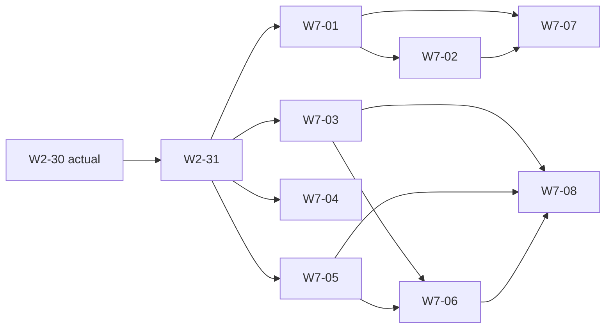

# W2-31 G7-A 客服与通知通道正式八包分配

| 项 | 内容 |
| --- | --- |
| 改了什么 | 将G7-A按实际40 API/7页/7x01分为W7-01…08；同编号甲机制actual后乙消费；三桩补owner、三项误归接收方改G7-B |
| 原因 | M2已交额度/发送/收件机制不能重造；客服21接口拆17+4，槽位无lock_version按真实状态事务；support已有出口保留 |
| 影响的包 | W2-31、W7-01…08；G7-B仍由M6拆，组包数仍8，不改里程碑/metadata/DDL/默认/退出条件 |
| 类别 | 拆包与接收归属勘误 |
| PR | 本地codex/w2-31-g7a-taskbooks；作者普通提交交ROOT唯一审查与合流，无远端操作 |

## 1. 基线与范围

actual main bb692e5c：W2-30已完成正式十连/真实CLI并合流。八编号开工核无占用，后继均未开工。
API取generated/routes.json的M7 V1.0；页面取官方pages登记；x01取x01-map。现有8包估算不变。
只有文档，不落地API/页/处理器，不改任何业务桩状态；后续G7-B不预先编实现任务。

## 2. 八包与依赖

| 编号 / 临时包 | 工作内容 | 代码依赖 | 规模 / 级别 | API / 页 / x01 |
| --- | --- | --- | --- | --- |
| W7-01 / A | 客服工单主体、生命周期与三个时限 | W2-31 | L / 乙 | 17/0/4 |
| W7-02 / B | 客服指派、转派与关联业务事件 | W2-31、W7-01 | M / 乙 | 4/0/1 |
| W7-03 / C | 微信模板槽位运营与既有订阅通道补齐 | W2-31 | M / 乙 | 4/0/0 |
| W7-04 / D | 企业微信应用、联系人回调与在线客服能力 | W2-31 | M / 甲（必要验签甲机制PR→乙消费PR） | 2/0/1 |
| W7-05 / E | 短信回执、投递日志与人工重发 | W2-31 | L / 甲（必要验签甲机制PR→乙消费PR） | 3/0/1 |
| W7-06 / F | 通知场景与短信模板运营配置 | W2-31、W7-03、W7-05 | L / 乙 | 10/0/0 |
| W7-07 / G | 客服工单后台与商家四页 | W2-31、W7-01、W7-02 | M / 丙 | 0/4/0 |
| W7-08 / H | 通知模板、发送日志与通道配置三页 | W2-31、W7-03、W7-05、W7-06 | L / 丙 | 0/3/0 |

A提供自身17接口实际消费的工单核心/初始ref校验/在办来源；B仅追加四路由、onBizEvent/S3，不循环。
D/E必要新增验签/解密机制同编号独立甲PR actual后乙PR消费，机制PR不夹业务；整包都actual才完成。
M2未配置通道保既有受控结果，不把E9/E10/E12/E18/V14/V15当全部代码包前置。

## 3. API唯一集合（40）

| operationId | method / path | 唯一owner |
| --- | --- | --- |
| `m.serviceManager.get` | GET `/m/service-manager` | W7-01 |
| `m.serviceTicket.confirm` | POST `/m/service-tickets/{serviceTicketId}/confirm` | W7-01 |
| `m.serviceTicket.create` | POST `/m/service-tickets` | W7-01 |
| `m.serviceTicket.entry.create` | POST `/m/service-tickets/{serviceTicketId}/entries` | W7-01 |
| `m.serviceTicket.get` | GET `/m/service-tickets/{serviceTicketId}` | W7-01 |
| `m.serviceTicket.list` | GET `/m/service-tickets` | W7-01 |
| `m.serviceTicket.reopen` | POST `/m/service-tickets/{serviceTicketId}/reopen` | W7-01 |
| `m.serviceTicket.withdraw` | POST `/m/service-tickets/{serviceTicketId}/withdraw` | W7-01 |
| `admin.serviceTicket.close` | POST `/admin/service-tickets/{serviceTicketId}/close` | W7-01 |
| `admin.serviceTicket.create` | POST `/admin/service-tickets` | W7-01 |
| `admin.serviceTicket.entry.create` | POST `/admin/service-tickets/{serviceTicketId}/entries` | W7-01 |
| `admin.serviceTicket.forceTransition` | POST `/admin/service-tickets/{serviceTicketId}/force-transition` | W7-01 |
| `admin.serviceTicket.get` | GET `/admin/service-tickets/{serviceTicketId}` | W7-01 |
| `admin.serviceTicket.list` | GET `/admin/service-tickets` | W7-01 |
| `admin.serviceTicket.submitResult` | POST `/admin/service-tickets/{serviceTicketId}/submit-result` | W7-01 |
| `admin.serviceTicket.summary` | GET `/admin/service-tickets/summary` | W7-01 |
| `admin.serviceTicket.update` | PATCH `/admin/service-tickets/{serviceTicketId}` | W7-01 |
| `admin.serviceTicket.assign` | POST `/admin/service-tickets/{serviceTicketId}/assign` | W7-02 |
| `admin.serviceTicket.reassign` | POST `/admin/service-tickets/{serviceTicketId}/reassign` | W7-02 |
| `admin.serviceTicket.ref.create` | POST `/admin/service-tickets/{serviceTicketId}/refs` | W7-02 |
| `admin.serviceTicket.ref.batchRemove` | POST `/admin/service-tickets/{serviceTicketId}/refs/remove` | W7-02 |
| `admin.wxTemplateSlot.disable` | POST `/admin/wx-template-slots/{slotKey}/disable` | W7-03 |
| `admin.wxTemplateSlot.enable` | POST `/admin/wx-template-slots/{slotKey}/enable` | W7-03 |
| `admin.wxTemplateSlot.list` | GET `/admin/wx-template-slots` | W7-03 |
| `admin.wxTemplateSlot.update` | PATCH `/admin/wx-template-slots/{slotKey}` | W7-03 |
| `hooks.wecom.event.receive` | POST `/hooks/wecom/events` | W7-04 |
| `hooks.wecom.event.verify` | GET `/hooks/wecom/events` | W7-04 |
| `admin.notificationDelivery.list` | GET `/admin/notification-deliveries` | W7-05 |
| `admin.notificationDelivery.resend` | POST `/admin/notification-deliveries/{notificationDeliveryId}/resend` | W7-05 |
| `hooks.sms.statusReport.receive` | POST `/hooks/sms/status-reports` | W7-05 |
| `admin.notifyScene.disable` | POST `/admin/notify-scenes/{sceneKey}/disable` | W7-06 |
| `admin.notifyScene.enable` | POST `/admin/notify-scenes/{sceneKey}/enable` | W7-06 |
| `admin.notifyScene.list` | GET `/admin/notify-scenes` | W7-06 |
| `admin.notifyScene.summary` | GET `/admin/notify-scenes/summary` | W7-06 |
| `admin.notifyScene.testSend` | POST `/admin/notify-scenes/{sceneKey}/test-send` | W7-06 |
| `admin.notifyScene.update` | PATCH `/admin/notify-scenes/{sceneKey}` | W7-06 |
| `admin.smsTemplate.list` | GET `/admin/sms-templates` | W7-06 |
| `admin.smsTemplate.summary` | GET `/admin/sms-templates/summary` | W7-06 |
| `admin.smsTemplate.testSend` | POST `/admin/sms-templates/{templateKey}/test-send` | W7-06 |
| `admin.smsTemplate.update` | PATCH `/admin/sms-templates/{templateKey}` | W7-06 |

这里只改任务分配，不改M7/V1.0归属；verify GET是API，不再计x01。FAQ/快捷回复/内部health/export均不在集合。

## 4. 页面唯一集合（7）

| page key | 正式route | 唯一owner |
| --- | --- | --- |
| `service.tickets` | `/service/tickets` | W7-07 |
| `service.ticket_detail` | `/service/tickets/$ticketNo` | W7-07 |
| `sub/service/service/index` | `sub/service/service/index` | W7-07 |
| `sub/service/ticket/index` | `sub/service/ticket/index` | W7-07 |
| `ops.templates` | `/ops/templates` | W7-08 |
| `ops.notify_logs` | `/ops/notify-logs` | W7-08 |
| `ops.channels` | `/ops/channels` | W7-08 |

M30提交弹层与TicketDone解决态仍原页；5后台+2小程序，页面登记metadata不在本拆包改。

## 5. x01唯一集合（7）

| 登记名 | 类别 | 唯一owner |
| --- | --- | --- |
| `support.onCalendarImported` | 订阅者 | W7-01 |
| `service.auto_resolve` | 定时器 | W7-01 |
| `service.first_response_due` | 定时器 | W7-01 |
| `service.solution_due` | 定时器 | W7-01 |
| `support.onBizEvent` | 订阅者 | W7-02 |
| `hooks.wecom.event.receive` | 回调 | W7-04 |
| `hooks.sms.statusReport.receive` | 回调 | W7-05 |

客服三个timer键/critical及事件载荷照x01；不拿analytics.fromOutbox/reports.onMonthClosed/export/内网flow凑数。

## 6. 现有桩与公口接收

| 已有移交 | 接收owner | 本次处理 |
| --- | --- | --- |
| m7-identity-overview-support；profile.admin_facts.support | W7-01 | 工单同口径事实/overview/profile/summary接A，桩仍留桩中 |
| m7-identity-bootstrap-support；m7-identity-wecom-contact-backfill | W7-04 | 在线客服能力与unionid回填，两个桩仅补owner |
| m7-order-todos | M7 G7-B（待M6拆编号） | 只改接收owner，不改内容/状态/里程碑 |
| m7-order-analytics-consumer | M7 G7-B（待M6拆编号） | 只改接收owner，不据文档关桩 |
| m7-publish-outbox-analytics | M7 G7-B（待M6拆编号） | 只改接收owner，真实派生消费者后继实现 |

support已有registration/PII、countStoreServiceTicketHistory、store-draft-facts、createAdCancelApprovalRefCompanion不是空出口；A/B必须保留caller事务和现有接线。
C只新增槽位运营四接口，沿M2额度/上报/下发；F只六场景+四SMS。槽位不发明lockVersion，场景按真实lockVersion/CAS。
D应用/联系人与已合群机器人能力分开；回执只写receipt事实，sent仅受理。未知结果/真实平台未验保留。

## 7. 交付和验证边界

八本九节/90–170行；乙≤20 API、丙≤8页；新并发只3–5参与者/3轮、纯目标3–5聚合，旧完整验收留专用CI。
新增测试路径/DTO/注册owner见各任务；机制前置独立actual，页面仅消费已合契约与M2冻结构件。
本包只跑状态/计划/registry/pages/contract静态官方检查及/tmp集合/无环核对，不跑业务/DB/build/真实通道。
W2-31完成仅表示拆包可开工，不表示客服/通知通道或G7-B/M7整体实现；作者不push/PR/合main。
